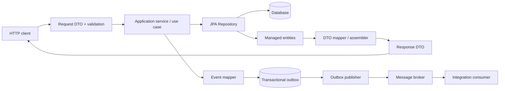

# Chuyển mô hình persistence sang DTO trước khi trao đổi ra ngoài

Một ứng dụng Spring Boot thường dùng JPA/Hibernate để ánh xạ bảng quan hệ thành `@Entity`, quản lý persistence context, dirty checking và quan hệ giữa các bảng. Tuy nhiên, đối tượng entity không phải là hợp đồng dữ liệu phù hợp để gửi trực tiếp qua HTTP, broker thông điệp, cache chia sẻ hoặc adapter Spring Integration. Đối tượng đó mang theo thông tin về cách lưu trữ, trạng thái tải quan hệ, đôi khi có cả các trường nội bộ mà bên nhận không cần biết.

Trong chương **JPA và Hibernate** của module `SPRING_BOOT_INTEGRATION`, bài học này hướng dẫn cách chuyển mô hình persistence sang **Data Transfer Object (DTO)** tại ranh giới tích hợp. Đây là kỹ năng quan trọng khi xây dựng Spring Boot tích hợp HTTP client, database, cache, message broker và các adapter Spring Integration: một hợp đồng dữ liệu rõ ràng sẽ giúp kiểm soát thay đổi schema, giao dịch, bảo mật trường dữ liệu, retry, xử lý trùng lặp và kiểm thử.

Mục tiêu sau bài học:

- Phân biệt `Entity`, mô hình nghiệp vụ, DTO cho REST, DTO cho message và dữ liệu cache.
- Xác định nơi truy vấn và ánh xạ entity thành DTO trước khi kết thúc transaction.
- Chọn chiến lược tải dữ liệu để tránh `LazyInitializationException`, N+1 và truy vấn quá nhiều.
- Thiết kế DTO phù hợp hợp đồng tích hợp, versioning và bảo vệ thông tin nhạy cảm.
- Kiểm chứng bằng unit test, integration test và contract test ở đúng ranh giới.

## 1. Vì sao không nên trả thẳng entity JPA?

Giả sử API `GET /api/v1/orders/{id}` trả trực tiếp một `PurchaseOrder` entity. Khi Jackson serialize entity thành JSON, nhiều vấn đề có thể xảy ra:

| Vấn đề | Biểu hiện | Hậu quả |
| --- | --- | --- |
| Lộ chi tiết persistence | JSON xuất hiện `internalNote`, `costPrice`, trường khóa nội bộ | Rò rỉ thông tin, phụ thuộc giữa API và schema. |
| Quan hệ lazy | Serializer gọi `getLines()` sau khi persistence context đã đóng | `LazyInitializationException` hoặc response lỗi 500. |
| N+1 query | Serializer đi qua nhiều quan hệ trên danh sách đơn hàng | Một request kích hoạt hàng chục/hàng trăm SQL ngoài dự tính. |
| Quan hệ hai chiều | `order.lines[].order.lines[]...` | Đệ quy/cycle, payload rất lớn hoặc lỗi serialization. |
| Hibernate proxy | Jackson gặp proxy/enhancement thay vì POJO thông thường | JSON phụ thuộc Hibernate module hoặc hành vi proxy. |
| Thay đổi schema | Đổi tên property, thêm quan hệ, thêm field persistence | API hoặc event contract thay đổi ngoài ý muốn. |
| Vòng đời entity | Entity còn được quản lý bởi persistence context | Vô tình thay đổi dữ liệu qua setter/dirty checking trong một giao dịch. |
| Khó versioning | Cùng entity được gửi cho nhiều consumer | Khó duy trì REST v1 và event v2 đồng thời. |

Thêm `@JsonIgnore` vào vài trường entity có thể giảm một số vấn đề, nhưng vẫn để hợp đồng bên ngoài phụ thuộc vào mã persistence, lazy loading và cách quan hệ được cấu hình. **Entity là mô hình quản lý dữ liệu của ứng dụng; DTO là dữ liệu có chủ đích được phép vượt ranh giới.**

## 2. Phân biệt các loại mô hình

| Loại | Mục đích | Ví dụ | Có nên ra ngoài process? |
| --- | --- | --- | --- |
| JPA entity | Lưu/truy vấn bằng Hibernate, biểu diễn quan hệ và trạng thái persistence | `PurchaseOrder`, `OrderLine` | Không gửi trực tiếp. |
| Command/use-case input | Đầu vào nghiệp vụ đã được kiểm tra và diễn giải | `PlaceOrderCommand` | Chủ yếu dùng trong ứng dụng. |
| API request DTO | Hợp đồng client gửi vào | `CreateOrderRequestV1` | Có, chỉ chứa trường client được phép cấp. |
| API response DTO | Hợp đồng server trả về | `OrderResponseV1` | Có, trường được công khai và ổn định. |
| Event/message DTO | Hợp đồng bất đồng bộ với consumer | `OrderPlacedV1` | Có, thường có `eventId` và `schemaVersion`. |
| Query projection/read model | Chỉ lấy các cột cần thiết cho màn hình hoặc truy vấn | `OrderSummaryRow` | Thường là mô hình nội bộ, có thể ánh xạ tiếp ra API DTO. |
| Cache value DTO | Bản chụp dữ liệu đã chọn để cache | `CachedOrderSummaryV1` | Có thể trao đổi qua Redis/cache chia sẻ, cần version/TTL. |

Một entity có thể được chuyển thành **nhiều DTO khác nhau** tùy người nhận: REST chi tiết đơn hàng, event xác nhận đơn hàng, export báo cáo, hoặc payload gửi đối tác vận chuyển. Các hợp đồng đó có vòng đời và quyền truy cập khác nhau, vì vậy không nên dùng một DTO “chung cho mọi nơi” chỉ vì cùng xuất phát từ một entity.

## 3. Ranh giới đề xuất trong một Spring Boot integration



Điểm then chốt:

1. **Request DTO → command:** kiểm tra cú pháp/hợp đồng đầu vào, rồi chuyển thành yêu cầu nghiệp vụ. Không bind thẳng request vào entity.
2. **Repository → entity:** JPA dùng entity để quản lý dữ liệu và transaction. Repository không phải nơi định nghĩa hợp đồng HTTP bên ngoài.
3. **Entity → response DTO:** mapping diễn ra khi dữ liệu cần thiết đã được tải, thường bên trong một transaction chỉ đọc của application service.
4. **Entity/domain result → event DTO:** snapshot sự kiện được tạo từ các giá trị đã xác nhận; ghi outbox trong cùng transaction với thay đổi dữ liệu nghiệp vụ.
5. **DTO → JSON/AMQP/Kafka/cache:** các tầng transport serialize đối tượng không còn phụ thuộc persistence context hoặc proxy của Hibernate.

Sơ đồ thể hiện đường đi logic; trong hệ thống thực tế lớp domain/service có thể sử dụng aggregate, projection hoặc nhiều repository. Điều bất biến là **adapter công khai hợp đồng DTO của chính nó**, thay vì trả nguyên entity qua ranh giới.

## 4. Ví dụ persistence model: đơn hàng và dòng hàng

Giả sử dịch vụ lưu đơn hàng tại PostgreSQL. Entity chứa thông tin nghiệp vụ, dữ liệu nội bộ và quan hệ với nhiều dòng hàng.

```java
package com.example.orders.persistence;

import jakarta.persistence.*;
import java.time.Instant;
import java.util.ArrayList;
import java.util.List;
import java.util.UUID;

@Entity
@Table(name = "purchase_orders")
public class PurchaseOrder {
    @Id
    private UUID id;

    @Enumerated(EnumType.STRING)
    @Column(nullable = false)
    private OrderStatus status;

    @Column(name = "total_minor", nullable = false)
    private long totalMinor;

    @Column(name = "customer_ref", nullable = false)
    private String customerReference;

    @Column(name = "internal_note")
    private String internalNote;

    @Column(name = "created_at", nullable = false)
    private Instant createdAt;

    @Version
    private long version;

    @OneToMany(mappedBy = "order", fetch = FetchType.LAZY)
    private List<OrderLine> lines = new ArrayList<>();

    protected PurchaseOrder() { }

    public UUID getId() { return id; }
    public OrderStatus getStatus() { return status; }
    public long getTotalMinor() { return totalMinor; }
    public Instant getCreatedAt() { return createdAt; }
    public List<OrderLine> getLines() { return lines; }
}
```

```java
package com.example.orders.persistence;

import jakarta.persistence.*;

@Entity
@Table(name = "order_lines")
public class OrderLine {
    @Id
    private Long id;

    @ManyToOne(fetch = FetchType.LAZY)
    @JoinColumn(name = "order_id", nullable = false)
    private PurchaseOrder order;

    @Column(nullable = false)
    private String sku;

    @Column(nullable = false)
    private int quantity;

    @Column(name = "unit_price_minor", nullable = false)
    private long unitPriceMinor;

    protected OrderLine() { }

    public String getSku() { return sku; }
    public int getQuantity() { return quantity; }
    public long getUnitPriceMinor() { return unitPriceMinor; }
}
```

Ví dụ trên chỉ thể hiện các trường cần cho bài học: `OrderStatus`, constructor tạo đơn hàng, logic invariant và các phương thức cập nhật thuộc về domain/persistence sẽ được định nghĩa riêng trong dự án. Để lưu aggregate mới có `OrderLine`, cần cấu hình cascade hoặc lưu dòng hàng qua repository tương ứng; không mặc định `@OneToMany` ở ví dụ sẽ tự persist các dòng hàng.

Không muốn lộ `internalNote`, `customerReference` hay `version` trong response public không đồng nghĩa phải xóa các trường đó khỏi entity: persistence cần dữ liệu để xử lý, còn DTO quyết định **những gì được truyền đi**.

## 5. Thiết kế DTO có hợp đồng rõ ràng

Với Java 17+ và Spring Boot 3.x, `record` phù hợp nhiều DTO chỉ đọc, vì các trường được khai báo tường minh và không có setter:

```java
package com.example.orders.api.dto;

import java.time.Instant;
import java.util.List;
import java.util.UUID;

public record OrderLineResponseV1(
        String sku,
        int quantity,
        long unitPriceMinor) {
}

public record OrderResponseV1(
        UUID id,
        String status,
        long totalMinor,
        String currency,
        Instant createdAt,
        List<OrderLineResponseV1> lines) {
    public OrderResponseV1 {
        lines = List.copyOf(lines);
    }
}
```

Ở đây response **không có** `internalNote`, `customerReference`, optimistic `version` và khóa nội bộ của `OrderLine`. Một trường hợp đồng API có thể được thêm vào DTO khi thực sự cần công khai, sau bước đánh giá quyền truy cập và tương thích consumer.

Quy ước `totalMinor`/`unitPriceMinor` biểu diễn số tiền nguyên theo đơn vị nhỏ nhất, tránh sai số `double` trong trao đổi tiền tệ. Hợp đồng cần nói rõ đơn vị cho `VND` và các loại tiền có số chữ số thập phân khác nhau; `currency` phải được xác định từ dữ liệu nghiệp vụ, **không tự gán `"VND"` trong mapper nếu database chứa nhiều loại tiền**. Ở ví dụ này giả định dịch vụ chỉ xử lý VND; khi hỗ trợ đa tiền tệ cần lưu currency trong mô hình nghiệp vụ và ánh xạ theo đơn hàng.

`List.copyOf()` giúp tránh việc caller sửa chính danh sách DTO và từ chối phần tử `null`; các record dòng hàng chỉ chứa giá trị bất biến. Nếu dùng DTO có nested mutable object, phải xem xét việc tạo defensive copy sâu hơn.

### Khi nào cần DTO riêng?

Ví dụ các endpoint cùng sử dụng dữ liệu đơn hàng:

| Endpoint/message | DTO | Vì sao tách? |
| --- | --- | --- |
| `GET /api/v1/orders/{id}` | `OrderResponseV1` | Cần nhiều dòng hàng, trạng thái và tổng tiền. |
| `GET /api/v1/orders` | `OrderSummaryResponseV1` | Cần các cột tóm tắt, không tải toàn bộ dòng hàng. |
| `POST /api/v1/orders` | `CreateOrderRequestV1` | Dữ liệu đầu vào phải được validate, không chứa trường server quản lý. |
| Event `order.placed.v1` | `OrderPlacedV1` | Consumer cần eventId, version và bản chụp dữ liệu cần thiết. |
| Request đến đối tác giao vận | `ShipmentRequestV2` | Theo hợp đồng và phạm vi dữ liệu của đối tác, độc lập REST API. |

Tên version trong DTO là một lựa chọn tổ chức, không phải yêu cầu của JPA. Có thể đặt version ở namespace/event type/API path thay vì tên lớp; điều quan trọng là không làm hợp đồng bên ngoài biến đổi ngầm khi entity thay đổi.

## 6. Viết mapper thủ công để kiểm soát từng trường

Mapper rõ ràng giúp reviewer biết chính xác những dữ liệu nào rời khỏi lớp persistence.

```java
package com.example.orders.application;

import com.example.orders.api.dto.OrderLineResponseV1;
import com.example.orders.api.dto.OrderResponseV1;
import com.example.orders.persistence.PurchaseOrder;
import java.util.List;
import org.springframework.stereotype.Component;

@Component
public class OrderResponseMapper {

    public OrderResponseV1 toResponse(PurchaseOrder order) {
        List<OrderLineResponseV1> lines = order.getLines().stream()
                .map(line -> new OrderLineResponseV1(
                        line.getSku(),
                        line.getQuantity(),
                        line.getUnitPriceMinor()))
                .toList();

        return new OrderResponseV1(
                order.getId(),
                order.getStatus().name(),
                order.getTotalMinor(),
                "VND", // Ví dụ đơn tiền tệ; sản phẩm đa tiền phải ánh xạ từ domain.
                order.getCreatedAt(),
                lines);
    }
}
```

Mapper này truy cập `order.getLines()` nên yêu cầu collection đã được tải hoặc còn persistence context cho phép tải. Dùng mapper thủ công không tự loại bỏ lazy loading hoặc N+1. Cách truy vấn và thời điểm gọi mapper quyết định số SQL thực thi.

Trong dự án lớn, MapStruct có thể sinh code ánh xạ ở thời điểm compile và phát hiện sai lệch trường tốt hơn reflection mapper. Ví dụ cấu hình:

```java
import org.mapstruct.Mapper;
import org.mapstruct.Mapping;
import org.mapstruct.ReportingPolicy;

@Mapper(
        componentModel = "spring",
        unmappedTargetPolicy = ReportingPolicy.ERROR)
public interface OrderResponseMapStructMapper {
    @Mapping(target = "currency", constant = "VND")
    OrderResponseV1 toResponse(PurchaseOrder order);
}
```

Đoạn MapStruct minh họa **chỉ nên dùng khi mô hình nguồn và DTO đã thống nhất kiểu/trường**: MapStruct còn phải biết cách map `OrderLine → OrderLineResponseV1` và `OrderStatus → String`; dự án có thể cần khai báo mapping phương thức tường minh, ví dụ `OrderLineResponseV1 toLineResponse(OrderLine line)` và chuyển enum. Với mã ví dụ đang dùng, mapper thủ công phía trên là lựa chọn ít mơ hồ hơn. `ReportingPolicy.ERROR` hữu ích vì khiến trường đích mới không được ánh xạ phải được xem xét, nhưng vẫn không phát hiện tự động việc nguồn vô tình lộ dữ liệu được ánh xạ vào một trường đích hợp lệ.

Tránh ánh xạ tự động toàn bộ field bằng `BeanUtils.copyProperties(entity, response)` hoặc dùng generic reflection mapper cho những hợp đồng public nhạy cảm. Đối với DTO, **danh sách field được phép ra ngoài** nên được quyết định bằng code hoặc mapping rule rõ ràng.

## 7. Thực hiện mapping trong transaction chỉ đọc

Mô hình thường dùng:

```java
package com.example.orders.application;

import com.example.orders.api.dto.OrderResponseV1;
import com.example.orders.persistence.PurchaseOrder;
import com.example.orders.persistence.PurchaseOrderRepository;
import java.util.UUID;
import org.springframework.stereotype.Service;
import org.springframework.transaction.annotation.Transactional;

@Service
public class OrderQueryService {
    private final PurchaseOrderRepository repository;
    private final OrderResponseMapper mapper;

    public OrderQueryService(
            PurchaseOrderRepository repository,
            OrderResponseMapper mapper) {
        this.repository = repository;
        this.mapper = mapper;
    }

    @Transactional(readOnly = true)
    public OrderResponseV1 getOrder(UUID id) {
        PurchaseOrder order = repository.findDetailedById(id)
                .orElseThrow(() -> new OrderNotFoundException(id));
        return mapper.toResponse(order);
    }
}
```

`OrderNotFoundException` là exception của ứng dụng để ánh xạ thành HTTP 404. Controller nhận **DTO đã tách khỏi JPA**:

```java
@RestController
@RequestMapping("/api/v1/orders")
public class OrderController {
    private final OrderQueryService service;

    public OrderController(OrderQueryService service) {
        this.service = service;
    }

    @GetMapping("/{id}")
    public OrderResponseV1 get(@PathVariable UUID id) {
        return service.getOrder(id);
    }
}
```

Khi method service trả về, transaction và persistence context gắn với lượt truy vấn có thể đã đóng. Jackson chỉ serialize các trường DTO đã được materialize, vì vậy không kích hoạt Hibernate lazy load qua entity nữa.

### Vì sao đặt mapping ở service?

- Service có thể xác định transaction boundary và chính sách truy vấn cho use case.
- Repository tập trung truy vấn/ghi entity hoặc projection; controller tập trung HTTP request/response.
- Có thể dùng lại mapper cho một application result nhưng tạo DTO khác cho từng outbound adapter.
- Khi tắt Open Session in View, response vẫn serialize được vì mọi giá trị cần dùng đã được nạp trước.

Thiết lập thường được khuyến nghị với REST API:

```yaml
spring:
  jpa:
    open-in-view: false
```

`open-in-view: false` giúp bộc lộ sớm chỗ serializer hoặc controller còn phụ thuộc lazy loading. Nó **không tự sửa** truy vấn; entity association cần thiết phải được tải trong service. Với ứng dụng có nhiều `EntityManagerFactory`, cần kiểm tra transaction manager tương ứng và nơi cấu hình Open Session in View cho từng persistence context.

## 8. Tải dữ liệu cần thiết bằng EntityGraph, join fetch hoặc projection

Nếu chỉ gọi repository `findById(id)` và `lines` đang lazy, mapper có thể phát sinh thêm SQL trong transaction. Với một đơn hàng chi tiết, một truy vấn có fetch plan rõ ràng thường phù hợp:

```java
package com.example.orders.persistence;

import java.util.Optional;
import java.util.UUID;
import org.springframework.data.jpa.repository.EntityGraph;
import org.springframework.data.jpa.repository.JpaRepository;
import org.springframework.data.jpa.repository.Query;
import org.springframework.data.repository.query.Param;

public interface PurchaseOrderRepository
        extends JpaRepository<PurchaseOrder, UUID> {

    @EntityGraph(attributePaths = "lines")
    @Query("select o from PurchaseOrder o where o.id = :id")
    Optional<PurchaseOrder> findDetailedById(@Param("id") UUID id);
}
```

`@EntityGraph(attributePaths = "lines")` báo cho provider biết cần tải collection dòng hàng phục vụ DTO. Với **một** đơn hàng và số dòng hàng hợp lý, cách này có thể giảm truy vấn phụ. Tuy nhiên, không dùng fetch join to-many bừa bãi trong một truy vấn phân trang nhiều đơn: join tạo nhiều hàng SQL cho mỗi order, có thể làm kết quả/giới hạn phân trang không như mong đợi, hoặc khiến Hibernate phải phân trang trong memory.

### DTO cho trang danh sách: projection thay vì tải aggregate lớn

Khi trang danh sách chỉ cần `id`, trạng thái, tiền và thời gian, không cần tải `lines`:

```java
package com.example.orders.query;

import com.example.orders.persistence.OrderStatus;
import java.time.Instant;
import java.util.UUID;

public interface OrderSummaryRow {
    UUID getId();
    OrderStatus getStatus();
    long getTotalMinor();
    Instant getCreatedAt();
}
```

```java
Page<OrderSummaryRow> findByCustomerReference(
        String customerReference, Pageable pageable);
```

Phương thức repository trên được khai báo trong `PurchaseOrderRepository`; Spring Data JPA có thể tạo interface-based projection theo tên getter. Lớp ứng dụng chuyển `OrderSummaryRow` sang `OrderSummaryResponseV1` của API:

```java
public record OrderSummaryResponseV1(
        UUID id, String status, long totalMinor, Instant createdAt) {
}

@Transactional(readOnly = true)
public Page<OrderSummaryResponseV1> listOrders(
        String customerReference, Pageable pageable) {
    return repository.findByCustomerReference(customerReference, pageable)
            .map(row -> new OrderSummaryResponseV1(
                    row.getId(),
                    row.getStatus().name(),
                    row.getTotalMinor(),
                    row.getCreatedAt()));
}
```

Các đoạn này là thành phần của service/repository được trình bày rút gọn; cần các import `Page`, `Pageable`, annotation và package thực tế khi đưa vào mã chạy. Nếu `customerReference` là dữ liệu nhạy cảm, không cho phép client tùy ý cung cấp nó để đọc đơn của người khác; lấy phạm vi truy cập từ danh tính đã xác thực và kiểm tra quyền ở application service.

Với query trả rất nhiều bản ghi, projection giảm lượng dữ liệu đọc và giảm rủi ro N+1. Dù là interface projection hay constructor projection, hãy kiểm chứng SQL thực tế do Hibernate sinh ra; cách khai báo getter/quan hệ lồng nhau có thể ảnh hưởng joins.

### Chọn chiến lược nào?

| Nhu cầu | Chiến lược đề xuất | Cần cảnh giác |
| --- | --- | --- |
| Chi tiết một order gồm vài dòng hàng | `@EntityGraph`/fetch join rồi map trong transaction | Payload lớn, số collection tải, trùng dòng ở SQL join. |
| Danh sách order có phân trang | Projection chỉ các cột cần | To-many fetch join với paging, count query. |
| Trang tổng hợp nhiều aggregate | Query DTO/read model chuyên biệt | Chậm do join lớn; cân nhắc preaggregation/read model. |
| Gửi event đã có đủ dữ liệu trong command/domain result | Tạo event DTO từ dữ liệu nghiệp vụ đã xác nhận | Không truy vấn lại vô lý hoặc serialize entity lazy. |
| Export rất nhiều hàng | Batch/stream DTO hoặc JDBC projection | Memory, transaction kéo dài, cursor và backpressure. |

## 9. N+1 và lỗi LazyInitializationException phải được xử lý ở tầng truy vấn

Ví dụ anti-pattern:

```java
List<PurchaseOrder> orders = repository.findAll();
return orders.stream().map(mapper::toResponse).toList();
```

Nếu mỗi order có `lines` lazy, một SQL lấy danh sách order có thể kéo theo một SQL cho `lines` của từng order: **1 + N query**. Thậm chí khi transaction còn mở và không có exception, response vẫn có thể rất chậm.

Chẩn đoán bằng SQL log, thống kê Hibernate, tracing JDBC hoặc công cụ profiling. Ở môi trường test có thể bật:

```yaml
spring:
  jpa:
    properties:
      hibernate:
        generate_statistics: true
logging:
  level:
    org.hibernate.SQL: DEBUG
```

Hạn chế log bind parameter chứa dữ liệu nhạy cảm. Số query là một tín hiệu, nhưng mục tiêu cuối là latency, dữ liệu truyền và sử dụng connection hợp lý.

Một số cách giải quyết:

1. Dùng projection cho list view chỉ cần vài cột.
2. Dùng fetch graph có chủ đích cho một aggregate nhỏ, tránh tải nhiều collection cùng lúc.
3. Với dữ liệu lớn, tách làm hai bước: lấy một trang IDs/summary, rồi lấy các dòng hàng của những IDs đó bằng query riêng và nhóm vào DTO.
4. Cân nhắc batch fetching (`hibernate.default_batch_fetch_size` hoặc `@BatchSize`) khi thích hợp và sau khi đã đo SQL.
5. Không dựa vào Jackson Hibernate module để “tự giải quyết” lazy; đó là quyết định serialization, không thay thế thiết kế fetch plan.

`LazyInitializationException` thường báo rằng code đã dùng một quan hệ chưa tải ở ngoài session. Cách sửa phải là xác định trường DTO cần gì và tải đúng trường đó **trước khi rời transaction**, thay vì chỉ bật Open Session in View để che vấn đề.

## 10. Chuyển request DTO thành command, không nhận entity từ client

Một request tạo đơn hàng không được gửi kèm `status`, `internalNote`, `version` hay `totalMinor` do server quyết định. DTO đầu vào khai báo chính xác các trường được chấp nhận:

```java
package com.example.orders.api.dto;

import jakarta.validation.Valid;
import jakarta.validation.constraints.Min;
import jakarta.validation.constraints.NotBlank;
import jakarta.validation.constraints.NotEmpty;
import java.util.List;

public record CreateOrderItemV1(
        @NotBlank String sku,
        @Min(1) int quantity) {
}

public record CreateOrderRequestV1(
        @NotEmpty List<@Valid CreateOrderItemV1> items) {
}
```

Controller validate request và chuyển sang command:

```java
@PostMapping
public ResponseEntity<OrderResponseV1> create(
        @Valid @RequestBody CreateOrderRequestV1 request) {

    PlaceOrderCommand command = new PlaceOrderCommand(
            request.items().stream()
                    .map(i -> new PlaceOrderItem(i.sku(), i.quantity()))
                    .toList());

    OrderResponseV1 created = applicationService.placeOrder(command);
    return ResponseEntity
            .created(URI.create("/api/v1/orders/" + created.id()))
            .body(created);
}
```

Trong ví dụ, `PlaceOrderCommand` và `PlaceOrderItem` là record nội bộ của ứng dụng, được định nghĩa trong lớp application; `applicationService.placeOrder()` kiểm tra sản phẩm, quyền truy cập, giá và tồn kho bằng dữ liệu tin cậy rồi tạo entity. DTO request **không chứa giá bán do client tự quyết định**, tránh lỗi mass assignment/overposting.

Bean Validation (`@NotEmpty`, `@Min`) kiểm tra cấu trúc đầu vào, còn business validation (SKU hợp lệ, giới hạn đặt hàng, trạng thái khách, quyền sở hữu đơn) thuộc use case. `@Valid` cần có Spring Validation starter và được đặt tại controller parameter như minh họa.

Với HTTP PATCH/PUT, hãy thiết kế rõ semantics: trường vắng mặt khác gì `null`, cập nhật một phần khác gì thay thế toàn bộ, kiểm tra version/ETag để tránh lost update. Không dùng cách `repository.save(objectMapper.convertValue(request, Entity.class))` cho request public; cách đó dễ cho phép client ghi các trường không được phép hoặc vô tình xóa quan hệ.

## 11. Tạo event DTO để gửi qua broker

Trong các luồng tích hợp có RabbitMQ, Kafka hoặc Spring Integration outbound adapter, **event là hợp đồng bất đồng bộ**. Một consumer không có persistence context của producer; vì vậy gửi entity/proxy Hibernate là không phù hợp.

Ví dụ event khi đơn hàng được đặt:

```java
package com.example.orders.events;

import java.time.Instant;
import java.util.List;
import java.util.UUID;

public record OrderPlacedV1(
        UUID eventId,
        int schemaVersion,
        UUID orderId,
        Instant occurredAt,
        long totalMinor,
        String currency,
        List<OrderItemSnapshotV1> items) {
    public OrderPlacedV1 {
        items = List.copyOf(items);
    }
}

public record OrderItemSnapshotV1(
        String sku,
        int quantity) {
}
```

Mỗi `public` record được lưu ở tệp Java riêng nếu triển khai nguyên mẫu này. `eventId` được tạo một lần cho **sự kiện logic** và giữ nguyên khi retry/publish lại; `orderId` dùng để liên hệ aggregate; `schemaVersion` giúp consumer diễn giải payload. Dữ liệu event được chọn theo nhu cầu consumer, không chép toàn bộ bảng `purchase_orders` hay các trường nhạy cảm.

### Mapping và outbox trong cùng transaction

```java
@Transactional
public UUID placeOrder(PlaceOrderCommand command) {
    PurchaseOrder order = orderFactory.create(command);
    orderRepository.save(order);

    OrderPlacedV1 event = eventMapper.toOrderPlaced(
            order, UUID.randomUUID(), clock.instant());

    outboxWriter.append(event); // INSERT vào cùng database/transaction.
    return order.getId();
}
```

Đoạn trên minh họa orchestration: `orderFactory`, `eventMapper`, `outboxWriter` và `clock` là các dependency của application service, cần được khai báo/implement trong dự án. Giả sử `orderFactory` tạo UUID trước khi `save`, các giá trị cần thiết cho event đã có và mapping chạy trong transaction. Nếu dùng ID do database sinh, hãy bảo đảm ID được cấp trước khi tạo event và đồng thời tránh flush không cần thiết.

`outboxWriter.append(event)` phải ghi **bản snapshot JSON/Avro/Protobuf hoặc dữ liệu có cấu trúc của event DTO** vào bảng outbox trong *cùng transaction local* với đơn hàng. Một publisher riêng đọc outbox sau commit và gửi tới broker; nó đánh dấu đã publish khi nhận được xác nhận phù hợp. Publisher có thể gửi lặp nếu crash giữa publish và cập nhật outbox, vì vậy consumer phải idempotent theo `eventId`.

```mermaid
sequenceDiagram
    participant API as Order API
    participant DB as PostgreSQL
    participant Pub as Outbox publisher
    participant MQ as Broker
    participant Con as Consumer
    API->>DB: BEGIN; save order + insert OrderPlacedV1 snapshot
    DB-->>API: COMMIT
    Pub->>DB: Poll committed outbox rows
    DB-->>Pub: Event DTO snapshot
    Pub->>MQ: Publish event
    MQ-->>Pub: Broker confirm
    Pub->>DB: Mark event as published
    MQ->>Con: Deliver OrderPlacedV1
    Con->>Con: Deduplicate eventId + handle
```

**Không** gọi `rabbitTemplate.convertAndSend(entity)` ngay trong transaction rồi cho rằng broker gửi và DB commit là nguyên tử. Nếu DB rollback sau khi broker đã nhận message, consumer có thể thấy một sự kiện về đơn hàng không tồn tại. DTO giải quyết ranh giới kiểu dữ liệu, còn transactional outbox giải quyết nhất quán giữa ghi DB và ý định phát event.

### Tại sao event không dùng lại OrderResponseV1?

REST response có thể thay đổi cách trình bày nhằm phục vụ UI; event là thông báo một sự kiện đã xảy ra và có thể cần trường `eventId`, `occurredAt`, `schemaVersion`, correlation ID hoặc dữ liệu phục vụ xử lý bất đồng bộ. Dùng chung làm tăng nguy cơ thay đổi UI vô tình phá vỡ consumer. Khi cùng một dữ kiện được công khai ở cả hai nơi, hai mapper vẫn có thể chia sẻ hàm chuyển đổi value object nội bộ, nhưng **hợp đồng đích là độc lập**.

## 12. DTO trong Spring Integration flow và cache

Trong Spring Integration, `Message<?>` có cả payload lẫn headers. Với outbound HTTP/Kafka/AMQP, nên chuẩn hóa payload thành DTO trước khi bước serialize:

```java
@Bean
IntegrationFlow orderNotificationFlow(
        OrderNotificationMapper mapper,
        MessageHandler outboundHandler) {

    return IntegrationFlow.from("ordersForNotification")
            .transform(PurchaseOrder.class, mapper::toNotificationDto)
            .handle(outboundHandler)
            .get();
}
```

Đây là **sơ đồ DSL ở mức minh họa**: `OrderNotificationMapper` và `MessageHandler` được ứng dụng khai báo; `ordersForNotification` là tên channel. Cần bảo đảm entity được map trong một đoạn xử lý có transaction và fetch plan thích hợp. Nếu queue/channel bất đồng bộ chuyển entity ra khỏi thread transaction trước khi chạy `.transform(...)`, lỗi lazy loading có thể xảy ra. Phương án an toàn hơn là **tạo DTO tại application service rồi mới `send()` vào channel bất đồng bộ**:

```java
OrderNotificationV1 notification =
        notificationMapper.fromOrder(order); // transaction đang mở
messageChannel.send(
        MessageBuilder.withPayload(notification)
                .setHeader("eventType", "order.notification.v1")
                .build());
```

Nếu việc gửi vào channel làm downstream chạy ngay, gọi external API trong transaction có thể kéo dài lock/connection; với luồng có yêu cầu độ tin cậy cao, dùng outbox hoặc cơ chế dispatch sau commit. Cách này tránh phụ thuộc thứ tự/luồng thực thi của `DirectChannel` hay `ExecutorChannel`.

Với Redis cache chia sẻ, không serialize entity Hibernate vào cache. Giá trị cache là snapshot DTO có cấu trúc xác định; ví dụ `CachedOrderSummaryV1` với `id`, `status`, `totalMinor`, `updatedAt`, `schemaVersion`. Cần chiến lược key/TTL/invalidation sau commit và khả năng đọc dữ liệu cache cũ khi deploy version mới. Cache DTO không tự bảo đảm dữ liệu tức thời; khi hợp đồng yêu cầu nhất quán, phải quy định cách xử lý stale value.

## 13. Quy tắc hợp đồng dữ liệu khi versioning

Entity/schema có thể thay đổi hàng tuần nhưng API/event vẫn phải tương thích với client và consumer đang chạy phiên bản cũ.

| Thay đổi | Ảnh hưởng nếu serialize entity | Cách dùng DTO để kiểm soát |
| --- | --- | --- |
| Đổi tên cột `customer_ref` | Có thể bị đồng nhất nhầm với tên field JSON | Giữ field hợp đồng như cũ, mapper đổi nguồn. |
| Tách bảng `order_lines` sang cấu trúc mới | Quan hệ entity thay đổi | Giữ `OrderLineResponseV1` với cùng ngữ nghĩa, đổi query/mapper. |
| Thêm `internalNote` vào entity | Có nguy cơ tự xuất hiện trong JSON | DTO không thay đổi cho đến khi chủ động bổ sung field. |
| Thêm thuộc tính optional vào response/event | Có thể phá client strict nếu không thỏa thuận | Xác định default/compatibility rule, cập nhật contract test. |
| Đổi kiểu `totalMinor` thành chuỗi | Có thể làm hỏng JSON consumer | Version contract rõ ràng; không âm thầm đổi kiểu. |
| Đổi ý nghĩa trường `status` | Dễ làm consumer hiểu sai dù JSON vẫn hợp lệ | Version hợp đồng và có migration/adapter khi cần. |
| Đổi `@Enumerated(ORDINAL)` sang `STRING` | Thay đổi persistence nhưng không nhất thiết API | Map enum sang mã public ổn định, không ràng buộc ordinal. |

Nguyên tắc:

- Chọn cách serialize timestamp (`Instant` ISO-8601 UTC), tiền tệ, số lớn, `null`, collection rỗng và enum public một cách nhất quán.
- Không coi việc **thêm field** luôn tương thích: có consumer từ chối unknown property hoặc contract strict.
- Khi dùng Jackson và `record`, kiểm chứng JSON hiện tại qua contract test; annotation như `@JsonProperty` hữu ích nếu tên wire khác tên Java.
- Với event, định nghĩa schema evolution, event type/version và chính sách consumer cũ; xem xét schema registry (Avro/Protobuf/JSON Schema) nếu nền tảng yêu cầu.
- Khi thay đổi ý nghĩa hoặc xóa trường bắt buộc, phát bản hợp đồng mới và để các phiên bản cùng tồn tại trong giai đoạn migration.

DTO giúp **tách nhịp thay đổi** giữa database, producer và consumer. Tuy vậy, DTO riêng không đảm bảo backward compatibility nếu không có quy tắc phát hành và kiểm thử hợp đồng.

## 14. Kiểm soát dữ liệu nhạy cảm và quyền truy cập

Một entity có thể có `email`, số điện thoại, token, giá vốn, ghi chú xử lý khiếu nại, trạng thái gian lận hoặc khóa ngoại tới tenant. Không bao giờ mặc định các trường đó được chia sẻ ra mọi kênh.

Quy trình đề xuất:

1. Xác định đối tượng nhận DTO (khách hàng, nhân viên, đối tác, consumer nội bộ) và phạm vi quyền của họ.
2. Liệt kê **allowlist field** cho từng hợp đồng; các trường nhạy cảm chỉ được thêm khi thực sự có nhu cầu và căn cứ truy cập.
3. Thực hiện authorization dựa trên principal và dữ liệu nghiệp vụ trước khi gọi mapper. DTO không thay thế kiểm tra quyền.
4. Nếu cần mask dữ liệu, thực hiện ở lớp chuyển đổi cho đúng người nhận; tránh sửa entity đang được quản lý chỉ để ẩn giá trị.
5. Không đưa secret, token hoặc toàn bộ entity vào message header, log, trace, DLQ hay cache.
6. Dùng contract test kiểm tra chính xác tập trường JSON, không chỉ kiểm tra `status=200`.

Ví dụ test âm tính rất quan trọng: phản hồi API **không được có** `internalNote`, `version`, `customerReference` hoặc nested `order` reference. Việc các trường không có trong DTO là lớp bảo vệ cấu trúc; vẫn cần authorization vì người dùng có thể truy vấn một `id` thuộc tài khoản khác.

## 15. Những lỗi thường gặp và cách xử lý

| Hiện tượng | Nguyên nhân | Cách xử lý |
| --- | --- | --- |
| `LazyInitializationException` khi trả JSON | Controller/serializer truy cập quan hệ sau khi transaction đóng | Tải quan hệ trong service, map sang DTO trước khi trả về. |
| Trả một danh sách order mất nhiều giây | Mapper lazy load `lines` cho mỗi order (N+1) | Projection cho trang list, batch hoặc query có fetch plan hợp lý. |
| JSON tự thay đổi sau khi thêm cột | API trả entity hoặc generic serialization | Khai báo DTO tường minh, contract test snapshot/JSON schema. |
| Response lộ ghi chú nội bộ | Entity được serialize trực tiếp | Ánh xạ allowlist DTO; thêm kiểm tra thiếu field nhạy cảm. |
| Stack overflow do quan hệ hai chiều | `OrderLine.order` trỏ ngược `PurchaseOrder.lines` | DTO một chiều chỉ chọn dữ liệu cần; không serialize graph entity. |
| Event sau commit thiếu dữ liệu | Mapper chạy async ngoài persistence context | Tạo snapshot DTO trong transaction trước khi enqueue/outbox. |
| Kafka/RabbitMQ consumer nhận Hibernate proxy | Producer gửi entity thay vì event schema | Chuyển thành message DTO/value primitives trước khi publish. |
| Hệ thống đối tác phụ thuộc vào cột DB | Dùng cùng class cho entity và wire model | Định nghĩa DTO riêng theo contract và mapping test. |
| Response sai tổng tiền/đơn vị | Mapper tự tính lại không thống nhất hoặc hard-code currency | Đọc giá trị authoritative từ domain; xác định đơn vị và rounding rule. |
| Client thay đổi trường status/version | Bind request trực tiếp vào entity | Request DTO allowlist → command → domain validation. |
| DTO có entity lồng bên trong | `OrderResponse` chứa `List<OrderLine>` entity | Map toàn bộ nested graph sang nested DTO. |
| DTO map được nhưng không idempotent | Retry phát lại event không giữ eventId | Outbox snapshot + eventId ổn định + consumer deduplication. |
| Test xanh dù REST thật lỗi | `@Transactional` test giữ persistence context mở | Test endpoint khi OSIV tắt và không để test transaction che lazy loading. |

## 16. Kiểm thử mapping và ranh giới tích hợp

Không cần test mọi getter đơn giản, nhưng các hợp đồng dữ liệu và lỗi phát sinh do transaction/fetch plan cần được xác nhận.

### 16.1. Unit test mapper

Khi mapping có phép chuyển enum, đơn vị tiền tệ, làm tròn, mask hoặc chọn field, viết test dữ liệu cụ thể:

```java
@Test
void responseDoesNotExposePersistenceFields() throws Exception {
    OrderResponseV1 dto = new OrderResponseV1(
            UUID.fromString("7cc3b197-2b38-4832-a0ed-805344e9e672"),
            "CONFIRMED",
            125_000L,
            "VND",
            Instant.parse("2026-11-20T08:30:00Z"),
            List.of(new OrderLineResponseV1("SKU-42", 2, 62_500L)));

    String json = objectMapper.writeValueAsString(dto);

    assertThat(json).contains("\"totalMinor\":125000");
    assertThat(json).doesNotContain(
            "internalNote", "version", "customerReference");
}
```

`objectMapper` là Jackson `ObjectMapper` được tạo/cấu hình trong test, còn `assertThat` ở ví dụ là AssertJ. Test này chứng minh DTO có hình dạng an toàn; cần bổ sung test nghiệp vụ cho việc **mapper lấy đúng trường** từ entity và xác định nguyên tắc dữ liệu được phép công khai.

### 16.2. Integration test JPA + DTO ngoài transaction

Test đáng giá nhất là lưu dữ liệu test trong PostgreSQL/Testcontainers hoặc database tích hợp có cùng hành vi, rồi:

1. Đọc entity và map sang DTO trong một application service `@Transactional(readOnly = true)`.
2. Để service trả về và transaction kết thúc; **không** để method test giữ một `@Transactional` bao toàn bộ thao tác.
3. Serialize DTO bằng Jackson ngoài transaction, xác minh có đủ `lines`, đúng số tiền và không có SQL phát sinh từ serializer.
4. Bật `spring.jpa.open-in-view=false`; nếu test dùng `@SpringBootTest` + MockMvc, xác minh response ở đúng HTTP boundary.
5. Khi cần, đếm SQL hoặc xem Hibernate statistics để phát hiện N+1 khi API phân trang nhiều đơn.

Ví dụ khung test:

```java
@SpringBootTest(properties = "spring.jpa.open-in-view=false")
@AutoConfigureMockMvc
class OrderApiIT {
    @Autowired MockMvc mvc;

    @Test
    void getOrderReturnsDtoWithoutHibernateProxy() throws Exception {
        UUID orderId = seedOrderInCommittedTransaction();

        mvc.perform(get("/api/v1/orders/{id}", orderId))
                .andExpect(status().isOk())
                .andExpect(jsonPath("$.id").value(orderId.toString()))
                .andExpect(jsonPath("$.lines[0].sku").value("SKU-42"))
                .andExpect(jsonPath("$.internalNote").doesNotExist())
                .andExpect(jsonPath("$.version").doesNotExist());
    }
}
```

`seedOrderInCommittedTransaction()` là helper của dự án phải **commit dữ liệu test trước khi gửi request**; có thể dùng `TransactionTemplate` riêng, fixture repository hoặc SQL test setup. Nếu test chạy transaction bao ngoài, request có thể thấy trạng thái persistence context khác production hoặc không tái hiện được lỗi lazy loading.

### 16.3. Contract test và consumer test

Với API:

- Xác minh field name, type, định dạng timestamp, giá trị enum, `null`/list rỗng, status code và error response.
- Xác minh các field **không được xuất hiện**, nhất là thông tin nhạy cảm.
- Kiểm tra quyền: người dùng A không thể lấy đơn hàng của người dùng B dù biết UUID.
- Chạy hợp đồng v1 khi entity/schema đã thay đổi để phát hiện regression.

Với message:

- Producer serialize event DTO v1 theo schema đã công bố; consumer tương thích có thể deserialize.
- `eventId` không đổi khi outbox publisher retry; duplicate delivery không tạo side effect trùng.
- Payload không chứa Hibernate class name, proxy, exception hoặc toàn bộ graph entity.
- Crash giữa DB commit và broker publish không mất sự kiện; crash sau publish trước khi mark outbox có thể phát lại, nhưng consumer deduplication xử lý được.
- Version cũ và mới chạy song song trong rolling deployment theo quy ước compatibility.

### 16.4. Kiểm thử hiệu năng mapping

Tạo 20–100 đơn hàng thử nghiệm với nhiều dòng hàng, gọi endpoint list theo `Pageable`, đếm số SQL và lượng dữ liệu trả về. Mục tiêu không phải một “ngưỡng query tuyệt đối” cho mọi ứng dụng, mà là **không tăng tuyến tính số SQL theo số order chỉ vì mapper chạm vào lazy collection**. Đồng thời kiểm tra thời gian response, giới hạn kích thước payload, số connection đang dùng và memory khi export batch.

## 17. Checklist áp dụng

Trước khi một `@Entity` đi qua bất kỳ API, broker, cache chia sẻ hoặc Spring Integration channel có thể chuyển thread/process, hãy kiểm tra:

- [ ] DTO request/response/event được định nghĩa riêng cho từng hợp đồng thực tế.
- [ ] Request chỉ chứa trường client có quyền truyền vào; validation và authorization được thực hiện trước thay đổi entity.
- [ ] DTO response/event có allowlist field; thông tin nội bộ và nhạy cảm không lộ qua JSON, log, cache hoặc DLQ.
- [ ] Mapper chạy sau khi dữ liệu cần thiết đã được tải và trước khi persistence context cần thiết kết thúc.
- [ ] `spring.jpa.open-in-view=false` được kiểm chứng với REST API; không phụ thuộc lazy load trong Jackson.
- [ ] Truy vấn chi tiết có fetch plan phù hợp; truy vấn list có projection/phân trang và tránh N+1.
- [ ] DTO không chứa entity, Hibernate proxy, `PersistentCollection` hoặc reference tới object còn managed.
- [ ] Event DTO có metadata cần thiết (`eventId`, thời gian, version) và payload ổn định; gửi event qua outbox hoặc chiến lược nhất quán đã được thiết kế.
- [ ] Hợp đồng tiền tệ, timestamp, enum, optional field, null và schema evolution có quy ước rõ.
- [ ] Có test mapping, HTTP contract, tích hợp JPA ngoài transaction và consumer compatibility.
- [ ] Thay đổi entity/schema không làm đổi DTO ngoài ý muốn; đã kiểm thử rolling deployment.

**Bài tập thực hành:** tạo entity `PurchaseOrder` và `OrderLine`, API `GET /api/v1/orders/{id}` và `GET /api/v1/orders` (có pagination). Trước tiên thử trả thẳng entity khi `open-in-view=false` để quan sát lỗi lazy loading hoặc payload không đúng mong muốn. Sau đó thêm `OrderResponseV1`, `OrderSummaryResponseV1`, mapper và các query có `@EntityGraph`/projection thích hợp. Viết MockMvc test xác nhận không lộ `internalNote` hay `version`, và integration test xác nhận list 50 order không sinh 51 truy vấn chỉ vì tải `lines`. Cuối cùng tạo `OrderPlacedV1` và một bảng outbox để thử rằng message JSON vẫn đọc được khi persistence context đã đóng và event có thể được publish lại với cùng `eventId`.

Khi persistence được đóng gói sau DTO, thay đổi schema Hibernate không bắt buộc làm thay đổi dữ liệu trao đổi với bên ngoài. Điều này giúp Spring Boot integration dễ kiểm thử hợp đồng, kiểm soát truy vấn và quyền truy cập, triển khai nhiều phiên bản consumer, cũng như xử lý retry và khôi phục một cách đáng tin cậy hơn.
