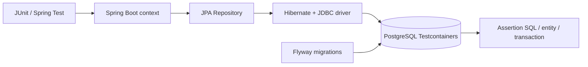

# Kiểm thử repository, giao dịch và truy vấn theo đúng cơ sở dữ liệu

Repository Spring Data JPA có thể vượt qua hàng chục unit test nhưng vẫn lỗi khi chạy với PostgreSQL thật: một câu JPQL sinh SQL khác dự kiến, unique constraint chỉ bị phát hiện lúc `flush`, truy vấn bị N+1, transaction commit thất bại, hoặc hai request đồng thời ghi đè cùng một đơn hàng. Các lỗi này thường xuất hiện ở **ranh giới giữa Hibernate, driver JDBC, hệ quản trị cơ sở dữ liệu và transaction manager**. Vì vậy, mock repository hoặc chạy một database nhúng khác loại không đủ để xác nhận hành vi cần triển khai.

Trong chương **JPA và Hibernate** của module `SPRING_BOOT_INTEGRATION`, bài học tập trung vào cách **kiểm thử repository, giao dịch và truy vấn trên đúng database engine** mà ứng dụng thực tế sử dụng. Module này tổ chức tích hợp Spring Boot qua HTTP client, cơ sở dữ liệu, cache, message broker và adapter Spring Integration; tính đúng đắn của persistence quyết định việc lưu trạng thái, deduplicate message, ghi outbox và phục hồi sau lỗi. Ví dụ dùng **Spring Boot 3.2–3.5, Java 17+, Spring Data JPA, Hibernate 6, PostgreSQL và Testcontainers**. Khi sử dụng Boot/Hibernate/Testcontainers ở dòng phiên bản khác, cần đối chiếu API/dependency với BOM của dự án.

## 1. Cần kiểm thử điều gì ở tầng persistence?

Đừng nhầm bài test `when(repository.save(...)).thenReturn(...)` với một bài test repository. Mock chỉ chứng minh service **gọi** một phương thức Java; nó không chạy query, ánh xạ entity, ràng buộc bảng hoặc transaction.

| Ranh giới | Câu hỏi cần trả lời | Cách kiểm thử phù hợp |
| --- | --- | --- |
| Entity mapping | `@Column`, `@Enumerated`, quan hệ, cascade, khóa chính có tương thích bảng thật? | JPA integration test trên PostgreSQL với schema đã migrate. |
| Repository query | JPQL/native SQL có trả đúng dữ liệu, lọc đúng tenant, sort và paginate đúng? | `@DataJpaTest`, seed dữ liệu đối chứng, assert cả kết quả lẫn trường hợp âm tính. |
| DB constraint | Unique, FK, `NOT NULL`, `CHECK` có thực sự chặn dữ liệu sai? | `saveAndFlush`/`flush`, bắt lỗi theo phạm vi DB, kiểm tra rollback. |
| Transaction | Nhiều bước ghi có commit/rollback cùng nhau? `@Transactional` có hiệu lực qua proxy? | Integration test gọi service thật ngoài transaction của test. |
| Concurrency | Hai transaction cùng sửa một bản ghi có mất cập nhật, deadlock hay lock timeout? | Hai connection và hai transaction đồng thời trên DB thật. |
| Hiệu năng truy vấn | N+1, join phát sinh quá nhiều dòng, index không được dùng? | Hibernate statistics, SQL log và query plan trên dataset đại diện. |
| Tích hợp hệ thống | Ghi business row cùng outbox/inbox có atomicity? | Test transaction DB + integration test broker ở bước sau. |

**Nguyên tắc:** chọn mức test thấp nhất còn chạy được hành vi cần chứng minh. Một phép chuẩn hóa chuỗi có thể unit test; hành vi `@Version`, isolation, `FOR UPDATE`, `jsonb`, unique index hoặc transaction commit phải dùng database thật.

## 2. Vì sao nên dùng cùng loại database với production?

Một test chạy H2 có thể rất nhanh, nhưng H2 không phải PostgreSQL, MySQL hay Oracle. Bật chế độ “PostgreSQL compatibility” cũng không biến H2 thành PostgreSQL.

| Khác biệt | Rủi ro nếu test trên database khác |
| --- | --- |
| SQL dialect | `ON CONFLICT`, `RETURNING`, `ILIKE`, CTE, window function hoặc lock clause không có cùng hành vi. |
| Kiểu dữ liệu | `UUID`, `JSONB`, `TIMESTAMPTZ`, array, enum, precision/scale được hỗ trợ khác nhau. |
| Ràng buộc và index | Unique trên giá trị `NULL`, partial index, expression index, FK và check constraint khác ngữ nghĩa. |
| Transaction/isolation | Default isolation, row locking, deadlock detection, serialization failure khác nhau. |
| Collation và timezone | Sắp xếp Unicode, case sensitivity, so sánh timestamp có thể thay đổi kết quả. |
| Schema migration | Flyway/Liquibase chạy DDL thật; Hibernate `ddl-auto=create-drop` có thể che thiếu migration. |
| Query planner | Một câu SQL đúng về logic vẫn có thể rất chậm khi chạy PostgreSQL với dữ liệu thật. |

Ưu tiên Testcontainers để chạy **cùng hệ quản trị và cùng major version** với production. Có thể pin một PostgreSQL minor version cụ thể cho test có tính tái lập; nâng image có kế hoạch khi hạ tầng nâng cấp. Một container PostgreSQL là môi trường thực thi gần production hơn mock/H2, nhưng vẫn chưa tái tạo mọi yếu tố: phân vùng mạng, kích thước dữ liệu, extension, cấu hình collation, replica lag và phần cứng cần thêm test phù hợp.



## 3. Tạo bộ phụ thuộc kiểm thử

Ví dụ Maven dành cho Spring Boot 3.x. Spring Boot BOM/parent quản lý phiên bản tương thích; cần xem dependency tree thực tế của dự án:

```xml
<dependencies>
    <dependency>
        <groupId>org.springframework.boot</groupId>
        <artifactId>spring-boot-starter-data-jpa</artifactId>
    </dependency>
    <dependency>
        <groupId>org.postgresql</groupId>
        <artifactId>postgresql</artifactId>
        <scope>runtime</scope>
    </dependency>
    <dependency>
        <groupId>org.flywaydb</groupId>
        <artifactId>flyway-core</artifactId>
    </dependency>
    <!-- Với phiên bản Flyway yêu cầu module PostgreSQL riêng: -->
    <dependency>
        <groupId>org.flywaydb</groupId>
        <artifactId>flyway-database-postgresql</artifactId>
    </dependency>

    <dependency>
        <groupId>org.springframework.boot</groupId>
        <artifactId>spring-boot-starter-test</artifactId>
        <scope>test</scope>
    </dependency>
    <dependency>
        <groupId>org.springframework.boot</groupId>
        <artifactId>spring-boot-testcontainers</artifactId>
        <scope>test</scope>
    </dependency>
    <dependency>
        <groupId>org.testcontainers</groupId>
        <artifactId>junit-jupiter</artifactId>
        <scope>test</scope>
    </dependency>
    <dependency>
        <groupId>org.testcontainers</groupId>
        <artifactId>postgresql</artifactId>
        <scope>test</scope>
    </dependency>
</dependencies>
```

Tọa độ `org.testcontainers:postgresql` ở ví dụ theo nhánh **Testcontainers 1.x** được sử dụng phổ biến trong Spring Boot 3.x; một số dòng mới của Testcontainers có thay đổi tên module. Khi dự án dùng Testcontainers 2.x, kiểm tra tọa độ từ tài liệu/BOM thực tế thay vì ép trộn hai dòng. Testcontainers cần một container runtime hoạt động trên máy chạy test hoặc CI.

`@ServiceConnection` xuất hiện từ Spring Boot 3.1, cho phép Spring Boot tự lấy URL, username và password từ container được nhận diện. Nếu dự án chưa có hỗ trợ này hoặc muốn cấu hình tường minh, có thể dùng `@DynamicPropertySource` với ba thuộc tính `spring.datasource.url`, `username`, `password`.

## 4. Dùng schema migration thật làm nguồn sự thật

Production thường sử dụng Flyway/Liquibase để thay đổi schema. Bài test cần dùng **cùng migration scripts** với ứng dụng, thay vì để Hibernate tự tạo bảng rồi chỉ kiểm tra query.

Ví dụ `src/main/resources/db/migration/V1__create_order_tables.sql`:

```sql
CREATE TABLE customer_orders (
    id           BIGINT GENERATED BY DEFAULT AS IDENTITY PRIMARY KEY,
    tenant_id    VARCHAR(64) NOT NULL,
    external_ref VARCHAR(80) NOT NULL,
    status       VARCHAR(24) NOT NULL,
    amount_minor BIGINT NOT NULL CHECK (amount_minor >= 0),
    version      BIGINT NOT NULL,
    CONSTRAINT uk_order_tenant_external UNIQUE (tenant_id, external_ref)
);

CREATE INDEX idx_order_tenant_status_id
    ON customer_orders (tenant_id, status, id);

CREATE TABLE order_lines (
    id          BIGINT GENERATED BY DEFAULT AS IDENTITY PRIMARY KEY,
    order_id    BIGINT NOT NULL REFERENCES customer_orders(id),
    sku         VARCHAR(80) NOT NULL,
    quantity    INTEGER NOT NULL CHECK (quantity > 0)
);

CREATE INDEX idx_order_lines_order_id ON order_lines(order_id);
```

Trong `application-test.yml` hoặc cấu hình test tương đương:

```yaml
spring:
  jpa:
    hibernate:
      ddl-auto: validate
    open-in-view: false
  flyway:
    enabled: true
```

`validate` làm Hibernate so cấu trúc entity với schema đã tồn tại; nó **không thay Flyway tạo bảng**. Nếu migration không chạy được, test nên fail sớm. Không sử dụng `ddl-auto=create`, `create-drop` hoặc `update` cho bài test nhằm chứng minh schema migration thật, vì chúng có thể tạo đối tượng mà script production thiếu.

Trong Spring Boot, cấu hình mặc định của JPA và database init phụ thuộc loại database và sự có mặt của công cụ migration. Vì vậy hãy đặt chính sách migration/DDL rõ ràng trong profile test, tránh dựa vào hành vi suy đoán khi chuyển từ H2 sang PostgreSQL.

## 5. Mô hình entity và repository dùng xuyên suốt

### 5.1. Entity có unique key, trạng thái và optimistic version

```java
package com.example.orders.persistence;

import jakarta.persistence.*;
import java.util.ArrayList;
import java.util.List;

@Entity
@Table(name = "customer_orders")
public class CustomerOrder {

    @Id
    @GeneratedValue(strategy = GenerationType.IDENTITY)
    private Long id;

    @Column(name = "tenant_id", nullable = false)
    private String tenantId;

    @Column(name = "external_ref", nullable = false)
    private String externalRef;

    @Enumerated(EnumType.STRING)
    @Column(nullable = false)
    private OrderStatus status;

    @Column(name = "amount_minor", nullable = false)
    private long amountMinor;

    @Version
    private Long version;

    @OneToMany(mappedBy = "order", cascade = CascadeType.PERSIST)
    private List<OrderLine> lines = new ArrayList<>();

    protected CustomerOrder() {}

    public CustomerOrder(String tenantId, String externalRef,
                         long amountMinor) {
        this.tenantId = tenantId;
        this.externalRef = externalRef;
        this.amountMinor = amountMinor;
        this.status = OrderStatus.PENDING;
    }

    public void confirm() { this.status = OrderStatus.CONFIRMED; }
    public void cancel() { this.status = OrderStatus.CANCELLED; }
    public void addLine(String sku, int quantity) {
        lines.add(new OrderLine(this, sku, quantity));
    }
    public Long getId() { return id; }
    public String getTenantId() { return tenantId; }
    public String getExternalRef() { return externalRef; }
    public OrderStatus getStatus() { return status; }
    public long getAmountMinor() { return amountMinor; }
    public Long getVersion() { return version; }
    public List<OrderLine> getLines() { return lines; }
}
```

```java
package com.example.orders.persistence;

import jakarta.persistence.*;

public enum OrderStatus { PENDING, CONFIRMED, CANCELLED }

@Entity
@Table(name = "order_lines")
public class OrderLine {
    @Id
    @GeneratedValue(strategy = GenerationType.IDENTITY)
    private Long id;

    @ManyToOne(fetch = FetchType.LAZY, optional = false)
    @JoinColumn(name = "order_id", nullable = false)
    private CustomerOrder order;

    @Column(nullable = false)
    private String sku;

    @Column(nullable = false)
    private int quantity;

    protected OrderLine() {}
    OrderLine(CustomerOrder order, String sku, int quantity) {
        this.order = order;
        this.sku = sku;
        this.quantity = quantity;
    }
    public String getSku() { return sku; }
    public int getQuantity() { return quantity; }
}
```

Theo Java, các `public` top-level type được lưu trong **các tệp `.java` riêng**; các block trên ghép để người học nhìn đủ mô hình. Code tối giản không chứa mọi business invariant, validation đầu vào hay mapping DTO. `@Version` dùng `Long` giúp provider nhận biết version chưa khởi tạo khi entity mới được lưu; giá trị version phải do JPA/Hibernate quản lý, không nhận từ client.

### 5.2. Repository với query nghiệp vụ

```java
package com.example.orders.persistence;

import java.util.Optional;
import org.springframework.data.domain.Page;
import org.springframework.data.domain.Pageable;
import org.springframework.data.jpa.repository.*;
import org.springframework.data.repository.query.Param;
import jakarta.persistence.LockModeType;

public interface CustomerOrderRepository
        extends JpaRepository<CustomerOrder, Long> {

    Optional<CustomerOrder> findByTenantIdAndExternalRef(
            String tenantId, String externalRef);

    long countByTenantIdAndStatus(String tenantId, OrderStatus status);

    @Query("""
           select o from CustomerOrder o
           where o.tenantId = :tenant and o.status = :status
           order by o.id desc
           """)
    Page<CustomerOrder> findPage(
            @Param("tenant") String tenant,
            @Param("status") OrderStatus status,
            Pageable pageable);

    @EntityGraph(attributePaths = "lines")
    @Query("select o from CustomerOrder o where o.id = :id")
    Optional<CustomerOrder> findDetailedById(@Param("id") Long id);

    @Lock(LockModeType.PESSIMISTIC_WRITE)
    @Query("select o from CustomerOrder o where o.id = :id")
    Optional<CustomerOrder> lockById(@Param("id") Long id);
}
```

Repository chỉ khai báo cách đọc/ghi. Những quyết định “ai được quyền đọc đơn thuộc tenant nào”, “khi nào confirm”, “khi nào phát event” nên nằm ở service/use case và được test bổ sung. Một repository có hàm `findById` công khai vẫn cần ranh giới authorization ở lớp ứng dụng.

## 6. `@DataJpaTest` với PostgreSQL Testcontainers

`@DataJpaTest` nạp một **slice** tập trung cho JPA entity, repository, transaction, JDBC và các auto-configuration liên quan, thay vì dựng tất cả HTTP controller, broker client và consumer. Điều này thích hợp kiểm chứng mapping, query và constraint của một persistence module.

```java
package com.example.orders.persistence;

import static org.junit.jupiter.api.Assertions.*;

import org.junit.jupiter.api.Test;
import org.springframework.beans.factory.annotation.Autowired;
import org.springframework.boot.test.autoconfigure.jdbc.AutoConfigureTestDatabase;
import org.springframework.boot.test.autoconfigure.orm.jpa.DataJpaTest;
import org.springframework.boot.test.autoconfigure.orm.jpa.TestEntityManager;
import org.springframework.boot.testcontainers.service.connection.ServiceConnection;
import org.testcontainers.containers.PostgreSQLContainer;
import org.testcontainers.junit.jupiter.Container;
import org.testcontainers.junit.jupiter.Testcontainers;

@DataJpaTest(properties = {
    "spring.jpa.hibernate.ddl-auto=validate",
    "spring.jpa.open-in-view=false"
})
@AutoConfigureTestDatabase(replace = AutoConfigureTestDatabase.Replace.NONE)
@Testcontainers
class CustomerOrderRepositoryIT {

    @Container
    @ServiceConnection
    static PostgreSQLContainer<?> postgres =
            new PostgreSQLContainer<>("postgres:16-alpine");

    @Autowired TestEntityManager entityManager;
    @Autowired CustomerOrderRepository repository;

    @Test
    void findsOrderWithinItsTenant() {
        CustomerOrder order =
                new CustomerOrder("tenant-a", "checkout-1001", 125_000);
        order.addLine("SKU-42", 2);
        entityManager.persistAndFlush(order);
        entityManager.clear();

        var found = repository.findByTenantIdAndExternalRef(
                "tenant-a", "checkout-1001");

        assertTrue(found.isPresent());
        assertEquals(order.getId(), found.orElseThrow().getId());
        assertTrue(repository.findByTenantIdAndExternalRef(
                "tenant-b", "checkout-1001").isEmpty());
    }
}
```

`@ServiceConnection` giúp cấu hình kết nối từ PostgreSQL container khi đang dùng các phiên bản Boot phù hợp; `@AutoConfigureTestDatabase(replace = NONE)` ngăn Spring Test tự đổi sang embedded database trong slice JPA. `@Testcontainers` cùng static `@Container` điều khiển lifecycle container. Cấu hình thực tế còn cần Spring Boot `flyway-core`/module PostgreSQL và migration resources để khởi tạo bảng như phần trước.

`@DataJpaTest` mặc định chạy mỗi test trong transaction và rollback sau test. Điều này tốt cho test query/constraint độc lập, nhưng **không chứng minh logic service commit thực tế**. Hãy dùng một loại integration test khác cho những tình huống cần kiểm tra commit, rollback sau exception, nhiều thread hoặc phản ứng của broker.

### 6.1. Nếu không dùng `@ServiceConnection`

Có thể thay `@ServiceConnection` bằng cấu hình tường minh:

```java
@DynamicPropertySource
static void configureDatabase(DynamicPropertyRegistry properties) {
    properties.add("spring.datasource.url", postgres::getJdbcUrl);
    properties.add("spring.datasource.username", postgres::getUsername);
    properties.add("spring.datasource.password", postgres::getPassword);
}
```

Cần import `DynamicPropertySource` và `DynamicPropertyRegistry` từ `org.springframework.test.context`. Ví dụ này là **phương án thay thế**, không cần kết hợp cả hai kiểu cho cùng một PostgreSQL container. Cấu hình nên giữ đủ rõ ràng để CI thất bại khi Docker không sẵn sàng, thay vì âm thầm rơi về H2.

## 7. `persist`, `flush`, `clear` và `commit` khác nhau

Trong một transaction JPA:

```text
repository.save(entity)
        |
        v
Entity được quản lý trong persistence context
        |
        v
entityManager.flush()
        |
        v
SQL được gửi tới PostgreSQL trong transaction HIỆN TẠI
        |
        v
entityManager.clear() / detach(entity)
        |
        v
Entity không còn managed; query sau phải đọc lại qua JPA/JDBC
        |
        v
COMMIT hoặc ROLLBACK bởi transaction manager
```

**`flush` không phải `commit`.** Sau `flush`, SQL đã được gửi nhưng transaction vẫn có thể rollback. `clear` không xóa row trong database; nó xóa trạng thái managed của persistence context. Hai thao tác này hữu ích để test thực sự chạm database, tránh “test xanh” chỉ vì Hibernate trả entity từ first-level cache.

| Thao tác | Ý nghĩa | Khi nào dùng trong test |
| --- | --- | --- |
| `save(entity)` | Đưa entity mới/đã có vào cơ chế persist/merge; có thể phát sinh SQL ngay với IDENTITY | Thiết lập dữ liệu thông thường. |
| `saveAndFlush(entity)` | Save rồi yêu cầu flush | Kiểm chứng constraint, query cập nhật, version hiện tại. |
| `entityManager.flush()` | Đồng bộ thay đổi managed xuống DB trong transaction | Buộc DB chạy SQL trước assertion. |
| `entityManager.clear()` | Evict toàn bộ entity managed | Buộc một lượt đọc mới thông qua query. |
| `entityManager.refresh(entity)` | Nạp lại trạng thái từ DB vào entity managed | Kiểm chứng thay đổi ngoài persistence context, tùy kịch bản. |
| Commit transaction | Khi giao dịch thành công, thay đổi trở nên bền vững | Test ứng dụng/service thật, đọc lại từ connection mới. |
| Rollback transaction | Hủy thay đổi chưa commit | Test ngoại lệ/constraint và tính nguyên tử. |

Với `GenerationType.IDENTITY`, Hibernate có thể thực hiện `INSERT` sớm để lấy ID ngay khi `persist`/`save`, nên không được mặc định “chưa flush thì chưa có SQL”. Dù vậy, `flush` vẫn cần khi test muốn bảo đảm những thay đổi đã được gửi xuống DB trước một assertion.

## 8. Kiểm thử query: kết quả, lọc tenant và phân trang

Một test đáng giá cần có dữ liệu **dễ gây nhầm lẫn**, không chỉ một row khớp. Ví dụ tạo:

| Tenant | External ref | Trạng thái | Số tiền |
| --- | --- | --- | --- |
| `tenant-a` | `ord-a-01` | `PENDING` | 10.000 |
| `tenant-a` | `ord-a-02` | `CONFIRMED` | 20.000 |
| `tenant-a` | `ord-a-03` | `CONFIRMED` | 30.000 |
| `tenant-b` | `ord-b-01` | `CONFIRMED` | 40.000 |

Sau khi lưu các row và `flush`/`clear`, test `findPage("tenant-a", CONFIRMED, PageRequest.of(0, 1))` phải:

- Có `totalElements == 2`, độc lập với kích thước trang.
- Trang đầu có một row thuộc `tenant-a`, trạng thái `CONFIRMED`.
- Thứ tự `order by id desc` đúng theo ID đã được database gán.
- Trang kế tiếp chứa row còn lại; không lẫn `tenant-b`.
- Bộ lọc không khớp trả trang rỗng, `totalElements == 0`.

Ví dụ:

```java
@Test
void pagesOnlyMatchingTenantOrders() {
    repository.save(new CustomerOrder("tenant-a", "ord-a-01", 10_000));
    CustomerOrder second =
            repository.save(new CustomerOrder("tenant-a", "ord-a-02", 20_000));
    second.confirm();
    CustomerOrder third =
            repository.save(new CustomerOrder("tenant-a", "ord-a-03", 30_000));
    third.confirm();
    CustomerOrder other =
            repository.save(new CustomerOrder("tenant-b", "ord-b-01", 40_000));
    other.confirm();

    repository.flush();
    entityManager.clear();

    Page<CustomerOrder> first = repository.findPage(
            "tenant-a", OrderStatus.CONFIRMED, PageRequest.of(0, 1));

    assertEquals(2, first.getTotalElements());
    assertEquals(1, first.getContent().size());
    assertEquals("ord-a-03", first.getContent().get(0).getExternalRef());

    Page<CustomerOrder> next = repository.findPage(
            "tenant-a", OrderStatus.CONFIRMED, PageRequest.of(1, 1));
    assertEquals("ord-a-02", next.getContent().get(0).getExternalRef());
}
```

Đoạn test được đặt bên trong `CustomerOrderRepositoryIT` ở trên; cần import `Page` và `PageRequest`. Không dùng sort tự nhiên của DB khi query không có `ORDER BY`: PostgreSQL không cam kết thứ tự row nếu không chỉ định.

### Query JPQL và native SQL

JPQL dựa trên **tên entity/property Java** như `o.tenantId`; native SQL dựa trên **bảng/cột thật** như `customer_orders.tenant_id`. Khi test query native có `jsonb`, `ILIKE`, upsert hoặc `FOR UPDATE SKIP LOCKED`, bắt buộc chạy trên DB production tương thích vì H2 dễ che khác biệt dialect.

Đồng thời kiểm thử `NULL`, chuỗi rỗng, nhiều tenant, Unicode, timezone, giá trị biên (`BIGINT`, precision) và projection DTO nếu đó là trường hợp thực tế của API. Một truy vấn đúng khi bảng chỉ có vài row vẫn có thể sai với duplicate join hoặc pagination.

## 9. Kiểm thử constraint và ngoại lệ từ database

Ràng buộc phải nằm ở database, đặc biệt khi có nhiều instance/consumer đồng thời. Validation ở Java cải thiện thông báo lỗi, nhưng hai request vẫn có thể cùng vượt qua bước “kiểm tra đã tồn tại chưa” rồi insert đồng thời.

Ví dụ unique `(tenant_id, external_ref)`:

```java
@Test
void databaseRejectsDuplicateExternalReference() {
    repository.saveAndFlush(
            new CustomerOrder("tenant-a", "checkout-dup", 10_000));
    entityManager.clear();

    assertThrows(DataIntegrityViolationException.class, () -> {
        repository.save(
                new CustomerOrder("tenant-a", "checkout-dup", 20_000));
        repository.flush();
    });
}
```

Test trên cần import `org.springframework.dao.DataIntegrityViolationException`. Khi PostgreSQL báo lỗi constraint, transaction hiện tại có thể chuyển sang trạng thái **không thể tiếp tục**. Vì vậy sau assertion exception, đừng thực hiện query khác trong **cùng transaction** rồi kết luận dữ liệu vẫn chính xác. Để kiểm chứng trạng thái sau rollback, hãy chạy một transaction mới ngoài transaction bị lỗi.

Những constraint quan trọng khác:

```sql
-- CHECK: từ chối số tiền âm
INSERT INTO customer_orders
    (tenant_id, external_ref, status, amount_minor, version)
VALUES ('tenant-a', 'negative', 'PENDING', -1, 0);

-- FK: từ chối order_id không tồn tại
INSERT INTO order_lines (order_id, sku, quantity)
VALUES (999999, 'SKU-1', 1);
```

Các câu lệnh này **được kỳ vọng thất bại** trên schema ở phần 4; chạy chúng trong transaction/test riêng và assert SQLState/constraint theo yêu cầu. Với PostgreSQL, unique thường dùng SQLState `23505`, FK `23503`, check `23514`, not-null `23502`. Nếu code ứng dụng chuyển exception thành HTTP 409/422 hoặc lỗi message non-retryable, thêm test ở tầng service/adapter cho chính sách chuyển lỗi đó.

Lưu ý constraint có thể được kiểm tra ở thời điểm khác nhau, nhất là `DEFERRABLE` constraint; khi đó chỉ `flush` chưa chắc đủ để chứng minh **commit** sẽ thành công. Hãy đặt test commit riêng cho các constraint có khả năng trì hoãn.

## 10. Kiểm thử giao dịch thực: không để transaction của test che lỗi

Một đặc điểm dễ gây hiểu lầm:

```java
@DataJpaTest
class RepositoryTest {
    @Test
    void test() {
        repository.save(...);
        // Test mặc định chạy trong transaction được rollback cuối test.
    }
}
```

Đây là test phù hợp cho repository, nhưng **không chứng minh** một use case thực sự commit dữ liệu khi được gọi qua Spring proxy. Các lỗi chỉ phát sinh tại commit, `@TransactionalEventListener(phase = AFTER_COMMIT)` hoặc những consumer chỉ nhìn thấy dữ liệu đã commit có thể bị che đi.

Để kiểm thử service transaction, dùng `@SpringBootTest` với PostgreSQL Testcontainers và **không gắn `@Transactional` lên test method/class**. Service thật nhận `@Transactional`, database commit khi service method return thành công. Ví dụ:

```java
@Service
public class OrderWriteService {
    private final CustomerOrderRepository repository;

    public OrderWriteService(CustomerOrderRepository repository) {
        this.repository = repository;
    }

    @Transactional
    public Long create(String tenant, String ref, long amountMinor) {
        CustomerOrder order =
                repository.save(new CustomerOrder(tenant, ref, amountMinor));
        return order.getId();
    }

    @Transactional
    public void createThenFail(String tenant, String ref) {
        repository.save(new CustomerOrder(tenant, ref, 10_000));
        repository.flush(); // SQL đã chạy; vẫn chưa commit.
        throw new IllegalStateException("Simulated application failure");
    }
}
```

Và một test ở cấp ứng dụng:

```java
@SpringBootTest(properties = "spring.jpa.hibernate.ddl-auto=validate")
@Testcontainers
class OrderTransactionIT {
    @Container
    @ServiceConnection
    static PostgreSQLContainer<?> postgres =
            new PostgreSQLContainer<>("postgres:16-alpine");

    @Autowired OrderWriteService service;
    @Autowired CustomerOrderRepository repository;

    @Test
    void createCommitsAndCanBeReadAfterReturn() {
        Long id = service.create("tenant-a", "committed-01", 10_000);

        assertTrue(repository.findById(id).isPresent());
    }

    @Test
    void failureRollsBackEvenAfterFlush() {
        assertThrows(IllegalStateException.class, () ->
                service.createThenFail("tenant-a", "rolled-back-01"));

        assertTrue(repository.findByTenantIdAndExternalRef(
                "tenant-a", "rolled-back-01").isEmpty());
    }
}
```

Các đoạn trên thuộc những tệp Java riêng, cần import annotation/class và có thể dùng `@AutoConfigureTestDatabase(replace = NONE)` nếu dựng slice JPA thay vì full `@SpringBootTest`. Đối với full `@SpringBootTest`, `@ServiceConnection` tự cấu hình connection theo Boot stack được hỗ trợ.

Mỗi test ở đây nên dùng `externalRef` riêng và cơ chế dọn dữ liệu test có kiểm soát (schema/container cô lập hoặc fixture cleanup) để tránh can thiệp nhau. Kết quả `findById` sau khi service return được thực hiện bên ngoài transaction của service, nên chứng minh commit ở mức application DB. Để chắc chắn test không bị ghép vào transaction bên ngoài do một base test class, kiểm tra cấu hình `@Transactional` kế thừa và transaction manager.

### Những tình huống transaction dễ bị bỏ sót

| Tình huống | Điều cần kiểm tra |
| --- | --- |
| Method nội bộ gọi `this.saveInTransaction()` | Self-invocation thông thường không đi qua Spring AOP proxy; `@Transactional` ở method được gọi có thể không hoạt động. |
| `private` method đánh `@Transactional` | Proxy không quản lý transaction theo cách kỳ vọng. |
| Checked exception | Theo cấu hình mặc định của Spring, không phải mọi checked exception đều gây rollback; dùng `rollbackFor` khi cần. |
| `@Transactional(readOnly = true)` | Là gợi ý tối ưu cho transaction/provider, không phải cơ chế bảo mật ngăn mọi ghi ở mọi database. |
| `@Transactional(propagation = REQUIRES_NEW)` | Có thể commit một transaction độc lập dù transaction ngoài rollback; cần test riêng. |
| Nhiều `PlatformTransactionManager` | Cần chọn đúng manager bằng tên/qualifier; một transaction cục bộ không bao gồm hai database độc lập. |
| Callback/async sau commit | Callback có thể chạy ngoài transaction ban đầu; dùng outbox nếu side effect cần khả năng phục hồi khi crash. |

## 11. Kiểm thử optimistic locking và lost update

`@Version` giúp Hibernate phát hiện khi entity được tải tại version cũ nhưng một transaction khác đã cập nhật cùng row. Với các cập nhật thông thường, Hibernate phát `UPDATE ... WHERE id=? AND version=?`; nếu affected rows bằng 0 thì có xung đột optimistic lock.

Ví dụ kịch bản:

```text
T1 đọc order-1, version=2
T2 đọc order-1, version=2
T1 cập nhật status=CONFIRMED, commit -> version=3
T2 cố cập nhật status=CANCELLED dựa trên version=2
  -> Hibernate phát hiện stale version; T2 phải rollback/retry nghiệp vụ
```

Test có thể tạo hai **detached entity copies** với version ban đầu, sau đó cập nhật và commit một copy rồi thử merge copy cũ. Tuy nhiên, để chứng minh tình huống production, nên có thêm integration test với **hai thread và hai transaction độc lập**, đọc version cũ rồi cố commit song song. Assertion:

- Chính xác một update được commit cho cùng version đầu vào.
- Update stale tạo `OptimisticLockException` hoặc Spring `OptimisticLockingFailureException` phù hợp.
- Lệnh retry (nếu có) phải **đọc lại trạng thái và kiểm tra business invariant**, không chỉ gọi lại `save()` với payload cũ.
- Trạng thái cuối và `version` đúng; không bị “last writer wins” ngoài ý muốn.

Không bắt một exception quá cụ thể nếu framework chuyển đổi khác nhau giữa `flush` và commit. Kiểm tra loại exception thuộc họ optimistic-locking và dữ liệu đã commit ở transaction mới.

### Pessimistic lock và `FOR UPDATE`

Repository `lockById(...)` được đánh dấu `@Lock(PESSIMISTIC_WRITE)`; cần gọi trong transaction có hiệu lực. Khi T1 đang giữ row lock, T2 có thể phải chờ, timeout hoặc nhận lỗi theo PostgreSQL/JPA lock timeout policy. Một test có hai connection thật mới chứng minh được hành vi đó.

Thiết kế test với `CountDownLatch`/barrier:

1. T1 bắt đầu transaction, gọi `lockById(orderId)`, giữ transaction chưa commit.
2. T2 bắt đầu transaction riêng, gọi `lockById(orderId)` hoặc một câu `UPDATE` cạnh tranh.
3. Xác minh T2 không vượt qua vùng cần bảo vệ khi T1 còn giữ lock; sau khi T1 commit, T2 có thể tiếp tục theo timeout/quy tắc được đặt.
4. Kiểm tra dữ liệu cuối và log lock wait/deadlock khi cần.

Tránh kết luận từ `Thread.sleep` một khoảng cố định; dùng latch và timeout test có biên rõ. Khi muốn kiểm tra `NOWAIT`, `SKIP LOCKED` hoặc isolation level, dùng native SQL và PostgreSQL thực. Có thể thiết lập `SET LOCAL lock_timeout = '...'` trong transaction test phù hợp để bài test không treo vô hạn.

## 12. Transaction isolation và các phép thử có hai connection

Isolation level ảnh hưởng kết quả giữa những transaction đồng thời. PostgreSQL mặc định `READ COMMITTED`; các mức khác có quy tắc riêng và đôi khi phát sinh lỗi serialization cần retry cả transaction.

| Hiện tượng | Ví dụ | Kiểm thử đề xuất |
| --- | --- | --- |
| Lost update | Hai worker đọc cùng số lượng rồi ghi giá trị mới | `@Version`/conditional update ngăn ghi đè; assert version. |
| Non-repeatable read | T1 đọc row hai lần, T2 commit cập nhật ở giữa | So sánh tại `READ COMMITTED` và mức mạnh hơn khi nghiệp vụ yêu cầu. |
| Phantom/aggregate invariant | Hai transaction cùng kiểm tra tổng giới hạn rồi insert | Dùng unique/exclusion/locking/serializable phù hợp; test concurrency. |
| Deadlock | T1 lock A rồi B, T2 lock B rồi A | Cố định thứ tự lock, timeout và retry có giới hạn. |
| Serialization failure | Hai giao dịch SERIALIZABLE cùng thao tác mâu thuẫn | Xác minh một bên có thể rollback và use case retry toàn transaction an toàn. |

Với PostgreSQL, SQLState `40001` báo serialization failure, `40P01` báo deadlock detected. Retry phải diễn ra sau khi rollback và bắt đầu **transaction mới**, có giới hạn attempt, backoff và idempotency cho side effect. Không bắt lỗi rồi tiếp tục SQL trên transaction đã bị PostgreSQL đánh dấu failed.

**Lưu ý:** test isolation không nên chạy trong một `@DataJpaTest` method có transaction bao ngoài, sau đó tạo hai `CompletableFuture` và tin rằng mọi thao tác chia cùng transaction. Transaction Spring thường gắn với thread; mỗi worker thread phải bắt đầu transaction thật bằng service proxy hoặc `TransactionTemplate` với transaction manager đúng.

## 13. Kiểm thử N+1, fetch plan và số truy vấn

Một repository có thể trả dữ liệu đúng nhưng chậm do `LAZY` association bị truy cập riêng cho từng row.

```java
List<CustomerOrder> orders = repository.findAll();
for (CustomerOrder order : orders) {
    System.out.println(order.getLines().size());
}
```

Nếu có N đơn hàng và mỗi `lines` được tải khi gọi getter, có thể phát sinh **1 query lấy orders + N query lấy lines**. Trong integration test, kiểm tra số SQL sau khi fixture đã được `flush` và `clear`; first-level cache nếu chưa xóa có thể làm bài test “không có N+1” giả.

Một hướng kiểm thử với Hibernate statistics:

```java
EntityManagerFactory emf = entityManager.getEntityManager()
        .getEntityManagerFactory();
SessionFactory sessionFactory = emf.unwrap(SessionFactory.class);
Statistics statistics = sessionFactory.getStatistics();
statistics.setStatisticsEnabled(true);

entityManager.flush();
entityManager.clear();
statistics.clear();

CustomerOrder detailed =
        repository.findDetailedById(orderId).orElseThrow();
int lineCount = detailed.getLines().size();

long preparedStatements = statistics.getPrepareStatementCount();
assertEquals(expectedLineCount, lineCount);
assertTrue(preparedStatements <= 2);
```

Đoạn này nằm trong test JPA đã cấu hình fixture, cần import `EntityManagerFactory`, `SessionFactory`, `Statistics` và có `orderId`, `expectedLineCount`. Giới hạn `<= 2` ở ví dụ là ngưỡng **do test tự chọn cho một order chi tiết**, không phải bảo đảm của mọi Hibernate version. Thống kê Hibernate gắn với `SessionFactory` và có thể bị ảnh hưởng bởi test chạy song song; cô lập test hoặc dùng datasource query counter phù hợp nếu muốn assertion chặt.

Khi tìm danh sách order có pagination, **không** dùng fetch join collection to-many một cách vô điều kiện. SQL join có thể nhân số row và khiến Hibernate cảnh báo hoặc phân trang trong bộ nhớ. Các lựa chọn:

1. Query projection/DTO chỉ các cột cần cho list.
2. Lấy một trang order IDs, rồi query lines theo tập IDs đó.
3. Sử dụng `@EntityGraph` có mục tiêu cho một aggregate chi tiết.
4. Cân nhắc batch fetching và xác minh SQL thực tế, lượng row và memory.

Đừng chỉ assert số query; cần đo cả thời gian, dữ liệu đọc, kích thước kết quả, connection utilization và latency khi tập dữ liệu lớn hơn.

## 14. Query plan, index và dữ liệu kiểm thử đại diện

Một câu query JPQL được Hibernate chuyển sang SQL. SQL đó chạy nhanh trên 10 row chưa chắc nhanh trên hàng triệu row. Khi một repository được dùng làm điểm polling, deduplication hoặc truy vấn API nhiều lần, query plan là một phần của khả năng vận hành.

Ví dụ query:

```sql
SELECT id, external_ref, amount_minor
FROM customer_orders
WHERE tenant_id = 'tenant-a'
  AND status = 'CONFIRMED'
ORDER BY id DESC
LIMIT 20;
```

Có thể chạy trên **test database** với dataset đại diện:

```sql
EXPLAIN (ANALYZE, BUFFERS)
SELECT id, external_ref, amount_minor
FROM customer_orders
WHERE tenant_id = 'tenant-a'
  AND status = 'CONFIRMED'
ORDER BY id DESC
LIMIT 20;
```

`EXPLAIN ANALYZE` **thực thi** câu truy vấn để đo, nên dùng ở môi trường phù hợp và cẩn trọng với các câu lệnh ghi. Kiểm tra index `idx_order_tenant_status_id`, số row scanned, sort, buffers và actual execution time. Query planner vẫn có thể chọn sequential scan cho bảng nhỏ; test không nên thất bại chỉ vì plan không xuất hiện từ khóa `Index Scan` trên một dataset bé.

Một test hiệu năng ổn định hơn có thể:

- Nạp hàng nghìn bản ghi theo phân phối tenant/status gần thực tế, chạy `ANALYZE`.
- Có ngưỡng thời gian rộng trên CI, hoặc chạy benchmark/query plan như một kiểm tra định kỳ riêng.
- So sánh regression khi thêm quan hệ/fetch graph hoặc thay index/migration.
- Kiểm tra predicate `tenant_id` luôn tồn tại trong những query cần cách ly tenant.

Tránh đưa execution time **chính xác vài mili giây** thành assertion bắt buộc trên CI chung vì phần cứng và tải máy khác nhau. Dùng plan/log để chẩn đoán và bài kiểm thử chức năng để bắt các lỗi deterministic.

## 15. Dữ liệu thời gian, số tiền và native type

Tầng persistence còn dễ sai ở ranh giới kiểu dữ liệu:

| Dữ liệu | Điều cần test trên DB thật |
| --- | --- |
| `Instant`/`TIMESTAMPTZ` | Cùng thời điểm được lưu và đọc nhất quán khi JVM/session timezone khác nhau. |
| `LocalDate` | Không bị dịch ngày do timezone và mapping sai kiểu. |
| `BigDecimal`/`NUMERIC(p,s)` | Precision, scale, làm tròn và overflow theo hợp đồng tiền tệ. |
| `long` amount in minor units | Giới hạn `BIGINT`, check nonnegative, chuyển đổi đơn vị có kiểm soát. |
| `UUID` | Index/query và serialization đúng kiểu, không phụ thuộc cast ngầm của H2. |
| `JSONB` | Key thiếu, `null`, array và operator PostgreSQL hoạt động đúng native query. |
| Collation/case | `LIKE`, `ILIKE`, Unicode và unique key có quy tắc so khớp phù hợp. |

Ví dụ khi API nhận timestamp có offset và service lưu `Instant`, test nên chuyển thời gian qua nhiều múi giờ mà vẫn đại diện **cùng thời điểm UTC**. Đừng so sánh `LocalDateTime` giả định luôn là UTC nếu hợp đồng không nói vậy.

## 16. Khi có nhiều DataSource, test phải chọn đúng database

Một Spring Boot integration có thể ghi đơn hàng vào `orders_db`, còn audit/inbox/outbox ở database hoặc schema khác. `@Primary` chỉ chọn bean mặc định khi inject, không đảm bảo mọi repository được gắn đúng `EntityManagerFactory`.

Trong cấu hình nhiều JPA persistence unit, repository thường được ràng buộc cụ thể:

```java
@EnableJpaRepositories(
    basePackages = "com.example.orders.persistence",
    entityManagerFactoryRef = "ordersEntityManagerFactory",
    transactionManagerRef = "ordersTransactionManager")
class OrdersJpaRepositoriesConfig {
    // Các bean DataSource, EntityManagerFactory,
    // transaction manager được khai báo rõ trong cấu hình đầy đủ.
}
```

Khi test:

- Dùng PostgreSQL container/schema cho mỗi đích như cấu hình production yêu cầu; xác minh migration của từng đích chạy đúng nơi.
- Kiểm tra JDBC URL/schema và quyền tài khoản được dùng bởi repository, tránh vô tình test trên H2 hoặc database chính.
- Sử dụng `@Transactional("ordersTransactionManager")` khi cần transaction của orders; nếu audit có manager riêng, chọn tường minh.
- Không giả định một `@Transactional` local commit/rollback atomically cả `orders_db` và `audit_db`. Nếu cần nhất quán xuyên database/broker, thiết kế outbox, saga hoặc cơ chế phối hợp riêng và kiểm thử failure window.

`@DataJpaTest` mặc định thiết kế cho một persistence slice; khi có nhiều `DataSource`/`EntityManagerFactory`, cần cấu hình test slice có chọn lọc hoặc dùng `@SpringBootTest` với cấu hình production đầy đủ. Chỉ dùng một test context chứa mọi repository nhưng thay toàn bộ connection bằng một H2 datasource có thể khiến mapping sai đích không bị phát hiện.

## 17. Inbox, outbox và giao dịch trong luồng tích hợp

Giả sử consumer nhận message `OrderConfirmed(eventId=evt-19)`, cập nhật `customer_orders` và ghi dấu xử lý vào `processed_event`. Nếu hai thao tác thuộc **cùng PostgreSQL transaction**, khi một thao tác thất bại cả hai phải rollback.

```sql
CREATE TABLE processed_event (
    consumer_name VARCHAR(80) NOT NULL,
    event_id      VARCHAR(100) NOT NULL,
    processed_at  TIMESTAMPTZ NOT NULL DEFAULT CURRENT_TIMESTAMP,
    PRIMARY KEY (consumer_name, event_id)
);
```

Mã logic:

```text
BEGIN transaction
  INSERT INTO processed_event(consumer_name, event_id)
  VALUES ('order-projection-v1', 'evt-19')
  ON CONFLICT DO NOTHING
  -> affected rows = 0: đã xử lý; không chạy side effect
  -> affected rows = 1: UPDATE customer_orders ... theo state/version guard
COMMIT
ACK broker sau khi transaction hoàn tất
```

Lưu ý: nếu `UPDATE customer_orders` không thỏa điều kiện chuyển trạng thái, service phải quyết định rollback hoặc ghi một kết quả xử lý có ý nghĩa. Không được đánh dấu inbox thành “hoàn tất” rồi âm thầm bỏ event chưa xử lý. Nếu broker redeliver sau DB commit nhưng trước ACK, consumer thấy inbox đã tồn tại và có thể ACK mà không tạo tác động lần hai.

Tương tự, khi producer cập nhật order và muốn phát event, hãy lưu bản ghi **outbox** vào cùng transaction với order; publisher riêng gửi broker và ghi nhận kết quả publish. Test transaction ở tầng DB xác minh `order row + outbox row` commit/rollback cùng nhau; test ở tầng broker xác minh redelivery/idempotency. Một test JPA đơn lẻ **không chứng minh exactly-once end-to-end** qua database và broker.

## 18. Tổ chức bộ test để nhanh, đúng và dễ chẩn đoán

| Bộ test | Công cụ / context | Phạm vi |
| --- | --- | --- |
| Domain/unit | JUnit không nạp Spring | Invariant, phép tính, phân loại exception. |
| Repository integration | `@DataJpaTest` + PostgreSQL Testcontainers | Entity, JPQL, native SQL, constraints, fetch plan. |
| Service transaction integration | `@SpringBootTest` hoặc context chọn lọc + DB thật | Commit, rollback, propagation, transaction manager. |
| Concurrency integration | DB thật + hai connection/transaction | Lock, deadlock, optimistic version, isolation. |
| Adapter/broker integration | DB + RabbitMQ/Kafka/Pulsar container thích hợp | ACK sau commit, redelivery, inbox/outbox. |
| Query performance | PostgreSQL với dữ liệu đại diện | Query plan, index, N+1, pagination, throughput. |

Giữ fixture ngắn và có chủ đích. Dùng `TestEntityManager` hoặc repository để tạo dữ liệu qua mapping thật; khi cần xác minh một migration DDL/constraint độc lập, dùng JDBC hoặc `@Sql` là hợp lý. Không tạo schema thủ công trong test nếu mục tiêu là xác nhận Flyway/Liquibase production.

### Tính độc lập giữa các test

- Mỗi test có tenant/externalRef độc lập; unique constraint không bị ảnh hưởng bởi test chạy trước.
- Repository tests thường rollback; tests cần commit có schema/database/fixture cleanup chủ động.
- Nếu dùng singleton container cho nhiều test context, dữ liệu có thể tồn tại xuyên test; quản lý vòng đời và dọn dữ liệu rõ ràng.
- Không đặt `@DirtiesContext` trên mọi test chỉ để dọn row: khởi tạo lại context tốn thời gian mà không thay thế isolation dữ liệu.
- Test concurrency cần giới hạn timeout rõ ràng và giải phóng latch/thread kể cả khi assertion lỗi.
- Đừng bắt mọi test dùng Docker nếu unit test có thể kiểm chứng logic thuần Java; chạy DB integration suite trong pipeline với hạ tầng đã chuẩn bị.

## 19. Lỗi thường gặp và cách chẩn đoán

| Triệu chứng | Nguyên nhân có thể | Cách xử lý |
| --- | --- | --- |
| Test H2 xanh, PostgreSQL production lỗi syntax | Native query phụ thuộc dialect | Testcontainers với đúng DB/driver và SQL thật. |
| Hibernate tạo bảng nhưng Flyway quên bảng | `ddl-auto=create` ở test | Dùng migration thật + `ddl-auto=validate`. |
| Duplicate không báo lỗi trong test | Chưa flush hoặc không có unique constraint | `saveAndFlush`/`flush`; kiểm tra DDL constraint. |
| Test pass dù query lẽ ra phải đọc DB | Entity đang có trong persistence context | `flush` rồi `clear`, query lại. |
| Sau `flush` test tưởng đã commit | Nhầm flush với commit | Kiểm tra ở transaction mới sau service return. |
| `@Transactional` service không rollback | Self-invocation, checked exception, sai manager | Test qua bean proxy, xác định rollback rule. |
| Lỗi query sau unique violation | PostgreSQL transaction đã bị đánh dấu failed | Rollback rồi bắt đầu transaction mới trước truy vấn tiếp. |
| N+1 xuất hiện trên danh sách order | Mapper truy cập lazy collection | Projection, entity graph/fetch plan và đo SQL. |
| Pagination chậm hoặc có cảnh báo memory pagination | Join fetch to-many kết hợp paging | Query hai bước hoặc projection; đo plan và số row. |
| `OptimisticLockException` ở production nhưng test chưa gặp | Test chỉ dùng một transaction/entity managed | Dùng hai transaction độc lập với version cũ. |
| `PessimisticLockException`/timeout | Cạnh tranh row lock hoặc lock order không nhất quán | Log thời gian chờ, đặt timeout, kiểm tra thứ tự lock. |
| Test riêng lẻ xanh, chạy cả suite lỗi | Shared container data, thứ tự test, concurrent fixtures | Cô lập dữ liệu và cleanup deterministic. |
| Message ACK dù DB rollback | Boundary ACK và commit chưa đúng | Integration test với broker, commit trước ACK. |
| Audit được ghi nhưng order rollback | Hai database có transaction manager độc lập | Xác định yêu cầu consistency, dùng outbox/saga phù hợp. |

## 20. Checklist và bài tập thực hành

Trước khi coi repository và persistence flow đã đạt yêu cầu, hãy kiểm tra:

- [ ] Test dùng đúng database engine/major version, driver, schema, collation và extension quan trọng của production.
- [ ] Flyway/Liquibase chạy migration thật; Hibernate `validate` thay vì tự tạo schema cho bài test này.
- [ ] Có test query theo tenant, kết quả rỗng, phân trang/sort, projection và dữ liệu biên.
- [ ] Có test unique/FK/check constraint, bao gồm `flush` và hành vi rollback.
- [ ] Có test service **commit** và **rollback** ngoài transaction test mặc định.
- [ ] `@Transactional` đi qua Spring bean proxy, đúng transaction manager, đúng propagation và rollback rule.
- [ ] Có test optimistic/pessimistic locking với hai transaction độc lập khi bài toán có concurrent updates.
- [ ] N+1/fetch plan và query plan được quan sát trên dữ liệu có kích thước phù hợp.
- [ ] Truy vấn native và kiểu dữ liệu đặc thù PostgreSQL được chạy trên PostgreSQL thật.
- [ ] Inbox/outbox, checkpoint hoặc state nghiệp vụ có test commit/rollback nguyên tử.
- [ ] Test độc lập và dọn dữ liệu được kiểm soát; CI đủ tài nguyên để chạy container integration.

**Bài tập:** tạo `CustomerOrder`, `OrderLine`, `CustomerOrderRepository` và migration PostgreSQL như ví dụ. Viết `@DataJpaTest` dùng Testcontainers để chứng minh: (1) tìm đơn theo `tenantId + externalRef` không lẫn tenant; (2) unique constraint từ chối external ref trùng trong cùng tenant nhưng cho phép ref đó ở tenant khác; (3) phân trang `CONFIRMED` đúng số lượng và thứ tự; (4) `findDetailedById` tải `lines` có kiểm soát SQL. Tiếp theo viết `@SpringBootTest` không có outer transaction để kiểm tra `OrderWriteService` commit và rollback sau `flush`. Cuối cùng tạo hai transaction cùng đọc version cũ, kiểm tra một lượt ghi bị từ chối bởi optimistic locking, và đưa một message có `eventId` cố định qua handler inbox để chứng minh redelivery không cập nhật nghiệp vụ hai lần.

Khi kiểm thử thực sự đi qua Hibernate, JDBC, database migration và transaction manager trên đúng cơ sở dữ liệu, ta phát hiện những sai lệch mà mock hoặc database thay thế có thể bỏ sót. Đây là nền tảng để các luồng tích hợp Spring Boot lưu trạng thái chính xác, xử lý đồng thời an toàn và phục hồi đáng tin cậy khi retry, crash hoặc message được phát lại.
