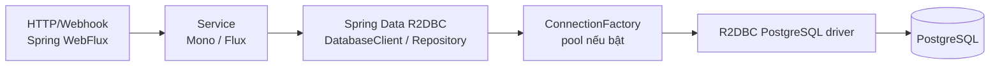

# R2DBC, ConnectionFactory và phân biệt với JDBC DataSource

> **Chương:** Dữ liệu reactive  
> **Phạm vi:** Tích hợp hệ thống trong Spring Boot (Spring Boot Integration).

## 1. Bài toán: truy cập cơ sở dữ liệu trong một luồng tích hợp reactive

Giả sử hệ thống Spring Boot nhận webhook từ đối tác, lưu sự kiện vào PostgreSQL, kiểm tra xem sự kiện đã được nhận trước đó chưa rồi tiếp tục xử lý hoặc chuyển sang broker. Một luồng HTTP dùng Spring WebFlux có thể biểu diễn việc nhận dữ liệu dưới dạng `Mono` hoặc `Flux`. Tuy nhiên, nếu tầng lưu trữ gọi JDBC đồng bộ ngay trên luồng xử lý sự kiện (event loop), thời gian chờ cơ sở dữ liệu có thể giữ luồng đó quá lâu và làm giảm khả năng phục vụ các yêu cầu khác.

**R2DBC (Reactive Relational Database Connectivity)** cung cấp giao diện truy cập cơ sở dữ liệu quan hệ theo kiểu reactive. Trong Spring Boot, `ConnectionFactory` là điểm đầu vào để lấy kết nối R2DBC, tương ứng về *vai trò tạo kết nối* với `DataSource` của JDBC nhưng khác hoàn toàn về API và cơ chế thực thi.

Học xong bài này, bạn cần:

- Giải thích luồng thực thi giữa Spring WebFlux, Spring Data R2DBC, R2DBC driver và cơ sở dữ liệu.
- Phân biệt `io.r2dbc.spi.ConnectionFactory` với `javax.sql.DataSource`, cũng như các loại transaction manager đi cùng.
- Cấu hình và sử dụng R2DBC trong Spring Boot để ghi dữ liệu tích hợp có khả năng chống xử lý trùng.
- Nhận diện giới hạn về giao dịch, connection pool, migration, retry và observability.
- Chọn R2DBC hoặc JDBC dựa trên kiến trúc thực tế, thay vì mặc định rằng reactive luôn nhanh hơn.

## 2. R2DBC là gì?

R2DBC là một **SPI (Service Provider Interface)** cho cơ sở dữ liệu quan hệ, được thiết kế để driver có thể thực hiện I/O theo cách không chặn luồng gọi (non-blocking) và phát hành kết quả qua giao diện `org.reactivestreams.Publisher`. Nó áp dụng cho SQL và cơ sở dữ liệu quan hệ; R2DBC **không biến** PostgreSQL/MySQL thành cơ sở dữ liệu phi quan hệ và **không phải** một ORM thay thế Hibernate/JPA.

Các thành phần cần phân biệt:

| Thành phần | Trách nhiệm |
|---|---|
| `ConnectionFactory` | Cung cấp publisher tạo `Connection` và metadata của kết nối; là abstraction trung tâm của R2DBC SPI. |
| R2DBC driver | Triển khai giao thức và đặc tính tương thích với cơ sở dữ liệu cụ thể, ví dụ PostgreSQL. |
| `Connection`, `Statement`, `Result` | SPI cấp thấp để thực thi SQL, bind tham số và đọc kết quả. |
| Spring `DatabaseClient` | API SQL fluent, trả về `Mono`/`Flux`, quản lý việc lấy và giải phóng kết nối trong những thao tác thông thường. |
| Spring Data R2DBC | Mapping thực thể, `R2dbcEntityTemplate`, reactive repository; không cung cấp toàn bộ tính năng ORM của JPA. |
| `R2dbcTransactionManager` | Quản lý giao dịch reactive qua một `ConnectionFactory`, gắn kết nối với Reactor Context. |
| Connection pool (tùy chọn) | Tái sử dụng kết nối vật lý, giới hạn lượng kết nối đồng thời tới database. |

### 2.1. Dữ liệu được truy vấn khi nào?

Một `Mono` hoặc `Flux` từ `DatabaseClient` thường mô tả công việc sẽ xảy ra khi có **subscription**. Chỉ tạo publisher mà không có nơi subscribe thì truy vấn chưa được thực hiện. Trong ứng dụng WebFlux, framework thường subscribe cho publisher do controller trả về; trong kiểm thử, `StepVerifier` có thể subscribe.

```java
Mono<Long> count = databaseClient.sql("SELECT COUNT(*) AS total FROM integration_inbox")
    .map((row, metadata) -> row.get("total", Long.class))
    .one();

// Chưa gọi block() hoặc subscribe() ở đây.
// WebFlux có thể subscribe nếu publisher này được trả từ handler thích hợp.
```

Reactive giúp luồng ứng dụng không phải đứng chờ I/O theo kiểu JDBC truyền thống. Dẫu vậy, **truy vấn SQL vẫn tiêu thụ tài nguyên và thời gian trên database**. Backpressure hỗ trợ điều phối luồng dữ liệu giữa các publisher/subscriber; nó không tự động làm truy vấn rẻ hơn, bảo đảm thời gian phản hồi hay thay thế việc giới hạn số kết nối.

### 2.2. Một luồng thực thi điển hình



Khi dùng `DatabaseClient` hoặc repository, hãy để Spring quản lý vòng đời kết nối. Nếu sử dụng SPI `ConnectionFactory.create()` trực tiếp, lập trình viên phải xử lý cả vòng đời kết nối, đóng kết nối, lỗi và transaction; mở kết nối thủ công rồi bỏ quên sẽ gây cạn pool.

## 3. So sánh ConnectionFactory của R2DBC và DataSource của JDBC

Hai abstraction đều phục vụ kết nối tới cơ sở dữ liệu, nhưng **không thể hoán đổi trực tiếp**.

| Tiêu chí | R2DBC `ConnectionFactory` | JDBC `DataSource` |
|---|---|---|
| Kiểu API | `io.r2dbc.spi.ConnectionFactory` | `javax.sql.DataSource` |
| Lấy kết nối | `create()` trả về `Publisher<? extends Connection>` | `getConnection()` trả về `java.sql.Connection` |
| Mô hình I/O | Reactive, hướng non-blocking theo driver | API đồng bộ, lời gọi SQL thường chặn luồng đang chạy |
| Xử lý kết quả | `Publisher`, qua `Mono`/`Flux` trong Spring | `ResultSet`, collections hoặc đối tượng đồng bộ |
| Tầng truy cập thường dùng | `DatabaseClient`, `R2dbcEntityTemplate`, `ReactiveCrudRepository` | `JdbcTemplate`, Spring Data JDBC, JPA/Hibernate |
| Transaction manager | `R2dbcTransactionManager` (Reactor Context) | `DataSourceTransactionManager`/`JdbcTransactionManager` (thread-bound); JPA thường dùng `JpaTransactionManager` |
| Cấu hình Spring Boot | `spring.r2dbc.*`, URL bắt đầu bằng `r2dbc:` | `spring.datasource.*`, URL bắt đầu bằng `jdbc:` |
| Hệ sinh thái | Cần R2DBC driver tương ứng; không phải mọi tính năng driver/JPA đều có | Hệ sinh thái JDBC/JPA chín muồi, công cụ migration và driver đa dạng |
| Phù hợp | Pipeline reactive có I/O từ đầu đến cuối, tải đồng thời cao và driver tương thích | Ứng dụng Spring MVC/JPA, logic đồng bộ, hoặc tích hợp với thư viện chỉ hỗ trợ JDBC |

Ví dụ ký hiệu hai hướng truy cập:

```java
// JDBC: lấy Connection theo lời gọi đồng bộ.
try (java.sql.Connection connection = dataSource.getConnection()) {
    // Tạo PreparedStatement, executeQuery / executeUpdate ...
}

// R2DBC: tạo publisher cho kết nối (minh họa SPI).
org.reactivestreams.Publisher<? extends io.r2dbc.spi.Connection> connections =
    connectionFactory.create();
// Cần subscribe và đóng Connection đúng cách nếu tự xử lý SPI.
```

**Điều dễ nhầm:** `spring-boot-starter-data-r2dbc` không làm `JpaRepository` hoạt động theo kiểu reactive. Tương tự, chỉ đổi `DataSource` thành `ConnectionFactory` sẽ không chuyển được một `JdbcTemplate` hoặc `EntityManager` sang R2DBC. Muốn chuyển, cần rà soát API truy cập dữ liệu, repository, transaction và mọi lời gọi blocking trên đường đi.

## 4. Cấu hình R2DBC trong Spring Boot

Ví dụ dưới đây dùng **PostgreSQL**, Spring WebFlux và Spring Data R2DBC. Các dependency nên dùng phiên bản được Spring Boot BOM đang áp dụng quản lý; driver phải tương thích với phiên bản Spring Boot/R2DBC SPI và PostgreSQL của dự án.

### 4.1. Dependency

```gradle
dependencies {
    implementation("org.springframework.boot:spring-boot-starter-webflux")
    implementation("org.springframework.boot:spring-boot-starter-data-r2dbc")
    runtimeOnly("org.postgresql:r2dbc-postgresql")
    implementation("org.springframework.boot:spring-boot-starter-actuator")
}
```

Các dependency trên minh họa cú pháp Gradle Groovy DSL. Nếu ứng dụng không nhận HTTP bằng WebFlux, không cần thêm starter WebFlux chỉ để chạy R2DBC. Khi sử dụng pool, kiểm tra `r2dbc-pool` có trên classpath và được Spring Boot hỗ trợ theo phiên bản đang chạy.

### 4.2. application.yml

```yaml
spring:
  r2dbc:
    url: r2dbc:postgresql://localhost:5432/integration_db
    username: ${DB_USER}
    password: ${DB_PASSWORD}
    pool:
      enabled: true
      initial-size: 5
      max-size: 20
      max-idle-time: 30m
```

`spring.r2dbc.url` xác định giao thức và database, `spring.r2dbc.username/password` lấy từ biến môi trường. Không nhúng mật khẩu thực vào repository hoặc log cấu hình. Đặt `max-size` dựa trên ngân sách kết nối của database **chia sẻ giữa mọi instance**, không chọn theo số lượng request HTTP.

Khi có `ConnectionFactory`, Spring Boot có thể ưu tiên auto-configuration cho R2DBC và làm JDBC `DataSource` auto-configuration không kích hoạt theo cách thông thường. Nếu ứng dụng cần **cả hai**, hãy cấu hình từng nguồn kết nối một cách tường minh, xác định riêng transaction manager và kiểm tra điều kiện auto-configuration của phiên bản đang dùng. Đừng giả định khai báo đồng thời `spring.r2dbc.*` và `spring.datasource.*` luôn tự tạo đủ hai bean.

### 4.3. Schema minh họa cho chống trùng

Giả sử mỗi webhook từ đối tác có một mã sự kiện ổn định. Bảng inbox có ràng buộc duy nhất trên cặp `(partner, message_id)`:

```sql
CREATE TABLE integration_inbox (
    id BIGSERIAL PRIMARY KEY,
    partner VARCHAR(80) NOT NULL,
    message_id VARCHAR(160) NOT NULL,
    payload TEXT NOT NULL,
    received_at TIMESTAMPTZ NOT NULL DEFAULT NOW(),
    CONSTRAINT uq_inbox_partner_message UNIQUE (partner, message_id)
);
```

Ràng buộc này là **cơ chế chống trùng ở mức dữ liệu**: hai request đồng thời có cùng khóa không thể cùng tạo hai bản ghi. Kiểm tra `SELECT` rồi mới `INSERT` mà không có unique constraint vẫn có race condition.

Đối với môi trường production, nên quản lý schema bằng migration có version (Flyway/Liquibase hoặc quy trình tương đương). Nhiều công cụ migration sử dụng **JDBC**, vì vậy cần cấu hình driver/kết nối phục vụ migration riêng nếu ứng dụng chính chỉ dùng R2DBC. Schema initialization tại lúc khởi động có thể hữu ích cho demo, nhưng không thay thế chiến lược migration và rollback.

## 5. Ví dụ end-to-end: ghi webhook một lần bằng DatabaseClient

Ở PostgreSQL, `INSERT ... ON CONFLICT DO NOTHING` kết hợp unique constraint tạo thao tác ghi idempotent ở mức inbox. Ví dụ này cố ý dùng `DatabaseClient` để thấy rõ SQL, bind parameter và kết quả publisher.

```java
import org.springframework.r2dbc.core.DatabaseClient;
import org.springframework.stereotype.Service;
import reactor.core.publisher.Mono;

@Service
public class InboxService {
    private final DatabaseClient databaseClient;

    public InboxService(DatabaseClient databaseClient) {
        this.databaseClient = databaseClient;
    }

    public Mono<Boolean> storeOnce(String partner, String messageId, String payload) {
        return databaseClient.sql("""
                INSERT INTO integration_inbox (partner, message_id, payload)
                VALUES (:partner, :messageId, :payload)
                ON CONFLICT (partner, message_id) DO NOTHING
                """)
            .bind("partner", partner)
            .bind("messageId", messageId)
            .bind("payload", payload)
            .fetch()
            .rowsUpdated()
            .map(rows -> rows > 0);
    }
}
```

Ý nghĩa các điểm chính:

1. `DatabaseClient` được cấu hình dựa trên `ConnectionFactory` của Spring Boot; không phải tự gọi `ConnectionFactory.create()` cho mỗi request.
2. `.bind(...)` truyền tham số có kiểm soát thay vì nối dữ liệu đối tác vào chuỗi SQL, giúp ngăn SQL injection.
3. `.rowsUpdated()` phát ra số hàng được ghi; với SQL này, `true` nghĩa là đã thêm bản ghi, `false` nghĩa là bị bỏ qua do xung đột khóa.
4. `Mono<Boolean>` giữ toàn bộ đường đi bất đồng bộ. Controller/service phía trên cần **trả lại hoặc compose publisher** để thao tác thực sự chạy.
5. `ON CONFLICT` là cú pháp **riêng PostgreSQL**; database khác cần cơ chế upsert/unique-conflict tương ứng.

Controller WebFlux mẫu:

```java
import org.springframework.http.HttpStatus;
import org.springframework.http.ResponseEntity;
import org.springframework.web.bind.annotation.PostMapping;
import org.springframework.web.bind.annotation.RequestBody;
import org.springframework.web.bind.annotation.RequestMapping;
import org.springframework.web.bind.annotation.RestController;
import reactor.core.publisher.Mono;

record IncomingEvent(String partner, String messageId, String payload) {}

@RestController
@RequestMapping("/integration/inbox")
public class InboxController {
    private final InboxService inboxService;

    public InboxController(InboxService inboxService) {
        this.inboxService = inboxService;
    }

    @PostMapping
    public Mono<ResponseEntity<Void>> receive(@RequestBody Mono<IncomingEvent> body) {
        return body
            .flatMap(event -> inboxService.storeOnce(
                event.partner(), event.messageId(), event.payload()))
            .map(inserted -> inserted
                ? ResponseEntity.status(HttpStatus.CREATED).<Void>build()
                : ResponseEntity.ok().<Void>build());
    }
}
```

Ví dụ chỉ minh họa **ghi vào inbox**. Trong triển khai thật, cần xác thực nguồn webhook, giới hạn kích thước payload, validation, xử lý lỗi và một tiến trình tiếp theo để đưa bản ghi chưa xử lý sang nghiệp vụ hoặc broker. HTTP `201 Created` ở đây biểu thị bản ghi inbox được tạo, không hứa rằng toàn bộ xử lý phía sau đã hoàn tất. Nếu hợp đồng HTTP cần `202 Accepted`, có thể định nghĩa lại trạng thái phản hồi cho đúng ý nghĩa bất đồng bộ.

Không gọi `block()` trong controller để lấy `Boolean` hoặc tự `subscribe()` trong service. `block()` có thể khóa event-loop; `subscribe()` thủ công tạo luồng công việc khó quản lý vòng đời, lỗi, context và transaction, đồng thời có thể khiến HTTP trả thành công trước khi database ghi xong.

## 6. Giao dịch reactive và giới hạn khi tích hợp nhiều hệ thống

### 6.1. Transaction trong R2DBC

`R2dbcTransactionManager` quản lý giao dịch qua `ConnectionFactory`. Spring liên kết kết nối giao dịch với **Reactor Context** của chuỗi publisher, khác với cách transaction JDBC phổ biến dùng `ThreadLocal`. Vì thế, transaction reactive cần được thiết lập bên trong chuỗi reactive và tiếp tục bằng các operator như `flatMap`, `then`, `zipWhen`.

```java
import org.springframework.transaction.reactive.TransactionalOperator;
import reactor.core.publisher.Mono;

// writeInbox() và writeAudit() đều trả Mono<?> và cùng truy cập
// một ConnectionFactory / cơ sở dữ liệu có transaction reactive.
Mono<Void> work = writeInbox()
    .then(writeAudit())
    .then()
    .as(transactionalOperator::transactional);
```

Ở đây `TransactionalOperator` biểu diễn ranh giới giao dịch cho publisher. Bạn cũng có thể dùng `@Transactional` trên phương thức **trả về `Mono`/`Flux`** khi đã có reactive transaction manager phù hợp. Với phương thức dùng proxy, các lưu ý thông thường của Spring AOP như self-invocation vẫn áp dụng.

Một số quy tắc cần nhớ:

- Hai thao tác R2DBC muốn cùng transaction thường phải dùng **cùng** `ConnectionFactory`/database và chạy trong cùng Reactor Context có transaction.
- Đừng đưa tác vụ JDBC/JPA blocking vào chuỗi R2DBC và tưởng rằng `R2dbcTransactionManager` sẽ bao trùm nó. JDBC và R2DBC có transaction manager, connection và context khác nhau.
- Xử lý lỗi bằng `onErrorResume` **bên trong** giao dịch có thể biến lỗi thành hoàn tất bình thường và dẫn tới commit; hãy định nghĩa rõ trường hợp nào rollback và trường hợp nào được chấp nhận.
- Retry có thể chạy lại SQL; chỉ retry khi đã phân tích lỗi có thể phục hồi và thao tác có idempotency. Trường hợp client mất kết nối sau khi database đã commit, client không thể suy ra chắc chắn rằng giao dịch chưa xảy ra.
- Timeout hoặc cancellation không bảo đảm database đã dừng toàn bộ công việc; mức hỗ trợ phụ thuộc driver, server và vị trí lỗi.

### 6.2. Transaction database không bao trùm HTTP/broker

Ví dụ `saveInbox().then(kafkaSender.send(...))` không trở thành một giao dịch nguyên tử chỉ nhờ `@Transactional` R2DBC. Có thể ghi database thành công nhưng publish message thất bại hoặc ngược lại. Đối với luồng tích hợp quan trọng, cân nhắc:

1. **Inbox + unique constraint:** từ chối xử lý trùng khi đối tác retry cùng event.
2. **Transactional outbox:** ghi thay đổi nghiệp vụ và bản ghi outbox **trong cùng transaction của một database**; tiến trình độc lập gửi outbox tới broker rồi cập nhật trạng thái.
3. **Consumer idempotent:** bên nhận kiểm tra khóa sự kiện trước khi áp dụng tác động; truyền correlation ID để nối trace.
4. **Retry có giới hạn, backoff và dead-letter:** chỉ với lỗi phù hợp, kết hợp cảnh báo cho bản ghi mắc kẹt.

Các cơ chế này hỗ trợ xử lý *at-least-once* an toàn hơn. Không nên khẳng định toàn bộ luồng HTTP → database → broker có *exactly-once* chỉ vì một thành phần dùng transaction.

## 7. Dùng JDBC và R2DBC chung hệ thống: quyết định thiết kế

Có những hệ thống tích hợp vừa cung cấp API WebFlux, vừa chạy batch cũ qua JPA. Việc hai công nghệ cùng tồn tại là khả thi, nhưng phải rạch ròi ranh giới:

| Tình huống | Hướng xử lý |
|---|---|
| API reactive đọc/ghi nhiều lần, cần giữ luồng I/O không chặn | Dùng R2DBC driver và reactive repository/`DatabaseClient` xuyên suốt đường đi. |
| Ứng dụng chủ yếu Spring MVC + JPA, cần lazy relationship, cache JPA, Hibernate | Giữ JDBC/JPA; chuyển sang R2DBC chỉ khi có yêu cầu kiến trúc rõ ràng và đã đánh giá chức năng thiếu. |
| Dùng WebFlux nhưng phải gọi thư viện JDBC legacy | Cô lập lời gọi blocking ở executor phù hợp (ví dụ `Schedulers.boundedElastic()`), giới hạn concurrency; xem đây là biện pháp tương thích, không biến JDBC thành non-blocking. |
| R2DBC chạy nghiệp vụ, Flyway/Liquibase quản lý schema | Bố trí kết nối/driver JDBC cho migration theo công cụ, tránh trộn transaction migration với nghiệp vụ. |
| Cùng một chức năng ghi cả hai nguồn dữ liệu | Thiết kế consistency và bù trừ rõ ràng; không suy diễn có giao dịch phân tán tự động. |

Ví dụ cô lập lời gọi JDBC bắt buộc tồn tại trong một ứng dụng reactive:

```java
Mono<LegacyResult> legacyCall = Mono.fromCallable(() -> legacyJdbcClient.load(id))
    .subscribeOn(reactor.core.scheduler.Schedulers.boundedElastic());
```

Phải kiểm soát số lượng thao tác chờ, thời gian phản hồi, tài nguyên pool JDBC và khả năng quá tải; `boundedElastic` chỉ chuyển nơi thực hiện lời gọi blocking sang nhóm thread phù hợp. Nó không biến driver JDBC thành R2DBC và cũng không gộp transaction của hai hướng.

## 8. Connection pool, hiệu năng và backpressure

**Non-blocking không có nghĩa là vô hạn kết nối.** Mỗi truy vấn chiếm thời gian trên database và có thể giữ kết nối pool cho đến khi hoàn tất. Nếu hệ thống có nhiều instance, ngân sách kết nối tổng cộng có thể xấp xỉ:

```text
số instance × max-size mỗi instance + kết nối từ migration, batch và dịch vụ khác
```

Con số này cần nằm trong giới hạn kết nối và năng lực xử lý thực tế của database. Đo tải trước khi tăng `max-size`; pool quá lớn có thể làm database tranh chấp CPU, I/O và locks nhiều hơn.

Trong luồng nhận webhook hoặc đồng bộ dữ liệu:

- Giới hạn concurrency khi dùng `flatMap(mapper, concurrency)`, nhất là khi mỗi phần tử mở một truy vấn. Chọn mức concurrency dựa trên pool và độ trễ database.
- Dùng pagination hoặc streaming phù hợp thay vì `collectList()` toàn bộ tập kết quả lớn vào RAM.
- Lựa chọn timeout ở HTTP client, pipeline và cơ sở dữ liệu có chủ đích; phân biệt timeout ứng dụng với statement timeout của database.
- Tránh N+1 queries; batch hoặc viết truy vấn gộp khi có thể, đo đạc trước khi tối ưu.
- Khi có lỗi pool exhausted, kiểm tra truy vấn chậm, transaction giữ kết nối lâu, mức concurrency và kết nối chưa được trả.

Đối với adapter gọi HTTP trong Spring Integration/WebFlux, dùng `WebClient` khi cần non-blocking. Nhưng việc dùng WebClient cho bước HTTP không tự làm bước JDBC phía sau trở thành reactive.

## 9. Kiểm thử và quan sát luồng R2DBC

### 9.1. Những tình huống cần kiểm thử

| Tình huống | Điều cần xác nhận |
|---|---|
| Event mới | Một dòng inbox được insert, API phát phản hồi theo hợp đồng. |
| Cùng event được gửi hai lần | Unique constraint chặn ghi trùng; không tạo hai side effect. |
| Hai request trùng đồng thời | Kết quả vẫn chỉ có một dòng; không chỉ dựa vào logic “check rồi insert”. |
| SQL lỗi giữa hai thao tác cùng transaction | Các thay đổi cần rollback cùng nhau trong đúng phạm vi database. |
| Pool nhỏ, nhiều request, database chậm | Hệ thống có giới hạn chờ, timeout, số kết nối và tín hiệu quá tải hợp lý. |
| Broker/API bên ngoài thất bại sau khi ghi DB | Bản ghi có thể retry theo outbox/inbox; không báo thành công nghiệp vụ sai lệch. |

Với repository hoặc `DatabaseClient`, có thể dùng `StepVerifier` để subscribe và khẳng định tín hiệu hoàn tất/lỗi. Các hành vi như khóa unique, isolation level, SQL dialect và transaction nên được kiểm thử tích hợp trên **database thực hoặc container cùng loại**, vì database giả lập không luôn phản ánh PostgreSQL. Kiểm thử hiệu năng cần đo cả database và pool, không chỉ tốc độ tạo `Mono`.

Ví dụ kiểm tra publisher `storeOnce`:

```java
StepVerifier.create(inboxService.storeOnce("partner-a", "evt-42", "{}"))
    .expectNext(true)
    .verifyComplete();

StepVerifier.create(inboxService.storeOnce("partner-a", "evt-42", "{}"))
    .expectNext(false)
    .verifyComplete();
```

Đoạn trên giả định bảng đã tồn tại và test đã khởi tạo trạng thái database sạch; import `reactor.test.StepVerifier` và dependency `reactor-test` trong phạm vi test.

### 9.2. Quan sát vận hành

Đối với tích hợp production, cần theo dõi các tín hiệu sau và có ngưỡng cảnh báo rõ ràng:

- **Pool:** số connection active/idle, thời gian chờ lấy connection, số request đang đợi, timeout.
- **SQL:** thời gian truy vấn, tỷ lệ lỗi, deadlock, conflict, lock wait, slow queries; theo SQL operation thay vì log toàn bộ payload nhạy cảm.
- **Luồng nghiệp vụ:** tốc độ nhận webhook, bản ghi trùng, độ trễ xử lý inbox/outbox, số lần retry và dead-letter.
- **Truy vết:** trace/correlation ID qua HTTP, service, database và broker; lưu khóa event để đối chiếu, tránh log bí mật/kết nối.
- **Lỗi theo loại:** phân biệt lỗi mạng/connection, SQL constraint, serialization, timeout và lỗi dữ liệu không hợp lệ trước khi quyết định retry.

Spring Boot Actuator, Micrometer và hệ thống tracing/logging hiện có hỗ trợ xây nền tảng observability; mức metric được xuất ra cụ thể còn phụ thuộc driver, connection pool và phiên bản cấu hình. Theo dõi metric phản ánh *việc truy vấn được thực thi* chứ không chỉ việc một publisher được tạo.

## 10. Các lỗi thiết kế thường gặp

| Triệu chứng | Nguyên nhân thường gặp | Cách tiếp cận |
|---|---|---|
| Tạo `Mono` nhưng không có row mới | Publisher không được subscribe hoặc bị bỏ khỏi chain | Trả publisher từ controller; nối bằng `flatMap`/`then`, kiểm thử bằng `StepVerifier`. |
| WebFlux chậm dù dùng R2DBC | Bước khác vẫn blocking, SQL chậm, database/pool bị nghẽn | Trace từ HTTP đến DB; tìm `block()`, JDBC legacy, locks, query plan, kích thước pool. |
| `@Transactional` không rollback như dự kiến | Dùng nhầm manager, trả giá trị đồng bộ, context bị tách hoặc lỗi bị nuốt | Xác nhận reactive manager, return publisher và đặt ranh giới transaction đúng chỗ. |
| Không thấy bean `DataSource` sau khi thêm R2DBC | Auto-configuration JDBC có thể đã nhường cho `ConnectionFactory` | Cấu hình hai bean tường minh nếu thật sự cần và chọn transaction manager tương ứng. |
| Webhook được xử lý hai lần | Retry hoặc cạnh tranh đồng thời; thiếu khóa chống trùng | Dùng unique constraint, inbox/outbox và consumer idempotent. |
| Database báo quá nhiều kết nối | Nhiều instance × pool quá lớn, truy vấn/transaction giữ kết nối lâu | Điều chỉnh giới hạn concurrency/pool, giải phóng connection và tối ưu truy vấn. |
| Migration không chạy dù truy cập R2DBC được | Công cụ migration đòi driver hoặc kết nối JDBC riêng | Cấu hình kênh migration và kiểm tra thứ tự triển khai schema. |

## 11. Tiêu chí chọn công nghệ cho bài toán tích hợp

**Nên cân nhắc R2DBC** khi dịch vụ đã dùng luồng reactive đầu cuối, có nhiều yêu cầu chờ I/O, database được driver R2DBC hỗ trợ tốt, và đội ngũ có khả năng vận hành transaction, lỗi, pool và tracing theo mô hình reactive.

**Nên giữ JDBC** khi nghiệp vụ phụ thuộc sâu vào JPA/Hibernate hoặc thư viện đồng bộ, lượng tải phù hợp với kiến trúc hiện tại, và lợi ích thực nghiệm của việc chuyển đổi không bù được chi phí thay tầng persistence. Cả hai vẫn có thể là lựa chọn tốt trong cùng một hệ thống nếu ranh giới rõ ràng.

Điểm cần nhớ khi xây dựng module **Spring Boot Integration**: `ConnectionFactory` là nguồn kết nối R2DBC cho đường đi reactive, còn `DataSource` là nguồn kết nối JDBC cho đường đi blocking. Quyết định dùng loại nào kéo theo thay đổi trong API truy vấn, mô hình giao dịch, công cụ migration và cách xử lý lỗi. Bất kể lựa chọn nào, **hợp đồng dữ liệu, tính idempotent, giới hạn tải, observability và ranh giới nhất quán giữa HTTP–database–broker** vẫn là những yêu cầu cốt lõi của một luồng tích hợp đáng tin cậy.
