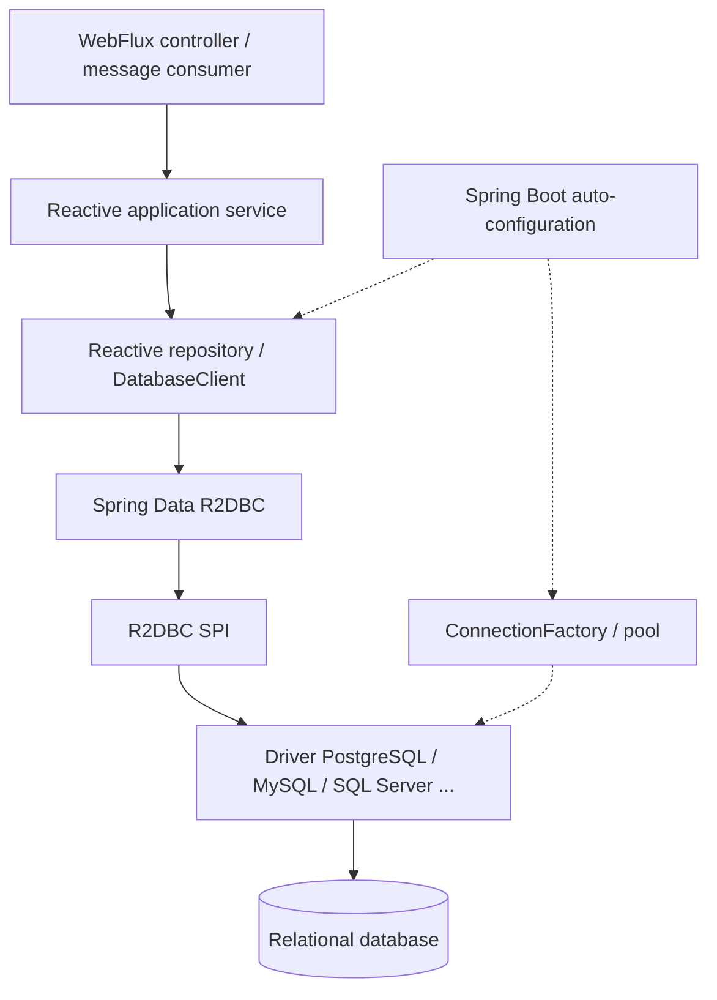

# Thiết lập spring-boot-starter-data-r2dbc và driver phù hợp

## 1. Vì sao phải chọn đúng starter và driver?

Trong một ứng dụng Spring Boot xử lý nhiều yêu cầu đồng thời, chờ dữ liệu từ database thường chiếm phần lớn thời gian của request. JDBC là mô hình quen thuộc nhưng các lệnh gọi truy vấn thường **chặn luồng đang thực hiện** cho đến khi có kết quả. **R2DBC (Reactive Relational Database Connectivity)** là đặc tả kết nối cơ sở dữ liệu quan hệ theo mô hình reactive, giúp ứng dụng tiếp tục xử lý tác vụ khác thay vì giữ một luồng chờ I/O trong lúc truy vấn.

Tuy nhiên, khai báo dependency `spring-boot-starter-data-r2dbc` **chưa đủ**: cần một **R2DBC driver** hỗ trợ database thực tế (PostgreSQL, MySQL, SQL Server, H2...), URL phù hợp driver và cấu hình kết nối. Driver là thành phần chuyển các thao tác theo R2DBC SPI thành giao thức kết nối cụ thể của database.

Bài này thuộc chương **Dữ liệu reactive** trong module **SPRING_BOOT_INTEGRATION**: tổ chức tích hợp hệ thống qua HTTP client, database, cache, broker thông điệp và adapter Spring Integration. Mục tiêu không chỉ “kết nối được database” mà còn quản lý **cấu hình, hợp đồng dữ liệu, transaction, lỗi, trùng lặp, kiểm thử và quan sát** trong luồng tích hợp thực tế.

Sau bài học, bạn có thể:

- Phân biệt **Spring Data R2DBC**, **R2DBC SPI**, **driver**, **`ConnectionFactory`** và connection pool.
- Thêm starter, chọn đúng artifact của driver và cấu hình URL/credential theo database.
- Tạo một ví dụ Spring Boot dùng `ReactiveCrudRepository` và endpoint trả về `Mono`.
- Cấu hình pool, TLS, khởi tạo schema/migration, transaction và timeout theo đúng phạm vi.
- Kiểm thử với database phù hợp production và chẩn đoán các lỗi cấu hình thường gặp.

> **Mốc phiên bản:** Ví dụ nhắm đến **Java 17+ và Spring Boot 3.2+**, với dependency được quản lý bởi BOM/parent của cùng một bản Spring Boot. Tên artifact, khả năng driver và các lựa chọn cấu hình có thể thay đổi theo phiên bản. Nếu dùng Spring Boot mới hơn, hãy kiểm tra compatibility của driver với R2DBC SPI và Spring Data R2DBC thuộc bản Boot đó trước khi pin phiên bản riêng.

## 2. R2DBC nằm ở đâu trong kiến trúc?



| Thành phần | Trách nhiệm |
|---|---|
| `spring-boot-starter-data-r2dbc` | Mang Spring Data R2DBC, các phụ thuộc cần thiết và điểm tự cấu hình tích hợp của Spring Boot |
| R2DBC SPI | Hợp đồng chuẩn cho `ConnectionFactory`, `Connection`, `Statement`, `Result` và cách phát tín hiệu Reactive Streams |
| R2DBC driver | Triển khai SPI theo protocol/database cụ thể; **không** phải JDBC driver |
| `ConnectionFactory` | Tạo kết nối R2DBC; tương ứng về mục đích với `DataSource` ở JDBC nhưng là loại API khác |
| `r2dbc-pool` | Bọc `ConnectionFactory` để tái sử dụng kết nối và giới hạn tải nếu được bật |
| `ReactiveCrudRepository` | Cung cấp thao tác CRUD reactive theo mô hình repository |
| `R2dbcEntityTemplate` / `DatabaseClient` | API thao tác SQL linh hoạt, thích hợp khi query không chỉ là CRUD đơn giản |

Khi controller WebFlux trả về `Mono<T>` hoặc `Flux<T>`, framework phụ trách subscribe ở ranh giới HTTP. Spring Data R2DBC trả về Publisher tương ứng; ta **không tự gọi `.subscribe()` hoặc `.block()` trong luồng xử lý reactive**. Điều này khác hẳn việc chỉ bọc một lệnh JDBC blocking vào `Mono.just(...)`: lệnh JDBC đã chạy và chặn trước khi Publisher được tạo.

**Chọn R2DBC khi** ứng dụng sử dụng reactive end-to-end, có nhiều thao tác I/O đồng thời và database có driver reactive ổn định. **JDBC/JPA có thể phù hợp hơn** khi luồng nghiệp vụ đồng bộ, cần hệ ORM phức tạp hoặc driver R2DBC của database chưa đáp ứng yêu cầu. R2DBC không mặc nhiên làm SQL nhanh hơn, không loại bỏ giới hạn của database và cũng không thay thế thiết kế index, query, transaction.

## 3. Cài đặt dependency: starter trước, driver sau

### 3.1. Ví dụ Maven cho PostgreSQL

Giả sử ứng dụng Inventory Service dùng PostgreSQL. Khi dự án đã có Spring Boot parent hoặc BOM:

```xml
<dependencies>
    <dependency>
        <groupId>org.springframework.boot</groupId>
        <artifactId>spring-boot-starter-data-r2dbc</artifactId>
    </dependency>

    <!-- Driver R2DBC dành riêng cho PostgreSQL -->
    <dependency>
        <groupId>org.postgresql</groupId>
        <artifactId>r2dbc-postgresql</artifactId>
        <scope>runtime</scope>
    </dependency>

    <!-- Chỉ cần nếu dự án cung cấp HTTP endpoint reactive -->
    <dependency>
        <groupId>org.springframework.boot</groupId>
        <artifactId>spring-boot-starter-webflux</artifactId>
    </dependency>

    <dependency>
        <groupId>org.springframework.boot</groupId>
        <artifactId>spring-boot-starter-test</artifactId>
        <scope>test</scope>
    </dependency>
    <dependency>
        <groupId>io.projectreactor</groupId>
        <artifactId>reactor-test</artifactId>
        <scope>test</scope>
    </dependency>
</dependencies>
```

Mỗi dependency có một nhiệm vụ:

1. Starter R2DBC cung cấp hạ tầng mapping, repository và tích hợp với Spring.
2. `r2dbc-postgresql` thực sự giao tiếp với PostgreSQL. Không có driver tương thích thì Spring không thể tạo kết nối từ `r2dbc:postgresql:...`.
3. WebFlux cần khi viết web API reactive. Nếu chỉ chạy batch hoặc message consumer reactive, không nhất thiết thêm web starter.
4. `reactor-test` cung cấp `StepVerifier` để kiểm tra luồng `Mono`/`Flux` trong test.

Không cần thêm `spring-boot-starter-data-jpa` chỉ để truy cập database bằng R2DBC. JPA sử dụng JDBC và mô hình blocking; thêm cả hai làm tăng độ phức tạp và có thể khiến người đọc nhầm `DataSource` với `ConnectionFactory`. Một ứng dụng **có thể** dùng cả JDBC và R2DBC khi thực sự cần, nhưng khi đó phải cấu hình và quản lý transaction riêng cho từng công nghệ.

### 3.2. Ví dụ Gradle (Kotlin DSL)

```kotlin
dependencies {
    implementation("org.springframework.boot:spring-boot-starter-data-r2dbc")
    runtimeOnly("org.postgresql:r2dbc-postgresql")

    implementation("org.springframework.boot:spring-boot-starter-webflux")

    testImplementation("org.springframework.boot:spring-boot-starter-test")
    testImplementation("io.projectreactor:reactor-test")
}
```

Không tùy tiện trộn các phiên bản Spring Data, Reactor và R2DBC SPI khác nhau. Ưu tiên dependency management của Spring Boot; driver cộng đồng không nằm trong BOM thì cần khai báo phiên bản được kiểm chứng riêng.

### 3.3. Chọn driver theo database thực

| Database | Driver R2DBC thường dùng | Dạng URL điển hình | Lưu ý |
|---|---|---|---|
| PostgreSQL | `org.postgresql:r2dbc-postgresql` | `r2dbc:postgresql://host:5432/inventory` | Phổ biến; hỗ trợ chức năng cụ thể tùy phiên bản driver |
| H2 | `io.r2dbc:r2dbc-h2` | `r2dbc:h2:mem:///testdb` | Thuận tiện cho thử nghiệm nhỏ; khác PostgreSQL về SQL/type/transaction |
| MySQL | `io.asyncer:r2dbc-mysql` | `r2dbc:mysql://host:3306/inventory` | Driver thuộc hệ sinh thái riêng; xác minh version và khả năng hỗ trợ trước khi dùng |
| Microsoft SQL Server | `io.r2dbc:r2dbc-mssql` | `r2dbc:mssql://host:1433/inventory` | Kiểm tra R2DBC SPI và tương thích phiên bản SQL Server |

Đây là các **lựa chọn phổ biến**, không phải danh mục đầy đủ hay bảo đảm tương thích ở mọi thời điểm. Với MariaDB, Oracle hoặc database khác, cần tra tài liệu driver chính thức để chọn đúng artifact, phiên bản, protocol, TLS và hạn chế tính năng.

**Phân biệt URL:**

```text
JDBC:   jdbc:postgresql://localhost:5432/inventory
R2DBC:  r2dbc:postgresql://localhost:5432/inventory
```

`org.postgresql:postgresql` là **JDBC driver** của PostgreSQL. Nó không thay thế được `org.postgresql:r2dbc-postgresql` khi sử dụng `spring.r2dbc.url`. Tương tự, có R2DBC driver không tự tạo `DataSource` JDBC.

## 4. Cấu hình kết nối PostgreSQL trong Spring Boot

### 4.1. application.yml cơ bản

```yaml
spring:
  r2dbc:
    url: ${R2DBC_URL:r2dbc:postgresql://localhost:5432/inventory}
    username: ${R2DBC_USERNAME}
    password: ${R2DBC_PASSWORD}
    pool:
      enabled: true
      initial-size: 2
      max-size: 20
      max-idle-time: 30m
      max-acquire-time: 2s
```

Trong ví dụ, URL mặc định chỉ để chạy local; username/password vẫn phải được cung cấp từ môi trường hoặc secret manager. Ở production, nên yêu cầu cung cấp `R2DBC_URL` rõ ràng và kiểm tra database name/host thuộc môi trường đúng.

Các trường chính:

| Thuộc tính | Vai trò |
|---|---|
| `spring.r2dbc.url` | Chọn driver bằng protocol và chỉ định database |
| `spring.r2dbc.username` / `password` | Tài khoản database; chỉ cấp quyền cần thiết |
| `spring.r2dbc.pool.enabled` | Bật pool khi thư viện pool có mặt trong classpath |
| `initial-size` | Số kết nối ban đầu; quá cao có thể tạo spike khi nhiều instance khởi động |
| `max-size` | Giới hạn kết nối mỗi instance; phải tính chung với số pod/replica |
| `max-idle-time` | Giảm số kết nối nhàn rỗi theo chính sách pool |
| `max-acquire-time` | Thời gian tối đa chờ mượn kết nối từ pool, không phải toàn bộ thời gian query |

Spring Boot có thể tự cấu hình pooled `ConnectionFactory` khi `r2dbc-pool` hiện diện. Starter hiện đại thường đưa thành phần cần thiết qua dependency, nhưng phải **kiểm tra dependency tree** nếu dự án dùng exclusions hoặc cấu hình đặc biệt. Nếu thiếu thư viện pool, đặt `enabled: true` không tạo được một implementation pooling từ hư không.

**Tính ngân sách kết nối:** Nếu có 6 instance Inventory Service, mỗi instance `max-size=20`, tổng kết nối lý thuyết từ ứng dụng có thể tới **120**, chưa tính công cụ migration, job, dịch vụ khác và kết nối quản trị. Giá trị pool cần phù hợp `max_connections` của PostgreSQL và tải truy vấn đã đo, không tự tăng tối đa để chữa SQL chậm.

### 4.2. Boot tạo bean nào?

Khi dependency, URL và thông tin kết nối hợp lệ, Spring Boot thường tự cấu hình:

- `ConnectionFactory` R2DBC (có thể được bọc bởi pool).
- `DatabaseClient` và hạ tầng Spring Data R2DBC như `R2dbcEntityTemplate`.
- Repository reactive trong phạm vi package được quét.
- Reactive transaction manager phù hợp với `ConnectionFactory`.

Vì vậy, trong trường hợp đơn giản **không cần tự viết `@Bean ConnectionFactory`**. Nếu tự định nghĩa một bean cùng loại, auto-configuration có thể backing off; lúc đó cần tự chịu trách nhiệm cấu hình properties, pool, TLS, metrics và transaction đúng cách.

### 4.3. Khi nào cần TLS?

Với production, kết nối database từ node/pod khác nên có mã hóa và kiểm tra danh tính server theo chính sách hạ tầng. PostgreSQL R2DBC driver có các tùy chọn SSL/TLS riêng theo phiên bản, chẳng hạn chế độ xác minh CA/hostname. Ví dụ minh họa dạng URL:

```text
r2dbc:postgresql://db.internal.example:5432/inventory?sslMode=VERIFY_FULL
```

Đoạn URL nêu ý định **xác minh đầy đủ chứng chỉ/hostname**; muốn chạy thật còn phải phân phối CA/trust material đúng cơ chế của driver, bảo đảm certificate có SAN khớp hostname và server bật TLS. Kiểm tra option name, cách nạp trust material và mức hỗ trợ `VERIFY_FULL` với **phiên bản driver đang dùng**. Không dùng chế độ tắt xác minh chứng chỉ hoặc `trust-all` để “sửa” kết nối production.

Phân biệt **transport TLS**, **quyền SQL** và **secret management**: TLS không tự cấp quyền thao tác bảng; tài khoản DB vẫn cần least privilege, luân chuyển mật khẩu và cơ chế audit theo yêu cầu.

### 4.4. Pool timeout, network timeout và query timeout khác nhau

Một truy vấn có thể chờ kết nối trong pool, thiết lập TCP/TLS, chờ PostgreSQL xử lý câu lệnh và chờ dữ liệu trả về. Những giới hạn này không đồng nghĩa:

| Giai đoạn | Mục đích giới hạn | Nơi cấu hình |
|---|---|---|
| Pool acquire | Không đợi mượn kết nối vô hạn khi pool đầy | `spring.r2dbc.pool.max-acquire-time` |
| TCP connection | Hạn chế thời gian mở kết nối | Tùy chọn riêng của R2DBC driver |
| Execute statement | Không để query chạy quá lâu | Query timeout/statement timeout do driver hoặc database hỗ trợ |
| Cả nghiệp vụ | Tổng thời gian phải trả lời HTTP hoặc xử lý event | Deadline tại application/service |

Có thể thêm `.timeout(Duration.ofSeconds(3))` cho `Mono` ở một nghiệp vụ; nhưng điều đó là **giới hạn cho Publisher**, không nên mặc nhiên coi là đã ngừng SQL đang chạy trên database. Đặc tính hủy câu lệnh khi cancel phụ thuộc driver/server. Cần xác minh timeout, connection recovery và query cancellation bằng kiểm thử tích hợp thực.

## 5. Tạo schema cho ứng dụng Inventory

Ví dụ giữ hàng dùng bảng nhỏ:

```sql
CREATE TABLE stock_item (
    sku VARCHAR(80) PRIMARY KEY,
    available BIGINT NOT NULL CHECK (available >= 0),
    version BIGINT NOT NULL DEFAULT 0
);
```

Lúc phát triển local, có thể dùng `src/main/resources/schema.sql` cùng:

```yaml
# application-local.yml
spring:
  sql:
    init:
      mode: always
```

Spring Boot hỗ trợ khởi tạo schema SQL khi có `ConnectionFactory` tương thích. **Không dùng `schema.sql` như công cụ migration production**: nhiều lần triển khai hoặc thay đổi bảng có thể gây lỗi. Ở production nên dùng một công cụ quản lý version schema như Flyway/Liquibase, có quy trình phê duyệt migration và rollback/forward-fix.

### 5.1. Flyway vẫn thường dùng kết nối JDBC để migration

Mặc dù ứng dụng truy vấn dữ liệu bằng R2DBC, nhiều công cụ migration chạy qua **JDBC**. Ví dụ cấu hình nguyên tắc:

```yaml
spring:
  r2dbc:
    url: ${R2DBC_URL}
    username: ${R2DBC_USERNAME}
    password: ${R2DBC_PASSWORD}
  flyway:
    enabled: true
    url: ${FLYWAY_JDBC_URL}
    user: ${FLYWAY_USER}
    password: ${FLYWAY_PASSWORD}
    locations: classpath:db/migration
```

Nếu chọn Flyway, cần thêm dependency Flyway, **JDBC driver tương ứng**, và có thể thêm module hỗ trợ riêng database theo phiên bản Flyway. URL Flyway phải là `jdbc:postgresql://...` chứ không phải URL R2DBC. Cấu hình độc lập này giúp ứng dụng **vẫn dùng R2DBC cho runtime**, nhưng không nên tự suy rằng migration JDBC và các transaction R2DBC dùng chung một connection/transaction.

Đối với hệ nhiều instance, xác định rõ quy trình một lần thực thi migration, schema baseline và thời điểm cho phép service nhận traffic. Không để một instance dùng schema mới trong khi instance khác còn chạy giả định cũ mà thiếu kế hoạch tương thích.

## 6. Viết entity, repository và API reactive

### 6.1. Entity trong Spring Data R2DBC

```java
// StockItem.java
import org.springframework.data.annotation.Id;
import org.springframework.data.annotation.Version;
import org.springframework.data.relational.core.mapping.Table;

@Table("stock_item")
public record StockItem(
        @Id String sku,
        long available,
        @Version Long version
) {}
```

`@Table` ánh xạ đến bảng SQL; `@Id` định danh record; `@Version` hỗ trợ optimistic locking khi dùng những thao tác save/update có hỗ trợ version. Trong ví dụ, field `version` là `Long` để có thể là `null` khi tạo mới. Với entity có ID ứng dụng tự cấp, Spring Data có thể dùng trạng thái version `null` để nhận biết entity mới; khi lưu, framework sẽ quản lý giá trị version theo cơ chế mapping của nó.

Lưu ý:

- Spring Data R2DBC **không phải JPA reactive**. Đừng dùng `@Entity`, `@ManyToOne` hoặc mong đợi lazy-loaded JPA association.
- Relationship và aggregate cần được thiết kế tường minh qua khóa, query/join, DTO hoặc `R2dbcEntityTemplate`.
- Với các thao tác update SQL viết tay, **`@Version` không tự bổ sung điều kiện kiểm tra và tăng version**; query tự viết phải xử lý điều kiện/field liên quan nếu hợp đồng cần.

### 6.2. Repository và truy vấn cập nhật an toàn

```java
// StockRepository.java
import org.springframework.data.r2dbc.repository.Query;
import org.springframework.data.r2dbc.repository.Modifying;
import org.springframework.data.repository.query.Param;
import org.springframework.data.repository.reactive.ReactiveCrudRepository;
import reactor.core.publisher.Mono;

public interface StockRepository
        extends ReactiveCrudRepository<StockItem, String> {

    @Modifying
    @Query("""
        UPDATE stock_item
           SET available = available - :quantity,
               version = version + 1
         WHERE sku = :sku
           AND available >= :quantity
        """)
    Mono<Integer> reserveIfAvailable(
            @Param("sku") String sku,
            @Param("quantity") long quantity
    );
}
```

Một câu lệnh `UPDATE ... WHERE available >= :quantity` thực hiện kiểm tra và giảm số lượng **trong cùng câu lệnh SQL**, giúp tránh race giữa thao tác “đọc còn hàng” và “ghi giảm hàng”. Khi update ảnh hưởng `0` hàng, chưa chắc chỉ có một nguyên nhân: SKU có thể không tồn tại hoặc số hàng không đủ. Nếu caller cần phân biệt hai trường hợp, cần thêm truy vấn hoặc thiết kế mã lỗi phù hợp mà vẫn xử lý các cạnh tranh đồng thời.

Ví dụ này minh họa cập nhật tồn kho trong một bảng. Để **giữ hàng đúng nghiệp vụ** giữa request retry, cần thêm bảng `reservation` với unique key theo operation ID và một transaction thiết kế phù hợp; chỉ cập nhật `available` không đủ bảo đảm idempotency qua các lần gọi lặp.

### 6.3. Service không block thread

```java
// StockService.java
import org.springframework.stereotype.Service;
import reactor.core.publisher.Mono;

@Service
public class StockService {
    private final StockRepository stockRepository;

    public StockService(StockRepository stockRepository) {
        this.stockRepository = stockRepository;
    }

    public Mono<StockItem> getStock(String sku) {
        return stockRepository.findById(sku);
    }

    public Mono<Boolean> reserveStock(String sku, long quantity) {
        if (sku == null || sku.isBlank() || quantity <= 0) {
            return Mono.error(
                    new IllegalArgumentException("SKU và số lượng không hợp lệ"));
        }
        return stockRepository.reserveIfAvailable(sku, quantity)
                .map(affectedRows -> affectedRows == 1);
    }
}
```

Với `Mono<Boolean>`, `false` là “không có hàng nào được cập nhật”, **không phải** “dịch vụ database không sẵn sàng”. Lỗi kết nối, SQL, pool hoặc timeout nên được phát ra bằng tín hiệu lỗi, ánh xạ thành exception tích hợp thích hợp ở ranh giới ứng dụng.

### 6.4. Endpoint WebFlux

```java
// StockController.java
import org.springframework.http.ResponseEntity;
import org.springframework.web.bind.annotation.GetMapping;
import org.springframework.web.bind.annotation.PathVariable;
import org.springframework.web.bind.annotation.RequestMapping;
import org.springframework.web.bind.annotation.RestController;
import reactor.core.publisher.Mono;

@RestController
@RequestMapping("/stocks")
public class StockController {
    private final StockService stockService;

    public StockController(StockService stockService) {
        this.stockService = stockService;
    }

    @GetMapping("/{sku}")
    public Mono<ResponseEntity<StockItem>> getStock(
            @PathVariable String sku
    ) {
        return stockService.getStock(sku)
                .map(ResponseEntity::ok)
                .defaultIfEmpty(ResponseEntity.notFound().build());
    }
}
```

Điểm đáng chú ý: controller trả `Mono<ResponseEntity<StockItem>>` thay vì gọi `.block()` để lấy `StockItem`. Khi không có dữ liệu, repository trả `Mono.empty()` và endpoint biến thành `404`. Khi có lỗi database, Publisher phát tín hiệu lỗi; handler tập trung quyết định HTTP status, logging và retry policy.

Nếu chỉ thêm `spring-boot-starter-data-r2dbc` mà ứng dụng vẫn dùng controller servlet/Spring MVC và nhiều dependency blocking, việc dùng `Mono` ở một repository không tự biến toàn bộ request pipeline thành non-blocking. Thiết kế cần đánh giá từ HTTP/consumer, cache, database đến downstream client.

## 7. Transaction reactive và ranh giới tích hợp

R2DBC hỗ trợ transaction tại connection/database phù hợp. Trong Spring, transaction reactive gắn với **Reactor Context** của subscription, khác cách buộc transaction vào thread trong nhiều ứng dụng JDBC truyền thống. Vì vậy:

- Method reactive dùng `@Transactional` thường phải trả về `Mono`/`Flux` để chuỗi thao tác database thực thi trong cùng reactive transaction khi được subscribe đúng cách.
- Nếu muốn kết hợp nhiều thao tác thành một transaction, có thể dùng `@Transactional` hoặc `TransactionalOperator` với `ReactiveTransactionManager`.
- Không tự gọi `.subscribe()` ở giữa transaction service; subscription riêng có thể tách thao tác khỏi transaction context.
- Tránh chuyển một bước sang JDBC blocking và giả định nó tự dùng cùng connection/transaction của R2DBC.
- Transaction trên một database **không bao trùm** lời gọi HTTP, cache Redis hoặc broker Kafka/RabbitMQ; cần outbox, idempotency, saga/compensation hoặc đối soát khi nghiệp vụ đi qua nhiều hệ thống.

Ví dụ kết hợp giảm tồn kho với ghi bản ghi giữ hàng (khung thiết kế; cần định nghĩa `ReservationRepository` và entity phù hợp trong ứng dụng):

```java
@Transactional
public Mono<Reservation> reserveAndRecord(Reservation request) {
    return stockRepository
            .reserveIfAvailable(request.sku(), request.quantity())
            .flatMap(rows -> {
                if (rows != 1) {
                    return Mono.error(
                            new InsufficientStockException(request.sku()));
                }
                return reservationRepository.save(request);
            });
}
```

Hai thao tác R2DBC có thể tham gia cùng transaction khi cùng transaction manager, cùng database và không tách subscription. Tuy nhiên đoạn mã này **chưa chống lệnh trùng**: cần unique constraint theo operation ID, xử lý duplicate key và quy định trả lại kết quả cũ khi một request lặp lại. Lỗi `OptimisticLockingFailureException` từ các thao tác lưu có kiểm tra `@Version` cũng cần chính sách retry/đối soát có giới hạn, không retry mọi lệnh ghi vô điều kiện.

### Khi xử lý event từ broker

Giả sử Inventory nhận sự kiện `ReserveRequested(orderId, sku, quantity, operationId)`. Consumer có thể nhận lại thông điệp sau crash hoặc timeout, dù lần đầu database đã commit. Transaction database không ngăn broker phát lại. Thiết kế thường gồm:

1. Lưu `operationId` trong bảng reservation với unique constraint.
2. Cập nhật tồn kho và reservation trong cùng database transaction.
3. Ghi outbox event cùng transaction nếu cần phát `ReservationCompleted`.
4. Khi nhận lại event, đọc trạng thái operation ID rồi trả kết quả đã xác định, không giảm số lượng lần hai.
5. Một worker publish outbox có thể phát lại event; downstream consumer cũng cần idempotent.

Đây là nơi R2DBC kết hợp với HTTP client, cache, broker và adapter Spring Integration theo phạm vi của module: chọn đúng driver chỉ là bước đầu, tính nhất quán của toàn luồng cần được thiết kế ở cấp ứng dụng.

## 8. Kiểm thử: từ dependency đến database thật

### 8.1. Test cấu hình và repository

Một test unit sử dụng mock repository không xác minh được driver, schema SQL, PostgreSQL type, pool hay transaction. Với repository R2DBC, nên có integration test chạy với **cùng họ database production**, chẳng hạn PostgreSQL qua Testcontainers.

Ví dụ dependency test (Maven, trong dự án dùng Spring Boot quản lý version):

```xml
<dependency>
    <groupId>org.springframework.boot</groupId>
    <artifactId>spring-boot-testcontainers</artifactId>
    <scope>test</scope>
</dependency>
<dependency>
    <groupId>org.testcontainers</groupId>
    <artifactId>junit-jupiter</artifactId>
    <scope>test</scope>
</dependency>
<dependency>
    <groupId>org.testcontainers</groupId>
    <artifactId>postgresql</artifactId>
    <scope>test</scope>
</dependency>
```

Với Spring Boot 3.2+, có thể dùng `@ServiceConnection` để cung cấp thông tin kết nối từ container vào auto-configuration:

```java
// StockRepositoryTest.java (imports rút gọn)
@DataR2dbcTest
@Testcontainers
@TestPropertySource(properties = "spring.sql.init.mode=always")
class StockRepositoryTest {

    @Container
    @ServiceConnection
    static PostgreSQLContainer<?> postgres =
            new PostgreSQLContainer<>("postgres:16-alpine");

    @Autowired
    StockRepository repository;

    @Test
    void reserveUpdatesStockAtomically() {
        Mono<String> operation = repository
                .save(new StockItem("SKU-TEST-1", 3, null))
                .then(repository.reserveIfAvailable("SKU-TEST-1", 2))
                .flatMap(rows -> repository.findById("SKU-TEST-1")
                        .map(item -> rows + ":" + item.available()));

        StepVerifier.create(operation)
                .expectNext("1:1")
                .verifyComplete();
    }
}
```

Trong test này, file `schema.sql` ở test resources hoặc main resources phải tạo bảng `stock_item`; nếu database container không có schema, cần bật khởi tạo test như ví dụ hoặc chạy migration. `@DataR2dbcTest` chỉ nạp các bean liên quan đến R2DBC nên phù hợp kiểm tra repository và mapping. Bản Testcontainers/Boot đang dùng phải hỗ trợ `@ServiceConnection` tạo đúng `R2dbcConnectionDetails`; khi không có tích hợp này, có thể cung cấp `spring.r2dbc.url`/credentials bằng `@DynamicPropertySource`.

Test có thể chạy cần Docker/Testcontainers sẵn sàng, đây là **hướng dẫn viết test**, không phải kết quả thực thi của bài học. Nếu bảng test dùng dữ liệu từ nhiều ca, bảo đảm isolation bằng container mới, rollback transaction test hoặc dọn dữ liệu có kiểm soát.

### 8.2. Những ca bắt buộc kiểm tra

| Test | Mục tiêu |
|---|---|
| Kết nối PostgreSQL thành công | Driver được load, URL/credential/schema đúng |
| Thiếu R2DBC driver | Ứng dụng báo lỗi cấu hình rõ, không dùng nhầm JDBC |
| `GET` SKU tồn tại và không tồn tại | Dữ liệu và HTTP `404` đúng |
| Giảm tồn kho đủ số lượng | Affected rows `1`, số lượng giảm đúng |
| Giảm quá tồn kho | Affected rows `0`, không âm tồn kho |
| Nhiều request đồng thời | Không có lost update; kiểm tra SQL điều kiện và transaction |
| Lưu entity có `@Version` lỗi thời | Phát hiện optimistic locking khi dùng thao tác save phù hợp |
| Pool tối đa đạt giới hạn | Thời gian chờ acquire hữu hạn; lỗi phát ra có thể quan sát |
| Mất kết nối/TLS sai CA | Không truy cập database, không tự tiếp tục như thành công |
| SQL lỗi hoặc timeout | Truyền lỗi có ngữ nghĩa, transaction rollback nếu cần |
| Event lặp cùng operation ID | Không giảm tồn kho lần hai |
| Migration | Bản schema thực được áp dụng và tương thích với mapping |

Khi dùng H2 để test, đừng coi pass là đủ chứng minh production PostgreSQL cũng đúng: cú pháp SQL, kiểu `JSONB`, lock/transaction và câu lệnh cập nhật có thể khác nhau.

## 9. Chẩn đoán sự cố và vận hành

### 9.1. Các lỗi cấu hình thường gặp

| Triệu chứng | Nguyên nhân khả dĩ | Hướng xử lý |
|---|---|---|
| Không tạo được `ConnectionFactory` | Thiếu driver R2DBC, URL sai scheme, driver không tương thích | Kiểm tra dependency tree, `spring.r2dbc.url`, provider thực |
| Có JDBC driver nhưng không kết nối R2DBC | Nhầm `org.postgresql:postgresql` với `r2dbc-postgresql` | Thêm đúng driver R2DBC |
| Password authentication failed | Sai secret, role hoặc database | Kiểm tra secret, grants và môi trường; không log password |
| Connection refused / name resolution | Host, port, mạng, service DNS | Kiểm tra đường mạng và hostname cấu hình |
| TLS handshake / certificate failure | Sai CA, SAN, mode xác minh, thời hạn cert | Sửa trust material/certificate, giữ xác minh TLS |
| Pool acquire timeout | Pool hết kết nối, query lâu hoặc leak | Đo thời gian query, số request đồng thời, pool usage; tối ưu SQL và sizing |
| Relation `stock_item` does not exist | Chưa chạy schema/migration hoặc sai schema | Xác minh migration, search path và quyền database |
| `No property...` / mapping exception | Entity, column, type mapping không khớp | Kiểm tra tên bảng/cột, converter và schema |
| `Blocking call!` / độ trễ bất thường | Gọi `.block()` hoặc dùng thư viện JDBC blocking trong flow | Loại bỏ blocking hoặc tách rõ nhánh imperative |
| Transaction không rollback như mong đợi | Tự subscribe, trộn transaction manager hoặc lỗi bị nuốt | Giữ một reactive chain và để lỗi propagate |

Ở môi trường nhiều database, kiểm tra R2DBC driver có hỗ trợ đúng type/protocol đang dùng; không đoán rằng cú pháp URL hoặc option TLS của PostgreSQL có thể sao chép sang MySQL/SQL Server.

### 9.2. Observability và bảo mật

Trên hệ thống thật, nên theo dõi tối thiểu:

- Độ trễ query và phân phối p95/p99, lỗi connection/SQL/timeout theo loại operation (không theo từng SKU).
- Tốc độ mượn kết nối, số connection đang dùng/rảnh/chờ (nếu pool có metrics tương ứng), timeout acquire.
- Tỷ lệ giao dịch thành công/rollback, số optimistic lock conflict, deadlock hoặc serialization failure.
- Correlation/trace ID nối từ HTTP request, message consumer đến hoạt động database; cần thiết lập tracing/instrumentation cụ thể mới có đầy đủ span.
- Trạng thái migration, version schema và sự tương thích schema giữa các instance.

Không log connection URL có mật khẩu, credentials, token, dữ liệu cá nhân hay nội dung SQL chứa tham số nhạy cảm. Tránh dùng `sku`, `orderId`, `operationId` hoặc SQL statement thô làm label metric có cardinality không giới hạn. Nếu truy vấn liên quan dữ liệu tài chính/nhân sự, cần kiểm soát quyền database đến bảng/schema theo least privilege.

### 9.3. Thứ tự triển khai gợi ý

1. Chốt database thực tế, phiên bản server và yêu cầu TLS.
2. Thêm starter Spring Data R2DBC, đúng driver, giữ compatibility với BOM.
3. Cấu hình URL/credentials/connection pool bằng environment và secret manager.
4. Chuẩn bị schema/migration theo quy trình có kiểm soát.
5. Xây entity, repository, service và endpoint reactive, tránh chặn luồng.
6. Kiểm thử repository với database thật; bổ sung lỗi, transaction và cạnh tranh đồng thời.
7. Đo pool, query, timeout và đặt ngân sách thời gian phù hợp trong toàn luồng tích hợp.

## 10. Tự kiểm tra

1. `spring-boot-starter-data-r2dbc` mang lại những gì, và vì sao vẫn cần thêm driver riêng?
2. Tại sao `jdbc:postgresql://...` không dùng được thay cho `r2dbc:postgresql://...`?
3. `ConnectionFactory` khác `DataSource` như thế nào? Hai loại này có tự chia sẻ transaction không?
4. Khi nào nên chọn R2DBC thay cho JDBC/JPA? R2DBC có làm SQL nhanh hơn không?
5. Vì sao phải tính tổng connection pool từ tất cả instance thay vì chỉ nhìn `max-size` của một pod?
6. Pool acquire timeout và statement timeout khác nhau ở đâu?
7. Khi update số lượng tồn kho, tại sao một câu `UPDATE ... WHERE available >= quantity` an toàn hơn tách đọc rồi ghi?
8. `@Version` có bảo vệ tự động mọi truy vấn SQL tự viết bằng `@Query` không?
9. Vì sao transaction R2DBC không bao trùm HTTP, Redis và broker, và cơ chế nào giúp xử lý message trùng?
10. Tại sao phải có integration test với PostgreSQL thật nếu production dùng PostgreSQL?

**Ghi nhớ:** Thiết lập Spring Data R2DBC cần **cả starter, driver tương thích, URL `r2dbc:...`, `ConnectionFactory` và cấu hình kết nối phù hợp**. Sau khi kết nối được, những yếu tố quyết định chất lượng tích hợp là thiết kế SQL/transaction, pool và timeout, bảo mật TLS/secret, migration, kiểm thử với database thật và quan sát khả năng hoạt động của luồng reactive.
