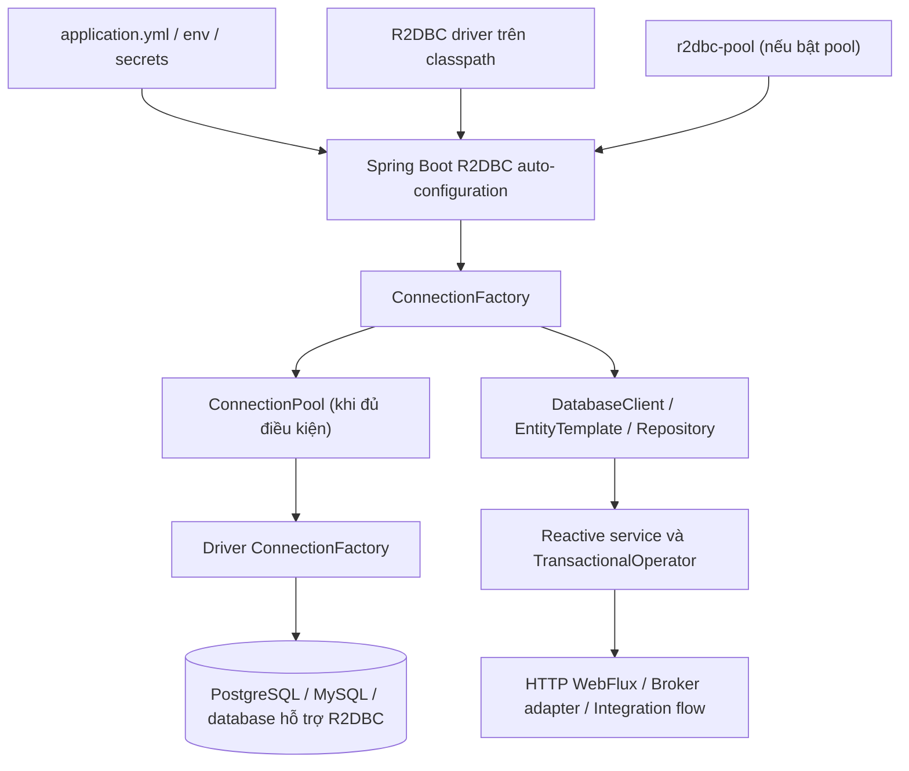
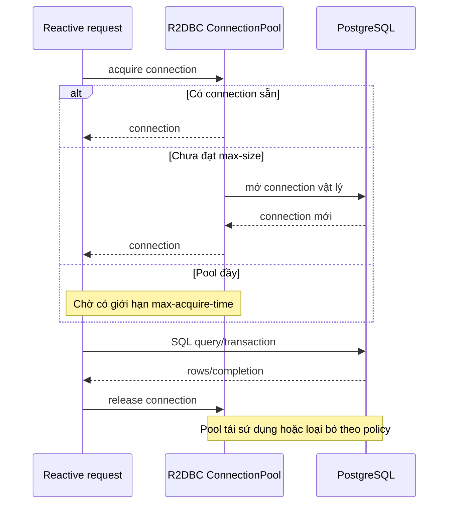
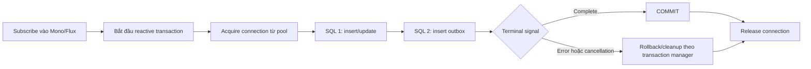
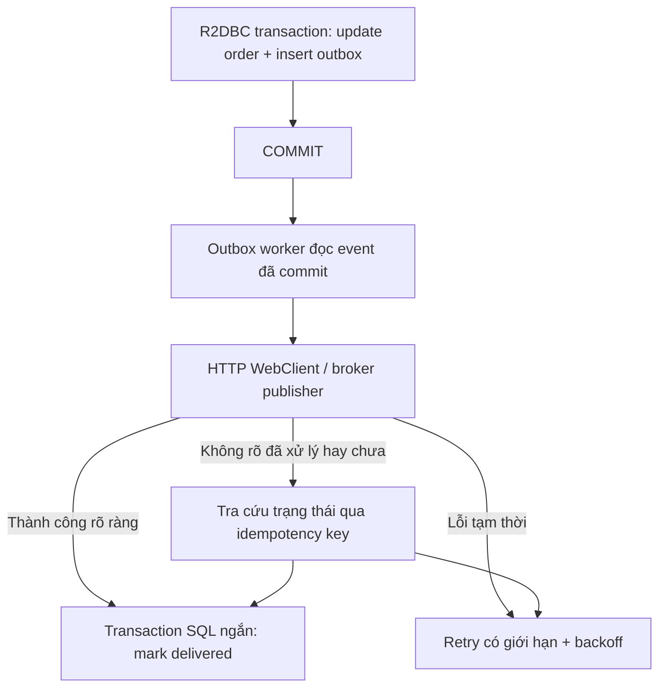

# Cấu hình spring.r2dbc.* và connection pool

> **Chương:** Dữ liệu reactive  
> **Phạm vi:** Trong module **SPRING_BOOT_INTEGRATION**, ứng dụng Spring Boot trao đổi dữ liệu qua HTTP client, SQL, cache, broker thông điệp và các adapter Spring Integration. Bài này đi sâu vào cấu hình **R2DBC**, cách Spring Boot tạo `ConnectionFactory`, cách tổ chức **connection pool** cho SQL reactive và các hệ quả đối với hợp đồng dữ liệu, giao dịch, lỗi, xử lý trùng lặp, kiểm thử và quan sát.

## 1. Vì sao kết nối SQL reactive cần cấu hình riêng?

Giả sử một dịch vụ nhận các sự kiện đơn hàng qua broker, ghi trạng thái vào PostgreSQL và cung cấp endpoint WebFlux để tra cứu. Mỗi request có thể cần một kết nối SQL, nhưng ứng dụng không thể tạo một kết nối vật lý mới cho mọi truy vấn hoặc giữ kết nối vô hạn.

Trong JDBC/JPA, thao tác database thường là **blocking** trên thread đang thực hiện. **R2DBC** (*Reactive Relational Database Connectivity*) cung cấp API truy cập database theo Reactive Streams, không buộc mỗi truy vấn phải đợi đồng bộ trên một thread của ứng dụng. Spring Data R2DBC, `DatabaseClient` và `R2dbcEntityTemplate` có thể sử dụng kết nối R2DBC để thực hiện các thao tác theo `Mono`/`Flux`.

Tuy nhiên, **reactive không có nghĩa không có giới hạn tài nguyên**:

- Database vẫn giới hạn số connection, transaction, CPU, bộ nhớ và I/O.
- Mỗi truy vấn/transaction cần lấy được một connection từ nguồn kết nối.
- Quá nhiều subscriber đồng thời có thể làm pool cạn và tăng thời gian chờ.
- Quá ít connection có thể khiến dịch vụ xử lý chậm dù event-loop không bị blocking.
- Một transaction reactive dài có thể giữ connection trong thời gian dài, làm cạn pool.

Vì vậy phải hiểu **ba khái niệm khác nhau**: `ConnectionFactory` tạo kết nối, `ConnectionPool` tái sử dụng và giới hạn kết nối, còn chính sách concurrency/timeout của ứng dụng quyết định tải thực sự được đưa tới pool.

## 2. Những tầng liên quan trong Spring Boot

| Tầng | Thành phần | Trách nhiệm |
| --- | --- | --- |
| **R2DBC SPI** | `io.r2dbc.spi.ConnectionFactory`, `Connection` | Hợp đồng truy cập SQL theo reactive API |
| **R2DBC driver** | `r2dbc-postgresql` hoặc driver tương thích database | Triển khai giao tiếp wire protocol, TLS, authentication và I/O tới database |
| **R2DBC Pool** | `io.r2dbc.pool.ConnectionPool` | Giới hạn số connection, cho mượn/trả, timeout, kiểm tra và loại bỏ connection |
| **Spring Data R2DBC** | `DatabaseClient`, `R2dbcEntityTemplate`, `ReactiveCrudRepository` | SQL binding, ánh xạ dữ liệu, repository và tích hợp Reactor |
| **Spring transaction** | `R2dbcTransactionManager`, `TransactionalOperator` | Quản lý transaction reactive theo Reactor context |
| **Spring Boot** | R2DBC auto-configuration, `spring.r2dbc.*` | Bind properties và tạo các bean khi classpath/điều kiện phù hợp |

`spring.r2dbc.*` là nhóm thuộc tính Spring Boot dành cho kết nối SQL **R2DBC**, khác với `spring.datasource.*` của JDBC. Chúng có thể cùng xuất hiện nếu ứng dụng thực sự dùng cả hai loại kết nối, nhưng không được giả định hai pool và hai transaction manager là một.



Sơ đồ thể hiện các vai trò, **không phải thứ tự phụ thuộc bean chính xác**: khi có pool, `ConnectionFactory` được inject vào Spring Data thường chính là pool bao ngoài driver factory. Không có pool thì `ConnectionFactory` trỏ trực tiếp tới driver.

## 3. Dependency và yêu cầu môi trường

Ví dụ một ứng dụng **Spring Boot 3.x**, Java 17+ và PostgreSQL:

```xml
<dependencies>
    <dependency>
        <groupId>org.springframework.boot</groupId>
        <artifactId>spring-boot-starter-data-r2dbc</artifactId>
    </dependency>
    <dependency>
        <groupId>org.postgresql</groupId>
        <artifactId>r2dbc-postgresql</artifactId>
        <scope>runtime</scope>
    </dependency>
</dependencies>
```

Spring Boot quản lý version của các thư viện nằm trong BOM tương ứng; tránh tự override ngẫu nhiên các phiên bản Spring Data, Reactor, SPI, driver và pool. Để dùng pooling, **`io.r2dbc:r2dbc-pool` phải có trên runtime classpath** (thường được kéo vào qua starter dữ liệu reactive phù hợp). Nếu dependency tree không có thư viện này, cần thêm:

```xml
<!-- Chỉ cần khai báo trực tiếp nếu chưa có qua dependency bắc cầu -->
<dependency>
    <groupId>io.r2dbc</groupId>
    <artifactId>r2dbc-pool</artifactId>
</dependency>
```

Một ứng dụng khác có thể cần cả `spring-boot-starter-webflux` để phục vụ HTTP reactive, nhưng **WebFlux không phải điều kiện bắt buộc để sử dụng R2DBC** trong worker hoặc message consumer. Ngược lại, việc thêm WebFlux mà vẫn truy vấn bằng JDBC/JPA không tự chuyển SQL sang non-blocking.

**Kiểm tra thực tế:** cần có driver R2DBC đúng loại database, cấu hình kết nối đúng và database đã khởi động. Tạo được `ConnectionFactory` không đồng nghĩa kết nối đã được thử thành công: nhiều driver/pool thiết lập connection khi được sử dụng lần đầu.

## 4. Cấu hình `spring.r2dbc.*` cơ bản

Ví dụ cấu hình PostgreSQL theo Spring Boot 3.x:

```yaml
spring:
  r2dbc:
    url: ${R2DBC_URL:r2dbc:postgresql://localhost:5432/orderdb}
    username: ${DB_USER:order_app}
    password: ${DB_PASSWORD}

    pool:
      enabled: true
      initial-size: 3
      max-size: 20
      max-idle-time: 15m
      max-life-time: 60m
      max-acquire-time: 2s
      max-create-connection-time: 3s
      validation-query: SELECT 1
```

Đây là **giá trị minh họa**, không phải cấu hình tối ưu cho mọi môi trường. Database phải có đủ connection cho tất cả instance ứng dụng và các workload khác. Trong production, không hardcode mật khẩu; dùng secret manager hoặc biến môi trường. Nếu kết nối đi qua mạng không tin cậy, cấu hình TLS và kiểm tra certificate theo yêu cầu bảo mật của database/driver.

Các thuộc tính cốt lõi:

| Thuộc tính | Vai trò | Điểm cần cẩn thận |
| --- | --- | --- |
| `spring.r2dbc.url` | Địa chỉ và giao thức R2DBC | Bắt đầu bằng `r2dbc:`, không phải `jdbc:` |
| `spring.r2dbc.username` | Tài khoản SQL | Nên là tài khoản có quyền tối thiểu cần thiết |
| `spring.r2dbc.password` | Mật khẩu SQL | Lấy từ secret, tránh ghi log/commit vào repository |
| `spring.r2dbc.pool.enabled` | Cho phép sử dụng connection pool khi thư viện và điều kiện tương ứng hiện diện | Không giả định bật flag là đủ nếu thiếu `r2dbc-pool` |
| `spring.r2dbc.pool.initial-size` | Số connection ban đầu pool hướng tới | Khởi tạo quá nhiều connection trên nhiều instance có thể gây áp lực lúc deploy |
| `spring.r2dbc.pool.max-size` | Giới hạn connection pool cho mỗi instance/factory | Phải tính theo tổng instance và giới hạn DB |
| `spring.r2dbc.pool.max-idle-time` | Thời gian connection rảnh tối đa trước khi có thể bị loại bỏ | Không phải thời hạn thực thi một truy vấn |
| `spring.r2dbc.pool.max-life-time` | Tuổi thọ connection tối đa | Khác với timeout HTTP/transaction, tùy cơ chế pool |
| `spring.r2dbc.pool.max-acquire-time` | Giới hạn thời gian chờ lấy connection | Khi pool cạn sẽ có lỗi thay vì chờ vô hạn |
| `spring.r2dbc.pool.max-create-connection-time` | Giới hạn thời gian tạo connection vật lý | Không thay thế toàn bộ connect/command timeout của driver |
| `spring.r2dbc.pool.validation-query` | Truy vấn dùng để kiểm tra connection khi pool áp dụng | Tăng thêm overhead; thử đúng dialect DB |

Không phải mọi nhóm properties hoặc driver option đều giống nhau giữa các phiên bản Spring Boot/R2DBC. Trước khi copy sang môi trường production, đối chiếu **configuration metadata và dependency tree của chính phiên bản Boot đang chạy**.

### 4.1. Phân biệt URL R2DBC và JDBC

```properties
# URL dùng bởi R2DBC ConnectionFactory
spring.r2dbc.url=r2dbc:postgresql://localhost:5432/orderdb

# URL JDBC, dùng bởi DataSource nếu ứng dụng cấu hình JDBC
spring.datasource.url=jdbc:postgresql://localhost:5432/orderdb
```

Không thay `r2dbc:postgresql` bằng `jdbc:postgresql` khi tạo `ConnectionFactory`; driver JDBC không triển khai R2DBC SPI. Driver options khác như SSL mode, socket timeout, connect timeout cấp driver thường được truyền bằng URL hoặc `spring.r2dbc.properties.*` **theo tài liệu của driver**. Đừng tùy tiện dùng tên property JDBC cho R2DBC.

### 4.2. Một lựa chọn pooling thay thế: URL driver `r2dbc:pool:...`

R2DBC Pool cũng hỗ trợ mô hình tạo pool qua `ConnectionFactoryOptions`/URL sử dụng provider `pool`. Khi Spring Boot đã được dùng để auto-configure `spring.r2dbc.pool.*`, cách dễ kiểm soát nhất thường là giữ URL **driver thông thường** `r2dbc:postgresql://...` và cấu hình pool bằng Boot properties.

Tránh vô tình **bọc pool nhiều lần** khi vừa dùng URL mang scheme pool, vừa bật thêm lớp pooling bên ngoài. Nếu muốn custom `ConnectionFactory` thủ công, phải có test xác nhận thực tế factory nào được inject, số connection tối đa và lifecycle shutdown.

## 5. Spring Boot tự động tạo bean gì?

Khi classpath, database driver, URL và các điều kiện auto-configuration phù hợp, Boot có thể tạo các bean như:

| Bean/API | Công dụng | Điều kiện/ghi chú |
| --- | --- | --- |
| `ConnectionFactory` | Nguồn kết nối R2DBC | Có driver + cấu hình phù hợp; có thể là `ConnectionPool` |
| `DatabaseClient` | Chạy SQL với binding, mapping reactive | Được cấu hình dựa trên `ConnectionFactory` trong stack Spring Data R2DBC |
| `R2dbcEntityTemplate` | CRUD, query và mapping entity | Khi các thành phần Spring Data R2DBC hiện diện |
| Reactive repositories | Repository với `Mono`/`Flux` | Cần Spring Data R2DBC repository scanning hợp lệ |
| `R2dbcTransactionManager` | Transaction manager reactive cho một connection factory | Không quản lý HTTP API, broker hoặc JDBC transaction của hệ khác |

Các bean cụ thể phụ thuộc version, dependency, bean do ứng dụng tự định nghĩa và điều kiện `@ConditionalOn...`. Ví dụ tự khai báo một `ConnectionFactory` custom có thể khiến auto-configuration **back off**. Nếu tự thêm nhiều connection factory, có thể phải đặt tên rõ bean, chọn `@Qualifier` và transaction manager riêng cho từng factory.

### 5.1. Kiểm tra kết quả auto-configuration

- Bật log condition evaluation bằng `debug=true` trong môi trường development nếu cần.
- Có thể dùng Actuator endpoint `conditions` trong môi trường có quyền truy cập hạn chế.
- Kiểm tra bean type được inject là `ConnectionPool` hay driver factory; trong integration test, assert phần cấu hình thực sự mong đợi.
- Test thực tế bằng `SELECT 1` hoặc một query nghiệp vụ đơn giản, không chỉ dựa vào thông báo ứng dụng khởi động.

**Khi R2DBC và JDBC cùng xuất hiện:** Spring Boot có thể bỏ qua auto-configuration của JDBC `DataSource` nếu có R2DBC `ConnectionFactory`, tùy điều kiện và phiên bản. Nếu cần cả hai, cấu hình rõ mỗi data source, driver, transaction manager và migration tool; không cho rằng Boot tự tạo hai kết nối chỉ vì classpath có cả hai starter.

## 6. Connection pool vận hành ra sao?

`ConnectionPool` nắm giữ số lượng connection có giới hạn và tái sử dụng chúng. Khi một reactive operation cần kết nối:

1. Pool cho mượn connection sẵn có hoặc tạo mới nếu còn chỗ.
2. Nếu đã đạt `max-size`, thao tác chờ một connection được trả lại, có thể bị giới hạn bởi `max-acquire-time`.
3. Khi publisher hoàn tất, lỗi hoặc bị hủy và tài nguyên được đóng đúng cách, connection được trả về pool hoặc bị loại theo chính sách.
4. Pool có thể kiểm tra connection hoặc loại bỏ connection quá già/nhàn rỗi.



Pool **không tự giảm số request đang gửi** tại HTTP endpoint hoặc broker consumer. Nếu client tạo hàng nghìn publisher cùng lúc, nhiều lời gọi vẫn xếp hàng đợi acquire, có thể hết hạn và gây retry storm. Phải phối hợp sizing pool với giới hạn concurrency ở các tầng trước.

### 6.1. Cách tính ngân sách connection

Giả sử PostgreSQL chỉ cho phép 120 connection phục vụ nhóm ứng dụng, và có 4 instance Spring Boot, mỗi instance `max-size=20`:

```text
Tối đa connection R2DBC của ứng dụng = 4 instance × 20 = 80
Ngân sách còn lại = 120 - 80 = 40
```

40 connection còn lại phải dành cho quản trị, migration, các ứng dụng khác và tăng trưởng/sự cố. Nếu rollout tạm thời chạy song song 8 instance trong lúc thay phiên bản, mức tối đa có thể lên tới **160 connection** và vượt ngân sách ngay cả khi cấu hình một instance trông hợp lý.

Một quy tắc sơ bộ:

```text
Số instance tối đa đồng thời × max-size mỗi instance
  + kết nối từ tất cả ứng dụng và tiến trình khác
  + dung lượng dự phòng
  <= giới hạn connection thực tế của DB / proxy
```

Đây là ngân sách **khả năng mở kết nối**, không phải lời hứa hiệu năng. Tăng pool không luôn tăng throughput vì database có thể chạm ngưỡng CPU, lock, I/O hoặc giới hạn query. Cần đo P95/P99 latency, số query đồng thời, lock wait và saturation.

### 6.2. Sizing bằng thời gian giữ connection

Thời gian giữ connection gồm acquire, SQL execution và thời gian transaction còn mở. Nếu mỗi request giữ connection 200 ms, một pool 20 connection về mặt lý tưởng có thể phục vụ nhiều hơn một pool giữ mỗi connection 5 giây; tuy nhiên queueing, lock, network và overhead khiến con số thực tế khác xa phép chia lý tưởng.

**Tối ưu đầu tiên:** rút ngắn transaction, tránh N+1 query, chọn index đúng, giới hạn số row, không thực hiện HTTP/network side effect khi connection SQL đang bị giữ. Sau đó mới điều chỉnh pool và concurrency bằng load test.

## 7. Reactive transaction giữ connection như thế nào?

Spring dùng `R2dbcTransactionManager` và Reactor context để gắn connection với một reactive transaction. Với code sử dụng `DatabaseClient` trong cùng chuỗi reactive được transaction quản lý, các thao tác SQL có thể dùng chung connection/transaction tương ứng.



**Cảnh báo:** cancellation có thể có ngữ nghĩa khác nhau theo phiên bản/cách dùng operator và không bảo đảm mọi side effect ngoài database được đảo ngược. Không dùng cancel như một cơ chế business rollback xuyên qua HTTP/broker.

### 7.1. Ví dụ thao tác SQL reactive với DatabaseClient

Giả sử schema PostgreSQL có các bảng:

```sql
CREATE TABLE orders (
    id UUID PRIMARY KEY,
    tenant_id VARCHAR(64) NOT NULL,
    status VARCHAR(30) NOT NULL,
    amount_minor BIGINT NOT NULL CHECK (amount_minor >= 0)
);

CREATE TABLE outbound_events (
    event_id UUID PRIMARY KEY,
    order_id UUID NOT NULL REFERENCES orders(id),
    event_type VARCHAR(60) NOT NULL,
    created_at TIMESTAMPTZ NOT NULL DEFAULT CURRENT_TIMESTAMP
);
```

Service cần đổi status đơn và insert outbox **trong cùng transaction SQL**, không gọi API đối tác trong transaction:

```java
package com.example.integration.reactive;

import java.util.UUID;
import org.springframework.r2dbc.core.DatabaseClient;
import org.springframework.stereotype.Service;
import org.springframework.transaction.reactive.TransactionalOperator;
import reactor.core.publisher.Mono;

@Service
public class ReactiveOrderService {
    private final DatabaseClient database;
    private final TransactionalOperator tx;

    public ReactiveOrderService(
            DatabaseClient database,
            TransactionalOperator tx) {
        this.database = database;
        this.tx = tx;
    }

    public Mono<UUID> confirmAndEnqueue(UUID orderId, UUID eventId) {
        return database.sql("""
                UPDATE orders SET status = 'CONFIRMED'
                 WHERE id = :orderId AND status = 'NEW'
                """)
                .bind("orderId", orderId)
                .fetch()
                .rowsUpdated()
                .flatMap(count -> {
                    if (count != 1) {
                        return Mono.error(new IllegalStateException(
                                "Order missing or no longer NEW"));
                    }
                    return database.sql("""
                            INSERT INTO outbound_events
                                (event_id, order_id, event_type)
                            VALUES
                                (:eventId, :orderId, 'order.confirmed')
                            """)
                            .bind("eventId", eventId)
                            .bind("orderId", orderId)
                            .fetch()
                            .rowsUpdated()
                            .thenReturn(eventId);
                })
                .as(tx::transactional);
    }
}
```

Trong ví dụ này `TransactionalOperator` được inject, và phải có bean được cấu hình từ `ReactiveTransactionManager` (có thể do ứng dụng khai báo rõ nếu auto-configuration không cung cấp bean phù hợp). Một cách cấu hình:

```java
import org.springframework.context.annotation.Bean;
import org.springframework.context.annotation.Configuration;
import org.springframework.r2dbc.connection.R2dbcTransactionManager;
import org.springframework.transaction.ReactiveTransactionManager;
import org.springframework.transaction.reactive.TransactionalOperator;
import io.r2dbc.spi.ConnectionFactory;

@Configuration
class ReactiveTxConfiguration {
    @Bean
    TransactionalOperator transactionalOperator(
            ReactiveTransactionManager transactionManager) {
        return TransactionalOperator.create(transactionManager);
    }
}
```

`R2dbcTransactionManager` thường được Boot cấu hình khi đủ điều kiện từ `ConnectionFactory`. Nếu đã có bean ReactiveTransactionManager, **không tạo thêm bean trùng** chỉ vì ví dụ có import class. Ví dụ trên dùng import `R2dbcTransactionManager` để giới thiệu vai trò; method chỉ cần interface `ReactiveTransactionManager`.

**Đọc code đúng:** `rowsUpdated()` trả publisher, các lệnh SQL chạy khi được subscribe; operator transaction gói toàn bộ chuỗi update + insert outbox. Nếu insert outbox thất bại, transaction rollback cả update order. SQL phải chạy qua đúng `ConnectionFactory` và transaction context được bảo toàn; tạo một subscription rời trong handler sẽ phá giả định “cùng transaction”.

### 7.2. Điều tuyệt đối tránh

```java
// Ví dụ sai: giữ transaction SQL khi chờ HTTP bên ngoài.
return database.sql("UPDATE orders SET status = 'CONFIRMED' ...")
        .fetch().rowsUpdated()
        .then(webClient.post()
                .uri("/partner/orders")
                .retrieve()
                .bodyToMono(Void.class))
        .as(tx::transactional);
```

Đây là *anti-pattern*, đoạn SQL có dấu `...` chỉ để minh họa. HTTP có thể chậm hoặc timeout trong khi transaction đang giữ connection. Nếu HTTP đã thành công mà SQL transaction rollback, đối tác vẫn có side effect. Giải pháp: trong transaction R2DBC chỉ ghi business record + outbox; commit; worker riêng gọi HTTP và ghi trạng thái delivery trong một transaction khác.

## 8. Liên hệ HTTP client, broker và Spring Integration

### 8.1. Gọi HTTP sau khi transaction hoàn tất

Một flow tích hợp có thể có ba pha:



Một luồng reactive nối các publisher rất tiện, nhưng **việc có `then(webClient...)` trong cùng chuỗi chưa đủ để bảo đảm transaction đã kết thúc**. Hãy đóng rõ phạm vi `as(tx::transactional)` quanh phần SQL rồi mới chain HTTP ở phía ngoài khi đó đúng với hợp đồng, hoặc dùng outbox worker độc lập cho độ tin cậy qua crash.

### 8.2. Broker consumer và idempotency

R2DBC pool không tự giải quyết việc message đến lặp. Khi Kafka/RabbitMQ redeliver sau lỗi ack hoặc consumer restart:

- Dùng `eventId` ổn định, business key và **unique constraint/inbox** ở database.
- Ghi inbox record và business update trong một transaction R2DBC ngắn.
- Chỉ ack/commit offset theo chính sách tương thích với trạng thái đã commit.
- Nếu phản hồi từ đối tác bị mất, tra cứu kết quả trước khi retry side effect; outbox là lớp lưu ý định gửi bền vững.

Nếu adapter broker dùng API imperative, **đừng giả định toàn bộ message flow tự reactive** chỉ vì downstream có R2DBC. Ngược lại, dùng R2DBC không tự chuyển JPA/JDBC, serializer blocking, HTTP client blocking hoặc transaction manager khác thành non-blocking.

## 9. Pool và timeout: cần phân biệt các mức

| Mức timeout | Ý nghĩa | Ví dụ khi thất bại |
| --- | --- | --- |
| **Connection acquisition** | Chờ mượn connection từ pool | Pool đầy, không có connection rảnh trong `max-acquire-time` |
| **Connection creation** | Mở connection vật lý mới | DB không truy cập được, handshake chậm |
| **Driver command/network timeout** | Chờ thao tác SQL ở driver/DB | Truy vấn/IO quá chậm; cấu hình tùy driver |
| **Reactive operator timeout** | Deadline trên `Mono`/`Flux` ở cấp service | `timeout(Duration.ofSeconds(3))` kết thúc publisher bằng lỗi |
| **Database statement/lock timeout** | Giới hạn thực thi/đợi khóa do DB áp dụng | PostgreSQL có `statement_timeout`/`lock_timeout` |
| **HTTP/broker timeout** | Chờ hệ thống bên ngoài | Không ảnh hưởng trực tiếp đến pool R2DBC nếu transaction đã commit |

**Một timeout không chứng minh DB chưa thực hiện thay đổi.** SQL có thể đã commit trước khi caller nhận được kết quả, tương tự HTTP side effect. Với lệnh ghi quan trọng, dùng unique constraint và cách tra cứu trạng thái theo idempotency key thay vì tự động gửi lại lệnh với định danh mới.

### 9.1. Tránh retry storm

Nếu pool đã bão hòa, retry ngay lập tức thường làm nặng thêm tình hình. Thiết kế:

1. Timeout và giới hạn concurrency ở inbound endpoint/worker.
2. Retry có giới hạn, exponential backoff và jitter cho lỗi transient đã được phân loại.
3. Circuit breaker/bulkhead khi downstream database đang mất khả năng phục vụ.
4. Phân biệt lỗi cấu hình (sai password/URL/schema) với lỗi mạng tạm thời; không retry vô hạn.
5. Giữ queue/buffer có giới hạn hoặc điều chỉnh tốc độ nhận từ broker theo khả năng downstream.

## 10. Tối ưu concurrency của một pipeline R2DBC

Ví dụ xử lý nhiều job bằng `Flux`:

```java
Flux<Job> jobs = loadPendingJobs();

Flux<Result> results = jobs.flatMap(
        job -> processJob(job).timeout(Duration.ofSeconds(5)),
        8 // Giới hạn tối đa 8 job đồng thời trong chuỗi này
);
```

Đây là **snippet minh họa**: các method `loadPendingJobs` và `processJob` được ứng dụng cung cấp. Giới hạn concurrency của `flatMap` chỉ áp dụng cho **pipeline này**, không phải toàn bộ process nếu có nhiều subscriber. Nếu `processJob` cần nhiều connection hoặc một transaction dài, concurrency 8 chưa chắc phù hợp với pool 20.

Nếu cần giữ thứ tự, xem xét `concatMap` hoặc `flatMapSequential` với semantics tương ứng; đổi sang xử lý tuần tự có thể giảm throughput. Không tạo `Flux` từ hàng triệu dòng rồi `collectList()` không có giới hạn vì dễ làm cạn bộ nhớ. Với DB, dùng paging/streaming có kiểm soát và giải phóng connection khi stream hoàn tất hoặc cancel.

### 10.1. Một stream dài có thể giữ connection

Một truy vấn `Flux<Row>` đang stream dữ liệu có thể giữ database cursor và connection trong suốt thời gian tiêu thụ; nếu client đọc rất chậm, pool có thể bị chiếm lâu. Cần đo thời gian giữ connection, số row và tần suất cancel; với dữ liệu khối lượng lớn, cân nhắc phân trang, chunking hoặc job batch riêng.

Không bao `Flux.interval(...)` hoặc một subscription dài hàng giờ trong reactive transaction chỉ để định kỳ ghi DB. Mỗi đợt cập nhật nên có transaction ngắn độc lập.

## 11. JDBC/JPA và R2DBC trong cùng ứng dụng

Các đặc điểm cần nhớ:

| Nhu cầu | R2DBC | JDBC/JPA |
| --- | --- | --- |
| Kiểu API | Reactive `Mono`/`Flux` | Imperative/blocking |
| Nguồn kết nối | `ConnectionFactory` / R2DBC pool | `DataSource` / HikariCP pool |
| Transaction manager | `R2dbcTransactionManager` | `DataSourceTransactionManager` hoặc `JpaTransactionManager` |
| Transaction context | Reactor context | Thread-bound context |
| Thư viện migration | Thường cần JDBC URL riêng hoặc pipeline migration | Thường tích hợp thuận tiện với JDBC DataSource |
| Hạn chế chính | Driver/tính năng SQL/ORM không giống JPA; quản lý publisher cẩn thận | Blocking; concurrency cần thread pool thích hợp |

Nếu sử dụng R2DBC cho API WebFlux nhưng Flyway/Liquibase để migration, **migration thường dùng JDBC driver và kết nối riêng**. Có thể chạy migration trong deployment pipeline hoặc khai báo cấu hình JDBC riêng cho công cụ migration, không phải giữ một `DataSource` do Boot tự tạo chỉ để khớp `spring.r2dbc.*`.

Ví dụ configuration concept:

```properties
# Runtime application
spring.r2dbc.url=r2dbc:postgresql://db:5432/orderdb

# Nếu Flyway được cấu hình để chạy qua JDBC, URL của nó là JDBC.
spring.flyway.url=jdbc:postgresql://db:5432/orderdb
```

Khi chọn Flyway, cần dependency JDBC driver PostgreSQL, các module hỗ trợ database tương ứng với version Flyway, quyền migration và secret riêng. Không trộn quyền DDL của migration tool vào tài khoản runtime nếu không có yêu cầu.

**Không dùng chung transaction manager:** một reactive `@Transactional` không bao gồm side effect JDBC/JPA theo mặc định. Nếu ứng dụng có hai nguồn dữ liệu, cần xác định ranh giới và chọn transaction manager phù hợp cho từng đoạn; với quy trình xuyên hai hệ thống thường phải dùng outbox hoặc cơ chế đối chiếu thay vì kỳ vọng ACID chung.

## 12. Bảo mật và vận hành nhiều môi trường

### 12.1. Các nguyên tắc cấu hình

- **URL và credentials:** lấy từ biến môi trường/secret, phân quyền tối thiểu và thay đổi mật khẩu có quy trình.
- **TLS:** cấu hình theo driver và server; xác minh certificate và chế độ xác thực. Không suy ra URL `r2dbc:postgresql` mặc định đã mã hóa.
- **Giới hạn kết nối:** tính cả rolling deployment, batch worker, migration tool, monitoring và các application khác.
- **Tách workload:** nếu đọc báo cáo chậm và API realtime cùng pool, query dài có thể chiếm connection; cân nhắc tách pool/datasource hoặc giới hạn concurrency, nhưng phải đo tác động.
- **Failover:** cần kiểm tra DNS, load balancer/proxy, reconnect, pool validation và độ trễ hồi phục; pool không bảo đảm mọi transaction tự tiếp tục sau failover.
- **Prepared statement và bind parameters:** dùng `DatabaseClient.bind(...)` để tránh nối SQL từ dữ liệu người dùng. Không tự ghép tên bảng/cột từ request ngoài.

### 12.2. Các chỉ số nên quan sát

| Nhóm | Metric/quan sát đề xuất |
| --- | --- |
| **Pool utilization** | Connection acquired/allocated/idle, pending acquire; số lần acquire timeout |
| **Độ trễ** | P50/P95/P99 thời gian acquire, SQL execution, tổng latency |
| **DB** | Active sessions, lock waits, query duration, errors, deadlocks |
| **Service** | Số request/consumer in-flight, queue depth, timeout, retry rate |
| **Transaction** | Số commit/rollback, thời gian giữ transaction, lỗi khi finalize |
| **Tích hợp** | Outbox backlog, inbox duplicate rate, HTTP/broker retry, reconciliation count |

Metric cụ thể phụ thuộc version Spring Boot, Micrometer, R2DBC Pool và instrumentation được bật; không giả định tên metric cố định có ở mọi dự án. Tránh gắn `tenantId`, `orderId`, SQL thô hoặc key có cardinality cao vào metric tags; log nên có correlation ID với chính sách ẩn dữ liệu nhạy cảm.

**Health check** DB không đủ để chứng minh pool còn phục vụ được tải thực tế. Một lệnh kiểm tra nhẹ có thể thành công ngay cả khi nhiều request nghiệp vụ đang chờ lock hoặc pool bão hòa.

## 13. Kiểm thử connection pool và ranh giới transaction

Kiểm thử nên dùng **PostgreSQL thực** (có thể qua Testcontainers) để chứng minh pool, kiểu dữ liệu, unique constraint, rollback, lock và timeout. Mock `DatabaseClient` không tái hiện được các đặc điểm concurrency quan trọng.

| Ca kiểm thử | Điều cần khẳng định |
| --- | --- |
| Tạo context với R2DBC URL đúng | `ConnectionFactory` và reactive template/client được khởi tạo |
| Sai host, password hoặc certificate | Lỗi kết nối/health được báo rõ; không retry vô hạn |
| Pool có `max-size` thấp và nhiều request đồng thời | Acquire chờ có giới hạn hoặc timeout; không tạo connection vô hạn |
| Query/transaction được cancel | Tài nguyên được giải phóng theo driver/pool và trạng thái dữ liệu được kiểm tra |
| Transaction update order + insert outbox | Cả hai cùng commit hoặc cùng rollback |
| Timeout sau khi DB ghi | Retry cùng business key không tạo record trùng |
| HTTP đối tác chậm | Không giữ transaction SQL trong lúc chờ mạng |
| Broker redelivery | Unique constraint/inbox ngăn ghi side effect hai lần |
| Pool failover/reconnect | Dịch vụ có thể phục hồi theo chính sách; không tự nhân đôi nghiệp vụ |
| Rolling deployment nhiều instance | Tổng connection không vượt ngân sách DB |
| Serializer/schema thay đổi | Dữ liệu đọc/ghi đúng contract, không làm publisher treo |

Ví dụ kiểm thử integration với Reactor `StepVerifier`:

```java
import java.util.UUID;
import org.junit.jupiter.api.Test;
import reactor.test.StepVerifier;

@Test
void confirmsOrderAndWritesOutboxInOneTransaction() {
    UUID orderId = seedNewOrder();
    UUID eventId = UUID.randomUUID();

    StepVerifier.create(service.confirmAndEnqueue(orderId, eventId))
            .expectNext(eventId)
            .verifyComplete();

    // Kiểm tra bằng một truy vấn độc lập rằng cả order.status
    // và outbound_events đã commit; thêm case insert lỗi
    // để xác minh rollback cả update.
}
```

Đây là skeleton test: `seedNewOrder()`, `service` và các bước xác minh DB thuộc test fixture của ứng dụng. Thêm dependency `reactor-test` ở scope test và một R2DBC PostgreSQL Testcontainer/instance. Với test đo pool exhaustion, đặt deadline hữu hạn, tránh `Thread.sleep()` kéo dài không ổn định.

### 13.1. Test transaction hiệu quả

Một số bài test vô tình chạy method ở một ngữ cảnh mà không có subscription; khi đó SQL trong publisher **chưa thực thi**. Cần subscribe qua `StepVerifier` hoặc framework test thích hợp.

Khi kiểm tra rollback, cố tình làm insert outbox lỗi bằng unique constraint, sau đó dùng **một transaction/query khác** để xác nhận status của order không bị đổi. Đừng chỉ assert publisher phát lỗi: một chuỗi bị lỗi vẫn có thể đã tạo side effect nếu các thao tác nằm ngoài transaction dự kiến.

## 14. Những nhầm lẫn thường gặp

1. **“R2DBC là JDBC viết bằng Mono.”** Sai: R2DBC dùng SPI/driver riêng, không tự biến JDBC/JPA thành non-blocking.
2. **“spring.r2dbc.url có thể dùng jdbc:postgresql:...”** Sai: cần URL R2DBC được driver hỗ trợ.
3. **“Thêm starter R2DBC là pool tự tối ưu.”** Sai: cần kiểm tra `r2dbc-pool`, cấu hình, giới hạn DB và tải thực tế.
4. **“max-size càng lớn thì nhanh.”** Sai: database có thể nghẽn bởi CPU, lock hoặc I/O; số instance cũng nhân tổng connection.
5. **“WebFlux không bao giờ chặn event-loop.”** Sai: một đoạn JDBC/HTTP blocking trong handler vẫn chặn nếu không cách ly.
6. **“Có @Transactional thì SQL và HTTP cùng rollback.”** Sai: transaction R2DBC chỉ bảo vệ dữ liệu ở phạm vi transaction manager; HTTP/broker có side effect riêng.
7. **“Một Mono kết thúc timeout là DB chưa ghi.”** Sai: có thể đã commit hoặc lệnh vẫn có kết quả cần tra cứu.
8. **“Pool tự xử lý retry cho mọi lỗi.”** Sai: kết nối, SQL exception, duplicate key và lỗi nghiệp vụ cần phân loại riêng.
9. **“Dùng Flux để stream triệu row không chiếm connection.”** Sai: streaming query có thể giữ cursor/connection đến khi hoàn tất/cancel.
10. **“Có R2DBC thì không thể dùng Flyway.”** Sai: migration thường dùng JDBC URL và cơ chế migration riêng.

## 15. Checklist cấu hình production

1. **Phiên bản:** chọn Spring Boot, Java, R2DBC driver và pool tương thích.
2. **Kết nối:** URL `r2dbc:...`, user, secret, TLS, quyền SQL tối thiểu.
3. **Pool:** quyết định có bật hay không, `initial-size`, `max-size`, idle/life/acquire timeout theo tải.
4. **Ngân sách:** nhân pool max-size với **số instance cực đại lúc rollout**, cộng các client DB khác.
5. **Transaction:** chỉ chứa thao tác SQL hữu hạn; không giữ connection qua HTTP, delay hoặc stream dài.
6. **Concurrency:** giới hạn in-flight ở HTTP/broker worker, `flatMap` và các queue.
7. **Lỗi và duplicate:** unique constraint/inbox/outbox, retry có giới hạn, status reconciliation.
8. **Migration:** schema SQL có version; JDBC migration connection rõ ràng nếu dùng Flyway/Liquibase.
9. **Quan sát:** pending acquire, active connections, error rate, transaction duration, outbox backlog.
10. **Kiểm thử:** PostgreSQL thực, pool saturation, failover, transaction rollback và broker redelivery.

### Câu hỏi tự kiểm tra

1. `ConnectionFactory` khác `ConnectionPool` và `DatabaseClient` như thế nào?
2. Vì sao `spring.r2dbc.url` không thể nhận URL JDBC?
3. `max-acquire-time` khác `max-create-connection-time` ở điểm nào?
4. Nếu hệ thống rollout từ 3 lên 6 instance, ngân sách database connection thay đổi thế nào?
5. Một reactive transaction đang chờ HTTP trong `then(...)` có thể gây vấn đề gì với pool?
6. Khi nào `Flux<Row>` có thể giữ connection lâu hơn dự tính?
7. Nếu SQL update thành công nhưng insert outbox thất bại, transaction phải có trạng thái nào?
8. Vì sao JDBC Flyway migration và R2DBC runtime có thể cần hai URL riêng?
9. Timeout của query có chứng minh side effect chưa xảy ra không? Phải thiết kế retry ra sao?
10. Những metric nào giúp phân biệt pool starvation với truy vấn SQL chậm?

**Ghi nhớ:** `spring.r2dbc.*` quản lý cấu hình kết nối và pool SQL reactive trong Spring Boot, còn `ConnectionFactory`/`ConnectionPool` quyết định cách cấp phát connection thật. Reactive giúp tổ chức I/O bất đồng bộ nhưng không xóa giới hạn database hoặc giao dịch. Thiết kế tốt phải có pool sizing theo tổng instance, timeout/concurrency hữu hạn, transaction SQL ngắn, inbox/outbox cho độ tin cậy xuyên HTTP/broker và kiểm thử, quan sát trên database thực.
