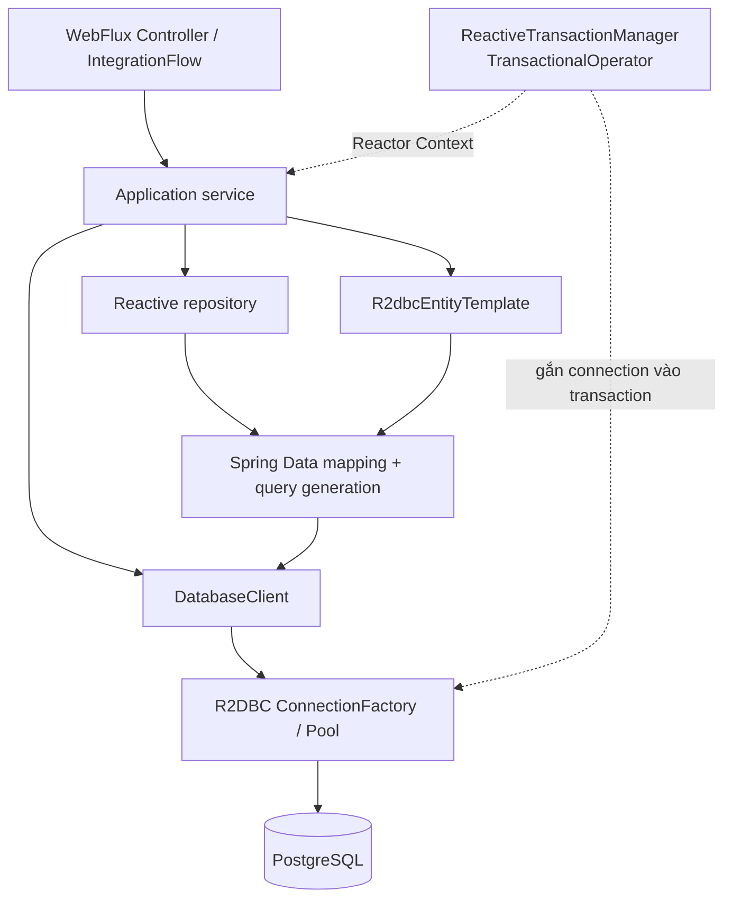
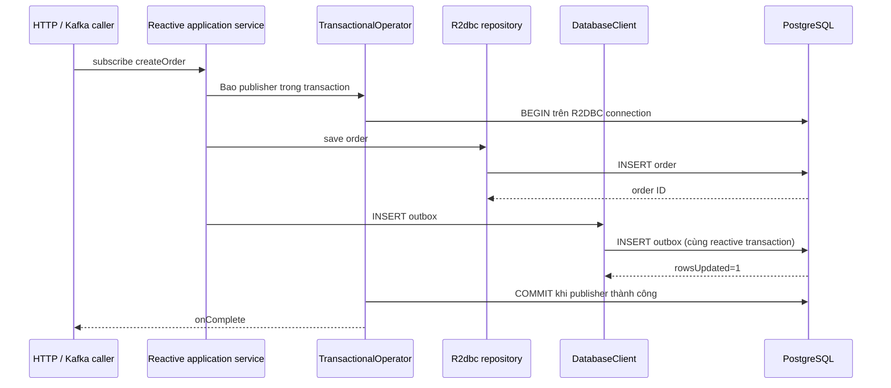
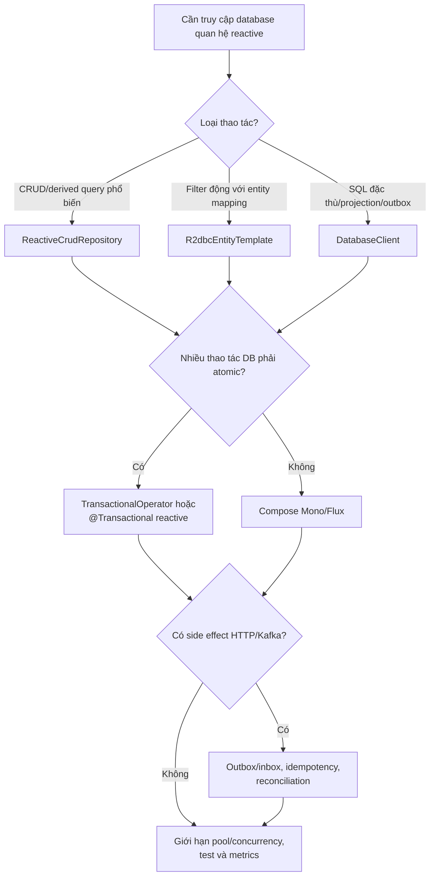

# DatabaseClient, R2dbcEntityTemplate và reactive repository

## 1. Bối cảnh: truy cập dữ liệu quan hệ trong một luồng reactive

Trong hệ thống Spring Boot, một tác vụ tích hợp có thể đi qua WebFlux, PostgreSQL, HTTP client, Kafka và cache. Ví dụ `order-service` nhận lệnh tạo đơn hàng, lưu dữ liệu vào PostgreSQL, ghi sự kiện vào **transactional outbox**, rồi một worker khác phát sự kiện sang Kafka. Nếu chọn mô hình reactive, ta cần một cơ chế truy cập database có thể phối hợp với `Mono`/`Flux` mà không chiếm một thread để chờ JDBC I/O ở mỗi truy vấn.

**R2DBC (Reactive Relational Database Connectivity)** là bộ SPI/driver cho truy cập cơ sở dữ liệu quan hệ bằng luồng bất đồng bộ, phù hợp với Reactive Streams. Spring Framework cung cấp `DatabaseClient`; Spring Data R2DBC xây dựng thêm `R2dbcEntityTemplate` và reactive repositories. Cả ba có thể cùng sử dụng một `ConnectionFactory`, cùng database, nhưng **mức độ trừu tượng và trách nhiệm không giống nhau**.

Bài học thuộc chương **Dữ liệu reactive** của module **SPRING_BOOT_INTEGRATION**, vì vậy không dừng ở việc chạy một câu SQL. Chúng ta còn xét transaction, lỗi, hợp đồng dữ liệu, connection pool, xử lý trùng, sự nhất quán giữa database và broker, kiểm thử, backpressure và quan sát các luồng tích hợp thực tế.

**Mục tiêu học tập**

1. Phân biệt `DatabaseClient`, `R2dbcEntityTemplate` và `ReactiveCrudRepository`/`R2dbcRepository`.
2. Chọn API thích hợp theo nhu cầu truy vấn, mapping, CRUD và hiệu năng.
3. Viết truy vấn có bind parameters, ánh xạ row, phân biệt `one()`, `first()` và `all()`.
4. Dùng entity mapping, criteria/query/update và derived repository methods đúng giới hạn.
5. Hiểu lúc Publisher thực thi, transaction reactive gắn với Reactor Context và vòng đời connection.
6. Thiết kế luồng ghi database cùng outbox để không phụ thuộc vào distributed transaction không tồn tại.
7. Giới hạn concurrency, kích thước kết quả và connection pool; kiểm thử với `StepVerifier`/Testcontainers.

> **Phạm vi:** Các ví dụ dùng Java 17+, Spring Boot 3.x, Spring Framework 6.x, Spring Data R2DBC 3.x, PostgreSQL và Reactor. Spring Boot 4.x/Spring Framework 7.x có thể thay đổi một số class, dependency hoặc auto-configuration; cần đối chiếu BOM và tài liệu của đúng phiên bản. Ví dụ code được thiết kế để giải thích từng lớp API; việc cấu hình đầy đủ cho production còn phụ thuộc schema, migration, yêu cầu consistency và hạ tầng thực tế.

## 2. Ba mức API trên cùng một `ConnectionFactory`



| API | Đặc điểm | Phù hợp khi | Cần tự làm |
| --- | --- | --- | --- |
| `DatabaseClient` | SQL-oriented, bind tham số, ánh xạ kết quả ở mức row. | SQL đặc thù, projection phức tạp, outbox insert, kiểm soát câu lệnh. | Viết SQL, ánh xạ row/result và bảo trì theo schema. |
| `R2dbcEntityTemplate` | Mapping entity và fluent CRUD/query API. | Truy vấn động theo criteria, insert/update/delete có mapping. | Biểu diễn query, hiểu mapping/versioning và giới hạn SQL. |
| `ReactiveCrudRepository`/`R2dbcRepository` | Repository interface, CRUD và derived query methods. | CRUD phổ biến, mã nghiệp vụ ngắn và truy vấn ổn định. | Định nghĩa method, dùng `@Query` khi query vượt khả năng derivation. |

Ba lớp **không phải ba database drivers**. Chúng thường dựa trên cùng driver R2DBC và cùng transactional context nếu được cấu hình thống nhất. Có thể dùng repository cho đơn hàng, template cho truy vấn tìm kiếm động và DatabaseClient để ghi outbox trong **cùng application service**.

### 2.1. Tại sao không dùng JPA repository reactive?

`JpaRepository`/Hibernate ORM thông thường chạy trên JDBC và là API blocking; việc bọc nó bằng `Mono.just(...)` **không biến truy cập JDBC thành non-blocking**. Spring Data R2DBC là một stack khác: nó không cung cấp toàn bộ mô hình ORM của JPA, chẳng hạn persistence context, dirty checking và lazy relationships theo kiểu Hibernate.

Nếu ứng dụng dùng JPA là chủ yếu và không cần non-blocking I/O, JDBC/JPA có thể đơn giản hơn. Không lựa chọn reactive chỉ vì tên framework nghe hiện đại; đánh giá số concurrent I/O, team expertise, driver, transaction, vận hành và thư viện xung quanh.

## 3. Chuẩn bị Spring Boot và PostgreSQL

### 3.1. Dependency

Với Maven và BOM của Spring Boot:

```xml
<dependencies>
    <dependency>
        <groupId>org.springframework.boot</groupId>
        <artifactId>spring-boot-starter-data-r2dbc</artifactId>
    </dependency>
    <dependency>
        <groupId>org.postgresql</groupId>
        <artifactId>r2dbc-postgresql</artifactId>
        <scope>runtime</scope>
    </dependency>

    <dependency>
        <groupId>org.springframework.boot</groupId>
        <artifactId>spring-boot-starter-test</artifactId>
        <scope>test</scope>
    </dependency>
    <dependency>
        <groupId>io.projectreactor</groupId>
        <artifactId>reactor-test</artifactId>
        <scope>test</scope>
    </dependency>
</dependencies>
```

Nếu dự án thêm WebFlux Controller, dùng `spring-boot-starter-webflux` ở tầng HTTP. Để quản lý schema với Flyway/Liquibase, cần cấu hình migration phù hợp; Flyway truyền thống dùng **JDBC connection** riêng, không chạy thông qua một R2DBC `ConnectionFactory` một cách mặc định.

### 3.2. Cấu hình `spring.r2dbc.*`

```yaml
# application.yml
spring:
  r2dbc:
    url: ${R2DBC_URL:r2dbc:postgresql://localhost:5432/order_db}
    username: ${R2DBC_USERNAME:order_app}
    password: ${R2DBC_PASSWORD}
    pool:
      enabled: true
      initial-size: 5
      max-size: 20
      max-idle-time: 30m
```

Trong môi trường sản xuất, **không đặt password thật vào source code** và không mặc định endpoint localhost là nơi production sẽ dùng. R2DBC URL có tiền tố `r2dbc:postgresql://`, không dùng JDBC URL `jdbc:postgresql://` cho `spring.r2dbc.url`.

Các thuộc tính pool có hiệu lực khi triển khai có `r2dbc-pool` trên classpath và Boot auto-configuration được kích hoạt. Kiểm tra version thực tế, thời gian chờ lấy connection, idle/lifetime và metrics của pool. `max-size: 20` là **giới hạn ví dụ theo mỗi instance**, không phải khuyến nghị chung cho mọi workload.

Một deployment 30 pod với mỗi pod tối đa 20 connections có thể tạo sức ép lên database lớn hơn 600 connections nếu các pool đều hoạt động gần ngưỡng; chưa kể JDBC migration, monitoring, worker và dịch vụ khác. Chọn pool dựa trên DB max connections, throughput, query latency và ngân sách tài nguyên chung.

### 3.3. SQL schema minh họa

Ta dùng một bảng đơn hàng và một bảng outbox để liên hệ chủ đề với luồng tích hợp:

```sql
CREATE TABLE integration_orders (
    id            BIGSERIAL PRIMARY KEY,
    command_id    VARCHAR(100) NOT NULL UNIQUE,
    customer_id   VARCHAR(80)  NOT NULL,
    status        VARCHAR(30)  NOT NULL,
    total_cents   BIGINT       NOT NULL CHECK (total_cents >= 0),
    created_at    TIMESTAMPTZ  NOT NULL,
    version       BIGINT       NOT NULL DEFAULT 0
);

CREATE INDEX idx_orders_customer_status
    ON integration_orders(customer_id, status);

CREATE TABLE integration_outbox (
    event_id      VARCHAR(160) PRIMARY KEY,
    order_id      BIGINT       NOT NULL
                  REFERENCES integration_orders(id),
    event_type    VARCHAR(80)  NOT NULL,
    payload       TEXT         NOT NULL,
    published     BOOLEAN      NOT NULL DEFAULT FALSE,
    created_at    TIMESTAMPTZ  NOT NULL
);

CREATE INDEX idx_outbox_unpublished_created
    ON integration_outbox(published, created_at);
```

Lược đồ phục vụ ví dụ, chưa gồm partitioning, retention, trạng thái worker lease và index tối ưu cho mọi truy vấn. Các migration thay đổi cấu trúc bảng cần được version hóa và triển khai theo kế hoạch mở rộng–di chuyển–thu hẹp để tránh phá consumer đang chạy.

### 3.4. Kiểm soát tự tạo schema

Không để code production tùy ý tạo/xóa bảng lúc startup nếu tổ chức đã dùng migration tool. PostgreSQL DDL, index, constraint, datatype và quyền DB là một phần **hợp đồng lưu trữ**; mã repository có thể biên dịch nhưng vẫn fail nếu migration chưa áp dụng hoặc mapping không khớp tên cột.

## 4. Đặc trưng reactive: Publisher chỉ là mô tả công việc

`Mono<T>` biểu diễn tối đa một kết quả, `Flux<T>` có thể phát nhiều kết quả. Với R2DBC, chuỗi operator là một **đường thực thi lười**: khi được subscribe, truy vấn mới được thực hiện theo ngữ nghĩa của Publisher.

```java
Mono<Long> count = databaseClient
    .sql("SELECT COUNT(*) FROM integration_orders")
    .map((row, metadata) ->
        row.get(0, Long.class))
    .one();

// Chưa gọi subscribe: chỉ mới dựng Publisher.
// Trong ứng dụng WebFlux, framework subscribe cho HTTP response.
// Trong test, StepVerifier sẽ subscribe.
```

Không viết:

```java
// SAI: subscribe thủ công rồi trả về trước khi DB thực thi xong.
public Mono<Void> saveOrderBad(IntegrationOrder order) {
    repository.save(order).subscribe();
    return Mono.empty();
}
```

Lỗi ở đoạn trên:

- Subscription chạy tách khỏi signal thành công/thất bại của caller.
- Transaction context và correlation context có thể không còn đúng.
- Caller có thể trả HTTP 201 hoặc ack Kafka **trước khi DB commit**.
- Retry/timeout của upstream không còn kiểm soát tác vụ đã tách rời.

Thay vào đó, **trả về chuỗi Publisher**:

```java
public Mono<IntegrationOrder> saveOrder(
    IntegrationOrder order
) {
    return repository.save(order);
}
```

Một cold Publisher được subscribe hai lần thường khiến **side effect xảy ra hai lần**. Nếu giữ một `Mono` ghi database rồi truyền qua nhiều subscriber, phải hiểu đặc tính repeat/caching và idempotency; không “cache()” tùy tiện những publisher đại diện cho command có side effect.

## 5. `DatabaseClient`: viết SQL và bind parameters

`org.springframework.r2dbc.core.DatabaseClient` là API ở tầng Spring Framework, làm việc trực tiếp với SQL và R2DBC driver nhưng không áp dụng full entity mapping như Spring Data repository.

### 5.1. Một câu SELECT với named parameters

```java
// OrderSqlGateway.java
import java.time.Instant;
import org.springframework.r2dbc.core.DatabaseClient;
import reactor.core.publisher.Flux;
import reactor.core.publisher.Mono;

public final class OrderSqlGateway {
    private final DatabaseClient db;

    public OrderSqlGateway(DatabaseClient db) {
        this.db = db;
    }

    public Flux<OrderSummary> findByStatus(String status) {
        return db.sql("""
                SELECT id, command_id, status, total_cents, created_at
                FROM integration_orders
                WHERE status = :status
                ORDER BY created_at DESC
                LIMIT 100
                """)
            .bind("status", status)
            .map((row, metadata) -> new OrderSummary(
                row.get("id", Long.class),
                row.get("command_id", String.class),
                row.get("status", String.class),
                row.get("total_cents", Long.class),
                row.get("created_at", Instant.class)
            ))
            .all();
    }

    public Mono<Long> countByStatus(String status) {
        return db.sql("""
                SELECT COUNT(*) AS total
                FROM integration_orders
                WHERE status = :status
                """)
            .bind("status", status)
            .map((row, metadata) -> row.get("total", Long.class))
            .one();
    }
}
```

Trong đó:

```java
// OrderSummary.java
import java.time.Instant;

public record OrderSummary(
    Long id,
    String commandId,
    String status,
    Long totalCents,
    Instant createdAt
) {}
```

`DatabaseClient.sql(...)` nhận câu SQL, `bind("status", value)` gửi giá trị riêng qua binding, `map(...)` tạo đối tượng Java và `all()` trả `Flux<OrderSummary>`.

**Cảnh báo row mapping:** `row.get("created_at", Instant.class)` phụ thuộc khả năng conversion của driver/dialect; với driver PostgreSQL, kiểu `TIMESTAMPTZ` có thể được trả về dạng `OffsetDateTime` rồi cần chuyển sang `Instant` tùy driver/version. Nếu thiếu hỗ trợ trực tiếp, thực hiện mapping rõ ràng:

```java
// Một lựa chọn rõ kiểu cho TIMESTAMPTZ của PostgreSQL.
java.time.OffsetDateTime timestamp =
    row.get("created_at", java.time.OffsetDateTime.class);
java.time.Instant instant =
    timestamp == null ? null : timestamp.toInstant();
```

Kiểm thử mapper với database/driver thật thay vì suy đoán từ Java type.

### 5.2. `one()`, `first()` và `all()`

| Terminal operation | Publisher | Khi nào chọn |
| --- | --- | --- |
| `.one()` | `Mono<T>` | Kỳ vọng tối đa một row; nhiều row được xem là sai hợp đồng truy vấn. |
| `.first()` | `Mono<T>` | Chỉ cần row đầu, ví dụ đã sắp xếp/giới hạn trong SQL. |
| `.all()` | `Flux<T>` | Nhiều row; nên giới hạn theo trang/batch. |
| `.fetch().rowsUpdated()` | `Mono<Long>` | Lấy số row bị tác động bởi UPDATE/DELETE/INSERT theo API driver. |

Đừng dùng `first()` để che lỗi uniqueness ở truy vấn nghiệp vụ đáng lẽ chỉ có một bản ghi. Với “đơn hàng theo commandId”, nên có unique constraint trong DB và dùng `one()` hoặc repository findByCommandId.

### 5.3. INSERT/UPDATE/DELETE và số dòng bị ảnh hưởng

```java
import org.springframework.r2dbc.core.DatabaseClient;
import reactor.core.publisher.Mono;

public Mono<Long> markOrderPaid(long orderId) {
    return db.sql("""
            UPDATE integration_orders
            SET status = :status
            WHERE id = :id AND status = :expected
            """)
        .bind("status", "PAID")
        .bind("id", orderId)
        .bind("expected", "PENDING")
        .fetch()
        .rowsUpdated();
}
```

Kết quả `0` row có thể nghĩa là không tồn tại, đã được xử lý, hoặc status hiện tại khác. Đừng coi `rowsUpdated()==0` luôn là success. Với command idempotent, cần tra cứu trạng thái hiện tại để phân biệt “đã hoàn tất cùng lệnh” và “xung đột trạng thái”.

Ví dụ kiểm tra điều kiện:

```java
return markOrderPaid(orderId).flatMap(updated -> {
    if (updated == 1L) {
        return Mono.empty();
    }
    return Mono.error(
        new IllegalStateException("Order không ở trạng thái PENDING")
    );
});
```

Đoạn code minh họa **so sánh count**; một ứng dụng thật có thể dùng exception nghiệp vụ riêng và transaction/outbox, không suy ra thao tác độc lập này đã phát event tương ứng.

### 5.4. Bind `null` đúng cách

R2DBC không cho phép `bind("note", null)` như một số API JDBC. Sử dụng `bindNull(...)` với kiểu dữ liệu:

```java
var query = db.sql("""
    UPDATE integration_orders SET status = :status
    WHERE id = :id
    """)
    .bind("status", "CANCELLED")
    .bind("id", orderId);

return query.fetch().rowsUpdated();

// Với cột NULLABLE:
// db.sql("UPDATE ... SET note = :note WHERE id = :id")
//   .bindNull("note", String.class)
//   .bind("id", orderId)
//   .fetch().rowsUpdated();
```

Không tạo SQL bằng string concatenation từ input người dùng:

```java
// SAI: injection và dữ liệu chứa dấu nháy có thể làm hỏng SQL.
db.sql("SELECT * FROM integration_orders WHERE status = '" + status + "'");

// ĐÚNG: bind giá trị.
db.sql("SELECT * FROM integration_orders WHERE status = :status")
  .bind("status", status);
```

**Bind parameters chỉ dành cho giá trị.** Không thể bind tên bảng, cột hoặc hướng `ORDER BY` theo cách bind string thông thường; các identifier động phải được chọn từ whitelist do ứng dụng định nghĩa.

### 5.5. Khi nào `DatabaseClient` thực sự có lợi?

- Join nhiều bảng để tạo DTO báo cáo nhỏ, không cần mapping entity đầy đủ.
- Dùng SQL đặc thù PostgreSQL: `ON CONFLICT`, `RETURNING`, CTE, window functions.
- Ghi outbox trong một transaction chung với repository.
- Cập nhật theo điều kiện (compare-and-set) bằng một câu SQL.
- Kiểm soát số row tác động và xử lý conflict rõ ràng.

Đánh đổi: viết SQL thủ công chịu trách nhiệm tên bảng/cột, SQL dialect và mapping. Khi schema đổi, compiler Java không tự phát hiện sai tên cột; cần migration/integration tests.

## 6. Entity mapping dùng chung cho template và repository

Spring Data R2DBC ánh xạ bảng quan hệ sang Java object thông qua annotation:

```java
// IntegrationOrder.java
import java.time.Instant;
import org.springframework.data.annotation.Id;
import org.springframework.data.annotation.Version;
import org.springframework.data.relational.core.mapping.Column;
import org.springframework.data.relational.core.mapping.Table;

@Table("integration_orders")
public record IntegrationOrder(
    @Id Long id,
    @Column("command_id") String commandId,
    @Column("customer_id") String customerId,
    String status,
    @Column("total_cents") long totalCents,
    @Column("created_at") Instant createdAt,
    @Version Long version
) {}
```

| Annotation | Ý nghĩa |
| --- | --- |
| `@Table` | Tên bảng (và tùy cấu hình schema). |
| `@Id` | Khóa chính; Spring Data dùng để nhận diện entity. |
| `@Column` | Tên cột thực tế khi khác tên property Java. |
| `@Version` | Hỗ trợ optimistic locking trong thao tác entity-aware phù hợp. |

Record là immutable nên thao tác lưu có thể trả **một record mới** với ID/version do database/ORM mapping cập nhật; hãy dùng giá trị do `save/insert` trả về thay vì giả định instance ban đầu bị biến đổi tại chỗ.

### 6.1. Quy tắc “entity mới” rất quan trọng

Một entity `@Id Long id` null thường được xem là mới. Với ID do ứng dụng tự cấp (UUID/String non-null), Spring Data cần cách quyết định INSERT hay UPDATE: `@Version`, `Persistable` hoặc cấu hình trạng thái mới phù hợp.

Nếu sai chiến lược, `save(...)` có thể thử UPDATE một row chưa tồn tại hoặc sinh lỗi optimistic locking. Với ví dụ trên, ta dùng `BIGSERIAL` và `id=null` khi tạo bản ghi, sau đó đọc ID từ entity được trả về.

### 6.2. Không nhầm `@Version` với event ordering

`@Version` bảo vệ một số thao tác cập nhật entity khỏi việc ghi đè cạnh tranh thông qua version. Nó **không tự động** giải quyết:

- Event Kafka phiên bản cũ đến sau sự kiện phiên bản mới.
- Một `DatabaseClient` raw SQL UPDATE bỏ qua cột version.
- Hai service ghi cùng trạng thái qua API không có precondition.
- Giao dịch giữa PostgreSQL và Kafka/HTTP.

Với message processing, cần một `aggregateVersion`/sequence number trong hợp đồng event và điều kiện update riêng; không coi mỗi optimistic lock exception là lỗi có thể retry vô hạn.

## 7. `R2dbcEntityTemplate`: CRUD và truy vấn theo criteria

`org.springframework.data.r2dbc.core.R2dbcEntityTemplate` cho phép query/update dựa trên mapping context của Spring Data, giảm phần SQL tường minh cho các thao tác thường gặp.

### 7.1. Insert entity

```java
// OrderTemplateGateway.java
import java.time.Instant;
import org.springframework.data.r2dbc.core.R2dbcEntityTemplate;
import reactor.core.publisher.Mono;

public final class OrderTemplateGateway {
    private final R2dbcEntityTemplate template;

    public OrderTemplateGateway(R2dbcEntityTemplate template) {
        this.template = template;
    }

    public Mono<IntegrationOrder> insertPending(
        String commandId, String customerId, long totalCents
    ) {
        var row = new IntegrationOrder(
            null, commandId, customerId,
            "PENDING", totalCents, Instant.now(), null
        );

        return template.insert(IntegrationOrder.class).using(row);
    }
}
```

Template lo phần insert SQL theo entity mapping, bao gồm tên bảng/cột. Nhưng business constraint vẫn nằm ở DB: `command_id UNIQUE`, `total_cents >= 0` và các rule bổ sung. Tạo mới trùng `commandId` có thể gây duplicate key; ứng dụng cần ánh xạ thành idempotent result hoặc conflict có kiểm soát.

### 7.2. Select với Criteria, Sort và Limit

```java
import org.springframework.data.domain.Sort;
import org.springframework.data.relational.core.query.Criteria;
import org.springframework.data.relational.core.query.Query;
import reactor.core.publisher.Flux;

public Flux<IntegrationOrder> findPendingForCustomer(
    String customerId, int limit
) {
    if (limit < 1 || limit > 100) {
        return Flux.error(new IllegalArgumentException(
            "limit phải từ 1 đến 100"
        ));
    }

    Query query = Query.query(
            Criteria.where("customerId").is(customerId)
                .and("status").is("PENDING")
        )
        .sort(Sort.by(Sort.Direction.DESC, "createdAt"))
        .limit(limit);

    return template.select(IntegrationOrder.class)
        .matching(query)
        .all();
}
```

Ở phần Criteria, dùng **property name của entity** như `customerId` và `createdAt`; Spring Data mapping xử lý liên hệ với `customer_id`, `created_at`. Với SQL viết trực tiếp trong `DatabaseClient`, bạn sử dụng tên cột SQL thực tế.

Để phân trang thực tế, cần thiết kế thứ tự ổn định (ví dụ thêm `id` khi `createdAt` trùng nhau). Với tập dữ liệu lớn, cân nhắc keyset/cursor pagination để tránh `OFFSET` sâu gây chi phí cao và sai lệch khi dữ liệu thay đổi.

### 7.3. Update theo tiêu chí

```java
import org.springframework.data.relational.core.query.Criteria;
import org.springframework.data.relational.core.query.Query;
import org.springframework.data.relational.core.query.Update;
import reactor.core.publisher.Mono;

public Mono<Long> markCancelled(long id) {
    Query query = Query.query(
        Criteria.where("id").is(id)
            .and("status").is("PENDING")
    );

    return template.update(IntegrationOrder.class)
        .matching(query)
        .apply(Update.update("status", "CANCELLED"));
}
```

Một update theo criteria có ưu điểm chỉ sửa các cột chỉ định. **Nhưng nó không tự thay thế optimistic locking từ `@Version` theo cách entity-level save**: nếu cần kiểm tra version của record, thêm điều kiện `version = :expectedVersion` và tăng version rõ ràng, hoặc dùng cập nhật entity-aware được Spring Data hỗ trợ và kiểm thử behavior.

Khi `markCancelled(...)` trả 0, ứng dụng phải xác định order đã `CANCELLED` trước đó hay đang ở `PAID`. Cùng status có thể cho idempotent response; status khác là business conflict.

### 7.4. Delete và rủi ro hard delete

```java
public Mono<Long> deletePending(long id) {
    return template.delete(IntegrationOrder.class)
        .matching(Query.query(
            Criteria.where("id").is(id)
                .and("status").is("PENDING")
        ))
        .all();
}
```

Xóa vật lý có thể phá audit/outbox hoặc tham chiếu foreign key. Trong hệ thống xử lý đơn hàng, thường cần state `CANCELLED`/`DELETED` hoặc retention policy hơn là xóa ngay bản ghi. Template chỉ là công cụ thao tác dữ liệu; nó không quyết định quy tắc nghiệp vụ.

### 7.5. Chọn template thay vì viết repository method khổng lồ

Nếu truy vấn có 8 bộ lọc optional, việc tạo `findByStatusAndCustomerIdAndCreatedAtBetween...` khiến interface khó bảo trì. Template + Criteria phù hợp hơn, nhưng vẫn phải:

- Validate sort field từ whitelist.
- Giới hạn số kết quả và thời gian truy vấn.
- Đo execution plan/index; criteria đẹp không làm query nhanh tự động.
- Test nullable/optional condition và pagination.

## 8. Reactive repositories: CRUD nhanh, query theo ý nghĩa

Spring Data R2DBC cho phép tạo interface repository:

```java
// IntegrationOrderRepository.java
import org.springframework.data.repository.reactive.ReactiveCrudRepository;
import reactor.core.publisher.Flux;
import reactor.core.publisher.Mono;

public interface IntegrationOrderRepository
    extends ReactiveCrudRepository<IntegrationOrder, Long> {

    Mono<IntegrationOrder> findByCommandId(String commandId);

    Flux<IntegrationOrder> findByCustomerIdAndStatus(
        String customerId, String status
    );

    Mono<Boolean> existsByCommandId(String commandId);
}
```

`ReactiveCrudRepository` có các thao tác thường gặp:

| Phương thức | Kết quả | Ghi chú |
| --- | --- | --- |
| `save(entity)` | `Mono<T>` | Insert/update theo trạng thái entity và mapping. |
| `findById(id)` | `Mono<T>` | Publisher trống nếu không tồn tại. |
| `findAll()` | `Flux<T>` | Tránh dùng không giới hạn trên bảng lớn. |
| `existsById(id)` | `Mono<Boolean>` | Chỉ là phép kiểm tra tại thời điểm truy vấn. |
| `count()` | `Mono<Long>` | Count DB có thể tốn tài nguyên tùy index/bảng. |
| `deleteById(id)` | `Mono<Void>` | Không bảo đảm “đã xóa một row” nếu không tự kiểm tra. |
| `findByCommandId(...)` | `Mono<IntegrationOrder>` | Derived query từ tên method, dựa trên mapping. |

Spring Data R2DBC còn có interface `R2dbcRepository`, phù hợp khi muốn chức năng repository đặc thù R2DBC/relational store theo version. Không phải mọi tính năng của JPA repository đều có ở đây: không mặc định có entity graph, `@OneToMany` lazy-loading, JPQL hay persistence context.

### 8.1. `@Query` cho SQL cần kiểm soát

```java
import org.springframework.data.r2dbc.repository.Query;

@Query("""
    SELECT *
    FROM integration_orders
    WHERE customer_id = :customerId
    ORDER BY created_at DESC, id DESC
    LIMIT :limit
    """)
Flux<IntegrationOrder> findLatestForCustomer(
    String customerId, int limit
);
```

Đoạn trên được đặt **bên trong interface repository**. Với `@Query`, nội dung là SQL theo dialect của database, không phải JPQL. Những phần động không thể bind như tên cột/sort direction phải được kiểm soát bằng cách tạo query ở template/gateway riêng với whitelist.

### 8.2. Projection và không lấy quá nhiều dữ liệu

Nếu API chỉ cần summary, không nhất thiết fetch toàn bộ entity có nhiều cột hoặc nội dung lớn. Có thể dùng projection hoặc `DatabaseClient` ánh xạ thẳng vào DTO. Chọn cách dễ kiểm soát nhất cho query:

- Repository: derived query/projection ổn định.
- Template: query động có mapping entity.
- DatabaseClient: projection SQL và join đặc thù, kiểm soát rõ cột.

### 8.3. Repository không thay ứng dụng kiểm tra business invariant

Nếu có workflow:

```text
if (!repository.existsByCommandId(cmdId)) {
    repository.save(order);
}
```

hai request đồng thời có thể cùng thấy `false` rồi cùng INSERT. Phải dùng **unique constraint** làm lớp bảo vệ cuối cùng, và giải quyết duplicate một cách có chủ đích. Không coi `existsBy...` trước `save` là cơ chế chống trùng an toàn dưới concurrency.

## 9. Cách chọn API trong một ứng dụng

| Nhu cầu | Khuyến nghị đầu tiên | Khi nào đổi lựa chọn |
| --- | --- | --- |
| CRUD cơ bản đơn hàng | Reactive repository. | Khi cần custom SQL/mapping/projection. |
| Tìm theo nhiều filter optional | `R2dbcEntityTemplate` + Criteria. | Nếu SQL tối ưu hóa đặc thù khó diễn đạt. |
| Join và aggregate cho báo cáo | `DatabaseClient`. | Nếu repo projection/`@Query` đủ rõ và dễ bảo trì. |
| INSERT outbox với SQL cụ thể | `DatabaseClient`. | Khi outbox có mapped entity và repository/template phù hợp. |
| Dùng `@Version` optimistic locking | Entity-aware repository/template. | Raw SQL phải tự điều khiển version. |
| Bulk ingest lớn | SQL/driver-specific batching có kiểm soát hoặc công cụ bulk riêng. | Repository save tuần tự khi dữ liệu nhỏ, đơn giản. |
| SQL độc lập dialect | Entity/repository có thể hỗ trợ một phần. | Không có phép màu portable cho mọi SQL/feature. |

Không tạo abstraction nhiều lớp chỉ để “đúng clean architecture”: một application service có thể inject repository và một outbox gateway dùng DatabaseClient. Quan trọng là **ranh giới business, transaction, lỗi và khả năng kiểm thử**.

## 10. Transaction reactive: không phải ThreadLocal

JDBC/JPA transactions trong các ứng dụng blocking thường dựa vào transaction context gắn với thread. R2DBC reactive transactions dùng **Reactor Context** để truyền trạng thái transaction và connection qua chuỗi Publisher.



### 10.1. Sử dụng `TransactionalOperator`

Khi Boot tạo `ReactiveTransactionManager` thích hợp cho `ConnectionFactory`, có thể nhận `TransactionalOperator` được cấu hình bằng bean:

```java
// ReactiveTransactionConfiguration.java
import org.springframework.context.annotation.Bean;
import org.springframework.context.annotation.Configuration;
import org.springframework.transaction.ReactiveTransactionManager;
import org.springframework.transaction.reactive.TransactionalOperator;

@Configuration(proxyBeanMethods = false)
public class ReactiveTransactionConfiguration {
    @Bean
    TransactionalOperator transactionalOperator(
        ReactiveTransactionManager manager
    ) {
        return TransactionalOperator.create(manager);
    }
}
```

Không tạo một transaction manager khác trên `ConnectionFactory` mới nếu muốn repository và DatabaseClient cùng tham gia transaction. Cả hai phải sử dụng cùng connection/transaction infrastructure hoặc một cấu hình multi-DB có scope rõ ràng.

### 10.2. Ghi order và outbox trong một local transaction

Ví dụ hợp đồng tạo đơn:

```java
// CreateOrderCommand.java
public record CreateOrderCommand(
    String commandId,
    String customerId,
    long totalCents
) {}
```

Service kết hợp repository và DatabaseClient:

```java
// CreateOrderService.java
import java.time.Instant;
import org.springframework.r2dbc.core.DatabaseClient;
import org.springframework.stereotype.Service;
import org.springframework.transaction.reactive.TransactionalOperator;
import reactor.core.publisher.Mono;

@Service
public class CreateOrderService {
    private final IntegrationOrderRepository orders;
    private final DatabaseClient db;
    private final TransactionalOperator tx;

    public CreateOrderService(
        IntegrationOrderRepository orders,
        DatabaseClient db,
        TransactionalOperator tx
    ) {
        this.orders = orders;
        this.db = db;
        this.tx = tx;
    }

    public Mono<IntegrationOrder> create(CreateOrderCommand cmd) {
        return Mono.defer(() -> {
            if (cmd.commandId() == null || cmd.commandId().isBlank()
                || cmd.totalCents() < 0) {
                return Mono.error(new IllegalArgumentException(
                    "Lệnh tạo đơn không hợp lệ"
                ));
            }

            Instant now = Instant.now();
            IntegrationOrder candidate = new IntegrationOrder(
                null,
                cmd.commandId(),
                cmd.customerId(),
                "PENDING",
                cmd.totalCents(),
                now,
                null
            );

            return orders.save(candidate)
                .flatMap(saved -> db.sql("""
                        INSERT INTO integration_outbox
                        (event_id, order_id, event_type, payload,
                         published, created_at)
                        VALUES (:eventId, :orderId, :eventType, :payload,
                                FALSE, :createdAt)
                        """)
                    .bind("eventId", "order-created:" + cmd.commandId())
                    .bind("orderId", saved.id())
                    .bind("eventType", "OrderCreated")
                    .bind("payload", """
                        {"commandId":"illustrative"}
                        """)
                    .bind("createdAt", now)
                    .fetch()
                    .rowsUpdated()
                    .flatMap(rows -> rows == 1L
                        ? Mono.just(saved)
                        : Mono.error(new IllegalStateException(
                            "Không tạo được outbox event"
                        ))
                    )
                );
        }).as(tx::transactional);
    }
}
```

**Đây là ví dụ minh họa transaction, chưa phải một command handler production hoàn chỉnh.** Trường `payload` dùng JSON tĩnh chỉ để dễ đọc; ứng dụng thật phải serialize event DTO đúng schema và đúng `commandId/orderId` bằng serializer có kiểm soát. Khi xây JSON thủ công, không ghép chuỗi input người dùng vào JSON. Ưu tiên JSON serializer và kiểm thử event contract.

Điều được đảm bảo: nếu cả hai câu ghi thực hiện trên **cùng R2DBC transaction** và insert outbox thất bại, local transaction rollback cả order lẫn outbox. Điều **không** được đảm bảo: event đã tới Kafka, HTTP request ngoài đã thành công hoặc consumer khác đã xử lý event.

### 10.3. Idempotency và duplicate key

`command_id UNIQUE` trong bảng order và `event_id PRIMARY KEY` trong outbox bảo vệ phần dữ liệu local. Nhưng `create(cmd)` ở ví dụ vẫn có thể báo duplicate-key khi một command được retry; để trở thành idempotent service cần:

1. Bắt đúng ngoại lệ uniqueness của `command_id` ở **ngoài** transaction vừa thất bại.
2. Đọc row hiện có bằng `findByCommandId` trong một transaction mới hoặc đọc phù hợp.
3. So sánh toàn bộ dữ liệu/hợp đồng command với row đã lưu; nếu khớp, trả kết quả cũ.
4. Nếu cùng `commandId` nhưng payload khác, trả business conflict, không coi là thành công.
5. Kiểm tra side effect downstream bằng event ID ổn định trong consumer inbox; không dựa chỉ vào exception class chung vì một `DuplicateKeyException` có thể đến từ constraint khác.

**Không thực hiện truy vấn recover trên một PostgreSQL transaction đã ở trạng thái aborted sau unique violation rồi kỳ vọng kết quả hợp lệ.** Retry/reconciliation nên diễn ra ở boundary mới sau rollback.

### 10.4. `@Transactional` với phương thức reactive

Có thể dùng:

```java
import org.springframework.transaction.annotation.Transactional;

@Transactional
public Mono<IntegrationOrder> createTransactional(CreateOrderCommand cmd) {
    return orders.save(toEntity(cmd))
        .flatMap(saved -> insertOutbox(saved).thenReturn(saved));
}
```

Đây là **phác thảo cấu trúc**: `toEntity` và `insertOutbox` là phương thức do application service triển khai. Để annotation hoạt động, method phải được gọi qua Spring proxy và trả kiểu Publisher reactive; tự gọi `this.createTransactional(...)` trong cùng class thường bỏ qua proxy interceptor. Đừng `subscribe()` hoặc `block()` bên trong method để “bắt đầu transaction”.

Với code phức tạp, `TransactionalOperator` biểu đạt rõ transaction scope hơn. Với function được compose qua nhiều layer, `@Transactional` vẫn phù hợp khi proxy/bean boundaries được kiểm soát.

### 10.5. Không trộn lẫn JDBC transaction với R2DBC transaction

`@Transactional` không tự kết nối một `JpaTransactionManager` và một `R2dbcTransactionManager` thành transaction ACID chung. Tương tự, không thể gộp một commit DB với HTTP/Kafka chỉ bằng annotation.

Nếu ứng dụng chạy song song JPA/JDBC và R2DBC, cần xác định transaction manager nào áp dụng cho từng method/Publisher, và hạn chế tham vọng giao dịch xuyên cả hai. Khi cần đồng bộ event, transactional outbox + inbox/replay là mô hình thực dụng hơn.

## 11. Tính tuần tự, concurrency và transaction connection

Trong Reactor, `flatMap` có thể khởi chạy nhiều inner publishers đồng thời. Điều này hữu ích cho các tác vụ I/O độc lập, nhưng **không mặc định phù hợp khi nhiều thao tác cùng dùng một connection đang trong một transaction**.

### 11.1. Tuần tự rõ ràng khi ghi các bước phụ thuộc

```java
return orders.save(order)
    .flatMap(saved -> outboxGateway.save(saved)
        .thenReturn(saved))
    .as(tx::transactional);
```

Phương thức `outboxGateway.save` phải trả `Mono<?>` và dùng cùng R2DBC infrastructure; DB operations được nối sau khi save trả kết quả, không chạy đồng thời. Với transaction trên một connection, thứ tự dễ dự đoán và tránh concurrent access không được driver hỗ trợ.

### 11.2. Cẩn trọng với `flatMap` concurrency cao

```java
Flux.fromIterable(commands)
    .flatMap(command -> createOrderService.create(command), 8);
```

`concurrency=8` giới hạn số inner publishers đang hoạt động, **không** giới hạn số commands đã có sẵn trong toàn hệ thống hoặc bảo đảm DB có đủ 8 connections. Nếu `create(...)` tự tạo transaction trên mỗi subscription, các transactions có thể song song theo pool. Điều này làm tăng throughput nhưng cũng tăng contention, duplicate races và áp lực xuống database.

Với thứ tự nghiệp vụ quan trọng, dùng `concatMap` hoặc phân vùng theo key rồi serialize từng partition. Không mặc định tăng concurrency cải thiện hiệu năng khi bottleneck là lock/index hoặc DB max connections.

### 11.3. `zip` trong transaction không phải lúc nào cũng lý tưởng

`Mono.zip(dbOperation1, dbOperation2)` biểu thị hai nguồn được subscribe phối hợp, có thể dẫn đến concurrent database statements trên connection của cùng transaction. Khi thao tác phụ thuộc nhau hoặc driver chỉ cho phép một statement tại một thời điểm, dùng `then`/`flatMap` theo thứ tự; nếu muốn parallel query, đánh giá kỹ transaction topology và driver.

## 12. Backpressure và connection pool: reactive không có nghĩa vô hạn

Một luồng trả `Flux<Order>` có thể hỗ trợ downstream demand, nhưng không vì thế mà mọi driver/DB đều stream từng row không buffer. Một số driver hoặc thao tác SQL có thể buffer kết quả hoặc chịu ảnh hưởng fetch size và cursor support.

### 12.1. Đừng dùng `collectList()` cho kết quả không giới hạn

```java
// RỦI RO: nếu bảng có hàng triệu bản ghi, toàn bộ kết quả lên heap.
Mono<java.util.List<IntegrationOrder>> all =
    repository.findAll().collectList();
```

Thay bằng truy vấn giới hạn:

```java
Flux<IntegrationOrder> pending = template
    .select(IntegrationOrder.class)
    .matching(
        Query.query(Criteria.where("status").is("PENDING"))
            .sort(Sort.by("id"))
            .limit(100)
    )
    .all();
```

Để xử lý nhiều trang, dùng keyset/cursor + checkpoint chứ không chỉ lặp `findAll()`. Giới hạn số row, bytes và thời gian của query là cách bảo vệ DB lẫn JVM.

### 12.2. Những queue ẩn cần nhìn thấy

```text
HTTP pending requests
  -> Reactor operators (flatMap concurrency/prefetch)
  -> R2DBC pool pending acquisition
  -> database active sessions / locks / disk I/O
  -> downstream Kafka/HTTP
```

Khi pool đầy, thêm 1.000 publishers không tạo thêm 1.000 connections: chúng có thể **chờ lấy connection**, dùng bộ nhớ và làm tăng độ trễ. Hãy đo active/idle/pending connections cùng p95/p99 SQL latency, DB lock time và hàng đợi ở API/broker.

Đặt các giới hạn thực tế:

1. `spring.r2dbc.pool.max-size` phù hợp DB và số pod.
2. Timeout acquire/read/query phù hợp SLA (tùy driver/pool và database).
3. `flatMap(..., concurrency)` hoặc semaphore/bulkhead theo use case.
4. Pagination/chunking, tránh materialize response lớn.
5. Timeout tổng cho request/command, không chỉ timeout từng kết nối.
6. Retry có backoff/jitter **chỉ** cho lỗi transient và operation an toàn.

### 12.3. Event loop không được chặn

Không dùng:

```java
// SAI bên trong WebFlux handler/reactive flow:
IntegrationOrder row = repository.findById(id).block();
```

Nếu cần gọi thư viện blocking hiện có, có thể tách riêng:

```java
Mono<String> legacyValue = Mono.fromCallable(
        () -> blockingLegacyClient.fetchValue()
    )
    .subscribeOn(
        reactor.core.scheduler.Schedulers.boundedElastic()
    );
```

Đây là **phương án tích hợp tạm** cho một component blocking, không biến component đó thành reactive và không đưa JDBC/JPA vào cùng R2DBC transaction. `boundedElastic` cũng có giới hạn thread/queue; phải đo dưới tải. Ưu tiên driver/client non-blocking khi mục tiêu kiến trúc yêu cầu.

## 13. Error handling đúng tầng

R2DBC có nhiều lớp exception:

| Loại lỗi | Ví dụ | Hướng xử lý |
| --- | --- | --- |
| Data integrity | `command_id` trùng, NOT NULL/CHECK/FK vi phạm. | Phân loại duplicate vs conflict/validation; không retry mù. |
| Optimistic lock | `@Version` không khớp. | Đọc state mới và tính lại command nếu hợp đồng cho phép. |
| Connection/timeout | DB unavailable, connection acquisition timeout. | Retry bounded với idempotency; quan sát pool/DB. |
| Serialization/type | Java type không tương thích cột/driver. | Sửa mapper/schema, không retry cùng payload vô hạn. |
| Query syntax | SQL sai tên cột hoặc dialect. | Sửa code/migration, không retry. |
| Deadlock/lock conflict | Transaction bị rollback, DB báo transient. | Có thể retry **toàn bộ transaction mới**, không chỉ một câu query bên trong transaction aborted. |
| Mapping entity | `@Column` sai, ID/new-state detection sai. | Sửa mapping và bổ sung integration tests. |

Spring có thể chuyển một số lỗi sang `DataAccessException` (ví dụ `DuplicateKeyException`) tùy layer, dialect và driver. Không gắn một policy “retry mọi `DataAccessException`”: nhiều lỗi là permanent.

### 13.1. `onErrorResume` không phải cách nuốt lỗi

```java
// NGUY HIỂM: biến sự cố DB thành không có đơn hàng.
return repository.findById(id)
    .onErrorResume(ex -> Mono.empty());
```

Đoạn này khiến caller không phân biệt “không tồn tại” với “DB bị hỏng”. Thay vào đó:

```java
return repository.findById(id)
    .switchIfEmpty(
        Mono.error(new OrderNotFoundException(id))
    );
```

`OrderNotFoundException` là exception ứng dụng tự định nghĩa. Chỉ dùng `onErrorResume` khi có recovery path an toàn và đã phân loại exception cụ thể:

```java
return repository.findById(id)
    .onErrorMap(
        org.springframework.dao.DataAccessResourceFailureException.class,
        ex -> new OrderStorageUnavailableException(ex)
    );
```

Mapping example phụ thuộc driver/translator có phát sinh đúng subtype hay không; kiểm thử failure thật. Không che exception gốc và correlation ID khi log/metrics.

### 13.2. Retry phải ở ngoài transaction đã thất bại

Với PostgreSQL, một SQL error trong transaction có thể khiến transaction vào trạng thái aborted; chạy tiếp statement trong cùng transaction sẽ lỗi. Nếu lỗi được phân loại transient (deadlock), cần **rollback, tạo transaction mới và chạy lại toàn bộ đơn vị công việc**.

Nếu Reactor `retryWhen(...)` được thêm sai vị trí, có thể resubscribe vào một đoạn Publisher không còn transaction sạch hoặc lặp side effect HTTP/Kafka đã thực hiện. Cần test thứ tự:

```java
// Sơ đồ tư duy, không phải handler hoàn chỉnh:
Mono.defer(() -> createOrderUnitOfWork(command))
    .as(tx::transactional)
    .retryWhen(transientRetrySpec);
```

Ở đây `transientRetrySpec` phải được tạo riêng theo loại lỗi/attempt/backoff, và `createOrderUnitOfWork` phải an toàn khi chạy lại. Đặc biệt đừng retry toàn bộ command sau khi đã gọi một API thanh toán không idempotent.

## 14. Tích hợp với HTTP, Kafka và cache

### 14.1. Không phát Kafka event trước khi DB commit

```java
// SAI về mặt consistency khi chỉ mong hai side effect tự atomic:
return repository.save(order)
    .flatMap(saved ->
        reactiveKafkaProducer.send(eventFor(saved))
            .thenReturn(saved)
    );
```

Nếu Kafka publish thành công nhưng DB transaction rollback, downstream có thể thấy một event cho dữ liệu chưa từng commit. Nếu DB commit trước rồi Kafka fail, event bị thiếu. Không một `@Transactional` R2DBC đơn lẻ nào giải quyết giao dịch phân tán này.

**Giải pháp thường dùng:** ghi order và outbox trong cùng transaction PostgreSQL; một relay độc lập đọc outbox sau commit để publish. Relay có thể phát lặp khi crash giữa publish và mark-complete, nên consumer phải idempotent theo event ID.

### 14.2. Kafka consumer và acknowledgment

Nếu Spring Kafka hoặc Spring Integration inbound adapter gọi reactive database service:

- Listener imperative không nên gọi `reactiveService.process(message).subscribe()` rồi ack ngay.
- Xác định cách bridge signal hoàn tất/thất bại sang cơ chế ack, thread và error handler của listener.
- Nếu listener adapter hỗ trợ nhận kết quả bất đồng bộ theo version/contract, dùng đúng integration đó; không tự giả định broker đợi `Mono` hoàn tất.
- Sau DB commit nhưng trước Kafka offset commit, message có thể đến lại. Cần unique inbox marker/business idempotency.

Một reactive repository **không** tự nâng Kafka delivery từ at-least-once thành exactly-once business side effect.

### 14.3. Cache chỉ là trạng thái phụ

Ví dụ lưu order rồi cập nhật Redis cache:

```text
PostgreSQL COMMIT -> Redis SET
```

Nếu Redis fail sau commit, lệnh nghiệp vụ có thể đã thành công dù cache chưa kịp cập nhật. Cần lựa chọn rõ: cache-aside/invalidation sau commit, outbox event cho invalidation, TTL và chính sách stale reads. Không rollback DB một cách giả định chỉ vì cache write thất bại; cũng không cache dữ liệu trước DB commit khi client khác có thể nhìn thấy trạng thái chưa được xác nhận.

## 15. Kiểm thử với `StepVerifier`

Reactive code cần kiểm tra **terminal signals** (next/complete/error), không chỉ kết quả một method call trước khi subscribe.

### 15.1. Unit test service có mock repository

Ví dụ khái quát với Mockito và Reactor:

```java
import static org.mockito.Mockito.*;
import static org.junit.jupiter.api.Assertions.*;

import java.time.Instant;
import org.junit.jupiter.api.Test;
import reactor.core.publisher.Mono;
import reactor.test.StepVerifier;

class FindOrderServiceTest {

    @Test
    void emitsOrderFromRepository() {
        IntegrationOrderRepository repository =
            mock(IntegrationOrderRepository.class);

        IntegrationOrder row = new IntegrationOrder(
            42L, "cmd-42", "customer-A", "PENDING",
            125000L, Instant.parse("2026-11-21T00:00:00Z"), 0L
        );
        when(repository.findById(42L))
            .thenReturn(Mono.just(row));

        StepVerifier.create(repository.findById(42L))
            .assertNext(actual ->
                assertEquals("cmd-42", actual.commandId())
            )
            .verifyComplete();

        verify(repository).findById(42L);
    }
}
```

Đây mới là kiểm thử **mock repository**, không xác minh SQL, named parameters, mapping `TIMESTAMPTZ` hoặc transaction thật. Không dùng mock test làm bằng chứng migration và driver đã tương thích.

### 15.2. Chứng minh Publisher chưa chạy trước subscription

```java
import java.util.concurrent.atomic.AtomicInteger;
import reactor.core.publisher.Mono;
import reactor.test.StepVerifier;

AtomicInteger subscriptions = new AtomicInteger();
Mono<String> operation = Mono.defer(() -> {
    subscriptions.incrementAndGet();
    return Mono.just("OK");
});

// Chưa subscribe: subscriptions == 0.
StepVerifier.create(operation)
    .expectNext("OK")
    .verifyComplete();
// Sau subscribe: subscriptions == 1.
```

Đây là ví dụ thuần Reactor để minh họa tính lazy, không phải một R2DBC integration test. Trong controller WebFlux, framework subscribe; trong test, `StepVerifier` subscribe và xác nhận signals.

### 15.3. Test cancellation và connection release

Với streaming query dài, test cancel (hoặc HTTP client disconnect) cần xác minh không để connection bị giữ mãi:

```java
StepVerifier.create(
        repository.findAll()
            .take(2)
    )
    .expectNextCount(2)
    .verifyComplete();
```

`take(2)` hủy upstream sau đủ hai phần tử; kiểm thử này không thay thế đo connection pool active/pending dưới cancellation. Trên database driver thực tế, cần test resource cleanup khi client hủy giữa query, transaction rollback hoặc response stream.

## 16. Testcontainers PostgreSQL: kiểm chứng mapping và transaction

R2DBC cần integration tests với database và driver thật. Với PostgreSQL Testcontainers, ta có thể đặt URL R2DBC theo host/mapped port container:

```xml
<dependency>
    <groupId>org.testcontainers</groupId>
    <artifactId>postgresql</artifactId>
    <scope>test</scope>
</dependency>
<dependency>
    <groupId>org.testcontainers</groupId>
    <artifactId>junit-jupiter</artifactId>
    <scope>test</scope>
</dependency>
```

Trong version Testcontainers mới, package/artifact naming có thể thay đổi; chọn BOM phù hợp với Spring Boot đang dùng. Ví dụ cấu hình:

```java
// OrderRepositoryIntegrationTest.java
import static org.assertj.core.api.Assertions.assertThat;

import java.time.Instant;
import org.junit.jupiter.api.Test;
import org.springframework.beans.factory.annotation.Autowired;
import org.springframework.boot.test.autoconfigure.data.r2dbc.DataR2dbcTest;
import org.springframework.r2dbc.core.DatabaseClient;
import org.springframework.test.context.DynamicPropertyRegistry;
import org.springframework.test.context.DynamicPropertySource;
import org.testcontainers.containers.PostgreSQLContainer;
import org.testcontainers.junit.jupiter.Container;
import org.testcontainers.junit.jupiter.Testcontainers;
import reactor.core.publisher.Mono;
import reactor.test.StepVerifier;

@DataR2dbcTest
@Testcontainers
class OrderRepositoryIntegrationTest {
    @Container
    static final PostgreSQLContainer<?> POSTGRES =
        new PostgreSQLContainer<>("postgres:16-alpine");

    @DynamicPropertySource
    static void r2dbcProperties(DynamicPropertyRegistry registry) {
        registry.add("spring.r2dbc.url", () ->
            "r2dbc:postgresql://" + POSTGRES.getHost()
                + ":" + POSTGRES.getMappedPort(5432)
                + "/" + POSTGRES.getDatabaseName()
        );
        registry.add("spring.r2dbc.username", POSTGRES::getUsername);
        registry.add("spring.r2dbc.password", POSTGRES::getPassword);
    }

    @Autowired DatabaseClient db;
    @Autowired IntegrationOrderRepository orders;

    @Test
    void insertsAndReadsMappedRecord() {
        Mono<IntegrationOrder> scenario =
            db.sql("""
                CREATE TABLE IF NOT EXISTS integration_orders (
                  id BIGSERIAL PRIMARY KEY,
                  command_id VARCHAR(100) NOT NULL UNIQUE,
                  customer_id VARCHAR(80) NOT NULL,
                  status VARCHAR(30) NOT NULL,
                  total_cents BIGINT NOT NULL,
                  created_at TIMESTAMPTZ NOT NULL,
                  version BIGINT NOT NULL DEFAULT 0
                )
                """)
            .then()
            .then(orders.save(
                new IntegrationOrder(
                    null, "it-cmd-42", "customer-A", "PENDING",
                    125000L, Instant.parse("2026-11-21T00:00:00Z"), null
                )
            ))
            .flatMap(saved -> orders.findById(saved.id()));

        StepVerifier.create(scenario)
            .assertNext(saved -> {
                assertThat(saved.id()).isNotNull();
                assertThat(saved.commandId()).isEqualTo("it-cmd-42");
                assertThat(saved.totalCents()).isEqualTo(125000L);
            })
            .verifyComplete();
    }
}
```

Đây là **mẫu cấu trúc test**, dùng DDL tại runtime chỉ để giữ ví dụ tự chứa. Test production nên dùng migration schema chính thức và dữ liệu fixture cô lập; nếu chạy lại cùng database, cần cleanup/truncate hoặc commandId ngẫu nhiên phù hợp để tránh unique conflict. Một số trường hợp cần bổ sung JDBC driver test cho Testcontainers/migration tool; chọn đúng dependency theo Testcontainers version.

### 16.1. Test transaction rollback

Thêm một bài test với `TransactionalOperator`:

1. Trong một transaction, INSERT `integration_orders`.
2. Tiếp tục INSERT outbox với `event_id` cố ý trùng gây unique violation.
3. Assert `Mono` phát lỗi.
4. Sau khi transaction rollback, query bảng orders và assert **không có** row mới.

Test này chứng minh hai lần ghi ở cùng một local transaction. Chỉ query DB sau khi publisher transaction kết thúc; tránh đọc từ một connection khác khi transaction còn chưa commit/rollback.

### 16.2. Test concurrent duplicate

Tạo hai subscriber cùng gửi `CreateOrderCommand` có `commandId` giống nhau; assert:

- Database chỉ có tối đa một order theo unique key.
- Một invocation có thể nhận duplicate-key; application service nếu định nghĩa idempotent recovery phải trả cùng kết quả đã lưu.
- Cùng ID nhưng payload khác phải là conflict, không âm thầm overwrite.
- Outbox chỉ chứa một event logic, dù relay có thể publish lại khi phục hồi.

Đây là test **race condition**, không thể được thay bằng một chuỗi tuần tự `existsByCommandId()` rồi `save()`.

### 16.3. Những bài kiểm thử cần thêm

| Kịch bản | Kỳ vọng |
| --- | --- |
| Named SQL bind | Không SQL injection, query trả đúng row. |
| `bindNull` | Cột nullable nhận null mà không có lỗi bind. |
| `one()` nhiều row | Lỗi hợp đồng thay vì lặng lẽ lấy row đầu. |
| Entity insert ID tự sinh | ID/version được mapping đúng. |
| Optimistic locking | Hai update cạnh tranh: không ghi đè mù. |
| Criteria + Sort + Limit | Truy vấn đúng cột, đúng thứ tự và giới hạn. |
| Mapping `TIMESTAMPTZ` | Không lỗi timezone/Java type conversion. |
| Duplicate command | Unique constraint và idempotent handling. |
| Outbox insert fail | Order rollback cùng transaction. |
| Connection acquisition timeout | Lỗi không bị nuốt thành kết quả rỗng. |
| DB unavailable | Retry có giới hạn và metrics. |
| Flux bị cancel | Connection/transaction được đóng/rollback đúng. |
| Query kết quả lớn | Giới hạn row, không `collectList()` vô hạn. |
| Kafka redelivery | Không nhân đôi business side effect. |

## 17. Quan sát và vận hành

### 17.1. Tín hiệu cần theo dõi

| Nhóm | Chỉ số |
| --- | --- |
| R2DBC pool | Active/idle/pending connections, acquisition wait, timeouts. |
| Database | Query latency p50/p95/p99, locks, deadlocks, slow SQL, CPU/disk. |
| Reactor | In-flight publishers, timeout/cancellation, operator errors, scheduler saturation. |
| Giao dịch | Commit/rollback, transaction duration, retry attempts và conflict count. |
| Tích hợp | Outbox backlog, oldest unpublished event, Kafka lag, DLT age. |
| Dữ liệu | Duplicate key, validation/mapping errors, schema migration mismatch. |
| SLO | Thời gian từ HTTP 202/201 đến khi order được lưu, event được công bố và consumer cập nhật. |

Spring Boot Actuator/Micrometer có thể cung cấp một phần metrics của driver, pool và request khi cấu hình instrumentation phù hợp. **Đừng giả định mọi metric trong bảng đã có sẵn**; outbox age, idempotent conflict hay latency của nghiệp vụ phải được ứng dụng tự đo. Tránh dùng `orderId`, `customerId` hoặc nguyên SQL có dữ liệu nhạy cảm làm metric tag.

### 17.2. Tracing reactive context

Reactive transaction/trace/correlation thường dựa vào context propagation; `ThreadLocal` thuần túy không phải nơi đáng tin cậy khi execution chuyển thread. Đặt observation đúng tầng WebFlux, database và messaging; không đưa credential, thông tin khách hàng hoặc body SQL nhạy cảm vào span attributes.

### 17.3. Production checklist

1. Tạo schema/migration, unique constraints và indexes theo hợp đồng.
2. Đặt `spring.r2dbc.url`/credentials/TLS theo môi trường, bảo vệ secrets.
3. Cấu hình pool và giới hạn in-flight concurrency theo DB max connections.
4. Chọn repository/template/DatabaseClient dựa trên loại truy vấn.
5. Không `block()`/`subscribe()` trong handler reactive; giữ Publisher gắn với caller.
6. Dùng transaction reactive cho **các DB operations local cần atomic**.
7. Áp dụng unique ID/idempotency/outbox cho Kafka/HTTP commands.
8. Giới hạn query result size, timeouts và retry budget.
9. Kiểm thử bằng R2DBC driver + database thật, rollback, concurrency và cancellation.
10. Đặt dashboard/alert cho pool pending, slow SQL, outbox backlog và lỗi mapping.

## 18. Những sai lầm thường gặp

| Sai lầm | Hậu quả | Cách khắc phục |
| --- | --- | --- |
| Dùng `Mono.just(jpaRepository.save(...))` | JDBC vẫn blocking trước khi Publisher được tạo. | Dùng R2DBC thực sự hoặc cô lập blocking rõ ràng. |
| Gọi `subscribe()` trong service rồi trả `Mono.empty()` | Caller/transaction mất khả năng theo dõi lỗi và hoàn tất. | Trả chuỗi Publisher cho caller. |
| Gọi `block()` trong WebFlux event-loop | Giảm throughput, nguy cơ deadlock/thread starvation. | Compose bằng `flatMap/then`. |
| Tin reactive nghĩa là không thể OOM | Kết quả lớn/queue/pool vẫn có giới hạn. | Limit query, kiểm soát bytes/concurrency. |
| Dùng `bind("note", null)` | Null binding lỗi. | Dùng `bindNull("note", String.class)`. |
| Ghép SQL bằng input string | SQL injection. | Bind values và whitelist identifiers. |
| `one()` với query có thể trả nhiều row | Lỗi ở runtime, không hợp contract. | Unique constraint hoặc dùng `all/first` đúng chủ đích. |
| Lấy `findAll().collectList()` ở bảng lớn | Heap tăng, truy vấn lâu. | Pagination/stream/chunk. |
| `@Id` non-null rồi coi object luôn mới | `save` có thể chọn update. | Hiểu entity new-state/`@Version`/`Persistable`. |
| Raw SQL UPDATE nhưng nghĩ `@Version` luôn bảo vệ | Lost update. | Condition version trong SQL hoặc entity-aware update. |
| Dùng `existsBy...` trước `save` để chống duplicate | Race giữa hai subscriber. | Unique key + idempotent recovery. |
| Transaction bị ném lỗi rồi query tiếp trong cùng transaction | PostgreSQL transaction ở trạng thái aborted. | Rollback và thực hiện recovery transaction mới. |
| `@Transactional` trên method `void` tự `subscribe()` | Transaction không bao đúng async work. | Reactive return type và proxy/TransactionalOperator. |
| Gộp JDBC/JPA và R2DBC bằng một annotation | Không có ACID chung như mong đợi. | Transaction boundaries rõ ràng. |
| Ghi DB xong gọi Kafka rồi tưởng atomic | Event thiếu/phantom khi một bên fail. | Transactional outbox + inbox/idempotency. |
| `flatMap` concurrency vô hạn trên commands | Pool/DB nghẽn, locks tăng. | Giới hạn concurrency và backpressure. |
| Mock repository test thay cho driver integration test | SQL/mapping/schema lỗi khi deploy. | Testcontainers và migration/schema thật. |

## 19. Quy trình chọn công cụ



**Câu hỏi tự kiểm tra**

1. `DatabaseClient` khác `R2dbcEntityTemplate` và `ReactiveCrudRepository` ở mức độ ánh xạ nào?
2. Vì sao `Mono.just(jdbcCall())` không làm lời gọi JDBC trở thành non-blocking?
3. Khi nào chọn `.one()`, `.first()` và `.all()`?
4. R2DBC bind `null` như thế nào? Tên bảng có thể bind như giá trị không?
5. Vì sao không nên `subscribe()` bên trong application service đã nhận một command?
6. `@Version` bảo vệ những thao tác nào, và tại sao raw SQL update có thể bỏ qua version?
7. Transaction reactive dùng Reactor Context hay chỉ ThreadLocal?
8. Nếu outbox insert thất bại, điều kiện nào để order insert rollback cùng lúc?
9. Vì sao `existsByCommandId()` trước `save()` không đủ chống xử lý trùng?
10. Khi Kafka redeliver sau DB commit, vì sao reactive repository không tự ngăn side effect lặp?
11. `flatMap(..., 100)` có ý nghĩa gì với R2DBC connection pool chỉ có 20 connections?
12. Vì sao Testcontainers phù hợp để kiểm tra mapping và transaction hơn việc mock repository?

## 20. Tài liệu tham khảo

- [Spring Framework — R2DBC](https://docs.spring.io/spring-framework/reference/data-access/r2dbc.html): `DatabaseClient`, parameter binding, result mapping và transaction.
- [Spring Data R2DBC — Reference Documentation](https://docs.spring.io/spring-data/relational/reference/r2dbc.html): mapping, `R2dbcEntityTemplate`, queries, repositories và optimistic locking.
- [Spring Boot — R2DBC](https://docs.spring.io/spring-boot/reference/data/sql.html#data.sql.r2dbc): cấu hình `spring.r2dbc.*`, driver và connection pool.
- [Spring Framework — Programmatic Reactive Transactions](https://docs.spring.io/spring-framework/reference/data-access/transaction/programmatic.html#tx-prog-reactive): `TransactionalOperator` và scope.
- [Project Reactor — Reference Guide](https://projectreactor.io/docs/core/release/reference/): `Mono`, `Flux`, backpressure, cancellation, context.
- [R2DBC Specification](https://r2dbc.io/spec/1.0.0.RELEASE/spec/html/): ConnectionFactory, statements và reactive interactions.
- [R2DBC PostgreSQL Driver](https://github.com/pgjdbc/r2dbc-postgresql): PostgreSQL driver, type binding và configuration.
- [Testcontainers — PostgreSQL Module](https://java.testcontainers.org/modules/databases/postgres/): cơ sở dữ liệu tạm cho integration tests.
- [Spring for Apache Kafka — Reference](https://docs.spring.io/spring-kafka/reference/): acknowledgment, listener errors và delivery semantics.
