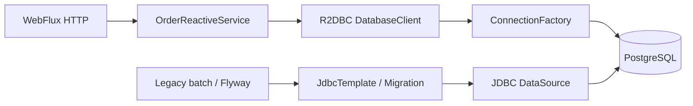
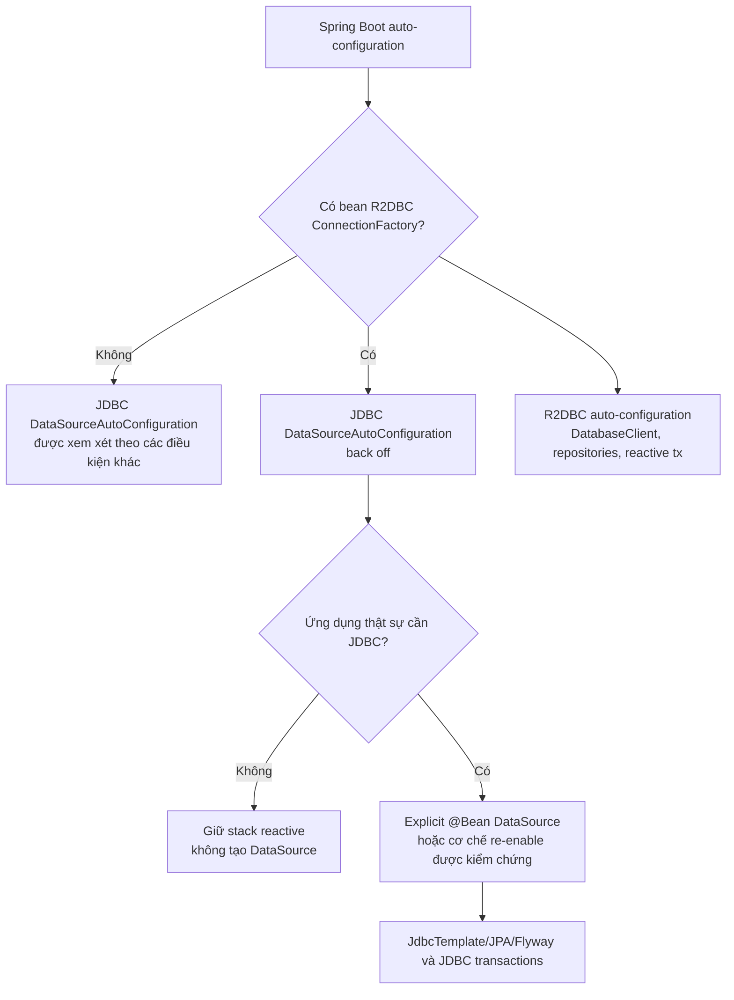
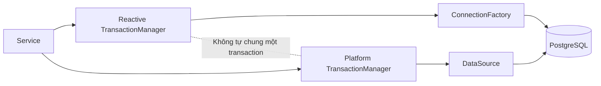
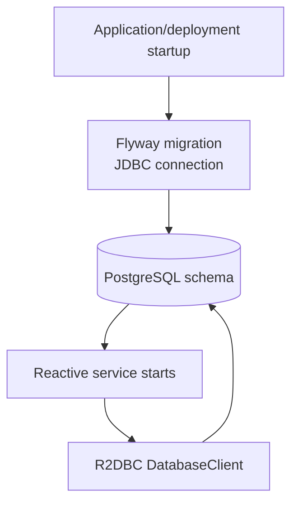
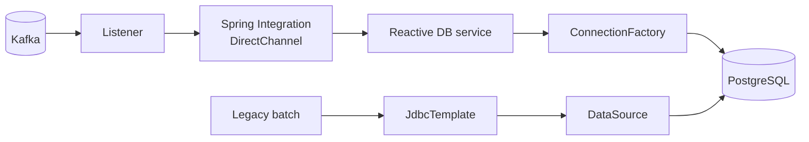
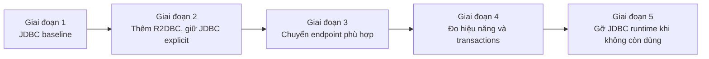

# Tự cấu hình khi đồng thời có ConnectionFactory và DataSource

## 1. Bài toán: ứng dụng cần cả truy cập SQL reactive lẫn JDBC

Một dịch vụ Spring Boot có thể nhận HTTP/WebFlux request, truy vấn dữ liệu bằng Spring Data R2DBC, nhưng vẫn cần một thành phần JDBC:

- **Flyway/Liquibase** chạy migration SQL khi triển khai.
- Một **batch job** hoặc thư viện báo cáo cũ chỉ hỗ trợ `JdbcTemplate`, JPA/Hibernate hoặc jOOQ qua JDBC.
- Spring Batch/Quartz hoặc một adapter Spring Integration có yêu cầu JDBC riêng.
- Một tuyến nghiệp vụ mới triển khai theo reactive, trong khi tuyến nghiệp vụ cũ vẫn dùng JDBC.

Ví dụ `order-service` nhận JSON qua HTTP, dùng R2DBC để ghi `orders` không chặn event loop, rồi một background job JDBC ghi dữ liệu báo cáo:



Hai đối tượng `ConnectionFactory` và `DataSource` là **hai cơ chế kết nối khác nhau**:

- `io.r2dbc.spi.ConnectionFactory`: tạo **R2DBC connections** cho API reactive; thường được `DatabaseClient`, `R2dbcEntityTemplate` và Spring Data R2DBC repositories sử dụng.
- `javax.sql.DataSource`: tạo **JDBC connections** cho API blocking; thường được `JdbcTemplate`, JPA/Hibernate, Flyway và các thư viện JDBC sử dụng.

**Vấn đề quan trọng:** Trong Spring Boot 3.5, khi context có bean `ConnectionFactory`, auto-configuration thông thường của JDBC `DataSource` **back off**. Khai báo cả hai nhóm thuộc tính `spring.r2dbc.*` và `spring.datasource.*` **không tự đảm bảo có cả hai bean**.

Trong module **SPRING_BOOT_INTEGRATION**, đây không chỉ là chuyện wiring. Một quyết định cấu hình sai còn ảnh hưởng transaction, pool capacity, luồng HTTP/broker, schema migration, timeout, idempotency và quan sát vận hành.

### Mục tiêu học tập

Sau bài này, bạn có thể:

1. Giải thích vì sao `DataSourceAutoConfiguration` rút lui khi có R2DBC `ConnectionFactory`, và điều gì vẫn được Boot tự cấu hình.
2. Phân biệt **classpath**, **properties**, **bean conditions** và **bean tự khai báo**.
3. Chủ động bật lại JDBC configuration hoặc tạo `DataSource` tường minh bên cạnh R2DBC.
4. Sử dụng `DatabaseClient`/R2DBC repositories và `JdbcTemplate`/JPA mà không nhầm hai đường truy cập.
5. Chọn `ReactiveTransactionManager` và `PlatformTransactionManager` đúng tầng, không giả định transaction tự trải qua cả hai.
6. Cấu hình migration, connection pools, security, resource ownership và các ranh giới blocking.
7. Đọc condition evaluation report, viết kiểm thử và thiết kế lộ trình di chuyển JDBC → R2DBC an toàn.

> **Phiên bản:** Nội dung tập trung vào **Spring Boot 3.5.x, Spring Framework 6.x, Spring Data R2DBC tương thích qua Boot BOM, Java 17+**. Một số API/auto-configuration khác ở Boot 2.x hoặc 4.x. Các ví dụ PostgreSQL cần cả JDBC driver và R2DBC driver; URL, người dùng và secret trong ví dụ chỉ minh họa.

## 2. Vì sao Spring Boot lại ưu tiên R2DBC khi thấy ConnectionFactory?

Spring Boot dùng **conditional auto-configuration**, tức cấu hình tự động chỉ được kích hoạt khi class/bean/property và điều kiện khác phù hợp.

`DataSourceAutoConfiguration` trong Boot 3.5 có điều kiện lớp chính như sau (rút gọn, chỉ nêu ý nghĩa):

```java
@AutoConfiguration(before = SqlInitializationAutoConfiguration.class)
@ConditionalOnClass({
        javax.sql.DataSource.class,
        org.springframework.jdbc.datasource.embedded.EmbeddedDatabaseType.class
})
@ConditionalOnMissingBean(type = "io.r2dbc.spi.ConnectionFactory")
public class DataSourceAutoConfiguration {
    // cấu hình JDBC DataSource khi điều kiện cho phép
}
```

Điều kiện **`@ConditionalOnMissingBean(type = "io.r2dbc.spi.ConnectionFactory")`** là điểm mấu chốt:

- Nếu có R2DBC `ConnectionFactory` được đăng ký, auto-configuration `DataSource` thông thường **không tạo JDBC DataSource**.
- Đây là cơ chế bảo vệ khỏi việc âm thầm dựng một stack JDBC blocking bên cạnh kết nối reactive khi tác giả chưa chủ động thiết kế.
- Sự hiện diện của driver PostgreSQL JDBC hoặc `spring.datasource.url` **không tự thắng điều kiện bean**.
- Bạn **vẫn có quyền tạo một `DataSource` explicit** khi nghiệp vụ cần; conditional auto-configuration không cấm user-defined beans.

Đây là **ưu tiên ở tầng tạo bean**, không phải quy tắc “Spring Boot chỉ cho phép một hệ truy cập database”. Cùng một application context có thể chứa cả `ConnectionFactory` lẫn `DataSource` nếu bạn cấu hình có chủ đích.

### 2.1. Bốn thứ cần phân biệt

| Tín hiệu | Ý nghĩa | Không đồng nghĩa |
| --- | --- | --- |
| Có R2DBC driver trên classpath | Boot có thể tạo ConnectionFactory nếu điều kiện/URL phù hợp | Chắc chắn đã có ConnectionFactory bean |
| Có JDBC driver + Hikari trên classpath | Có thể tạo DataSource theo điều kiện | DataSource được tạo khi R2DBC đã hiện diện |
| Có `spring.datasource.url` | Có cấu hình JDBC URL | Auto-configuration luôn tạo DataSource |
| Có `@Bean DataSource` | Người viết ứng dụng yêu cầu bean JDBC rõ ràng | Mọi lời gọi đều tự non-blocking |

**Đọc bean graph thay vì đoán từ `pom.xml` hoặc `application.yml`.** Khi nhìn thấy `No qualifying bean of type 'javax.sql.DataSource'`, cần kiểm tra condition report xem có `ConnectionFactory` nào khiến `DataSourceAutoConfiguration` rút lui.

### 2.2. Sơ đồ quyết định



Sơ đồ chỉ mô tả **tình huống auto-config thông thường**. R2DBC auto-configuration có các điều kiện riêng; một `ConnectionFactory` tạo thủ công, nhiều factories hoặc các bean overrides có thể khiến kết quả khác. Vì vậy phải kiểm chứng context thực tế.

## 3. Ma trận các trường hợp thường gặp

| Classpath và bean | R2DBC ConnectionFactory | JDBC DataSource | Diễn giải |
| --- | --- | --- | --- |
| Chỉ JDBC starter/driver, cấu hình `spring.datasource` | Không có | Boot thường tự cấu hình nếu đủ điều kiện | Stack JDBC thông thường |
| Chỉ R2DBC starter/driver, cấu hình `spring.r2dbc` | Boot thường tạo | Không có theo mặc định | Stack reactive |
| Cả hai starters/drivers, có R2DBC ConnectionFactory | Có | **Thường không tự tạo** | DataSource auto-config back off |
| Cả hai, tự khai báo `@Bean DataSource` | Có | **Có** | Hai kết nối do app chủ động sở hữu |
| R2DBC + chủ động re-enable DataSource auto-config | Có | Có khi các điều kiện/binding đúng | Cần kiểm tra Boot version và condition report |
| Chỉ có JDBC properties nhưng thiếu JDBC driver/pool hợp lệ | Tùy | Có thể lỗi/không tạo | Properties không thay dependency |
| Nhiều `DataSource` hoặc `ConnectionFactory` | Có thể nhiều | Có thể nhiều | `@Primary`/`@Qualifier` và template/transaction ambiguity |

Đừng nhầm việc thêm `spring-boot-starter-data-jpa` với việc cưỡng bức DataSource được tạo. Một dependency mới có thể khiến `JpaRepository`, `JdbcTemplate` hoặc transaction manager xuất hiện trong classpath, nhưng các bean vẫn phụ thuộc auto-config conditions.

## 4. Dependency tối thiểu cho R2DBC + JDBC PostgreSQL

Ví dụ Maven với Spring Boot parent/BOM quản lý versions:

```xml
<dependencies>
    <!-- Reactive SQL access / R2DBC repositories -->
    <dependency>
        <groupId>org.springframework.boot</groupId>
        <artifactId>spring-boot-starter-data-r2dbc</artifactId>
    </dependency>

    <!-- R2DBC PostgreSQL driver -->
    <dependency>
        <groupId>org.postgresql</groupId>
        <artifactId>r2dbc-postgresql</artifactId>
        <scope>runtime</scope>
    </dependency>

    <!-- JDBC clients and HikariCP -->
    <dependency>
        <groupId>org.springframework.boot</groupId>
        <artifactId>spring-boot-starter-jdbc</artifactId>
    </dependency>

    <!-- JDBC PostgreSQL driver -->
    <dependency>
        <groupId>org.postgresql</groupId>
        <artifactId>postgresql</artifactId>
        <scope>runtime</scope>
    </dependency>
</dependencies>
```

Nếu ứng dụng cần HTTP reactive, thêm `spring-boot-starter-webflux`. Nếu dùng JPA/Hibernate cho legacy model, thêm `spring-boot-starter-data-jpa` **thay vì bắt buộc dùng nó cho mọi JDBC operation**.

### 4.1. Hai drivers không hoán đổi cho nhau

- `org.postgresql:r2dbc-postgresql` là R2DBC driver, được dùng bởi `r2dbc:postgresql://...` và `ConnectionFactory`.
- `org.postgresql:postgresql` là JDBC driver, được dùng bởi `jdbc:postgresql://...` và `DataSource`.
- Thêm JDBC driver không làm `DatabaseClient` tự có backend.
- Thêm R2DBC driver không làm Flyway dùng R2DBC để chạy migrations; Flyway SQL migrations thông thường dùng **JDBC**.

Một số database vendors phát hành driver dưới artifact khác; luôn dùng driver mà Spring Boot version và vendor hỗ trợ thực tế.

### 4.2. Mẫu Gradle

```groovy
dependencies {
    implementation 'org.springframework.boot:spring-boot-starter-data-r2dbc'
    runtimeOnly 'org.postgresql:r2dbc-postgresql'

    implementation 'org.springframework.boot:spring-boot-starter-jdbc'
    runtimeOnly 'org.postgresql:postgresql'
}
```

Không tự chọn version Hikari/R2DBC SPI/Spring Data lệch Boot BOM trừ khi đã đánh giá tương thích.

## 5. Cấu hình hai URL tách biệt

Một file `application.yml` có thể khai báo:

```yaml
spring:
  r2dbc:
    url: r2dbc:postgresql://db.internal.example:5432/orders
    username: ${R2DBC_USERNAME}
    password: ${R2DBC_PASSWORD}
    pool:
      enabled: true
      initial-size: 5
      max-size: 15
      max-acquire-time: 3s

  datasource:
    url: jdbc:postgresql://db.internal.example:5432/orders
    username: ${JDBC_USERNAME}
    password: ${JDBC_PASSWORD}
    hikari:
      maximum-pool-size: 5
      connection-timeout: 3s
```

**Quan trọng:** đoạn YAML này chỉ khai báo **cả hai bộ thuộc tính**. Nếu có R2DBC `ConnectionFactory`, Boot 3.5 thông thường **không tự tạo `DataSource` chỉ vì có nhánh `spring.datasource`**. Cần áp dụng một trong các chiến lược ở mục tiếp theo.

Các đường dẫn `spring.r2dbc.*` và `spring.datasource.*` là **hai namespace cấu hình khác nhau**:

| Thuộc tính | Áp dụng cho | Không áp dụng cho |
| --- | --- | --- |
| `spring.r2dbc.url` | R2DBC ConnectionFactory | JDBC DataSource |
| `spring.r2dbc.username/password` | R2DBC connection login | JDBC login |
| `spring.r2dbc.pool.max-size` | Pool R2DBC nếu có `r2dbc-pool` | Hikari |
| `spring.datasource.url` | JDBC DataSource nếu được tạo | R2DBC |
| `spring.datasource.hikari.maximum-pool-size` | Hikari DataSource được binding đúng | R2DBC pool |
| `spring.flyway.url/user/password` | Migration JDBC connection khi Flyway dùng own datasource | R2DBC ConnectionFactory |

### 5.1. R2DBC pooling không bắt buộc từ SPI

`ConnectionFactory` là API tạo R2DBC connection, **không mặc định** mọi instance đều pooled. Spring Boot có thể sử dụng `r2dbc-pool` khi dependency/điều kiện thích hợp. Với pool:

- `max-size` giới hạn số kết nối do R2DBC pool quản lý.
- `max-acquire-time` kiểm soát chờ lấy connection.
- `initial-size` ảnh hưởng khởi tạo ban đầu; không phải throughput mục tiêu.
- Driver options trong URL có thể có precedence so với properties, cần kiểm tra khi đưa options vào URL.

Không cấu hình `spring.r2dbc.pool.max-size=20` rồi mặc định database chỉ nhận tối đa 20 connections từ toàn ứng dụng: JDBC Hikari, Flyway, pods khác và admin tools còn tạo các connections riêng.

### 5.2. JDBC Hikari là một pool khác

Khi có cả hai:

```text
R2DBC pool max 15 connections
      +
Hikari JDBC max 5 connections
      +
Migration/CLI/admin connections
      +
Tổng số pod replicas
```

Nếu có 6 replicas, chỉ riêng hai application pools có thể dùng tới khoảng `6 × (15+5) = 120` connections khi đầy; chưa tính Flyway, background jobs và connections khác. Database `max_connections` phải tính toàn cụm và có safety margin.

## 6. Chiến lược A: chủ động giữ JDBC qua @Import của Spring Boot

Tài liệu Spring Boot 3.5 phần **Using R2DBC** nêu cách re-enable JDBC `DataSource` auto-configuration bằng cách import `DataSourceAutoConfiguration` vào một `@Configuration` class khi ứng dụng thật sự cần cả hai.

```java
package example.integration.config;

import org.springframework.boot.autoconfigure.jdbc.DataSourceAutoConfiguration;
import org.springframework.context.annotation.Configuration;
import org.springframework.context.annotation.Import;

@Configuration(proxyBeanMethods = false)
@Import(DataSourceAutoConfiguration.class)
public class JdbcAlongsideR2dbcConfiguration {
}
```

Sau đó cung cấp **đúng** `spring.datasource.url/username/password` và JDBC driver/HikariCP phù hợp. Đây là cách được **tài liệu Spring Boot 3.5 đề cập**, tuy nhiên cần hiểu:

1. `@Import` **không biến JDBC thành non-blocking**; JDBC vẫn dùng blocking calls.
2. Cơ chế conditions và thời điểm bean definitions được xử lý có thể thay đổi theo Boot version, ứng dụng tự khai báo factory hoặc auto-config exclusions.
3. **Phải xác minh runtime** thực có cả `ConnectionFactory` lẫn `DataSource` và JDBC pool nhận đúng properties.
4. Nếu `DataSourceAutoConfiguration` bị exclude, có nhiều DataSources hoặc custom configurations, không mặc định ví dụ tối giản là đủ.
5. `@Import` không tự bảo đảm `JdbcTransactionManager`, `EntityManagerFactory` hay Flyway đã chọn đúng DataSource trong mọi cấu hình.

Vì tính điều kiện này khó nhận ra trong code review, không nên coi `@Import` là một “mẹo magic” thay cho kiểm thử. Nếu cần kiểm soát rõ ràng và mapping chính xác, xem chiến lược B.

### 6.1. Khi nào dùng chiến lược A?

Phù hợp nếu:

- Dự án chủ yếu dùng R2DBC nhưng giữ một nhánh JDBC có cấu hình thông thường.
- Có đúng một JDBC DataSource.
- Muốn tiếp tục sử dụng Boot pool/metrics/JdbcTemplate setup và đã xác minh điều kiện Boot version.
- Không cần tách connection properties/driver hoặc nhiều pools phức tạp.

Nếu ứng dụng cần hai JDBC DataSources hoặc muốn chỉ dùng JDBC cho batch/migration với quyền khác, chiến lược explicit thường rõ hơn.

## 7. Chiến lược B: tự khai báo DataSource tường minh

Cách trực tiếp là yêu cầu Spring tạo bean `DataSource` rõ ràng, **không dựa vào đường tự tạo JDBC đang back off**:

```java
package example.integration.config;

import com.zaxxer.hikari.HikariDataSource;
import javax.sql.DataSource;

import org.springframework.boot.autoconfigure.jdbc.DataSourceProperties;
import org.springframework.boot.context.properties.ConfigurationProperties;
import org.springframework.boot.context.properties.EnableConfigurationProperties;
import org.springframework.context.annotation.Bean;
import org.springframework.context.annotation.Configuration;

@Configuration(proxyBeanMethods = false)
@EnableConfigurationProperties(DataSourceProperties.class)
public class ExplicitJdbcConfiguration {

    @Bean(name = "jdbcDataSource")
    @ConfigurationProperties("spring.datasource.hikari")
    HikariDataSource jdbcDataSource(DataSourceProperties properties) {
        return properties.initializeDataSourceBuilder()
                .type(HikariDataSource.class)
                .build();
    }
}
```

**Vì sao cách này rõ ràng?**

- `DataSourceProperties` bind các thuộc tính JDBC chung ở `spring.datasource.*`.
- `initializeDataSourceBuilder()` chuyển URL/user/password sang cấu hình pool phù hợp.
- `@ConfigurationProperties("spring.datasource.hikari")` áp các thông số riêng của Hikari trên bean được tạo, như `maximum-pool-size` và `connection-timeout`.
- `@EnableConfigurationProperties` bảo đảm bean properties được đăng ký ngay cả khi `DataSourceAutoConfiguration` không chạy.
- Một `@Bean` rõ ràng khiến việc có JDBC `DataSource` không phụ thuộc vào việc Boot tự suy ra từ `ConnectionFactory`.

**Lưu ý:** Boot thường có thể tạo `JdbcTemplate` từ một DataSource duy nhất nếu điều kiện `JdbcTemplateAutoConfiguration` phù hợp. Nhưng trong hệ nhiều datasources, hãy khai báo `JdbcTemplate` và manager bằng `@Qualifier` cụ thể thay vì đoán bean nào được chọn.

### 7.1. Tự khai báo JdbcTemplate để xác định chắc đường kết nối

```java
package example.integration.config;

import javax.sql.DataSource;
import org.springframework.beans.factory.annotation.Qualifier;
import org.springframework.context.annotation.Bean;
import org.springframework.context.annotation.Configuration;
import org.springframework.jdbc.core.JdbcTemplate;

@Configuration(proxyBeanMethods = false)
public class ExplicitJdbcClientConfiguration {

    @Bean(name = "ordersJdbcTemplate")
    JdbcTemplate ordersJdbcTemplate(
            @Qualifier("jdbcDataSource") DataSource dataSource) {
        return new JdbcTemplate(dataSource);
    }
}
```

Khi chỉ có một JDBC `DataSource`, có thể để Boot tạo `JdbcTemplate` theo conditions. Ví dụ explicit ở đây dùng khi cần **biết chính xác** JDBC adapter nào được dùng; nếu đã có auto-configured template, một user-defined template có thể khiến auto-configuration đó back off. Không tạo nhiều templates không cần thiết rồi gặp lỗi ambiguous injection.

### 7.2. R2DBC vẫn dùng factory của nó

Nếu không tự định nghĩa `ConnectionFactory`, Spring Boot có thể tiếp tục tạo R2DBC connection factory từ `spring.r2dbc.*`, cung cấp `DatabaseClient`, `R2dbcEntityTemplate` và reactive repositories theo các điều kiện Spring Data tương ứng.

```text
Spring context
 ├── ConnectionFactory (R2DBC)
 │    ├── DatabaseClient
 │    ├── R2dbcEntityTemplate
 │    └── Reactive repositories
 └── jdbcDataSource (JDBC / Hikari)
      ├── JdbcTemplate / JdbcClient
      ├── JDBC TransactionManager
      └── Flyway / legacy JDBC integrations
```

Sự tồn tại đồng thời này **không biến transaction của R2DBC thành transaction của JDBC**. Phải coi chúng là hai access paths với transaction managers riêng.

## 8. Cần kiểm chứng bean graph sau khi cấu hình

Một ứng dụng có thể khởi động nhưng dùng sai connection hoặc connection pool. Trước khi viết nghiệp vụ, tạo bước kiểm tra beans trong test:

```java
package example.integration.config;

import io.r2dbc.spi.ConnectionFactory;
import javax.sql.DataSource;

import org.junit.jupiter.api.Test;
import org.springframework.beans.factory.annotation.Autowired;
import org.springframework.boot.test.context.SpringBootTest;
import org.springframework.context.ApplicationContext;

import static org.assertj.core.api.Assertions.assertThat;

@SpringBootTest
class BothConnectionTypesTest {

    @Autowired
    ApplicationContext context;

    @Test
    void contextContainsBothR2dbcAndJdbcConnections() {
        assertThat(context.getBeansOfType(ConnectionFactory.class))
                .isNotEmpty();

        assertThat(context.getBeansOfType(DataSource.class))
                .containsKey("jdbcDataSource");
    }
}
```

Test này áp dụng cho **chiến lược B**, nơi bean JDBC đặt tên `jdbcDataSource`. Với chiến lược A, `DataSource` có thể mang tên mặc định khác, thường `dataSource`; điều chỉnh assertion tương ứng.

**Chưa đủ:** test chỉ kiểm tra bean graph, không chứng minh JDBC và R2DBC kết nối được DB thật hoặc trỏ đúng database/schema. Phải thêm integration test thực hiện query từ cả hai clients và kiểm tra migration/transaction semantics.

### 8.1. Dùng Condition Evaluation Report

Chạy local/test với:

```bash
java -jar orders-service.jar --debug
```

Hoặc bật log:

```yaml
logging:
  level:
    org.springframework.boot.autoconfigure: DEBUG
```

Trong startup condition report, tìm `DataSourceAutoConfiguration`, `R2dbcAutoConfiguration`, `JdbcTemplateAutoConfiguration` và các điều kiện về `ConnectionFactory`. Một report có thể nêu đại ý:

```text
DataSourceAutoConfiguration:
  Did not match:
    @ConditionalOnMissingBean found bean of type
    'io.r2dbc.spi.ConnectionFactory'
```

Đây là **minh họa**; cấu trúc log/đoạn text thực thay đổi theo version. Không bật `--debug` cho production lâu dài vì logs có thể rất nhiều và chứa metadata cấu hình; kiểm soát quyền xem log.

### 8.2. Actuator không thay integration test

Actuator `/actuator/conditions` có thể giúp đọc condition evaluations khi được cấu hình và cấp quyền phù hợp. `/actuator/health` có thể có indicators liên quan DB/JDBC/R2DBC theo auto-configuration. Nhưng:

- Indicator tồn tại không chứng minh endpoint business dùng đúng bean.
- Readiness của DB không kiểm tra được mọi transaction, schema và key/tenant.
- Không public `conditions` hoặc `env` ra Internet; chúng tiết lộ thông tin nội bộ.
- Test cần query thực và kiểm tra kết quả từ JDBC/R2DBC độc lập.

## 9. Một DatabaseClient reactive đúng nghĩa

Spring Data R2DBC thường dùng `DatabaseClient` với API trả `Mono`/`Flux`:

```java
package example.integration.orders;

import org.springframework.r2dbc.core.DatabaseClient;
import org.springframework.stereotype.Repository;
import reactor.core.publisher.Mono;

@Repository
public class ReactiveOrderStore {

    private final DatabaseClient client;

    public ReactiveOrderStore(DatabaseClient client) {
        this.client = client;
    }

    public Mono<Long> insert(String orderId, String status) {
        return client.sql(
                "INSERT INTO orders (order_id, order_status) " +
                "VALUES (:orderId, :status)")
                .bind("orderId", orderId)
                .bind("status", status)
                .fetch()
                .rowsUpdated();
    }
}
```

Ở Spring Framework 6.x, `rowsUpdated()` trả số rows updated theo dạng `Mono<Long>` ở những phiên bản gần đây; xác minh chữ ký trên bản cụ thể nếu dùng Spring Framework cũ. SQL và tên cột phải khớp Flyway migrations thực; mã chỉ minh họa repository.

Điểm quan trọng:

- Method trả `Mono<Long>`; **SQL thường thực thi khi có subscription**, không phải lúc khởi tạo publisher.
- Reactive chain hỗ trợ composition, cancellation và backpressure theo driver/chuỗi operator thực tế.
- Một method tên `insert` trả `Mono` **không nên** bí mật gọi `block()` rồi bọc kết quả vào `Mono.just(...)`.
- Nếu có unique constraint `order_id`, retry do broker redelivery phải được xử lý theo idempotency semantics, không phải retry mọi lỗi SQL vô hạn.

### 9.1. Reactive repository khác JPA repository

```java
// OrderRow.java
package example.integration.orders;

import org.springframework.data.relational.core.mapping.Table;
import org.springframework.data.annotation.Id;

@Table("orders")
public record OrderRow(
        @Id String orderId,
        String orderStatus) {
}
```

```java
// ReactiveOrderRepository.java
package example.integration.orders;

import org.springframework.data.repository.reactive.ReactiveCrudRepository;

public interface ReactiveOrderRepository
        extends ReactiveCrudRepository<OrderRow, String> {
}
```

Đây là **mô hình Spring Data R2DBC**, sử dụng mapping annotation của Spring Data Relational, không phải `jakarta.persistence.Entity` của Hibernate/JPA. Dự án nên định nghĩa package cho R2DBC entities/repositories riêng để tránh auto-detection và mapping lẫn với JPA repositories.

**Không dùng `JpaRepository` rồi kỳ vọng nó trả non-blocking `Mono`**; Hibernate/JPA thường truy cập database qua JDBC blocking.

## 10. JdbcTemplate: vẫn blocking dù nằm trong WebFlux app

Một JDBC client:

```java
package example.integration.reporting;

import org.springframework.beans.factory.annotation.Qualifier;
import org.springframework.jdbc.core.JdbcTemplate;
import org.springframework.stereotype.Repository;

@Repository
public class LegacyReportDao {

    private final JdbcTemplate jdbc;

    public LegacyReportDao(
            @Qualifier("ordersJdbcTemplate") JdbcTemplate jdbc) {
        this.jdbc = jdbc;
    }

    public int countOrders() {
        Integer count = jdbc.queryForObject(
                "SELECT COUNT(*) FROM orders", Integer.class);
        return count == null ? 0 : count;
    }
}
```

Phương thức `countOrders()` chạy **blocking** trên thread gọi. Không gọi trực tiếp từ Netty event loop trong một WebFlux request handler nhiều tải:

```java
// Anti-pattern: lambda thực thi JDBC blocking khi có subscription
public Mono<Integer> countOrdersWrong() {
    return Mono.fromSupplier(legacyReportDao::countOrders);
}
```

Một `Mono` không làm cho đoạn JDBC bên trong tự trở thành non-blocking. Nếu subscriber chạy trên event loop, nó có thể chặn cả event loop trong lúc chờ DB.

### 10.1. Bridge blocking code vào boundedElastic

Khi buộc dùng JDBC từ một reactive pipeline:

```java
package example.integration.reporting;

import org.springframework.stereotype.Service;
import reactor.core.publisher.Mono;
import reactor.core.scheduler.Schedulers;

@Service
public class ReportingBridge {

    private final LegacyReportDao dao;

    public ReportingBridge(LegacyReportDao dao) {
        this.dao = dao;
    }

    public Mono<Integer> countOrders() {
        return Mono.fromCallable(dao::countOrders)
                .subscribeOn(Schedulers.boundedElastic());
    }
}
```

`subscribeOn(Schedulers.boundedElastic())` giúp **cô lập blocking call khỏi event loop**, không khiến JDBC driver thành non-blocking. Với tải cao, vẫn cần:

- Hikari pool size và connection acquire timeout rõ.
- Giới hạn concurrency/reactive operator (`flatMap(..., concurrency)`, bulkhead).
- Query timeout và transaction timeout.
- Quan sát boundedElastic queue/threads; tránh đưa tất cả blocking jobs vào một scheduler shared không kiểm soát.
- Cân nhắc `Scheduler` chuyên dụng cho workload lớn, lifecycle/destroy phù hợp.

### 10.2. Không dùng `block()` trong reactive chain

```java
// Anti-pattern
public OrderRow loadOrder(String id) {
    return reactiveRepository.findById(id).block();
}
```

`block()` chuyển reactive work thành chờ đồng bộ; trên non-blocking event loop có thể gây lỗi `block()/blockFirst()/blockLast() are blocking` hoặc nghẽn threads. Ở một số ranh giới imperative do hệ thống kiểm soát, chờ blocking có thể là quyết định được tính toán, nhưng phải có timeout, bounded concurrency và không nằm trong event loop.

## 11. Hai transaction managers không tương đương nhau

Khi có cả hai connection mechanisms:

- **JDBC:** `PlatformTransactionManager` (ví dụ `JdbcTransactionManager` hoặc `JpaTransactionManager`) điều phối transaction dựa trên JDBC connections và thường dùng thread-bound state.
- **R2DBC:** `ReactiveTransactionManager` (ví dụ `R2dbcTransactionManager`) điều phối transaction reactive, gắn context với **Reactor Context** của reactive pipeline.

Một `@Transactional` đặt trên method không tự “gom” cả hai thành một distributed transaction:



Việc cả JDBC và R2DBC trỏ cùng database **không làm chúng chia sẻ cùng một session/connection hoặc transaction**. Một bên commit và bên kia rollback là tình huống có thể xảy ra nếu bạn thực hiện hai đường truy cập như hai transactions.

### 11.1. Khai báo transaction managers có tên rõ ràng

```java
package example.integration.config;

import javax.sql.DataSource;
import io.r2dbc.spi.ConnectionFactory;

import org.springframework.beans.factory.annotation.Qualifier;
import org.springframework.context.annotation.Bean;
import org.springframework.context.annotation.Configuration;
import org.springframework.jdbc.support.JdbcTransactionManager;
import org.springframework.r2dbc.connection.R2dbcTransactionManager;
import org.springframework.transaction.PlatformTransactionManager;
import org.springframework.transaction.ReactiveTransactionManager;

@Configuration(proxyBeanMethods = false)
public class ExplicitTransactionManagers {

    @Bean("jdbcTransactionManager")
    PlatformTransactionManager jdbcTransactionManager(
            @Qualifier("jdbcDataSource") DataSource dataSource) {
        return new JdbcTransactionManager(dataSource);
    }

    @Bean("r2dbcTransactionManager")
    ReactiveTransactionManager r2dbcTransactionManager(
            ConnectionFactory connectionFactory) {
        return new R2dbcTransactionManager(connectionFactory);
    }
}
```

Đây là **cấu hình chủ động** cho trường hợp dùng Spring JDBC. Nếu project dùng JPA cho dữ liệu qua Hibernate, hãy dùng `JpaTransactionManager` thích hợp cho EntityManagerFactory, không thay bừa bằng `JdbcTransactionManager` khi nghiệp vụ dùng JPA.

Spring Boot có thể tự cấu hình một số transaction managers theo conditions; nếu bạn khai báo explicit, hãy xác minh không có manager trùng tên hoặc manager framework khác đã được chọn. Cấu hình `@Transactional` hoặc `TransactionalOperator` nên chỉ rõ bean bằng tên hoặc qualifier để không tạo ambiguity.

### 11.2. Mỗi transaction nằm trong một đường truy cập

Một JDBC service:

```java
package example.integration.reporting;

import org.springframework.stereotype.Service;
import org.springframework.transaction.annotation.Transactional;

@Service
public class LegacyJdbcService {

    private final LegacyReportDao dao;

    public LegacyJdbcService(LegacyReportDao dao) {
        this.dao = dao;
    }

    @Transactional(transactionManager = "jdbcTransactionManager")
    public int countOrders() {
        return dao.countOrders();
    }
}
```

Một reactive service:

```java
package example.integration.orders;

import org.springframework.stereotype.Service;
import org.springframework.transaction.annotation.Transactional;
import reactor.core.publisher.Mono;

@Service
public class ReactiveOrderService {

    private final ReactiveOrderStore store;

    public ReactiveOrderService(ReactiveOrderStore store) {
        this.store = store;
    }

    @Transactional(transactionManager = "r2dbcTransactionManager")
    public Mono<Void> create(String id) {
        return store.insert(id, "NEW").then();
    }
}
```

Reactive `@Transactional` cần reactive return type và hoạt động khi có subscription; transaction được quản lý theo Reactor context. Một call `legacyJdbcService.countOrders()` bên trong reactive pipeline không tự tham gia R2DBC transaction, ngay cả khi cả hai nhìn cùng database.

### 11.3. Dùng `TransactionalOperator` cho reactive pipeline

```java
package example.integration.orders;

import org.springframework.stereotype.Service;
import org.springframework.transaction.reactive.TransactionalOperator;
import reactor.core.publisher.Mono;

@Service
public class ReactiveOrderWorkflow {

    private final ReactiveOrderStore orders;
    private final TransactionalOperator reactiveTx;

    public ReactiveOrderWorkflow(
            ReactiveOrderStore orders,
            TransactionalOperator reactiveTx) {
        this.orders = orders;
        this.reactiveTx = reactiveTx;
    }

    public Mono<Void> create(String id) {
        return orders.insert(id, "NEW")
                .then()
                .as(reactiveTx::transactional);
    }
}
```

Khi có nhiều reactive transaction managers, `TransactionalOperator` phải được tạo/inject theo đúng bean; code trên giả định có một operator phù hợp trong context. Có thể định nghĩa:

```java
@Bean("ordersReactiveOperator")
TransactionalOperator ordersReactiveOperator(
        @Qualifier("r2dbcTransactionManager")
        ReactiveTransactionManager manager) {
    return TransactionalOperator.create(manager);
}
```

Với `@Transactional` và `TransactionalOperator`, external calls như Kafka/HTTP nằm ngoài database transaction về mặt atomicity trừ khi sử dụng cơ chế transaction/phối hợp riêng. **Reactive** không đồng nghĩa **distributed transaction**.

## 12. Nếu cùng một nghiệp vụ gọi cả R2DBC và JDBC thì sao?

Giả sử order service làm hai thao tác:

```text
R2DBC: INSERT orders
JDBC:  INSERT legacy_audit
```

Dù cả hai cùng trỏ tới database `orders`, chúng dùng **hai connections khác nhau**. Không có gì đảm bảo commit của hai thao tác nguyên tử chỉ nhờ gọi chúng trong một reactive chain:

```java
// Anti-pattern về kỳ vọng một transaction bao phủ JDBC và R2DBC:
return reactiveOrders.create(id)
        .then(Mono.fromCallable(() -> legacyAuditDao.writeAudit(id))
                .subscribeOn(Schedulers.boundedElastic()))
        .then();
```

Nếu R2DBC commit xong rồi JDBC insert thất bại, order đã được ghi còn audit chưa được ghi. Nếu JDBC commit trước rồi R2DBC rollback, điều ngược lại có thể xảy ra. Có scheduler đúng để tránh chặn event loop **không giải quyết tính nguyên tử**.

### 12.1. Ba lựa chọn kiến trúc

| Lựa chọn | Cách làm | Khi phù hợp |
| --- | --- | --- |
| **Một transaction owner** | Thực hiện tất cả bảng liên quan qua **một** connection technology/transaction manager | Order + outbox cùng DB, cần atomic commit |
| **Tách thành workflow có bù trừ** | Mỗi transaction commit riêng, lưu trạng thái và retry/reconcile | Nhiều systems/stack phải phối hợp |
| **Transactional outbox/inbox** | DB transaction chính ghi event bền vững; worker khác xử lý bước kế tiếp | Integration HTTP/broker hoặc legacy JDBC riêng |

Với cùng một PostgreSQL instance, nếu yêu cầu `orders` và `integration_outbox` phải commit cùng nhau, nên viết cả hai trong **một R2DBC transaction** hoặc **một JDBC transaction**, không chia một statement cho R2DBC và statement còn lại cho JDBC rồi kỳ vọng `@Transactional` bao phủ.

### 12.2. Ví dụ R2DBC transaction: ghi orders và outbox

```java
package example.integration.orders;

import org.springframework.r2dbc.core.DatabaseClient;
import org.springframework.stereotype.Repository;
import reactor.core.publisher.Mono;

@Repository
public class ReactiveOrderWriter {

    private final DatabaseClient client;

    public ReactiveOrderWriter(DatabaseClient client) {
        this.client = client;
    }

    public Mono<Void> writeOrderAndOutbox(
            String orderId, String eventId, String payloadJson) {

        Mono<Long> orderInsert = client.sql(
                "INSERT INTO orders(order_id, order_status) " +
                "VALUES (:orderId, :status)")
                .bind("orderId", orderId)
                .bind("status", "NEW")
                .fetch().rowsUpdated();

        Mono<Long> outboxInsert = client.sql(
                "INSERT INTO integration_outbox(event_id, aggregate_id, " +
                "payload_json) VALUES (:eventId, :orderId, " +
                "CAST(:payload AS jsonb))")
                .bind("eventId", eventId)
                .bind("orderId", orderId)
                .bind("payload", payloadJson)
                .fetch().rowsUpdated();

        return orderInsert
                .then(outboxInsert)
                .then();
    }
}
```

Một service gọi phương thức trên **dưới cùng `TransactionalOperator` reactive**:

```java
return writer.writeOrderAndOutbox(orderId, eventId, eventJson)
        .as(ordersReactiveOperator::transactional);
```

SQL minh họa giả định schema đã có các cột tương ứng; nếu bảng có các cột `NOT NULL` khác, phải điền đủ. Hãy dùng eventId ổn định, transaction manager đúng `ConnectionFactory` mà `DatabaseClient` đang dùng, và unique constraints để chống trùng.

**Quan trọng:** hai `Mono` chỉ tham gia một reactive transaction khi được subscribe trong **cùng Reactor context** và có `R2dbcTransactionManager` phù hợp. Đừng tự gọi `.subscribe()` bên trong repository; điều đó tạo một execution độc lập, dễ làm mất transaction context và error propagation.

## 13. Flyway/Liquibase: migration JDBC khi runtime chủ yếu dùng R2DBC

Đây là một động cơ rất phổ biến để có cả hai connection technologies. Flyway SQL migrations sử dụng **JDBC**, trong khi runtime business queries có thể hoàn toàn R2DBC.



### 13.1. Không cần giữ JDBC DataSource để truy vấn mọi request

Một hệ R2DBC thuần có thể chọn một trong hai chiến lược:

1. **Migration job riêng:** chạy Flyway CLI/Gradle/Maven/plugin trong CI/CD với JDBC connection và credentials DDL; ứng dụng runtime chỉ có R2DBC `ConnectionFactory`.
2. **Flyway chạy lúc Spring Boot startup:** thêm dependencies Flyway + JDBC driver và cấu hình **Flyway-native JDBC URL/credentials** nếu không có application `DataSource`.

Ví dụ startup Flyway với kết nối riêng:

```yaml
spring:
  r2dbc:
    url: r2dbc:postgresql://db.internal.example:5432/orders
    username: ${DB_RUNTIME_USER}
    password: ${DB_RUNTIME_PASSWORD}

  flyway:
    enabled: true
    locations: classpath:db/migration
    url: jdbc:postgresql://db.internal.example:5432/orders
    user: ${DB_MIGRATION_USER}
    password: ${DB_MIGRATION_PASSWORD}
    validate-on-migrate: true
    clean-disabled: true

  sql:
    init:
      mode: never
```

Theo tài liệu Spring Boot, khi cấu hình `spring.flyway.url` hoặc `spring.flyway.user`, Flyway có thể dùng **DataSource riêng do Flyway xây dựng** theo các thuộc tính đó. Ví dụ trên không đòi application phải public một bean `DataSource` cho mọi JDBC service.

**Dependency:** cần `flyway-core`, module database phù hợp (ví dụ `flyway-database-postgresql` cho các bản Flyway mới), và PostgreSQL JDBC driver. R2DBC PostgreSQL driver **không** thay JDBC driver khi Flyway tạo connection.

```xml
<dependency>
    <groupId>org.flywaydb</groupId>
    <artifactId>flyway-core</artifactId>
</dependency>
<dependency>
    <groupId>org.flywaydb</groupId>
    <artifactId>flyway-database-postgresql</artifactId>
</dependency>
```

Các dependency này dùng version do Boot BOM quản lý. Nếu đã dùng `spring-boot-starter-flyway` ở bản có starter đó, tránh khai báo trùng không cần thiết; xác minh BOM và Flyway database support đúng phiên bản.

### 13.2. Có DataSource application rồi: Flyway sẽ chọn cái nào?

Nếu bạn chủ động tạo `jdbcDataSource`:

- Flyway có thể dùng `DataSource` chính/`@Primary` theo auto-configuration nếu không khai báo riêng.
- Có thể dùng `@FlywayDataSource` để chỉ định DataSource migration, với `@Bean(defaultCandidate=false)` theo API Boot tương ứng khi cần giữ một runtime DataSource khác.
- Hoặc cung cấp `spring.flyway.url/user/password` để Flyway sử dụng connection migration riêng.

**Không nên** để Flyway vô tình dùng runtime JDBC user không có DDL privileges, hoặc dùng schema khác với R2DBC runtime URL. Nếu production tách account migration và runtime, migration job ngoài app giúp runtime không cần mang secret DDL.

### 13.3. Chọn một cơ chế tạo schema

```yaml
spring:
  sql:
    init:
      mode: never
  jpa:
    hibernate:
      ddl-auto: validate
```

Nhánh `spring.jpa` chỉ cần nếu project thực sự dùng JPA. Tránh để Hibernate `ddl-auto=update`, `schema.sql`/`data.sql` và Flyway cùng tự thay schema trong production. Một startup có cả R2DBC + JDBC còn có thể có **R2DBC SQL script initializer**; đặt `spring.sql.init.mode: never` để vô hiệu hóa đường SQL script nếu Flyway là schema owner.

### 13.4. Migration completion khác reactive subscription

Flyway startup chạy blocking JDBC DDL. Điều đó **có thể chấp nhận được ở deployment/startup phase**, khác với việc block Netty event loop cho từng HTTP request. Phải cân nhắc:

- Startup readiness chờ migration xong.
- DDL locks và tác động tới phiên bản cũ đang chạy.
- Nhiều replicas cùng khởi động và cùng tìm cách migrate.
- Database migration cần strategy expand/contract, không tự phá schema cũ.

Với hệ production có nhiều instances, migration job riêng thường dễ quản lý quyền, logs và downtime budget hơn.

## 14. Một ứng dụng có hai repository systems cần ranh giới package

Nếu đồng thời có Spring Data R2DBC repositories và Spring Data JPA repositories, Boot/Spring Data có thể bật **strict repository configuration mode**. Hai frameworks có repository interfaces và annotation entity khác nhau; một repository đặt sai package/extends sai base interface có thể được candidate detection không như dự kiến.

Ví dụ cấu trúc mã nguồn:

```text
example.integration
├── config
│   ├── ReactiveDatabaseConfiguration.java
│   └── ExplicitJdbcConfiguration.java
├── reactive
│   ├── model/OrderRow.java
│   ├── repository/ReactiveOrderRepository.java
│   └── service/ReactiveOrderService.java
├── legacy
│   ├── entity/LegacyInvoiceEntity.java
│   ├── repository/LegacyInvoiceJpaRepository.java
│   └── service/LegacyBillingService.java
└── api
    └── OrdersController.java
```

Đề xuất:

- Spring Data R2DBC dùng `org.springframework.data.relational.core.mapping.Table`/`org.springframework.data.annotation.Id`.
- JPA dùng `jakarta.persistence.Entity`/`jakarta.persistence.Id`.
- Repository interfaces nên mở rộng `ReactiveCrudRepository` hoặc `JpaRepository` phù hợp; không cố cho một interface vừa làm JPA vừa làm R2DBC repository.
- Khi auto-scan bị nhập nhằng, dùng `@EnableR2dbcRepositories(basePackages=...)` và `@EnableJpaRepositories(basePackages=...)` theo đúng version, cùng `@EntityScan` nếu cần.
- Đảm bảo R2DBC entity/table mapping không vô tình dựa vào JPA annotations; R2DBC không phải Hibernate reactive thay thế trực tiếp.

### 14.1. Repository trả `Mono<T>` không phải bằng chứng toàn stack non-blocking

Nếu implementation gọi JDBC/JPA rồi bọc `Mono.just(result)`, kết quả chỉ là một wrapper reactive quanh blocking call đã xảy ra. Kiểm tra **driver và DataSource/ConnectionFactory của repository thực**.

Spring Data R2DBC hỗ trợ relational persistence reactive nhưng không có toàn bộ cơ chế Hibernate như lazy-loaded JPA associations và dirty checking. Việc di chuyển entity/repository cần thay đổi design, không phải đổi mỗi interface return type.

## 15. WebFlux, MVC và việc có DataSource không chọn web stack

Đây là hai trục độc lập:

| Trục | Lựa chọn | Quyết định gì? |
| --- | --- | --- |
| Web layer | Spring MVC hoặc Spring WebFlux | HTTP server request processing model |
| Database layer | JDBC hoặc R2DBC | API kết nối SQL blocking vs reactive |
| Messaging | Kafka/Rabbit/Pulsar listeners/adapters | Delivery/ack và threading theo broker |
| Transaction | JDBC/JPA or R2DBC | Connection participation và transaction context |

Có `ConnectionFactory` không khiến ứng dụng đang dùng `spring-boot-starter-web` tự biến thành WebFlux. Khi cả Spring MVC và WebFlux starters có trên classpath, Spring Boot theo convention thường ưu tiên Spring MVC web application type, trừ khi cấu hình rõ.

Cũng không có quy tắc “chỉ được dùng R2DBC trong WebFlux”: một CLI worker hoặc Kafka consumer có thể dùng `DatabaseClient` reactive mà không phục vụ HTTP. Ngược lại, WebFlux app có thể gọi JDBC nhưng cần tách blocking work khỏi event loop và giới hạn concurrency.

### 15.1. Những dấu hiệu cảnh báo blocking trong reactive pipeline

- `JdbcTemplate.query...` gọi trực tiếp trong `flatMap`, `map` hoặc `doOnNext`.
- `JpaRepository.save(...)` chạy trong HTTP handler trên Netty event loop.
- `.block()`, `.blockOptional()` trong request pipeline.
- `Thread.sleep(...)`, file IO blocking, Java `synchronized` có contention lớn trên event loop.
- `Mono.just(legacyService.runBlocking())`: legacy call chạy **ngay lúc tạo Mono**, trước cả subscription/scheduler.

Nếu cần bridge, dùng `Mono.fromCallable(...).subscribeOn(boundedElastic())` và giới hạn tài nguyên. Reactive API không tự loại bỏ bottleneck của database, SSL handshake, broker consumer concurrency hay third-party network.

## 16. Pool budget: hai đường truy cập cùng tranh tài nguyên DB

Mỗi pool có cơ chế acquire, idle, validation và timeout riêng. Với một PostgreSQL:

```text
                     PostgreSQL max_connections
                         /           \\
              R2DBC pool(s)       JDBC Hikari pool(s)
                 /     \\             /      \\
               API   Worker        JPA     Legacy batch
```

Nếu `spring.r2dbc.pool.max-size=15` và `spring.datasource.hikari.maximum-pool-size=5`, một pod có thể mở ~20 application connections khi pools đầy. Với 8 pods, lên tới ~160, cộng Flyway, monitoring, admin và các connections khác. **Không lấy tổng của từng pool trên một pod làm toàn bộ database capacity**.

### 16.1. Ví dụ ngân sách theo nhu cầu

| Workload | Pool / giới hạn | Rủi ro khi đặt quá cao |
| --- | --- | --- |
| WebFlux orders | R2DBC max 15 | Queries nhiều làm DB CPU/lock/I/O bão hòa |
| JDBC reporting | Hikari max 5 | Blocking batch quét bảng lớn, chiếm pool |
| Flyway migration | Connection riêng theo job | DDL locks/backfill chậm ảnh hưởng cả hai |
| Kafka outbox publisher | Reactive hoặc JDBC owner được chọn | Nhiều consumers tăng SQL concurrency |
| Partner API | HTTP pool + concurrency limit | Tăng concurrent requests gây 429/timeouts |

Pool không tạo thêm throughput nếu DB hoặc connection locks đã bão hòa. Với R2DBC, giảm queue saturation bằng acquire timeout; với Hikari, quan sát pending threads và transaction duration.

### 16.2. Timeout không có một cấu hình chung

| Tình huống | Cần timeout nào? |
| --- | --- |
| R2DBC pool hết connection | Acquire timeout của R2DBC pool |
| Hikari hết connection | `spring.datasource.hikari.connection-timeout` |
| SQL query chạy quá lâu | Driver/query/statement timeout phù hợp |
| JDBC transaction chờ lock | Database lock timeout và transaction deadline |
| Reactive request chờ HTTP partner | WebClient response timeout/overall budget |
| Kafka listener processing chậm | Poll interval/consumer settings và business timeout |

Đặt `spring.r2dbc.pool.max-acquire-time=3s` không tự đặt JDBC `statement_timeout` thành 3 giây. Ngược lại, `Hikari connection-timeout` chỉ giới hạn **chờ lấy connection từ pool**, không phải tổng thời gian SQL query.

## 17. TLS, secrets và hai drivers

Khi có hai connection types, cả hai phải có security configuration đúng:

- `r2dbc:postgresql://...` dùng các driver-specific R2DBC connection options.
- `jdbc:postgresql://...` dùng các PostgreSQL JDBC driver options như `sslmode=verify-full`, trust cert path và hostname verification.
- `spring.r2dbc.username/password` và `spring.datasource.username/password` có thể dùng **hai credentials khác nhau**; đó thường là lợi thế để tách quyền.
- Flyway migration user cần DDL rights nếu chạy schema changes; runtime R2DBC/JDBC user chỉ nên có quyền cần cho nghiệp vụ.
- Không ghi password trong code, logs, tracing spans hoặc metadata broker.

Ví dụ JDBC URL yêu cầu kiểm tra chain và hostname theo PostgreSQL JDBC semantics:

```yaml
spring:
  datasource:
    url: "jdbc:postgresql://db.internal.example:5432/orders?sslmode=verify-full&sslrootcert=/etc/tls/postgresql-ca.pem"
```

Đối với R2DBC PostgreSQL, tên/tập option TLS phải tra **đúng R2DBC driver version**; không copy nguyên JDBC query parameters sang R2DBC URL rồi mặc định hiệu lực. Chỉ dùng trusted CA/hostname verification đúng; không bật tùy chọn kiểu `trust-all` để vượt lỗi certificate.

### 17.1. Trùng URL không tự đảm bảo cùng schema

JDBC URL và R2DBC URL có thể trỏ cùng host/database nhưng:

- Default schema/search path khác do connection options/user.
- Một user có quyền đọc bảng A, user khác không.
- Session timezone/statement timeout khác.
- Transaction isolation/auto-commit defaults khác.
- SQL dialect hoặc driver conversion cho JSONB, timestamp, UUID có thể khác.

Hãy kiểm tra `current_database()`, `current_schema()`, session settings, account và bảng thực từ **cả hai clients** khi debug.

## 18. Database initialization: đừng để hai cơ chế tranh quyền

Khi chạy cùng R2DBC và JDBC, bạn có thể có nhiều đường khởi tạo:

```text
Flyway / Liquibase  (JDBC migration)
Hibernate ddl-auto (JPA/JDBC)
Spring SQL init    (có thể xử lý JDBC hoặc R2DBC)
Testfixtures        (data.sql hoặc test scripts)
```

**Quy tắc:** một cơ chế nên sở hữu schema. Nếu dùng Flyway, không để Hibernate `update/create` tự biến đổi schema production và không kích hoạt `schema.sql` trùng với migrations.

Khi có application runtime R2DBC và một migration JDBC path, phải chắc:

1. Migration đã chạy thành công **trước khi** reactive repositories xử lý các queries phụ thuộc schema.
2. Custom init beans không tự thực thi query quá sớm khi schema chưa sẵn sàng.
3. Dữ liệu đã có ở schema cũ tương thích với code mới trong rolling deployment.
4. Migration không chạy hai lần do nhiều pods hoặc hai initialization strategies.

### 18.1. Phụ thuộc database initialization

Spring Boot có cơ chế phát hiện một số database initializers như Flyway, Liquibase, JDBC/R2DBC script initializers và các beans phụ thuộc DB initialization. Nhưng một custom startup listener chạy query, hoặc một `@PostConstruct` tự dùng R2DBC, có thể cần điều phối rõ.

Khi thật sự cần, dùng annotation Boot:

```java
package example.integration.init;

import org.springframework.boot.sql.init.dependson.DependsOnDatabaseInitialization;
import org.springframework.context.annotation.Bean;
import org.springframework.context.annotation.Configuration;

@Configuration(proxyBeanMethods = false)
public class WarmupConfiguration {

    @Bean
    @DependsOnDatabaseInitialization
    WarmupTask warmupTask() {
        return new WarmupTask();
    }
}
```

`WarmupTask` là class do dự án cung cấp; annotation chỉ nêu dependency bean initialization, **không tự subscribe reactive publisher hay cho phép blocking trong constructor**. Với production, không nên warmup bằng cách full scan database khi khởi động nhiều instances.

### 18.2. Flyway migration không tự biến thành reactive

Flyway chạy JDBC blocking là phù hợp ở migration stage; **không gọi `Flyway.migrate()` bên trong một WebFlux request** như tác vụ nghiệp vụ. Điều đó vừa block thread vừa đưa DDL operations vào request path, rất nguy hiểm cho availability và quyền.

Nếu cần đổi schema trong deployment, dùng pipeline/job với quyền kiểm soát, backup và rollback plan; runtime DB queries vẫn có thể dùng R2DBC.

## 19. Dùng R2DBC và JDBC với Kafka/Rabbit/Pulsar: chọn điểm commit

Một Spring Boot integration flow có thể:



Nếu Kafka listener gọi reactive service:

```java
@KafkaListener(topics = "orders.events.v1")
public void onOrder(OrderCreatedV1 event) {
    reactiveOrderService.create(event.orderId()).subscribe();
}
```

đây là **anti-pattern** khi container dùng return/callback completion để ACK: listener trả về sau khi subscription được khởi tạo, có thể **trước DB commit**. Nếu process chết sau ACK nhưng trước DB commit, event có nguy cơ mất.

### 19.1. Các chiến lược an toàn hơn

- Dùng listener container/adapter hỗ trợ **asynchronous acknowledgment** theo đúng Spring Kafka version và method signature thích hợp, hoàn thành callback khi reactive publisher đã đạt điểm bền vững.
- Hoặc lưu event vào durable inbox bằng một transaction rồi ACK; worker reactive xử lý sau.
- Hoặc triển khai listener imperative có JDBC transaction hoàn tất trước ACK, nếu yêu cầu/tải phù hợp.

Không gọi `.subscribe()` trong listener để “fire-and-forget” rồi kỳ vọng broker biết transaction reactive đã commit. Tương tự với RabbitMQ ACK/NACK và Pulsar acknowledgement: adapter lifecycle/ack thuộc framework/broker, **không thuộc tên method Mono**.

### 19.2. Reactive stream không tự có exactly-once

Một `Mono<Void>` đại diện một computation; không bảo đảm producer không publish trùng, broker không redeliver, hoặc JDBC batch không chạy lại. Nếu một event có thể xuất hiện nhiều lần:

```sql
CREATE TABLE processed_event (
    consumer_name VARCHAR(100) NOT NULL,
    event_id VARCHAR(80) NOT NULL,
    processed_at TIMESTAMPTZ NOT NULL,
    PRIMARY KEY (consumer_name, event_id)
);
```

Ghi inbox receipt và business effect trong **cùng một transaction của một DB access stack**, xử lý unique conflict/race có chủ đích. Đừng trộn JDBC receipt với R2DBC business write rồi gọi đó là atomic chỉ vì cùng schema.

## 20. Test cả hai đường kết nối trên database thật

Unit test với mocked `DatabaseClient` hoặc mocked `DataSource` không chứng minh Boot tạo đúng beans, URLs cùng database hay transaction hoạt động thực. Một integration test có thể dùng Testcontainers PostgreSQL.

### 20.1. Dependencies test

```xml
<dependency>
    <groupId>org.springframework.boot</groupId>
    <artifactId>spring-boot-starter-test</artifactId>
    <scope>test</scope>
</dependency>
<dependency>
    <groupId>org.springframework.boot</groupId>
    <artifactId>spring-boot-testcontainers</artifactId>
    <scope>test</scope>
</dependency>
<dependency>
    <groupId>org.testcontainers</groupId>
    <artifactId>junit-jupiter</artifactId>
    <scope>test</scope>
</dependency>
<dependency>
    <groupId>org.testcontainers</groupId>
    <artifactId>postgresql</artifactId>
    <scope>test</scope>
</dependency>
```

Với Spring Boot Testcontainers, `@ServiceConnection` có thể cung cấp connection details cho các technologies phù hợp dựa trên container/driver availability. Tuy nhiên, khi cần **cả JDBC và R2DBC connection details trong một context**, test phải chứng minh **cả hai clients** thực sự trỏ đúng container, thay vì chỉ giả định annotation sẽ cấu hình mọi đường.

Một phương án minh bạch dùng `@DynamicPropertySource`:

```java
package example.integration.test;

import io.r2dbc.spi.ConnectionFactory;
import javax.sql.DataSource;
import org.junit.jupiter.api.Test;
import org.springframework.beans.factory.annotation.Autowired;
import org.springframework.boot.test.context.SpringBootTest;
import org.springframework.r2dbc.core.DatabaseClient;
import org.springframework.jdbc.core.JdbcTemplate;
import org.springframework.test.context.DynamicPropertyRegistry;
import org.springframework.test.context.DynamicPropertySource;
import org.testcontainers.containers.PostgreSQLContainer;
import org.testcontainers.junit.jupiter.Container;
import org.testcontainers.junit.jupiter.Testcontainers;

import static org.assertj.core.api.Assertions.assertThat;

@SpringBootTest
@Testcontainers
class JdbcAndR2dbcIT {

    @Container
    static PostgreSQLContainer<?> postgres =
            new PostgreSQLContainer<>("postgres:16-alpine");

    @DynamicPropertySource
    static void databaseProperties(DynamicPropertyRegistry registry) {
        registry.add("spring.datasource.url", postgres::getJdbcUrl);
        registry.add("spring.datasource.username", postgres::getUsername);
        registry.add("spring.datasource.password", postgres::getPassword);

        registry.add("spring.r2dbc.url", () ->
                "r2dbc:postgresql://" + postgres.getHost() + ":" +
                postgres.getMappedPort(5432) + "/" +
                postgres.getDatabaseName());
        registry.add("spring.r2dbc.username", postgres::getUsername);
        registry.add("spring.r2dbc.password", postgres::getPassword);
    }

    @Autowired
    DataSource jdbcDataSource;

    @Autowired
    ConnectionFactory connectionFactory;

    @Autowired
    JdbcTemplate jdbc;

    @Autowired
    DatabaseClient r2dbc;

    @Test
    void bothConnectionsReachTheSameDatabase() {
        String databaseFromJdbc = jdbc.queryForObject(
                "SELECT current_database()", String.class);

        String databaseFromR2dbc = r2dbc
                .sql("SELECT current_database() AS db_name")
                .map((row, metadata) -> row.get("db_name", String.class))
                .one()
                .block(java.time.Duration.ofSeconds(5));

        assertThat(connectionFactory).isNotNull();
        assertThat(jdbcDataSource).isNotNull();
        assertThat(databaseFromR2dbc)
                .isEqualTo(databaseFromJdbc);
    }
}
```

Trong test JUnit (thread blocking do test runner kiểm soát), dùng `.block(Duration)` là một phương án kiểm tra kết quả; **không copy `.block()` vào HTTP WebFlux handler**. Test giả định dự án đã tạo `DataSource` explicit hoặc re-enable theo mục 6/7 và có cả hai drivers.

Nếu dùng Flyway ở test startup, migrations phải chạy thành công trước query; nếu kiểm tra chỉ `current_database()` thì DB trống cũng đủ. Để kiểm chứng business schema, test thêm tables/constraints/transaction/repositories thực.

## 21. Contract tests và failure tests phải vượt qua việc “có bean”

Đối với hai client types cùng truy cập PostgreSQL, cần kiểm tra các ranh giới quan trọng:

| Kịch bản | Điều cần xác minh |
| --- | --- |
| Chỉ R2DBC starter, không dùng JDBC | Context có `ConnectionFactory`, không tự cần `DataSource` |
| Cả starters, không explicit DataSource | Condition report cho thấy JDBC auto-configuration back off |
| Có `@Bean DataSource` | Context có cả `ConnectionFactory` và `DataSource`, đúng names |
| Có `@Import(DataSourceAutoConfiguration.class)` | Auto-config tạo DataSource đúng khi điều kiện bản thực cho phép |
| JDBC URL sai | JDBC query fail rõ, R2DBC có thể vẫn hoạt động nếu URL độc lập |
| R2DBC URL sai | Reactive query fail, JDBC có thể vẫn hoạt động |
| Hai URLs trỏ khác database/schema | Integration test phát hiện qua `current_database()`/`current_schema()` |
| Một user thiếu quyền | Query đúng path nhưng bị authorization failure; không tự fallback sang account khác |
| Hikari pool cạn | Blocking acquisition timeout; WebFlux event loop không bị đưa vào chờ trực tiếp |
| R2DBC pool cạn | Reactive acquire timeout/backpressure, không tạo infinite pending queue |
| JDBC commit, R2DBC rollback | Hai transaction độc lập, test chứng minh không atomic |
| Reactive transaction cancellation | Rollback/cleanup theo semantics driver/operator; không để connection leak |
| Kafka redelivery sau DB commit | Inbox/outbox + eventId đảm bảo không áp business effect hai lần |
| Flyway chạy với migration user | Schema đúng, runtime users đọc/ghi được; không cần DDL credentials trong request path |

### 21.1. Unit test configuration conditions

Đối với một thư viện/starter dùng `@AutoConfiguration` và `@ConditionalOnMissingBean`, có thể dùng `ApplicationContextRunner` để test từng tổ hợp:

```text
Test A: only jdbc auto-config + driver
    → expect JDBC DataSource (nếu các điều kiện khác đáp ứng)

Test B: r2dbc ConnectionFactory bean + jdbc auto-config
    → expect DataSource auto-config back off

Test C: r2dbc factory + explicit jdbcDataSource bean
    → expect cả hai beans

Test D: thêm custom transaction managers
    → expect @Transactional chạy đúng manager theo tên
```

Khi kiểm tra auto-configuration thực, cần import đủ auto-config classes, dependency driver, bean user configuration và properties liên quan. Nếu test quá rút gọn thiếu Hikari hoặc driver, DataSource có thể không được tạo vì **nguyên nhân khác** không liên quan R2DBC.

### 21.2. Test transactional correctness

Ví dụ:

1. Tạo hai tables `orders` và `integration_outbox` qua Flyway.
2. Gọi reactive service dùng `R2dbcTransactionManager`, ghi order + outbox.
3. Cố ý làm outbox insert lỗi unique constraint → assert cả hai writes rollback.
4. Gọi JDBC legacy report read, xác minh không thấy order đã rollback.
5. Sau đó test một flow dùng JDBC và R2DBC trong hai transactions độc lập, assert rõ khả năng một bên commit còn bên kia fail.
6. Kiểm tra các mapping của `BigDecimal`, `Instant`, UUID và JSONB qua JDBC/R2DBC để tránh lệch contract.

**Không nên mong test thứ năm rollback nguyên tử**: mục tiêu của nó là phơi bày ranh giới transaction thực. Nếu nghiệp vụ không chấp nhận bất nhất, chuyển sang một transaction owner/outbox.

### 21.3. Test blocking detection

Trong WebFlux integration test, dùng request thực và tạo JDBC query chậm có kiểm soát. Theo dõi:

- Netty event loop có bị block không?
- `boundedElastic` active/pending và Hikari pending có tăng đúng kỳ vọng?
- Khi 20 requests đồng thời nhưng JDBC pool chỉ 5 connections, API có timeout và backpressure hợp lý không?
- Cancellation của HTTP request có tự dừng JDBC query không? **Không nên giả định**; JDBC cancellation/statement timeout phụ thuộc driver và cách triển khai.

BlockHound có thể giúp phát hiện một số blocking operations trong reactive thread khi được cấu hình tương thích với runtime. Nhưng nó không thay kiểm thử tải, query timeout và transaction behavior thực.

## 22. Diagnosing: lỗi nào thuộc auto-configuration, lỗi nào thuộc SQL?

| Triệu chứng | Nguyên nhân thường gặp | Hướng xử lý |
| --- | --- | --- |
| `No qualifying bean of type DataSource` | Có R2DBC ConnectionFactory khiến JDBC auto-config back off | Kiểm tra conditions, explicit DataSource hoặc documented @Import |
| `Failed to configure a DataSource` | JDBC driver/URL/embedded DB không hợp lệ khi JDBC path được yêu cầu | Kiểm tra driver, URL, profiles và auto-config |
| `No qualifying bean of type ConnectionFactory` | Thiếu R2DBC driver, URL, starter hoặc custom factory lỗi | Kiểm tra R2DBC auto-config conditions |
| Có `spring.datasource.url` nhưng không có Hikari | Chỉ có JDBC properties, bean condition đã ngăn tự tạo | Đừng suy ra từ YAML; xem bean graph |
| JPA repository không tạo được | Chưa có DataSource/EntityManagerFactory hoặc package scanning sai | Rà JPA starter, entities, JDBC path và repositories |
| R2DBC repository không tạo được | Mapping/scan/driver/config sai | Rà `ReactiveCrudRepository`, `@Table`, R2dbcDataAutoConfiguration |
| `NoUniqueBeanDefinitionException` DataSource/manager | Nhiều beans cùng type | Đặt `@Qualifier`/`@Primary` và managers rõ |
| `@Transactional` dường như không rollback | Chọn sai manager hoặc gọi `subscribe()` tạo publisher độc lập | Dùng manager theo tên, giữ một Reactor context, test rollback |
| Flyway báo không tìm connection JDBC | Chỉ có R2DBC driver hoặc thiếu Flyway JDBC URL/DataSource | Thêm JDBC driver và migration connection config |
| Flyway tạo bảng nhưng reactive query vẫn fail | Hai URLs trỏ khác DB/schema, hoặc mapping SQL sai | So sánh host/database/schema/user và migrations |
| WebFlux latency tăng rất cao | JDBC blocking chạy trên event loop | `fromCallable + subscribeOn`, concurrency/timeout |
| Pool timeout dù CPU còn trống | JDBC/R2DBC pool nhỏ, queries giữ connection lâu | Đo active/pending, transaction duration, query performance |
| `block()` không được phép trên event loop | Blocking Reactor wait ở nonblocking thread | Không gọi `block()` trong handler |
| Kafka ACK nhưng DB không có event | `.subscribe()` bên trong listener, listener return quá sớm | Async ack đúng API hoặc durable inbox |
| Duplicate order sau consumer restart | At-least-once redelivery, thiếu idempotency | Unique eventId/inbox trong một transaction |
| PostgreSQL connections vượt giới hạn | Tổng R2DBC + Hikari + replicas + migration quá cao | Tính connection budget toàn hệ |
| TLS lỗi chỉ ở một đường truy cập | JDBC và R2DBC driver dùng TLS options khác | Kiểm tra CA, hostname/SAN, driver-specific configs |

### 22.1. Quy trình phân tích từng bước

1. **Xác định stack đang lỗi:** R2DBC `ConnectionFactory`, JDBC `DataSource`, JPA hay Flyway?
2. **Kiểm tra classpath:** cả drivers và starters có tương thích BOM không?
3. **Kiểm tra properties:** hai URLs/profiles/users/tls/options thuộc namespace nào?
4. **Đọc condition evaluation report:** `DataSourceAutoConfiguration` match hay back off vì `ConnectionFactory`?
5. **Kiểm tra bean graph:** names, number of factories, templates, transaction managers và qualifiers.
6. **Query DB thật:** `current_database()`, `current_schema()`, quyền và migration version.
7. **Chỉ ra thread/scheduler:** blocking JDBC có nằm trên event loop không?
8. **Kiểm tra transaction/ACK:** khi handler trả, DB đã commit hay chỉ mới tạo `Mono`?
9. **Thử failure/replay:** rollback, duplicate events, pool saturation và shutdown.

Không chữa một lỗi `DataSource` không tồn tại bằng cách tắt R2DBC nếu nghiệp vụ thực sự cần cả hai. Hãy hiểu điều kiện bean rồi cấu hình đúng owner.

## 23. Kịch bản thực tế: nâng một service JDBC lên reactive từng bước

Giả sử hệ thống có `billing-service`:

- REST Spring MVC, JDBC `JdbcTemplate`, PostgreSQL Hikari.
- Một `@KafkaListener` nhận `InvoiceCreated` và ghi `invoice` trong transaction.
- Flyway quản lý schema khi deploy.

Đội muốn chuyển một HTTP reporting endpoint thành WebFlux + R2DBC để phục vụ nhiều kết nối đồng thời nhưng chưa thể thay toàn bộ JPA/JDBC.

### 23.1. Thay đổi gây lỗi

Họ thêm:

```xml
<dependency>
    <groupId>org.springframework.boot</groupId>
    <artifactId>spring-boot-starter-data-r2dbc</artifactId>
</dependency>
```

và R2DBC PostgreSQL driver cùng `spring.r2dbc.url`. Sau deploy, Boot tạo R2DBC `ConnectionFactory` nhưng **không còn tự tạo JDBC `DataSource`** như trước, khiến `JdbcTemplate` hoặc legacy repository không khởi tạo được.

**Nguyên nhân:** không phải dữ liệu PostgreSQL biến mất; điều kiện `@ConditionalOnMissingBean(ConnectionFactory)` của JDBC `DataSourceAutoConfiguration` đã làm auto-configuration rút lui.

### 23.2. Cách triển khai từng giai đoạn



**Giai đoạn 1 — Baseline:** ghi nhận schema, metrics, Hikari pool, transaction boundaries, HTTP latency và consumer ack policy.

**Giai đoạn 2 — Thêm R2DBC:** giữ `DataSource` explicit bằng chiến lược B; kiểm tra cả hai clients truy cập cùng DB/schema, không mất Flyway migrations hoặc `JdbcTransactionManager`.

**Giai đoạn 3 — Chuyển một workflow:** viết repository R2DBC với `DatabaseClient`/reactive repository, dùng reactive transaction manager; **không trộn** JDBC statement trong transaction mới.

**Giai đoạn 4 — Kiểm thử:** so sánh kết quả business, throughput và database connections; kiểm tra Kafka listener ACK và idempotency; nếu phải gọi legacy JDBC từ WebFlux, isolate blocking work.

**Giai đoạn 5 — Thu gọn:** khi không còn JDBC runtime, có thể bỏ `DataSource` và legacy beans. Flyway có thể được chạy bằng migration job JDBC riêng, nên việc xóa application JDBC `DataSource` **không có nghĩa** xóa luôn JDBC driver khỏi hệ thống deployment nếu pipeline còn cần.

### 23.3. Đừng chuyển cả application sang WebFlux chỉ vì R2DBC

Nếu endpoints hiện tại chủ yếu dùng blocking JPA/HTTP libraries, chuyển server sang WebFlux mà không thay các blocking operations có thể khiến latency **tệ hơn** vì event loop bị chặn. R2DBC và WebFlux nên được áp dụng nơi có lợi ích cụ thể; không bắt buộc chuyển tất cả chỉ để sử dụng một reactive repository.

## 24. Kiến trúc production: ranh giới trách nhiệm rõ ràng

Một cách tổ chức phù hợp:

```text
                    SPRING_BOOT_INTEGRATION
        ┌────────────────────────────────────────┐
HTTP    │ Orders WebFlux Controller              │
request │  → Reactive Domain Service             │
        │  → DatabaseClient / ConnectionFactory  │
        │            PostgreSQL                  │
        │                                        │
Legacy  │ Legacy Report/Batch Service            │
job     │  → JdbcTemplate / Hikari DataSource    │
        │            PostgreSQL                  │
        │                                        │
Events  │ Kafka/Rabbit/Pulsar listener           │
        │  → durable Inbox / Outbox               │
        │  → chosen transaction owner            │
        └────────────────────────────────────────┘

Deploy migration job:
  Flyway (JDBC URL + restricted DDL credentials)
  → schema version gate before serving traffic
```

Quy tắc vận hành:

- Mỗi business workflow có một **transaction owner**.
- JDBC và R2DBC connection pools có budgets, metrics và shutdown lifecycles riêng.
- Không truyền `ConnectionFactory` cho JDBC libraries; chúng cần `DataSource`.
- Không truyền Hikari `DataSource` cho R2DBC reactive repository để “chạy reactive”.
- Migration dùng chính xác database/schema mà runtime sẽ truy cập.
- Đối với Spring Integration adapter, xác định adapter dùng `JdbcTemplate`, `R2dbcEntityTemplate`, broker client hay HTTP client để cấu hình đúng.
- Transactional outbox/inbox và idempotency bảo vệ kết quả khi broker/HTTP xảy ra lỗi, không phụ thuộc JDBC hay R2DBC.

### 24.1. Monitoring và alerting

| Metric/tín hiệu | Ý nghĩa |
| --- | --- |
| Hikari active/idle/pending | JDBC workload có cạn connections không |
| R2DBC pool allocated/acquired/pending | Reactive workload có bị queue/saturation không |
| Database connections theo user/application | Tổng tải qua cả hai pools và các pod |
| SQL p95/p99, lock waits | Query bottleneck, transaction kéo dài |
| WebFlux event loop blocked warnings | Blocking code lọt vào event loop |
| Flyway schema version/startup time | Ứng dụng mới đã thấy schema đúng chưa |
| Kafka consumer lag, DLT | Message processing và recovery |
| Outbox/inbox pending age | Business work có được commit/bù trừ không |
| Transaction rollback/validation errors | Sai manager, mapping hoặc business contract |

Tên metric thực tế tùy Spring Boot/Micrometer/Hikari/r2dbc-pool version. Không đoán tên meter mà chưa kiểm tra Actuator/MeterRegistry. Không gắn raw order IDs hoặc event payloads làm metric tags có cardinality vô hạn.

### 24.2. Graceful shutdown và resource lifecycle

Một app có cả JDBC và R2DBC cần dừng HTTP/broker listeners, pollers và background jobs trước khi resource pools đóng:

```text
Quiesce HTTP / Kafka / Spring Integration poller
  → Drain business work & pending reactive publishers
  → Commit/ack hoặc persist recovery state
  → Stop outbound publisher
  → Close R2DBC pool + JDBC Hikari pool
  → Flush observability
```

Reactive publishers là **lazy**; một `Mono` được tạo nhưng chưa subscribe không phải công việc đã được xử lý. Với `@Async`/schedulers, phải theo dõi in-flight operations và để đạt điểm bền vững trước khi ACK nguồn.

## 25. Checklist áp dụng khi đồng thời có ConnectionFactory và DataSource

1. **Xác định nhu cầu:** JDBC còn cần cho JPA/batch/Flyway hay chỉ bị kéo theo dependency?
2. **Đọc điều kiện Boot 3.5:** `DataSourceAutoConfiguration` back off khi có bean R2DBC `ConnectionFactory`.
3. **Classpath:** R2DBC driver và JDBC driver đúng loại; tránh versions lệch BOM.
4. **Properties:** hai URLs có scheme đúng `r2dbc:` và `jdbc:`, credentials/profile tách rõ.
5. **Bean strategy:** dùng documented `@Import` hoặc explicit `@Bean DataSource` có test.
6. **Hikari binding:** nếu tạo bean thủ công, bind `spring.datasource.hikari.*` rõ ràng.
7. **R2DBC pool:** kiểm tra `r2dbc-pool`, max-size/acquire timeout và connection budget.
8. **Templates/repositories:** `DatabaseClient` vs `JdbcTemplate` và package mapping không nhập nhằng.
9. **Transactions:** ReactiveTransactionManager vs PlatformTransactionManager được chọn tường minh.
10. **Atomicity:** một business transaction không trải rộng sang JDBC và R2DBC tự động.
11. **Blocking:** JDBC/JPA không chạy trên WebFlux event loop; dùng boundedElastic/bulkhead khi phải bridge.
12. **Migrations:** Flyway/Liquibase có JDBC path/credentials, schema phù hợp R2DBC runtime.
13. **Schema owner:** không để Flyway, Hibernate `update` và SQL initializer tranh quyền.
14. **Integration:** broker ACK chỉ sau business commit/durable inbox; outbox và idempotency cho redelivery.
15. **TLS/secrets:** driver-specific CA/hostname verification và quyền user riêng.
16. **Observability:** condition report, bean graph, pool metrics, query latency, consumer lag.
17. **Testing:** Testcontainers với cả hai connections, rollback, failure, concurrency và schema.
18. **Rollout:** mở rộng schema tương thích old/new app, không chặn traffic bằng migration dài.
19. **Shutdown:** dừng listener/poller trước khi Hikari/R2DBC pool đóng.
20. **Tối giản sau migration:** bỏ JDBC runtime DataSource khi không còn cần; giữ JDBC tool độc lập cho Flyway nếu có.

### Câu hỏi tự kiểm tra

**1.** Vì sao có `spring.datasource.url` và JDBC driver vẫn có thể không có `DataSource` bean khi R2DBC `ConnectionFactory` hiện diện?

**2.** Điều kiện nào của `DataSourceAutoConfiguration` trong Boot 3.5 liên quan trực tiếp đến R2DBC?

**3.** Khác nhau giữa documented `@Import(DataSourceAutoConfiguration.class)` và tự khai báo `@Bean DataSource` là gì? Khi nào cần test condition report?

**4.** `spring.r2dbc.pool.max-size` có giới hạn số JDBC Hikari connections không? Vì sao phải tính connection budget toàn cụm?

**5.** Một `@Transactional("r2dbcTransactionManager")` có tự bao phủ một `JdbcTemplate.update(...)` ở thread khác không?

**6.** Vì sao `Mono.fromCallable(jdbcDao::load).subscribeOn(boundedElastic())` vẫn dùng blocking database API?

**7.** Flyway có thể dùng R2DBC ConnectionFactory thay JDBC driver chỉ bằng cách đổi URL thành `r2dbc:` không?

**8.** Vì sao JPA `@Entity` và R2DBC `@Table` không nên được coi như hai annotation tương đương cho cùng repository?

**9.** Một Kafka listener gọi `reactiveService.save(...).subscribe()` rồi return. Khi nào listener có thể commit offset, và rủi ro gì xảy ra khi crash?

**10.** Có hai database clients trỏ cùng PostgreSQL nhưng khác `current_schema()`. Bạn sẽ phát hiện điều đó bằng test nào?

**11.** Vì sao dùng Flyway JDBC trong một migration job startup có thể hợp lý, nhưng chạy JDBC blocking trong WebFlux event loop lại nguy hiểm?

**12.** Nếu JDBC transaction commit nhưng R2DBC transaction fail, cần cơ chế nào để giữ business consistency?

## Tài liệu tham khảo

- [Spring Boot 3.5 — SQL Databases (Using R2DBC)](https://docs.spring.io/spring-boot/3.5/reference/data/sql.html): mô tả rõ `ConnectionFactory` khiến JDBC `DataSource` auto-configuration back off và cách dùng `@Import` để giữ JDBC.
- [Spring Boot 3.5 — DataSourceAutoConfiguration API](https://docs.spring.io/spring-boot/3.5/api/java/org/springframework/boot/autoconfigure/jdbc/DataSourceAutoConfiguration.html): điều kiện `@ConditionalOnMissingBean(type = "io.r2dbc.spi.ConnectionFactory")`.
- [Spring Boot 3.5 — Common Application Properties](https://docs.spring.io/spring-boot/3.5/appendix/application-properties/index.html): `spring.r2dbc.*`, `spring.datasource.*`, Hikari và pool.
- [Spring Boot 3.5 — Database Initialization](https://docs.spring.io/spring-boot/3.5/how-to/data-initialization.html): Flyway/Liquibase, JDBC/R2DBC SQL initialization, migration data sources.
- [Spring Boot 3.5 — Configure a Custom DataSource](https://docs.spring.io/spring-boot/3.5/how-to/data-access.html): `@Bean DataSource` và tự binding properties.
- [Spring Framework 6 — Data Access with R2DBC](https://docs.spring.io/spring-framework/reference/data-access/r2dbc.html): ConnectionFactory, DatabaseClient, R2dbcTransactionManager.
- [Spring Framework — Transaction Management](https://docs.spring.io/spring-framework/reference/data-access/transaction.html): imperative vs reactive transaction context và declarative/programmatic transactions.
- [Spring Data R2DBC — Reference](https://docs.spring.io/spring-data/relational/reference/r2dbc.html): reactive repositories, mapping và transactions.
- [Project Reactor — Schedulers](https://projectreactor.io/docs/core/release/reference/coreFeatures/schedulers.html): `boundedElastic`, `subscribeOn`, blocking wrapper pattern.
- [Testcontainers PostgreSQL](https://java.testcontainers.org/modules/databases/postgres/): integration tests với database thật.

## Kết luận

Trong Spring Boot 3.5, **có bean R2DBC `ConnectionFactory` khiến JDBC `DataSourceAutoConfiguration` thông thường back off**. Vì vậy việc đặt cả `spring.r2dbc.*` và `spring.datasource.*` trong YAML chưa đủ để đảm bảo tồn tại cả hai connection types. Khi thật sự cần JDBC bên cạnh R2DBC, hãy chủ động **re-enable theo tài liệu Boot hoặc khai báo `DataSource` explicit**, rồi xác minh bean graph, URLs, pools, transaction managers và migration path bằng integration tests. R2DBC cho phép SQL reactive, nhưng JDBC/JPA vẫn blocking; tách blocking work khỏi event loop không biến hai loại transaction thành nguyên tử. Đối với các luồng HTTP, database, cache, broker và Spring Integration, tính đúng đắn đến từ **một transaction owner rõ ràng, inbox/outbox, idempotency, schema management, timeout và quan sát**, không chỉ từ việc ứng dụng khởi động thành công với hai bean kết nối cùng tồn tại.
