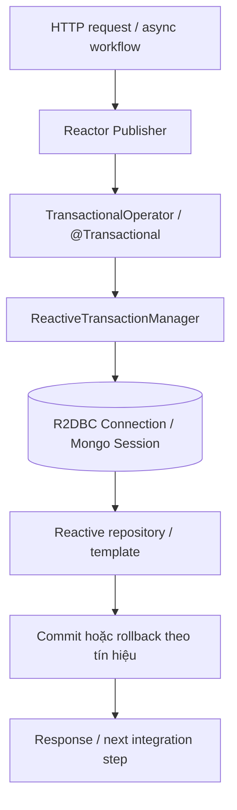
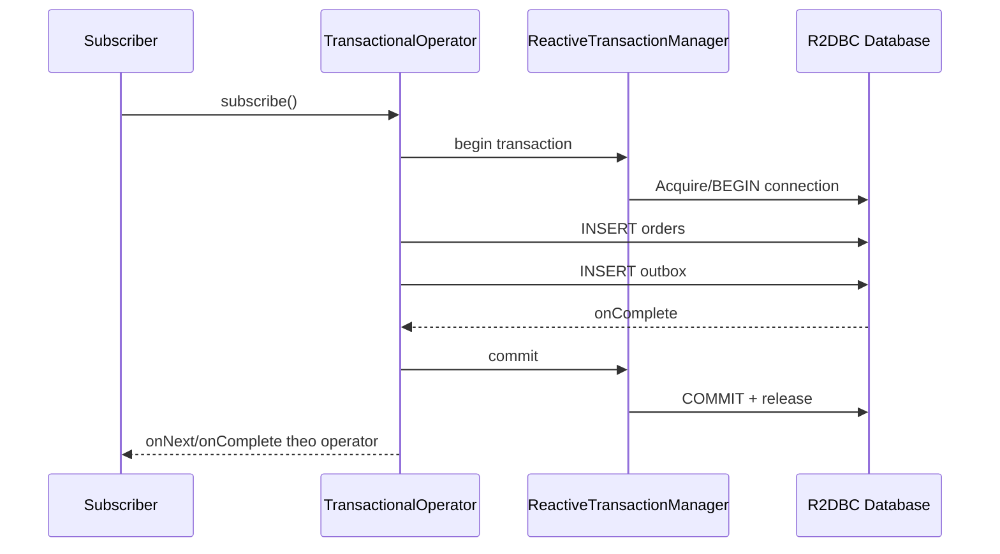
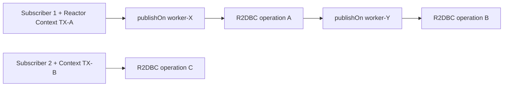
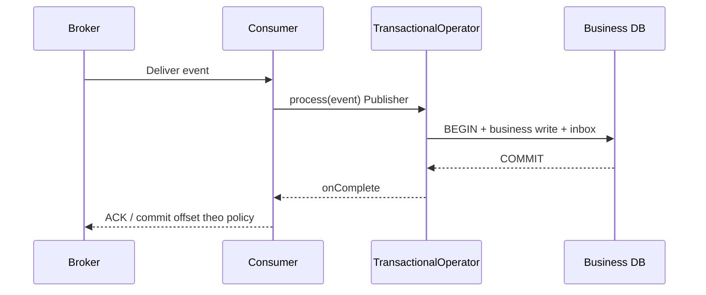
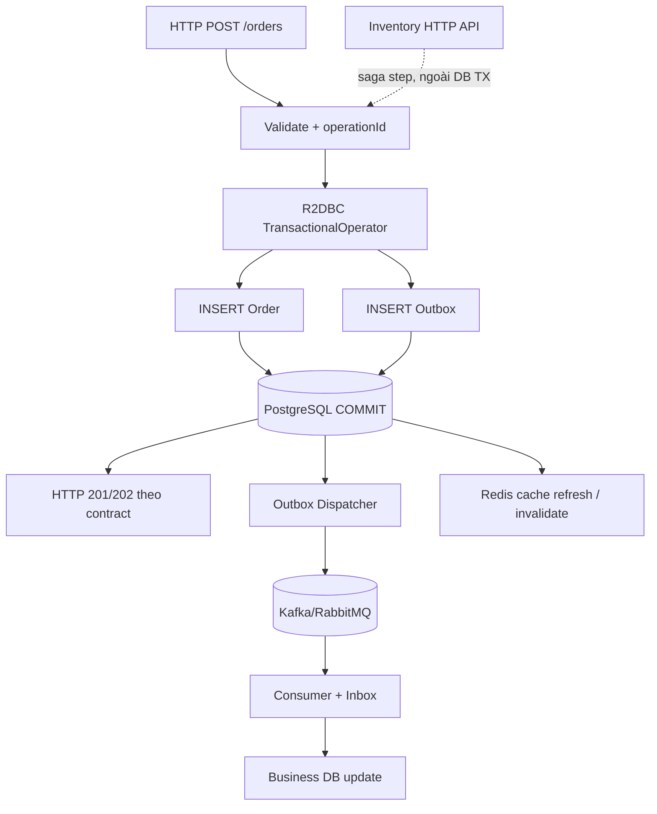

# ReactiveTransactionManager và TransactionalOperator

## 1. Giao dịch reactive là gì, và vì sao cần hiểu đúng ranh giới?

Trong mô-đun **SPRING_BOOT_INTEGRATION**, một ứng dụng Spring Boot có thể dùng HTTP client, SQL hoặc MongoDB, Redis, broker thông điệp và các adapter Spring Integration để xây dựng luồng dữ liệu đồng bộ lẫn bất đồng bộ. Khi dùng **Spring WebFlux, Reactor, Spring Data R2DBC** hoặc **Reactive MongoDB**, thao tác dữ liệu thường được biểu diễn dưới dạng `Mono<T>` và `Flux<T>` thay vì thực thi ngay khi gọi method.

Một tình huống điển hình:

```text
HTTP POST /orders
       |
       v
Reactive service
       |
       +-- INSERT orders ------------------+
       |                                   | một local
       +-- INSERT integration_outbox ------+ transaction
       |
       v
Commit DB transaction
       |
       v
Outbox dispatcher -> broker -> consumers
```

Ta muốn **hai bản ghi SQL commit cùng nhau**: hoặc có order cùng outbox event, hoặc cả hai rollback. Nhưng vẫn phải phân biệt:

- **Reactive transaction** bảo vệ những thao tác dữ liệu được tham gia đúng trong cùng transaction manager, resource và reactive subscription.
- Nó **không** tự biến HTTP request, Redis operations, Kafka/RabbitMQ publish hay một database khác thành một distributed transaction.
- Nó **không** đồng nghĩa tất cả thao tác trong method Java đều chạy cùng thread, và **không** dựa vào ThreadLocal giống transaction imperative.
- Nó **không** bắt đầu khi object `Mono` được tạo; với publisher lazy, lifecycle bắt đầu khi có subscription.
- Một tín hiệu hoàn thành publisher không tự khẳng định mọi side effect bên ngoài DB đã thành công.

Bài tập trung vào **“ReactiveTransactionManager và TransactionalOperator”** thuộc chương **Dữ liệu reactive**. Nội dung dùng khái niệm/API trong **Spring Framework 6.x, Spring Boot 3.x, Spring Data R2DBC và Spring Data MongoDB**, với Java 17+. Các lớp manager khác nhau theo datastore; propagation và isolation thực tế phụ thuộc hỗ trợ từ driver/server.



## 2. Imperative transaction khác reactive transaction như thế nào?

Spring quản lý giao dịch theo hai mô hình:

| Khía cạnh | Imperative | Reactive |
| --- | --- | --- |
| Core interface | `PlatformTransactionManager` | `ReactiveTransactionManager` |
| Ngữ cảnh thường dùng | Thread-bound qua `TransactionSynchronizationManager` imperative | Subscriber-bound qua **Reactor Context** |
| Kiểu thao tác | JDBC/JPA blocking | R2DBC/Reactive Mongo non-blocking |
| Khi hoạt động | Lời gọi method/scope đồng bộ | Trong vòng đời reactive subscription |
| API programmatic | `TransactionTemplate` | `TransactionalOperator` |
| Declarative | `@Transactional` trên blocking methods | `@Transactional` trên methods trả reactive `Publisher` phù hợp |
| Signals dẫn tới outcome | Return/exception từ code đồng bộ | `onComplete`, `onError` và xử lý `cancel` |
| Connection/session | Bound theo thread | Bound theo reactive context của transaction |
| Cách nối thao tác | Thứ tự statements Java | `flatMap`, `then`, `concatMap`, reactive composition |

Với JDBC:

```java
@Transactional
public OrderEntity placeOrder(CreateOrderCommand command) {
    OrderEntity saved = repository.save(toEntity(command));
    outboxRepository.save(toOutbox(command));
    return saved;
}
```

Với R2DBC, cách tiếp cận đúng là **trả về publisher mô tả toàn bộ thao tác**:

```java
@Transactional
public Mono<OrderRow> placeOrder(CreateOrderCommand command) {
    return orders.insert(command)
        .flatMap(saved ->
            outbox.insert(command)
                .thenReturn(saved)
        );
}
```

Ở snippet reactive, `orders`/`outbox` là các reactive abstractions minh họa; mọi thao tác phải được nối trong publisher trả về và tham gia cùng manager. Nếu gọi `subscribe()` bên trong method hoặc chạy JDBC blocking tùy tiện, chúng có thể thoát scope transaction.

### 2.1. Vì sao ThreadLocal không đủ?

Reactive pipelines có thể đi qua nhiều thread do `publishOn`/`subscribeOn`, network events và asynchronous driver callbacks. Một transaction được gắn chỉ vào thread hiện tại sẽ không theo được các callbacks đó.

Spring reactive transaction sử dụng **Reactor Context**, lan truyền cùng subscription qua các operators đúng chuẩn. Đừng tự quản lý transaction bằng `ThreadLocal<Connection>`; cũng đừng coi MDC hoặc Java thread ID là bằng chứng hai database operations thuộc cùng transaction.

### 2.2. Reactive không có nghĩa mọi thứ đều non-blocking

Nếu một method trả `Mono.fromCallable(() -> jdbcTemplate.queryForObject(...))` nhưng gọi JDBC blocking trên event-loop, nó vẫn **blocking**. Gắn thêm `subscribeOn(boundedElastic())` chỉ chuyển blocking sang worker thread; **không** làm JDBC tham gia vào `R2dbcTransactionManager`.

Ngược lại, `WebClient` non-blocking gọi partner API vẫn là **remote side effect**, không được rollback bởi transaction của R2DBC.

## 3. ReactiveTransactionManager: hợp đồng điều phối vòng đời giao dịch

`ReactiveTransactionManager` nằm trong package `org.springframework.transaction`. Nó cung cấp API reactive ở mức khái niệm:

```java
public interface ReactiveTransactionManager
        extends org.springframework.transaction.TransactionManager {

    reactor.core.publisher.Mono<ReactiveTransaction>
        getReactiveTransaction(TransactionDefinition definition);

    reactor.core.publisher.Mono<Void>
        commit(ReactiveTransaction transaction);

    reactor.core.publisher.Mono<Void>
        rollback(ReactiveTransaction transaction);
}
```

Snippet mô tả chữ ký quan trọng; không phải file cần tự tạo trong ứng dụng. `ReactiveTransaction` biểu diễn state của giao dịch đang hoạt động. Thông thường **không tự gọi** ba method này bằng tay cho từng business operation, vì cleanup context, rollback-on-error và resource lifecycle phức tạp hơn nhìn qua interface.

Những implementation quan trọng:

- `R2dbcTransactionManager`, package `org.springframework.r2dbc.connection`: quản lý transaction trên R2DBC `ConnectionFactory`.
- `ReactiveMongoTransactionManager`, package `org.springframework.data.mongodb`: quản lý MongoDB reactive client sessions/transactions khi topology hỗ trợ.
- Những manager tùy hệ thống khác có thể hiện thực interface, nhưng không đồng nghĩa chúng cung cấp distributed XA transaction.

### 3.1. Một manager phải biết resource mà nó sở hữu

Một `R2dbcTransactionManager` được tạo với **một `ConnectionFactory`**. Nó bind transactional R2DBC connection vào Reactor Context để các Spring Data R2DBC/`DatabaseClient` operations phù hợp tái sử dụng connection đó.

Một `ReactiveMongoTransactionManager` quản lý session/giao dịch MongoDB theo `ReactiveMongoDatabaseFactory`. Nó không tự thu nhận PostgreSQL connection.

Nếu có cả hai manager trong ứng dụng, phải chọn rõ manager theo transaction boundary; không giả định một `@Transactional` sẽ tự kéo cả hai datastore vào một atomic commit.

### 3.2. Khi nào dùng @Transactional, khi nào dùng TransactionalOperator?

- **`@Transactional`** thích hợp khi một public service method có transaction scope rõ, gọi qua Spring-managed proxy và trả Publisher.
- **`TransactionalOperator`** thích hợp khi cần chỉ rõ **một đoạn reactive pipeline**, tách các bước trước/sau commit, áp transaction definition có chủ đích hoặc tránh những khó khăn của proxy/self-invocation.
- Có thể kết hợp trong hệ thống, nhưng tránh lồng transaction không cần thiết và tránh để operator/annotation chọn nhầm manager.

## 4. Thiết lập R2DBC transaction manager trong Spring Boot

Dependency Maven cho một ứng dụng imperative-free R2DBC với PostgreSQL:

```xml
<dependency>
    <groupId>org.springframework.boot</groupId>
    <artifactId>spring-boot-starter-data-r2dbc</artifactId>
</dependency>

<dependency>
    <groupId>org.postgresql</groupId>
    <artifactId>r2dbc-postgresql</artifactId>
    <scope>runtime</scope>
</dependency>
```

Cấu hình kết nối minh họa:

```yaml
spring:
  r2dbc:
    url: ${R2DBC_URL:r2dbc:postgresql://localhost:5432/orderdb}
    username: ${R2DBC_USER:order_service}
    password: ${R2DBC_PASSWORD}
```

Không commit credentials thật. Trong production, cấu hình connection pool, TLS, server authentication, acquisition timeout và client/network deadlines tương ứng. `spring.r2dbc.url` **không** phải JDBC URL `jdbc:postgresql://...`.

Với một `ConnectionFactory` và phù hợp auto-configuration conditions, Spring Boot có thể cung cấp `R2dbcTransactionManager`. Để bài học thể hiện rõ ownership, ta có thể khai báo:

```java
package example.orders.config;

import io.r2dbc.spi.ConnectionFactory;

import org.springframework.context.annotation.Bean;
import org.springframework.context.annotation.Configuration;
import org.springframework.r2dbc.connection.R2dbcTransactionManager;
import org.springframework.transaction.ReactiveTransactionManager;
import org.springframework.transaction.reactive.TransactionalOperator;

@Configuration
public class OrderTransactionsConfiguration {

    @Bean("orderTransactionManager")
    ReactiveTransactionManager orderTransactionManager(
            ConnectionFactory connectionFactory) {
        return new R2dbcTransactionManager(connectionFactory);
    }

    @Bean("orderTransactionalOperator")
    TransactionalOperator orderTransactionalOperator(
            ReactiveTransactionManager orderTransactionManager) {
        return TransactionalOperator.create(
            orderTransactionManager
        );
    }
}
```

**Lưu ý injection:** code trên giả định chỉ có một `ReactiveTransactionManager` cần inject. Nếu ứng dụng có R2DBC và Mongo managers, sử dụng `@Qualifier("orderTransactionManager")` tại parameter hoặc injection point để tránh ambiguity. Không tạo thêm manager nếu Boot/project đã cấu hình một manager phù hợp và bạn chưa xác định việc bean override.

Ví dụ tường minh hơn cho operator:

```java
@Bean("orderTransactionalOperator")
TransactionalOperator orderTransactionalOperator(
        @org.springframework.beans.factory.annotation.Qualifier(
            "orderTransactionManager"
        )
        ReactiveTransactionManager transactionManager) {

    return TransactionalOperator.create(transactionManager);
}
```

Trong code thật chỉ chọn **một** định nghĩa bean trên, không khai báo cùng bean hai lần. Cấu hình test cần dùng cùng `ConnectionFactory` để transaction manager và `R2dbcEntityTemplate`/repositories tham gia cùng DB.

### 4.1. Vì sao dùng R2dbcEntityTemplate hoặc DatabaseClient?

Spring Data R2DBC cung cấp abstractions như:

- `R2dbcEntityTemplate` cho mapping entity và CRUD reactive.
- `ReactiveCrudRepository`/`R2dbcRepository` cho repository reactive.
- `DatabaseClient` cho SQL parameterized, mapping thủ công khi cần.

Khi được tạo từ cùng configured connection factory và hỗ trợ transaction context, các thao tác sẽ tham gia transaction. Ngược lại, gọi raw `connectionFactory.create()` rồi quản lý connection mới theo cách riêng có thể bỏ qua connection bound vào context, tạo sự cố “một thao tác commit dù operator bên ngoài rollback”.

## 5. TransactionalOperator: đưa phạm vi giao dịch vào một Publisher

`TransactionalOperator` thuộc `org.springframework.transaction.reactive`, là API programmatic dùng một `ReactiveTransactionManager`.

Hai hình thức:

```java
Mono<OrderRow> chain = writeOrderAndOutbox(command);

// Hình thức operator trên một Mono/Flux:
Mono<OrderRow> result =
    transactionalOperator.transactional(chain);

// Hoặc Reactor .as(...) để trang trí một pipeline:
Mono<OrderRow> equivalent =
    chain.as(transactionalOperator::transactional);
```

Với default operator propagation REQUIRED, transaction begin khi subscription tới transactional publisher; commit khi nguồn completed thành công, rollback khi onError, và xử lý cancel theo transactional operator của Spring Framework tương ứng. Hai ví dụ trên là hai lựa chọn thay thế, không cần gọi cả hai cho một publisher.



### 5.1. Tạo pipeline không có nghĩa câu SQL đã chạy

```java
Mono<OrderRow> operation =
    transactionOperator.transactional(
        template.insert(OrderRow.class).using(order)
    );

// Chưa có subscriber: thao tác thường chưa thực thi.
```

Khi WebFlux handler return `operation`, framework sẽ subscribe. Trong test, `StepVerifier.create(operation)` subscribe và xác minh kết quả. **Không tự `subscribe()` chỉ để “bắt đầu chạy transaction” trong business service**, bởi caller sẽ mất kiểm soát cancellation, backpressure, lỗi và kết quả.

### 5.2. Ưu tiên Mono.defer cho logic phải chạy mỗi subscription

```java
Mono<OrderRow> operation = Mono.defer(() -> {
    OrderRow row = createRowForCurrentCommand();
    return template.insert(OrderRow.class).using(row);
}).as(transactionalOperator::transactional);
```

Code trong `defer` chạy cho mỗi subscription. Nếu generator cấp mới orderId/eventId trong đó, một retry bằng resubscription có thể tạo ID mới và phá idempotency. Vì thế **ID logical business phải ổn định bên ngoài retry**, dù row construction diễn ra lazy.

### 5.3. Không để dữ liệu tạm ngoài reactive chain

Sai:

```java
Mono<OrderRow> save = template.insert(OrderRow.class)
    .using(order);

save.subscribe(); // Detached write: không cùng transaction!

return template.insert(OutboxRow.class)
    .using(outbox)
    .as(transactionalOperator::transactional);
```

Đúng là phải **compose**:

```java
return template.insert(OrderRow.class)
    .using(order)
    .flatMap(saved ->
        template.insert(OutboxRow.class)
            .using(outbox)
            .thenReturn(saved)
    )
    .as(transactionalOperator::transactional);
```

## 6. Ví dụ thực tế: ghi order và transactional outbox bằng R2DBC

Ta xây một **local transaction** cho `orders` và `integration_outbox`. Sau commit, một dispatcher độc lập mới publish event qua RabbitMQ/Kafka. Làm như vậy giúp tránh khoảng mất event giữa database commit và broker publish.

### 6.1. PostgreSQL schema

```sql
CREATE TABLE orders (
    id VARCHAR(64) PRIMARY KEY,
    tenant_id VARCHAR(64) NOT NULL,
    status VARCHAR(24) NOT NULL,
    total_amount NUMERIC(18,2) NOT NULL
);

CREATE TABLE integration_outbox (
    event_id VARCHAR(64) PRIMARY KEY,
    aggregate_id VARCHAR(64) NOT NULL,
    event_type VARCHAR(80) NOT NULL,
    schema_version INTEGER NOT NULL,
    payload_json TEXT NOT NULL,
    status VARCHAR(24) NOT NULL
);
```

Các cột `payload_json` và `schema_version` là **hợp đồng event đã serialize**, không phải Java entity tự động được gửi lên broker. Khi cần query JSON, có thể chọn PostgreSQL JSONB với codec/schema policy tương ứng; ví dụ dùng TEXT để giảm chi tiết phụ không thuộc chủ đề.

### 6.2. Persistence records

```java
package example.orders.data;

import java.math.BigDecimal;

import org.springframework.data.annotation.Id;
import org.springframework.data.relational.core.mapping.Column;
import org.springframework.data.relational.core.mapping.Table;

@Table("orders")
public record OrderRow(
    @Id String id,
    @Column("tenant_id") String tenantId,
    String status,
    @Column("total_amount") BigDecimal totalAmount
) {}
```

```java
package example.orders.data;

import org.springframework.data.annotation.Id;
import org.springframework.data.relational.core.mapping.Column;
import org.springframework.data.relational.core.mapping.Table;

@Table("integration_outbox")
public record OutboxRow(
    @Id @Column("event_id") String eventId,
    @Column("aggregate_id") String aggregateId,
    @Column("event_type") String eventType,
    @Column("schema_version") int schemaVersion,
    @Column("payload_json") String payloadJson,
    String status
) {}
```

### 6.3. Application command và service

```java
package example.orders.application;

import java.math.BigDecimal;

public record CreateOrderCommand(
    String orderId,
    String eventId,
    String tenantId,
    BigDecimal amount,
    String eventJson
) {}
```

`eventJson` giả định được tạo từ một **validated, versioned business event DTO** và đã serializable trước khi gọi service. Không nhận raw JSON thiếu kiểm tra trực tiếp từ HTTP client rồi lưu như event tin cậy. `orderId` và `eventId` phải ổn định qua retry của cùng logical operation.

```java
package example.orders.application;

import example.orders.data.OrderRow;
import example.orders.data.OutboxRow;

import java.math.BigDecimal;

import org.springframework.beans.factory.annotation.Qualifier;
import org.springframework.data.r2dbc.core.R2dbcEntityTemplate;
import org.springframework.stereotype.Service;
import org.springframework.transaction.reactive.TransactionalOperator;

import reactor.core.publisher.Mono;

@Service
public class OrderCommandService {

    private final R2dbcEntityTemplate template;
    private final TransactionalOperator transaction;

    public OrderCommandService(
            R2dbcEntityTemplate template,
            @Qualifier("orderTransactionalOperator")
            TransactionalOperator transaction) {
        this.template = template;
        this.transaction = transaction;
    }

    public Mono<OrderRow> createOrder(CreateOrderCommand command) {

        return Mono.defer(() -> {
            validate(command);

            OrderRow order = new OrderRow(
                command.orderId(),
                command.tenantId(),
                "PENDING",
                command.amount()
            );

            OutboxRow event = new OutboxRow(
                command.eventId(),
                command.orderId(),
                "OrderCreated",
                1,
                command.eventJson(),
                "PENDING"
            );

            return template.insert(OrderRow.class)
                .using(order)
                .flatMap(saved ->
                    template.insert(OutboxRow.class)
                        .using(event)
                        .thenReturn(saved)
                );
        }).as(transaction::transactional);
    }

    private static void validate(CreateOrderCommand command) {
        if (command == null
                || command.orderId() == null
                || command.orderId().isBlank()
                || command.eventId() == null
                || command.eventId().isBlank()
                || command.tenantId() == null
                || command.tenantId().isBlank()
                || command.amount() == null
                || command.amount().signum() < 0
                || command.eventJson() == null
                || command.eventJson().isBlank()) {
            throw new IllegalArgumentException(
                "Invalid create-order command"
            );
        }
    }
}
```

Vì `R2dbcEntityTemplate.insert(...)` được dùng tường minh, các ID business đã cấp từ ứng dụng không bị nhầm với việc repository `save(...)` cần xác định entity isNew/new-state (điểm dễ sai khi ID không null). `flatMap` đảm bảo outbox insert chỉ bắt đầu khi order insert phát kết quả; `thenReturn(saved)` chỉ trả order sau khi outbox insert hoàn tất.

**Atomicity:** hai inserts sử dụng cùng `R2dbcEntityTemplate`/connection factory dưới một `R2dbcTransactionManager`. Nếu outbox insert lỗi (ví dụ duplicate `event_id`), transaction rollback cả order insert.

**Giới hạn:** service chưa hiện thực business idempotency replay (cùng `orderId` có thể gây duplicate key), chưa có optimistic state machine hay outbox dispatcher. Mục đích của code là minh họa transaction scope; production cần query/reconciliation/trả lại kết quả của operation cũ khi retry.

### 6.4. Vì sao không publish broker trong transaction?

Sai lầm phổ biến:

```java
return template.insert(OrderRow.class)
    .using(order)
    .flatMap(saved -> rabbitPublisher.send(event).thenReturn(saved))
    .as(transaction::transactional);
```

Publish có thể thành công rồi database rollback, hoặc database commit nhưng broker publish mất response. `TransactionalOperator` **không điều phối giao dịch phân tán giữa R2DBC và broker**. Một outbox worker có retry, confirm và eventId ổn định thích hợp hơn cho business event không được mất.

## 7. @Transactional trên một phương thức trả Mono/Flux

Spring hỗ trợ giao dịch declarative qua `@Transactional` khi invocation được **Spring AOP proxy** xử lý và transaction manager reactive được chọn cho return type reactive.

```java
package example.orders.application;

import example.orders.data.OrderRow;
import example.orders.data.OutboxRow;

import org.springframework.data.r2dbc.core.R2dbcEntityTemplate;
import org.springframework.stereotype.Service;
import org.springframework.transaction.annotation.Transactional;

import reactor.core.publisher.Mono;

@Service
public class DeclarativeOrderService {

    private final R2dbcEntityTemplate template;

    public DeclarativeOrderService(
            R2dbcEntityTemplate template) {
        this.template = template;
    }

    @Transactional(transactionManager = "orderTransactionManager")
    public Mono<OrderRow> saveOrderAndEvent(
            OrderRow order, OutboxRow event) {

        return template.insert(OrderRow.class)
            .using(order)
            .flatMap(saved ->
                template.insert(OutboxRow.class)
                    .using(event)
                    .thenReturn(saved)
            );
    }
}
```

Nếu method được gọi từ **một bean khác qua proxy** và Spring có reactive transaction infrastructure phù hợp, transaction áp vào Publisher trả về. Nó không tự chạy query chỉ vì method được gọi.

### 7.1. Self-invocation là bẫy của proxy

```java
@Service
class ExampleService {

    public Mono<Void> outer() {
        return inner(); // Lời gọi this.inner() không qua proxy.
    }

    @Transactional
    public Mono<Void> inner() {
        return reactiveWork();
    }
}
```

Trong proxy mode thông thường, lời gọi `this.inner()` không đi qua proxy nên advice `@Transactional` có thể không được áp dụng. Giải pháp: đặt transaction boundary ở public method được gọi qua bean proxy, tách service hoặc dùng `TransactionalOperator` tường minh.

### 7.2. Annotation không giúp code blocking vào R2DBC transaction

Một method được annotate nhưng trả giá trị imperative (không phải Publisher) có thể được xem theo transaction manager/implementation khác; đừng giả định nó được quản lý như một reactive flow. Khi có cả manager imperative và reactive, hãy chỉ rõ manager và test transaction thực tế. JDBC/JPA gọi trong publisher cũng không được R2DBC transaction bảo vệ.

### 7.3. Transaction scope phải bao trọn các Publisher cần thiết

Sai:

```java
@Transactional
public Mono<Void> update() {
    Mono<Void> first = repository.updateStatus();
    Mono<Void> second = outboxRepository.insertEvent();

    // Không compose second, không có subscription cho nó.
    return first;
}
```

Đúng:

```java
@Transactional
public Mono<Void> update() {
    return repository.updateStatus()
        .then(outboxRepository.insertEvent());
}
```

Không gọi nested `subscribe()`, không chuyển connection bound vào ThreadLocal và không return trước khi Publisher quan trọng được nối vào chain.

## 8. Reactor Context: transaction theo subscriber, không theo Java thread

**Reactor Context** là một cấu trúc key/value gắn với từng subscription. Spring đặt/tra cứu transaction context ở đây, để các operators và Spring Data reactive operations cùng nhìn thấy transaction dù thread xử lý thay đổi.



Hai subscribers của cùng một cold publisher có thể tạo **hai executions và hai transaction scopes khác nhau**. Không cache/reuse Publisher chứa writes nếu không hiểu hệ quả resubscription, share/replay và hot publishers.

### 8.1. publishOn/subscribeOn không tự tách transaction

Khi operators được compose đúng, Reactor Context được truyền trong subscription và thay thread không mặc nhiên làm mất transaction. Nhưng các hành động **ngoài chain** như tự `subscribe()`, dispatch sang `CompletableFuture` không gắn context hoặc tự tạo raw DB connection có thể thoát transaction.

### 8.2. Reactor Context không phải MDC của logging

MDC thường dựa vào ThreadLocal. Có thể cần Micrometer context propagation hoặc tracing instrumentation phù hợp để đưa correlation/span IDs vào logs khi qua async boundary. Đừng coi MDC có/không có `transactionId` là cách xác nhận Spring reactive transaction; việc kiểm tra đúng phải dùng transaction-aware APIs và integration tests.

### 8.3. Transactional resource phải là cùng ConnectionFactory

Nếu một application có hai Postgres clusters, transaction của `orderConnectionFactory` không tự áp sang `auditConnectionFactory`. Hai repositories cùng trả `Mono` không có nghĩa chúng cùng transaction. Kiểm tra mapping repository/template → ConnectionFactory → transaction manager. Khi cần atomicity giữa clusters, dùng integration pattern như outbox/event/reconciliation thay vì khẳng định local R2DBC transaction xử lý tất cả.

## 9. onComplete, onError và cancel quyết định commit/rollback

Một transaction reactive bị chi phối bởi **terminal signals** của Publisher.

| Tín hiệu từ transactional source | Kết quả thường mong đợi |
| --- | --- |
| `onComplete` bình thường | Commit |
| `onError` từ lỗi chưa được phục hồi bên trong scope | Rollback |
| `cancel` trước khi hoàn tất | Spring reactive transaction hiện đại thực hiện rollback-on-cancel |
| Mất network trong lúc commit | Có thể có **outcome chưa biết**; cần đối soát |
| Inner exception đã bị `onErrorResume` biến thành success trước boundary | Transaction có thể commit |

**Cancellation cực kỳ quan trọng.** Từ Spring Framework 5.3, Spring reactive transaction infrastructure xử lý cancel theo hướng rollback. Nhưng nếu một DB commit vừa hoàn tất và client đã hủy subscription hoặc mất response, application không thể suy từ HTTP disconnect rằng transaction chắc chắn chưa commit; phải phân biệt trạng thái quan sát từ phía caller và trạng thái thực tế database.

### 9.1. Bẫy onErrorResume đặt bên trong transaction

```java
return writeOrderThenOutbox()
    .onErrorResume(error -> {
        // Error bị chuyển thành completion ngay trong TX.
        return Mono.empty();
    })
    .as(transaction::transactional);
```

Transaction nhìn thấy pipeline hoàn tất, có thể **commit những writes đã thành công trước lỗi**. Đây là nguyên nhân tạo “partial business success” khi developer tưởng mọi exception tự rollback.

Nếu mục tiêu là rollback khi lỗi, phục hồi **ngoài** operator:

```java
return writeOrderThenOutbox()
    .as(transaction::transactional)
    .onErrorResume(error ->
        mapToExplicitBusinessFailure(error)
    );
```

Trong ví dụ này, source phát `onError` đến operator trước khi fallback áp dụng, nên transaction có cơ hội rollback. `mapToExplicitBusinessFailure` phải có type tương thích với return Publisher và business outcome rõ; không tự biến mọi lỗi thành “không có order”.

### 9.2. Rethrow và error mapping

```java
return writeOrderThenOutbox()
    .onErrorMap(
        org.springframework.dao.DuplicateKeyException.class,
        ex -> new OrderAlreadyExistsException(
            "Order identity already exists", ex
        )
    )
    .as(transaction::transactional);
```

`onErrorMap` vẫn tạo `onError`, nên transaction rollback. `OrderAlreadyExistsException` là domain exception cần định nghĩa trong ứng dụng; snippet minh họa mapping, không phải một class có sẵn của Spring.

### 9.3. Dùng setRollbackOnly khi business outcome không ném exception

Trong callback programmatic, có thể chủ động đánh dấu rollback:

```java
transactionalOperator.execute(status ->
    validateAndWrite()
        .doOnNext(result -> {
            if (result.mustAbort()) {
                status.setRollbackOnly();
            }
        })
);
```

Đây là `Flux` từ `execute(...)`; `validateAndWrite()` và `result.mustAbort()` là các application abstractions. **Không nên dùng rollback-only để che lỗi rồi vẫn trả 201 Created**: caller cần một outcome phân biệt aborted với successful commit.

## 10. Hình thức execute(callback) và phạm vi operator

`TransactionalOperator` có hai cách dùng khác nhau về mặt trình bày:

- **Operator style:** `transactional(publisher)` bọc trọn Publisher.
- **Callback style:** `execute(status -> publisher)` cho phép truy cập `ReactiveTransaction` và chỉ rõ đoạn code thực thi.

Ví dụ callback style:

```java
public reactor.core.publisher.Mono<OrderRow> writeOne(
        OrderRow row) {

    return transactionalOperator
        .execute(status ->
            template.insert(OrderRow.class).using(row)
        )
        .single();
}
```

Ở đây `execute` trả `Flux<OrderRow>`; `single()` phù hợp **chỉ khi callback chắc chắn phát đúng một item rồi hoàn tất**. Nó không nên dùng cho một Flux nhiều rows chỉ để lấy phần tử đầu vì toán tử `single()` sẽ lỗi nếu số lượng khác một.

### 10.1. Không dùng take(1) trên transaction nhiều rows

```java
return transactionalOperator.execute(status ->
    repository.findAll()
        .flatMap(this::updateSomething)
).take(1);
```

`take(1)` có thể **cancel upstream** sau phần tử đầu. Với reactive transaction, cancel có thể dẫn tới rollback, và những writes đã phát tín hiệu thành công trước đó không nhất thiết đã commit. Khi muốn xử lý tất cả rows, hãy đợi completion, ví dụ `then()` hoặc `collectList()` trên một tập dữ liệu được giới hạn phù hợp.

### 10.2. Không tạo transaction dài cho unbounded stream

Một `Flux` đọc MongoDB change stream hoặc Kafka topic có thể sống không giới hạn. Bọc toàn bộ stream bằng một transaction sẽ giữ resource/cursor/session quá lâu và không bao giờ commit khi stream chưa hoàn thành.

Thay vì:

```java
// Sai về phạm vi khi events là một stream vô hạn:
return events.as(transactionalOperator::transactional);
```

hãy tạo transaction **cho từng logical unit hoặc bounded batch**:

```java
return events
    .concatMap(event ->
        processOneEvent(event)
            .as(transactionalOperator::transactional)
    );
```

`concatMap` giữ thứ tự và giới hạn số thao tác đang chạy trong ví dụ; throughput có thể thấp hơn `flatMap`. Khi chọn concurrency, phải xem backpressure, pool capacity và business ordering. Nếu event source là broker, ACK/offset commit phải được phối hợp với kết quả transaction.

## 11. TransactionDefinition: propagation, isolation, timeout và readOnly

Một operator có thể dùng transaction definition cụ thể:

```java
import org.springframework.transaction.TransactionDefinition;
import org.springframework.transaction.support.DefaultTransactionDefinition;
import org.springframework.transaction.reactive.TransactionalOperator;

DefaultTransactionDefinition definition =
    new DefaultTransactionDefinition();

definition.setName("order.create");
definition.setPropagationBehavior(
    TransactionDefinition.PROPAGATION_REQUIRED
);
definition.setIsolationLevel(
    TransactionDefinition.ISOLATION_READ_COMMITTED
);
definition.setTimeout(5);

TransactionalOperator orderTx =
    TransactionalOperator.create(manager, definition);
```

`manager` trong snippet là một `ReactiveTransactionManager` đã được cung cấp; code không ngụ ý mọi datastore hỗ trợ mọi isolation level/timeout. Có thể đặt name cho trace/diagnostics, nhưng không nên đưa orderId vào transaction name gây cardinality cao.

| Thuộc tính | Ý nghĩa | Lưu ý |
| --- | --- | --- |
| `PROPAGATION_REQUIRED` | Tham gia transaction đang có hoặc tạo mới | Thường là default |
| `REQUIRES_NEW` | Tạo transaction độc lập theo manager | Có thể cần connection bổ sung, pool capacity |
| `NESTED` | Dùng nested/savepoint nếu manager/driver hỗ trợ | Không portable như mặc định |
| `ISOLATION_READ_COMMITTED` | Không đọc dữ liệu chưa commit theo semantics DB | Khác giữa DB engines |
| `ISOLATION_SERIALIZABLE` | Mạnh hơn nhưng tăng conflict/retry | Không bảo vệ external HTTP effects |
| Timeout | Giới hạn transaction timeout theo manager | Không phải tổng business deadline toàn workflow |
| `readOnly` | Hint/constraint tùy manager/driver/database | Không thay database authorization |

### 11.1. Nested và REQUIRES_NEW cần kiểm chứng

Một `REQUIRES_NEW` có thể tạm suspend transaction hiện tại và lấy một connection khác; nếu connection pool max size bằng số concurrent requests đang giữ outer transaction, rất dễ cạn pool. `NESTED` thường dựa vào database savepoints nếu supported. Chọn propagation theo requirement thật và dùng integration test xác minh rollback độc lập/savepoint semantics trên driver đang dùng.

### 11.2. ReadOnly không phải security policy

`@Transactional(readOnly = true)` hoặc definition readOnly có thể được R2DBC manager/driver truyền xuống connection như hint, nhưng không được coi là hàng rào bảo mật duy nhất. Database roles, privileges và query validation mới là các lớp kiểm soát phù hợp.

### 11.3. Timeout phải bao gồm cả phần ngoài DB

Một HTTP request có 2 giây end-to-end deadline không nên bắt đầu transaction rồi chờ partner API 10 giây. Phân budget cho connect/response, DB tx, retries/backoff và commit. Transaction timeout không tự điều khiển timeout của WebClient, broker publish hoặc business job.

## 12. SQL isolation và concurrency: transaction không loại mọi race

Dù tất cả writes được bọc transaction, hai concurrent requests vẫn có thể xung đột.

Ví dụ:

```text
Tx A: SELECT stock available = 5
Tx B: SELECT stock available = 5
Tx A: reserve 4
Tx B: reserve 4
```

Nếu ứng dụng đọc–sửa–ghi không có điều kiện phù hợp, cả hai có thể tin đã giữ 4 đơn vị. Transaction alone ở isolation mặc định chưa chắc chặn mọi lost update/write skew.

### 12.1. Atomic conditional update

Nếu database là owner của stock, dùng SQL update có predicate và kiểm tra số rows:

```sql
UPDATE inventory
SET available_quantity = available_quantity - :quantity
WHERE sku = :sku
  AND available_quantity >= :quantity;
```

Ví dụ qua `DatabaseClient`:

```java
public Mono<Boolean> reserve(
        String sku, int quantity) {

    return databaseClient.sql("""
        UPDATE inventory
           SET available_quantity =
               available_quantity - :quantity
         WHERE sku = :sku
           AND available_quantity >= :quantity
        """)
        .bind("sku", sku)
        .bind("quantity", quantity)
        .fetch()
        .rowsUpdated()
        .map(rows -> rows == 1L);
}
```

`DatabaseClient` là bean/reactive API được inject; code giả định column và SQL syntax phù hợp. Với versions/traces khác, kiểu numeric của `rowsUpdated()` có thể thay đổi, nên kiểm tra API đang dùng. Đây là atomic conditional update trong **một database**, không phải giữ hàng xuyên Inventory Service từ Order Service.

### 12.2. Unique constraints chống duplicate khi retry

Trong tích hợp HTTP/broker, một operation ID ổn định và unique index giúp chặn requests trùng dưới concurrency. Pattern `SELECT trước rồi INSERT nếu chưa có` có race window. Khi database báo duplicate, application phải phân biệt **“đây là retry cùng payload”** với **“đụng key nhưng payload khác”**, không trả bừa business success.

### 12.3. Không chạy nhiều statement song song trên một connection

Một reactive transaction thường bind một connection tới context. `Mono.zip(writeA, writeB)` hoặc `flatMap` có concurrency có thể khiến nhiều SQL operations đồng thời trên cùng connection; không phải R2DBC driver nào cũng hỗ trợ multiplexing theo cách đó. Với dependent writes trong transaction, dùng `then`/`flatMap` tuần tự; cân nhắc batch operations khi cần throughput.

## 13. Reactive MongoDB: cùng interface, nhưng manager khác

Với MongoDB reactive, Spring Data cung cấp `ReactiveMongoTransactionManager`. Nó quản lý MongoDB client session và transaction bằng reactive APIs; transaction cần một **MongoDB deployment topology hỗ trợ transaction**, chẳng hạn replica set hoặc sharded cluster theo phiên bản server/driver.

Dependency Maven:

```xml
<dependency>
    <groupId>org.springframework.boot</groupId>
    <artifactId>spring-boot-starter-data-mongodb-reactive</artifactId>
</dependency>
```

Cấu hình cơ bản:

```yaml
spring:
  data:
    mongodb:
      uri: ${MONGODB_URI:mongodb://localhost:27017/orders_db}
```

Một MongoDB **standalone** dùng trong local setup có thể đọc/ghi reactive bình thường nhưng không hỗ trợ multi-document transaction. Đừng kết luận MongoDB transaction đã hoạt động chỉ vì `ReactiveMongoRepository.save(...)` trả `Mono`.

### 13.1. Khai báo manager và operator cho MongoDB

```java
package example.orders.mongo;

import org.springframework.context.annotation.Bean;
import org.springframework.context.annotation.Configuration;
import org.springframework.data.mongodb.ReactiveMongoDatabaseFactory;
import org.springframework.data.mongodb.ReactiveMongoTransactionManager;
import org.springframework.transaction.ReactiveTransactionManager;
import org.springframework.transaction.reactive.TransactionalOperator;

@Configuration
class ReactiveMongoTransactionsConfiguration {

    @Bean("mongoTransactionManager")
    ReactiveTransactionManager mongoTransactionManager(
            ReactiveMongoDatabaseFactory factory) {
        return new ReactiveMongoTransactionManager(factory);
    }

    @Bean("mongoTransactionalOperator")
    TransactionalOperator mongoTransactionalOperator(
            @org.springframework.beans.factory.annotation.Qualifier(
                "mongoTransactionManager"
            )
            ReactiveTransactionManager manager) {
        return TransactionalOperator.create(manager);
    }
}
```

Đây là manager/operator **riêng cho MongoDB**. Nó không thay thế cấu hình R2DBC ở những ứng dụng dùng cả hai. Khi đó nên đặt tên và dùng `@Qualifier`/`@Transactional(transactionManager="...")` rõ ràng.

### 13.2. Hai document trong một MongoDB transaction

Giả sử `ReactiveMongoTemplate` và hai document classes `OrderDocument`/`OutboxDocument` đã được định nghĩa:

```java
public Mono<OrderDocument> saveOrderAndOutbox(
        OrderDocument order,
        OutboxDocument outbox) {

    return mongoTemplate.insert(order)
        .flatMap(saved ->
            mongoTemplate.insert(outbox)
                .thenReturn(saved)
        )
        .as(mongoTransactionalOperator::transactional);
}
```

Đoạn code minh họa phạm vi operator, không khai báo toàn bộ document classes; hai operations phải dùng cùng reactive factory/manager, cùng session và cấu hình transaction support. Với MongoDB có sharding, write concern, transaction lifetime, cross-shard behavior và commit retry semantics còn phụ thuộc topology/server.

### 13.3. Đừng nhầm atomicity một document với multi-document transaction

MongoDB có tính atomic ở phạm vi **một document write** theo cơ chế của nó. Nếu chỉ cập nhật một document, có thể không cần multi-document transaction. Nhưng nếu cần ghi `orders` và `outbox` ở **hai documents**, yêu cầu atomicity là một vấn đề khác.

Nếu transaction không được hỗ trợ, lỗi phải xuất hiện rõ trong integration test; không tự fallback sang “ghi hai records không transaction rồi luôn báo success”. Có thể thiết kế mô hình embed outbox event trong cùng document khi phù hợp với access pattern, hoặc dùng transaction trên topology đã hỗ trợ.

## 14. Nhiều manager hoặc nhiều database: chọn ranh giới có chủ đích

Một ứng dụng có cả PostgreSQL R2DBC và Reactive MongoDB:

```text
Order Service
  ├── R2dbcEntityTemplate -> Order R2DBC ConnectionFactory
  │                           -> orderTransactionManager
  └── ReactiveMongoTemplate -> MongoDB ReactiveDatabaseFactory
                              -> mongoTransactionManager
```

Mặc dù **cả hai đều reactive**, dùng:

```java
@Transactional
public Mono<Void> writeBoth() {
    return sqlWrite().then(mongoWrite());
}
```

**không** tạo distributed transaction. Khi có nhiều manager, `@Transactional` không định danh có thể không chọn đúng hoặc gây ambiguity. Chỉ định cụ thể manager và xác định transaction nào sở hữu những thao tác nào.

### 14.1. Hai local transactions không bằng một atomic transaction

```java
return sqlWrite()
    .as(orderTx::transactional)
    .then(mongoWrite().as(mongoTx::transactional));
```

Đoạn trên tạo **hai transaction độc lập** theo thứ tự. Nếu SQL commit thành công rồi Mongo write thất bại, SQL không tự rollback. Đảo thứ tự cũng không giải quyết vấn đề, chỉ thay cửa sổ lỗi.

Trong thiết kế tích hợp, chọn:

- Một source of truth và publish event qua transactional outbox.
- Consumer Mongo projection cập nhật eventual-consistently, có retry và idempotency.
- Reconciliation để phát hiện sự kiện/mapping chậm hoặc thất lạc.
- Một workflow/saga với trạng thái và compensation nếu cả hai systems đều có business side effects.

Không tự quảng bá two-phase commit trừ khi hạ tầng và các resource managers thực sự hỗ trợ protocol và bạn đã đánh giá failure windows của nó. `ReactiveTransactionManager` không phải một XA coordinator.

### 14.2. TransactionManager của JDBC và R2DBC cùng dùng Spring nhưng không trao đổi context

Ví dụ:

```text
DataSource/JPA:
  DataSourceTransactionManager / JpaTransactionManager
  -> ThreadLocal transaction context

R2DBC:
  R2dbcTransactionManager
  -> Reactor Context transaction context
```

Tự gọi `entityManager.persist(...)` từ reactive chain đang có R2DBC transaction không đưa JPA write vào cùng commit. Nếu cần tích hợp imperative legacy API, dùng một lớp boundary riêng, chọn đúng scheduling/resource ownership và xem đây là **hai bước không atomically committed**.

## 15. Thời gian sống của transaction, cancellation và retry

Reactive code khuyến khích dùng composition, nhưng transaction dài dễ giữ **một R2DBC connection** hoặc **một Mongo client session** quá lâu. Điều này quan trọng khi connection pool nhỏ và hệ thống nhận lượng HTTP requests lớn.

### 15.1. Không gọi partner HTTP bên trong transaction dài

Ví dụ không nên dùng khi cần local DB atomicity:

```java
return databaseClient.sql("UPDATE orders ...")
    .fetch()
    .rowsUpdated()
    .then(webClient.post()
        .uri("/payments")
        .retrieve()
        .bodyToMono(PaymentReply.class))
    .as(orderTransaction::transactional);
```

Trong khi chờ Payment 10 giây, DB transaction có thể giữ connection/locks. Hơn nữa, nếu provider đã commit payment nhưng DB rollback, HTTP effect không được undo.

Một workflow phù hợp hơn:

1. Transaction A: ghi order intent/outbox, commit nhanh.
2. Worker/saga gọi Payment qua HTTP **ngoài DB transaction** với idempotency key.
3. Transaction B: ghi payment outcome và outbox event mới.
4. Nếu response mất/unknown, job reconciliation truy vấn provider.
5. Notification/Analytics được cập nhật qua message bus eventual-consistently.

### 15.2. Retry scope phải có tính idempotent

```java
return writeOrderAndOutbox()
    .as(orderTransaction::transactional)
    .retryWhen(
        reactor.util.retry.Retry.backoff(
            2, java.time.Duration.ofMillis(100)
        ).filter(this::isTransientDatabaseError)
    );
```

Khi đặt retry **ngoài operator**, mỗi resubscription có thể tạo transaction mới sau rollback/lỗi của lần trước. Nhưng cần lưu ý:

- `isTransientDatabaseError` là policy ứng dụng, phải phân loại đúng các lỗi database/driver.
- Không retry duplicate key, schema invalid hoặc auth failure một cách mù.
- Commit/network outcome có thể chưa rõ; retry lại toàn operation phải có stable business ID và idempotency.
- Limit attempts và tổng deadline, tránh retry storms.
- Nếu event ID được tạo mới trong `Mono.defer`, một resubscription có thể tạo event khác, làm sai logical operation.

### 15.3. Reactor timeout có thể cancel transaction

```java
return writeOrderAndOutbox()
    .as(orderTransaction::transactional)
    .timeout(java.time.Duration.ofSeconds(2));
```

Khi timeout ở downstream cancel subscription vào operator, Spring reactive transaction thường thực hiện rollback-on-cancel. Tuy nhiên **không nên suy từ một TimeoutException rằng database chắc chắn chưa commit**, đặc biệt nếu timeout trùng thời điểm COMMIT đã đến server nhưng client chưa nhận xác nhận. Đây là lý do API retry cần idempotency/reconciliation.

### 15.4. Đừng kiểm tra commit bằng việc client disconnect

Một browser đóng tab hoặc gateway timeout có thể cancel HTTP response. Business operation có thể đã commit trước đó. Nếu API chỉ trả `202 Accepted`, cần durable job status để caller hỏi lại bằng operation ID; nếu trả `201 Created`, response thất lạc vẫn cần cơ chế tra cứu/retry an toàn.

## 16. onErrorResume, empty Publisher và chính sách rollback

Trong reactive pipelines, một business decision có thể xuất hiện dưới dạng `Mono.empty()`, `Mono.just(result)` hoặc `Mono.error(...)`. Spring transaction không tự biết trạng thái nghiệp vụ nếu bạn chuyển lỗi thành completion.

### 16.1. Empty không mặc nhiên là failure

```java
return repository.findById(orderId)
    .flatMap(this::update)
    .as(orderTx::transactional);
```

Nếu `findById` trả `Mono.empty()`, pipeline hoàn tất thành công và transaction commit (thường không có update). Nếu business requirement là “order không tồn tại phải fail”, hãy phát lỗi:

```java
return repository.findById(orderId)
    .switchIfEmpty(
        Mono.error(
            new IllegalArgumentException(
                "Order not found"
            )
        )
    )
    .flatMap(this::update)
    .as(orderTx::transactional);
```

### 16.2. onErrorContinue không phải rollback policy

`onErrorContinue` có semantics phức tạp và có thể cho phép pipeline tiếp tục sau lỗi của một phần tử. Đừng đưa nó vào transactional write flow chỉ để “xử lý thêm phần tử còn lại” mà không xác định atomicity. Khi cần xử lý từng record độc lập, tạo **một transaction nhỏ cho mỗi record** với `concatMap`/`flatMap` có concurrency giới hạn và record outcome riêng.

### 16.3. Mono.zip có rủi ro với empty và side effect

`Mono.zip(writeA(), writeB())` có thể hoàn tất rỗng nếu một publisher không emit giá trị, đồng thời cancel nguồn khác trong một số tình huống. Nếu `writeB` là side effect phải chạy sau `writeA`, dùng `then`/`flatMap`, không dùng `zip` chỉ để “chạy cả hai”.

### 16.4. SQL errors và rollback-only

Một DB constraint error làm Publisher phát `onError` và operator rollback. Nếu cần catch để trả domain exception, dùng `onErrorMap`/`doOnError`. Nếu phục hồi lỗi **bên trong transaction**, phải hiểu rằng đã biến terminal signal thành completion; nếu nghiệp vụ vẫn cần rollback, tái phát lỗi, dùng rollback-only một cách có chủ đích hoặc đưa fallback ra ngoài operator.

### 16.5. Không gộp timeout, validation và connectivity thành một loại lỗi

| Tín hiệu | Rủi ro | Policy gợi ý |
| --- | --- | --- |
| `DuplicateKeyException` | Business ID trùng hoặc retry hợp lệ | Tra cứu operation cũ, so fingerprint |
| `DataIntegrityViolationException` | Unique/foreign/check constraint | Không retry nóng, sửa input/schema |
| R2DBC transient connection error | Database không sẵn sàng | Bounded retry nếu safe |
| Serialization/deadlock conflict | Có thể cần retry transaction | Retry cả unit of work, stable IDs |
| `TimeoutException` | Không rõ commit đã tới DB chưa | Reconcile theo operation ID |
| `CancellationException`/cancel | Transaction có thể rollback | Theo dõi downstream result, không đoán |
| Remote HTTP 503 | Nằm ngoài DB transaction | Retry/backoff hoặc saga |
| Invalid event JSON | Permanent contract failure | DLQ/quarantine, không retry mãi |

## 17. Phạm vi transaction cho broker consumer và Spring Integration

Một Kafka/RabbitMQ consumer có thể dùng reactive data access để cập nhật database. Phải xác định **khi nào broker được ACK/commit offset** so với **khi nào DB transaction hoàn tất**.



### 17.1. Chỉ ACK sau khi publisher hoàn thành

Nếu consumer nhận message rồi gọi:

```java
service.process(event).subscribe();
return; // listener có thể ACK sớm.
```

DB update chạy detached, listener container có thể coi method đã thành công trước khi write commit. Đây là một lỗi nghiêm trọng. Cần dùng **listener adapter hỗ trợ reactive completion** hoặc bridge có policy rõ: chờ kết quả bằng cơ chế được framework hỗ trợ, không block event-loop tùy tiện, không ACK trước durable completion.

Trong Spring Kafka/AMQP, cách listener container xử lý asynchronous/reactive return, acknowledgment và error channel **phụ thuộc version/configuration**. Không giả định chỉ cần return `Mono<Void>` là container ở mọi phiên bản tự đợi subscription. Kiểm thử với broker thật để chứng minh lifecycle.

### 17.2. Inbox ở cùng transaction với business write

Nếu consumer nhận `OrderConfirmed(eventId=evt-6e0f)`:

```text
BEGIN R2DBC transaction
  INSERT inbox(consumer, eventId) with unique constraint
  IF new event:
    UPDATE projection / business state
COMMIT
ACK broker
```

Nếu ACK mất sau commit, broker có thể redeliver. Unique inbox ngăn lặp side effect DB. Với email/payment bên ngoài DB, phải bổ sung outbox/side-effect idempotency hoặc một job state bền vững, vì inbox commit **không tự làm email provider idempotent**.

### 17.3. Spring Integration message flows

Spring Integration có `DirectChannel`, `ExecutorChannel`, `QueueChannel`, reactive/imperative adapters và các endpoint khác nhau. Một `Message<?>` mang payload/headers **không đồng nghĩa** rằng Reactor Context transaction sẽ tự được forward qua mọi channel/thread.

- Một reactive flow được compose cùng subscription có thể giữ transaction context.
- Một handler tự dispatch sang thread/task khác không qua reactive context propagation có thể chạy ngoài transaction.
- Một broker adapter giao nhận message là một **transport boundary**, không nằm trong SQL transaction manager.
- Error channels của Spring Integration và Reactor `onError` cần mapping có chủ đích.
- Với process async dài, nên commit business state và dùng outbox/job state thay vì giữ DB transaction trong suốt flow.

### 17.4. ACK/offset và duplicate

RabbitMQ ACK xác nhận delivery, còn Kafka committed offset đánh dấu vị trí tiêu thụ group. Cả hai **không chứng minh business outcome đã hoàn tất** nếu listener commit trước side effect. Sử dụng inbox, durable outcome và reconciliation, đồng thời quan sát consumer lag/queue ready/unacked riêng với số successful DB commits.

## 18. Controller WebFlux và ranh giới trả HTTP response

Một endpoint WebFlux có thể trả Publisher kết nối transaction:

```java
package example.orders.api;

import example.orders.application.CreateOrderCommand;
import example.orders.application.OrderCommandService;
import example.orders.data.OrderRow;

import org.springframework.http.HttpStatus;
import org.springframework.web.bind.annotation.*;

import reactor.core.publisher.Mono;

@RestController
@RequestMapping("/orders")
public class OrderController {

    private final OrderCommandService orders;

    public OrderController(OrderCommandService orders) {
        this.orders = orders;
    }

    @PostMapping
    @ResponseStatus(HttpStatus.CREATED)
    public Mono<OrderCreatedResponse> create(
            @RequestBody Mono<CreateOrderRequest> body) {

        return body
            .map(request ->
                new CreateOrderCommand(
                    request.orderId(),
                    request.eventId(),
                    request.tenantId(),
                    request.totalAmount(),
                    request.eventJson()
                )
            )
            .flatMap(orders::createOrder)
            .map(saved ->
                new OrderCreatedResponse(
                    saved.id(), saved.status()
                )
            );
    }
}

record CreateOrderRequest(
    String orderId,
    String eventId,
    String tenantId,
    java.math.BigDecimal totalAmount,
    String eventJson
) {}

record OrderCreatedResponse(
    String orderId,
    String status
) {}
```

**Ví dụ API mang tính cơ học để thấy subscription boundary**, không phải thiết kế bảo mật/contract production. Trong ứng dụng thật, `eventId`/`eventJson` phải do trusted application layer tạo từ validated business command; không lấy raw payload/event ID tùy ý do HTTP caller cung cấp như ở snippet. Authentication, tenant authorization, idempotency và error mapping cần triển khai riêng.

### 18.1. Không trả 201 khi transaction chưa commit

Nếu endpoint trả `Mono<OrderCreatedResponse>` từ transactional service, response mapping nên chỉ xảy ra sau outcome transaction thành công theo publisher contract. Không tạo hot side effect rồi trả `Mono.just(...)` sớm. Với workflow còn cần Payment/Inventory thực hiện sau, thường nên trả `202 Accepted` cùng durable job/order state, không hứa mọi downstream đã hoàn tất.

### 18.2. Không đặt HTTP request body deserialization bên trong DB transaction một cách không cần thiết

`@RequestBody Mono<CreateOrderRequest>` sẽ decode request body; nên validate dữ liệu trước khi bắt đầu DB transaction khi có thể. Giữ transaction ngắn. Business validation phụ thuộc dữ liệu DB có thể nằm trong transaction, nhưng validation thuần cấu trúc/security thì nên sớm tại boundary.

### 18.3. HTTP disconnect và durable operation ID

Nếu client đóng kết nối khi server đang commit, callback có thể nhận cancel. Kết quả cuối không thể đoán tuyệt đối qua HTTP connection. Dùng `operationId` ổn định, unique constraints và API truy vấn trạng thái để tránh khách hàng tạo đơn trùng khi gửi lại.

## 19. TransactionalOperator và StepVerifier: unit tests kiểm tra tín hiệu

`StepVerifier` thuộc Reactor Test, dùng để subscribe và xác minh signals. Một test giả lập reactive repository có thể chứng minh code **không nuốt lỗi**, nhưng không chứng minh SQL rollback thật.

Ví dụ code giả định có `OrderCommandService` và mocked `R2dbcEntityTemplate` không đơn giản vì fluent API có nhiều stages. Tốt hơn là unit test các helper/domain methods độc lập và dùng integration test cho transaction.

### 19.1. Test không có subscription thì không có write

```java
import static org.assertj.core.api.Assertions.assertThat;
import java.util.concurrent.atomic.AtomicInteger;
import org.junit.jupiter.api.Test;
import reactor.core.publisher.Mono;
import reactor.test.StepVerifier;

class ReactiveLazinessTest {

    @Test
    void workStartsOnSubscription() {
        AtomicInteger writes = new AtomicInteger();

        Mono<String> operation = Mono.defer(() -> {
            writes.incrementAndGet();
            return Mono.just("saved");
        });

        assertThat(writes.get()).isZero();

        StepVerifier.create(operation)
            .expectNext("saved")
            .verifyComplete();

        assertThat(writes.get()).isEqualTo(1);
    }
}
```

Test này kiểm tra Reactor laziness, không dùng real transaction. Nó làm rõ điều dễ nhầm khi một developer gọi method reactive nhưng quên return/subscribe đúng cách trong framework.

### 19.2. Test error placement trong operator

Khi có test transaction manager giả/in-memory hoặc một Postgres container, tạo một write thành công và một write cố tình lỗi:

```text
write A succeeds
write B emits database constraint error
expected: transaction rollback A and B
```

Sau đó đặt `onErrorResume` **bên trong** hoặc **bên ngoài** transaction boundary trong test riêng. Không mặc định mọi fallback là an toàn; assert trạng thái database cuối để hiểu thực tế commit/rollback.

## 20. Integration test R2DBC transaction bằng PostgreSQL Testcontainers

Để chứng minh tính atomicity, cần database thật và Spring transaction infrastructure thật. Dùng Testcontainers PostgreSQL, khởi tạo schema, chạy service rồi đọc trực tiếp DB.

Dependencies Maven test:

```xml
<dependency>
    <groupId>org.springframework.boot</groupId>
    <artifactId>spring-boot-starter-test</artifactId>
    <scope>test</scope>
</dependency>

<dependency>
    <groupId>io.projectreactor</groupId>
    <artifactId>reactor-test</artifactId>
    <scope>test</scope>
</dependency>

<dependency>
    <groupId>org.testcontainers</groupId>
    <artifactId>postgresql</artifactId>
    <scope>test</scope>
</dependency>

<dependency>
    <groupId>org.testcontainers</groupId>
    <artifactId>junit-jupiter</artifactId>
    <scope>test</scope>
</dependency>
```

Trong test, PostgreSQL Testcontainers dùng JDBC driver cho metadata/health nội bộ của container, nhưng ứng dụng dưới test kết nối qua **R2DBC URL**. Project có thể cần JDBC driver tương thích cho Testcontainers và cấu hình test runtime. Để tập trung vào transaction, ví dụ sử dụng image `postgres:16-alpine` và `@DynamicPropertySource`.

### 20.1. Tạo dynamic R2DBC connection

```java
package example.orders;

import org.junit.jupiter.api.Test;
import org.springframework.beans.factory.annotation.Autowired;
import org.springframework.boot.test.context.SpringBootTest;
import org.springframework.test.context.DynamicPropertyRegistry;
import org.springframework.test.context.DynamicPropertySource;
import org.testcontainers.containers.PostgreSQLContainer;
import org.testcontainers.junit.jupiter.Container;
import org.testcontainers.junit.jupiter.Testcontainers;

import org.springframework.r2dbc.core.DatabaseClient;
import org.springframework.data.r2dbc.core.R2dbcEntityTemplate;

import reactor.test.StepVerifier;

@SpringBootTest
@Testcontainers
class ReactiveOrderTransactionIT {

    @Container
    static PostgreSQLContainer<?> postgres =
        new PostgreSQLContainer<>("postgres:16-alpine");

    @DynamicPropertySource
    static void registerDatabase(DynamicPropertyRegistry registry) {
        registry.add("spring.r2dbc.url", () ->
            "r2dbc:postgresql://"
                + postgres.getHost() + ":"
                + postgres.getMappedPort(5432) + "/"
                + postgres.getDatabaseName()
        );
        registry.add("spring.r2dbc.username",
            postgres::getUsername);
        registry.add("spring.r2dbc.password",
            postgres::getPassword);
    }

    @Autowired DatabaseClient databaseClient;
    @Autowired R2dbcEntityTemplate template;
    @Autowired example.orders.application.OrderCommandService orders;

    // Test methods ở phần tiếp theo.
}
```

Đoạn trên là **khung test class**, các imports/test methods và schema setup cần nối vào phần dưới; production app cần tạo `orderTransactionManager`/`orderTransactionalOperator` theo ví dụ mục 4. Khi chạy CI, Docker image phải được phép sử dụng, network/port bindings hợp lệ, còn test R2DBC driver phải tương thích PostgreSQL version.

### 20.2. Chuẩn bị schema trong @BeforeEach

Các đoạn method sau đặt **bên trong class `ReactiveOrderTransactionIT`**:

```java
@org.junit.jupiter.api.BeforeEach
void createSchemaAndClearRows() {

    reactor.core.publisher.Mono<Void> schema =
        databaseClient.sql("""
            CREATE TABLE IF NOT EXISTS orders (
                id VARCHAR(64) PRIMARY KEY,
                tenant_id VARCHAR(64) NOT NULL,
                status VARCHAR(24) NOT NULL,
                total_amount NUMERIC(18,2) NOT NULL
            )
            """).then()
        .then(databaseClient.sql("""
            CREATE TABLE IF NOT EXISTS integration_outbox (
                event_id VARCHAR(64) PRIMARY KEY,
                aggregate_id VARCHAR(64) NOT NULL,
                event_type VARCHAR(80) NOT NULL,
                schema_version INTEGER NOT NULL,
                payload_json TEXT NOT NULL,
                status VARCHAR(24) NOT NULL
            )
            """).then())
        .then(databaseClient.sql(
            "DELETE FROM integration_outbox"
        ).then())
        .then(databaseClient.sql(
            "DELETE FROM orders"
        ).then());

    StepVerifier.create(schema).verifyComplete();
}
```

Đây là **test setup**, không phải code production request handler. `StepVerifier` subscribe cho các DDL/DML commands. Trong test suite chạy song song, nên cấp schema/database riêng hoặc tránh để nhiều tests xóa cùng tables.

### 20.3. Happy path: hai records cùng commit

```java
@Test
void commitsOrderAndOutboxTogether() {

    var command =
        new example.orders.application.CreateOrderCommand(
            "ord-happy",
            "evt-happy",
            "tenant-17",
            new java.math.BigDecimal("49.90"),
            "{\"eventId\":\"evt-happy\",\"schemaVersion\":1}"
        );

    StepVerifier.create(orders.createOrder(command))
        .expectNextMatches(row ->
            "ord-happy".equals(row.id())
        )
        .verifyComplete();

    StepVerifier.create(
        databaseClient.sql("""
            SELECT COUNT(*) AS total
            FROM integration_outbox
            WHERE event_id = 'evt-happy'
            """)
            .map((row, metadata) ->
                row.get("total", Long.class))
            .one()
    )
    .expectNext(1L)
    .verifyComplete();
}
```

Không đưa parameter String trực tiếp trong SQL khi nó đến từ caller thật; ví dụ dùng literal đã hard-code cho test. Production code sử dụng parameter binding.

### 20.4. Rollback path: outbox trùng ID

```java
@Test
void rollsBackOrderWhenOutboxInsertFails() {

    var existing =
        new example.orders.data.OutboxRow(
            "evt-duplicate",
            "ord-old",
            "OrderCreated",
            1,
            "{\"eventId\":\"evt-duplicate\"}",
            "PENDING"
        );

    StepVerifier.create(
        template.insert(example.orders.data.OutboxRow.class)
            .using(existing)
    ).expectNextCount(1).verifyComplete();

    var command =
        new example.orders.application.CreateOrderCommand(
            "ord-must-rollback",
            "evt-duplicate",
            "tenant-17",
            new java.math.BigDecimal("10.00"),
            "{\"eventId\":\"evt-duplicate\"}"
        );

    StepVerifier.create(orders.createOrder(command))
        .expectError()
        .verify();

    StepVerifier.create(
        databaseClient.sql("""
            SELECT COUNT(*) AS total
            FROM orders WHERE id = :orderId
            """)
            .bind("orderId", "ord-must-rollback")
            .map((row, metadata) ->
                row.get("total", Long.class))
            .one()
    ).expectNext(0L).verifyComplete();
}
```

Vì outbox `event_id` đã tồn tại, insert thứ hai lỗi. Nếu transaction hoạt động đúng, order insert trước đó phải rollback và count = 0. Với Spring R2DBC driver/exception translator cụ thể, có thể assert `DuplicateKeyException`, nhưng test trên minh họa trọng tâm là **rollback thực tế**, tránh khóa vào một tên exception không được driver bảo đảm.

### 20.5. Những điều integration test chưa chứng minh

Test trên chưa kiểm tra:

- Kafka/RabbitMQ publish/consumer ACK;
- Payment HTTP side effect;
- Reconnect khi COMMIT outcome không chắc;
- Concurrent transactions và isolation conflicts;
- Connection pool saturation/timeout;
- Multiple R2DBC ConnectionFactories;
- MongoDB transaction support;
- API status mapping, authorization và idempotency workflow.

Những điểm ấy cần những test độc lập ở đúng ranh giới.

## 21. Những bài kiểm thử bổ sung cho transaction boundaries

Test rollback cơ bản chưa đủ khi hệ thống chịu tải hoặc sử dụng WebFlux/broker liên tục. Các trường hợp dưới đây cần được kiểm tra theo nhu cầu ứng dụng.

### 21.1. Subscription nhiều lần

```java
Mono<OrderRow> command =
    orderService.createOrder(createOrderCommand);

StepVerifier.create(command)
    .expectNextCount(1)
    .verifyComplete();

StepVerifier.create(command)
    .expectError()
    .verify();
```

Nếu command dùng cùng `orderId` và unique key, subscription thứ hai có thể gặp duplicate key. Điều này chứng minh **Publisher cold có thể chạy lại side effect** mỗi khi subscribe. Ví dụ không tuyên bố loại exception cụ thể; với domain idempotency đầy đủ, lần thứ hai có thể trả lại kết quả của lần trước thay vì ném lỗi.

**Không cache một Publisher ghi dữ liệu bằng `cache()` rồi coi đó là idempotency bền vững.** Nó chỉ giữ kết quả trong memory của một process/Publisher instance và không bảo vệ across restarts, instances hoặc client retries.

### 21.2. Cancellation và rollback

Test dạng:

```java
StepVerifier.create(
    service.longRunningWrite()
        .as(orderTx::transactional)
)
    .thenCancel()
    .verify();
```

Test này **chưa đủ** để chứng minh rollback nếu không quan sát DB. Cần tạo timing có kiểm soát: write A đã thực thi, B đang chờ, cancel subscription, sau đó query database để assert A không còn tồn tại. Việc bắt được cancel signal không bảo đảm DB commit/rollback race đã giải quyết theo business expectation.

Dùng synchronization primitives/test-controlled Publishers, không phụ thuộc hoàn toàn `Thread.sleep` với timing dễ flake.

### 21.3. Transaction context khi thay scheduler

```java
return writeA()
    .publishOn(reactor.core.scheduler.Schedulers.boundedElastic())
    .then(writeB())
    .as(orderTx::transactional);
```

Trong Reactor composition chuẩn, context truyền qua operator dù scheduler thay đổi. Test chỉ hữu ích nếu nó đọc/ghi **cùng DB transaction** và kiểm chứng rollback khi B lỗi. Không kiểm tra bằng ThreadLocal transaction marker của imperative manager, vì đó không phải cơ chế reactive.

### 21.4. Lỗi dependency bên ngoài transaction

Một test nên mô phỏng:

```text
R2DBC transaction commits order + outbox
Outbox worker sends to RabbitMQ
Broker connection fails
Expected:
  order vẫn có,
  outbox PENDING,
  retry giữ cùng eventId,
  no duplicate business effect
```

Không assert Order DB rollback khi RabbitMQ không nhận event, vì broker publish diễn ra **ngoài** local transaction trong thiết kế outbox.

### 21.5. Multiple managers và partial commit

Với ứng dụng R2DBC + MongoDB, viết integration test cố tình làm Mongo insert lỗi sau khi SQL transaction đã commit. Kiểm tra SQL state không tự rollback, đánh dấu workflow `RECONCILE_PENDING` và dùng event/retry để sửa projection. Mục tiêu là **ngăn lập trình viên hiểu nhầm hai `TransactionalOperator` thành distributed atomicity**.

## 22. Observability: theo dõi transaction, pool và kết quả nghiệp vụ

Transaction lỗi có thể xuất hiện như latency tăng hoặc giảm thông lượng trước khi trở thành lỗi HTTP. Quan sát nên có:

| Tín hiệu | Dùng để phân tích | Lưu ý |
| --- | --- | --- |
| R2DBC pool acquired/pending | Hết connections, acquisition slow | Metrics phụ thuộc pool/instrumentation |
| SQL query latency/errors | Truy vấn chậm hoặc constraint failure | Không log raw PII/SQL params |
| Transaction duration | Thời gian từ begin tới commit/rollback | Không mặc định mọi meter được auto tạo |
| Commit/rollback errors | Commit outcome chưa rõ, rollback failure | Phân biệt với query execution failure |
| HTTP request duration | Khách hàng chờ bao lâu | Không đồng nghĩa business completion |
| Outbox oldest pending age | Event chưa publish quá lâu | Bắt sự cố sau DB commit |
| Consumer inbox duplicates | Redelivery/retry có trùng | Không đếm là new business events |
| Business completion latency | Từ accepted operation đến final state | Bổ sung pending-age để thấy stuck jobs |
| Reactive cancellations | Client disconnect, timeout, operator truncation | Cần phân loại chủ thể cancel |
| Downstream HTTP/Redis/broker metrics | Các dependency ngoài transaction | Không gộp vào DB transaction latency |

**Tránh đặt mỗi order ID/event ID làm meter tag.** Một metric như `transaction.duration{orderId="ord-1024"}` sẽ tạo hàng triệu time series. Dùng bounded labels như `operation=create_order`, `database=orders`, `outcome=commit/rollback/unknown`; ID chi tiết thuộc logs/traces đã kiểm soát quyền và retention.

### 22.1. Đo transaction duration đúng phạm vi

Một `Timer` bắt đầu trước khi gọi method trả `Mono` nhưng dừng ngay khi method return sẽ chỉ đo **thời gian dựng Publisher**, không đo DB transaction.

Sai:

```java
long start = System.nanoTime();
Mono<OrderRow> publisher = service.createOrder(command);
long elapsed = System.nanoTime() - start;
// Đây không phải query/transaction latency.
```

Cần đo khi subscription bắt đầu và hoàn tất:

```java
return Mono.defer(() -> {
    io.micrometer.core.instrument.Timer.Sample sample =
        io.micrometer.core.instrument.Timer.start(meters);

    return service.createOrder(command)
        .doFinally(signal ->
            sample.stop(
                meters.timer(
                    "integration.order.create.duration",
                    "signal", signal.name()
                )
            )
        );
});
```

Code trên đo **subscription-to-terminal-signal của Publisher bọc**, không thuần transaction manager begin/commit duration. `doFinally` chạy khi complete/error/cancel, nhưng position của instrumentation so với transaction operator quyết định commit có nằm trong khoảng đo không. Nếu cần phân biệt commit/rollback thật, dùng transaction lifecycle instrumentation tương thích với manager và đối chiếu DB/outbox state, không suy chỉ từ `signal=ON_COMPLETE`.

### 22.2. Trace propagation và Reactor Context

Micrometer Tracing/Observation có thể liên kết HTTP, R2DBC và messaging spans khi tích hợp đúng. Nhưng tracing context, transaction context và business `operationId` là **ba loại metadata khác nhau**. Một callback chạy ở scheduler khác có thể vẫn có transaction context, trong khi MDC logging không được propagate; hoặc tracing có span nhưng DB operation thoát transaction vì raw connection.

Hãy kiểm tra từng mục độc lập:

1. Có Reactor Context transaction khi truy cập R2DBC resource?
2. Có correlation/trace propagation qua HTTP hoặc messaging boundary?
3. Có business operation ID để reconciliation sau lỗi mất response?
4. Logs/traces có masking secrets, tenant data và SQL parameters phù hợp?

### 22.3. Các chỉ số báo động có ý nghĩa

- Pool pending connection tăng + transaction duration p99 tăng → nghi giữ transaction quá lâu, queries chậm hoặc thiếu capacity.
- Transaction rollback rate tăng sau deploy → xem schema migration, constraints, isolation conflicts, exception handling.
- Commit errors tăng + client retries → kiểm tra unknown outcome và idempotency, không xóa dữ liệu bừa.
- Outbox oldest age tăng nhưng DB commits ổn → publisher/dispatcher/broker boundary kẹt, không nhất thiết transaction lỗi.
- Consumer DB commits thấp trong khi broker redelivery cao → kiểm tra inbox duplicates, deadlocks, downstream saturation và ACK policy.

## 23. Runbook: xử lý các lỗi reactive transaction thường gặp

| Triệu chứng | Nguyên nhân có thể | Hành động |
| --- | --- | --- |
| Gọi method mà DB không có row | Publisher chưa được subscribe hoặc không return đúng chain | Kiểm tra WebFlux/StepVerifier subscription |
| Một row commit dù insert thứ hai lỗi | Source bị detach bằng `subscribe()`, sai manager/connection hoặc `onErrorResume` trước operator | Compose lại chain, xác minh rollback test |
| `@Transactional` không có tác dụng | Self-invocation, non-Spring object, manager không phù hợp | Dùng proxy đúng hoặc operator |
| Reactive code có thread blockage | JDBC/JPA hoặc `block()` trên event-loop | Chuyển boundary hoặc dùng R2DBC |
| Connection pool cạn | DB transaction ôm WebClient/Flux dài | Commit ngắn, giảm concurrency, backpressure |
| Transaction không hỗ trợ | MongoDB standalone hoặc driver feature thiếu | Đúng topology, compatible driver |
| NESTED/REQUIRES_NEW hành xử khác dự kiến | Driver/savepoint, pool thiếu hoặc propagation không supported | Test trên database thật |
| Error bị che rồi partial writes commit | `onErrorResume`/`onErrorComplete` bên trong operator | Đưa recovery ra ngoài hoặc tái phát lỗi |
| `take(1)` dẫn tới rollback | Cancel sớm một transactional Flux | Chờ toàn bộ Publisher complete |
| Transaction không bao gồm raw driver SQL | Tạo connection riêng ngoài context | Dùng transaction-aware client/template |
| Response HTTP mất nhưng DB có row | Commit thành công trước disconnect | Stable operation ID, query/reconciliation |
| Duplicate order sau retry | Mỗi subscription tạo business ID khác | Unique key + idempotent workflow |
| SQL + Mongo cập nhật lệch | Hai local transactions khác nhau | Outbox/events/compensation/reconcile |
| Kafka offset đã commit nhưng DB chưa ghi | Listener ACK/commit trước reactive operation complete | Liên kết completion với ACK policy |
| Mongo session bị timeout | Transaction kéo dài hoặc server topology/limits | Thu hẹp scope, tune theo support |
| Metrics chỉ vài microseconds | Đo lúc tạo Mono chứ không đo subscription | Timer bao terminal signals |

### 23.1. Quy trình kiểm tra khi nghi transaction bị bỏ qua

**Bước 1 — Xem return type:** method trả `Mono/Flux` hay đang trả object imperative? Có nơi nào tự `subscribe()` hay `block()` không?

**Bước 2 — Xem transaction boundary:** `@Transactional` có chạy qua Spring proxy không? `TransactionalOperator` có bọc đúng toàn bộ write Publisher không?

**Bước 3 — Xem manager:** R2DBC hay reactive Mongo? Có nhiều managers? Qualifier và `ConnectionFactory`/factory binding có đúng không?

**Bước 4 — Xem error operators:** `onErrorResume`, `onErrorComplete`, `take`, `timeout`, `retryWhen` nằm bên trong hay ngoài transaction boundary? Có source nào phát empty thay cho error?

**Bước 5 — Kiểm tra dữ liệu sau lỗi:** dùng SQL/BSON raw query để xác nhận committed state, không chỉ dựa vào exception class hoặc log “rollback requested”.

**Bước 6 — Kiểm tra resource/failover:** connection pool, network, commit timeout, database constraints, driver warnings và topology. Với unknown outcome, dùng operation ID và reconciliation, không blind retry side-effecting commands.

### 23.2. Đừng “sửa” rollback bằng cách nuốt exception

Ví dụ:

```java
return performCriticalWrites()
    .onErrorReturn(defaultSuccess())
    .as(transaction::transactional);
```

Có thể làm transaction commit những writes trước khi lỗi và trả business success giả. Xử lý lỗi cần trả **typed failure**, đảm bảo rollback trước khi fallback và không đánh dấu state hoàn tất khi consistency chưa được phục hồi.

## 24. Tình huống tổng hợp: Reactive Order Service + R2DBC + Kafka/RabbitMQ

Giả sử Order Service là WebFlux application dùng PostgreSQL R2DBC làm **source of truth**, Redis giữ read cache, Inventory Service cung cấp HTTP API, Kafka/RabbitMQ phân phối events. Yêu cầu: nhận đơn, ghi order/outbox bền vững, publish event sau commit, consumers xử lý idempotently.



### 24.1. Một request đi qua bốn ranh giới

| Bước | Ranh giới | Cam kết có thể đưa ra |
| --- | --- | --- |
| HTTP inbound | Client ↔ Order Service | Đã validate/nhận operation theo contract |
| R2DBC local transaction | Order Service ↔ PostgreSQL | Order + outbox commit/rollback cùng nhau |
| Outbox → broker | Publisher ↔ Kafka/RabbitMQ | Đã publish/ACK theo broker policy, có retry |
| Broker → consumer | Message delivery ↔ consumer DB | Consumer xử lý idempotently, ACK sau durable outcome |

**Không trộn bốn cam kết này thành một biến `success=true`.** Nếu HTTP trả 202 sau DB commit thì user có durable order intent; nó không có nghĩa Inventory, Payment, Notification đã hoàn tất.

### 24.2. Thực hiện theo từng giai đoạn

1. **API boundary:** validate request/tenant authorization; tạo hoặc tái sử dụng `operationId` và `orderId` ổn định.
2. **Reactive transaction:** `TransactionalOperator` ghi Order PENDING và Outbox `OrderCreated` cùng R2DBC connection; chỉ commit khi cả hai writes hoàn tất.
3. **Response:** trả Order ID + trạng thái bền vững; nếu request timeout, caller dùng ID để tra cứu trước retry.
4. **Publisher:** claim outbox theo lease/locking, gửi event, chờ broker acknowledgment theo transport, update `SENT` hoặc retry cùng event ID.
5. **Consumer:** parse/version-check event, ghi inbox + business state trong local transaction phù hợp, ACK/commit offset sau durable outcome.
6. **Cache/read model:** update/invalidate Redis sau source-of-truth commit; stale policy/TTL rõ.
7. **Observability:** đo HTTP latency, DB transaction outcome, outbox oldest age, broker lag/ready/unacked, consumer duplicate và end-to-end completion.
8. **Reconciliation:** xử lý trường hợp broker ACK mất, HTTP response mất, worker crash, outbox treo hoặc consumer DLQ.

### 24.3. Các failure windows

| Thời điểm lỗi | Hệ quả | Thiết kế phục hồi |
| --- | --- | --- |
| Sau insert Order trước insert Outbox | Transaction chưa complete | Rollback Order |
| Outbox duplicate `event_id` | Constraint error | Rollback cả Order và Outbox write |
| Client timeout sát DB commit | Không chắc caller đã thấy response | Operation ID + lookup |
| DB commit rồi dispatcher down | Order đã lưu, event chưa publish | Outbox PENDING + retry |
| Broker nhận nhưng publisher mất confirm | Có thể publish lại cùng event | Consumer dedupe bằng eventId |
| Consumer DB commit rồi ACK mất | Redelivery | Inbox unique key |
| Redis update fail sau Order commit | Cache stale | TTL/invalidation retry |
| Inventory HTTP timeout sau giữ hàng | Reservation outcome UNKNOWN | Idempotency/query/compensation |
| Consumer version schema mới chưa hiểu | Deserialization/validation failure | DLQ/quarantine + compatibility |

### 24.4. Vì sao không mở transaction trong suốt mọi bước?

Nếu giữ R2DBC transaction trong lúc chờ Inventory/Payment/broker, service sẽ giữ connection lâu, tăng lock contention và vẫn **không đạt distributed atomicity**. Một transaction nhỏ cho local writes + durable workflow state/retry/outbox cho external operations dễ phục hồi và quan sát hơn.

### 24.5. Khi nào nên dùng một transaction trên nhiều bước reactive?

Khi chúng cùng thuộc **một resource transaction boundary** và business cần all-or-nothing, ví dụ:

- Ghi order và outbox trong PostgreSQL qua cùng R2DBC connection.
- Cập nhật nhiều rows liên quan và kiểm tra constraint trong cùng database.
- Ghi nhiều Mongo documents trong reactive Mongo transaction trên topology hỗ trợ.
- Đọc dữ liệu để ra quyết định rồi ghi trong một transaction nếu isolation/locking phù hợp và scope ngắn.

Không nên bọc transaction quanh một `Flux` không kết thúc, một import hàng triệu records không chia batch hoặc cả saga xuyên service.

## 25. Checklist, thực hành và kết luận

### 25.1. Checklist trước khi merge một reactive transaction flow

- [ ] Đã chọn `ReactiveTransactionManager` đúng datastore và đúng connection/session factory?
- [ ] Giao dịch có thật sự cần nhiều operations all-or-nothing trên **cùng resource**?
- [ ] Các thao tác dữ liệu được compose bằng `then`/`flatMap`, không gọi `subscribe()` bên trong?
- [ ] Pipeline trả Publisher lazy, được framework/test subscribe đúng lifecycle?
- [ ] Nếu dùng `@Transactional`, method đi qua Spring proxy và trả reactive type phù hợp?
- [ ] Nếu dùng `TransactionalOperator`, operator bao trọn đúng bước cần commit/rollback?
- [ ] Không có `onErrorResume`/`onErrorComplete` làm commit partial data ngoài ý muốn?
- [ ] Có test cancellation/timeout, không suy commit outcome chỉ từ HTTP response?
- [ ] Có timeout, propagation và isolation tương thích driver/DB topology?
- [ ] Không giữ connection khi gọi remote HTTP hoặc xử lý Flux vô hạn?
- [ ] Không dùng JDBC/JPA blocking trong reactive transaction rồi mặc định nó cùng commit?
- [ ] Có unique keys/optimistic locking cho concurrency/idempotency?
- [ ] Đã kiểm thử R2DBC rollback thực trên DB bằng Testcontainers/StepVerifier?
- [ ] Với Mongo reactive, topology có hỗ trợ transaction nhiều documents không?
- [ ] Với nhiều datastore, không tuyên bố local transaction là distributed atomicity?
- [ ] Broker ACK/offset commit diễn ra theo durable consumer completion policy?
- [ ] Outbox/inbox có event ID ổn định, retry budget và reconciliation?
- [ ] Metrics/tracing được gắn với subscription/terminal signals thay vì creation time?
- [ ] Logs/metrics không lộ credentials, SQL params nhạy cảm hay high-cardinality IDs?

### 25.2. Bài thực hành tự kiểm tra

**Bài 1 — Rollback:** tạo một service chèn hai rows trong một R2DBC transaction. Cố tình cho row thứ hai vi phạm unique constraint; xác minh row đầu không tồn tại sau lỗi.

**Bài 2 — Fallback:** đặt `onErrorResume` bên trong và bên ngoài `TransactionalOperator` trong hai tests riêng; so sánh dữ liệu commit thực tế sau cùng một lỗi.

**Bài 3 — Context:** thay scheduler bằng `publishOn` giữa hai writes, không dùng raw connection; xác minh cả hai vẫn rollback cùng nhau khi bước hai lỗi.

**Bài 4 — Transaction scope:** mô phỏng WebClient chậm. So sánh connection pool wait khi bọc HTTP call bên trong một transaction dài và khi dùng outbox/job state để tách bước ngoài transaction.

**Bài 5 — Reactive Mongo:** chạy cùng test multi-document trên MongoDB standalone và replica set; ghi nhận sự khác biệt và từ chối fallback âm thầm khi transaction không được hỗ trợ.

**Bài 6 — Broker retry:** giả lập crash sau DB commit trước ACK và chứng minh inbox/operation ID ngăn duplicate business effect.

### 25.3. Kết luận

**`ReactiveTransactionManager` là nền tảng điều phối commit/rollback của một transaction reactive**, gắn resource vào **Reactor Context** theo subscription chứ không dựa trên ThreadLocal của JDBC/JPA. **`TransactionalOperator`** cho phép xác định giao dịch tường minh trong một `Mono`/`Flux`, còn **`@Transactional`** thích hợp cho service methods reactive đi qua Spring proxy.

Cách dùng đúng không chỉ là viết `.as(tx::transactional)`: phải **compose mọi Publisher vào cùng transaction**, hiểu `onComplete`/`onError`/`cancel`, kiểm soát `onErrorResume`, giới hạn transaction lifetime, chọn đúng manager/ConnectionFactory và kiểm thử trên database thật.

Trong hệ thống tích hợp Spring Boot qua HTTP, SQL/MongoDB, Redis và Kafka/RabbitMQ, **một local reactive transaction chỉ bảo đảm atomicity trong phạm vi resource mà nó sở hữu**. Những side effects xuyên ranh giới cần outbox/inbox, idempotency, workflow state, bounded retries và reconciliation. Khi chia đúng transaction boundary và quan sát theo business outcome, reactive data flow mới vừa non-blocking, vừa có thể tin cậy khi gặp timeout, duplicate delivery và partial failure.
