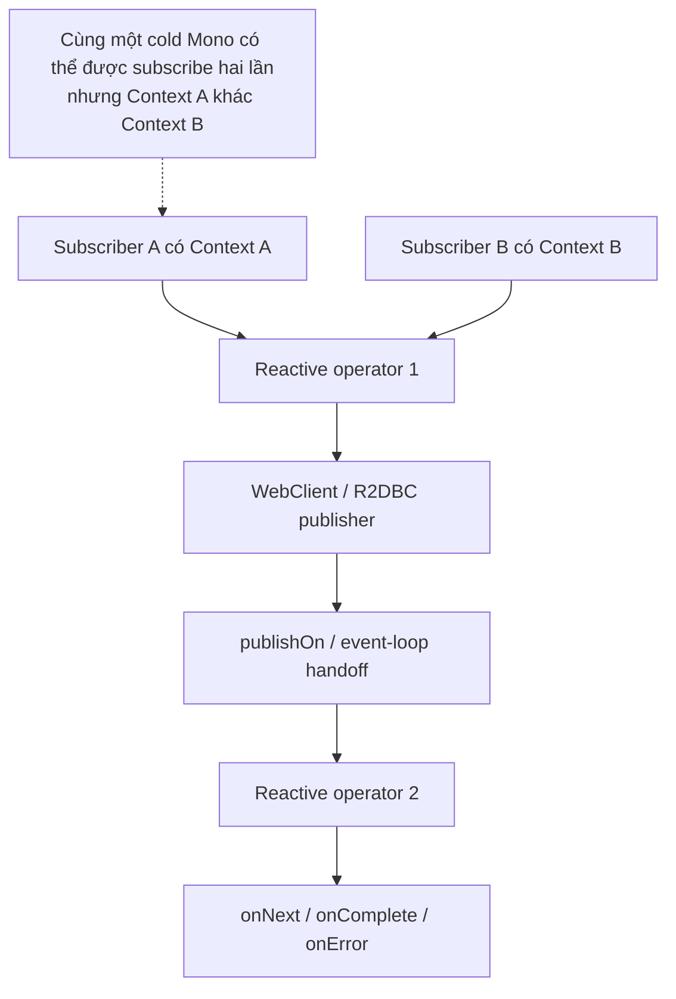
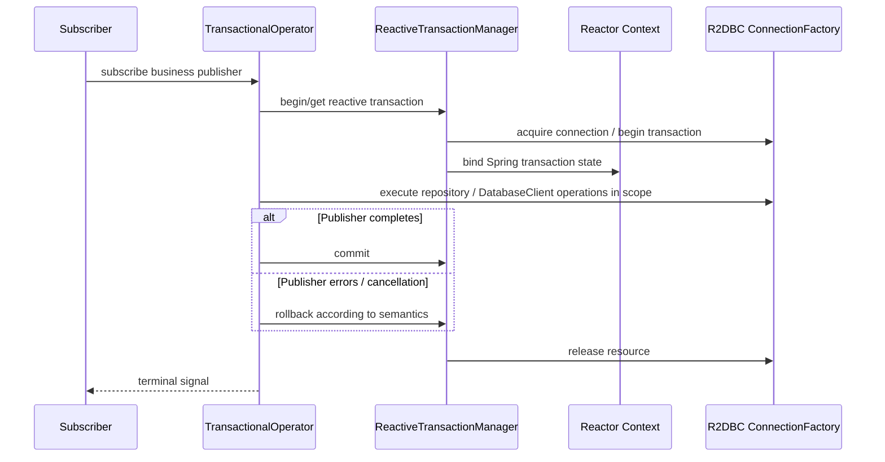
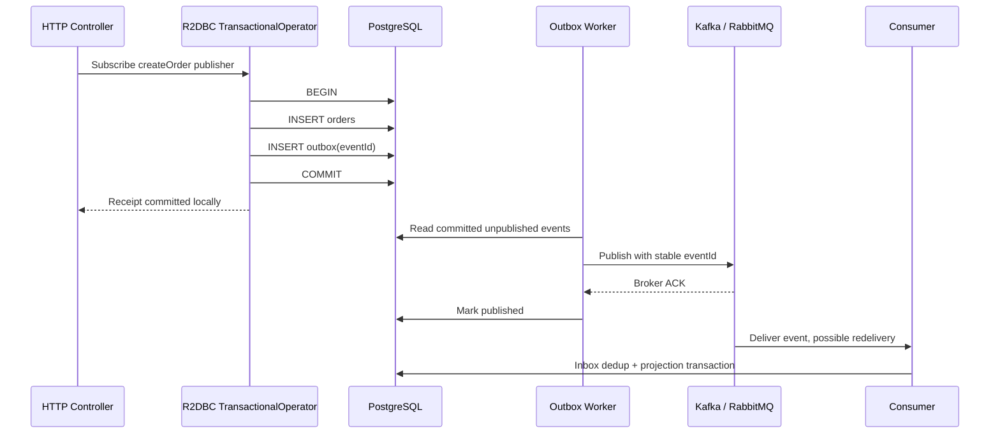
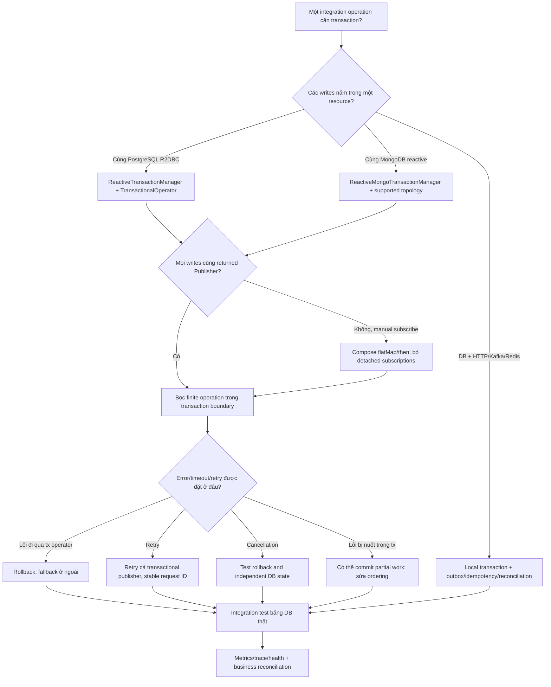

# Phạm vi Reactor Context trong giao dịch reactive

> **Chương:** Dữ liệu reactive  
> **Module:** SPRING_BOOT_INTEGRATION — tích hợp hệ thống trong Spring Boot qua HTTP client, cơ sở dữ liệu, cache, broker thông điệp và các adapter của Spring Integration; chú trọng cấu hình, hợp đồng dữ liệu, giao dịch, lỗi, xử lý trùng lặp, kiểm thử và quan sát các luồng tích hợp thực tế.

## 1. Vì sao một lời gọi reactive có thể “mất giao dịch”?

Một service Spring Boot nhận yêu cầu đặt hàng, ghi đơn hàng vào PostgreSQL bằng R2DBC, ghi ý định phát sự kiện vào bảng outbox rồi trả kết quả. Người viết mong hai thao tác SQL cùng commit hoặc cùng rollback:

```text
HTTP request
   ↓
Reactive order service
   ├─ INSERT orders
   └─ INSERT outbox
   ↓
HTTP response
```

Trong mô hình imperative quen thuộc, `@Transactional` với JDBC/JPA thường gắn transaction state với **thread hiện tại** thông qua cơ chế `ThreadLocal` và Spring `TransactionSynchronizationManager` loại imperative.

Trong mô hình reactive:

- `Mono`/`Flux` có thể được subscribe trên một thread rồi thực thi callbacks trên thread khác.
- Nhiều operation chạy bất đồng bộ qua `publishOn`, `subscribeOn`, các drivers và event loops.
- Không thể suy ra transaction hiện tại từ tên thread.
- Spring reactive transaction infrastructure truyền **transaction context theo Reactor subscriber context** và sử dụng connection/resource binding phù hợp.

Nếu bạn phá ranh giới subscription, tự subscribe một nhánh mới, đặt transaction operator sai phạm vi, nuốt lỗi trước khi transaction nhìn thấy hoặc trộn JDBC blocking vào R2DBC pipeline, chương trình có thể **commit khác kỳ vọng** dù từng câu SQL và từng `Mono` đều “chạy được”.

### 1.1. Một ví dụ dễ mắc

```java
// Sai: nhánh phụ bị subscribe riêng, không thuộc publisher đang return.
Mono<OrderReceipt> createOrder(CreateOrderRequest request) {
    orderRepository.save(mapOrder(request))
            .subscribe(saved -> auditRepository.save(
                    auditOf(saved)).subscribe());

    return Mono.just(new OrderReceipt("ACCEPTED"));
}
```

Đây là **anti-pattern minh họa**, không phải method chạy được độc lập: `OrderReceipt`, repositories và helpers là thành phần ứng dụng. Hai lần gọi `subscribe()` tạo các subscriptions tự quản; caller nhận `ACCEPTED` ngay, không đợi SQL commit, error propagation không còn trong chain và không có cơ sở nói rằng hai writes tham gia cùng một reactive transaction.

Thay vì side-subscribe, compose các publishers **trong cùng pipeline** và áp transaction vào đúng đoạn cần atomicity.

### 1.2. Mục tiêu học tập

Sau bài này, bạn có thể:

1. Giải thích `reactor.util.context.Context`, `ContextView` và tính chất **gắn với subscriber**, không gắn với thread.
2. Phân biệt `contextWrite(...)`, `deferContextual(...)`, `publishOn(...)`, `subscribeOn(...)` và một subscription mới.
3. Nêu cách Spring reactive transaction manager dùng Reactor Context để gắn transaction/resource vào luồng thực thi.
4. Cấu hình `R2dbcTransactionManager`/`ReactiveTransactionManager`, `TransactionalOperator` và `@Transactional` cho return type reactive.
5. Thiết kế phạm vi commit/rollback khi có `flatMap`, `then`, `onErrorResume`, `retryWhen`, `timeout` và cancellation.
6. Tránh các lỗi tự `subscribe()`, `block()`, `Mono.just(...)` eager side effects, nested publishers và trộn JDBC/JPA với R2DBC.
7. Phân biệt giao dịch nội bộ database với HTTP, Redis, Kafka, RabbitMQ, MongoDB và outbox/inbox.
8. Viết integration tests với PostgreSQL Testcontainers, `StepVerifier` và kiểm chứng rollback/commit bằng **kết quả database thực**.
9. Điều tra lỗi transaction context bằng logs/observability an toàn mà không sửa các keys nội bộ Spring.

### 1.3. Phạm vi phiên bản

Ví dụ dùng **Java 17+, Spring Boot 3.x, Spring Framework 6.x, Spring Data R2DBC, Reactor 3.5–3.7** và PostgreSQL R2DBC driver tương thích với BOM của ứng dụng. Spring Boot 4.x, Reactor 3.8+ hoặc các drivers mới có thể khác về auto-configuration, context propagation và API; cần đối chiếu tài liệu phiên bản thực đang chạy.

**Không nhầm:** bài nói về **Spring-managed reactive transactions**, không hứa mọi library tạo `Publisher` đều transaction-aware, cũng không hứa Reactor Context sẽ tự đi qua HTTP/Kafka network hoặc mọi asynchronous API bên ngoài Reactor.

## 2. Reactor Context là gì?

`Reactor Context` là cấu trúc **key/value bất biến theo giao diện cập nhật** (mỗi lần `put/delete` tạo context view mới hoặc cấu trúc được copy-on-write theo implementation). Nó đi cùng **subscription chain**, cho phép các operators ở vị trí thích hợp truy cập thông tin mà không phải truyền từng tham số qua mọi method.

Ví dụ một context có thể mang:

```text
Subscriber Context:
  request.correlationId = "req-71e"
  tenantId = "tenant-blue"
  Spring transaction context = managed internally by framework
```

Các giá trị này khác `onNext` payload:

- `OrderDto` là **business data** được emit.
- `Context` là **metadata đi kèm subscription** (không emit như một record thông thường).
- Reactor Context không phải database transaction object hay connection pool.
- Spring dùng các context keys/objects nội bộ để locate transaction state, còn application có thể bổ sung correlation metadata với key riêng.

### 2.1. Immutable context và ContextView

```java
import reactor.util.context.Context;
import reactor.util.context.ContextView;

Context original = Context.of("traceId", "trace-A");
Context modified = original.put("tenantId", "tenant-blue");

// original không bị sửa.
String traceId = original.get("traceId");
boolean hasTenant = original.hasKey("tenantId"); // false

ContextView view = modified;
String tenantId = view.get("tenantId");
```

Code này là fragment Java thuần. `Context` cho operations tạo phiên bản mới, `ContextView` chủ yếu cho việc đọc. Với custom context, nên dùng key type rõ (class hoặc dedicated key constant) để tránh đụng tên; tránh chứa credentials/raw PII lớn trong context.

### 2.2. Context gắn với subscriber, không gắn với thread



Một cold publisher được subscribe hai lần có thể được chạy **hai lần với hai Context khác nhau**:

```java
Mono<String> flow = Mono.deferContextual(context ->
        Mono.just(context.getOrDefault("correlationId", "missing")));

flow.contextWrite(context ->
        context.put("correlationId", "req-A"))
    .subscribe(value -> System.out.println(value)); // req-A

flow.contextWrite(context ->
        context.put("correlationId", "req-B"))
    .subscribe(value -> System.out.println(value)); // req-B
```

`subscribe()` trong ví dụ này **chỉ dùng để minh họa Context độc lập**, không phải khuyến nghị tự subscribe trong service nghiệp vụ.

### 2.3. Context không truyền tới các tiến trình khác

Giả sử một publisher có `tenantId` trong Reactor Context rồi gọi HTTP partner:

```text
Reactor Context in service A
    ↓
WebClient request sent over network
    ↓
Service B receives new HTTP request / new subscription
```

Service B **không tự nhận Context object từ service A**. Muốn truyền trace/correlation/tenant ID (nếu được phép) phải dùng **giao thức rõ**: HTTP headers, Kafka message headers, AMQP properties hoặc business event fields; phía nhận validate/authorize và tái thiết lập context riêng. Không serialize nguyên Context hoặc transaction state lên wire.

## 3. Hướng truyền Context: đọc từ upstream, ghi ở downstream

Một điểm rất dễ nhầm: `contextWrite(...)` có hiệu lực lên **operators nằm ở phía upstream trong cùng subscription path**. Nó không sửa một biến global và không tự thay đổi những operators nằm downstream.

### 3.1. Ví dụ contextWrite cơ bản

```java
import reactor.core.publisher.Mono;
import reactor.util.context.Context;

Mono<String> result =
        Mono.deferContextual(ctx ->
                Mono.just("request=" + ctx.get("requestId")))
            .contextWrite(Context.of("requestId", "req-42"));

// Khi subscribe, result emit "request=req-42".
```

Giải thích theo hướng subscription: subscriber ở cuối chain khởi tạo Context; `contextWrite` tạo một Context bổ sung cho **source nằm phía trên nó**. `Mono.deferContextual` đọc Context khi được subscribe, nên thấy `requestId`.

### 3.2. Một operator bên dưới contextWrite không nhìn thấy key

```java
Mono<String> example =
        Mono.deferContextual(ctx ->
                Mono.just("upstream=" + ctx.get("requestId")))
            .contextWrite(ctx -> ctx.put("requestId", "req-42"))
            .flatMap(value ->
                    Mono.deferContextual(ctx ->
                            Mono.just(value + ", downstream="
                                    + ctx.getOrDefault(
                                            "requestId", "missing"))));
```

Khi subscribe mà **không cấp context ngoài**, source upstream thấy `req-42`, còn `deferContextual` bên trong `flatMap` nằm downstream của `contextWrite` có thể thấy `missing`. Đây là quy tắc về **vị trí operator và subscription**, không phải bug ngẫu nhiên vì đổi thread.

Muốn cả chain thấy key, đặt `contextWrite` ở **cuối đoạn cần áp**:

```java
Mono<String> fixed =
        Mono.deferContextual(ctx ->
                Mono.just("upstream=" + ctx.get("requestId")))
            .flatMap(value ->
                    Mono.deferContextual(ctx ->
                            Mono.just(value + ", downstream="
                                    + ctx.get("requestId"))))
            .contextWrite(ctx ->
                    ctx.put("requestId", "req-42"));
```

### 3.3. contextWrite không mutate Context của người khác

```java
Mono<String> first = Mono.deferContextual(ctx ->
        Mono.just(ctx.getOrDefault("scope", "none")));

Mono<String> scoped = first.contextWrite(ctx ->
        ctx.put("scope", "first-only"));

Mono<String> other = Mono.deferContextual(ctx ->
        Mono.just(ctx.getOrDefault("scope", "none")));
```

`scoped` có key `scope` trong đoạn upstream của nó; `other` không bị thay đổi chỉ vì có cùng event loop/thread. Đây là điều kiện quan trọng để **hai HTTP requests hoặc hai Kafka messages không chia sẻ transaction/tenant context vô ý**.

### 3.4. Ghi đè key và giá trị mặc định

```java
Mono<String> read = Mono.deferContextual(ctx ->
        Mono.just(ctx.getOrDefault("traceId", "unset")));

Mono<String> chain = read
        .contextWrite(ctx -> ctx.put("traceId", "inner"))
        .contextWrite(ctx -> ctx.put("traceId", "outer"));
```

Ở đây đoạn `contextWrite` gần source hơn ghi `inner` lên Context đã có `outer` từ downstream, nên source thường nhìn thấy `inner`. Đừng dựa vào phép đặt tên “inner/outer” để nhớ; hãy **vẽ vị trí operators** và kiểm tra bằng `StepVerifier` cho chain thực tế.

### 3.5. ContextWrite tại ranh giới request

Một ví dụ controller WebFlux:

```java
import org.springframework.web.bind.annotation.GetMapping;
import org.springframework.web.bind.annotation.PathVariable;
import org.springframework.web.bind.annotation.RestController;
import reactor.core.publisher.Mono;

@RestController
class OrderQueryController {
    private final ReactiveOrderQueryService service;

    OrderQueryController(ReactiveOrderQueryService service) {
        this.service = service;
    }

    @GetMapping("/api/orders/{orderId}")
    Mono<OrderDto> get(@PathVariable String orderId) {
        return service.find(orderId)
                .contextWrite(ctx ->
                        ctx.put("requestKind", "query"));
    }
}
```

`ReactiveOrderQueryService` và `OrderDto` là các types ứng dụng minh họa. WebFlux subscribe publisher trả về theo lifecycle HTTP request; không cần gọi `subscribe()` trong controller. Key `requestKind` sẽ sẵn cho các publishers nằm upstream trong pipeline trên, nhưng **không** tự động ghi vào Spring reactive transaction state hoặc gửi header ra network.

## 4. Spring reactive transaction context nằm ở đâu?

Spring reactive transaction management dùng **Reactor Context của subscription** để truyền transaction metadata và resource binding (ví dụ R2DBC `Connection` gắn với transaction đang hoạt động).



Đây là sơ đồ khái niệm; implementation dùng internal transaction context state và connection binding theo reactive APIs. **Application không được tự dựng Context key/connection binding giả để “mở giao dịch”**; hãy dùng `ReactiveTransactionManager`/`TransactionalOperator` hoặc `@Transactional` được Spring proxy quản lý.

### 4.1. ReactiveTransactionManager và JDBC manager khác nhau

| Môi trường | Transaction manager | Cơ chế scope điển hình |
| --- | --- | --- |
| JDBC/JPA imperative | `DataSourceTransactionManager`/`JpaTransactionManager`, thuộc `PlatformTransactionManager` | Thread-bound transaction resources |
| R2DBC reactive | `R2dbcTransactionManager`, thuộc `ReactiveTransactionManager` | Subscriber/Reactive Context + connection binding |
| Reactive MongoDB | `ReactiveMongoTransactionManager` | Reactive subscriber context + Mongo session |
| Kafka producer transactions | Kafka producer/transactional APIs | Cơ chế Kafka riêng, không tự đồng bộ với R2DBC |
| HTTP client | Không có local ACID transaction manager | Network request; remote side effects độc lập |

Đặt `@Transactional` lên một method trả `Mono<T>` mà ứng dụng chỉ có imperative transaction manager sẽ **không tự tạo R2DBC transaction**. Ngược lại, imperative JPA repository không tự tham gia transaction context của R2DBC.

### 4.2. Ai truy cập được transaction state?

Các thành phần transaction-aware như `DatabaseClient`/Spring Data R2DBC repositories sử dụng Spring resource management phù hợp để lấy connection đã bind trong Reactor Context. Nếu code tự gọi một `ConnectionFactory.create()` không qua cơ chế Spring-managed transactional connection access, nó có thể lấy **connection khác ngoài transaction hiện tại**.

Trong Spring Framework có class:

```java
org.springframework.transaction.reactive.TransactionSynchronizationManager
```

phân biệt với:

```java
org.springframework.transaction.support.TransactionSynchronizationManager
```

Class đầu thuộc **reactive transaction synchronization**, class sau là **imperative ThreadLocal-oriented infrastructure**. Import nhầm class có thể làm code đọc sai transaction state.

### 4.3. Kiểm tra transaction active một cách có kiểm soát

```java
import org.springframework.transaction.reactive.TransactionSynchronizationManager;
import reactor.core.publisher.Mono;

Mono<Boolean> activeTransaction() {
    return TransactionSynchronizationManager
            .forCurrentTransaction()
            .map(TransactionSynchronizationManager::isActualTransactionActive);
}
```

Ở bên trong một **Spring-managed reactive transaction**, method có thể emit `true`; nếu không có transaction context hợp lệ, `forCurrentTransaction()` có thể phát `NoTransactionException`. Đó là API chẩn đoán, **không phải cách bắt đầu transaction**. Không mutate resource maps hoặc dùng object reactive transaction manager nội bộ như business context key.

### 4.4. Hai subscribers không được chia transaction

```text
Subscriber A
  └─ Transaction A / R2DBC connection A

Subscriber B
  └─ Transaction B / R2DBC connection B
```

Khi cùng cold Publisher được subscribe **hai lần**, transactional operator có thể bắt đầu **hai transactions riêng**. Cần đặc biệt thận trọng với retry, cache, hot publishing hoặc WebFlux framework tái subscribe: không ngầm giả định hai subscriptions chia một transaction.

### 4.5. Ranh giới rõ giữa Context và resource

Reactor Context không phải chỗ lưu một open connection tùy ý để truyền cho HTTP client. Nếu tự bỏ `io.r2dbc.spi.Connection` vào context với key `"connection"`, Spring Data repository **không tự biết** đây là transaction hợp lệ; còn làm tăng rủi ro concurrent use, leak và sai commit/rollback.

Spring transaction manager phải sở hữu lifecycle của resource. Application chỉ cấu hình **transaction boundary và policy**; business metadata như `correlationId` có thể dùng key khác, nhưng không được giả làm Spring transaction resource.

## 5. Cấu hình Spring Boot, PostgreSQL và R2DBC

### 5.1. Dependencies cho một ứng dụng reactive data

```groovy
// build.gradle — project đã áp dụng Spring Boot plugin/BOM.
dependencies {
    implementation 'org.springframework.boot:spring-boot-starter-webflux'
    implementation 'org.springframework.boot:spring-boot-starter-data-r2dbc'
    implementation 'org.springframework.boot:spring-boot-starter-validation'
    runtimeOnly 'org.postgresql:r2dbc-postgresql'

    // Chỉ thêm khi cần R2DBC pooling nếu starter/BOM chưa bao gồm.
    runtimeOnly 'io.r2dbc:r2dbc-pool'

    testImplementation 'org.springframework.boot:spring-boot-starter-test'
    testImplementation 'io.projectreactor:reactor-test'
    testImplementation 'org.springframework.boot:spring-boot-testcontainers'
    testImplementation 'org.testcontainers:junit-jupiter'
    testImplementation 'org.testcontainers:postgresql'
}
```

Dự án cần kiểm tra dependencies thực tế do Spring Boot BOM quản lý: tránh ép version `r2dbc-spi`, PostgreSQL driver hoặc Reactor trái với Spring Data R2DBC. Nếu dùng Flyway/Liquibase migration trên PostgreSQL, các tools đó có thể cần **JDBC driver/connection riêng** dù business runtime dùng R2DBC. Đừng cho rằng `spring.r2dbc.url` là một JDBC URL hợp lệ.

### 5.2. application.yml có externalized configuration

```yaml
spring:
  r2dbc:
    url: r2dbc:postgresql://${PG_HOST:localhost}:${PG_PORT:5432}/orders
    username: ${PG_USER:orders}
    password: ${PG_PASSWORD}
    pool:
      enabled: true
      initial-size: 2
      max-size: 20
      max-idle-time: 20m

logging:
  level:
    org.springframework.transaction: INFO
    org.springframework.r2dbc: INFO
```

Các giá trị là ví dụ, không phải production sizing. `spring.r2dbc.pool.*` quản lý **R2DBC connection pool**, **khác** `ConnectionProvider` của Reactor Netty WebClient. Có 20 database connections không đồng nghĩa có 20 HTTP sockets và ngược lại.

`PG_HOST`/`PG_PORT` phải phù hợp vị trí JVM so với PostgreSQL (host, Docker Compose network, Testcontainers dynamic port). Trong tests, nên dùng `@ServiceConnection` để tránh hard-code port. Với production, cấp password qua secret provider, không commit giá trị thật vào source.

### 5.3. Database schema cho ví dụ order và outbox

```sql
CREATE TABLE orders (
    order_id VARCHAR(120) PRIMARY KEY,
    request_key VARCHAR(120) NOT NULL UNIQUE,
    total_amount NUMERIC(18,2) NOT NULL
        CHECK (total_amount > 0),
    state VARCHAR(40) NOT NULL,
    created_at TIMESTAMPTZ NOT NULL DEFAULT CURRENT_TIMESTAMP
);

CREATE TABLE outbox (
    event_id VARCHAR(120) PRIMARY KEY,
    aggregate_id VARCHAR(120) NOT NULL,
    event_type VARCHAR(120) NOT NULL,
    payload JSONB NOT NULL,
    created_at TIMESTAMPTZ NOT NULL DEFAULT CURRENT_TIMESTAMP,
    published_at TIMESTAMPTZ NULL
);

CREATE INDEX outbox_unpublished_idx
    ON outbox (created_at)
    WHERE published_at IS NULL;
```

Schema này cố ý tối giản để minh họa **hai SQL writes cùng transaction**. Production cần quản lý migrations/versioning, permissions, retention, retries, outbox claim/locking, serialization schema và giới hạn payload. `event_id`/`request_key` giúp nhận diện operation logic ổn định qua retries.

### 5.4. ReactiveTransactionManager mặc định và R2dbcTransactionManager

Spring Boot có thể auto-configure `R2dbcTransactionManager` khi có `ConnectionFactory` phù hợp và không có transaction manager khác cản điều kiện auto-configuration. Với **một R2DBC ConnectionFactory và một reactive transaction manager**, nhiều ứng dụng chỉ cần inject:

```java
import org.springframework.context.annotation.Bean;
import org.springframework.context.annotation.Configuration;
import org.springframework.transaction.ReactiveTransactionManager;
import org.springframework.transaction.reactive.TransactionalOperator;

@Configuration(proxyBeanMethods = false)
class ReactiveTransactionConfiguration {

    @Bean
    TransactionalOperator ordersTx(
            ReactiveTransactionManager manager) {
        return TransactionalOperator.create(manager);
    }
}
```

Nếu có **nhiều transaction managers** (JDBC, R2DBC, MongoDB), phải chọn đúng manager cho từng operation, ví dụ dùng `@Qualifier` hoặc tạo bean `TransactionalOperator` với tên/qualifier rõ. Không để reactive SQL viết vào PostgreSQL A nhưng transaction manager bind connection của PostgreSQL B.

### 5.5. Spring-aware data access

Trong transaction reactive, nên dùng:

- `DatabaseClient` hoặc `R2dbcEntityTemplate` do Spring quản lý.
- Spring Data R2DBC `ReactiveCrudRepository`/`R2dbcRepository`.
- Một `ConnectionFactory` đúng với `R2dbcTransactionManager`.

Nếu bạn tự tạo new `ConnectionFactory` khác hoặc dùng driver thấp cấp để `create()` connection ngoài Spring transaction infrastructure, thao tác có thể chạy **ngoài connection đang bind** dù chain có cùng Reactor Context. Reactor Context chỉ là đường truyền transaction/resource state; thư viện vẫn phải **transaction-aware**.

## 6. TransactionalOperator: ranh giới giao dịch programmatic

`TransactionalOperator` cho phép bọc một publisher để Spring tạo transaction khi được subscribe; khi publisher hoàn tất thành công thì commit theo semantics manager, còn lỗi dẫn tới rollback.

### 6.1. DTOs cho ví dụ

```java
// PlaceOrderCommand.java
import java.math.BigDecimal;

public record PlaceOrderCommand(
        String orderId,
        String requestKey,
        BigDecimal totalAmount) {
}
```

```java
// OrderReceipt.java
public record OrderReceipt(
        String orderId, String state) {
}
```

Một command hợp lệ phải có `orderId` và `requestKey` không rỗng, `totalAmount > 0`. Trong production, validate dữ liệu trước khi ghi, xác định stable request key từ caller/idempotency policy và tránh dùng UUID mới mỗi retry.

### 6.2. Hai SQL operations cùng một reactive transaction

```java
// ReactiveOrderWriter.java
import java.math.BigDecimal;
import org.springframework.r2dbc.core.DatabaseClient;
import org.springframework.stereotype.Service;
import org.springframework.transaction.reactive.TransactionalOperator;
import reactor.core.publisher.Mono;

@Service
public class ReactiveOrderWriter {
    private final DatabaseClient db;
    private final TransactionalOperator tx;

    public ReactiveOrderWriter(
            DatabaseClient db,
            TransactionalOperator ordersTx) {
        this.db = db;
        this.tx = ordersTx;
    }

    public Mono<OrderReceipt> placeOrder(
            PlaceOrderCommand command) {

        return Mono.defer(() -> {
            validate(command);

            Mono<Void> insertOrder = db.sql("""
                    INSERT INTO orders
                        (order_id, request_key, total_amount, state)
                    VALUES (:orderId, :requestKey, :amount, 'NEW')
                    """)
                    .bind("orderId", command.orderId())
                    .bind("requestKey", command.requestKey())
                    .bind("amount", command.totalAmount())
                    .fetch()
                    .rowsUpdated()
                    .then();

            // Trình diễn một JSONB literal hợp lệ; hệ thống thật
            // cần serialize payload theo event contract/version.
            Mono<Void> insertOutbox = db.sql("""
                    INSERT INTO outbox
                        (event_id, aggregate_id, event_type, payload)
                    VALUES (:eventId, :orderId, 'OrderCreated',
                            CAST(:payload AS jsonb))
                    """)
                    .bind("eventId", command.requestKey())
                    .bind("orderId", command.orderId())
                    .bind("payload", "{\"state\":\"NEW\"}")
                    .fetch()
                    .rowsUpdated()
                    .then();

            return insertOrder
                    .then(insertOutbox)
                    .thenReturn(
                            new OrderReceipt(command.orderId(), "NEW"));
        }).as(tx::transactional);
    }

    private void validate(PlaceOrderCommand command) {
        if (command == null
                || command.orderId() == null
                || command.orderId().isBlank()
                || command.requestKey() == null
                || command.requestKey().isBlank()
                || command.totalAmount() == null
                || command.totalAmount()
                        .compareTo(BigDecimal.ZERO) <= 0) {
            throw new IllegalArgumentException(
                    "Invalid create order command");
        }
    }
}
```

**Điều quan trọng trong ví dụ:**

1. `Mono.defer(...)` trì hoãn validation/tạo SQL publishers đến **khi có subscription**; exception được phát thành `onError` thay vì lỗi khi chỉ dựng Mono.
2. `insertOrder.then(insertOutbox)` thực thi **tuần tự**: insert outbox bắt đầu sau khi insert order hoàn tất thành công.
3. `.as(tx::transactional)` tạo một **transaction boundary bao quanh cả hai writes** trong cùng subscription.
4. Nếu insert outbox lỗi (ví dụ `event_id` vi phạm khóa chính), transaction rollback và **row orders mới cũng không được commit**.
5. `tx` là Spring-managed reactive operator dùng đúng `ReactiveTransactionManager`/`ConnectionFactory`.
6. DB write thành công **không đồng nghĩa Kafka/RabbitMQ đã phát event**; outbox worker làm việc đó sau commit.

**Idempotency:** đoạn này dùng unique constraints để chống trùng nhưng nếu gửi lại cùng command, `INSERT orders` có thể phát duplicate-key error; nó chưa trả lại receipt cũ một cách idempotent. Production cần lookup theo `request_key`, so khớp payload fingerprint, và trả kết quả cũ hoặc conflict rõ theo hợp đồng; **không** đơn giản nuốt mọi duplicate-key error.

### 6.3. Transaction bắt đầu lúc subscribe, không phải lúc method được gọi

```java
Mono<OrderReceipt> deferred =
        writer.placeOrder(command);

// Chưa có DB transaction được mở chỉ vì đã có biến deferred.

// WebFlux controller có thể return deferred cho framework subscribe.
// Test có thể dùng StepVerifier.create(deferred).
```

Với cold publisher điển hình, subscribe lần thứ hai sẽ thực thi lại SQL và mở một **transaction riêng**, có thể gặp unique constraint. Nếu dùng `retryWhen`, phải xác định retries đặt trong/ngoài operator và requestKey ổn định. Đừng phát mã business ID mới mỗi subscription nếu đó vẫn là cùng logical operation.

### 6.4. Style trả Mono và callback style

Có hai phong cách:

```java
// Operator style: type thường giữ Mono<T> hoặc Flux<T>.
Mono<OrderReceipt> result =
        writePublisher.as(tx::transactional);

// Callback style: execute nhận lambda có ReactiveTransaction.
Flux<OrderReceipt> resultFlux = tx.execute(status ->
        writePublisher.flux());
```

`writePublisher` ở đây là publisher đã được xây dựng phù hợp. Với callback style, `TransactionalOperator.execute(...)` trả **Flux** theo API, thích hợp khi cần `ReactiveTransaction` status để rollback programmatically. Khi chỉ cần transactional `Mono`, operator style dễ đọc hơn.

### 6.5. Chủ động đánh dấu rollback-only

```java
Flux<OrderReceipt> flow = tx.execute(status ->
        verifyBusinessPrecondition()
            .flatMap(valid -> {
                if (!valid) {
                    status.setRollbackOnly();
                    return Mono.empty();
                }
                return writeOrderAndOutbox();
            }));
```

Đây là **fragment**: `verifyBusinessPrecondition()` trả `Mono<Boolean>` và `writeOrderAndOutbox()` trả publisher receipt, do service cung cấp. Khi đánh dấu `rollbackOnly`, transaction manager sẽ rollback theo semantics transaction; không nên trả HTTP success “đã tạo đơn” nếu nhánh này không ghi dữ liệu. Một thiết kế khác là phát domain error rõ để caller nhìn thấy thất bại thay vì trả empty tùy tiện.

### 6.6. Không dùng subscribe() bên trong transaction

```java
// Sai: outbox write trở thành một subscription không thuộc chain.
Mono<OrderReceipt> wrong(PlaceOrderCommand command) {
    return insertOrder(command)
            .doOnSuccess(order ->
                    insertOutbox(order).subscribe())
            .thenReturn(new OrderReceipt(command.orderId(), "NEW"))
            .as(tx::transactional);
}
```

`insertOrder`/`insertOutbox` là helper publishers giả định. Dù `.as(tx::transactional)` xuất hiện ở cuối, subscription được tạo bên trong `doOnSuccess` **không đương nhiên kế thừa transaction context** và không được chờ trong transaction boundary. Side effects của `doOnSuccess` cũng không phải cơ chế compose correctness; dùng `flatMap`/`then` trả publisher cho Spring quản lý.

## 7. @Transactional trên method trả Mono/Flux

### 7.1. Declarative reactive transaction

```java
// AnnotatedOrderService.java
import org.springframework.r2dbc.core.DatabaseClient;
import org.springframework.stereotype.Service;
import org.springframework.transaction.annotation.Transactional;
import reactor.core.publisher.Mono;

@Service
public class AnnotatedOrderService {
    private final DatabaseClient db;

    public AnnotatedOrderService(DatabaseClient db) {
        this.db = db;
    }

    @Transactional
    public Mono<Void> createMetadata(String orderId, String eventId) {
        return db.sql("""
                    INSERT INTO orders
                        (order_id, request_key, total_amount, state)
                    VALUES (:orderId, :eventId, 1.00, 'NEW')
                    """)
                .bind("orderId", orderId)
                .bind("eventId", eventId)
                .fetch().rowsUpdated().then()
                .then(db.sql("""
                    INSERT INTO outbox
                        (event_id, aggregate_id, event_type, payload)
                    VALUES (:eventId, :orderId,
                            'OrderCreated', '{}'::jsonb)
                    """)
                    .bind("eventId", eventId)
                    .bind("orderId", orderId)
                    .fetch().rowsUpdated().then());
    }
}
```

Với **Spring AOP proxy gọi từ bean khác**, method trả Publisher và transaction manager reactive đúng loại, Spring có thể mở/bind transaction khi subscription diễn ra, commit khi Publisher hoàn tất hoặc rollback khi lỗi.

**Không dùng `@Transactional` trên một method trả `void` có `subscribe()` bên trong** rồi kỳ vọng giao dịch bọc các callbacks; transaction interception phải thấy return type reactive và subscriber chain.

### 7.2. Self-invocation bỏ qua proxy

```java
@Service
class BadSelfInvocation {
    public Mono<Void> start() {
        return saveInsideTransaction(); // gọi this.method trực tiếp
    }

    @Transactional
    public Mono<Void> saveInsideTransaction() {
        return someReactiveDatabaseWrite();
    }
}
```

Đây là skeleton minh họa; `someReactiveDatabaseWrite()` là helper giả định. Với Spring AOP proxy mode thông thường, lời gọi nội bộ `this.saveInsideTransaction()` **không đi qua transactional proxy**, vì thế annotation có thể không được áp dụng.

Giải pháp: chuyển transactional operation sang một bean khác rồi inject gọi qua proxy, hoặc dùng `TransactionalOperator` rõ ràng trong service. Không sửa bằng cách tự gọi `subscribe()` ở caller.

### 7.3. Chọn đúng transaction manager khi có nhiều resources

Nếu ứng dụng có R2DBC + reactive MongoDB + JDBC:

```java
// Fragment — tên bean phải khớp với cấu hình thực của ứng dụng.
@Transactional(transactionManager = "ordersR2dbcTransactionManager")
public Mono<OrderReceipt> placeOrderReactive(...) {
    // Reactive R2DBC operations.
}
```

Đây là fragment khai báo tên manager **giả định**; phải thực sự định nghĩa một bean `ordersR2dbcTransactionManager` nếu sử dụng. Không copy nguyên tên rồi mong Boot tự tạo. Khi chỉ có một reactive manager hợp lệ, annotation không chỉ định tên có thể đơn giản hơn.

### 7.4. Sự khác biệt giữa R2DBC/JPA khi dùng @Transactional

| Cách viết | Điều kiện để transaction đúng | Lỗi phổ biến |
| --- | --- | --- |
| `@Transactional Mono<T>` với R2DBC | Reactive manager + Spring proxy + subscribe chain | Method tự subscribe, proxy bị bypass |
| `TransactionalOperator Mono<T>` | Bọc publisher ở đúng scope | Bọc chỉ một SQL thay vì cả workflow |
| `@Transactional void` với JPA | Imperative manager, gọi đồng bộ trong thread-bound scope | Tưởng transaction lan qua async reactive callbacks |
| `@Transactional Mono<T>` nhưng dùng JdbcTemplate | JDBC blocking, manager mismatch | Event loop block, resource không cùng reactive transaction |
| Mongo reactive transaction | ReactiveMongoTransactionManager + topology hỗ trợ session/transaction | Dùng standalone MongoDB hoặc không có manager |

Một method annotated `@Transactional` có thể thành công vì database riêng lẻ auto-commit dù annotation không được áp, khiến test happy path **không phát hiện thiếu transaction**. Hãy viết test **cố tình làm bước thứ hai lỗi rồi xác nhận bước thứ nhất rollback**.

## 8. Vị trí operator quyết định rollback hay commit

Reactive transactions quan sát **terminal signals** của publisher mà transaction operator quản lý. Nếu một lỗi được chuyển thành success/empty **trước khi đi tới transaction boundary**, transaction có thể commit những writes đã thực hiện.

### 8.1. Để lỗi đi qua transaction boundary rồi xử lý ở ngoài

```java
Mono<OrderReceipt> safeFallback =
        writeOrderThenOutbox()
            .as(tx::transactional)
            .onErrorResume(PartnerBusinessException.class,
                    error -> Mono.just(
                            new OrderReceipt("unknown", "REJECTED")));
```

Trong ví dụ fragment này, `writeOrderThenOutbox()` là publisher hai bước, `PartnerBusinessException` là custom domain exception. Nếu source phát lỗi, `TransactionalOperator` nhìn thấy lỗi và thực hiện rollback trước khi fallback ngoài transaction tạo `REJECTED` (theo transaction completion semantics). Caller phải phân biệt **REJECTED** với **đã ghi DB thành công**; không trả receipt giả “NEW” nếu rollback.

### 8.2. Nuốt lỗi trong transaction có thể commit một phần

```java
Mono<Void> dangerous =
        insertOrder()
            .then(insertOutbox())
            .onErrorResume(error -> {
                log.warn("Ignoring outbox error", error);
                return Mono.empty();
            })
            .as(tx::transactional);
```

Đây là anti-pattern: `onErrorResume(...)` **nằm bên trong phần được transaction bọc**. Nếu `insertOrder()` thành công, `insertOutbox()` thất bại rồi lỗi bị thay bằng `Mono.empty()`, transaction operator có thể chỉ thấy **onComplete** và tiến hành commit.

**Lưu ý PostgreSQL:** nếu lỗi do SQL constraint làm PostgreSQL transaction vào trạng thái aborted, cố commit vẫn có thể dẫn tới rollback hoặc lỗi; **không dùng hiện tượng đó làm safety net**. Với lỗi business do Java phát sinh sau câu INSERT đầu (không làm database transaction aborted), pattern trên có thể thật sự commit row order thiếu outbox. Nguyên tắc đúng là **đừng nuốt lỗi mà bạn cần để rollback**.

### 8.3. doOnError không thay đổi terminal error

```java
Mono<Void> audited =
        insertOrder()
            .then(insertOutbox())
            .doOnError(error ->
                    log.warn("Order transaction failed", error))
            .as(tx::transactional);
```

`doOnError` quan sát side effect mà **không chuyển onError thành onComplete**, nên transaction vẫn nhìn thấy lỗi. Nhưng không log raw SQL parameters/customer PII và không gọi external HTTP/Kafka publish side effect từ `doOnError` rồi nghĩ nó là một rollback handler bền vững.

### 8.4. onErrorMap để phân loại mà không nuốt

```java
Mono<OrderReceipt> mapped =
        writeOrderThenOutbox()
            .onErrorMap(
                    org.springframework.dao.DuplicateKeyException.class,
                    original -> new DuplicateOrderRequestException(
                            "Order already exists", original))
            .as(tx::transactional);
```

`DuplicateOrderRequestException` là custom application exception. `onErrorMap` giữ terminal signal là lỗi, cho phép rollback. Tuy nhiên duplicate-key ở `orders` chưa đủ kết luận replay hợp lệ: cần đọc lại record cũ và so payload/requestKey theo idempotency contract.

### 8.5. setRollbackOnly khi nghiệp vụ chọn không ném exception

Một validation có thể trả `Mono<Decision>` thay vì ném lỗi. Nếu muốn dừng transaction mà vẫn emit một result, dùng `TransactionalOperator.execute(status -> ...)` để gọi `status.setRollbackOnly()`. Nhưng hãy ghi rõ trong type/result rằng không có database commit, và xác minh manager behavior bằng integration tests.

**Không** dùng `onErrorContinue` để bỏ qua SQL errors tùy tiện trong một financial/order workflow. Semantics của nó phụ thuộc hỗ trợ của operators và có thể khiến side effects/rollback không còn dễ đoán; với transactional data, ưu tiên fail fast rồi xử lý ngoài boundary.

## 9. retryWhen: mỗi lần retry có mở transaction mới không?

Vị trí retry **so với** transactional operator là khác biệt quan trọng.

### 9.1. Retry bao ngoài transaction

```java
Mono<OrderReceipt> withFreshTransactionPerAttempt =
        writeOrderThenOutbox()
            .as(tx::transactional)
            .retryWhen(Retry.backoff(2,
                    Duration.ofMillis(100))
                .filter(this::isRetryableDatabaseFailure));
```

Vì retry nằm **sau transactional boundary**, một onError khiến subscription vào transactional publisher kết thúc/rollback, rồi retry thường **subscribe lại publisher đó**, tạo **transaction mới** cho attempt sau. Đây thường là phạm vi đúng khi muốn retry deadlock/serialization failure sau rollback.

Nhưng vẫn phải có:

- Stable `requestKey`/eventId qua attempts.
- Bounded retries/backoff và tổng deadline.
- Phân loại lỗi transient (deadlock, serialization failure, connection transient) vs permanent (invalid payload, unique mismatch, schema drift).
- Test DB state và khả năng retry sau crash, không chỉ kiểm tra exception class.
- Cảnh giác side effects **ngoài DB transaction** đã thực thi ở attempt trước.

### 9.2. Retry bên trong transaction

```java
Mono<OrderReceipt> risky =
        writeOrderThenOutbox()
            .retryWhen(Retry.backoff(2,
                    Duration.ofMillis(100)))
            .as(tx::transactional);
```

Ở đây transaction operator có thể quản lý **một transaction cho toàn bộ retry sequence**. Nếu một SQL statement đã khiến PostgreSQL transaction bị aborted, các retry tiếp theo trong cùng transaction có thể thất bại cho tới khi rollback. Ngoài ra, một số effects của attempt trước đã ở trong transaction hiện tại, gây trạng thái không rõ nếu bạn retry logic không được thiết kế rollback to savepoint.

**Khuyến nghị:** nếu retry được dùng để phục hồi database transaction failure, thường đặt **toàn bộ transaction bên trong mỗi attempt** thay vì retry raw SQL steps trong transaction bị lỗi. Nếu business muốn retry một operation trong cùng transaction với savepoints, cần API/savepoint policy rõ và test trên driver/DB thực.

### 9.3. import cho ví dụ retry

```java
import java.time.Duration;
import reactor.core.publisher.Mono;
import reactor.util.retry.Retry;
```

`isRetryableDatabaseFailure(...)` là helper nghiệp vụ giả định, không phải method sẵn có của Spring. Không filter mọi `RuntimeException` là retryable. Với network timeout sau một **external HTTP POST**, không retry theo nguyên tắc R2DBC transaction vì remote operation không chịu DB rollback.

### 9.4. Retry không phá tính lazy nhưng có thể tạo thêm side effects

```java
Mono<OrderReceipt> commandFlow = writer.placeOrder(command);

// Một subscription bình thường => một attempt.
// retryWhen => có thể nhiều subscriptions/transactions.
// cache()/share() => có thể thay đổi số subscriptions thật.
```

Khi gọi `cache()` hoặc `share()`, bạn có thể biến một cold transactional publisher thành một nguồn chia sẻ/hot-like behavior; subscribers sau có thể nhận **cached value** mà không mở transaction mới. Điều này không nhất thiết sai, nhưng phải có design cụ thể nếu mỗi subscriber được mong đợi làm work độc lập.

**Đừng cache transaction-bound publishers như một service singleton “đang giữ connection mở”**. Một transaction chỉ có lifecycle trong subscription/operation cụ thể.

## 10. timeout, cancellation và reactive transaction

### 10.1. Timeout ngoài transaction thường hủy subscription

```java
Mono<OrderReceipt> bounded =
        writeOrderThenOutbox()
            .as(tx::transactional)
            .timeout(Duration.ofSeconds(3));
```

Nếu transaction chưa hoàn tất trước deadline, `timeout` có thể **cancel upstream subscription**; Spring reactive transaction infrastructure ở các phiên bản hiện đại xử lý cancellation bằng rollback theo semantics của nó. **Không coi cancellation là onComplete thành công**.

Tuy nhiên cần phân biệt:

- Một **database transaction local** có thể rollback các writes chưa commit.
- Nếu commit đã xảy ra đúng lúc timeout/cancellation race, caller không nên suy chắc chắn DB chưa commit chỉ từ timeout signal.
- External HTTP partner đã nhận lệnh POST **không rollback** vì R2DBC subscription bị cancel.
- Một Reactor subscription bị hủy không bảo đảm mọi callback ngoại vi đã ngừng.

### 10.2. take, next và downstream hủy Flux

```java
Flux<OrderDto> stream = readAndUpdateOrders()
        .as(tx::transactional);

Mono<OrderDto> first = stream.next();
```

`next()` lấy phần tử đầu rồi **cancel phần còn lại của Flux**. Nếu publisher là transaction thực hiện nhiều writes, cancellation có thể khiến transaction rollback, trong khi downstream đã nhìn thấy một `OrderDto`. Vì vậy **không thiết kế giao dịch ghi phụ thuộc vào việc subscriber đọc hết một Flux tùy ý**.

Một pattern vững hơn:

1. Xây một **finite Mono** thực hiện toàn bộ writes trong transaction.
2. Chờ Mono hoàn tất/commit.
3. Sau đó emit response/events từ một publisher khác khi cần stream.

### 10.3. Trả Flux đang ghi DB trực tiếp cho HTTP streaming

```java
// Anti-pattern dễ gây khó kiểm soát:
@GetMapping("/stream-and-update")
Flux<OrderDto> streamAndWrite() {
    return repository.findAll()
            .flatMap(this::updateAndSave)
            .as(tx::transactional);
}
```

Nếu client ngắt kết nối sau 10 records, HTTP server có thể cancel subscription và Spring rollback transaction. Nhưng HTTP client **đã nhận** 10 emitted records; những records đó không còn phản ánh DB commit cuối cùng. Thiết kế API nên tách **command transaction** khỏi **streaming response** khi tính nhất quán quan trọng.

### 10.4. Cấu hình timeout trên từng tầng

| Timeout | Tác động | Không đồng nghĩa |
| --- | --- | --- |
| R2DBC connection pool acquire timeout | Không lấy được DB connection | RDBMS đã rollback một operation trước đó |
| Database statement timeout | DB giới hạn thời gian query | HTTP partner đã ngừng xử lý |
| Reactor `Mono.timeout(...)` | Cancel reactive subscription nếu quá hạn | Commit chưa từng xảy ra trong mọi race |
| WebClient response timeout | HTTP response đến chậm | Local R2DBC transaction chắc chắn rollback |
| Kafka poll/ack timeout | Consumer lifecycle/redelivery | PostgreSQL đã commit hay chưa |

Một workflow tích hợp cần **overall business deadline** cùng state machine/reconciliation. Đừng đặt database statement timeout 30 giây nhưng HTTP caller timeout 2 giây rồi giả định toàn bộ side effects được hủy lập tức.

### 10.5. Cancellation tests cần kiểm chứng database state

Nếu muốn xác nhận rollback do cancellation:

1. Dựng transactional publisher có insert row đầu rồi chờ một controlled gate trước write tiếp.
2. Subscribe bằng `StepVerifier` hoặc một `BaseSubscriber`.
3. Khi biết write đầu đã thực hiện **trong transaction nhưng chưa commit**, cancel subscription.
4. Chờ rollback/connection cleanup có kiểm soát.
5. Dùng **subscription mới ngoài transaction** query database và assert row không tồn tại.
6. Không chỉ assert callback `doFinally(SignalType.CANCEL)`; đó là tín hiệu cancellation, không chứng minh DB state cuối.

Đừng dựa vào `Thread.sleep(...)` để chọn thời điểm cancellation chính xác; dùng Reactor `Sinks`/latches với deadline trong tests.

## 11. Branching, parallelism và transaction context

### 11.1. flatMap có truyền Context cho inner publishers không?

Trong một Reactor chain chuẩn, một inner `Mono` được trả về từ `flatMap` thường nhận subscriber Context phù hợp với vị trí operation:

```java
Mono<OrderReceipt> flow =
        repository.findById(orderId)
            .flatMap(order ->
                    repository.save(order.confirmed()))
            .map(saved -> new OrderReceipt(
                    saved.id(), saved.state()))
            .as(tx::transactional);
```

Nếu cả hai repositories là **Spring Data R2DBC repositories cùng connection factory** và transaction operator bọc toàn chain, các operations có thể cùng tham gia transaction. Chuyển thread bằng Reactor operators không tự xóa subscriber Context.

### 11.2. Nhưng parallel statements trên cùng connection là nguy hiểm

```java
// Không mặc định an toàn khi hai DB operations chạy song song
// trên cùng connection-bound reactive transaction:
Mono<Void> riskyParallel =
        Mono.when(
                repository.save(entityA),
                repository.save(entityB))
            .as(tx::transactional);
```

`Mono.when(...)` có thể subscribe hai inner publishers đồng thời. Trong reactive transaction, hai writes có thể chia cùng một R2DBC connection (resource transaction-bound); mức độ hỗ trợ **concurrent operations trên cùng connection** phụ thuộc driver/protocol/transaction semantics. Không coi nó như hai connection độc lập hoặc transaction an toàn song song chỉ vì Reactive API cho phép composition.

Với một transaction cần thứ tự:

```java
Mono<Void> sequential =
        repository.save(entityA)
            .then(repository.save(entityB))
            .then()
            .as(tx::transactional);
```

Hoặc xử lý nhiều bản ghi:

```java
Flux<Entity> updates = Flux.fromIterable(entities)
        .concatMap(entity -> repository.save(entity))
        .as(tx::transactional);
```

`concatMap` thực hiện tuần tự trên dòng element; phù hợp hơn khi cùng connection transaction-bound và ordering cần thiết. Không giữ một transaction mở cho hàng triệu records trong một Flux vô hạn: chunk thành các **finite units** và checkpoint sau commit, có idempotency.

### 11.3. zip/when có thể cancel các nhánh còn lại

```java
Mono<Tuple2<Order, Audit>> both =
        Mono.zip(loadOrder(), loadAudit());
```

Nếu một nhánh phát lỗi hoặc hoàn tất rỗng theo semantics của `zip`, nhánh khác có thể bị cancel. Trong một giao dịch ghi, **cancellation** có thể ảnh hưởng rollback/trạng thái side effects. Với các writes cần cùng commit, chuỗi chúng tuần tự hoặc thiết kế transaction carefully; không dùng `zip` để bắt buộc “hai side effects chắc chắn xong” nếu một nhánh có thể empty/error/cancel sớm.

### 11.4. publishOn/subscribeOn không phải ranh giới transaction mới

```java
Mono<Boolean> active =
        activeTransaction()
            .publishOn(Schedulers.parallel())
            .flatMap(previous ->
                    activeTransaction()
                            .map(after -> previous && after))
            .as(tx::transactional);
```

Trong Reactor chuẩn, cả hai lần đọc transaction context thường vẫn thấy **cùng reactive transaction scope** dù `publishOn` đổi thread. Nguyên nhân là transaction được truyền qua Reactor Context, không phụ thuộc cùng Java thread.

Điều này **không** chứng minh bạn có thể dùng JDBC `Connection` ThreadLocal ở thread mới, và không làm code tự `new Thread(...).start()` kế thừa Context. Một boundary ngoài Reactor (executor callback, CompletionStage, listener framework khác) cần cơ chế propagation rõ.

### 11.5. Detached subscribe là một đường thực thi khác

```java
Mono<Void> dangerous =
        orderRepository.save(order)
            .doOnNext(saved -> {
                // Detached subscriber: không chờ, không cùng rollback boundary.
                auditRepository.save(auditOf(saved)).subscribe();
            })
            .then()
            .as(tx::transactional);
```

Đây là anti-pattern ngay cả khi hai repositories dùng cùng R2DBC driver. Subscription mới không mặc nhiên được Spring reactive transaction gắn resource/context từ parent, và exception có thể bị mất. Hãy dùng:

```java
Mono<Void> correct =
        orderRepository.save(order)
            .flatMap(saved ->
                    auditRepository.save(auditOf(saved)))
            .then()
            .as(tx::transactional);
```

### 11.6. Context mất khi thay bằng Context.empty()

```java
// Anti-pattern khi nằm bên trong Spring transaction scope:
Mono<Void> broken =
        databaseWrite()
            .contextWrite(old -> reactor.util.context.Context.empty())
            .as(tx::transactional);
```

Một `contextWrite(old -> Context.empty())` được áp ở một vị trí upstream của transactional operator có thể **xóa toàn bộ subscriber Context mà Spring vừa cấp**, bao gồm transaction state; database write có thể không tham gia transaction bạn định dùng.

Muốn thêm metadata, hãy **giữ nguyên Context hiện tại**:

```java
Mono<Void> safe =
        databaseWrite()
            .contextWrite(ctx ->
                    ctx.put("correlationId", "req-42"))
            .as(tx::transactional);
```

Không tự tạo Context mới chỉ chứa custom keys rồi gắn vào publisher trong transactional scope. Nếu không chắc vị trí operator, test cả `TransactionSynchronizationManager.forCurrentTransaction()` và database rollback behavior.

## 12. ThreadLocal, MDC, Spring Security và observability

### 12.1. Reactor Context khác Java ThreadLocal

```text
Imperative request:
  Thread-17 → ThreadLocal transaction state → JDBC connection

Reactive request:
  Subscriber A Context → R2DBC transaction state
       ↳ may execute on Netty thread-1
       ↳ may continue on parallel scheduler thread-4
       ↳ may resume on Netty thread-2

Thread identity is NOT transaction identity.
```

Không dùng:

```java
ThreadLocal<String> currentOrderId = new ThreadLocal<>();
```

như cách truyền `orderId` giữa reactive callbacks. Một event loop có thể xử lý nhiều subscriptions xen kẽ; state ThreadLocal dễ lẫn hoặc mất khi thread chuyển. Với dữ liệu cần độ chính xác nghiệp vụ như tenant ID, order ID, permission hoặc idempotency key, **truyền tham số tường minh** vẫn thường an toàn/dễ kiểm thử hơn đưa mọi thứ vào Context.

### 12.2. Dùng Reactor Context cho metadata nhỏ

```java
// CorrelationKeys.java
public final class CorrelationKeys {
    public static final String REQUEST_ID = "request.correlationId";

    private CorrelationKeys() {
    }
}
```

```java
Mono<String> loggableOperation() {
    return Mono.deferContextual(ctx -> {
        String requestId = ctx.getOrDefault(
                CorrelationKeys.REQUEST_ID, "unknown");
        return Mono.just("request=" + requestId);
    });
}
```

`contextWrite(ctx -> ctx.put(REQUEST_ID,...))` tạo context cho nhánh upstream, không thay đổi state của một request khác. Chỉ lưu metadata ngắn/ổn định; một Context chứa toàn bộ payload/order list có thể làm tăng bộ nhớ và phơi bày dữ liệu giữa operators.

### 12.3. MDC không tự được cập nhật nhờ Context

SLF4J MDC thường dựa trên `ThreadLocal`; `org.slf4j.MDC.get("requestId")` không nhất thiết đọc được key lưu trong Reactor Context khi thread thay đổi.

Một logging strategy phải có cơ chế bridge/context propagation phù hợp (ví dụ Micrometer Context Propagation, Reactor hooks/automatic mode, thư viện logging instrumentation). Đừng tự viết:

```java
// Anti-pattern: set rồi không clear MDC trên shared event loop.
MDC.put("requestId", requestId);
return repository.save(order);
```

Thread event loop có thể xử lý request khác sau đó; nếu MDC không được restore/clear đúng lifecycle, log có thể mang **request ID/tenant sai**. Khi dùng manual MDC bridge, phải restore previous value trong `finally/doFinally` với hiểu biết chính xác về execution threading; thường nên dùng instrumentation đã được hỗ trợ và test log correlation.

### 12.4. Automatic Context Propagation là một tính năng khác

Trong Reactor 3.5+ và các dòng Spring Boot phù hợp, Micrometer Context Propagation/automatic propagation hỗ trợ bridge **một số ThreadLocal values đã đăng ký accessors** qua Reactor subscriber Context.

Tùy phiên bản Boot, có thể thấy cấu hình dạng:

```yaml
spring:
  reactor:
    context-propagation: auto
```

hoặc Reactor API như `Hooks.enableAutomaticContextPropagation()` khi ứng dụng chủ động bật và library support tương ứng. **Không** coi hai cơ chế này là việc kích hoạt Spring R2DBC transaction: transaction reactive đã dựa trên subscriber context và Spring resource management riêng. Automatic propagation chủ yếu giúp observability và ThreadLocal bridge cho những keys/accessors được hỗ trợ.

Tránh bật hook toàn cục nhiều lần không kiểm soát hoặc tự đăng ký accessors cho secret-bearing ThreadLocals. Kiểm tra Spring Boot/Reactor/Micrometer BOM và đo overhead/trace correctness.

### 12.5. Spring Security reactive cũng dùng Reactor Context

Spring Security reactive infrastructure có thể đặt `SecurityContext` vào Reactor Context. Khi muốn đọc principal theo Reactor API, dùng reactive utilities như `ReactiveSecurityContextHolder.getContext()` thay vì lấy `SecurityContextHolder` ThreadLocal như application MVC imperative.

```java
// Fragment: đọc authentication được cấp bởi reactive security chain.
import org.springframework.security.core.Authentication;
import org.springframework.security.core.context.ReactiveSecurityContextHolder;
import reactor.core.publisher.Mono;

Mono<String> authenticatedSubject() {
    return ReactiveSecurityContextHolder.getContext()
            .map(ctx -> ctx.getAuthentication())
            .filter(Authentication::isAuthenticated)
            .map(Authentication::getName);
}
```

**Không tin một tenantId context key tự do** mà không xác nhận against authenticated principal/authorization. Reactor Context chỉ là kênh metadata theo subscription; nó không tự xác minh quyền hoặc tạo security boundary giữa tenants.

### 12.6. Trace context và transaction context có vòng đời khác nhau

Một trace HTTP request → R2DBC transaction → WebClient → Kafka publish có thể kéo dài qua **nhiều local transactions** ở nhiều services; tracing/correlation giúp theo dõi luồng, **không phải ACID distributed transaction**.

Ví dụ:

```text
traceId=abc123
span=POST /orders
R2DBC tx=commit orders+outbox
span=outbox dispatch Kafka
Kafka consumer span=project order
R2DBC tx=commit read model
```

Hai database commits ở hai services là **hai transactions khác nhau** dù cùng trace ID. Chỉ kết luận trạng thái nghiệp vụ cuối cùng từ database/ack/reconciliation, không từ việc span kết thúc thành công.

## 13. Reactive MongoDB cũng cần transaction context, nhưng resource khác R2DBC

Spring Data MongoDB reactive có `ReactiveMongoTemplate` và `ReactiveMongoTransactionManager`. Transaction manager sử dụng subscriber/reactive context để gắn MongoDB `ClientSession` và transaction state cho các MongoDB operations tương thích.

### 13.1. MongoDB transaction đòi hỏi topology thích hợp

MongoDB multi-document transactions thường yêu cầu **replica set hoặc sharded cluster** được cấu hình đúng và các điều kiện phiên bản/driver phù hợp. Một standalone MongoDB có thể cho CRUD đơn giản nhưng **không hỗ trợ transaction như replica set**.

Trong development/Testcontainers, khi test Mongo transaction, dựng replica set đúng và dùng connection URI mà MongoDB driver khám phá được các members. Đừng chỉ kiểm thử `MongoTemplate.save(...)` rồi tuyên bố multi-document rollback đã được xác minh.

### 13.2. Cấu hình manager cho Mongo reactive

```java
// Fragment cấu hình khi ứng dụng có một ReactiveMongoDatabaseFactory.
import org.springframework.context.annotation.Bean;
import org.springframework.data.mongodb.ReactiveMongoDatabaseFactory;
import org.springframework.data.mongodb.ReactiveMongoTransactionManager;
import org.springframework.transaction.reactive.TransactionalOperator;

@Bean("mongoReactiveTransactionManager")
ReactiveMongoTransactionManager mongoTxManager(
        ReactiveMongoDatabaseFactory factory) {
    return new ReactiveMongoTransactionManager(factory);
}

@Bean("mongoTransactionalOperator")
TransactionalOperator mongoTransactionalOperator(
        @Qualifier("mongoReactiveTransactionManager")
        ReactiveMongoTransactionManager manager) {
    return TransactionalOperator.create(manager);
}
```

`@Qualifier` là `org.springframework.beans.factory.annotation.Qualifier`; code trên là **fragment configuration**, đặt trong một `@Configuration` class phù hợp. Không khai báo cùng một bean name nhiều lần khi Boot auto-config đã có manager hoặc nhiều transaction manager beans.

### 13.3. TransactionalOperator trên MongoTemplate

```java
Mono<OrderProjection> updateProjection(OrderProjection projection) {
    return reactiveMongoTemplate.save(projection)
            .as(mongoTransactionalOperator::transactional);
}
```

`reactiveMongoTemplate` và `mongoTransactionalOperator` là beans đã inject. Đoạn code chỉ đưa **MongoDB write** vào Mongo transaction; nó không tự bao gồm PostgreSQL hoặc Kafka publish. Với multi-document update, compose nhiều MongoTemplate calls trong cùng transaction và test lỗi ở bước cuối rollback toàn bộ Mongo writes.

### 13.4. R2DBC transaction và MongoDB transaction không cộng thành một distributed transaction

```text
R2DBC PostgreSQL transaction
   ├─ orders insert
   └─ outbox insert

MongoDB reactive transaction
   └─ read-model/projection update

Kafka consumer offsets
   └─ committed separately
```

Nếu bọc `mongoTransactionalOperator` bên ngoài `ordersTx` hay ngược lại, chúng vẫn là **hai transaction managers/resource systems**. Một commit thành công ở database A và lỗi ở database B có thể để lại trạng thái một phần. Chọn **event-driven consistency, outbox/inbox, idempotency và reconciliation** thay vì giả định Reactor Context ghép chúng thành một transaction nguyên tử.

### 13.5. Mongo session và event loop/cancellation

Mongo reactive client quản lý session theo reactive transaction scope; không giữ `ClientSession` trong một singleton mutable field hoặc chia cho các concurrent operations không được hỗ trợ. Khi cancel pipeline, test transaction rollback/cleanup theo driver version và xác minh dữ liệu thực; không suy từ việc `Flux` dừng emit.

## 14. Reactor Context không tự vượt ranh giới HTTP, cache và broker

### 14.1. WebClient HTTP call bên trong transaction

```java
// Anti-pattern về business atomicity:
Mono<OrderReceipt> flow =
        db.sql("INSERT INTO orders ...")
            .fetch().rowsUpdated()
            .then(webClient.post()
                    .uri("/payments")
                    .bodyValue(payment)
                    .retrieve()
                    .bodyToMono(PaymentReceipt.class))
            .map(receipt -> new OrderReceipt(
                    receipt.orderId(), "PAID"))
            .as(tx::transactional);
```

Đây là **pseudocode fragment**: SQL ellipsis không chạy được, `payment`/DTOs là thành phần ứng dụng. Nó minh họa lỗi kiến trúc: dù WebClient publisher nhận Reactor Context metadata của subscriber, HTTP partner **không tham gia PostgreSQL transaction**. Nếu payment đã commit rồi database rollback, không có rollback phân tán.

Giữ transaction local ngắn, commit DB intent+outbox, rồi dispatch HTTP với stable idempotency key và cơ chế đối soát. Đừng giữ PostgreSQL connection/locks qua thời gian chờ 5 giây response/retry của remote partner.

### 14.2. KafkaTemplate reactive wrapper không mang SQL transaction

Nếu một Spring service ghi PostgreSQL bằng R2DBC rồi `kafkaTemplate.send(...)`:

- Kafka producer ACK/transaction thuộc Kafka resource.
- Reactor Context có thể đi qua wrappers nhưng **không tự tạo Kafka transaction** trong cùng resource map.
- Kafka producer future hoàn tất không tự rollback PostgreSQL commit.
- Spring transaction manager riêng hoặc coordination adapters có giới hạn rõ; không giả định “cùng thread/context” là cùng ACID.

Thực hành phù hợp: ghi `orders + outbox` cùng local R2DBC transaction, worker đọc outbox đã commit và gửi Kafka, consumer dedup theo eventId. Nếu Kafka publish thành công nhưng worker crash trước khi đánh dấu published, gửi lại có thể tạo duplicate Kafka event; consumers cần idempotent handling.

### 14.3. RabbitMQ, Redis và external cache

RabbitMQ publisher confirms, Redis commands và reactive MongoDB đều có semantics riêng. Một `RedisReactiveCommands` hoặc `ReactiveRedisTemplate` được gọi từ cùng Reactor pipeline **không tự rollback** khi R2DBC transaction lỗi. Ví dụ:

```java
Mono<Void> dangerous =
        orderRepository.save(order)
            .then(reactiveRedisTemplate.opsForValue()
                    .set("order:" + order.id(), "NEW")
                    .then())
            .as(ordersTx::transactional);
```

Nếu Redis SET đã thành công rồi PostgreSQL rollback vì bước SQL sau, cache có thể phản ánh dữ liệu không tồn tại trong DB. Thường cần cache invalidation/update **sau commit**, stale-tolerant policy hoặc event-driven projection với version checks; không đưa external side effects vào giữa DB transaction rồi giả định chúng được rollback.

### 14.4. Spring Integration reactive flows cũng có boundaries

Một Spring Integration flow có thể dùng reactive channel/endpoint và nhận Publisher. Nhưng để participation trong Spring reactive transaction, phải xác nhận:

1. Transaction bắt đầu ở **subscriber chain thật**.
2. Mọi reactive DB operations được compose thành publisher trả về cho framework.
3. Không tự `subscribe()` trong message handler rồi ACK upstream quá sớm.
4. Không chuyển sang imperative adapter/JDBC transaction rồi giả định Reactor Context tự lan.
5. Khi handler emit completion, có phân biệt SQL commit với Kafka/RabbitMQ ack hoặc HTTP response không?

Trong flow imperative, chọn transaction/ACK strategy phù hợp thread model hoặc durable outbox; không cố “truyền transaction context” bằng cách nhét một Connection object vào message headers.

### 14.5. Context propagation qua Kafka headers: business metadata, không transaction state

Một Kafka event có thể mang:

```json
{
  "eventId": "evt-42",
  "aggregateId": "order-42",
  "aggregateVersion": 3,
  "schemaVersion": 1,
  "correlationId": "req-71e",
  "type": "OrderCreated"
}
```

Producer gửi `correlationId` như một field/header được phép; consumer dùng ID đó để logging/tracing và tạo **Reactor Context mới** cho subscription xử lý event. Transaction state/resource map của producer không thể và không nên đi theo Kafka message.

Trong một consumer group, rebalance/redelivery có thể tạo **subscription và R2DBC transaction mới** cho cùng event. Cần dedup theo `eventId`/aggregate version, không theo Java Context identity hay thread ID.

## 15. Giao dịch reactive, outbox và idempotency

### 15.1. Mục tiêu đúng: atomicity nội bộ + eventual consistency bên ngoài



**Reactor Context** bảo đảm transaction-aware SQL operations có thể dùng cùng Spring local transaction trong subscription; **outbox** giải quyết khoảng trống giữa local DB commit và broker publish. Hai công cụ bổ sung nhau, không thay thế nhau.

### 15.2. Inbox dedup cho consumer

```sql
CREATE TABLE processed_event (
    consumer_name VARCHAR(100) NOT NULL,
    event_id VARCHAR(120) NOT NULL,
    payload_hash VARCHAR(128) NOT NULL,
    processed_at TIMESTAMPTZ NOT NULL DEFAULT CURRENT_TIMESTAMP,
    PRIMARY KEY (consumer_name, event_id)
);
```

Consumer xử lý cùng `eventId` nhiều lần do broker redelivery/rebalance nên cần transaction:

1. Kiểm tra/INSERT marker `processed_event` theo consumer + eventId.
2. Nếu marker đã tồn tại, so payload hash/contract để phân biệt replay hợp lệ với collision.
3. Nếu mới, cập nhật projection/business tables.
4. Commit marker cùng projection trong **một local R2DBC transaction**.
5. Sau commit, xác nhận upstream Kafka/RabbitMQ theo message acknowledgment semantics.

Nếu process chết sau SQL commit nhưng trước Kafka offset ACK, event có thể được deliver lại; unique marker cho phép skip duplicate **an toàn**. Không ACK Kafka trước khi DB commit rồi hy vọng Reactor Context sẽ phục hồi record đã bị skip.

### 15.3. Retry và business key

Khi `retryWhen` re-subscribe transaction, mọi lần thử phải giữ:

- `requestKey` cho một logical command.
- `eventId` cho outbox event logic.
- `aggregateId`/version cho ordering và state transition.
- Schema version/payload hash để phát hiện conflicting replay.

Đừng tạo key mới bên trong `Mono.defer` nếu retry cùng business operation; tốt hơn cấp stable keys từ command trước subscription. Nếu generate ID theo business rule, persist hoặc truyền nó qua các lần retry một cách rõ ràng.

### 15.4. Commit local không phải delivered end-to-end

Sau `orders + outbox` commit:

```text
Database: orders=NEW, outbox=PENDING
Kafka:     event not published yet
Partner:   not called yet
```

Trả HTTP 201 “Order created locally” có thể đúng nếu hợp đồng chỉ cam kết ghi DB; không được trả “shipment completed” nếu còn outbox pending. Tình trạng end-to-end cần state machine `PENDING / DISPATCHING / CONFIRMED / UNKNOWN_REQUIRES_RECONCILIATION` và metrics/alerts tương ứng.

### 15.5. Reactor Context không phải lock hoặc distributed lease

Một Context key `requestKey=abc` không bảo vệ hai requests độc lập cùng gửi `abc`. Unique database constraints/optimistic locking, distributed coordination hoặc server-side idempotency contract mới đảm bảo concurrency safety. Dù Reactor Context có thể truyền key cho logs, nó không làm hai subscriptions tự động serialize/merge.

## 16. Kiểm thử Reactor Context với StepVerifier

Trước khi test PostgreSQL, hãy kiểm chứng quy tắc context propagation **không phụ thuộc database**. `reactor-test` cung cấp `StepVerifier` và các assertions cho publisher signals/context.

### 16.1. Context được đọc khi subscription bắt đầu

```java
import org.junit.jupiter.api.Test;
import reactor.core.publisher.Mono;
import reactor.test.StepVerifier;
import reactor.test.StepVerifierOptions;
import reactor.util.context.Context;

class ReactorContextScopeTest {

    @Test
    void readsInitialContextOfSubscriber() {
        Mono<String> flow = Mono.deferContextual(ctx ->
                Mono.just(ctx.get("requestId")));

        StepVerifierOptions opts = StepVerifierOptions.create()
                .withInitialContext(
                        Context.of("requestId", "req-42"));

        StepVerifier.create(flow, opts)
                .expectNext("req-42")
                .verifyComplete();
    }

    @Test
    void contextWriteAffectsUpstreamReader() {
        Mono<String> flow = Mono.deferContextual(ctx ->
                        Mono.just(ctx.get("requestId")))
                .contextWrite(ctx ->
                        ctx.put("requestId", "req-71e"));

        StepVerifier.create(flow)
                .expectNext("req-71e")
                .verifyComplete();
    }
}
```

`withInitialContext(...)` giúp test behavior mà không cần tự `subscribe()` rồi chờ asynchronous callbacks. Không cần fake ThreadLocal để mô phỏng subscriber context.

### 16.2. Context không mất chỉ vì publishOn

```java
import reactor.core.scheduler.Schedulers;

Mono<String> switchingThreads =
        Mono.deferContextual(ctx ->
                    Mono.just(ctx.get("correlationId")))
            .publishOn(Schedulers.parallel())
            .flatMap(value ->
                    Mono.deferContextual(ctx ->
                            Mono.just(value + ":" +
                                    ctx.get("correlationId"))))
            .contextWrite(ctx ->
                    ctx.put("correlationId", "req-99"));

StepVerifier.create(switchingThreads)
        .expectNext("req-99:req-99")
        .verifyComplete();
```

Đây là **test fragment**: đặt trong test method với imports thích hợp. Nếu test pass, nó chứng minh **subscriber Context đi qua publishOn** cho chain đó, không chứng minh mọi ThreadLocal/third-party callback tự động được propagate.

### 16.3. Test phía dưới contextWrite không thấy key

```java
Mono<String> scoped =
        Mono.deferContextual(ctx ->
                    Mono.just(ctx.get("region")))
            .contextWrite(ctx -> ctx.put("region", "ap-southeast-1"))
            .flatMap(value ->
                    Mono.deferContextual(ctx ->
                            Mono.just(value + "/" +
                                    ctx.getOrDefault("region", "none"))));

StepVerifier.create(scoped)
        .expectNext("ap-southeast-1/none")
        .verifyComplete();
```

Vị trí `flatMap` trong ví dụ nằm downstream của `contextWrite`, nên nó không nhận key được inject cho source upstream. Nếu bạn đổi vị trí `contextWrite` xuống cuối chain, kết quả có thể trở thành `ap-southeast-1/ap-southeast-1`.

### 16.4. Test mỗi subscription có Context riêng

```java
Mono<String> flow = Mono.deferContextual(ctx ->
        Mono.just(ctx.get("userScope")));

StepVerifier.create(
        flow.contextWrite(ctx -> ctx.put("userScope", "A")))
        .expectNext("A")
        .verifyComplete();

StepVerifier.create(
        flow.contextWrite(ctx -> ctx.put("userScope", "B")))
        .expectNext("B")
        .verifyComplete();
```

Một publisher object được tái sử dụng ở đây nhưng **hai subscriptions nhận hai Context views khác nhau**. Không dùng một mutable singleton map làm “current Context” để chia giữa chúng.

### 16.5. Khi nào cần kiểm tra context key tồn tại?

Với custom metadata, dùng `ctx.hasKey(...)`/`ctx.getOrDefault(...)` và chọn default phù hợp. Nhưng với **transaction bắt buộc**, không lặng lẽ lấy default false rồi tự bắt đầu resource ngoài transaction; dùng `TransactionSynchronizationManager.forCurrentTransaction()` và fail fast nếu workflow phải có Spring-managed transaction.

Một Context key bị thiếu không có nghĩa event loop mất state: thường là **vị trí contextWrite, detached subscription hoặc boundary framework**.

## 17. Integration test R2DBC rollback thật với PostgreSQL Testcontainers

Một test gọi `when(repository.save(...)).thenReturn(Mono.just(...))` chỉ kiểm tra service composition giả lập. Nó **không chứng minh** Spring đã bind R2DBC connection vào Reactor Context hoặc PostgreSQL thật sự rollback khi outbox insert lỗi.

### 17.1. Test dependencies

```groovy
dependencies {
    implementation 'org.springframework.boot:spring-boot-starter-data-r2dbc'
    runtimeOnly 'org.postgresql:r2dbc-postgresql'

    testImplementation 'org.springframework.boot:spring-boot-starter-test'
    testImplementation 'io.projectreactor:reactor-test'
    testImplementation 'org.springframework.boot:spring-boot-testcontainers'
    testImplementation 'org.testcontainers:junit-jupiter'
    testImplementation 'org.testcontainers:postgresql'
}
```

Ví dụ bên dưới giả định classes `PlaceOrderCommand`, `OrderReceipt`, `ReactiveOrderWriter` và `ReactiveTransactionConfiguration` ở các mục trước đã nằm trên classpath. Không dùng H2 in-memory để giả định mọi PostgreSQL JSONB/constraint/transaction behavior tương đương.

### 17.2. Tạo test context với R2DBC PostgreSQL

```java
// ReactiveOrderTransactionIntegrationTest.java
import java.math.BigDecimal;
import java.util.UUID;
import org.junit.jupiter.api.BeforeEach;
import org.junit.jupiter.api.Test;
import org.springframework.beans.factory.annotation.Autowired;
import org.springframework.boot.SpringBootConfiguration;
import org.springframework.boot.autoconfigure.EnableAutoConfiguration;
import org.springframework.boot.test.context.SpringBootTest;
import org.springframework.boot.testcontainers.service.connection.ServiceConnection;
import org.springframework.context.annotation.Import;
import org.springframework.dao.DataIntegrityViolationException;
import org.springframework.r2dbc.core.DatabaseClient;
import org.springframework.transaction.reactive.TransactionalOperator;
import org.springframework.transaction.reactive.TransactionSynchronizationManager;
import org.testcontainers.containers.PostgreSQLContainer;
import org.testcontainers.junit.jupiter.Container;
import org.testcontainers.junit.jupiter.Testcontainers;
import reactor.core.publisher.Mono;
import reactor.test.StepVerifier;

import static org.assertj.core.api.Assertions.assertThat;

@SpringBootTest(
        classes = ReactiveOrderTransactionIntegrationTest.TestApp.class)
@Testcontainers
class ReactiveOrderTransactionIntegrationTest {

    @Container
    @ServiceConnection
    static final PostgreSQLContainer<?> postgres =
            new PostgreSQLContainer<>("postgres:16-alpine")
                    .withDatabaseName("orders_it")
                    .withUsername("it_user")
                    .withPassword("it_password");

    @SpringBootConfiguration
    @EnableAutoConfiguration
    @Import({
        ReactiveOrderWriter.class,
        ReactiveTransactionConfiguration.class
    })
    static class TestApp {
    }

    @Autowired DatabaseClient db;
    @Autowired ReactiveOrderWriter writer;
    @Autowired TransactionalOperator tx;

    @BeforeEach
    void ensureSchema() {
        Mono<Void> ddl = db.sql("""
                CREATE TABLE IF NOT EXISTS orders (
                    order_id VARCHAR(120) PRIMARY KEY,
                    request_key VARCHAR(120) NOT NULL UNIQUE,
                    total_amount NUMERIC(18,2) NOT NULL,
                    state VARCHAR(40) NOT NULL
                )
                """).fetch().rowsUpdated().then()
                .then(db.sql("""
                    CREATE TABLE IF NOT EXISTS outbox (
                        event_id VARCHAR(120) PRIMARY KEY,
                        aggregate_id VARCHAR(120) NOT NULL,
                        event_type VARCHAR(120) NOT NULL,
                        payload JSONB NOT NULL
                    )
                    """).fetch().rowsUpdated().then());

        StepVerifier.create(ddl).verifyComplete();
    }

    private Mono<Long> countOrders(String orderId) {
        return db.sql("""
                    SELECT COUNT(*) AS count_value
                    FROM orders WHERE order_id = :orderId
                    """)
                .bind("orderId", orderId)
                .map((row, metadata) ->
                        row.get("count_value", Long.class))
                .one();
    }

    private Mono<Long> countOutbox(String eventId) {
        return db.sql("""
                    SELECT COUNT(*) AS count_value
                    FROM outbox WHERE event_id = :eventId
                    """)
                .bind("eventId", eventId)
                .map((row, metadata) ->
                        row.get("count_value", Long.class))
                .one();
    }

    @Test
    void commitsOrderAndOutboxTogether() {
        String orderId = "order-" + UUID.randomUUID();
        String requestKey = "req-" + UUID.randomUUID();

        StepVerifier.create(writer.placeOrder(
                        new PlaceOrderCommand(orderId, requestKey,
                                new BigDecimal("125.50"))))
                .assertNext(receipt -> {
                    assertThat(receipt.orderId()).isEqualTo(orderId);
                    assertThat(receipt.state()).isEqualTo("NEW");
                })
                .verifyComplete();

        StepVerifier.create(countOrders(orderId))
                .expectNext(1L)
                .verifyComplete();
        StepVerifier.create(countOutbox(requestKey))
                .expectNext(1L)
                .verifyComplete();
    }

    @Test
    void rollsBackOrderWhenOutboxInsertFails() {
        String orderId = "order-" + UUID.randomUUID();
        String alreadyUsedEventId = "req-" + UUID.randomUUID();

        // Chuẩn bị outbox row có event_id trùng.
        StepVerifier.create(db.sql("""
                    INSERT INTO outbox
                        (event_id, aggregate_id, event_type, payload)
                    VALUES (:eventId, 'different-order',
                            'OrderCreated', '{}'::jsonb)
                    """)
                    .bind("eventId", alreadyUsedEventId)
                    .fetch().rowsUpdated().then())
                .verifyComplete();

        StepVerifier.create(writer.placeOrder(
                        new PlaceOrderCommand(
                                orderId,
                                alreadyUsedEventId,
                                new BigDecimal("25.00"))))
                .expectErrorMatches(error ->
                        error instanceof DataIntegrityViolationException)
                .verify();

        // Query bằng subscription MỚI ngoài transaction đã rollback.
        StepVerifier.create(countOrders(orderId))
                .expectNext(0L)
                .verifyComplete();

        StepVerifier.create(countOutbox(alreadyUsedEventId))
                .expectNext(1L)
                .verifyComplete();
    }

    @Test
    void transactionStateIsAvailableInSubscriberContext() {
        Mono<Boolean> isActive =
                TransactionSynchronizationManager
                        .forCurrentTransaction()
                        .map(TransactionSynchronizationManager
                                ::isActualTransactionActive);

        StepVerifier.create(isActive.as(tx::transactional))
                .expectNext(true)
                .verifyComplete();
    }
}
```

**Các bảo đảm và giới hạn của test:**

- `@ServiceConnection` cho PostgreSQL Testcontainers giúp Boot cung cấp R2DBC connection details đúng runtime; cần driver/dependencies hỗ trợ version đã chọn.
- Test class khởi **PostgreSQL thật** trên port động; không connect shared database ngoài ý muốn.
- `@BeforeEach` tạo minimal schema, không tự xóa dữ liệu của một database không xác nhận là ephemeral.
- Mỗi test dùng UUID keys mới để không đụng rows của test khác.
- Test rollback dùng **outbox primary key conflict** sau bước insert order; đây là failure path có thể quan sát được.
- Assertions chạy qua **DatabaseClient inject từ Spring context**, không tạo `ConnectionFactory` mới ngoài transaction setup.
- Test chỉ chứng minh atomicity trong **PostgreSQL local transaction**, chưa chứng minh broker publish/Kafka offset consistency.

**Lưu ý quan trọng về schema/test environment:** nếu dự án có Flyway/Liquibase, nên chạy migrations tương ứng thay vì tự DDL trong test; đoạn DDL tối giản chỉ để bài học tự chứa. Đừng để test này chạy trên database shared vì `CREATE TABLE IF NOT EXISTS` có thể che schema version khác nhau. Testcontainers cần Docker runtime khả dụng; nếu không có Docker, test phải báo rõ thiếu điều kiện thay vì chuyển sang mock/H2 rồi cho là đã verify rollback.

### 17.3. Test annotation-based transaction

Với `AnnotatedOrderService.createMetadata(...)` từ mục 7, có thể inject bean vào cùng test context (thêm vào `@Import`) rồi:

1. Gọi từ test code **qua Spring bean proxy**.
2. Cấp eventId trùng để bước outbox lỗi sau order insert.
3. `StepVerifier.create(service.createMetadata(...)).expectError(...).verify()`.
4. Query `orders` bằng DatabaseClient ngoài transaction và xác minh row mới **không tồn tại**.
5. So sánh với việc gọi self-invocation không qua proxy: test giúp phát hiện annotation bị bypass.

Không chỉ dùng `@Transactional` trên **JUnit test method** rồi suy rằng publisher đã tạo bên trong tự tham gia transaction test. Reactive transaction phải thực sự bao quanh **subscription**; test framework imperative transaction semantics có thể không bao gồm callback thực hiện sau.

### 17.4. Test lỗi bị nuốt trước transaction boundary

Một integration test quan trọng nữa:

```java
// Fragment, test với một lỗi Java được phát sau insert order.
Mono<Void> risky = insertOrder()
        .then(Mono.error(new IllegalStateException("simulated")))
        .onErrorResume(error -> Mono.empty())
        .as(tx::transactional);
```

Nếu không có lỗi SQL làm transaction aborted, operator có thể **commit insertOrder** vì publisher cuối emit `onComplete`. Khi chuyển `onErrorResume` **ra ngoài** `.as(tx::transactional)`, test phải xác minh rollback. Đo kết quả bằng DB query, không chỉ assert publisher result là empty.

### 17.5. Test retry tạo transaction mới

Xây một test publisher cố ý phát transient error ở attempt đầu, thành công ở attempt sau; đặt:

```java
operation.as(tx::transactional)
        .retryWhen(Retry.max(1));
```

Đo:

- Số lần source được subscribe.
- Transaction active trong từng attempt.
- Có rollback của attempt lỗi trước khi attempt sau bắt đầu.
- DB final state chỉ có một committed logical effect.
- Request key/eventId giữ ổn định qua attempts.

Không khẳng định chỉ một dòng code `retryWhen` là đủ cho SQL deadlock recovery; test với loại lỗi thực mà driver/PostgreSQL phát, và đảm bảo external side effects không nằm trong retry transaction.

### 17.6. Test cancellation và tài nguyên

Với publisher có controlled gate giữa hai SQL writes:

```text
Test subscribes tx publisher
    → INSERT order inside tx
    → signal "insert reached"
    → wait on gate without completing
Test cancels subscription
    → reactive transaction rolls back
Test opens NEW independent database subscription
    → count orders by ID should be 0
```

Chờ rollback hoàn tất/connection release trước khi assert bằng bounded polling; tránh test flaky với `Thread.sleep(20)`. Có thể dùng `Sinks.One`/`Sinks.Empty` hoặc latches với thời hạn và một subscription handle được dispose sau khi first write signal tới test. Kiểm tra `R2dbcTransactionManager` của version cụ thể khi quyết định rollback-on-cancel.

## 18. Quan sát, logging và các triệu chứng sai transaction scope

### 18.1. Ba lớp bằng chứng cần thu

| Tầng | Bằng chứng nên thu | Câu hỏi |
| --- | --- | --- |
| **Reactive execution** | Subscription ID (ở mức app), operator ordering, onError/onComplete/cancel | Publisher nào được subscribe, có nhánh tách rời không? |
| **Spring transaction** | Begin/commit/rollback events, manager type, tx active indicator | Có transaction reactive thật hay chỉ mỗi SQL auto-commit? |
| **Database resource** | DB transaction IDs khi cần, row counts, unique constraints, locks, pool metrics | Hai writes có cùng commit/rollback không? |
| **Business workflow** | outbox status, inbox markers, Kafka/HTTP delivery states | Local commit đã được truyền downstream chưa? |

Chỉ nhìn log “method annotated @Transactional được gọi” **không đủ**. Transaction reactive có thể chỉ bắt đầu khi publisher được subscribe, và annotation có thể bị bypass do self-invocation/proxy.

### 18.2. Metrics nên theo dõi

| Metric/signal | Gợi ý nguyên nhân khi bất thường | Không nên diễn giải |
| --- | --- | --- |
| Reactive transaction commit/rollback count | Error/retry/cancel rate hoặc transaction policy | Rollback count bằng business failures chính xác trong mọi tình huống |
| R2DBC pool active/idle/pending | Connection leaks, long transactions, DB bottleneck | Cùng dữ liệu với WebClient ConnectionProvider |
| Transaction duration p95/p99 | Transaction giữ connection quá lâu | Mọi độ trễ là do DB |
| Query/statement latency | Slow SQL/index contention, locks | HTTP partner network delay |
| Retry attempts theo error category | Nhiều deadlocks/transient failures | Luôn retryable |
| Outbox oldest unpublished age | Local commit xong nhưng broker chưa nhận | R2DBC rollback |
| Duplicate eventId count | Kafka redelivery/retry/idempotency conflict | Một duplicate chắc chắn là bug |
| WebClient/HTTP errors | Remote dependency failure | Remote 503 nằm trong local SQL transaction |
| Reactor scheduler blocked thread warnings | JDBC/JPA blocking trong reactive flow | Cần thêm R2DBC pool connections |

Không mặc định tất cả metrics này xuất hiện tự động chỉ nhờ thêm Spring Data R2DBC; business counters và custom transaction duration có thể cần instrumentation riêng. Khi đo, dùng metric labels có cardinality thấp như service/operation/outcome, không đặt orderId, userId hoặc eventId làm labels.

### 18.3. Log lỗi nhưng không để lộ dữ liệu

Một record log có thể được chuẩn hóa:

```text
traceId=7a9...redacted
operation=placeOrder
transactionManager=R2DBC_ORDERS
transactionOutcome=ROLLBACK
failureCategory=OUTBOX_UNIQUE_CONSTRAINT
retryAttempt=1
publisherSignal=onError
businessOutcome=NOT_COMMITTED
```

Đây là **format minh họa** phải do application implement, không phải log framework tự sinh. Không log password, raw JWT, SQL bind parameters có PII, toàn bộ Reactor Context hoặc nguyên văn payload. Khi cần điều tra chính xác một event, dùng audit store có phân quyền thay vì metric label hoặc log công khai.

### 18.4. Context propagation và MDC mismatch

Một tình huống:

```text
HTTP request correlationId=req-A
  WebFlux thread-1 logs req-A
  publishOn parallel-3
  DB log has requestId=req-B or null
```

Nếu Reactor Context vẫn còn, transaction có thể hoạt động đúng dù MDC sai. Lỗi observability thường do MDC ThreadLocal bridge/correlation instrumentation, không chứng minh R2DBC transaction context đã mất. Hãy tách:

1. Kiểm tra Reactor `deferContextual` custom key trong chain.
2. Kiểm tra Spring `TransactionSynchronizationManager.forCurrentTransaction()` bên trong transaction.
3. Kiểm tra actual database rollback.
4. Kiểm tra MDC/tracing hook/accessor config.

Không sửa vấn đề MDC bằng cách thay toàn bộ `contextWrite(old -> Context.empty().put(...))` vì có thể **phá transaction**.

### 18.5. Runbook khi xuất hiện “No transaction in context”

| Triệu chứng | Giả thuyết | Cách xác minh |
| --- | --- | --- |
| `NoTransactionException` từ reactive manager | Chưa vào transactional boundary | Vị trí `.as(tx::transactional)`, annotation/proxy |
| Một SQL commit dù bước kế tiếp lỗi | Lỗi bị `onErrorResume` nuốt ở trong transaction | Operator ordering, DB rollback test |
| @Transactional có vẻ không hoạt động | Self-invocation hoặc method return type không reactive | Bean proxy, external invocation, manager |
| Connection không tham gia transaction | Driver/resource ngoài Spring-bound ConnectionFactory | Bean identity, client wiring |
| Cùng cold Mono được xử lý hai lần | Hai subscriptions hoặc `retryWhen` | Tracing attempts, operator location |
| Context key có ở upstream nhưng mất ở downstream | `contextWrite` chỉ áp upstream | Test positions bằng `StepVerifier` |
| Context bị xóa sau một contextWrite | Function trả Context mới không giữ keys cũ | Search `Context.empty()`, regression test |
| Transaction active trước publishOn nhưng không trong external callback | Boundary non-Reactor/detached execution | Reactor chain, manual executors, `subscribe()` |
| JDBC @Transactional không bao bọc R2DBC | Imperative manager vs reactive manager mismatch | Type/import/manager qualifier |
| R2DBC and Mongo writes chỉ một bên rollback | Hai local transaction managers khác nhau | Resource boundaries/outbox |
| Stream client disconnect làm state “đảo ngược” | `Flux.next()/take()` cancels transaction | Cancellation logs, DB test, API design |
| Retry làm sai số lượng orders | Fresh IDs mỗi re-subscription | Request key generation/payload fingerprint |
| DB connection pool pending tăng | Long transactions hoặc fan-out parallel | Traces/SQL duration/pool metrics |

### 18.6. Một quy trình điều tra an toàn

1. **Xác nhận entrypoint:** WebFlux controller, reactive Kafka adapter, scheduler hay caller imperative?
2. **Xác nhận return type:** method trả `Mono/Flux` cho framework subscribe hay có `subscribe()` thủ công?
3. **Vẽ publisher chain:** ghi rõ vị trí `contextWrite`, `as(tx::transactional)`, `retryWhen`, `onErrorResume`, `timeout`, `take`.
4. **Kiểm tra manager và resource:** R2DBC/Mongo reactive hay JDBC manager? DB client có cùng ConnectionFactory?
5. **Kiểm tra actual subscription:** chain có được subscribe? Có hai subscriptions khác nhau không?
6. **Kiểm tra spring transaction context:** probe có kiểm soát trong transactional scope, không dump raw Context.
7. **Chạy rollback test:** cố tình làm SQL thứ hai lỗi, xác minh SQL đầu không commit.
8. **Kiểm tra downstream:** HTTP/Kafka/Redis effects có nằm ngoài transaction không?
9. **Kiểm tra cancellation/retry:** client timeout, flux truncation hay retry lặp?
10. **Sửa và viết regression test:** không chỉ thêm annotation; test state sau lỗi/cancel/re-subscribe.

## 19. Những anti-pattern phổ biến và cách thay thế

### 19.1. Bảng so sánh

| Anti-pattern | Vì sao sai | Phương án |
| --- | --- | --- |
| `save().subscribe(); return Mono.just(success)` | Detached work, không propagate errors/tx | Return composed publisher |
| `Mono.just(repository.saveBlocking(...))` | Blocking side effect xảy ra eager trước subscribe | R2DBC hoặc `Mono.fromCallable(...).subscribeOn(boundedElastic())` với boundary đúng |
| `@Transactional` method tự gọi trong cùng class | Bypass Spring AOP proxy | Bean riêng/TransactionalOperator |
| `onErrorResume(... -> Mono.empty())` trước tx operator | Che lỗi, có thể commit partial effects | Propagate error qua tx rồi fallback |
| Retry SQL ở trong một PostgreSQL transaction đã aborted | Retry không tạo transaction mới | Retry cả transactional publisher |
| `Context.empty()` thay current Context | Xóa transaction/security metadata | `ctx.put(...)` giữ keys hiện hữu |
| `ThreadLocal` giữ transaction cho R2DBC | Thread switching làm scope không bền | Spring reactive tx manager/Reactor Context |
| `Mono.when(twoWrites)` trên một tx connection | Concurrent operations không mặc định an toàn | `then`/`concatMap` hoặc thiết kế riêng |
| `Flux.take(1)` với transactional multi-write | Cancel dẫn tới rollback dù đã emit partial result | Finite Mono commit rồi stream |
| HTTP POST trong DB tx để “atomic” | Remote side effect không rollback cùng DB | Outbox, idempotency, reconciliation |
| Kafka ACK trước R2DBC commit | Crash có thể skip business effect | ACK sau commit, inbox dedup |
| Dump raw Reactor Context vào log | Có thể lộ security/tenant metadata | Chỉ log sanitized correlation |

### 19.2. Mono.just vs Mono.defer cho side effects

```java
// Sai khi insertBlocking() là imperative side effect:
Mono<Integer> eager = Mono.just(insertBlocking());

// Chỉ tạo publisher khi subscribe, nhưng vẫn blocking I/O
// nên KHÔNG chạy trên event loop.
Mono<Integer> deferredBlocking =
        Mono.fromCallable(this::insertBlocking)
                .subscribeOn(Schedulers.boundedElastic());

// Ưu tiên khi có R2DBC reactive API:
Mono<Long> reactive = databaseClient.sql(sql)
        .fetch()
        .rowsUpdated();
```

`insertBlocking` và `sql` là helpers/biến giả định. `Mono.defer`/`fromCallable` giải quyết **laziness**; chúng không tự chuyển JDBC thành R2DBC, không tự giữ transaction ThreadLocal xuyên Reactor schedulers. Với imperative repository cần transaction, đặt transactional method trong Spring bean blocking và gọi trên scheduler phù hợp.

### 19.3. Khi nào không cần Reactor Context?

Không dùng Context cho mọi giá trị chỉ vì API hỗ trợ:

- `orderId`/`totalAmount`/`eventId` là business data → dùng DTO/parameters.
- Transaction management → dùng Spring reactive manager/operator, không tự tạo context key.
- Correlation/tracing/security metadata theo subscription → Context hoặc framework instrumentation phù hợp.
- External service auth → validated security config/headers, không mặc định đưa raw tokens vào Context.
- Durable workflow state → PostgreSQL/outbox/job store, không Context RAM.

Một thiết kế rõ ràng thường **truyền tham số tường minh** cho nghiệp vụ và để Reactor Context phục vụ metadata theo subscriber/transaction framework.

### 19.4. Không “sửa” missing transaction bằng block()

```java
// Anti-pattern:
@Transactional
public void create(String id) {
    reactiveRepository.save(new Order(id)).block();
}
```

Code này pha imperative method với reactive publisher và có thể block event loop; transaction manager nào đang áp phụ thuộc annotation/method execution/proxy, nhưng không có cơ sở đảm bảo R2DBC transaction được tạo đúng chỉ vì gọi `block()`. Hãy chọn kiến trúc nhất quán:

- Imperative JPA/JDBC + imperative manager trên thread phù hợp.
- Reactive R2DBC/Mongo + reactive manager, return Publisher cho framework subscribe.
- Bridge legacy có giới hạn và **transaction boundary của bên imperative** rõ ràng.

## 20. Cây quyết định thiết kế phạm vi reactive transaction



### 20.1. Quy tắc chọn theo use case

| Use case | Transaction scope | Kiểu triển khai |
| --- | --- | --- |
| Ghi order và outbox vào cùng PostgreSQL | Một R2DBC transaction | `Mono.then(...).as(tx::transactional)` |
| Cập nhật hai MongoDB collections | Một reactive Mongo transaction nếu topology hỗ trợ | `ReactiveMongoTransactionManager` |
| Đọc một bản ghi đơn giản | Có thể không cần write transaction | `Mono<Entity>` reactive query |
| Ghi PostgreSQL và publish Kafka | DB transaction + outbox worker | Durable event publishing |
| Ghi R2DBC rồi gọi external HTTP payment | Không atomic cùng remote | Stable idempotency key + status/reconciliation |
| Đọc/ghi trong Kafka consumer | DB transaction cho projection/inbox, ACK riêng | At-least-once + dedup |
| JDBC legacy trong WebFlux | Imperative transaction offloaded | Không ép JDBC vào R2DBC context |
| Event stream dài hàng giờ | Không giữ một DB transaction suốt stream | Finite transactional chunks/checkpoints |

### 20.2. Phạm vi giao dịch nên càng ngắn càng tốt

Một reactive publisher có thể giữ database connection/locks trong suốt transaction, dù thread không bị block. Nếu bọc:

```text
BEGIN
  SQL write
  WebClient waits 10s
  Redis writes
  Kafka send
  SQL update
COMMIT
```

transaction R2DBC có thể kéo dài hàng chục giây, làm tăng connection pool pending/lock wait. Tách thành:

```text
BEGIN
  SQL business write
  SQL outbox write
COMMIT

External dispatch/retry/reconcile after commit
```

Reactive **không có nghĩa** connection database không bị chiếm trong thời gian chờ. Tối ưu transaction duration cùng resource pool sizing.

## 21. Bài tập thực hành: một command, hai SQL writes và một event downstream

### 21.1. Bối cảnh

Ứng dụng Spring Boot làm trung gian nhận yêu cầu tạo đơn từ HTTP client. Nó lưu business order vào PostgreSQL bằng R2DBC, ghi outbox event trong cùng DB transaction. Một worker khác gửi event lên Kafka/RabbitMQ; consumer cập nhật MongoDB read model hoặc gọi HTTP partner.

```text
POST /api/orders
   ↓
Validate command + stable requestKey
   ↓
Mono<OrderReceipt> with TransactionalOperator
   ├── INSERT orders
   └── INSERT outbox
   ↓
Commit PostgreSQL
   ↓
Return 201 / receipt for local order
   ↓
Outbox worker publishes to Kafka/RabbitMQ
   ↓
Consumer projection/idempotency
```

**Yêu cầu nghiệp vụ:**

- Không có `orders` row mới nếu outbox insert không thành công.
- Có thể nhận lại cùng `requestKey` mà không tạo hai đơn logic.
- Khi Kafka consumer redeliver, MongoDB/PostgreSQL projection không bị áp cùng event hai lần.
- Không tuyên bố “shipment/payment completed” chỉ vì local DB transaction commit.
- Trace/correlation ID truyền qua HTTP/Kafka headers an toàn, không cố truyền transaction resource qua network.

### 21.2. Các bước triển khai

1. Tạo Spring Boot project có WebFlux, Spring Data R2DBC, PostgreSQL R2DBC driver, Testcontainers và reactor-test. Chọn version qua Spring Boot BOM.
2. Tạo schema `orders`, `outbox` và unique constraints cho `request_key`, `event_id`.
3. Tạo `PlaceOrderCommand` chứa orderId, stable requestKey, amount và validation.
4. Dùng `DatabaseClient` hoặc Spring Data R2DBC repositories cùng `ConnectionFactory`, không tự mở một connection khác trong repository helper.
5. Tạo `TransactionalOperator` từ đúng `ReactiveTransactionManager`.
6. Compose `INSERT orders` rồi `INSERT outbox` bằng `then/flatMap`, bọc cả chuỗi bằng `.as(tx::transactional)`.
7. Viết controller trả `Mono<OrderReceipt>` cho WebFlux; **không** gọi `subscribe()` trong service/controller.
8. Viết test dùng `StepVerifier.create(...)` và PostgreSQL Testcontainers xác nhận hai rows cùng commit.
9. Gây primary key violation ở outbox, xác nhận order row mới bị rollback bằng query độc lập.
10. Chuyển `onErrorResume` từ ngoài transaction vào trong rồi kiểm chứng rủi ro commit partial writes với **lỗi Java phát sinh sau insert**, không chỉ SQL aborted state.
11. Thử `retryWhen` đặt ngoài và trong transaction; đếm attempts, so DB state và thay đổi requestKey để thấy nguy cơ duplicate.
12. Viết test Reactor Context với `deferContextual`, `withInitialContext`, `contextWrite` ở hai vị trí khác nhau.
13. Chèn `publishOn(Schedulers.parallel())`, xác minh subscriber metadata/transaction state không tự mất khi đổi thread.
14. Thử anti-pattern `contextWrite(old -> Context.empty())` trong một transactional flow và chứng minh vì sao cần giữ Context cũ.
15. Thử `Mono.when(write1, write2)` so với `write1.then(write2)`, kiểm tra driver/transaction behavior và lý do không song song tùy tiện trên cùng connection.
16. Tạo controlled cancellation test giữa hai writes, xem database cuối cùng sau rollback; không chỉ assert `doFinally(CANCEL)`.
17. Dựng worker đọc outbox đã commit và phát Kafka event với stable eventId, ghi trạng thái published sau broker ACK.
18. Tạo consumer inbox unique constraint, mô phỏng Kafka redelivery sau DB commit nhưng trước offset ACK.
19. Dùng reactive MongoDB projection (nếu topology hỗ trợ) và phân biệt transaction Mongo riêng với transaction R2DBC.
20. Thêm WebClient gọi partner với stable idempotency key, mô phỏng response timeout **sau khi partner đã commit**, rồi lookup/reconcile.
21. Gắn Micrometer/trace/correlation metadata qua Reactor Context an toàn; xác minh MDC không bị lẫn khi nhiều requests xen kẽ.
22. Đo R2DBC pool pending, transaction duration, rollback ratio, duplicate event rate và outbox oldest pending age khi tăng concurrent traffic.
23. Kiểm tra graceful shutdown/cancellation, không dừng một worker khi đang bỏ dở state mà không có recovery.
24. Viết runbook khi `NoTransactionException`, `DuplicateKeyException`, R2DBC pool timeout, WebClient 503 và Kafka redelivery.

### 21.3. Ma trận test nghiệm thu

| Tình huống | Expected Publisher signal | Expected DB state | Ghi chú |
| --- | --- | --- | --- |
| Order và outbox insert thành công | `onNext(receipt) + onComplete` | Cả hai rows commit | Một local transaction |
| Outbox insert lỗi constraint | `onError` | Order row mới rollback | Test quan trọng nhất |
| Lỗi Java sau insert order | `onError` qua tx | Order row rollback | Không cần dựa vào PostgreSQL aborted state |
| Lỗi Java bị `onErrorResume` nuốt trong tx | `onComplete`/fallback | Có thể commit order một phần | Anti-pattern cần phát hiện |
| Retry ngoài tx sau transient error | Retry rồi thành công/lỗi | Mỗi attempt có transaction độc lập | Stable request key |
| Subscribe hai lần cùng cold Mono | Hai executions, có thể duplicate-key | Một logical record nếu uniqueness đúng | Không đảm bảo tự dedup |
| Cancel trước commit | Cancellation | Rollback theo manager semantics | Chờ cleanup rồi query |
| `publishOn` giữa hai DB calls | Success | Cùng transaction nếu chain/resource đúng | Context không ThreadLocal |
| Detached `subscribe()` ở audit write | Main chain có thể complete sớm | Audit write không được bảo đảm atomic | Không dùng |
| HTTP partner đã commit nhưng response timeout | HTTP error/timeout | Local DB state tùy workflow | Reconciliation bắt buộc |
| Kafka redelivery cùng eventId | Consumer có thể thấy event lần nữa | Inbox unique chặn duplicate | ACK sau DB commit |
| Thêm `Context.empty()` làm mất transaction context | Missing tx/behavior lệch | Rollback test thất bại | Giữ Context hiện tại |

### 21.4. Kết quả mong đợi khi hoàn thành

Một người triển khai tốt phải giải thích được:

1. **Ai tạo transaction?** Spring reactive transaction manager/operator, khi subscription bắt đầu.
2. **Ai tham gia?** Những reactive database operations dùng resource binding đúng và nằm trong scope.
3. **Transaction sống bao lâu?** Đến terminal signal/commit/rollback theo manager, không gắn mãi với một thread.
4. **Cái gì không tham gia?** Remote HTTP/Kafka/Redis/Mongo transaction khác nếu không có coordination riêng.
5. **Làm sao chứng minh?** Test SQL write 2 lỗi → write 1 rollback, kiểm tra database thật sau signal.

## 22. Checklist production và câu hỏi tự kiểm tra

### 22.1. Checklist review trước khi merge

- [ ] Method reactive trả `Mono/Flux` cho framework subscribe, không tự `subscribe()` rời rạc?
- [ ] Đã phân biệt `Reactor Context` (per subscriber) với `ThreadLocal` (per thread)?
- [ ] Mọi custom `contextWrite` giữ Context hiện hữu thay vì replace bằng `Context.empty()`?
- [ ] `deferContextual` đọc đúng vùng upstream của `contextWrite` theo operator ordering?
- [ ] Context keys có phạm vi nhỏ, không chứa raw secrets/business payload lớn?
- [ ] Các HTTP/Kafka consumers mới có tự tạo Context mới thay vì giả định context được gửi qua network?
- [ ] Có đúng `ReactiveTransactionManager` cho R2DBC/Mongo, không dùng nhầm imperative manager?
- [ ] Có kiểm tra Spring AOP proxy, self-invocation và method return type với `@Transactional`?
- [ ] `@Transactional` service không gọi `block()`/JDBC blocking trên Reactor event loop?
- [ ] SQL operations dùng cùng Spring-aware `DatabaseClient`/repository/`ConnectionFactory`?
- [ ] Có `TransactionalOperator` hoặc annotation bọc **toàn bộ** các DB writes cần atomicity?
- [ ] Một transaction chỉ xử lý finite unit; không giữ connection qua vô hạn Flux/HTTP stream?
- [ ] Không chạy nhiều SQL writes concurrent trên cùng connection mà chưa xác minh driver behavior?
- [ ] Không dùng `Mono.when/zip` như giả định về transaction atomicity của parallel branches?
- [ ] Lỗi cần rollback không bị `onErrorResume/onErrorContinue` nuốt trước transactional boundary?
- [ ] Fallback thành công nằm **sau rollback**, không trả domain success giả khi transaction chưa commit?
- [ ] Retry bao trọn **một transactional publisher** với stable business IDs và bounded budget?
- [ ] Không retry PostgreSQL transaction đã aborted mà không rollback/new transaction?
- [ ] Cancellation/timeout semantics được kiểm thử bằng DB state, không chỉ `doFinally(CANCEL)`?
- [ ] `publishOn/subscribeOn` không bị coi là transaction boundary; detached subscription được loại bỏ?
- [ ] Tất cả transaction managers/resources có bean qualifiers rõ nếu app có R2DBC+JPA+Mongo?
- [ ] Reactive MongoDB transaction có topology hỗ trợ và integration tests đúng?
- [ ] HTTP/Kafka/Redis side effects không bị tuyên bố nằm trong PostgreSQL ACID?
- [ ] Có outbox/inbox, stable eventId/requestKey, idempotency và reconciliation giữa resources?
- [ ] Kafka offset ACK chỉ sau database transaction hoàn tất theo handler contract?
- [ ] Reactor Context tracing/security không được dùng thay business authorization?
- [ ] MDC/ThreadLocal bridge được cấu hình/kiểm thử đúng, không lẫn request IDs giữa threads?
- [ ] Metrics/logs transaction outcomes, retries, outbox backlog có loại bỏ PII/secrets?
- [ ] Testcontainers PostgreSQL thật có ca commit, rollback, retry, cancellation và subscription isolation?
- [ ] Không dùng `@Transactional` trên JUnit imperative test method rồi suy ra reactive publisher đã nằm trong transaction?
- [ ] Schema migration/unique constraints và pool sizing được quản lý theo environment?
- [ ] Runbook phân biệt transaction context mất, failed commit, remote timeout và broker redelivery?

### 22.2. Câu hỏi tự kiểm tra

1. Reactor Context là gì và tại sao nó không đơn thuần là ThreadLocal?
2. Một cold `Mono` có thể được subscribe hai lần với hai Context khác nhau không?
3. `contextWrite` tác động tới operators upstream hay downstream?
4. Vì sao `deferContextual` thường được dùng để đọc key lúc subscribe?
5. `Context.empty()` thay Context đang có có thể gây hại gì trong reactive transaction?
6. `publishOn(Schedulers.parallel())` có nhất thiết làm mất R2DBC transaction context không?
7. Vì sao một callback chạy qua `CompletableFuture` không tự đọc được Reactor Context?
8. Spring reactive `TransactionSynchronizationManager` khác class imperative trùng tên ở package nào?
9. `R2dbcTransactionManager` lấy connection đang bind ở đâu?
10. `TransactionalOperator` được subscribe khi nào?
11. Tại sao `.as(tx::transactional)` nên bao cả order insert và outbox insert?
12. Hai SQL statements có cùng subscriber nhưng dùng hai ConnectionFactories khác nhau có tự cùng transaction không?
13. `@Transactional Mono<Void>` và `@Transactional void` khác nhau như thế nào?
14. Lời gọi nội bộ `this.annotatedMethod()` có thể bỏ qua Spring AOP transaction proxy không?
15. Vì sao `onErrorResume(... -> Mono.empty())` trước transaction operator có thể commit một phần dữ liệu?
16. `onErrorMap` và `doOnError` có thay terminal onError thành success không?
17. Retry ngoài `.as(tx::transactional)` và retry bên trong khác thế nào?
18. Vì sao retry SQL trong một PostgreSQL transaction đã aborted thường không hợp lý?
19. Khi client hủy Flux, Spring reactive transaction thường xử lý ra sao?
20. Một HTTP client nhận được 10 records rồi cancel stream có bảo đảm DB đã commit 10 writes không?
21. Vì sao `Mono.when(repository.save(a), repository.save(b))` không mặc định an toàn trên một transaction-bound connection?
22. `Mono.zip(...)` có thể cancel nhánh khác khi một nhánh empty/error không?
23. Reactor Context có tự truyền qua Kafka message headers/HTTP requests không?
24. Tại sao Spring Security reactive Context không thay business authorization validation?
25. Reactor Context tự động làm `MDC.get("traceId")` đúng trên mọi event loop không?
26. `spring.reactor.context-propagation=auto` liên quan gì tới ThreadLocal bridge, có phải tạo R2DBC transaction không?
27. ReactiveMongoTransactionManager có thể bao PostgreSQL R2DBC và MongoDB thành một transaction ACID không?
28. Vì sao một outbox worker phát Kafka sau DB commit vẫn cần inbox dedup?
29. Làm sao kiểm thử rollback thật với PostgreSQL Testcontainers thay vì mock repositories?
30. Tại sao test chỉ `StepVerifier.expectError(...)` chưa đủ để kết luận DB rollback?
31. Nếu Kafka ACK trước khi DB commit, lỗi crash nào có thể gây mất business effect?
32. Nếu POST HTTP timeout sau khi đối tác đã commit, local reactive rollback có xóa remote side effect không?

**Ghi nhớ:** Reactor Context là **ngữ cảnh theo từng subscription**, không phải ThreadLocal hay một giao dịch phân tán. Spring reactive transaction manager dùng nó để truyền transaction/resource binding tới R2DBC hoặc MongoDB operations tương thích trong **cùng publisher chain**. `contextWrite` chỉ tác động theo phạm vi operators phù hợp; detached `subscribe()`, `Context.empty()` thay Context, đặt `onErrorResume` sai chỗ, `retryWhen`/cancellation và trộn blocking data access có thể làm commit/rollback lệch kỳ vọng. Bọc một **finite set of DB operations** trong `TransactionalOperator`/`@Transactional`, chứng minh bằng database integration tests và dùng **outbox/inbox/idempotency/reconciliation** cho HTTP, cache và broker bên ngoài.

### Tài liệu tham khảo

- [Project Reactor — Adding a Context to a Reactive Sequence](https://projectreactor.io/docs/core/release/reference/advancedFeatures/context.html)
- [Project Reactor — Context Propagation Support](https://projectreactor.io/docs/core/release/reference/advanced-contextPropagation.html)
- [Project Reactor — Context Javadoc](https://projectreactor.io/docs/core/release/api/reactor/util/context/Context.html)
- [Project Reactor — StepVerifier Testing](https://projectreactor.io/docs/core/release/reference/testing.html)
- [Spring Framework — Programmatic Transaction Management](https://docs.spring.io/spring-framework/reference/data-access/transaction/programmatic.html)
- [Spring Framework — Reactive Transaction Management with TransactionalOperator](https://docs.spring.io/spring-framework/reference/data-access/transaction/programmatic.html#tx-prog-operator)
- [Spring Framework — Declarative Transaction Management](https://docs.spring.io/spring-framework/reference/data-access/transaction/declarative.html)
- [Spring Framework — R2DBC Transaction Management](https://docs.spring.io/spring-framework/reference/data-access/r2dbc.html)
- [Spring Framework — Reactive TransactionSynchronizationManager Javadoc](https://docs.spring.io/spring-framework/docs/6.2.x/javadoc-api/org/springframework/transaction/reactive/TransactionSynchronizationManager.html)
- [Spring Framework — TransactionalOperator Javadoc](https://docs.spring.io/spring-framework/docs/6.2.x/javadoc-api/org/springframework/transaction/reactive/TransactionalOperator.html)
- [Spring Boot 3.5 — R2DBC and SQL Databases](https://docs.spring.io/spring-boot/3.5/reference/data/sql.html)
- [Spring Boot 3.5 — Observability](https://docs.spring.io/spring-boot/3.5/reference/actuator/observability.html)
- [Spring Boot 3.5 — Testcontainers](https://docs.spring.io/spring-boot/3.5/reference/testing/testcontainers.html)
- [Spring Data R2DBC — Reference](https://docs.spring.io/spring-data/relational/reference/r2dbc.html)
- [Spring Data MongoDB — Reactive Transactions](https://docs.spring.io/spring-data/mongodb/reference/mongodb/client-session-transactions.html)
- [Spring Security — Reactive Security Context](https://docs.spring.io/spring-security/reference/reactive/authorization/index.html)
- [Micrometer Context Propagation](https://docs.micrometer.io/context-propagation/reference/)
- [Testcontainers Java — PostgreSQL](https://java.testcontainers.org/modules/databases/postgres/)
- [PostgreSQL — Transaction Isolation](https://www.postgresql.org/docs/current/transaction-iso.html)
