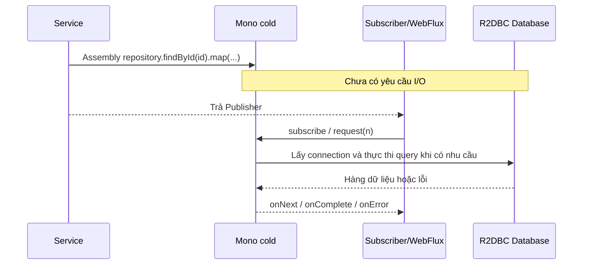

# Phân biệt thời điểm tạo Publisher với thời điểm truy vấn thực thi

## 1. Vấn đề trong luồng tích hợp dữ liệu reactive

Trong **Spring Boot Integration**, ứng dụng thường đọc cơ sở dữ liệu, gọi HTTP client, ghi kết quả và phát sự kiện tới broker. Với Spring Data R2DBC hoặc Reactive MongoDB, các thao tác này thường trả về **`Mono<T>`** hoặc **`Flux<T>`** của Project Reactor. Khác với lời gọi JDBC đồng bộ thông thường, việc nhận được một đối tượng `Mono`/`Flux` **chưa chứng minh câu truy vấn đã được gửi tới database**.

So sánh hai cách gọi:

```java
// JDBC: query thường thực thi ngay và chặn luồng gọi.
Order order = jdbcTemplate.queryForObject(sql, rowMapper, id);

// Spring Data R2DBC: repository thường tạo một Publisher cold.
Mono<Order> publisher = reactiveOrderRepository.findById(id);
```

Ở dòng thứ hai, Publisher mô tả **cách** lấy dữ liệu. Với Publisher *cold* thông thường, truy vấn chỉ được kích hoạt khi có **subscriber** đăng ký, và tiến trình phát dữ liệu được điều phối bởi nhu cầu nhận tín hiệu. Phân biệt hai thời điểm này giúp tránh các lỗi: tạo Publisher nhưng quên chạy, ghi cùng dữ liệu hai lần do subscribe lại, retry một thao tác có side effect, đo sai thời gian database và đặt transaction không đúng ranh giới.

**Giới hạn cần nhớ:** Không phải mọi Publisher đều cold; một số nguồn *hot* có thể phát dữ liệu độc lập với từng subscriber. Ngoài ra, code Java dùng để **tạo** Publisher vẫn có thể thực thi ngay một phần công việc, như kiểm tra đầu vào, tính tham số, ghi log hoặc gọi nhầm hàm blocking.

## 2. Ba thời điểm: assembly, subscription và phát tín hiệu

| Thời điểm | Điều thực sự xảy ra | Điều chưa thể suy ra |
| --- | --- | --- |
| **Assembly** (lắp ráp) | Java gọi các phương thức tạo Publisher, nối toán tử `map`, `flatMap`, `filter`, `doOnNext`, tính các tham số đầu vào. | Chưa đủ cơ sở để kết luận SQL đã thực thi. |
| **Subscription** (đăng ký) | Subscriber gắn vào chuỗi qua `subscribe`, nhận `Subscription` và thể hiện nhu cầu dữ liệu bằng `request(n)`. | Không đảm bảo SQL hoàn thành ngay khi subscribe. |
| **Signals** (tín hiệu) | Dữ liệu đi qua `onNext`; hoàn thành bằng `onComplete` hoặc lỗi bằng `onError`. | Không tự khẳng định các side effect ngoài DB đã commit nguyên tử. |



Sơ đồ mô tả đường đi thường gặp khi Spring Data trả Publisher cold. Việc lấy connection, chuẩn bị statement, gửi SQL và fetch hàng có thể diễn ra ở các thời điểm cụ thể khác nhau tùy driver R2DBC, connection pool, backpressure và transaction. Phát biểu “truy vấn chạy khi subscribe” nên được hiểu là **subscription kích hoạt chuỗi xử lý dẫn đến truy vấn**, không phải đồng hồ đo chính xác thời điểm database nhận SQL.

### 2.1. `subscribe()` không tự tạo luồng mới

`subscribe()` đăng ký subscriber, không mặc định sinh thread. `Mono.just(1)` có thể phát tín hiệu đồng bộ trên luồng gọi; R2DBC hay HTTP reactive thường hoàn thành bất đồng bộ theo I/O. Các toán tử `subscribeOn`/`publishOn` điều phối lịch thực thi và vị trí phát tín hiệu, nhưng không thay thế subscription và không tự biến một JDBC driver blocking thành non-blocking.

### 2.2. Ai là subscriber trong Spring Boot?

- Với **Spring WebFlux**, controller trả `Mono` hoặc `Flux`; runtime đăng ký để viết HTTP response.
- **StepVerifier** trong kiểm thử sẽ đăng ký Publisher và kiểm tra các tín hiệu.
- `block()`/`blockOptional()` cũng tạo subscription, rồi chờ kết quả đồng bộ. Chúng có thể kích hoạt truy vấn, nhưng không nên dùng trong event-loop WebFlux.
- Các điểm tích hợp khác có thể subscribe, ví dụ một thành phần điều phối luồng reactive hoặc adapter chuyên trách.

Trong service thông thường, nên **trả về Publisher cho caller** thay vì tự gọi `subscribe()` và bỏ qua kết quả. Tự subscribe trong service dễ gây fire-and-forget: HTTP đã phản hồi thành công trong khi việc ghi hoặc gửi sự kiện còn đang chạy, và lỗi không trở lại pipeline chính.

## 3. Minh họa chắc chắn bằng `Mono.defer`

`Mono.defer` nhận hàm tạo Publisher, và chỉ gọi hàm này khi có subscription:

```java
import java.util.concurrent.atomic.AtomicInteger;
import reactor.core.publisher.Mono;

AtomicInteger executions = new AtomicInteger();

Mono<String> query = Mono.defer(() -> {
    int count = executions.incrementAndGet();
    System.out.println("Đang chạy công việc lần " + count);
    return Mono.just("order-42");
});

System.out.println(executions.get()); // 0: mới tạo Publisher

query.block();  // Subscription 1: counter thành 1
query.block();  // Subscription 2: counter thành 2

System.out.println(executions.get()); // 2
```

Ví dụ trên không truy cập database nhưng biểu diễn chính xác hành vi lazy của hàm bên trong `defer`. Tạo biến `query` chưa làm `executions` tăng; mỗi subscription có thể chạy lại công việc. Tương tự, với truy vấn Spring Data R2DBC cold thông thường, **hai subscription có thể tạo hai lần truy vấn**.

Tuy nhiên, **lời gọi Java tạo Publisher** và **I/O mà Publisher mô tả** vẫn là hai thứ khác nhau. Một phương thức repository có thể thực hiện kiểm tra tham số hoặc ghi log lúc gọi; câu SQL thật chỉ được gửi ở phần xử lý có subscription/demand. Không nên phát biểu rằng “không dòng code nào chạy trước subscribe”.

## 4. Repository R2DBC: tạo truy vấn và nhận kết quả

Giả sử hệ thống tích hợp lưu đơn hàng trong bảng `orders` của PostgreSQL thông qua Spring Data R2DBC:

```java
import org.springframework.data.annotation.Id;
import org.springframework.data.relational.core.mapping.Table;
import org.springframework.data.repository.reactive.ReactiveCrudRepository;

@Table("orders")
record OrderEntity(@Id Long id, String status) {}

interface OrderRepository
        extends ReactiveCrudRepository<OrderEntity, Long> {
}
```

Service dùng repository rồi gắn operator quan sát:

```java
import org.slf4j.Logger;
import org.slf4j.LoggerFactory;
import org.springframework.stereotype.Service;
import reactor.core.publisher.Mono;

@Service
public class OrderQueryService {
    private static final Logger log =
            LoggerFactory.getLogger(OrderQueryService.class);

    private final OrderRepository repository;

    public OrderQueryService(OrderRepository repository) {
        this.repository = repository;
    }

    public Mono<OrderEntity> getById(long id) {
        log.info("Assembly query for order {}", id);
        return repository.findById(id)
                .doOnSubscribe(s ->
                        log.info("Subscribed to order query {}", id))
                .doOnNext(order ->
                        log.info("Received order {}", order.id()))
                .doOnError(error ->
                        log.warn("Order query {} failed", id, error));
    }
}
```

Khi gọi `getById(42L)`, log **assembly** được ghi ngay. Với nguồn R2DBC cold, log **subscribed** và các tín hiệu kết quả/lỗi chỉ xuất hiện khi Publisher được subscribe. Nhưng log `doOnSubscribe` **không đánh dấu chính xác lúc SQL đi tới DB**; có thể còn chờ connection từ pool. Dùng metrics/tracing ở lớp driver, pool hoặc database nếu cần đo thời gian query thực tế.

### 4.1. Ví dụ truy vấn với `DatabaseClient`

Với `DatabaseClient` của Spring R2DBC, chuỗi `sql(...).bind(...).map(...).one()` tạo Publisher truy vấn:

```java
import org.springframework.r2dbc.core.DatabaseClient;
import reactor.core.publisher.Mono;

record OrderRow(Long id, String status) {}

class OrderSqlGateway {
    private final DatabaseClient databaseClient;

    OrderSqlGateway(DatabaseClient databaseClient) {
        this.databaseClient = databaseClient;
    }

    Mono<OrderRow> findById(long id) {
        return databaseClient.sql(
                    "SELECT id, status FROM orders WHERE id = :id")
                .bind("id", id)
                .map((row, meta) -> new OrderRow(
                        row.get("id", Long.class),
                        row.get("status", String.class)))
                .one();
    }
}
```

Lời gọi `findById` tạo mô tả và publisher kết quả; việc lấy connection, gửi câu lệnh và nhận hàng xảy ra khi chuỗi được tiêu thụ. `one()` phát tối đa một bản ghi hoặc hoàn thành rỗng; logic ánh xạ chạy khi có dữ liệu từ database.

### 4.2. Controller WebFlux giữ pipeline bất đồng bộ

```java
import org.springframework.http.ResponseEntity;
import org.springframework.web.bind.annotation.GetMapping;
import org.springframework.web.bind.annotation.PathVariable;
import org.springframework.web.bind.annotation.RequestMapping;
import org.springframework.web.bind.annotation.RestController;
import reactor.core.publisher.Mono;

@RestController
@RequestMapping("/orders")
class OrderController {
    private final OrderQueryService service;

    OrderController(OrderQueryService service) {
        this.service = service;
    }

    @GetMapping("/{id}")
    Mono<ResponseEntity<OrderEntity>> get(@PathVariable long id) {
        return service.getById(id)
                .map(ResponseEntity::ok)
                .defaultIfEmpty(ResponseEntity.notFound().build());
    }
}
```

Controller trả Publisher diễn đạt hai nhánh: tìm được order thì trả `200`, không tìm được thì `404`. Nó chưa cần chặn thread để đợi query. WebFlux quản lý subscription trong vòng đời HTTP request; lỗi database đi qua `onError` và được bộ xử lý lỗi phù hợp nhận.

## 5. Gọi trực tiếp repository khác gì `Mono.defer`?

Hai cách sau **thường đều hoãn SQL** nếu repository trả Publisher cold:

```java
Mono<OrderEntity> direct = repository.findById(id);

Mono<OrderEntity> deferred =
        Mono.defer(() -> repository.findById(id));
```

Nhưng thời điểm **gọi phương thức Java** khác nhau:

| Cách viết | Lúc gọi `findById` | Lúc I/O cold thường khởi động |
| --- | --- | --- |
| `repository.findById(id)` | Ngay khi assembly | Khi Publisher đã được subscribe và có nhu cầu |
| `Mono.defer(() -> repository.findById(id))` | Mỗi khi có subscription | Khi Publisher mới được subscribe và có nhu cầu |
| `Mono.just(repository.findById(id))` | Ngay khi assembly | Tạo **`Mono<Mono<OrderEntity>>`**; subscription của outer Mono không tự chạy inner Mono |

Với một repository thuần reactive, cách gọi trực tiếp thường đã đủ lazy. `defer` hữu ích khi **chính việc tạo Publisher** phải được hoãn, ví dụ chọn đường truy vấn vào lúc subscribe, nạp tham số từ ngữ cảnh subscriber, hoặc đảm bảo fallback chỉ được dựng khi cần.

### 5.1. Giá trị tham số ở thời điểm assembly

```java
long selectedId = 42L;
Mono<OrderEntity> query = repository.findById(selectedId);

selectedId = 43L;
// Query đã được tạo với đối số 42.
```

Đừng dựa vào biến mutable dùng chung để thay đổi truy vấn của nhiều request: dễ gây race condition và trộn dữ liệu tenant. Khi cần tham số theo từng subscription, hãy đưa tham số qua pipeline một cách tường minh, hoặc dùng `Mono.deferContextual` để đọc **Reactor Context**.

### 5.2. `Mono.just` có thể vô tình thực thi I/O blocking quá sớm

```java
// SAI: phương thức JDBC chạy NGAY để tạo tham số cho Mono.just.
Mono<OrderDto> eager = Mono.just(blockingDao.loadOrder(42L));

// Trì hoãn lời gọi tới lúc subscription.
Mono<OrderDto> lazy = Mono.fromCallable(
        () -> blockingDao.loadOrder(42L));
```

`Mono.just(value)` nhận một giá trị đã được tính xong. `Mono.fromCallable` chỉ chạy hàm khi có subscription, nhưng **chưa làm thao tác blocking trở thành non-blocking**. Nếu bắt buộc tích hợp thư viện JDBC/SDK đồng bộ trong một ứng dụng WebFlux, có thể cách ly công việc blocking bằng scheduler riêng:

```java
import reactor.core.scheduler.Schedulers;

Mono<OrderDto> bridge = Mono.fromCallable(
        () -> blockingDao.loadOrder(42L))
        .subscribeOn(Schedulers.boundedElastic());
```

`boundedElastic` dùng pool thread có giới hạn để chạy blocking I/O, vẫn tiêu thụ thread và connection. Với truy vấn có thể dùng driver reactive thực thụ, ưu tiên Spring Data R2DBC hoặc API reactive tương ứng để tận dụng mô hình không chặn luồng.

## 6. Nhiều subscription có thể tạo nhiều truy vấn

Một Publisher cold **không phải** đối tượng kết quả đã được tải và dùng lại tự động:

```java
Mono<OrderEntity> source = repository.findById(42L);

Mono<OrderEntity> forBilling = source
        .doOnNext(order -> log.info("Billing sees {}", order.id()));

Mono<OrderEntity> forAudit = source
        .doOnNext(order -> log.info("Audit sees {}", order.id()));

// Nếu forBilling và forAudit được subscribe riêng,
// nguồn cold thông thường được kích hoạt hai lần.
```

Hai lần đọc có thể lấy **hai phiên bản dữ liệu khác nhau** nếu order thay đổi giữa hai subscription. Với publisher **ghi dữ liệu**, hai subscription có thể ghi hai lần. Trong tích hợp hệ thống, điều này liên quan trực tiếp đến xử lý trùng lặp, transaction và idempotency.

### 6.1. `retry` kích hoạt resubscription

```java
Mono<OrderEntity> retried = repository.findById(42L)
        .retry(2); // Ban đầu + tối đa hai subscription thử lại.
```

`retry(2)` chỉ minh họa cơ chế resubscribe; **không nên retry mọi exception trong production**. Cần phân biệt lỗi tạm thời với lỗi nghiệp vụ/SQL không thể phục hồi, đặt backoff và giới hạn thử lại. Với thao tác ghi, gọi HTTP POST hoặc publish thông điệp, việc thử lại có thể phát sinh side effect trùng nếu không có khóa idempotency hay quy trình hòa giải.

### 6.2. `cache` giúp tái dùng kết quả, đồng thời tạo rủi ro dữ liệu cũ

```java
Mono<OrderEntity> cached = repository.findById(42L).cache();

// Subscription đầu thường chạy query.
// Subscription sau nhận lại tín hiệu đã cache.
```

`Mono.cache()` lưu terminal signal, có thể gồm giá trị, hoàn thành rỗng hoặc lỗi tùy overload/chính sách TTL. Với Publisher sống lâu, cache vô hạn dễ gây stale data, giữ lỗi cũ, tốn bộ nhớ và lẫn dữ liệu giữa người dùng/tenant nếu sai phạm vi. Nếu cần cache nghiệp vụ, hãy thiết kế key, TTL, invalidation và quyền truy cập rõ ràng.

### 6.3. Cold, hot và Publisher được chia sẻ

Nguồn **cold** mô tả công việc gắn với mỗi subscription; nguồn **hot** có thể phát tín hiệu độc lập và người subscribe muộn có thể bỏ lỡ dữ liệu. Operator như `share` hoặc `publish().refCount(...)` có thể làm nhiều subscriber chia sẻ một subscription nguồn. Do đó không thể phát biểu “mọi lần subscribe luôn tạo SQL mới” khi chưa biết nguồn có cache/multicast hay không.

## 7. Ghép thao tác đọc/ghi: tạo Publisher không có nghĩa đã hoàn tất

Giả sử luồng nghiệp vụ phải cập nhật order rồi ghi bản ghi audit. Đoạn sau **chỉ tạo hai Publisher**:

```java
Mono<OrderEntity> saveOrder = orders.save(order);
Mono<AuditEvent> saveAudit = audits.save(auditEvent);
// Không có subscription hoặc pipeline bao ngoài,
// chưa đủ cơ sở để kết luận hai thao tác đã chạy.
```

Để thực thi theo thứ tự và truyền lỗi:

```java
public Mono<Void> saveOrderThenAudit(
        OrderEntity order, AuditEvent auditEvent) {
    return orders.save(order)
            .then(Mono.defer(() -> audits.save(auditEvent)))
            .then();
}
```

Giả định `orders` và `audits` là các repository reactive được inject vào service; `AuditEvent` là entity nghiệp vụ. `then(...)` đợi Publisher trước hoàn tất thành công mới subscribe bước tiếp theo. `Mono.defer` còn đảm bảo lời gọi tạo Publisher audit chỉ diễn ra khi cần. Nếu ghi order lỗi, bước audit không được thực thi. Tuy nhiên, **tuần tự không đồng nghĩa với transaction nguyên tử trên hai database hay hệ thống khác nhau**.

Đoạn code sau là lỗi phổ biến:

```java
public Mono<Void> unsafe(OrderEntity order) {
    orders.save(order); // Publisher bị bỏ qua.
    return Mono.empty(); // Caller thấy hoàn tất rỗng.
}
```

Tương tự, gọi `orders.save(order).subscribe()` rồi trả `Mono.empty()` làm công việc tách khỏi caller; lỗi, cancellation, tracing và transaction khó còn được điều phối đúng.

### 7.1. `map` khác `flatMap`

```java
Mono<String> status = orders.findById(42L)
        .map(OrderEntity::status);

Mono<AuditEvent> audit = orders.findById(42L)
        .flatMap(order ->
                audits.save(new AuditEvent(null, order.id(), "READ")));
```

`map` dùng cho biến đổi **đồng bộ từ T sang R**. Nếu lambda của `map` trả về `Mono<R>`, kết quả sẽ là `Mono<Mono<R>>`; luồng bên trong không tự được ghép để chạy. `flatMap` nối Publisher bên trong vào chuỗi chính. Với `Flux` nhiều phần tử, `flatMap` có thể chạy nhiều xử lý con đồng thời và thay đổi thứ tự tín hiệu; `concatMap` thích hợp khi cần giữ thứ tự, còn giới hạn concurrency giúp bảo vệ database/API/broker.

## 8. Reactive transaction bắt đầu theo subscription

Với **ReactiveTransactionManager** phù hợp, chẳng hạn `R2dbcTransactionManager`, transaction reactive gắn với **Reactor Context** trong dòng tín hiệu; tạo Publisher transactional chưa có nghĩa transaction đã bắt đầu tại dòng Java đó.

```java
import org.springframework.stereotype.Service;
import org.springframework.transaction.reactive.TransactionalOperator;
import reactor.core.publisher.Mono;

@Service
public class OrderWriteService {
    private final OrderRepository orders;
    private final TransactionalOperator tx;

    public OrderWriteService(OrderRepository orders,
                             TransactionalOperator tx) {
        this.orders = orders;
        this.tx = tx;
    }

    public Mono<OrderEntity> save(OrderEntity changed) {
        return orders.save(changed)
                .as(tx::transactional);
    }
}
```

`save` trả về một Publisher mô tả ghi dữ liệu trong transaction. Khi có subscription, transaction operator mới mở/điều phối transaction và subscribe nguồn; khi kết thúc thì commit hoặc rollback theo tín hiệu và chính sách áp dụng. Nếu cùng Publisher được subscribe hai lần, có thể phát sinh **hai lần ghi và hai transaction**.

Với `@Transactional` trên phương thức trả `Mono`/`Flux`, Spring dùng quản lý giao dịch reactive khi có manager phù hợp, và transaction gắn với subscription. Phương thức phải được gọi qua Spring proxy để advice có hiệu lực; tự gọi bằng `this.someTransactionalMethod()` có thể bỏ qua proxy.

Những giới hạn cần nhớ:

1. Reactive transaction không tự bao phủ `JdbcTemplate` hoặc JPA blocking nếu chúng dùng transaction manager khác.
2. Một transaction của database không làm cho HTTP request, Redis write hay publish Kafka/RabbitMQ trở nên nguyên tử cùng DB.
3. Vị trí `retryWhen` trong hoặc ngoài transaction có thể thay đổi phạm vi chạy lại và số transaction.
4. Nếu side effect đã xảy ra ở hệ thống ngoài rồi DB rollback, phải có idempotency, transactional outbox hoặc saga tùy yêu cầu nhất quán.

## 9. Lỗi và timeout: xuất hiện ở assembly hay ở signal?

Kiểm tra tham số dưới đây ném exception Java **ngay khi gọi phương thức**, trước khi có Publisher để subscribe:

```java
public Mono<OrderEntity> load(long id) {
    if (id <= 0) {
        throw new IllegalArgumentException("id phải dương");
    }
    return repository.findById(id)
            .onErrorMap(error ->
                    new IllegalStateException("Không đọc được order " + id, error));
}
```

Nếu muốn lỗi kiểm tra tham số được trả bằng **`onError` khi subscribe**, có thể viết:

```java
public Mono<OrderEntity> loadReactive(long id) {
    return Mono.defer(() -> {
        if (id <= 0) {
            return Mono.error(
                    new IllegalArgumentException("id phải dương"));
        }
        return repository.findById(id);
    });
}
```

Trong cách thứ hai, `onErrorResume` hoặc HTTP error handler xử lý lỗi trên pipeline. Điều này cũng đảm bảo các operator quan sát có thể thấy lỗi khi có subscription.

### 9.1. Timeout không chứng minh database chưa commit

```java
import java.time.Duration;

Mono<OrderEntity> query = repository.findById(42L)
        .timeout(Duration.ofSeconds(2));
```

`timeout` phát lỗi và cancel nguồn nếu quá thời hạn chờ tín hiệu theo cấu hình. Cancellation có thực sự dừng câu lệnh đang chạy trong database không còn phụ thuộc driver, DB và trạng thái kết nối. Với thao tác ghi, timeout ở ứng dụng **không chứng minh transaction tại server chắc chắn chưa commit**; cần idempotency và kiểm tra trạng thái trước khi thử lại.

`doFinally` có thể theo dõi hoàn tất, lỗi hoặc cancellation; `doOnError` ghi nhận lỗi nhưng không tự phục hồi. Nếu `onErrorResume` cung cấp fallback, cần phân biệt lỗi tạm thời và lỗi dữ liệu để tránh che giấu sự cố hạ tầng thành “không tìm thấy”.

### 9.2. Trì hoãn việc tạo Publisher fallback

```java
Mono<OrderEntity> resolved = primaryRepository.findById(42L)
        .switchIfEmpty(Mono.defer(() ->
                backupRepository.findById(42L)));
```

`switchIfEmpty` chỉ subscribe fallback khi nguồn đầu tiên hoàn thành rỗng. `Mono.defer` ở đây còn trì hoãn **lời gọi Java tạo Publisher backup**. Nếu backup repository cũng cold, việc tạo Publisher sớm chưa đồng nghĩa có SQL; khác biệt của `defer` là tránh side effect hoặc chi phí của chính thao tác tạo fallback lúc assembly.

## 10. Flux, backpressure và nhiều request cùng chạy

Với `Flux<OrderEntity>`, downstream yêu cầu số phần tử qua `request(n)`. Backpressure điều phối lượng tín hiệu đi qua các Publisher tuân thủ Reactive Streams, nhưng **không nên suy ra driver/database sẽ fetch chính xác n row qua mạng cho mỗi request**; cơ chế buffering và fetch phụ thuộc driver.

```java
Flux<OrderEntity> stream = repository.findAll()
        .doOnSubscribe(s -> log.info("Start stream"))
        .doOnRequest(n -> log.debug("Requested {} rows", n))
        .doOnNext(order -> log.debug("Received {}", order.id()));
```

Với nguồn cold chưa cache, mỗi subscription `findAll()` thường tạo một lượt đọc. Nếu HTTP client hủy request, WebFlux có thể cancel subscription, nhưng truy vấn đã thực hiện tới đâu phải kiểm tra theo driver/database. Khi xử lý nhiều bản ghi rồi gọi API ngoài bằng `flatMap`, cần giới hạn concurrency, timeout, retry và idempotency để bảo vệ tài nguyên phía sau.

## 11. Kiểm thử chứng minh lazy execution

Ví dụ kiểm thử không cần database dùng `AtomicInteger` và `StepVerifier`:

```java
import static org.junit.jupiter.api.Assertions.assertEquals;
import java.util.concurrent.atomic.AtomicInteger;
import org.junit.jupiter.api.Test;
import reactor.core.publisher.Mono;
import reactor.test.StepVerifier;

class LazyPublisherTest {
    @Test
    void runsWorkOnEachSubscription() {
        AtomicInteger executions = new AtomicInteger();

        Mono<String> query = Mono.defer(() -> {
            executions.incrementAndGet();
            return Mono.just("ok");
        });

        assertEquals(0, executions.get()); // Assembly

        StepVerifier.create(query)
                .expectNext("ok")
                .verifyComplete();
        assertEquals(1, executions.get());

        StepVerifier.create(query)
                .expectNext("ok")
                .verifyComplete();
        assertEquals(2, executions.get());
    }
}
```

`StepVerifier` nằm trong dependency `reactor-test` (thường ở test scope). Bài test trên chứng minh supplier chạy khi subscribe, không tự chứng minh R2DBC driver thực thi SQL lúc nào. Để xác minh query thật:

1. Khởi tạo PostgreSQL test riêng (ví dụ Testcontainers) và dữ liệu cố định.
2. Tạo `Mono` từ repository; dùng bộ đo SQL/driver thích hợp xác nhận chưa có truy vấn đọc tương ứng trước subscribe.
3. Dùng `StepVerifier` subscribe và kiểm tra dữ liệu, error, completion; đối chiếu log/metrics SQL.
4. Subscribe lần thứ hai khi chưa cache để quan sát lần truy vấn mới; thử với `cache()` để đối chiếu.
5. Kiểm tra retry, timeout và transaction đối với thao tác ghi; xác minh chống trùng lặp khi được subscribe lại.

Không nên kết luận thời điểm SQL bằng `Thread.sleep` rồi đoán: metric hoặc hook trong database/driver mới cho bằng chứng về I/O.

## 12. Sai lầm thường gặp

| Nhận định hoặc đoạn code sai | Hậu quả | Cách sửa |
| --- | --- | --- |
| “Gán biến `Mono` nghĩa là SQL đã chạy.” | Đo sai latency, bỏ sót thao tác hoặc nhầm transaction. | Phân biệt assembly, subscription và query execution. |
| `Mono.just(blockingDao.find(...))` | I/O blocking chạy ngay lúc assembly. | Dùng R2DBC hoặc `fromCallable` với scheduler phù hợp cho bridge. |
| Gọi `repository.save(entity)` rồi bỏ Publisher. | Công việc cold có thể không được thực hiện. | Trả Publisher hoặc nối bằng `flatMap`/`then`. |
| Tự `subscribe()` bên trong service rồi trả `Mono.empty()`. | Caller mất khả năng chờ thành công/lỗi và quản lý transaction. | Để subscriber có chủ đích ở boundary quản lý vòng đời. |
| `map` với lambda trả `Mono`. | Thành `Mono<Mono<T>>`, luồng trong chưa được ghép. | Dùng `flatMap` hoặc `concatMap`. |
| Nghĩ `subscribe()` luôn tạo thread. | Không phát hiện việc blocking trên event-loop. | Phân biệt subscription và scheduler. |
| Subscribe hai lần nhưng chỉ mong một truy vấn. | I/O và side effect có thể lặp. | Thiết kế lifecycle, chia sẻ/cache có kiểm soát. |
| Retry mọi lỗi của thao tác ghi. | Tạo trùng đơn hàng hoặc sự kiện. | Retry có điều kiện, backoff và idempotency. |
| Cho rằng `timeout` nghĩa là DB rollback. | Retry có thể ghi trùng dù transaction trước đã commit. | Kiểm tra trạng thái và hòa giải sau timeout. |
| Cache Publisher chứa dữ liệu của từng người dùng. | Có thể giữ dữ liệu cũ hoặc sai phạm vi tenant. | Cache theo key/TTL và quyền truy cập rõ ràng. |
| Dùng `doOnSubscribe` như timestamp SQL được gửi. | Metric query không chính xác. | Đo từ driver, pool hoặc database. |
| Dùng `@Transactional` reactive rồi gọi JDBC blocking. | Transaction không quản lý đúng tài nguyên. | Dùng manager/driver tương thích hoặc tách luồng imperative. |

## 13. Checklist cho luồng Spring Boot Integration

Trước khi vận hành một luồng đọc/ghi R2DBC kết hợp HTTP client, cache hoặc broker:

1. **Nguồn cold hay hot?** Có `cache`, `share`, multicast hoặc số subscriber bất ngờ không?
2. **Ai là subscriber?** WebFlux, adapter, test hay lệnh `block()`? Có Publisher nào được tạo rồi bỏ qua không?
3. **Code nào chạy tại assembly?** Kiểm tra đầu vào, tạo fallback, gọi blocking và tính tham số đã rõ thời điểm chưa?
4. **Các thao tác đã được nối thành pipeline?** Dùng `flatMap`/`then`/`concatMap` để chờ đúng thứ tự và truyền lỗi chưa?
5. **Có blocking I/O trên event-loop không?** Đã dùng R2DBC thực thụ hoặc cách ly legacy blocking an toàn chưa?
6. **Subscribe lại có gây side effect không?** Retry, timeout, hai subscriber và cache có được thiết kế cùng idempotency chưa?
7. **Transaction đặt đúng phạm vi chưa?** DB commit, HTTP call và publish message có giải pháp outbox hoặc hòa giải khi cần không?
8. **Giám sát đúng lớp chưa?** Phân biệt assembly log, subscriber log, connection wait, SQL execution và terminal signal.
9. **Đã kiểm thử hành vi lazy bằng test phù hợp chưa?** Test có chứng minh lúc subscribe và số lần query/ghi thực tế không?

**Điểm cần nhớ:** Tạo **Publisher** reactive thường chỉ lắp ráp mô tả công việc. Với truy vấn Spring Data reactive kiểu **cold**, **subscription và nhu cầu dữ liệu** mới kích hoạt chuỗi có khả năng thực thi I/O. Nhận biết ranh giới này giúp thiết kế transaction, retry, idempotency, xử lý lỗi và quan sát luồng tích hợp Spring Boot đúng với hành vi thực tế.
