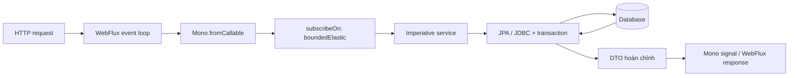
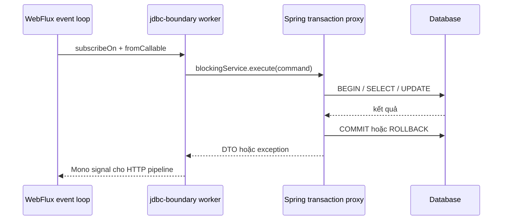
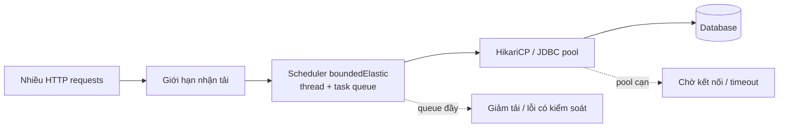

# Tích hợp JDBC hoặc JPA trong ứng dụng reactive tại ranh giới có kiểm soát

> **Chương:** Dữ liệu reactive  
> **Phạm vi module:** `SPRING_BOOT_INTEGRATION` — tổ chức tích hợp hệ thống trong Spring Boot qua HTTP client, cơ sở dữ liệu, cache, broker thông điệp và adapter của Spring Integration, với trọng tâm là cấu hình, hợp đồng dữ liệu, giao dịch, xử lý lỗi/trùng lặp, kiểm thử và khả năng quan sát.

Ứng dụng dùng Spring WebFlux và Reactor không bắt buộc phải thay ngay toàn bộ cơ sở dữ liệu sang R2DBC. Nhiều hệ thống vẫn có mô hình dữ liệu, thư viện nghiệp vụ hoặc transaction chạy trên JDBC/JPA. Có thể tiếp tục sử dụng những thành phần đó trong một ứng dụng trả về `Mono`/`Flux`, **nếu cô lập phần chặn luồng (blocking) tại một ranh giới rõ ràng**, đặt giới hạn tài nguyên và giữ transaction trong phần xử lý đồng bộ.

Điều cần phân biệt là: **API trả về `Mono` không làm cho JDBC/JPA trở thành non-blocking**. Một câu lệnh JDBC vẫn giữ một thread chờ database phản hồi. Để bảo vệ event loop, ta chuyển công việc đó sang scheduler dành cho tác vụ blocking, giới hạn số yêu cầu đồng thời và công khai ranh giới giữa hai mô hình.

## 1. Mục tiêu học tập

Sau bài học, bạn có thể:

1. Giải thích tại sao gọi JDBC/JPA trực tiếp trên WebFlux event loop gây suy giảm khả năng phục vụ đồng thời.
2. Dùng `Mono.fromCallable(...)` và `subscribeOn(...)` để chuyển một thao tác blocking sang `Schedulers.boundedElastic()` hoặc một scheduler riêng.
3. Giữ `@Transactional` và phiên làm việc JPA trong **một đoạn imperative chạy trên cùng worker thread**, trả về DTO đã được tạo hoàn chỉnh.
4. Đặt giới hạn ở scheduler, connection pool, số tác vụ đồng thời và thời gian chờ thực tế của driver/database.
5. Kiểm thử lỗi, rollback, cạnh tranh tài nguyên, timeout và việc không chặn event loop.
6. Biết khi nào giải pháp cầu nối JDBC/JPA là hợp lý và khi nào nên cân nhắc R2DBC hoặc một dịch vụ riêng.

## 2. Blocking và non-blocking khác nhau ở đâu?

Trong HTTP server reactive như WebFlux trên Reactor Netty, một số ít event-loop thread chịu trách nhiệm xử lý sự kiện I/O cho nhiều kết nối. Khi một event-loop thread đi vào `repository.findById(...)`, lời gọi JDBC thường phải **đợi đồng bộ** cho tới khi nhận kết quả từ database. Trong thời gian đó thread không xử lý được các sự kiện khác mà nó phụ trách.

Việc biến kết quả thành `Mono` sau khi truy vấn xong không thay đổi thời gian đã bị chặn:

```java
// SAI: truy vấn JDBC/JPA đã chạy trước khi Mono được tạo.
Mono<OrderDto> find(Long id) {
    OrderDto dto = blockingOrderReader.find(id);
    return Mono.just(dto);
}
```

Tương tự, `Mono.defer(() -> Mono.just(blockingOrderReader.find(id)))` có trì hoãn thời điểm gọi tới lúc subscription, nhưng **vẫn chặn thread thực thi subscription** nếu không có ranh giới scheduler thích hợp. Đây là vấn đề về *nơi thực thi*, không đơn thuần là *thời điểm thực thi*.

Luồng mong muốn:



Đường từ `boundedElastic` tới database vẫn blocking; lợi ích là **event loop được giải phóng** để xử lý các kết nối khác. Không có lời hứa rằng toàn ứng dụng đã non-blocking từ đầu đến cuối. Thread phát tín hiệu `Mono` sau khi hoàn tất có thể là worker; việc ghi socket vẫn do runtime xử lý theo cơ chế I/O của nó.

| Thành phần | Đặc tính | Cách dùng trong ứng dụng reactive |
|---|---|---|
| JDBC / Spring JDBC / `JdbcTemplate` | Truy vấn và lấy kết quả theo API blocking | Gọi bên trong callable có scheduler dành cho blocking. |
| Spring Data JPA / Hibernate | ORM đồng bộ, persistence context gắn với transaction/thread | Giữ toàn bộ truy cập entity và ánh xạ DTO trong imperative service có transaction. |
| R2DBC | Driver và API truy cập database theo mô hình reactive nếu driver hỗ trợ | Sử dụng publisher và `ReactiveTransactionManager`; tránh ép về JDBC khi không cần. |
| Reactor `Mono` / `Flux` | Biểu diễn luồng kết quả và tín hiệu bất đồng bộ | Không tự chuyển blocking call sang worker. |
| `Schedulers.boundedElastic()` | Scheduler có giới hạn phục vụ công việc có thể blocking | Cô lập công việc JDBC/JPA; theo dõi tải và không coi queue là vô hạn. |

## 3. Khi nào nên giữ JDBC/JPA?

Một cầu nối blocking có giới hạn thường hữu ích khi:

- Hệ thống đã có repository JPA, transaction và logic nghiệp vụ ổn định; đang chuyển dần lớp HTTP sang WebFlux.
- Cần một thư viện chỉ hỗ trợ JDBC, một câu truy vấn quản trị hiếm khi chạy hoặc một vài tác vụ dữ liệu có thời gian thực thi dự đoán được.
- Cơ sở dữ liệu/driver và yêu cầu nghiệp vụ chưa có lộ trình R2DBC phù hợp; việc thay ORM có chi phí lớn so với lợi ích kỳ vọng.

Cần đánh giá lại nếu hầu hết request đều phụ thuộc vào nhiều truy vấn blocking, lưu lượng cao khiến scheduler/connection pool luôn đầy, hoặc các thao tác database liên tục được ghép với nhiều bước reactive. Khi đó phương án khả thi có thể là giữ một service MVC/JPA độc lập, tái cấu trúc ranh giới dịch vụ, hoặc chuyển phần dữ liệu thực sự thích hợp sang R2DBC. Lựa chọn phải dựa vào throughput, latency, giao dịch, thư viện hiện có và khả năng vận hành; không mặc định R2DBC nhanh hơn trong mọi bài toán.

## 4. Thiết kế một ranh giới imperative rõ ràng

Ví dụ: API `GET /orders/{id}` trả `Mono<OrderDto>`; dữ liệu đơn hàng được lưu trong PostgreSQL qua Spring Data JPA. Các dependency minh họa gồm `spring-boot-starter-webflux`, `spring-boot-starter-data-jpa` và JDBC driver tương ứng với database. Cấu hình `spring.datasource.*`, JPA mapping và schema cần được thiết lập theo ứng dụng thực tế.

### 4.1. Đặt transaction trong service đồng bộ

Đây là phần **imperative**. Cả truy vấn, truy cập field trên entity và tạo DTO nằm trong thời gian transaction còn hiệu lực:

```java
import java.math.BigDecimal;
import org.springframework.data.jpa.repository.JpaRepository;
import org.springframework.http.HttpStatus;
import org.springframework.stereotype.Service;
import org.springframework.transaction.annotation.Transactional;
import org.springframework.web.bind.annotation.ResponseStatus;

record OrderDto(Long id, String status, BigDecimal total) {}

// Giả sử OrderEntity đã được ánh xạ @Entity vào bảng orders.
interface OrderRepository extends JpaRepository<OrderEntity, Long> {}

@ResponseStatus(HttpStatus.NOT_FOUND)
class OrderNotFoundException extends RuntimeException {
    OrderNotFoundException(Long id) {
        super("Order not found: " + id);
    }
}

@Service
class BlockingOrderReader {
    private final OrderRepository orders;

    BlockingOrderReader(OrderRepository orders) {
        this.orders = orders;
    }

    @Transactional(readOnly = true)
    public OrderDto find(Long id) {
        OrderEntity order = orders.findById(id)
            .orElseThrow(() -> new OrderNotFoundException(id));

        // Truy cập field và tạo DTO ngay trong transaction.
        return new OrderDto(order.getId(), order.getStatus(), order.getTotal());
    }
}
```

`OrderEntity` và các getter trong ví dụ là thành phần của mô hình JPA sẵn có; cần thay theo schema thực tế. Định nghĩa `@Transactional` ở public method của Spring bean được gọi qua proxy Spring. **Không** chuyển method này thành `Mono<OrderDto>` chỉ để có kiểu trả về reactive: với `JpaTransactionManager`, cần transaction bao quanh *lúc JDBC thực thi*, chứ không phải lúc publisher mới được tạo.

Đặc biệt tránh trả `OrderEntity`, `Stream<OrderEntity>` hoặc proxy lazy-loading ra ngoài service. Sau khi transaction và persistence context đóng, việc đọc association `LAZY` có thể thất bại (`LazyInitializationException`) hoặc vô tình kích hoạt truy vấn ở thread khác. Nếu DTO cần quan hệ liên kết, fetch dữ liệu một cách có chủ đích bằng projection, join hoặc query phù hợp khi vẫn còn transaction.

### 4.2. Cô lập truy vấn trong scheduler riêng

Ứng dụng có thể dùng scheduler dùng chung `Schedulers.boundedElastic()` cho công việc blocking mức vừa phải. Với workload JDBC/JPA quan trọng, một scheduler riêng giúp đặt giới hạn và theo dõi rõ phần tải này:

```java
import org.springframework.context.annotation.Bean;
import org.springframework.context.annotation.Configuration;
import reactor.core.scheduler.Scheduler;
import reactor.core.scheduler.Schedulers;

@Configuration(proxyBeanMethods = false)
class JdbcBoundaryConfig {
    @Bean(destroyMethod = "dispose")
    Scheduler jdbcScheduler() {
        // Giới hạn số backing thread và số task chờ mỗi backing thread.
        return Schedulers.newBoundedElastic(12, 100, "jdbc-boundary");
    }
}
```

`12` và `100` chỉ là thông số **minh họa**, không phải cấu hình tối ưu cho mọi hệ thống. `newBoundedElastic(threadCap, queuedTaskCap, name)` giới hạn số backing thread và số tác vụ được xếp hàng *trên mỗi backing thread*. Phải chọn dựa trên connection pool, độ trễ SQL, tỷ lệ tải và các công việc blocking khác; scheduler quá nhiều thread có thể khiến database nghẽn nặng hơn. Khi scheduler hết sức chứa, việc lập lịch có thể bị từ chối; hệ thống cần trả lỗi có kiểm soát, giảm tải hoặc giới hạn request từ sớm.

### 4.3. Bridge từ endpoint reactive

Lúc tạo publisher, không gọi database. Khi subscriber đăng ký, callable mới được thực thi trên scheduler được chỉ định:

```java
import org.springframework.beans.factory.annotation.Qualifier;
import org.springframework.web.bind.annotation.GetMapping;
import org.springframework.web.bind.annotation.PathVariable;
import org.springframework.web.bind.annotation.RestController;
import reactor.core.publisher.Mono;
import reactor.core.scheduler.Scheduler;

@RestController
class OrderController {
    private final BlockingOrderReader reader;
    private final Scheduler jdbcScheduler;

    OrderController(BlockingOrderReader reader,
                    @Qualifier("jdbcScheduler") Scheduler jdbcScheduler) {
        this.reader = reader;
        this.jdbcScheduler = jdbcScheduler;
    }

    @GetMapping("/orders/{id}")
    Mono<OrderDto> get(@PathVariable Long id) {
        return Mono.fromCallable(() -> reader.find(id))
                   .subscribeOn(jdbcScheduler);
    }
}
```

`Mono.fromCallable(...)` đưa kết quả hoặc exception của lời gọi đồng bộ vào publisher; `subscribeOn(...)` chuyển việc subscription và thực thi nguồn callable sang worker. Cách viết này giữ service JPA đồng bộ và transaction gói trọn trong một lần gọi. Các mapper thuần CPU hoặc pipeline ở phía reactive có thể chạy tiếp trên scheduler khác nếu thực sự cần, nhưng **không thêm `publishOn` tùy tiện**: mỗi lần chuyển thread đều có chi phí.

Lưu ý: nếu callable trả `null`, `Mono.fromCallable` hoàn tất mà không phát giá trị. Với một API tìm đơn hàng, hãy xử lý trường hợp thiếu dữ liệu bằng exception nghiệp vụ như ví dụ, hoặc `switchIfEmpty` có chủ đích để không vô tình biến thiếu bản ghi thành response rỗng khó hiểu.

## 5. Giữ transaction đúng ranh giới

Với JPA/JDBC và `PlatformTransactionManager` như `JpaTransactionManager` hoặc `DataSourceTransactionManager`, Spring thường quản lý transaction theo **thread hiện tại**. Nếu phần nghiệp vụ bị tách qua nhiều reactive operator hoặc thread khác nhau, transaction cục bộ không tự lan truyền theo Reactor Context.



Sơ đồ diễn tả chuyển giao *logic* về pipeline phản hồi; tín hiệu Reactor thực tế không bắt buộc quay về đúng event-loop thread ban đầu.

### 5.1. Ghi dữ liệu và outbox trong cùng transaction

Khi ứng dụng reactive nhận yêu cầu tạo đơn, có thể sử dụng lại một service JPA đồng bộ để lưu đơn và bản ghi outbox trong **cùng một transaction**:

```java
@Service
class BlockingOrderWriter {
    private final OrderRepository orders;
    private final OutboxRepository outbox;

    BlockingOrderWriter(OrderRepository orders, OutboxRepository outbox) {
        this.orders = orders;
        this.outbox = outbox;
    }

    @Transactional
    public OrderReceipt create(CreateOrder command) {
        OrderEntity order = orders.save(OrderEntity.from(command));
        outbox.save(OutboxEvent.orderCreated(order.getId(), command.requestId()));
        return new OrderReceipt(order.getId());
    }
}

// Trong WebFlux handler/controller:
Mono<OrderReceipt> result = Mono.fromCallable(() -> writer.create(command))
                                .subscribeOn(jdbcScheduler);
```

Các kiểu `CreateOrder`, `OrderReceipt`, `OutboxRepository` và factory trong đoạn này là **mã minh họa nghiệp vụ**, cần khai báo dựa trên schema của dự án. Khối `@Transactional` chỉ bao phủ hai thao tác DB cùng transaction manager; event broker sẽ được publisher khác gửi từ outbox sau khi commit. Không gọi HTTP hoặc publish message trực tiếp rồi tin rằng rollback của JPA có thể đảo ngược tác dụng phụ bên ngoài.

Muốn chống tạo trùng khi client thử lại một lệnh ghi, cần một `requestId`/idempotency key ổn định và ràng buộc unique ở DB, cùng logic xử lý tranh chấp, trả lại kết quả đã được lưu. `@Transactional` tự nó **không** bảo đảm idempotency. Publisher outbox và consumer có thể chạy lại; tiếp tục cần định danh event và kiểm soát trùng ở ranh giới messaging.

### 5.2. Những cách làm sai với transaction

```java
// SAI: @Transactional áp vào method trả Mono nhưng JDBC chạy sau đó.
@Transactional
public Mono<OrderDto> findLater(Long id) {
    return Mono.fromCallable(() -> repository.findById(id)
        .map(this::toDto)
        .orElseThrow());
}

// SAI: đọc JPA entity trong transaction rồi để reactive pipeline
// tiếp tục truy cập lazy association ở một thời điểm/thread khác.
Mono<OrderEntity> entity = Mono.fromCallable(() -> reader.loadEntity(id))
                               .subscribeOn(jdbcScheduler);
```

Trong trường hợp đầu, transaction theo thread thường kết thúc khi method trả về publisher, **trước khi subscriber thực hiện callable**. Với trường hợp sau, JPA entity và lazy state rời khỏi ranh giới sở hữu tài nguyên. Thay bằng một method imperative hoàn chỉnh trả DTO, rồi bọc **lời gọi method đó** bằng `Mono.fromCallable(...)`.

Nếu sử dụng `TransactionTemplate` thay cho `@Transactional`, đặt `transactionTemplate.execute(...)` *bên trong* callable và thực hiện toàn bộ bước JDBC trong callback transaction. Tránh self-invocation kiểu `this.methodAnnotatedTransactional()` vì lời gọi nội bộ cùng bean thường bỏ qua proxy và không kích hoạt transaction như mong đợi.

## 6. Kiểm soát tài nguyên: scheduler, pool, concurrency

Offload giải quyết việc **đặt lời gọi blocking lên thread phù hợp**. Để hệ thống ổn định dưới tải, phải kiểm soát thêm số tác vụ được phép xếp hàng và số kết nối database.



| Giới hạn | Ý nghĩa | Dấu hiệu cần quan sát |
|---|---|---|
| Scheduler thread cap | Số tác vụ blocking có thể chiếm backing thread cùng lúc trong scheduler này | Thread bận liên tục, chờ trong queue, độ trễ tăng. |
| Scheduler task queue | Số tác vụ chờ lập lịch trước khi bị từ chối | Lượng task chờ, lỗi từ chối lập lịch. |
| JDBC connection pool | Số connection DB đang được cấp và thời gian chờ lấy connection | Active/idle/pending connections, connection acquisition timeout. |
| DB capacity | Số truy vấn, lock, CPU và I/O database chịu được | Slow query, deadlock, transaction kéo dài. |
| Concurrency của pipeline | Số lời gọi blocking được khởi động từ một chuỗi `Flux` | In-flight requests, pending tasks, thời gian cuối đuôi (p95/p99). |

Không tăng thread cap chỉ vì độ trễ tăng: nếu pool có 10 connection nhưng scheduler chạy 100 truy vấn cùng lúc, phần lớn thread có thể chỉ ngồi chờ connection, làm tăng hàng đợi và bộ nhớ. Với nhiều endpoint và nhiều instance, tổng tải lên DB còn lớn hơn mức giới hạn của một scheduler. Cần đo ở tải thực tế, phân bổ ngân sách tài nguyên và có cơ chế hạn chế/loại bỏ tải khi quá ngưỡng.

Ví dụ xử lý danh sách ID có độ đồng thời tối đa trong **một subscription**:

```java
Flux<OrderDto> orders = Flux.fromIterable(orderIds)
    .flatMap(id -> Mono.fromCallable(() -> reader.find(id))
                       .subscribeOn(jdbcScheduler),
             8); // Tối đa 8 tác vụ con đang được flatMap theo dõi.
```

`flatMap(..., 8)` không giới hạn tổng request đến từ mọi người dùng; cần thêm scheduler cap, chính sách admission/rate limit và cấu hình connection pool. Nếu nghiệp vụ cần giữ thứ tự đầu vào, cân nhắc `flatMapSequential` hoặc `concatMap` và chấp nhận đánh đổi throughput.

Lưu ý quan trọng: không dùng `Schedulers.parallel()` cho tác vụ JDBC/JPA. Scheduler đó phục vụ công việc CPU, không phải chờ I/O blocking. Không dùng `block()`, `blockFirst()` hoặc `blockLast()` trên event loop để “lấy nhanh kết quả”; chúng vừa phá tính reactive vừa có thể gây lỗi tại runtime.

## 7. Timeout, hủy subscription và xử lý lỗi

Một API WebFlux có thể dùng timeout để giới hạn thời gian **đợi kết quả ở phía reactive**:

```java
Mono<OrderDto> response = Mono.fromCallable(() -> reader.find(id))
    .subscribeOn(jdbcScheduler)
    .timeout(Duration.ofSeconds(3));
```

`Mono.timeout(...)` giúp caller không phải chờ vô hạn, nhưng **không bảo đảm câu SQL/JDBC đang chạy đã dừng ngay**. Khi timeout hoặc client ngắt kết nối, cancellation/interrupt có thể không được driver, database hoặc thư viện JPA thực thi tức thì. Worker/connection có thể tiếp tục bị giữ sau khi HTTP response đã thất bại. Vì vậy cần nhiều lớp thời hạn phù hợp:

- **Connection acquisition timeout** ở pool: giới hạn thời gian chờ lấy connection.
- **Connection/read/network timeout** ở JDBC driver: giới hạn khả năng chờ do kết nối hoặc mạng lỗi, theo đúng tính năng driver đang dùng.
- **Query/statement timeout** ở JPA/JDBC hoặc database: giới hạn truy vấn kéo dài; kiểm tra hiệu lực thực tế với driver và DB.
- **Transaction timeout** nếu có chính sách tương ứng: không thay thế statement timeout của driver ở mọi tình huống.
- **Reactive request deadline**: giới hạn thời gian client chờ và kết thúc response có kiểm soát.

Phải chọn các giới hạn phối hợp, vì chỉ đặt timeout ở lớp ngoài có thể khiến hệ thống tích lũy hàng trăm tác vụ JDBC đang chạy ngầm. Với thao tác ghi, khi HTTP timeout, **không suy ra DB đã rollback**: commit có thể đã xảy ra nhưng response mất. Client retry cần idempotency key và endpoint truy vấn trạng thái hoặc quy trình đối soát.

| Lỗi | Hướng xử lý |
|---|---|
| Không tìm thấy bản ghi | Mapping thành 404 hoặc kết quả miền nghiệp vụ rõ ràng; không retry. |
| Vi phạm unique constraint | Xác định có phải yêu cầu trùng idempotency key; tránh chuyển mọi conflict thành retry. |
| Truy vấn timeout hoặc DB unavailable | Giảm tải, cảnh báo, retry hữu hạn với backoff nếu thao tác và ngữ cảnh cho phép. |
| Scheduler/connection pool bão hòa | Từ chối tải sớm theo chính sách dịch vụ, đo queue/pool; không xếp hàng vô hạn. |
| Deadlock/serialization failure | Cân nhắc retry **cả transaction** khi nghiệp vụ bảo đảm an toàn; tránh retry nửa chừng. |
| Client hủy request sau thao tác ghi | Kiểm tra trạng thái đã commit qua ID ổn định và cơ chế đối soát. |

Nếu áp dụng retry của Reactor (`retryWhen`), mỗi subscription lại thực thi callable và transaction thêm lần nữa. Vì vậy chỉ bật retry khi đã hiểu mã lỗi, tính idempotent và tổng ngân sách thời gian. Đừng để retry và hàng đợi cùng lúc nhân tải tới database. Những nguyên tắc này cũng áp dụng khi tích hợp cache, HTTP client hoặc broker ở các bước sau, vì mỗi ranh giới mạng có thể thất bại độc lập.

## 8. Context, bảo mật và khả năng quan sát

Reactor Context khác với `ThreadLocal`. Thông tin như transaction JDBC, MDC log hoặc một số security context của thư viện imperative không nhất thiết tự xuất hiện trên scheduler worker. Đừng dựa vào việc thread được tái sử dụng để suy ra `ThreadLocal` vẫn có giá trị của request hiện tại.

- Truyền các trường nghiệp vụ bắt buộc (tenant ID, request ID, actor ID) vào tham số của imperative service sau khi xác thực/ủy quyền ở lớp thích hợp; không dựa vào biến tĩnh hoặc `ThreadLocal` tùy ý.
- Với Spring Security reactive và logging/tracing, dùng cơ chế context propagation được stack hiện hành hỗ trợ và kiểm thử đường chuyển scheduler. Không gán ngầm rằng toàn bộ MDC/SecurityContext sẽ tự chuyển đúng.
- Không đưa password, access token, dữ liệu cá nhân nhạy cảm hoặc payload đầy đủ vào log. Truy vết bằng correlation/trace ID và ID nghiệp vụ khi chính sách cho phép.
- Tránh mở `EntityManager` hoặc transaction trong event loop rồi truyền sang worker; để Spring tạo, sử dụng và đóng transaction **bên trong** lời gọi imperative.

Những tín hiệu vận hành nên có trong một luồng `WebFlux → boundedElastic → JPA → database`:

| Tín hiệu | Câu hỏi vận hành |
|---|---|
| Thời gian API p50/p95/p99, số request đang xử lý | API chậm vì khối lượng request hay vì database? |
| Scheduler active/queued tasks và lỗi từ chối, nếu có instrumentation | Bao nhiêu việc JDBC đang bị xếp hàng? |
| HikariCP active/idle/pending, timeout lấy connection | Pool có cạn không và đã cạn bao lâu? |
| DB slow queries, locks, transaction duration | Truy vấn nào đang giữ connection quá lâu? |
| Số lần retry, lỗi theo nhóm, request timeout | Lỗi tạm thời có trở thành retry storm không? |
| Trace ID và order ID qua HTTP, service, database, outbox/broker | Có thể xác định bước gây chậm hoặc lỗi của một đơn hàng không? |

Spring Boot Actuator, Micrometer và instrumentation phù hợp hỗ trợ thu thập các tín hiệu này. Mức metric scheduler cụ thể tùy cấu hình và phiên bản Reactor/Micrometer; cần bật instrumentation tương ứng và xác nhận metric thực sự xuất hiện trước khi thiết lập alert. Theo dõi cả giới hạn database và các instance đang sử dụng chung database.

## 9. Kiểm thử ranh giới JDBC/JPA trong WebFlux

Kiểm thử chỉ xác nhận endpoint trả JSON đúng là chưa đủ. Mục tiêu của ranh giới là bảo vệ event loop, bảo toàn transaction và hoạt động dự đoán được dưới lỗi/tải:

| Nhóm kiểm thử | Kịch bản tối thiểu | Điều cần khẳng định |
|---|---|---|
| Mapping và hợp đồng | Có đơn hàng / không có ID | DTO đầy đủ, 404 rõ ràng, không có lazy proxy thoát khỏi service. |
| Transaction | Ghi order thành công nhưng ghi outbox lỗi | Cả hai thao tác DB rollback khi thực sự thuộc cùng transaction. |
| Chuyển scheduler | Truy vấn chạy chậm có chủ đích | Phần JDBC chạy trên worker phù hợp, không chặn event-loop thread. |
| Giới hạn tải | Nhiều request đồng thời, pool nhỏ | Tốc độ/queue có giới hạn, hệ thống phản hồi hoặc từ chối tải có kiểm soát. |
| Timeout/cancellation | DB chậm hơn request deadline | HTTP kết thúc đúng thời hạn; đo tiếp tác vụ DB còn chạy và cách tài nguyên được giải phóng. |
| Idempotency | Gửi lại lệnh tạo đơn sau khi mất phản hồi | Không tạo đơn/outbox nghiệp vụ trùng khi có cùng khóa được hỗ trợ. |
| Quan sát | Query lỗi hoặc pending connection tăng | Có metric/log/trace đủ để điều tra. |

Nên dùng database thật trong integration test, ví dụ Testcontainers với PostgreSQL, khi cần xác minh transaction, constraint, locking và driver timeout. Có thể dùng `WebTestClient` để kiểm tra hợp đồng HTTP; `StepVerifier` để kiểm tra publisher; fake repository để kiểm tra nhánh domain nhanh. Những test với repository giả **không chứng minh** được tính chất blocking/transaction/locking của JDBC thực.

Một bài test tích hợp có thể cho query thật chậm một cách có kiểm soát, gửi nhiều request cạnh tranh, rồi xem log thread hoặc trace để xác định blocking code đã được offload. Nếu dùng BlockHound, cần kiểm tra tương thích với JDK/Reactor đang chạy và cấu hình đúng; đây là công cụ phát hiện một số blocking call trên non-blocking thread, không thay thế test với database và đo latency dưới tải.

## 10. Những lỗi triển khai dễ gặp

| Cách làm | Hậu quả | Cách sửa |
|---|---|---|
| `Mono.just(repository.findById(id))` | Blocking xảy ra ngay khi tạo `Mono`. | Đóng gói lời gọi vào `Mono.fromCallable`, sau đó `subscribeOn` scheduler phù hợp. |
| `Mono.fromCallable(...).publishOn(boundedElastic())` | `publishOn` sau nguồn không di chuyển phần callable đã chạy trước nó. | Dùng `subscribeOn` cho nguồn callable. |
| `.block()` trong controller WebFlux | Chặn thread xử lý request; có thể gây lỗi và tụt throughput. | Trả `Mono`/`Flux` để framework subscribe. |
| `@Transactional` trực tiếp quanh method trả `Mono` nhưng dùng JPA | Transaction imperative có thể đóng trước khi publisher thực thi. | Đặt `@Transactional` trên method đồng bộ được gọi bên trong callable. |
| Trả entity JPA ra pipeline reactive | Lazy loading khi persistence context đóng, rủi ro truy cập khác thread. | Tạo DTO hoàn chỉnh trong service transaction. |
| Dùng `Schedulers.parallel()` hoặc thread pool vô hạn cho JDBC | Chặn thread CPU hoặc làm nổ số kết nối/tác vụ chờ. | Dùng boundedElastic có giới hạn, đặt thêm admission control. |
| Chỉ dùng `Mono.timeout` | HTTP hết hạn nhưng SQL vẫn có thể chiếm thread/connection. | Phối hợp timeout của driver, query, pool, transaction, request. |
| Retry mọi lỗi, kể cả ghi dữ liệu | Tăng tải và tạo tác dụng phụ trùng. | Phân loại lỗi; retry giới hạn và thiết kế idempotency. |

## 11. Bài thực hành tổng hợp

Hãy mở rộng một ứng dụng Spring Boot có WebFlux và Spring Data JPA đang dùng database thực:

1. Tạo `GET /orders/{id}` trả `Mono<OrderDto>`; gọi JPA trong một method `@Transactional(readOnly = true)` đồng bộ và offload ở controller/adapter.
2. Tạo `POST /orders` dùng service imperative với transaction lưu order và outbox, gắn request ID ổn định để chuẩn bị cho retry.
3. Cấu hình scheduler riêng có số backing thread hữu hạn và pool JDBC hữu hạn. Kiểm tra tăng tải vừa phải để thấy điểm bão hòa.
4. Làm query chậm hoặc tạm ngắt DB, thử cả timeout ở phía reactive và timeout/query deadline ở driver/DB. Quan sát thread và connection có được giải phóng hay không.
5. Mô phỏng request ghi bị timeout sau commit; gửi lại cùng idempotency key và xác minh không sinh thêm đơn hàng logic.
6. Viết integration test cho rollback, unique constraint và metric cơ bản; ghi lại p95/p99 latency, pool pending và số request thất bại.

**Điều kiện nghiệm thu:** Các lời gọi JDBC/JPA chỉ xảy ra trong boundary đã chỉ định; transaction bao phủ đúng phần DB đồng bộ; DTO không mang lazy entity ra ngoài; hệ thống có giới hạn tải và deadline ở cả HTTP/DB; retry không làm nhân tác dụng phụ; có bằng chứng kiểm thử/metric cho tải và lỗi.

## 12. Câu hỏi tự đánh giá

**1. `Mono.fromCallable(() -> repository.findAll())` đã an toàn trên WebFlux chưa?**  
Chưa đủ. Nó chỉ trì hoãn việc gọi; cần `subscribeOn` scheduler thích hợp nếu có thể được subscribe trên non-blocking thread, và vẫn phải giới hạn kết quả/truy vấn.

**2. Vì sao không gắn `@Transactional` lên một method trả `Mono` rồi đặt câu lệnh JPA trong `map`?**  
Transaction manager imperative thường gắn với thread và thời điểm invocation, còn `map` thực thi khi subscribe, có thể ở thời điểm hoặc thread khác. Bọc **toàn bộ lời gọi service đồng bộ có transaction** trong callable được offload.

**3. Client ngắt kết nối sau 2 giây có đảm bảo `INSERT` trong database bị hủy không?**  
Không. Reactive cancellation không bảo đảm hủy ngay câu lệnh blocking hoặc rollback nếu transaction đã commit. Cần timeout ở driver/database và cơ chế xác định trạng thái/idempotency cho lệnh ghi.

**4. Scheduler có 50 thread nhưng pool chỉ có 10 connection thì chuyện gì có thể xảy ra?**  
Nhiều worker chỉ chờ lấy connection, kéo dài latency và làm queue đầy. Đặt các giới hạn có liên hệ với nhau và kiểm thử bằng workload thực.

**5. Khi nào chọn R2DBC?**  
Khi yêu cầu vận hành và mô hình dữ liệu hưởng lợi từ I/O reactive xuyên suốt, driver/hệ sinh thái hỗ trợ và đội ngũ có thể quản lý `ReactiveTransactionManager`, pipeline cũng như các khác biệt với JPA. Nếu phần lớn logic đang dựa trên JPA và không có nút thắt tài nguyên rõ rệt, cầu nối có giới hạn có thể là bước chuyển đổi phù hợp.

Điểm cốt lõi khi tích hợp JDBC/JPA vào một ứng dụng reactive là **làm rõ nơi công việc blocking được thực thi, nơi transaction bắt đầu/kết thúc và giới hạn tài nguyên ở từng lớp**. Một boundary được kiểm thử và quan sát tốt cho phép tận dụng mã dữ liệu hiện có trong Spring Boot, đồng thời duy trì khả năng đáp ứng của WebFlux và cơ sở để xây dựng những luồng tích hợp đáng tin cậy hơn.
