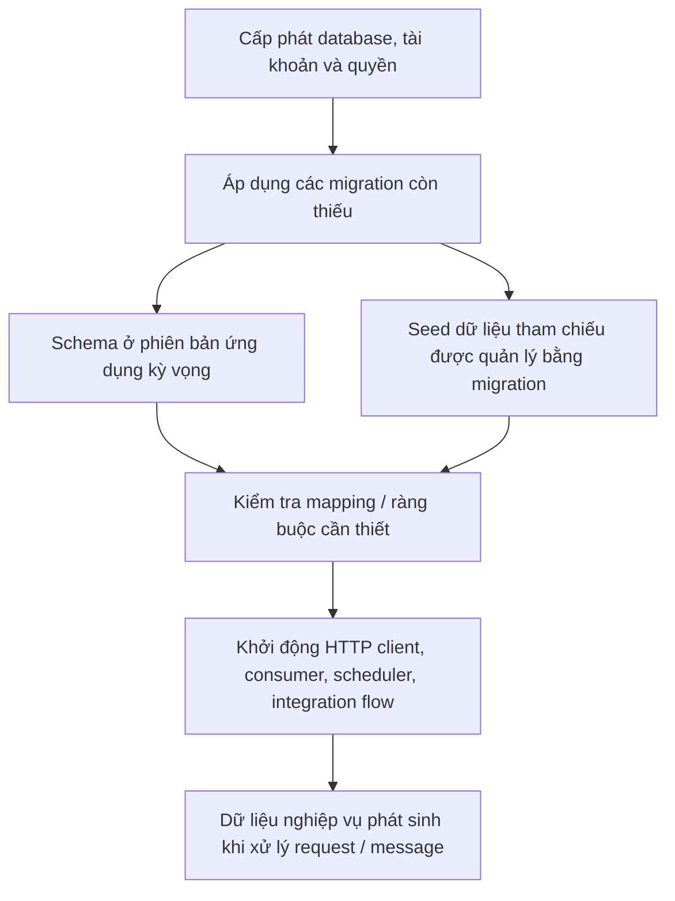

# Phân biệt tạo schema, nạp dữ liệu và nâng phiên bản cơ sở dữ liệu

Trong một ứng dụng **Spring Boot Integration**, cơ sở dữ liệu thường giữ nhiều loại thông tin: cấu hình đối tác, trạng thái xử lý sự kiện, bản ghi chống xử lý trùng, dữ liệu nghiệp vụ hoặc các bảng dùng cho message store/outbox. Khi triển khai ứng dụng, ba thao tác dễ bị gộp chung là **tạo schema**, **nạp dữ liệu khởi tạo** và **nâng phiên bản cơ sở dữ liệu**. Chúng liên quan với nhau nhưng giải quyết ba câu hỏi khác nhau:

- **Tạo schema:** Cấu trúc cần có để ứng dụng lưu và đọc dữ liệu là gì?
- **Nạp dữ liệu:** Những bản ghi ban đầu nào phải tồn tại để ứng dụng hoạt động?
- **Migration:** Làm sao đưa cơ sở dữ liệu đang chạy từ phiên bản cũ sang phiên bản mới một cách có kiểm soát?

Phân biệt rõ ba việc này giúp dịch vụ tích hợp khởi động có thể dự đoán, triển khai lặp lại được, tránh làm mất dữ liệu và hạn chế lỗi khi nhiều phiên bản ứng dụng cùng hoạt động.

## 1. Ba khái niệm và ranh giới trách nhiệm

| Hoạt động | Đối tượng chính | Ví dụ | Khi nào thực hiện | Điều cần bảo đảm |
| --- | --- | --- | --- | --- |
| **Tạo schema** (schema creation) | Bảng, cột, khóa, chỉ mục, ràng buộc, sequence | Tạo `inbound_event`, khóa duy nhất cho `(partner_code, external_event_id)` | Khi dựng cơ sở dữ liệu trống hoặc tạo một cấu trúc mới | Cấu trúc tương thích với ứng dụng |
| **Nạp dữ liệu khởi tạo** (data initialization/seed) | Hàng dữ liệu nền tảng | Thêm danh mục loại sự kiện hoặc cấu hình mặc định | Khi môi trường cần bộ dữ liệu ban đầu | Không tạo trùng, không ghi đè tùy tiện dữ liệu vận hành |
| **Migration** (schema/data migration) | Lịch sử thay đổi cấu trúc **và đôi khi cả dữ liệu** | Thêm cột, backfill dữ liệu cũ, tạo chỉ mục mới | Mỗi lần phát hành có thay đổi cần áp dụng lên DB đã tồn tại | Đúng thứ tự, truy vết được, an toàn với dữ liệu hiện có |

**Lưu ý về thuật ngữ:** Tạo schema và seed có thể được *thực hiện thông qua migration*. Chẳng hạn, bản migration đầu tiên tạo các bảng, bản thứ hai chèn danh mục cố định. Tuy vậy, **mục đích** của ba thao tác vẫn khác nhau. Không nên nhầm công cụ thực thi với loại thay đổi.

Một ví dụ gần với luồng tích hợp: khi nhận webhook từ đối tác, ứng dụng ghi sự kiện vào bảng `inbound_event` và dùng ràng buộc duy nhất để chống xử lý lại cùng mã sự kiện. Việc **tạo bảng và unique constraint** thuộc cấu trúc; **thêm danh mục loại sự kiện được hỗ trợ** thuộc seed; khi cần **bổ sung thông tin hệ thống nguồn cho những sự kiện đã lưu**, đó là migration trên cơ sở dữ liệu đang có dữ liệu.

## 2. Vòng đời dữ liệu trong một dịch vụ Spring Boot



Ở đây có hai dạng "khởi tạo" cần tránh lẫn lộn:

1. **Khởi tạo một môi trường mới:** Có thể cần tạo toàn bộ bảng, chỉ mục, danh mục chuẩn từ một database trống.
2. **Khởi động một tiến trình ứng dụng:** Thường diễn ra nhiều lần mỗi ngày hoặc khi scale thêm replica. Không có nghĩa được xóa bảng, tạo lại bảng hay chèn lại mọi bản ghi.

Nếu một consumer đọc thông điệp ngay khi ứng dụng khởi động nhưng bảng lưu trạng thái idempotency chưa tồn tại, luồng sẽ lỗi. Vì vậy, các cấu trúc bắt buộc phải sẵn sàng **trước khi** ứng dụng nhận lưu lượng hoặc tiêu thụ thông điệp. Trong hệ thống có nhiều replica, việc cập nhật schema càng cần được kiểm soát theo phiên bản triển khai.

## 3. Tạo schema: định nghĩa cấu trúc dữ liệu

Schema của một ứng dụng tích hợp có thể bao gồm bảng sự kiện đầu vào, bảng trạng thái xử lý, bảng outbox, bảng cấu hình đối tác, khóa ngoại và các chỉ mục phục vụ truy vấn. Ví dụ dưới đây dùng **PostgreSQL**; kiểu `JSONB`, `TIMESTAMPTZ` và cú pháp identity cần điều chỉnh nếu dùng cơ sở dữ liệu khác.

```sql
CREATE TABLE integration_event_type (
    code         VARCHAR(40) PRIMARY KEY,
    description  VARCHAR(160) NOT NULL
);

CREATE TABLE inbound_event (
    id                 BIGINT GENERATED BY DEFAULT AS IDENTITY PRIMARY KEY,
    partner_code       VARCHAR(80) NOT NULL,
    external_event_id  VARCHAR(128) NOT NULL,
    event_type_code    VARCHAR(40) NOT NULL
                       REFERENCES integration_event_type(code),
    payload            JSONB NOT NULL,
    processing_status  VARCHAR(24) NOT NULL DEFAULT 'RECEIVED',
    received_at        TIMESTAMPTZ NOT NULL DEFAULT CURRENT_TIMESTAMP,

    CONSTRAINT uq_inbound_event_partner_external
        UNIQUE (partner_code, external_event_id)
);

CREATE INDEX ix_inbound_event_status_received
    ON inbound_event (processing_status, received_at);
```

Trong cấu trúc này:

- `PRIMARY KEY` định danh bản ghi nội bộ.
- `FOREIGN KEY` ngăn sự kiện tham chiếu loại không hợp lệ.
- `UNIQUE (partner_code, external_event_id)` là một lớp bảo vệ trước webhook được gửi lại. Ứng dụng vẫn phải xử lý xung đột khóa duy nhất đúng cách; chỉ có constraint không thay thế toàn bộ logic idempotency.
- Chỉ mục hỗ trợ tìm sự kiện chưa xử lý; việc chọn chỉ mục cuối cùng phải dựa trên truy vấn và khối lượng dữ liệu thật.

### Hibernate có thể tạo schema, nhưng dùng khi nào?

JPA/Hibernate dựa vào các `@Entity` để so sánh hoặc tạo một phần cấu trúc database, tùy giá trị `spring.jpa.hibernate.ddl-auto`:

| Giá trị | Hành vi chính | Khuyến nghị |
| --- | --- | --- |
| `none` | Không yêu cầu Hibernate tự quản lý DDL | Khi schema do công cụ khác quản lý |
| `validate` | Kiểm tra cấu trúc liên quan đến mapping entity; không tự tạo/sửa | Phù hợp khi production dùng Flyway/Liquibase |
| `update` | Cố gắng điều chỉnh schema theo entity | Tránh dùng để quản trị thay đổi production vì khó kiểm soát và truy vết |
| `create` | Tạo lại cấu trúc do Hibernate quản lý khi khởi động; có thể xóa dữ liệu hiện có | Chỉ cân nhắc trong môi trường thử nghiệm cô lập |
| `create-drop` | Tạo schema khi chạy và dọn khi kết thúc `EntityManagerFactory` | Hữu ích cho thử nghiệm ngắn, không dùng với dữ liệu cần giữ |

`validate` **không** bảo đảm tất cả chỉ mục, trigger, bảng ngoài entity mapping hoặc hợp đồng tích hợp đều đúng. Một ứng dụng dùng Spring Integration JDBC Message Store có thể cần các bảng đặc thù của adapter; những bảng này cũng phải được tạo và quản trị theo tài liệu/DDL tương thích với adapter, chứ không thể mặc nhiên trông chờ Hibernate tạo chúng.

Mặc định của `ddl-auto` có thể khác nhau theo loại database và công cụ migration có mặt. Trong một dự án thật, nên **khai báo tường minh** để tránh thay đổi hành vi khi đổi profile hoặc thêm dependency.

## 4. Nạp dữ liệu khởi tạo: phân biệt seed và dữ liệu vận hành

Seed là tập dữ liệu **cần có trước khi xử lý nghiệp vụ**. Trong dịch vụ tích hợp, ví dụ hợp lý gồm danh mục loại sự kiện, trạng thái chuẩn, danh sách capability mặc định hoặc cấu hình kỹ thuật ổn định. Ngược lại, access token, dữ liệu đơn hàng, thông điệp nhận được, checkpoint tiêu thụ, trạng thái retry và thông tin đối tác đã được vận hành điều chỉnh **không nên bị seed lại ở mỗi lần khởi động**.

Ví dụ nạp hai loại sự kiện tham chiếu vào bảng đã tạo:

```sql
INSERT INTO integration_event_type (code, description)
VALUES
    ('PAYMENT_CONFIRMED', 'Đối tác xác nhận thanh toán'),
    ('SHIPMENT_UPDATED',  'Đối tác cập nhật vận chuyển')
ON CONFLICT (code) DO NOTHING;
```

Câu lệnh dùng khóa nghiệp vụ ổn định (`code`) và tránh thêm hàng trùng nếu thực thi lại. Tuy nhiên, `ON CONFLICT DO NOTHING` **không tự cập nhật** mô tả nếu bản ghi đã có giá trị cũ. Khi danh mục cần thay đổi theo yêu cầu sản phẩm, hãy mô tả thay đổi bằng một migration mới hoặc một cơ chế cấu hình có chủ sở hữu rõ ràng.

Cần phân biệt thêm ba trường hợp:

- **Reference data:** Mã trạng thái, loại sự kiện chuẩn; có thể lưu bằng migration versioned, kiểm soát cùng mã nguồn.
- **Bootstrap configuration:** Cấu hình khởi tạo cần thiết, nhưng có thể thay đổi sau khi vận hành; cần chính sách giữ lại sửa đổi thủ công.
- **Test/demo fixtures:** Đối tác giả, token giả, dữ liệu mẫu; nên nằm trong profile test/development, không được tự động nạp vào production.

### Spring Boot SQL initialization

Spring Boot hỗ trợ chạy các script SQL như `schema.sql` và `data.sql` qua `spring.sql.init.*`. Cơ chế này thuận tiện cho demo nhỏ, thử nghiệm hoặc môi trường đơn giản, nhưng **không có lịch sử migration versioned** như Flyway/Liquibase.

Ví dụ cho một demo tự quản lý cấu trúc bằng script SQL:

```yaml
spring:
  sql:
    init:
      mode: always
  jpa:
    hibernate:
      ddl-auto: none
```

Với cấu hình trên, nếu có `schema.sql`/`data.sql` trong vị trí mặc định, các script được xem xét khi khởi động. Vì `mode: always` áp dụng cả khi database không phải embedded, script phải được thiết kế để chạy lặp an toàn hoặc môi trường phải được tái tạo có chủ đích. Trên production, không bật cấu hình này chỉ để nạp lại seed.

Thông thường Spring Boot chạy script SQL initialization **trước** khi khởi tạo JPA. Nếu demo cố tình muốn Hibernate tạo bảng rồi mới chạy `data.sql`, có thể dùng `spring.jpa.defer-datasource-initialization=true` kết hợp cấu hình DDL phù hợp. Đây là lối đi cho bài thử nghiệm, **không phải** lý do để phối hợp nhiều cơ chế tạo schema trong production.

## 5. Migration: quản trị thay đổi qua các phiên bản

Giả sử version đầu tiên của ứng dụng đã lưu hàng triệu sự kiện webhook. Bản phát hành mới cần bổ sung trường `source_system` để phân biệt đường nhận HTTP, broker hoặc batch. Nếu xóa bảng và tạo lại, toàn bộ lịch sử xử lý sẽ mất; nếu chỉ sửa entity và hy vọng `ddl-auto=update` hoàn tất, ta không kiểm soát được backfill, khóa bảng và thứ tự triển khai.

Migration giải quyết việc này bằng **các thay đổi có thứ tự và được ghi nhận lịch sử**. Flyway và Liquibase là hai lựa chọn phổ biến trong hệ sinh thái Spring Boot. Một dự án nên chọn **một nguồn có thẩm quyền** để thay đổi schema cho cùng nhóm đối tượng dữ liệu.

### Ví dụ Flyway từ cơ sở dữ liệu trống đến schema mới

Một cấu trúc thư mục thường gặp:

```text
src/main/resources/
└── db/
    └── migration/
        ├── V1__create_integration_tables.sql
        ├── V2__seed_event_types.sql
        ├── V3__add_source_system.sql
        └── V4__backfill_and_require_source_system.sql
```

- `V1__create_integration_tables.sql` chứa DDL của mục 3.
- `V2__seed_event_types.sql` chứa lệnh chèn dữ liệu tham chiếu của mục 4.
- `V3__add_source_system.sql` mở rộng schema:

```sql
ALTER TABLE inbound_event
    ADD COLUMN source_system VARCHAR(50);
```

- `V4__backfill_and_require_source_system.sql` hoàn thiện ràng buộc sau khi dữ liệu cũ đã có giá trị hợp lệ:

```sql
UPDATE inbound_event
SET source_system = 'partner-webhook'
WHERE source_system IS NULL;

ALTER TABLE inbound_event
    ALTER COLUMN source_system SET NOT NULL;
```

Ví dụ V4 chỉ phù hợp khi biết chắc dữ liệu cũ đều đến từ webhook hoặc quy tắc backfill đó đã được kiểm chứng. **Không** dùng giá trị mặc định tùy tiện nếu dữ liệu thực tế đến từ nhiều nguồn. Với bảng lớn, `UPDATE` toàn bảng và `SET NOT NULL` có thể tạo tải hoặc khóa đáng kể; cần backfill theo lô, theo dõi tiến độ và triển khai mở rộng rồi siết ràng buộc ở đợt phù hợp.

Khi chạy lần đầu trên database trống, Flyway áp dụng các script `V1` → `V4` theo thứ tự. Trên database đã có lịch sử, nó chỉ thực thi những migration chưa áp dụng. Flyway lưu trạng thái và checksum trong bảng lịch sử schema (thường là `flyway_schema_history`), nhờ đó biết phiên bản nào đã chạy.

Không sửa nội dung migration versioned **đã được áp dụng** chỉ vì muốn đổi một cột hay sửa seed. Thay đổi như vậy có thể làm validation checksum thất bại và khiến môi trường phát triển lệch với staging/production. Hãy tạo một migration mới để thay đổi trạng thái hiện tại.

### Cấu hình Spring Boot với Flyway

Đưa Flyway và JDBC driver phù hợp vào dependency của ứng dụng (với một số tổ hợp phiên bản Flyway/database, cần thêm module hỗ trợ riêng cho database). Cấu hình điển hình:

```yaml
spring:
  datasource:
    url: ${DB_URL}
    username: ${DB_USER}
    password: ${DB_PASSWORD}
  flyway:
    enabled: true
    locations: classpath:db/migration
  jpa:
    hibernate:
      ddl-auto: validate
  sql:
    init:
      mode: never
```

Trong cấu hình này, **Flyway tạo và nâng phiên bản schema**, Hibernate **kiểm tra mapping entity**, còn SQL initialization mặc định bằng `schema.sql`/`data.sql` được tắt để tránh hai cơ chế cùng quản lý schema. Secrets đến từ biến môi trường hoặc hệ thống quản lý bí mật; không đưa mật khẩu thật vào YAML hoặc migration.

Trong quy trình khởi động thông thường do Spring Boot cấu hình, các migration được áp dụng trước khi các thành phần JPA phụ thuộc schema sẵn sàng. Với nhiều `DataSource` hoặc cấu hình khởi tạo tùy chỉnh, phải kiểm tra **đúng datasource/schema đích** và thứ tự khởi động thay vì mặc định rằng mọi bean đều dùng cùng database.

### Nếu chọn Liquibase thì sao?

Liquibase cũng cho phép khai báo chuỗi `changeSet` có ID, tác giả, precondition và lịch sử áp dụng, ví dụ thông qua XML/YAML/JSON/SQL. Spring Boot có thể cấu hình bằng `spring.liquibase.change-log`. Không cần cài cả Flyway lẫn Liquibase để làm chung một việc; hãy chọn theo tiêu chuẩn đội ngũ, công cụ hiện hữu và quy trình triển khai.

## 6. Migration dữ liệu khác gì với seed?

**Seed** tạo những bản ghi nền tảng vốn *chưa có*. **Data migration** biến đổi các bản ghi *đã tồn tại* để chúng hợp lệ với phiên bản mới.

Ví dụ:

| Tình huống | Loại công việc | Cách tiếp cận |
| --- | --- | --- |
| Database trống cần danh mục `PAYMENT_CONFIRMED` | Seed | Thêm bản ghi tham chiếu có mã ổn định |
| Đổi tên mã `DELIVERED_OK` sang `SHIPMENT_DELIVERED` cho bản ghi đã lưu | Data migration | Có script chuyển đổi, kiểm tra tham chiếu và khả năng tương thích |
| Bổ sung cột `source_system` | Schema migration | `ALTER TABLE` và điều chỉnh code |
| Điền `source_system` cho các sự kiện lịch sử | Data migration/backfill | Chọn quy tắc đúng theo dữ liệu thật, chạy theo lô nếu cần |
| Nhận thêm webhook sau khi chạy production | Dữ liệu vận hành | Do integration flow xử lý, không thuộc seed/migration |

Migration thường có cả **DDL** và **DML**, nhưng không nên dùng migration để ghi lại từng thông điệp nghiệp vụ hay đồng bộ dữ liệu vận hành từ hệ thống đối tác. Dữ liệu live phải đi qua luồng nhập liệu/tích hợp có retry, theo dõi và kiểm soát trùng lặp thích hợp.

### Expand → backfill → contract

Khi hệ thống cần cập nhật mà vẫn có phiên bản ứng dụng cũ chạy song song, cách tiếp cận thông dụng là:

1. **Expand:** Thêm cột mới ở dạng nullable hoặc cấu trúc mới tương thích với ứng dụng cũ.
2. **Chuyển tiếp:** Triển khai code đọc được dữ liệu cũ, đồng thời ghi dữ liệu theo cấu trúc mới; nếu cần thì dual-write có kiểm soát và đối chiếu.
3. **Backfill:** Chuyển đổi dữ liệu lịch sử theo lô, kiểm tra số lượng, dữ liệu lỗi và tốc độ.
4. **Contract:** Khi mọi instance đã chuyển sang code mới và dữ liệu thỏa điều kiện, mới thêm `NOT NULL`, xóa cột cũ hoặc ngừng đường ghi cũ.

Đừng nhầm **thứ tự file migration** với **thứ tự rollout ứng dụng**. Nếu V3, job backfill và V4 phải nằm ở các đợt triển khai khác nhau, pipeline phát hành phải thể hiện điều đó rõ ràng. Một script V4 chạy ngay sau V3 chưa chắc đã có thời gian để job backfill hoàn thành. Với các database không hỗ trợ transaction cho mọi thao tác DDL, phải chuẩn bị cả phương án xử lý migration chạy dở.

## 7. Chọn cơ chế theo môi trường

| Môi trường / mục tiêu | Cách quản lý được ưu tiên | Điều cần tránh |
| --- | --- | --- |
| Ví dụ học tập ngắn, DB dùng một lần | `schema.sql`/`data.sql` hoặc Hibernate `create-drop` | Giữ dữ liệu quan trọng trong môi trường tự xóa schema |
| Unit test không cần DB thật | Mock hoặc kho dữ liệu giả phù hợp phạm vi test | Suy diễn rằng test giả đã xác thực SQL thực tế |
| Integration test cho luồng JDBC thực | Chạy Flyway/Liquibase trên engine gần production, ví dụ PostgreSQL Testcontainers | Chỉ test trên H2 rồi mặc định PostgreSQL sẽ có cùng kiểu dữ liệu, transaction và cú pháp |
| Staging / production | Migration versioned + `ddl-auto=validate` hoặc `none` theo mapping | `create`, `create-drop`, `update` như cơ chế phát hành schema chính |
| Dữ liệu đối tác, token, checkpoint hoặc retry | Cấu hình bảo mật, API quản trị, integration flow, job có kiểm soát | Seed lại khi restart gây mất trạng thái hoặc ghi đè quyết định vận hành |

Trong một dự án có nhiều service dùng chung database, cần quy định rõ service nào sở hữu bảng nào. Hai service cùng tự chạy migration làm thay đổi chung một bảng dễ tạo race condition và khó đồng bộ hợp đồng dữ liệu. Cần một chuỗi migration hoặc một quy trình điều phối được sở hữu rõ ràng.

## 8. Rủi ro thường gặp và cách xử lý

### 8.1. Cùng một bảng bị tạo nhiều lần

**Triệu chứng:** lỗi tương tự `relation already exists`, `table already exists` hoặc startup thất bại khi script SQL và migration đồng thời tạo bảng.

**Nguyên nhân có thể:** bật Flyway nhưng vẫn chạy `schema.sql`, hoặc Hibernate đang `create`/`update` trên cùng schema.

**Cách xử lý:** xác định một công cụ sở hữu DDL, tắt các cơ chế còn lại theo môi trường, rồi đối chiếu lịch sử migration với cấu trúc thật. Tránh dùng `IF NOT EXISTS` bừa bãi để che sự lệch schema.

### 8.2. Seed bị chèn lặp hoặc ghi đè dữ liệu vận hành

**Triệu chứng:** trùng khóa khi restart, thay đổi cấu hình đối tác trở về giá trị mặc định hoặc bản ghi demo xuất hiện ở production.

**Cách xử lý:** dùng khóa nghiệp vụ, định nghĩa rõ seed có chỉ thêm khi thiếu hay được quyền cập nhật, tách fixture demo khỏi migration production và đặt quyền sở hữu cho dữ liệu có thể chỉnh sửa sau khởi tạo.

### 8.3. Sửa migration cũ khiến validation thất bại

**Triệu chứng:** Flyway báo checksum mismatch hoặc validation failed trên môi trường đã từng chạy migration.

**Cách xử lý:** đối chiếu lịch sử, khôi phục nội dung migration đã phát hành, tạo file version mới cho thay đổi mong muốn. Các lệnh như `repair` chỉ nên dùng khi đã hiểu rõ trạng thái thực tế và có quy trình khắc phục sự cố; không dùng để che lỗi tùy tiện.

### 8.4. Deploy mới nhưng bản ghi cũ chưa tương thích

**Triệu chứng:** thêm cột bắt buộc làm lỗi `NOT NULL`, code cũ ghi thiếu cột, consumer đọc trạng thái chưa được chuyển đổi hoặc truy vấn xuống cấp vì backfill toàn bảng.

**Cách xử lý:** triển khai expand/backfill/contract, áp dụng biện pháp tương thích ngược trong giai đoạn chạy song song, lập kế hoạch index và backfill theo kích thước dữ liệu. Đo thời gian khóa và tác động tới throughput của integration flow.

### 8.5. Nhiều replica hoặc nhiều kết nối đến database

Khi hàng chục instance cùng khởi động, mỗi instance đều có thể cố gắng kiểm tra migration. Flyway có cơ chế quản lý lịch sử/đồng bộ tùy database và phiên bản, nhưng chiến lược vận hành vẫn phải tính tới khóa, thời gian chờ và chính sách restart. Trong hệ thống yêu cầu kiểm soát chặt, có thể chạy migration thành bước riêng của deployment, trước khi scale ứng dụng. Với nhiều `DataSource`, kiểm tra lại database mà migration thực sự kết nối, tên schema và quyền thực thi DDL.

## 9. Kiểm thử và quan sát quá trình khởi tạo

Một bài kiểm thử tích hợp có giá trị nên dùng **database trống**, chạy đúng chuỗi migration của ứng dụng và kiểm tra cả cấu trúc lẫn dữ liệu ban đầu. Ví dụ với Spring Boot và JDBC:

```java
@SpringBootTest
class DatabaseInitializationIT {

    @Autowired
    JdbcTemplate jdbc;

    @Test
    void eventTypeSeedIsAvailableAfterMigrations() {
        Integer count = jdbc.queryForObject(
            """
            SELECT COUNT(*)
            FROM integration_event_type
            WHERE code IN ('PAYMENT_CONFIRMED', 'SHIPMENT_UPDATED')
            """,
            Integer.class
        );

        assertEquals(2, count);
    }
}
```

Đoạn test minh họa sử dụng JUnit 5 (`@Test`, `assertEquals`), Spring Boot Test, `JdbcTemplate` và một datasource kiểm thử đã cấu hình. Trong dự án thực, nên dùng container database giống production, cấu hình migration tự chạy trong test, đồng thời có test cho unique constraint và khả năng đọc dữ liệu cũ sau khi nâng phiên bản.

Trước khi phát hành, nên xác minh được:

1. **Từ database trống:** chạy toàn bộ migration thành công, seed đủ bản ghi bắt buộc, ứng dụng khởi động và xử lý được một webhook mẫu.
2. **Từ bản database cũ:** nâng cấp bằng migration mới mà giữ nguyên dữ liệu đã có; truy vấn và adapter vẫn tương thích.
3. **Chạy lặp:** restart hoặc scale replica không làm chèn trùng dữ liệu hay tạo lại bảng.
4. **Đường lỗi:** phát hiện migration không thành công trước khi consumer bắt đầu xử lý; có thông tin để khắc phục và khởi động lại an toàn.
5. **Khả năng quan sát:** log có tên/phiên bản migration, thời lượng, kết quả; có cảnh báo cho startup thất bại, schema lệch và tồn đọng backfill.

Cần quan sát cả hành vi nghiệp vụ: nếu thay đổi schema làm consumer chậm hoặc tăng lỗi ghi cơ sở dữ liệu, chỉ nhìn thấy kết quả migration `SUCCESS` là chưa đủ. Với webhook và broker, nên theo dõi độ trễ xử lý, số thông điệp retry/dead-letter và tỷ lệ trùng lặp sau khi deploy.

## 10. Checklist thiết kế cho production

- **Nguồn quản trị:** xác định duy nhất Flyway hoặc Liquibase quản lý từng schema; chọn `ddl-auto=validate` khi phù hợp, tắt SQL init script ngoài ý muốn.
- **Hợp đồng dữ liệu:** mọi thay đổi bảng/cột/constraint phải xét cả HTTP endpoint, consumer, message store, batch job và phiên bản ứng dụng cũ đang chạy.
- **An toàn dữ liệu:** có backup/restore được kiểm tra; đánh giá kích thước bảng, khóa DDL, thời gian backfill, transaction và khả năng rollback/roll-forward trên database thực tế.
- **Seed có chủ sở hữu:** dữ liệu tham chiếu tách khỏi dữ liệu nghiệp vụ, dùng mã ổn định, xác định rõ quy tắc khi bản ghi đã tồn tại.
- **Quyền và bảo mật:** tài khoản chạy migration có quyền DDL phù hợp; tài khoản runtime nên theo nguyên tắc tối thiểu quyền. Không đưa secrets vào script seed.
- **Kiểm tra tự động:** chạy migration trên database thử nghiệm và bản sao cấu trúc/dữ liệu đại diện; validate lịch sử migration trước deploy.
- **Theo dõi sau phát hành:** xác nhận version schema, health của ứng dụng, throughput của integration flow, retry backlog và tính nhất quán của dữ liệu đã chuyển đổi.

## 11. Tình huống tự đánh giá

Giả sử một Spring Boot service nhận sự kiện giao hàng từ HTTP webhook, ghi vào `inbound_event` và chuyển tiếp qua message broker. Sau ba tháng, team yêu cầu thêm `source_system`, đồng thời đưa vào danh mục loại sự kiện `RETURN_REQUESTED`.

Hãy phân loại công việc:

1. **Thêm cột `source_system`:** schema migration, ưu tiên thêm nullable để các phiên bản cũ còn hoạt động.
2. **Điền nguồn cho những sự kiện lịch sử:** data migration/backfill, chỉ dùng quy tắc mà dữ liệu thực chứng minh được.
3. **Đưa `RETURN_REQUESTED` vào danh mục:** cập nhật reference data bằng migration version mới, không sửa file seed version cũ đã chạy.
4. **Ghi sự kiện mới nhận được:** nhiệm vụ runtime của integration flow, có kiểm soát trùng bằng `(partner_code, external_event_id)`.
5. **Bắt buộc `source_system` khác null:** bước contract sau khi backfill và các producer/consumer liên quan đã sẵn sàng.

Như vậy, **schema creation** trả lời cấu trúc ban đầu là gì, **seed** trả lời dữ liệu tham chiếu ban đầu cần có là gì, còn **migration** ghi nhận cách chuyển từ trạng thái cơ sở dữ liệu hiện tại sang trạng thái mới mà không làm gián đoạn hoặc làm mất dữ liệu. Trong hệ thống Spring Boot Integration, ba hoạt động phải được thiết kế cùng với thứ tự khởi động, tính tương thích hợp đồng, xử lý trùng lặp và khả năng quan sát của toàn bộ luồng tích hợp.
