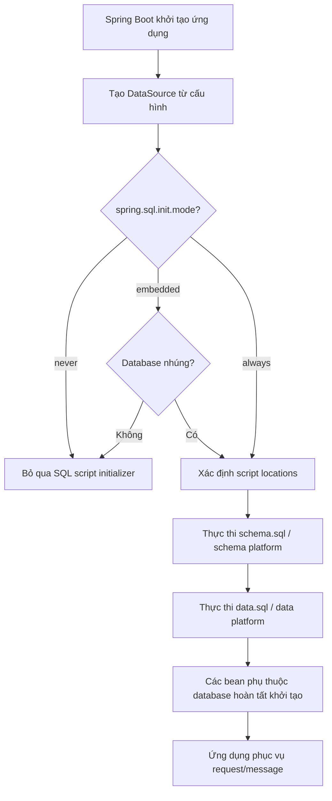
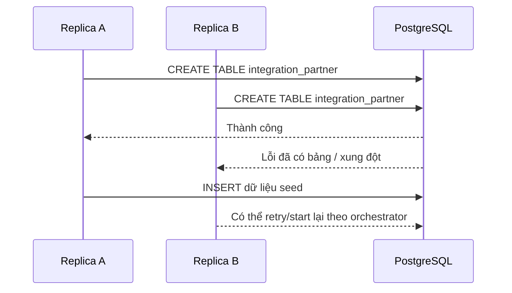
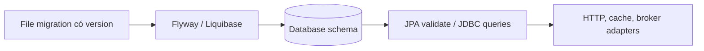
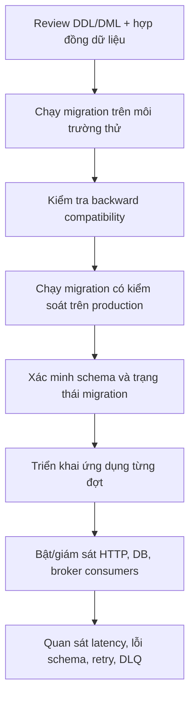

# `schema.sql`, `data.sql` và cấu hình `spring.sql.init.*`

## 1. Bài toán: kết nối được database nhưng chưa có dữ liệu cần thiết

Trong hệ thống tích hợp sử dụng Spring Boot, một luồng xử lý có thể cần bảng ánh xạ mã đối tác, bảng chống xử lý trùng sự kiện, bảng outbox hoặc các dữ liệu tham chiếu trước khi nhận HTTP request và message từ broker. Cấu hình JDBC thành công mới chứng minh ứng dụng **kết nối được** database; chưa chứng minh schema và dữ liệu ban đầu đã tồn tại.

Ví dụ, dịch vụ đặt hàng gọi API danh mục để tra cứu sản phẩm, lưu đơn hàng trong PostgreSQL rồi phát `OrderCreated` tới broker. Khi service khởi động trên database trống, các câu lệnh như:

```sql
SELECT partner_code, base_url
FROM integration_partner
WHERE enabled = TRUE;
```

sẽ thất bại nếu bảng `integration_partner` chưa được tạo. Ngay cả khi bảng có sẵn, hệ thống có thể hoạt động sai nếu không có bản ghi cấu hình đối tác bắt buộc.

Spring Boot có cơ chế **script-based SQL initialization** để chạy các tệp SQL khi ứng dụng khởi động:

- `schema.sql` thường chứa **DDL**: `CREATE TABLE`, `CREATE INDEX`, `ALTER TABLE` trong những trường hợp phù hợp.
- `data.sql` thường chứa **DML**: `INSERT` các bản ghi khởi tạo hoặc dữ liệu mẫu.
- Nhóm thuộc tính `spring.sql.init.*` điều khiển lúc nào chạy script, đọc script ở đâu, xử lý lỗi thế nào và dùng encoding/separator nào.

Đây là cơ chế phù hợp cho ứng dụng mẫu, test và một số tình huống khởi tạo đơn giản. Nó **không thay thế mặc định cho quy trình migration có phiên bản** của một database đã chứa dữ liệu production.

Trong module **SPRING_BOOT_INTEGRATION**, cần nhìn việc khởi tạo database như một phần của vòng đời tích hợp: kiểm soát schema, hợp đồng dữ liệu, thứ tự triển khai, tính nhất quán giao dịch, xử lý trùng lặp sự kiện và khả năng quan sát lỗi ở startup.

### Mục tiêu học tập

Sau bài này, bạn có thể:

1. Giải thích khi nào Spring Boot chạy `schema.sql` và `data.sql`, và cơ chế phát hiện database nhúng.
2. Tạo ví dụ `schema.sql`/`data.sql` hoàn chỉnh với Spring JDBC và H2.
3. Sử dụng các thuộc tính quan trọng của `spring.sql.init.*` và script theo platform.
4. Phân biệt trình tự script initialization với Hibernate/JPA schema generation.
5. Đánh giá khi nào nên chuyển sang Flyway/Liquibase và vì sao không chạy nhiều cơ chế quản lý schema cùng lúc.
6. Viết kiểm thử startup, điều tra lỗi SQL, dự kiến vấn đề khởi động nhiều instance và deploy an toàn.

> **Phiên bản:** các ví dụ dựa trên Spring Boot 3.x, Java 17+ và Spring JDBC. Từ Spring Boot 2.5, nhóm cấu hình được chuẩn hóa quanh `spring.sql.init.*`; dự án Boot cũ có thể dùng tên thuộc tính khác. Hãy đối chiếu documentation của đúng phiên bản đang triển khai khi nâng cấp.

## 2. Cơ chế tự động khởi tạo SQL của Spring Boot

Ở mức khái quát, Spring Boot phát hiện một `DataSource` phù hợp và cung cấp bộ khởi tạo script khi điều kiện auto-configuration đáp ứng. Với cấu hình thông thường, các script được đọc từ classpath:

```text
src/main/resources/
  ├── application.yml
  ├── schema.sql
  └── data.sql
```

Luồng khởi động:



Trong sơ đồ, thứ tự schema trước data là đặc điểm quan trọng, còn thứ tự khởi tạo tương quan với JPA/Hibernate có thể thay đổi bằng thuộc tính riêng ở mục 7.

### 2.1. Mặc định `mode=embedded`

Nếu không chỉ định `spring.sql.init.mode`, Spring Boot thông thường chỉ tự thực thi script cho **database nhúng** như H2, HSQLDB hoặc Derby. Với PostgreSQL/MySQL ở bên ngoài, chỉ có `schema.sql` trong classpath **không có nghĩa** nó tự chạy.

| `spring.sql.init.mode` | Tác dụng | Tình huống thường gặp |
| --- | --- | --- |
| `embedded` | Chỉ khởi tạo khi database được nhận diện là nhúng; đây là giá trị mặc định | Ví dụ học tập, test H2 |
| `always` | Chạy initializer với database được cấu hình khi có script | Demo trên PostgreSQL, môi trường được kiểm soát |
| `never` | Tắt cơ chế SQL script initialization của Boot | Production dùng Flyway/Liquibase hoặc schema do nền tảng quản lý |

**Cảnh báo:** `mode=always` có nghĩa thao tác script có thể diễn ra **mỗi lần một instance ứng dụng khởi động**. Đây không phải một lệnh `CREATE DATABASE` chỉ chạy một lần khi cài đặt hệ thống.

### 2.2. Nguồn script và tính tùy chọn

Các vị trí mặc định tương đương với các pattern dạng:

```text
optional:classpath*:schema.sql
optional:classpath*:data.sql
```

Từ khóa `optional:` cho phép không tìm thấy file mà không xem đó là lỗi cấu hình; `classpath*:` có thể tìm nhiều tài nguyên khớp pattern trên classpath. Vì thế:

- Không có `schema.sql` hoặc `data.sql` **không nhất thiết** làm ứng dụng lỗi.
- Nếu file có mặt nhưng câu lệnh SQL sai, initializer vẫn có thể thất bại.
- Khi đặt tên/location riêng, phải hiểu sự khác nhau giữa “không có script” và “script có lỗi”.
- Nếu nhiều module/JAR đưa tài nguyên trùng tên vào classpath, cần kiểm tra những file nào thực sự được phát hiện. Với ứng dụng production, nên khai báo path rõ ràng.

Trong ứng dụng tích hợp, nên giữ **cấu hình nguồn database và môi trường** tách khỏi **logic xây dựng bảng** để tránh thay đổi schema ngoài ý muốn khi scale service.

## 3. Ví dụ hoàn chỉnh: tạo bảng và dữ liệu mẫu với H2

Xây dựng một ứng dụng Spring Boot nhỏ, lưu danh sách dịch vụ đối tác và mã hệ thống trong một database nhúng. Đây là dữ liệu tham chiếu mà adapter HTTP có thể dùng khi chọn endpoint.

### 3.1. Dependency Maven

```xml
<!-- pom.xml: phần dependencies -->
<dependencies>
    <dependency>
        <groupId>org.springframework.boot</groupId>
        <artifactId>spring-boot-starter-jdbc</artifactId>
    </dependency>
    <dependency>
        <groupId>com.h2database</groupId>
        <artifactId>h2</artifactId>
        <scope>runtime</scope>
    </dependency>
    <dependency>
        <groupId>org.springframework.boot</groupId>
        <artifactId>spring-boot-starter-test</artifactId>
        <scope>test</scope>
    </dependency>
</dependencies>
```

Ví dụ giả định POM dùng Spring Boot parent hoặc BOM tương ứng. Do đó các dependency thuộc tập phiên bản do Boot quản lý không cần ghi version trực tiếp. `spring-boot-starter-jdbc` cung cấp Spring JDBC và pool kết nối phù hợp; H2 là database nhúng dùng để minh họa, **không phải lựa chọn thay thế PostgreSQL production mặc định**.

### 3.2. Tạo `src/main/resources/schema.sql`

```sql
CREATE TABLE integration_partner (
    partner_code VARCHAR(40) PRIMARY KEY,
    display_name VARCHAR(120) NOT NULL,
    base_url VARCHAR(255) NOT NULL,
    enabled BOOLEAN NOT NULL
);

CREATE TABLE inbound_event_receipt (
    event_id VARCHAR(80) PRIMARY KEY,
    source_system VARCHAR(40) NOT NULL,
    received_at TIMESTAMP NOT NULL
);

CREATE INDEX idx_inbound_receipt_source
    ON inbound_event_receipt (source_system);
```

Giải thích:

- `integration_partner`: bảng ánh xạ mã dịch vụ sang địa chỉ đối tác để adapter chọn nơi gọi HTTP.
- `inbound_event_receipt`: ví dụ schema lưu định danh message đã tiếp nhận. Khóa chính `event_id` góp phần chống xử lý trùng, nhưng **việc lưu receipt và thực hiện tác động nghiệp vụ cần cùng ranh giới transaction phù hợp** nếu muốn bảo đảm hiệu quả thực sự.
- Các câu lệnh được kết thúc bằng dấu `;`, separator mặc định thường dùng cho script SQL.
- Với H2 mới, tạo bảng sẽ thành công; với database có bảng cũ, chạy lại những câu `CREATE TABLE` này có thể thất bại.

### 3.3. Tạo `src/main/resources/data.sql`

```sql
INSERT INTO integration_partner
    (partner_code, display_name, base_url, enabled)
VALUES
    ('CATALOG', 'Catalog Service', 'https://catalog.example.test', TRUE);

INSERT INTO integration_partner
    (partner_code, display_name, base_url, enabled)
VALUES
    ('SHIPPING', 'Shipping Service', 'https://shipping.example.test', FALSE);
```

Hai địa chỉ `.example.test` chỉ là endpoint giả lập. Đừng đặt credential, token, API key, số tài khoản hoặc dữ liệu khách hàng thật trong `data.sql`. Các giá trị cấu hình có tính môi trường như URL production thường thích hợp hơn với configuration/secret manager; ở đây chỉ minh họa dữ liệu ban đầu.

**Thứ tự thực thi:** `schema.sql` tạo bảng trước, `data.sql` chèn các hàng sau. Nếu `data.sql` tham chiếu bảng/cột chưa có, initializer báo lỗi khi không bật chế độ bỏ qua lỗi.

### 3.4. Cấu hình `application.yml`

```yaml
spring:
  datasource:
    url: "jdbc:h2:mem:integrationdb;DB_CLOSE_DELAY=-1"
    driver-class-name: org.h2.Driver
    username: sa
    password: ""

  sql:
    init:
      mode: always
      encoding: UTF-8
      schema-locations: classpath:schema.sql
      data-locations: classpath:data.sql
      continue-on-error: false
```

`DB_CLOSE_DELAY=-1` giữ database H2 trong bộ nhớ đến khi JVM kết thúc, thay vì đóng khi connection cuối được giải phóng. Đây là chi tiết chỉ áp dụng H2; không nên sao chép vào JDBC URL của PostgreSQL.

Với H2, có thể **bỏ `mode: always`** để dùng `embedded` mặc định. Bài giữ `always` để người đọc thấy nơi cấu hình lựa chọn này, không nhằm đề xuất luôn bật cho mọi môi trường.

### 3.5. Đọc dữ liệu bằng `JdbcTemplate`

```java
// src/main/java/example/integration/PartnerDirectory.java
package example.integration;

import org.springframework.jdbc.core.JdbcTemplate;
import org.springframework.stereotype.Repository;

import java.util.List;

@Repository
public class PartnerDirectory {

    private final JdbcTemplate jdbcTemplate;

    public PartnerDirectory(JdbcTemplate jdbcTemplate) {
        this.jdbcTemplate = jdbcTemplate;
    }

    public List<PartnerEndpoint> findEnabledPartners() {
        return jdbcTemplate.query(
                """
                SELECT partner_code, base_url
                FROM integration_partner
                WHERE enabled = TRUE
                ORDER BY partner_code
                """,
                (rs, rowNum) -> new PartnerEndpoint(
                        rs.getString("partner_code"),
                        rs.getString("base_url")));
    }
}

record PartnerEndpoint(String partnerCode, String baseUrl) {
}
```

Khi ứng dụng khởi động thành công, lời gọi `findEnabledPartners()` trả về bản ghi `CATALOG`, vì `SHIPPING` có `enabled = FALSE`. Spring Boot chạy script theo cơ chế khởi tạo datasource; adapter nghiệp vụ chỉ cần dùng `JdbcTemplate`, không phải tự chạy DDL mỗi lần gọi.

Trong môi trường production, **URL động lấy từ database** phải được kiểm soát nguồn dữ liệu, phân quyền chỉnh sửa và danh sách đích được phép truy cập để tránh rủi ro SSRF. Dữ liệu mẫu trong bài không đủ để thiết kế bảo mật cho một hệ thống gọi URL tùy ý.

## 4. Các thuộc tính `spring.sql.init.*` quan trọng

| Thuộc tính | Giá trị hoặc mặc định đáng chú ý | Khi nào dùng |
| --- | --- | --- |
| `spring.sql.init.mode` | `embedded` mặc định; `always`; `never` | Kiểm soát bật/tắt khởi tạo theo loại database/môi trường |
| `spring.sql.init.schema-locations` | Mặc định tìm `schema.sql` trên classpath theo pattern tùy chọn | Chỉ đường tới các script DDL riêng |
| `spring.sql.init.data-locations` | Mặc định tìm `data.sql` theo pattern tùy chọn | Chỉ đường tới dữ liệu khởi tạo |
| `spring.sql.init.platform` | Giá trị platform như `postgresql`, `h2` tùy cấu hình | Hỗ trợ các script hậu tố platform |
| `spring.sql.init.encoding` | Có thể đặt `UTF-8` | Tránh lỗi ký tự khi script có dữ liệu tiếng Việt |
| `spring.sql.init.separator` | Thường dùng `;` | Dấu tách câu lệnh; cẩn trọng SQL procedural |
| `spring.sql.init.continue-on-error` | `false` mặc định | Quyết định tiếp tục hay dừng khi script lỗi |
| `spring.sql.init.username`, `password` | Tùy môi trường, khi được hỗ trợ bởi initializer | Trường hợp cần credential riêng cho script; không công bố secret trong source |

Thực tế sử dụng các thuộc tính còn phụ thuộc phiên bản Boot, kiểu `DataSource` hoặc `ConnectionFactory` và cấu hình initializer được chọn. Hãy kiểm tra metadata cấu hình của Spring Boot **đúng version** nếu hệ thống đang nâng cấp.

### 4.1. `mode` không phải công tắc migration một lần

Nếu ứng dụng chạy với PostgreSQL và:

```yaml
spring:
  sql:
    init:
      mode: always
```

thì mỗi lần service khởi động, initializer có thể cố thực thi những script hiện diện. Nếu `schema.sql` có `CREATE TABLE integration_partner (...)`, lần khởi động thứ hai trên cùng database thường gặp lỗi “relation already exists”.

Vì thế:

- **Test/H2 database mới:** dễ dùng `schema.sql`/`data.sql`.
- **Demo hoặc tác vụ khởi tạo có kiểm soát:** có thể dùng `always` nếu đã thiết kế script phù hợp và hiểu startup lifecycle.
- **Production có schema tồn tại lâu dài:** ưu tiên migration có phiên bản và quy trình triển khai riêng; đặt `mode: never` nếu không dùng script initializer.

### 4.2. `schema-locations` và `data-locations`

Khi muốn dùng đường dẫn cụ thể:

```yaml
spring:
  sql:
    init:
      schema-locations:
        - classpath:db/init/base-schema.sql
        - classpath:db/init/extra-indexes.sql
      data-locations:
        - classpath:db/init/reference-data.sql
```

Thứ tự các tài nguyên được khai báo là đáng chú ý vì bảng phải có trước khi tạo index hay chèn dữ liệu. Tránh thiết kế một file phụ thuộc vào trạng thái ngầm từ thư viện khác trên classpath. Khi sử dụng location **không có tiền tố `optional:`**, việc thiếu tài nguyên có thể trở thành lỗi khởi động, giúp phát hiện đóng gói thiếu file.

**Không biến resource initializer thành cơ chế chạy lại khi có request.** Các script này thuộc vòng đời khởi tạo ứng dụng; thay đổi dữ liệu nghiệp vụ sau startup phải qua repository/service, migration hoặc job chuyên biệt.

### 4.3. Script theo database platform

Hai engine SQL có thể khác nhau về identity column, UUID, kiểu JSON, expression, index hoặc cơ chế upsert. Spring Boot có thể sử dụng các tên script theo `spring.sql.init.platform`:

```text
src/main/resources/
  schema.sql
  data.sql
  schema-h2.sql
  data-h2.sql
  schema-postgresql.sql
  data-postgresql.sql
```

Ví dụ profile test:

```yaml
spring:
  sql:
    init:
      platform: h2
```

Hoặc môi trường PostgreSQL có chủ ý dùng SQL init:

```yaml
spring:
  sql:
    init:
      mode: always
      platform: postgresql
```

Khi dùng script có hậu tố platform, chú ý việc kết hợp **script chung và script riêng** theo quy tắc của phiên bản Boot đang dùng; tránh tạo cùng một bảng hai lần trong `schema.sql` và `schema-postgresql.sql`. Với quy trình đòi hỏi thứ tự nghiêm ngặt, khai báo `schema-locations` và `data-locations` cụ thể thường rõ ràng hơn.

**Không giả định H2 mô phỏng PostgreSQL hoàn toàn.** DDL, constraint, transaction, kiểu dữ liệu và cú pháp SQL có thể khác ngay cả ở chế độ tương thích. Những migration quan trọng phải được test với engine và version production.

### 4.4. `continue-on-error` và `separator`

```yaml
spring:
  sql:
    init:
      continue-on-error: false
      separator: ";"
      encoding: UTF-8
```

Đặt `continue-on-error: false` giúp ứng dụng dừng sớm khi SQL sai, thiếu bảng, trùng dữ liệu hoặc không có quyền. Bật `true` có thể làm startup tiếp tục với schema/dữ liệu **chỉ được tạo một phần**, khiến lỗi phát sinh muộn ở request hoặc consumer. Không nên dùng `true` như cách chữa lỗi “table already exists”.

Nếu SQL chứa procedural blocks hoặc dấu `;` bên trong body, dấu tách đơn giản có thể gây phân tích sai tùy parser/driver. Với stored procedure, function, trigger hay migration có cú pháp phức tạp, cần công cụ migration hỗ trợ cách phân tách phù hợp thay vì cố ép mọi DDL vào `schema.sql`.

## 5. Thứ tự thực thi và những trường hợp dễ nhầm

Với một database và SQL initializer thông thường:

```text
Tạo DataSource / ConnectionFactory
          |
          v
       schema.sql
          |
          v
        data.sql
          |
          v
 Khởi tạo bean cần database
          |
          v
      Ứng dụng sẵn sàng
```

Thứ tự **schema trước data** là cơ sở để một bảng vừa tạo nhận các bản ghi seed. Tuy nhiên không nên suy ra rằng Spring Boot tự kiểm tra tính logic của các hàng: nếu thiếu foreign key hoặc dữ liệu sai nghiệp vụ, script vẫn có thể chạy.

### 5.1. Khởi tạo bảng và dữ liệu bằng script không phải cùng một transaction phân tán

Nếu một script thực hiện nhiều DDL/DML rồi câu cuối lỗi, database có thể còn lại **một phần** thay đổi. Khả năng rollback phụ thuộc engine, DDL transaction semantics, autocommit và cách thực thi script. Đừng coi toàn bộ `schema.sql` + `data.sql` là một migration nguyên tử có thể quay lui chỉ bằng cách khởi động lại.

Điều này đặc biệt quan trọng nếu bảng có liên quan tới luồng tích hợp:

- Bảng inbox chống trùng thiếu unique constraint có thể khiến một message được xử lý nhiều lần.
- Bảng outbox tạo thiếu index hoặc cột trạng thái có thể làm publisher bị nghẽn.
- Bản ghi mapping đối tác thiếu có thể gây gửi dữ liệu sang sai dịch vụ nếu code fallback không an toàn.

### 5.2. Nhiều instance khởi động đồng thời

Giả sử ba replica của service đồng loạt start với `mode=always` trên **cùng một PostgreSQL**. Cả ba có thể cố chạy `CREATE TABLE`/`INSERT`:



Ngay cả `CREATE TABLE IF NOT EXISTS` cũng không biến mọi seed script thành an toàn khi chạy song song: hai `INSERT` có thể vẫn đụng unique key, và schema có thể chưa đúng phiên bản mong muốn. **Production nên sử dụng một quy trình migration có khóa/điều phối và lịch sử migration**, sau đó mới mở rộng số instance ứng dụng.

## 6. Quan hệ giữa `schema.sql`, `data.sql` và Hibernate/JPA

Đây là nguồn lỗi thường gặp nhất khi ứng dụng có `spring-boot-starter-data-jpa`.

### 6.1. Hai cơ chế tạo schema khác nhau

| Cơ chế | Ai tạo schema? | Thuộc tính chính | Đặc điểm |
| --- | --- | --- | --- |
| Script initialization | SQL do bạn viết | `spring.sql.init.*` | Kiểm soát câu DDL/DML cụ thể, dùng tốt với JDBC |
| Hibernate schema generation | Hibernate dựa vào entity mapping | `spring.jpa.hibernate.ddl-auto` | Tạo/cập nhật/validate schema theo entity, không phải migration có version |
| Migration có version | Flyway hoặc Liquibase | Cấu hình của Flyway/Liquibase | Có lịch sử thay đổi, xác định thứ tự và phát hiện lỗi migration |

Các giá trị Hibernate phổ biến:

- `none`: không tạo/sửa schema bằng Hibernate.
- `validate`: kiểm tra schema hiện có có phù hợp entity mapping ở mức được Hibernate hỗ trợ; không tự tạo bảng.
- `create`/`create-drop`: tạo lại schema theo entity (với `create-drop` còn xóa khi đóng SessionFactory theo vòng đời phù hợp); **có thể mất dữ liệu**.
- `update`: cố điều chỉnh schema dựa trên entity, nhưng không thay thế migration rõ ràng và có thể khó dự đoán.

Spring Boot có cơ chế suy đoán `ddl-auto` mặc định theo loại database và sự hiện diện của công cụ quản lý schema. Không dựa vào mặc định này cho production; hãy đặt rõ giá trị trong cấu hình theo môi trường.

### 6.2. Cách A — script quản lý schema, Hibernate chỉ kiểm tra

Khi chủ động viết `schema.sql` tương ứng các entity JPA, cấu hình:

```yaml
spring:
  sql:
    init:
      mode: always
  jpa:
    hibernate:
      ddl-auto: validate
```

Theo mô hình này, script phải tạo đủ bảng/cột/constraint mà Hibernate mong đợi; `validate` không tự sửa lỗi. Cấu hình chỉ phù hợp khi bạn hiểu tính phù hợp của schema trên database cụ thể. Với PostgreSQL production, nên thay `schema.sql` bằng migration đã version hóa, giữ `ddl-auto: validate` hoặc `none` theo chính sách dự án.

### 6.3. Cách B — Hibernate tạo schema, `data.sql` thêm dữ liệu

Nếu muốn dùng JPA/Hibernate tạo bảng trong môi trường test, rồi mới chạy `data.sql`, cần hoãn datasource script initialization đến **sau** bước Hibernate tạo schema:

```yaml
spring:
  datasource:
    url: jdbc:h2:mem:jpa_example
  jpa:
    hibernate:
      ddl-auto: create-drop
    defer-datasource-initialization: true
  sql:
    init:
      mode: always
```

Khi đó:

```text
DataSource
   → Hibernate tạo schema từ @Entity
   → data.sql INSERT dữ liệu phù hợp với schema Hibernate tạo
   → ứng dụng khởi động
```

**Không để `schema.sql` cũng `CREATE TABLE` cùng những bảng Hibernate vừa tạo** khi sử dụng mô hình này. Một cách đơn giản cho bài test là chỉ cung cấp `data.sql` và để Hibernate dựng schema trong database H2 trống.

`spring.jpa.defer-datasource-initialization=true` chỉ thay đổi thứ tự giữa SQL script initialization và khởi tạo JPA; nó không biến script thành migration version hóa và không bảo đảm tương thích schema với môi trường production.

### 6.4. Trường hợp nên tránh

```yaml
spring:
  sql:
    init:
      mode: always
  jpa:
    hibernate:
      ddl-auto: update
```

Đoạn này không tự động sai cú pháp, nhưng nếu cả script và Hibernate cùng có quyền thay đổi bảng, bạn khó biết bên nào sở hữu schema, thứ tự nào thắng và tại sao lỗi chỉ xảy ra ở một môi trường. Cần quy định **một cơ chế chính sở hữu DDL**, còn cơ chế khác chỉ đọc/validate khi phù hợp.

## 7. Khi nào chọn Flyway hoặc Liquibase?

Giả sử ứng dụng đã đi vào production với bảng `integration_partner`. Sau hai tháng, bạn cần:

1. Thêm `connect_timeout_ms` với giá trị mặc định phù hợp.
2. Backfill dữ liệu cho các đối tác đang hoạt động.
3. Đặt unique constraint mới.
4. Nâng cấp các instance mà không làm hỏng phiên bản cũ đang chạy.

Một `schema.sql` mới không trả lời được: “database này đã áp dụng những thay đổi nào và đang ở version nào?”. Khi nhiều môi trường/instance cùng sống lâu dài, nên dùng công cụ migration:

| Thuộc tính | `schema.sql`/`data.sql` | Flyway/Liquibase |
| --- | --- | --- |
| Mục đích chủ đạo | Khởi tạo đơn giản tại startup | Quản lý thay đổi schema/dữ liệu qua thời gian |
| Lịch sử version | Không có ledger migration riêng | Có bảng metadata theo công cụ |
| Chỉ chạy thay đổi mới | Không tự quản lý theo version | Có cơ chế so sánh lịch sử và chạy migration chưa áp dụng |
| Điều phối khi nhiều instance cùng start | Không có migration lock/version ledger riêng | Có cơ chế điều phối/khóa và lịch sử phù hợp database |
| Rollback | Phụ thuộc script và thao tác thủ công | Có chiến lược công cụ hỗ trợ, nhưng không phải mọi thay đổi đều tự rollback được |
| Schema production lâu dài | Dễ gặp vấn đề chạy lại và drift | Phù hợp hơn khi được quản trị đúng |

**Đừng phối hợp** SQL script initialization với Flyway/Liquibase để cùng tạo/sửa một schema production. Có thể dùng một ít data initializer rất đặc biệt trong vài kiến trúc, nhưng phải chứng minh thứ tự và quyền sở hữu rõ ràng; mặc định chọn **một công cụ chính**.

### Ví dụ Flyway (minh họa chuyển đổi)

```text
src/main/resources/
  db/migration/
    V1__create_integration_partner.sql
    V2__add_partner_timeout.sql
    V3__seed_default_partner_codes.sql
```

```sql
-- V2__add_partner_timeout.sql, ví dụ PostgreSQL
ALTER TABLE integration_partner
ADD COLUMN connect_timeout_ms INTEGER NOT NULL DEFAULT 2000;
```

Mỗi migration mang ý nghĩa **thay đổi từ trạng thái trước sang trạng thái sau**, khác với script `CREATE TABLE` cho một database trống. Khi dùng Flyway, quản lý dependency theo version Spring Boot và database plugin/driver phù hợp; áp dụng migration vào staging trước và kiểm tra đường nâng cấp của dữ liệu thực.

Một cấu hình thường gặp khi đã chọn Flyway:

```yaml
spring:
  sql:
    init:
      mode: never
  jpa:
    hibernate:
      ddl-auto: validate
```

Sơ đồ trách nhiệm:



Version hóa schema cũng là một phần của **contract giữa các phiên bản service**. Khi triển khai rolling update, schema mới thường phải tương thích tạm thời với cả instance cũ và instance mới.

## 8. Dữ liệu seed, reference data và idempotency

Không phải mọi `INSERT` đều có cùng ý nghĩa:

| Dạng dữ liệu | Ví dụ | Cách quản lý thường hợp lý |
| --- | --- | --- |
| Dữ liệu demo/test | Hai đối tác giả lập với URL `.example.test` | `data.sql` trong profile test/demo |
| Dữ liệu tham chiếu ổn định | Danh mục trạng thái hoặc mã nghiệp vụ bắt buộc | Migration có version hoặc quy trình provisioning rõ |
| Cấu hình nhạy cảm theo môi trường | API key, mật khẩu, endpoint production | Secret manager/config management, không seed từ source |
| Dữ liệu nghiệp vụ sống | Đơn hàng, sự kiện, trạng thái giao dịch | Ghi qua service/repository với transaction và hợp đồng phù hợp |
| Dữ liệu event inbox/outbox | Message ID, thời điểm xử lý, trạng thái phát | Được ghi khi xử lý message/transaction, không phải dữ liệu mẫu startup |

### 8.1. Vì sao `data.sql` dễ lỗi khi chạy lần thứ hai?

Ví dụ:

```sql
INSERT INTO integration_partner
    (partner_code, display_name, base_url, enabled)
VALUES
    ('CATALOG', 'Catalog Service', 'https://catalog.example.test', TRUE);
```

Nếu `partner_code = 'CATALOG'` đã tồn tại, database sẽ trả lỗi trùng primary key. Cách xử lý không phải bật `continue-on-error=true`; điều đó che cả lỗi khác. Cần lựa chọn:

- Chỉ chạy script với **database mới** rồi không chạy lại ở môi trường lưu dữ liệu lâu dài.
- Chuyển seed sang migration có version, để chỉ áp dụng khi tới đúng phiên bản.
- Với tác vụ provisioning bắt buộc lặp lại, sử dụng cú pháp upsert **đúng database** và chính sách ghi đè có kiểm soát.

Ví dụ PostgreSQL, cú pháp riêng của engine:

```sql
INSERT INTO integration_partner
    (partner_code, display_name, base_url, enabled)
VALUES
    ('CATALOG', 'Catalog Service', 'https://catalog.example.test', TRUE)
ON CONFLICT (partner_code) DO NOTHING;
```

Câu này tránh tạo hàng trùng, nhưng **không cập nhật dữ liệu cũ**, và cũng không tự giải quyết race giữa nhiều bước DDL/seed. Nếu giá trị URL thay đổi theo môi trường hoặc người vận hành đã sửa bản ghi, một upsert ghi đè có thể gây sự cố. Phải xác định **ai sở hữu dữ liệu** và chính sách thay đổi trước khi chọn `DO NOTHING` hoặc `DO UPDATE`.

### 8.2. Liên hệ xử lý message trùng

Bảng `inbound_event_receipt` trong ví dụ có primary key trên `event_id`. Đây là bước nền của **inbox pattern**, nhưng chỉ tạo schema chưa ngăn được lỗi:

```text
Consumer nhận event E
  → ghi receipt E thành công
  → cập nhật đơn hàng thất bại
  → message được phát lại
  → thấy receipt E đã tồn tại, bỏ qua
  → đơn hàng không được cập nhật
```

Với một database giao dịch, cần đặt thao tác ghi receipt và cập nhật nghiệp vụ trong **cùng transaction** thích hợp, hoặc thiết kế trạng thái xử lý và recovery rõ ràng. Không dùng SQL startup initializer để ghi nhận trạng thái event đang chạy.

Tương tự, bảng outbox phải có schema phù hợp rồi dữ liệu outbox được thêm trong transaction nghiệp vụ. Flyway/script chịu trách nhiệm **tạo cấu trúc**, còn service chịu trách nhiệm **thực hiện thao tác nghiệp vụ**.

## 9. Cấu hình theo môi trường: local, test, production

Một cách tổ chức rõ ràng là bật SQL initialization ở local/test và tắt ở production đã có migration chính thức.

```yaml
# application.yml: mặc định an toàn cho database dùng lâu dài
spring:
  sql:
    init:
      mode: never
```

```yaml
# application-local.yml: môi trường H2 thử nghiệm
spring:
  datasource:
    url: "jdbc:h2:mem:local_integration;DB_CLOSE_DELAY=-1"
    username: sa
    password: ""
  sql:
    init:
      mode: always
      schema-locations: classpath:schema.sql
      data-locations: classpath:data.sql
```

```yaml
# application-prod.yml: production do Flyway/Liquibase quản lý
spring:
  sql:
    init:
      mode: never
  jpa:
    hibernate:
      ddl-auto: validate
```

Nếu ứng dụng production chỉ dùng Spring JDBC, không cần `spring.jpa.*` và có thể bỏ khối JPA. Ví dụ local giả định tài nguyên `schema.sql`/`data.sql` tương thích H2 và được đóng gói vào ứng dụng.

Những lưu ý quan trọng:

1. **Kiểm tra active profile thật** khi chạy, tránh deploy production mà vô tình bật `local` hoặc cấu hình `mode: always`.
2. Không đặt credential production trong `application-prod.yml`; dùng secret manager, biến môi trường hoặc cơ chế bảo mật tương ứng.
3. Một số tổ chức quản lý schema bằng migration job tách khỏi ứng dụng. Trong trường hợp đó, readiness của service phải phụ thuộc trạng thái migration hoàn thành, không tự tranh quyền DDL.
4. Nếu có nhiều datasource, không mặc định Boot sẽ khởi tạo **tất cả** datasource với cùng script. Hãy xác định datasource/initializer đích và trách nhiệm khởi tạo của từng database.

## 10. Kiểm thử `schema.sql` và `data.sql`

### 10.1. Integration test nhanh với H2

Khi dùng sample `schema.sql`/`data.sql` và `JdbcTemplate` trong mục 3, có thể viết:

```java
package example.integration;

import org.junit.jupiter.api.Test;
import org.springframework.beans.factory.annotation.Autowired;
import org.springframework.boot.test.context.SpringBootTest;
import org.springframework.jdbc.core.JdbcTemplate;
import org.springframework.test.context.ActiveProfiles;

import static org.assertj.core.api.Assertions.assertThat;

@SpringBootTest
@ActiveProfiles("local")
class SqlInitializationTest {

    @Autowired
    JdbcTemplate jdbcTemplate;

    @Test
    void loadsPartnerReferenceData() {
        Integer total = jdbcTemplate.queryForObject(
                """
                SELECT COUNT(*)
                FROM integration_partner
                WHERE partner_code = ?
                  AND enabled = TRUE
                """,
                Integer.class,
                "CATALOG");

        assertThat(total).isEqualTo(1);
    }
}
```

Test này kiểm chứng ít nhất ba điều:

- Spring Boot tạo đúng datasource H2 theo profile.
- `schema.sql` được thực thi để tạo bảng.
- `data.sql` đã tạo bản ghi tham chiếu mà adapter cần đọc.

`@SpringBootTest` yêu cầu project có class `@SpringBootApplication`/cấu hình Boot thích hợp. Nếu test dùng profile local chung cho developer, có thể tạo profile `test` độc lập để tránh phụ thuộc cấu hình trên máy người học.

### 10.2. Khi nào H2 chưa đủ?

Nếu production dùng PostgreSQL/MySQL/Oracle, H2 không xác nhận đầy đủ:

- DDL/constraint và cú pháp vendor-specific.
- Phân quyền user migration và user runtime.
- Lock, transaction isolation, collation và xử lý timestamp/timezone.
- Hành vi `ON CONFLICT`, JSON, UUID, function hoặc partition.
- Timeout, TLS, pool connection và startup race khi nhiều instance cùng khởi động.

Nên có integration test chạy **engine và phiên bản database tương ứng với production**, ví dụ bằng Testcontainers hoặc một instance CI được quản lý. Với migration, test cả **tạo mới** lẫn **nâng cấp từ schema/version trước**, không chỉ test database rỗng.

### 10.3. Test lỗi và tính lặp lại

Các kịch bản có giá trị:

| Kịch bản | Kết quả cần quan sát |
| --- | --- |
| Database trống, script hợp lệ | Application context khởi tạo thành công, bảng và seed tồn tại |
| Script không có ở location bắt buộc | Startup thất bại rõ ràng thay vì âm thầm bỏ qua |
| SQL sai cú pháp | Startup thất bại nếu `continue-on-error=false` |
| Chạy lại trên database còn bảng/dữ liệu | Thấy rõ tính không idempotent; chọn migration hoặc seed strategy |
| Hibernate tạo schema, `data.sql` chạy trước | Lỗi table not found; kiểm tra `defer-datasource-initialization` |
| Deploy migration mới với instance cũ | Schema vẫn tương thích trong khoảng rolling update |
| Thay đổi dữ liệu tham chiếu | Quy định cập nhật/không ghi đè rõ và có test nghiệp vụ |

Đối với lỗi startup, test nên xác minh thông báo/cause có ích; **không viết test chỉ để bắt mọi exception rồi coi là thành công**, vì như vậy có thể che lỗi connection hoặc credential ngoài dự kiến.

## 11. Chẩn đoán lỗi khởi tạo SQL

| Triệu chứng | Nguyên nhân thường gặp | Hướng kiểm tra |
| --- | --- | --- |
| PostgreSQL kết nối được nhưng không có bảng | `mode=embedded` mặc định, SQL script không chạy | Xem `spring.sql.init.mode`, profile và logs initializer |
| H2 báo `Table ... not found` khi đọc | `schema.sql` không được phát hiện, sai datasource hoặc JPA tạo bảng khác | Xem script location, datasource URL và thứ tự JPA |
| Lần chạy thứ hai lỗi `table already exists` | `schema.sql` không lặp lại an toàn trên DB persistent | Chọn migration và tắt init ở production |
| `data.sql` lỗi `duplicate key` | Bản ghi seed đã tồn tại hoặc có hai nguồn seed | Xác định dữ liệu nguồn, thiết kế migration/upsert có kiểm soát |
| Lỗi tại statement có dấu `;` trong function | Parser script tách statement không đúng kiểu procedural SQL | Dùng migration tool hoặc cấu hình separator thích hợp |
| Tiếng Việt bị lỗi encoding | Tệp SQL và `spring.sql.init.encoding` không khớp | Chuẩn hóa UTF-8 từ editor đến database/connection |
| Startup thành công nhưng dữ liệu thiếu | `continue-on-error=true`, script optional không có, profile không đúng | Đưa `continue-on-error=false`, location bắt buộc và kiểm tra hậu điều kiện |
| Ứng dụng A chạy, ứng dụng B lỗi khi start | Các replica cùng cố chạy DDL/seed hoặc schema drift | Tách migration khỏi startup replica và quản lý lịch sử |
| JPA báo schema validation failure | SQL tạo schema khác entity hoặc migration chưa áp dụng | So sánh entity mapping, migration version, DB thực tế |
| User runtime không có quyền `CREATE TABLE` | Tài khoản DML được phân quyền tối thiểu, initializer cố chạy DDL | Chạy migration bằng tài khoản riêng, ứng dụng chỉ có quyền runtime |

Để quan sát việc thực thi script, có thể tăng log ở môi trường phát triển:

```yaml
logging:
  level:
    org.springframework.jdbc.datasource.init: DEBUG
```

Lúc điều tra, cần ghi nhận **tên datasource, script location, statement gây lỗi và exception gốc**. Tránh đưa toàn bộ SQL có dữ liệu nhạy cảm vào log production; script không nên chứa credential thật ngay từ đầu.

### Quy trình phân tích sự cố

1. Kiểm tra **active profile** và giá trị cấu hình cuối cùng của `spring.sql.init.mode`.
2. Xác nhận URL/database/schema được kết nối thực tế, không nhầm H2 in-memory với PostgreSQL hoặc nhầm schema namespace.
3. Kiểm tra tài nguyên SQL có nằm trong **artifact/JAR** được deploy hay không.
4. Đọc cause đầu tiên ở initializer: file thiếu, lỗi DDL, lỗi data, quyền truy cập hay kết nối.
5. Nếu có JPA, xác định bên nào sở hữu DDL, giá trị `ddl-auto` và cờ defer.
6. Nếu triển khai nhiều instance, xác định script có chạy lặp/đồng thời; chọn migration và trạng thái version phù hợp.

## 12. SQL initializer và các cơ chế khởi tạo khác

Không phải mọi table được tạo lúc startup đều do `schema.sql`. Spring Boot và các thư viện có thể có cơ chế initialization riêng:

| Thành phần | Cơ chế có thể gặp | Khác với `spring.sql.init.*` như thế nào? |
| --- | --- | --- |
| Spring JDBC | `schema.sql` và `data.sql` | Khởi tạo SQL tổng quát theo script của ứng dụng |
| Spring Data JPA | Hibernate `ddl-auto` | Dựa trên mapping `@Entity`; thứ tự với script cần cấu hình |
| Flyway | `db/migration/V...__*.sql` | Migration có version và lịch sử |
| Liquibase | Changelog XML/YAML/JSON/SQL | Changeset được theo dõi và kiểm soát |
| Spring Batch JDBC | Script/tables metadata cho JobRepository, cấu hình Batch riêng | Không đồng nghĩa schema nghiệp vụ |
| Spring Session JDBC | Bảng lưu HTTP session, có cấu hình initialization riêng | Không đồng nghĩa schema nghiệp vụ |

Trong module tích hợp Spring Boot, một ứng dụng có thể chứa cả **bảng nghiệp vụ**, **bảng metadata Batch** và **bảng Spring Session**. Phải phân biệt ai tạo từng nhóm bảng để tránh sự cố “bảng tồn tại nhưng thiếu quyền/phiên bản” hoặc bị tạo lại ngoài ý muốn.

### Trường hợp dùng R2DBC

Spring Boot cũng có hỗ trợ script-based initialization cho `R2dbc ConnectionFactory` ở những cấu hình phù hợp. Tuy nhiên, **JDBC và R2DBC không dùng chung transaction manager, driver và toàn bộ cách quản lý kết nối**. Ví dụ `JdbcTemplate`/H2 JDBC ở mục 3 áp dụng cho JDBC; không nên thay dependency bằng R2DBC rồi giả định đoạn Java không phải sửa.

Nếu ứng dụng cấu hình cả JDBC và R2DBC hoặc nhiều connection factory/datasource, phải kiểm tra đúng bean initializer sẽ được tạo theo điều kiện auto-configuration của phiên bản Boot sử dụng; khi cần, triển khai initializer tường minh cho nguồn dữ liệu mong muốn.

## 13. Liên hệ với việc phát triển và vận hành luồng tích hợp

Sự nhất quán giữa schema và luồng thông điệp quan trọng hơn việc chỉ khởi động không lỗi. Một thay đổi của bảng outbox hoặc bảng lưu receipt ảnh hưởng cả adapter, broker và consumer.

### 13.1. Trình tự triển khai an toàn



Một chiến lược **expand → migrate → contract**:

- **Expand:** thêm cột/bảng/index tương thích để cả phiên bản app cũ và mới vẫn chạy.
- **Migrate:** chuyển/điền dữ liệu, cho app mới sử dụng cách đọc/ghi mới, đo dữ liệu trễ hoặc thiếu.
- **Contract:** chỉ xóa cột/định dạng cũ khi toàn bộ ứng dụng cũ đã ngừng sử dụng và hợp đồng liên quan đã cập nhật.

Thứ tự này đặc biệt quan trọng khi nhiều service đồng thời truy cập database hoặc sự kiện từ phiên bản cũ vẫn còn nằm trong broker.

### 13.2. Startup, readiness và message consumer

Nếu schema chưa sẵn sàng:

- HTTP endpoint có thể trả 500 khi chạy câu query đầu tiên.
- Kafka/RabbitMQ consumer có thể đọc message rồi thất bại khi ghi inbox/outbox, gây retry hoặc tăng lag.
- Cache warmer có thể nạp dữ liệu chưa được seed đầy đủ.

Vì vậy trước khi service nhận traffic, cần có chiến lược xác minh dependency/schema phù hợp với kiến trúc vận hành. Chỉ thấy TCP connection tới DB thành công không đảm bảo version schema mong đợi. Tránh tự khai triển lại DDL trong health check vì health check có thể được gọi nhiều lần và song song.

### 13.3. Quan sát cần thiết

| Tín hiệu | Mục đích |
| --- | --- |
| Lỗi khởi tạo datasource / script | Phân biệt lỗi credential/network với lỗi DDL/DML |
| Version migration đã áp dụng | Xác định schema có đáp ứng phiên bản ứng dụng không |
| Thời gian khởi động và thời gian migration | Nhận biết startup bị chậm do lock, backfill, index lớn |
| Lỗi SQL theo loại | Phát hiện table/column not found, deadlock, timeout, quyền truy cập |
| Consumer lag, retry, DLQ | Phát hiện ảnh hưởng dây chuyền tới luồng tích hợp |
| Số lượng seed/reference records kỳ vọng | Xác minh điều kiện khởi tạo của nghiệp vụ |

Log nên chứa đủ script location hoặc migration version để chẩn đoán, nhưng không chứa dữ liệu bí mật hoặc nội dung message nhạy cảm.

## 14. Tình huống thực tế: deploy ứng dụng mới lên PostgreSQL có dữ liệu cũ

**Bối cảnh:** ứng dụng đã có bảng `integration_partner`, đang phục vụ nhiều replica. Phiên bản mới thêm trường `connect_timeout_ms`. Nhóm phát triển sửa `schema.sql` và bật `spring.sql.init.mode=always` để “tự áp dụng DDL khi start”.

**Điều gì có thể xảy ra?**

1. Replica đầu tiên chạy lại `CREATE TABLE integration_partner`, gặp lỗi vì bảng đã tồn tại.
2. Nếu bật `continue-on-error=true`, lỗi có thể bị bỏ qua nhưng không có bảo đảm cột mới đã xuất hiện.
3. Một replica khởi động trước khi cột được tạo có thể query lỗi; consumer có thể retry message hàng loạt.
4. Nếu có nhiều thay đổi DDL và backfill, các instance có thể thực hiện cùng lúc hoặc dùng dữ liệu ở trạng thái chuyển tiếp.

**Hướng xử lý:**

- Tạo migration có version, ví dụ `V2__add_partner_timeout.sql`, rồi kiểm thử nâng cấp từ schema thật.
- Thực thi migration qua quy trình có điều phối, dùng một tài khoản đủ quyền DDL và có kiểm tra hoàn tất.
- Giữ SQL initialization của ứng dụng production ở `mode: never`; Hibernate nếu có chỉ `validate` hoặc `none`.
- Tổ chức migration theo dạng tương thích với ứng dụng cũ trong lúc rollout.
- Sau deploy, kiểm tra error rate, SQL latency, retry và consumer lag; có phương án xử lý nếu schema/data cần phục hồi.

**Kết luận từ tình huống:** `schema.sql` và `data.sql` rất hữu ích cho database mới và kiểm thử nhanh, nhưng việc quản trị **thay đổi theo thời gian** cần cơ chế migration và kế hoạch rollout phù hợp.

## 15. Checklist thực hành

1. **Xác định môi trường:** database là H2/HSQL/Derby nhúng hay hệ thống lưu trữ lâu dài?
2. **Chọn chủ sở hữu schema:** `schema.sql`, Hibernate, Flyway/Liquibase hoặc job migration rõ ràng.
3. **Cấu hình mode:** hiểu `embedded`/ `always`/ `never`; tránh `always` trên production persistent DB khi script không repeat-safe.
4. **Kiểm soát location:** bảo đảm file SQL nằm đúng classpath và được đóng gói; dùng location bắt buộc khi cần fail-fast.
5. **Viết DDL/DML rõ ràng:** bảng, constraint, index và bản ghi tham chiếu đúng hợp đồng; không chứa secret thật.
6. **Chú ý thứ tự:** schema trước data; nếu Hibernate tạo schema, cấu hình `defer-datasource-initialization` phù hợp.
7. **Fail fast:** giữ `continue-on-error=false` trừ khi có lý do được đánh giá kỹ.
8. **Kiểm thử:** có test H2 nhanh và test trên database/driver/version production cho migration và SQL vendor-specific.
9. **Triển khai:** tránh nhiều instance tự tạo schema; quản lý migration version, rollback và dữ liệu đang hoạt động.
10. **Quan sát:** nhận biết lỗi init, lỗi DDL/DML, version schema và tác động tới HTTP/cache/broker.

### Câu hỏi tự kiểm tra

**1.** Tại sao một ứng dụng dùng PostgreSQL vẫn có thể khởi động mà không chạy `schema.sql`, dù file đã được đóng gói trong JAR?

**2.** Khác biệt giữa `spring.sql.init.mode=always` và một migration Flyway chưa được áp dụng là gì?

**3.** Một ứng dụng dùng Hibernate `ddl-auto=create-drop` và muốn nạp `data.sql` sau khi bảng được tạo. Cần cấu hình nào và vì sao?

**4.** Hai instance cùng khởi động trên PostgreSQL persistent với `schema.sql` có câu `CREATE TABLE`. Rủi ro nào xuất hiện ngay cả khi SQL sử dụng `IF NOT EXISTS`?

**5.** Có nên đặt `continue-on-error=true` để bỏ qua lỗi duplicate primary key từ `data.sql`? Nêu hướng giải quyết có kiểm soát.

**6.** Việc có khóa chính `event_id` trên bảng inbox đã đủ bảo đảm một message không gây tác động nghiệp vụ hai lần chưa?

**7.** Tại sao một bài test chạy tốt trên H2 vẫn cần được bổ sung kiểm thử trên PostgreSQL khi migration sử dụng kiểu dữ liệu và tính năng riêng của PostgreSQL?

## Kết luận

`schema.sql` và `data.sql` là cơ chế thuận tiện để Spring Boot tạo cấu trúc và nạp dữ liệu ban đầu, nhất là trong học tập, local development và integration test. Nhóm `spring.sql.init.*` quyết định **có chạy**, **chạy script nào**, **chạy theo platform nào** và **xử lý lỗi ra sao**; khi có Hibernate/JPA còn phải thiết kế đúng thứ tự khởi tạo. Với database production lưu dữ liệu lâu dài, quản lý schema bằng Flyway/Liquibase hoặc quy trình migration có kiểm soát thường an toàn hơn vì có lịch sử phiên bản và phối hợp được nhiều instance. Trong hệ thống tích hợp HTTP, cơ sở dữ liệu, cache và broker, schema đúng ngay từ startup và hợp đồng dữ liệu tương thích xuyên các đợt triển khai là điều kiện để các adapter vận hành ổn định.
