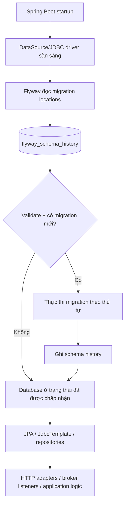
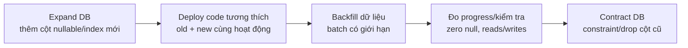
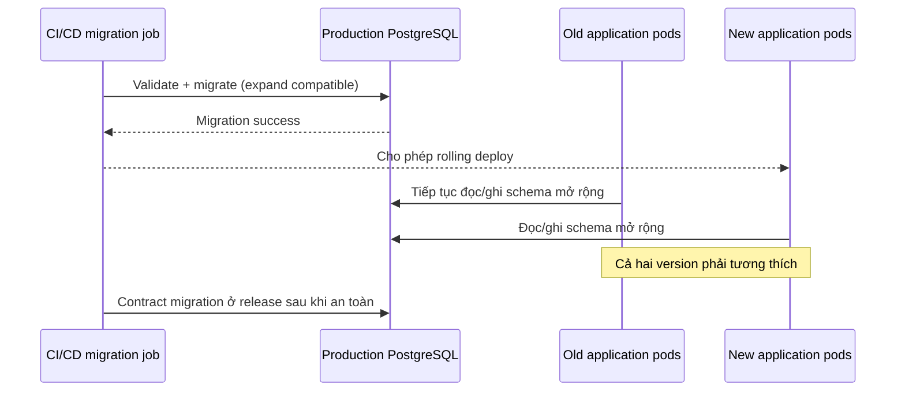
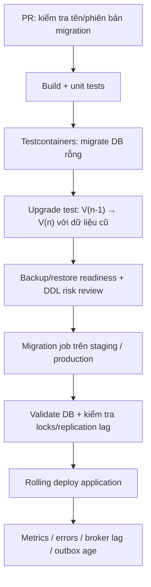

# Tích hợp Flyway và quản lý migration có phiên bản

## 1. Vì sao tích hợp database cần migration có kiểm soát?

Trong module **SPRING_BOOT_INTEGRATION**, một ứng dụng có thể nhận yêu cầu HTTP, ghi đơn hàng vào PostgreSQL, đọc cache Redis và phát sự kiện Kafka thông qua transactional outbox. Mỗi lần thay đổi mã nguồn, định dạng dữ liệu hoặc hợp đồng sự kiện, cấu trúc database có thể cũng phải thay đổi. Nếu ứng dụng đã mong đợi cột `external_reference` trong khi database production chưa có cột đó, lỗi sẽ xuất hiện ngay lúc truy vấn; ngược lại, nếu DBA xóa một cột khi vẫn còn một replica cũ đang dùng, quá trình rolling deployment có thể gián đoạn.

Những thay đổi như sau đều cần được quản lý:

- Tạo bảng `orders`, `integration_outbox`, `processed_event`.
- Thêm cột `schema_version`, `correlation_id` hoặc một cột nullable trước khi triển khai tính năng mới.
- Tạo chỉ mục để truy vấn outbox hoặc consumer inbox không làm nghẽn database.
- Bổ sung ràng buộc unique cho `event_id` nhằm chống xử lý trùng.
- Chuyển đổi dữ liệu cũ trước khi đổi kiểu, đặt `NOT NULL` hoặc loại bỏ một cột.
- Duy trì view/reference data được nhiều adapter cùng sử dụng.

**Flyway** là công cụ quản lý phiên bản schema theo migration scripts. Thay vì “mỗi môi trường tự chạy SQL khi cần”, mỗi thay đổi được lưu thành một tệp có tên theo quy ước, đặt trong source control, được Flyway theo dõi bằng **schema history table**. Spring Boot có tích hợp Flyway tại giai đoạn khởi tạo ứng dụng, giúp cập nhật database trước khi các thành phần phụ thuộc bắt đầu sử dụng schema.

### Mục tiêu học tập

Sau bài này, bạn có thể:

1. Cài đặt Flyway trong Spring Boot và đặt SQL migration ở đúng `classpath:db/migration`.
2. Phân biệt **versioned migrations** (`V...`) với **repeatable migrations** (`R...`), thứ tự và tính bất biến của chúng.
3. Hiểu `flyway_schema_history`, checksum, validate, repair, baseline, clean và các trạng thái lỗi.
4. Kết hợp Flyway với Spring JDBC/JPA mà không để Hibernate `ddl-auto` hoặc `schema.sql` cùng tranh quyền tạo schema.
5. Thiết kế migration tương thích với **rolling deployment**, backfill, index và dữ liệu lớn.
6. Điều phối migration ở CI/CD, nhiều replica, nhiều datasource hoặc schema, với tài khoản được cấp quyền thích hợp.
7. Viết integration tests và quy trình xử lý sự cố migration thất bại.

> **Phạm vi ví dụ:** Java 17+, Spring Boot 3.x (đặc biệt các ví dụ tương thích Spring Boot 3.5), PostgreSQL và Flyway được quản lý phiên bản bằng Spring Boot BOM. Các bản Flyway mới có mô-đun hỗ trợ database riêng, chẳng hạn `flyway-database-postgresql`; cần kiểm tra version chính xác khi áp dụng với MySQL/Oracle/SQL Server. Lệnh và dữ liệu minh họa không nên chạy nguyên vẹn trên production mà chưa được đánh giá khóa, downtime và quyền dữ liệu.

## 2. Cơ chế Flyway trong vòng đời Spring Boot

Flyway lưu **lịch sử migration đã áp dụng** vào một bảng trong database. Khi ứng dụng được khởi động với Flyway auto-configuration phù hợp:

1. Spring Boot chuẩn bị `DataSource` và cấu hình Flyway.
2. Flyway xác định những migration trên classpath và đọc schema history.
3. Flyway kiểm tra lịch sử/version/checksum theo cấu hình.
4. Flyway thực thi những migration mới cần áp dụng, ghi kết quả vào history.
5. Các thành phần được Spring Boot nhận diện là phụ thuộc vào database initialization mới tiếp tục khởi tạo theo thứ tự phù hợp.



Hình trên biểu diễn **thứ tự logic**, không cam kết mọi bean do người dùng tạo sẽ tự nhận biết dependency. Một custom bean kết nối DB trong constructor hoặc một background thread tự khởi chạy có thể cần cấu hình quan hệ phụ thuộc với database initialization.

### 2.1. Migration không thay thế application transaction

Flyway quản lý thay đổi schema và dữ liệu theo migration. Nó **không**:

- Biến `@Transactional` trên service thành distributed transaction giữa DB và Kafka/HTTP.
- Tự bảo đảm không xử lý trùng event.
- Tự đồng bộ hợp đồng JSON/API giữa producer và consumer.
- Tự quyết định lúc nào an toàn để xóa cột trong một hệ nhiều replica.
- Tự sao lưu hoặc rollback thay đổi DDL trong mọi loại database.

Migration tốt phải đi cùng **application compatibility**, transaction boundaries, idempotency, kiểm thử và quy trình triển khai.

## 3. Dependency Flyway và PostgreSQL trong Spring Boot

Với Maven dùng Spring Boot parent/BOM:

```xml
<!-- pom.xml: phần dependencies -->
<dependency>
    <groupId>org.springframework.boot</groupId>
    <artifactId>spring-boot-starter-jdbc</artifactId>
</dependency>
<dependency>
    <groupId>org.postgresql</groupId>
    <artifactId>postgresql</artifactId>
    <scope>runtime</scope>
</dependency>
<dependency>
    <groupId>org.flywaydb</groupId>
    <artifactId>flyway-core</artifactId>
</dependency>
<dependency>
    <groupId>org.flywaydb</groupId>
    <artifactId>flyway-database-postgresql</artifactId>
</dependency>
```

Nếu dùng Gradle:

```groovy
dependencies {
    implementation 'org.springframework.boot:spring-boot-starter-jdbc'
    runtimeOnly 'org.postgresql:postgresql'
    implementation 'org.flywaydb:flyway-core'
    runtimeOnly 'org.flywaydb:flyway-database-postgresql'
}
```

Trong những dòng Flyway mới, hỗ trợ PostgreSQL nằm ở mô-đun bổ sung; thiếu nó có thể dẫn tới lỗi kiểu `Unsupported Database` hoặc không nhận diện database dù JDBC driver vẫn hoạt động. Sử dụng **version Flyway mà Spring Boot BOM quản lý**, tránh trộn tùy ý `flyway-core` bản mới với database module bản cũ.

Nếu ứng dụng dùng JPA, thay hoặc bổ sung starter tương ứng:

```xml
<dependency>
    <groupId>org.springframework.boot</groupId>
    <artifactId>spring-boot-starter-data-jpa</artifactId>
</dependency>
```

Khi JPA được dùng, `DataSource` và Flyway vẫn là hai mối quan tâm riêng: JPA quản lý entities/query còn Flyway quản lý **thay đổi schema đã được version hóa**.

### 3.1. Cấu hình `application.yml`

```yaml
spring:
  datasource:
    url: jdbc:postgresql://localhost:5432/orders
    username: ${DB_USERNAME}
    password: ${DB_PASSWORD}
    hikari:
      maximum-pool-size: 10
      connection-timeout: 2s

  flyway:
    enabled: true
    locations: classpath:db/migration
    validate-on-migrate: true
    clean-disabled: true

  jpa:
    hibernate:
      ddl-auto: validate

  sql:
    init:
      mode: never
```

Ý nghĩa:

- `spring.flyway.locations` xác định nơi chứa SQL migrations; mặc định phổ biến của Spring Boot là `classpath:db/migration`.
- `validate-on-migrate` yêu cầu kiểm tra lịch sử và migration trước khi áp dụng theo semantics phiên bản Flyway.
- `clean-disabled` giúp chặn thao tác `clean` nguy hiểm thông qua Flyway.
- `ddl-auto: validate` để Hibernate **so khớp entity với schema**, không tự tạo/xóa bảng.
- `spring.sql.init.mode: never` vô hiệu hóa đường chạy `schema.sql`/`data.sql` của Spring Boot SQL initializer, tránh hai cơ chế cùng làm thay đổi schema.

**Chỉ bật `ddl-auto: validate` khi project thực sự có JPA.** Với Spring JDBC thuần, bỏ nhánh `spring.jpa`. Nếu database là local/test chưa có tài khoản, có thể dùng môi trường thử nghiệm riêng; không commit credentials vào Git.

### 3.2. Cấu hình hạ tầng và bảo mật

Các môi trường khác nhau có thể cung cấp `DB_USERNAME`/`DB_PASSWORD` bằng secret manager hoặc biến môi trường. Không đưa password trực tiếp vào migration SQL, `application.yml` commit công khai, log hoặc tài liệu.

Kết nối PostgreSQL production thường cần driver-level TLS phù hợp, ví dụ `sslmode=verify-full` và CA root được quản lý. **Flyway không tự làm cho JDBC driver bật hostname verification** chỉ vì ứng dụng đã có một Spring SSL bundle khác.

## 4. Cấu trúc thư mục migration

Quy ước điển hình:

```text
src/main/resources/
└── db/
    └── migration/
        ├── V1__create_orders_and_outbox.sql
        ├── V2__add_external_reference.sql
        ├── V3__create_outbox_indexes.sql
        └── R__orders_reporting_view.sql
```

Tên tệp thường có các thành phần:

```text
V<version>__<description>.sql
R__<description>.sql
```

Trong đó:

- `V`: **versioned migration**; version thường tăng theo chuỗi số/phần, ví dụ `1`, `2`, `2_1`.
- `__`: **hai dấu gạch dưới** ngăn version và description.
- `description`: mô tả dễ đọc, thường dùng chữ thường và dấu gạch dưới.
- `.sql`: SQL migration script theo database dialect.
- `R__`: **repeatable migration**, không có version; chạy khi cần, đặc biệt khi nội dung/checksum thay đổi.

Ví dụ đúng/sai:

| Tên file | Đánh giá | Giải thích |
| --- | --- | --- |
| `V1__create_orders.sql` | Đúng | Version 1, hai dấu gạch dưới |
| `V2_1__add_index.sql` | Đúng | Một phiên bản với thành phần phụ theo quy ước Flyway |
| `R__rebuild_reporting_view.sql` | Đúng | Repeatable, phù hợp view có thể tái tạo |
| `V3_add_index.sql` | Sai quy ước mặc định | Thiếu dấu `__` |
| `create_orders.sql` | Không phải migration chuẩn theo prefix mặc định | Flyway có thể không nhận theo naming pattern |
| `R2__view.sql` | Không phải repeatable prefix mặc định | Repeatable không mang version |

Flyway cho phép tùy chỉnh prefix/suffix/separator, nhưng trong dự án mới nên ưu tiên tên mặc định để công cụ và người đọc đều hiểu.

### 4.1. Tệp đã áp dụng phải bất biến

Sau khi `V1__create_orders_and_outbox.sql` đã chạy ở staging hoặc production, **không sửa nội dung để “hoàn thiện V1”**. Flyway lưu checksum của script và có thể phát hiện file hiện tại không còn khớp bản đã được áp dụng.

Nếu cần sửa schema, tạo một migration **mới** như `V4__add_order_reference_constraint.sql`. Lịch sử migration cần biểu diễn con đường thay đổi thực tế để mọi môi trường đều đi cùng một lộ trình, không dựa vào trạng thái cuối của database trên máy tác giả.

### 4.2. Version không nhất thiết bằng số release ứng dụng

Migration version cần có **thứ tự nhất quán** và không trùng. Có thể dùng version tăng dần (`V1`, `V2`, `V3`) hoặc một quy ước timestamp được thống nhất và tránh trùng khi nhiều nhánh phát triển.

Khi hai team cùng tạo `V7`, merge conflict cần được giải quyết **trước khi release**. Không mặc định bật `out-of-order` chỉ để tránh phải điều phối phiên bản; hãy đánh giá môi trường nào đã áp dụng script và đường tương thích.

## 5. Ví dụ V1: tạo bảng đơn hàng và transactional outbox

Hãy thiết kế migration đầu tiên cho `order-service`. Tài liệu ví dụ sử dụng PostgreSQL:

```sql
-- src/main/resources/db/migration/V1__create_orders_and_outbox.sql

CREATE TABLE orders (
    order_id VARCHAR(80) PRIMARY KEY,
    order_status VARCHAR(32) NOT NULL,
    currency CHAR(3) NOT NULL,
    total_amount NUMERIC(20, 2) NOT NULL,
    created_at TIMESTAMPTZ NOT NULL,
    version BIGINT NOT NULL DEFAULT 0,
    CONSTRAINT chk_orders_total_nonnegative
        CHECK (total_amount >= 0)
);

CREATE TABLE integration_outbox (
    event_id VARCHAR(80) PRIMARY KEY,
    aggregate_id VARCHAR(80) NOT NULL,
    event_type VARCHAR(120) NOT NULL,
    schema_version INTEGER NOT NULL,
    payload_json JSONB NOT NULL,
    created_at TIMESTAMPTZ NOT NULL,
    published_at TIMESTAMPTZ NULL,
    attempt_count INTEGER NOT NULL DEFAULT 0,
    CONSTRAINT chk_outbox_attempt_nonnegative
        CHECK (attempt_count >= 0)
);
```

Tại sao có những cột này?

| Cột | Vai trò trong tích hợp |
| --- | --- |
| `order_id` | Opaque business ID; không dùng Kafka offset làm ID đơn hàng |
| `order_status` | Trạng thái nghiệp vụ theo hợp đồng riêng |
| `currency`, `total_amount` | Tiền tệ và số tiền `NUMERIC`, tránh lưu `double` |
| `created_at` | Thời điểm tạo, ứng dụng sử dụng timestamp có offset/UTC semantics |
| `version` | Có thể dùng optimistic locking nếu repository/entity hỗ trợ |
| `event_id` | Định danh sự kiện để chống gửi/xử lý trùng phù hợp |
| `schema_version` | Version contract của event payload, không phải Flyway DB version |
| `payload_json` | Nội dung sự kiện sẽ publish; cần chính sách dữ liệu và retention |
| `published_at` | Đánh dấu khi publisher ghi nhận thành công theo chính sách |
| `attempt_count` | Quan sát retry và tránh retry vô hạn |

**Hai loại version khác nhau:** `V1` trong filename là phiên bản **database migration**; `schema_version` trong outbox là phiên bản **dữ liệu event**. Không gộp hai khái niệm: database có thể nâng schema mà wire contract vẫn V1, hoặc ngược lại.

### 5.1. Không mặc định thêm `IF NOT EXISTS` vào mọi DDL

Ví dụ:

```sql
-- Không mặc định dùng nếu mục tiêu là phát hiện schema drift:
CREATE TABLE IF NOT EXISTS orders (...);
```

Có thể che giấu môi trường đã tồn tại một bảng `orders` **khác cấu trúc**. Trong migration đã được version hóa, nên để script **thất bại có tín hiệu rõ** nếu tiền điều kiện không đúng, hoặc viết precondition/check có chủ đích. `IF NOT EXISTS` chỉ phù hợp khi đã phân tích trạng thái trước đó và có kiểm chứng schema tương đương.

### 5.2. Ràng buộc unique là một phần hợp đồng bền vững

Một inbox table có thể cần:

```sql
CREATE TABLE processed_integration_event (
    consumer_name VARCHAR(100) NOT NULL,
    event_id VARCHAR(80) NOT NULL,
    processed_at TIMESTAMPTZ NOT NULL,
    PRIMARY KEY (consumer_name, event_id)
);
```

Primary key theo `consumer_name, event_id` là quyết định phạm vi idempotency: cùng một event có thể được các consumer khác nhau xử lý độc lập, nhưng không nên tạo side effect hai lần trong **cùng consumer workflow**.

Để chống race, nghiệp vụ phải ghi receipt và business state **trong cùng transaction** phù hợp. Flyway tạo constraint; nó không tự thêm idempotency logic vào `@KafkaListener`.

## 6. V2: thêm cột theo hướng tương thích lùi

Giả sử ứng dụng muốn ghi mã đối chiếu từ đối tác:

```sql
-- V2__add_external_reference.sql
ALTER TABLE orders
    ADD COLUMN external_reference VARCHAR(128);
```

Cột mới cho phép `NULL` ở giai đoạn đầu, vì dữ liệu cũ chưa có `external_reference`. Đây là bước **expand**:

- Ứng dụng cũ không cần biết cột mới nên có thể tiếp tục hoạt động.
- Ứng dụng mới có thể bắt đầu đọc/ghi cột khi deployment phù hợp.
- Backfill dữ liệu cũ được thực hiện theo kế hoạch, không buộc migration startup quét hàng triệu rows.
- Ràng buộc `NOT NULL` hoặc loại bỏ cột cũ chỉ được triển khai sau khi xác minh tất cả code và dữ liệu tương thích.

Đây là thiết kế quan trọng cho Kubernetes rolling deployment: trong một thời gian ngắn, có thể tồn tại **old pods và new pods cùng truy cập một database**.

### 6.1. Mô hình expand → migrate → contract



**Không xóa cột cũ cùng release với code mới** nếu còn replica, consumer hoặc integration batch job sử dụng cột đó. Tương tự, tránh đổi tên cột trực tiếp khi nhiều phiên bản service cùng chạy; có thể thêm cột mới, ghi song song có kiểm soát, chuyển reads rồi mới loại bỏ.

### 6.2. Backfill dữ liệu lớn không nên mặc định chạy ở startup

Ví dụ backfill đơn giản trên một bảng **nhỏ và được quản lý**:

```sql
UPDATE orders
SET external_reference = order_id
WHERE external_reference IS NULL;
```

Trên bảng hàng chục triệu rows, câu SQL có thể:

- Giữ lock lâu hoặc gây I/O/WAL lớn.
- Làm replication lag tăng.
- Khiến query/consumer processing chậm.
- Vượt thời gian startup/deployment.
- Khó rollback tác động dữ liệu khi chạy một lần toàn bảng.

Với dữ liệu lớn, nên thiết kế **backfill job riêng**: quét theo khóa ổn định, cập nhật batch nhỏ, có checkpoint/progress, giới hạn QPS, xử lý idempotent và quan sát replication lag. Chỉ thêm `NOT NULL`/constraint sau khi backfill đã hoàn thành và đã kiểm chứng.

## 7. V3: chỉ mục cho outbox và giới hạn khóa trên production

Một publisher thường truy vấn các event chưa được gửi:

```sql
SELECT event_id, aggregate_id, event_type, payload_json
FROM integration_outbox
WHERE published_at IS NULL
ORDER BY created_at, event_id
LIMIT 100;
```

Với bảng vừa hoặc nhỏ, migration có thể thêm chỉ mục:

```sql
-- V3__create_outbox_indexes.sql
CREATE INDEX idx_outbox_pending
    ON integration_outbox (created_at, event_id)
    WHERE published_at IS NULL;
```

Một index đúng giúp giảm chi phí scan, nhưng tạo index trên bảng lớn có thể ảnh hưởng write load và lock. Với PostgreSQL production, cân nhắc `CREATE INDEX CONCURRENTLY` nếu cần giảm thời gian chặn writes:

```sql
-- Minh họa cú pháp PostgreSQL, KHÔNG chạy trong transaction block:
CREATE INDEX CONCURRENTLY idx_outbox_pending
    ON integration_outbox (created_at, event_id)
    WHERE published_at IS NULL;
```

**Đặc biệt quan trọng:** `CREATE INDEX CONCURRENTLY` của PostgreSQL **không được phép chạy trong transaction block**. Flyway thường chạy migration SQL trong transaction trên database hỗ trợ DDL transactions. Khi sử dụng concurrent index, phải:

1. Tạo **migration riêng** cho thao tác không chạy trong transaction.
2. Cấu hình script execution là non-transactional theo khả năng phiên bản Flyway (ví dụ cấu hình script kèm `executeInTransaction=false`).
3. Không trộn statement cần transaction và không transaction mà chưa xem `mixed` policy.
4. Chuẩn bị phương án phục hồi nếu concurrent index build thất bại và để lại **invalid index**; kiểm tra trạng thái index trước khi retry.
5. Test với PostgreSQL version, lưu lượng và migration strategy giống production.

`CREATE INDEX CONCURRENTLY` không phải là “không lock” hoặc “không tốn tài nguyên”; nó vẫn có chi phí CPU, I/O và có thể mất nhiều thời gian. Không đưa nó vào startup path mà không xét readiness, deployment timeout và rollback.

### 7.1. Script configuration riêng (khi phiên bản Flyway hỗ trợ)

Ví dụ đặt tệp cấu hình cạnh script:

```text
db/migration/
  V4__create_large_index_concurrently.sql
  V4__create_large_index_concurrently.sql.conf
```

Nội dung tệp `.sql.conf`:

```properties
executeInTransaction=false
```

Và nội dung `V4__create_large_index_concurrently.sql` là một câu `CREATE INDEX CONCURRENTLY ...` phù hợp. Đoạn này mô tả một **tùy chọn của Flyway cho migration theo script**, không yêu cầu bạn thêm tệp khác ngoài bài Markdown đang học. Cần đối chiếu khả năng hỗ trợ và chính sách execution ở đúng bản Flyway; một số database/statement có behavior khác PostgreSQL.

## 8. Repeatable migration: phù hợp view và các đối tượng có thể định nghĩa lại

Repeatable migration dùng prefix `R__` và không có version:

```sql
-- R__orders_reporting_view.sql
CREATE OR REPLACE VIEW reporting_orders AS
SELECT
    order_id,
    order_status,
    currency,
    total_amount,
    created_at
FROM orders;
```

Ý nghĩa:

- Flyway lưu checksum của repeatable script.
- Khi nội dung script thay đổi, Flyway có thể chạy lại script ở lần migrate tiếp theo.
- Repeatable migrations thường được áp dụng sau các versioned migrations đang chờ theo cơ chế sắp xếp của Flyway.
- Vì có thể chạy lại, nội dung nên **idempotent hoặc có khả năng định nghĩa lại an toàn**.

**Không dùng `R__` cho mọi thay đổi dữ liệu một lần**. Ví dụ insert một khoản phí giao dịch có side effect rồi chạy lại khi comment thay đổi có thể tạo dữ liệu trùng nếu không có constraint/upsert phù hợp. Những thay đổi schema/data **một lần và có thứ tự** thường thuộc versioned migrations.

### 8.1. Khi nào versioned, khi nào repeatable?

| Nhu cầu | Chọn | Vì sao |
| --- | --- | --- |
| Tạo bảng và cột mới | `V__` | Một thay đổi lịch sử có thứ tự |
| Thêm constraint/index | `V__` | Cần biết lần đầu áp dụng và hậu quả DDL |
| Chuyển đổi dữ liệu cũ một lần | `V__` hoặc backfill job có kiểm soát | Không nên tự chạy lại mỗi lần checksum đổi |
| Định nghĩa lại view | `R__` | Có thể tạo lại toàn bộ theo nội dung hiện tại |
| Stored procedure/function có thể thay thế | `R__` khi phù hợp dialect | Dễ quản lý theo nội dung mới nhất |
| Seed dữ liệu tham chiếu thay đổi | Có thể `R__` nếu upsert/replace **thật sự an toàn** | Cần rõ authority và việc xóa/sửa dữ liệu |

Đừng dùng placeholder có giá trị thay đổi liên tục trong repeatable script nếu không chủ đích làm checksum thay đổi và buộc script chạy lại. Trong Flyway, thay đổi placeholder có thể ảnh hưởng checksum của repeatable migration.

## 9. Schema history, version và checksum

Flyway quản lý một bảng lịch sử, mặc định thường có tên `flyway_schema_history`. Với PostgreSQL, có thể quan sát:

```sql
SELECT
    installed_rank,
    version,
    description,
    type,
    script,
    checksum,
    installed_on,
    success
FROM flyway_schema_history
ORDER BY installed_rank;
```

Ví dụ dữ liệu minh họa:

| installed_rank | version | description | script | success |
| ---: | --- | --- | --- | --- |
| 1 | 1 | create orders and outbox | `V1__create_orders_and_outbox.sql` | true |
| 2 | 2 | add external reference | `V2__add_external_reference.sql` | true |
| 3 | 3 | create outbox indexes | `V3__create_outbox_indexes.sql` | true |
| 4 | *null* | orders reporting view | `R__orders_reporting_view.sql` | true |

`version` của repeatable migration không giống một số version cụ thể; Flyway ghi nhận repeatable theo cơ chế lịch sử của nó. Tên history table/schema có thể được cấu hình lại, và quyền xem tùy database user.

### 9.1. Checksum dùng để làm gì?

Flyway có thể tính **checksum từ nội dung script**. Khi một versioned script đã được chạy ở production mà người phát triển sửa lại nội dung trong Git, việc validate có thể báo mismatch.

```text
Production history:
  V2__add_external_reference.sql → checksum X

Artifact mới:
  V2__add_external_reference.sql → checksum Y

Nếu X != Y:
  cần điều tra source/version/drift, không tự ghi đè lịch sử.
```

Một script mới có version lớn hơn có thể sửa lỗi schema. **Sửa tệp V2 cũ rồi chạy `repair` để khớp checksum mới** có thể che đi khác biệt giữa những môi trường đã chạy V2 trước và những môi trường mới chưa chạy.

### 9.2. Trạng thái `Pending`, `Success`, `Failed` và `Out of Order`

Flyway có hệ thống trạng thái migration đa dạng phụ thuộc loại script và thông tin history. Một vài trường hợp người vận hành hay gặp:

- Migration tồn tại trên classpath nhưng chưa áp dụng: **pending**.
- Migration đã áp dụng thành công: **success**.
- Migration dừng giữa chừng trên database không thể rollback DDL đầy đủ: có thể xuất hiện **failed** history hoặc schema dở dang.
- Migration mới có version **thấp hơn** version cao nhất đã áp dụng: có thể là trạng thái out-of-order/ignored/missing tùy cấu hình.
- Migration trong history không còn có file tương ứng: cần phân biệt artifact packaging sai, xóa nhầm file hay intentional baseline/retention.

Khi một môi trường khác nhau báo trạng thái khác nhau, không chỉ nhìn số `V3` mà phải kiểm tra **file thực tế trong artifact, history, checksum và schema hiện có**.

## 10. Các lệnh/hoạt động quan trọng: migrate, validate, info, repair, baseline, clean

| Hoạt động Flyway | Mục đích | Cảnh báo |
| --- | --- | --- |
| `migrate` | Áp dụng migration đang chờ theo version và policy | Có thể thực thi DDL/data changes; phải kiểm soát deployment |
| `validate` | Kiểm tra lịch sử migrations đã áp dụng có phù hợp những file hiện tại hay không | Không phải schema diff đầy đủ, không chứng minh mọi bảng không bị sửa tay |
| `info` | Xem trạng thái các migration đã biết | Thích hợp điều tra trước rollout |
| `repair` | Điều chỉnh metadata của schema history trong những tình huống được hỗ trợ | **Không sửa schema thực tế**, dễ che drift nếu dùng sai |
| `baseline` | Đánh dấu mốc bắt đầu quản lý một schema đang tồn tại | Không tự tạo lại các bảng trước baseline |
| `clean` | Xóa các database objects trong schema được Flyway quản lý | **Phá hủy dữ liệu**, cấm ở production |

Trong Spring Boot, startup với Flyway auto-config thường gọi quá trình migrate theo cấu hình. Các lệnh `info`, `validate`, `repair`, `baseline` có thể chạy qua Flyway CLI, Maven/Gradle plugin hoặc một công cụ quản trị riêng **nếu được cấu hình đúng database, credentials và version**.

Đừng gợi ý chạy `mvn flyway:migrate` một cách máy móc khi dự án chưa khai báo Flyway Maven Plugin và không có URL/credentials cho plugin đó. **Dependency `flyway-core` cho ứng dụng Spring Boot không tự đồng nghĩa Maven CLI plugin đã được cấu hình.**

### 10.1. `repair` không phải rollback

Ví dụ một migration DDL thất bại do hết dung lượng, để lại cột đã thêm nhưng lịch sử báo failed. Lệnh `repair` chỉ tác động tới **metadata history**, không đảo ngược cột hay dữ liệu đã được thay đổi. Trước khi dùng:

1. Sao lưu hoặc đảm bảo có snapshot/restore point phù hợp.
2. Kiểm tra trạng thái schema thực, các lock/transactions và lý do lỗi.
3. Chọn sửa schema bằng SQL/rollback/forward fix **được phê duyệt**.
4. Xác định chính xác `repair` sẽ sửa metadata nào.
5. Kiểm tra lại `validate` và thử trên bản sao môi trường.

Không chạy `repair` để “làm xanh pipeline” khi chưa hiểu vì sao checksum khác.

### 10.2. `clean-disabled` là một guardrail quan trọng

Production không nên cho thao tác xóa toàn bộ schema thông qua Flyway. Cấu hình:

```yaml
spring:
  flyway:
    clean-disabled: true
```

Cần kết hợp với database roles có **quyền tối thiểu**. Một tài khoản có quyền `DROP SCHEMA` trên toàn database vẫn có thể phá dữ liệu nếu credential bị lạm dụng; chỉ khóa một API Flyway không thay thế RBAC.

## 11. Database đã tồn tại: baseline thay vì cố chạy V1 lên schema có sẵn

Khi đưa Flyway vào một hệ thống cũ, schema production có thể đã có 50 bảng nhưng **chưa có `flyway_schema_history`**.

Nếu ngay lập tức chạy `V1__create_orders.sql`, Flyway có thể từ chối migrate vì schema không rỗng nhưng chưa có lịch sử, hoặc DDL lỗi do bảng đã tồn tại. Cần một kế hoạch **adoption/baseline**:

1. Kiểm kê schema thực đang chạy trên production, migration thủ công trước đây và version ứng dụng.
2. Chụp baseline schema/data reference và kiểm tra mọi môi trường phù hợp.
3. Chọn baseline version rõ ràng, ví dụ `1` tương ứng với snapshot hiện hành.
4. Đánh dấu history baseline theo quy trình đã thử trên staging.
5. Chỉ áp dụng các version **sau mốc baseline** để mở rộng schema.
6. Kiểm chứng rằng môi trường trống mới vẫn có đường bootstrap hợp lệ.

### 11.1. `baseline-on-migrate` là lựa chọn nhạy cảm

```yaml
spring:
  flyway:
    baseline-on-migrate: true
    baseline-version: 1
```

Trong tình huống phù hợp, `baseline-on-migrate` cho phép Flyway baseline tự động khi migrate vào một schema **không rỗng nhưng chưa có lịch sử**. Đây là **tùy chọn cần giám sát**, không phải cấu hình mặc định cho mọi service.

Rủi ro lớn: nếu URL trỏ nhầm một database/schema đang có dữ liệu, tự baseline có thể bỏ qua bước bảo vệ thường giúp phát hiện **kết nối sai môi trường**. Production nên ưu tiên thao tác baseline có kế hoạch, sau khi kiểm tra chính xác endpoint/schema và trạng thái dữ liệu.

### 11.2. Baseline migration file khác baseline command

Flyway các phiên bản mới có khái niệm **baseline migrations** (tệp bắt đầu bằng `B...` trong điều kiện được hỗ trợ) để rút ngắn việc khởi tạo môi trường mới với nhiều migration lịch sử. Điều này **khác** thao tác `baseline` ghi một marker vào history của schema đang tồn tại.

Không tự thay `V1` thành `B1` và xóa các migration cũ mà chưa hiểu luật chọn baseline migrations, phiên bản Flyway và khả năng tạo mới/replay từng môi trường. Trong bài học này, ví dụ chính chỉ sử dụng **V__ và R__** để tránh phụ thuộc không cần thiết vào chức năng nâng cao.

## 12. Flyway và Hibernate/JPA: một bên sở hữu DDL

Một ứng dụng Spring Data JPA có thể cấu hình:

```yaml
spring:
  jpa:
    hibernate:
      ddl-auto: update
```

Nhưng nếu **Flyway là công cụ quản lý schema chính**, việc để Hibernate tự `update` schema trên production làm mất kiểm soát: mỗi runtime có thể tạo biến đổi schema không nằm trong Git migration history, khó rollback và khác nhau giữa các môi trường.

Khuyến nghị khi dùng Flyway:

```yaml
spring:
  flyway:
    enabled: true
    locations: classpath:db/migration
  jpa:
    hibernate:
      ddl-auto: validate
  sql:
    init:
      mode: never
```

Hoặc `ddl-auto: none` nếu chiến lược kiến trúc/kiểm thử đã có một nguồn khác bảo đảm mapping/schema tương thích.

### 12.1. `validate` của Hibernate không phải `validate` của Flyway

| Kiểm tra | Trả lời câu hỏi nào? |
| --- | --- |
| Flyway `validate` | Migration history có phù hợp với các script/metadata hiện tại không? |
| Hibernate `ddl-auto: validate` | Entity mappings Hibernate có tương thích với schema nó nhìn thấy hay không? |
| Contract tests | Payload HTTP/Kafka có giữ đúng wire schema/semantics không? |
| Integration tests | Flow DB + broker + HTTP có hoạt động đúng với một schema đã migrate thật không? |

Hibernate validate không phát hiện mọi hành vi nghiệp vụ sai hoặc mọi thay đổi schema ít liên quan entities; Flyway validate không phát hiện cột bị sửa ngoài history bằng mọi cách. Cần nhiều lớp kiểm chứng.

### 12.2. Tránh hai hệ tự khởi tạo SQL

Spring Boot có cơ chế chạy `schema.sql` và `data.sql` riêng. Nếu dùng cùng Flyway, cả hai có thể cạnh tranh thứ tự tạo bảng hoặc chèn dữ liệu. Trong một hệ thống tích hợp có nhiều môi trường:

- Dùng Flyway để quản lý schema và seed dữ liệu tham chiếu cần versioning.
- Dùng test fixtures cho dữ liệu thử nghiệm, không đưa mọi dữ liệu giả vào migration production.
- Không dùng `hibernate.hbm2ddl.auto=create-drop` trên production.
- Nếu bắt buộc kết hợp nhiều công cụ, phải định nghĩa thứ tự và quyền sở hữu từng schema rõ ràng, thay vì dựa vào hành vi auto-detection.

## 13. Khởi tạo ứng dụng: thứ tự DataSource, Flyway, JPA và custom beans

Spring Boot có cơ chế xác định các bean phụ thuộc database initialization. Trong trường hợp thông thường, Flyway chạy trước khi EntityManagerFactory cần schema được khởi tạo.

Tuy nhiên, custom bean có thể query database khi khởi tạo quá sớm, chẳng hạn:

```java
// Anti-pattern: query DB trực tiếp trong constructor
@Component
class BadCacheWarmup {
    BadCacheWarmup(JdbcTemplate jdbc) {
        jdbc.queryForList("SELECT * FROM orders");
    }
}
```

Nếu bean được khởi tạo trước khi migration hoàn tất, nó có thể báo `relation "orders" does not exist`. Một số bean phụ thuộc dữ liệu khởi tạo có thể được đánh dấu:

```java
package example.integration.init;

import org.springframework.boot.sql.init.dependson.DependsOnDatabaseInitialization;
import org.springframework.boot.ApplicationRunner;
import org.springframework.context.annotation.Bean;
import org.springframework.context.annotation.Configuration;
import org.springframework.jdbc.core.JdbcTemplate;

@Configuration(proxyBeanMethods = false)
public class ReferenceDataWarmupConfiguration {

    @Bean
    @DependsOnDatabaseInitialization
    ApplicationRunner referenceDataWarmup(JdbcTemplate jdbc) {
        return args -> {
            Integer count = jdbc.queryForObject(
                    "SELECT COUNT(*) FROM orders", Integer.class);
            System.out.println("Existing orders: " + count);
        };
    }
}
```

Ở đây `ApplicationRunner` chạy sau khi application context được khởi tạo; annotation thể hiện dependency rõ ràng cho bean và có thể hữu ích khi xử lý các bean startup tùy biến. Trong ứng dụng thật, không nên dùng `System.out.println` để đo production data; dùng metric/log có kiểm soát và tránh kéo dài startup vì full scan.

### 13.1. Broker listener và scheduled jobs

Một `@KafkaListener` có thể bắt đầu tiêu thụ sự kiện ngay sau khi container được kích hoạt. Nếu migration kéo dài hoặc database chưa sẵn sàng, handler có thể thất bại, retry liên tục hoặc làm consumer lag tăng.

Thực hành tốt:

- Chỉ cho listener/adapter bắt đầu khi database schema đã sẵn sàng.
- Không tự spawn thread trong constructor vượt qua lifecycle của Spring Boot.
- Gắn readiness với điều kiện có ý nghĩa, nhưng không biến mọi lỗi DB tạm thời thành liveness restart storm.
- Với migration lớn, **tách migration ra deploy stage** thay vì để listener khởi động đồng thời với DDL nặng.

## 14. Migration và nhiều replica: tại sao startup không luôn là nơi tốt nhất?

Mặc định, khi nhiều bản sao ứng dụng Spring Boot cùng khởi động với Flyway bật, mỗi bản sao đều có thể cố khởi chạy migration. Flyway sử dụng schema history/locking theo khả năng database để tránh áp cùng một migration đồng thời theo cách thông thường. Tuy nhiên:

- Replica có thể phải **chờ lock**, kéo dài startup.
- Nếu migration lớn, các instance mới không Ready trong thời gian dài.
- DB/proxy có thể bị áp lực connection và DDL lock.
- Nếu một migration lỗi, nhiều replica cùng fail startup/retry, gây sự cố rollout.
- Flyway locking không sửa được migration **không tương thích với code cũ** vẫn đang chạy.



### 14.1. Hai chiến lược vận hành

| Chiến lược | Ưu điểm | Hạn chế |
| --- | --- | --- |
| **Flyway chạy lúc app startup** | Dễ setup, tiện local/dev/test | DDL ảnh hưởng readiness, lock, lỗi startup khi nhiều replicas |
| **Migration job độc lập trong pipeline** | Kiểm soát người chạy, quyền DDL, logs và gates trước rollout | Phải đảm bảo app không chạy `migrate` ngoài ý muốn và pipeline có quy trình rollback |

Trong production nhiều replica, migration job riêng thường giúp dễ kiểm soát hơn:

1. Build và kiểm tra artifact chứa migrations.
2. Backup/restore point theo mức rủi ro.
3. Chạy migrate một lần bằng account DDL đã giới hạn quyền.
4. Validate kết quả schema và metrics.
5. Chạy rolling deployment ứng dụng mới dùng account runtime có quyền hạn chế.
6. Thực thi contract cleanup ở một release sau khi đủ điều kiện.

Nếu pipeline quản lý migration riêng, có thể đặt `spring.flyway.enabled=false` cho **ứng dụng runtime**, trong khi migration job dùng Flyway riêng hoặc profile chuyên biệt. Điều này phải được xác minh qua profile/secret/CI; không để deploy mới chạy trên DB cũ khi job migration chưa thành công.

## 15. Vai trò tài khoản runtime và migration

Trong hệ thống sản xuất, tài khoản ứng dụng cần `SELECT/INSERT/UPDATE/DELETE` theo nguyên tắc tối thiểu, còn migration có thể cần `CREATE/ALTER/DROP`. Cho runtime full DDL permissions làm tăng rủi ro nếu credential lộ hoặc application bị khai thác.

Spring Boot hỗ trợ cấu hình Flyway kết nối riêng qua các thuộc tính:

```yaml
spring:
  datasource:
    url: jdbc:postgresql://db.internal.example:5432/orders
    username: ${DB_RUNTIME_USER}
    password: ${DB_RUNTIME_PASSWORD}

  flyway:
    url: jdbc:postgresql://db.internal.example:5432/orders
    user: ${DB_MIGRATION_USER}
    password: ${DB_MIGRATION_PASSWORD}
    locations: classpath:db/migration
```

Trong ví dụ, `spring.flyway.url/user/password` khiến Flyway dùng thông tin kết nối phù hợp cho migration. Tùy cách cấu hình Spring Boot/bean và phiên bản, có thể kết nối bằng riêng credentials hoặc DataSource dành cho migration.

**Ranh giới bảo mật:** nếu Flyway chạy **trong cùng process với ứng dụng**, runtime process vẫn có thể nhìn thấy credential DDL; việc dùng hai user chỉ tách quyền của **connection nghiệp vụ** và connection migration, không tạo cô lập hoàn toàn. Để giảm quyền của runtime, nên chạy migration job riêng và **không cấp DDL secret cho ứng dụng serving traffic**.

### 15.1. Flyway DataSource riêng bằng annotation

Spring Boot hỗ trợ `@FlywayDataSource` để chỉ định DataSource dùng cho Flyway nếu ứng dụng có nhiều bean. Ví dụ mô hình:

```text
PrimaryDataSource (runtime user, pool phục vụ API)
MigrationDataSource @FlywayDataSource (DDL user, chỉ dùng Flyway)
```

Khi tự cấu hình, phải xử lý `@Primary`/`@Qualifier`, binding và lifecycle phù hợp. Đừng tạo DataSource migration dùng chung connection pool lớn phục vụ request nếu nó chỉ chạy migration một lần.

## 16. Nhiều datasource và schema: tránh migrate nhầm nơi

Một ứng dụng tích hợp có thể dùng:

```text
ordersDataSource       → orders database/schema
reportingDataSource    → reporting database/schema
auditDataSource        → audit database/schema
```

Chỉ có một `spring.flyway.locations` không đồng nghĩa Flyway tự biết phải chạy script lên cả ba nguồn dữ liệu. Nếu có nhiều DataSource:

1. Xác định **mỗi schema** được quản lý bởi công cụ/migration job nào.
2. Chọn chính xác `DataSource` cho Flyway hoặc tạo các `Flyway` instances riêng một cách có chủ đích.
3. Tách migrations theo schema/hợp đồng để tránh `V1` của Orders va chạm `V1` của Audit trong cùng history.
4. Định nghĩa database user, search path/default schema và nơi đặt history table.
5. Test mỗi migration trên đúng database và tài khoản triển khai.

Ví dụ thiết lập schema PostgreSQL:

```yaml
spring:
  flyway:
    default-schema: orders_app
    schemas: orders_app
    table: flyway_schema_history
    locations: classpath:db/migration/orders
```

Ví dụ này chỉ có hiệu lực nếu schema và quyền tương thích với cấu hình Flyway/PostgreSQL. Cần xác minh việc Flyway tạo schema khi được phép, đường `search_path` của PostgreSQL và sự phù hợp giữa tên bảng không schema-qualified trong SQL với `default-schema`.

**Không sử dụng `schemas: orders_app, reporting, audit` rồi mặc định mọi migration sẽ được áp cùng một cách lên cả ba schema.** `schemas` liên quan tập schema mà Flyway quản lý và nơi lưu history, không phải vòng lặp copy từng script sang mọi schema.

### 16.1. Rủi ro khi dùng nhiều schema/tenant

Multitenancy theo schema khiến mỗi tenant có migration history riêng hoặc một chiến lược trung tâm. Không nên cho mọi instance startup tự chạy migration qua hàng nghìn tenant schemas: quá nhiều DB operations, locking và khó quan sát.

Cần có migration orchestrator/tenant registry, concurrency giới hạn, checkpoint và báo cáo rõ tenant nào đã lên version nào. Schema version drift giữa tenants cần được theo dõi có chủ đích.

## 17. Transactional DDL và khả năng phục hồi khi lỗi

Không phải database nào cũng xử lý DDL trong transaction giống nhau.

| Database | Điều cần lưu ý |
| --- | --- |
| PostgreSQL | Nhiều DDL có thể rollback trong transaction; một số lệnh như `CREATE INDEX CONCURRENTLY` không được chạy trong transaction |
| MySQL | Nhiều DDL có implicit commit/atomic DDL semantics riêng, không tương đương rollback cả migration bằng Spring transaction |
| Oracle | DDL thường có implicit commit; phải lập kế hoạch phục hồi riêng |
| SQL Server | DDL transaction support phụ thuộc câu lệnh, phiên bản và cấu hình |

Với PostgreSQL, một V__ migration SQL thông thường có thể chạy transactionally, giúp rollback toàn bộ nhóm statement nếu có lỗi trong giới hạn mà DB hỗ trợ. Nhưng nếu script chứa lệnh không transactional, hoặc DB không hỗ trợ transaction DDL phù hợp, **một nửa schema có thể đã thay đổi** khi Flyway báo lỗi.

### 17.1. Quy trình xử lý migration lỗi

1. **Dừng rollout** và không để nhiều phiên bản application tiếp tục thực hiện thao tác dựa trên schema không xác định.
2. Thu thập exception gốc, script/version, SQLSTATE, database host/schema và thời điểm lỗi.
3. Xem `flyway_schema_history` để biết history state; đừng chỉ đọc log application.
4. Kiểm tra schema vật lý: bảng/cột/index/constraint thực tế đã tồn tại tới đâu.
5. Đánh giá database snapshot/backup và khả năng rollback DDL theo dialect.
6. Chọn **forward-fix migration hoặc khôi phục** theo quy trình được phê duyệt, xử lý metadata history nếu cần.
7. Chạy `validate`/integration tests trên schema sau phục hồi trước khi tiếp tục rollout.

**Không sửa script V__ đã chạy ở môi trường khác để khớp database đang lỗi**, vì tạo thêm một lịch sử khác biệt khó quản lý.

### 17.2. `out-of-order` không phải công tắc chữa mọi lỗi version

Nếu production đã có V5, một nhánh phát triển mới merge thêm V4 mà production chưa áp dụng, Flyway có thể báo V4 ở trạng thái thấp hơn current version. Bật:

```yaml
spring:
  flyway:
    out-of-order: true
```

cho phép một số trường hợp migration có version thấp được chạy sau migration có version cao. Tuy nhiên, **thứ tự thực tế đã đổi**, nên V4 có thể giả định schema chưa có thay đổi V5 và thất bại hoặc làm sai dữ liệu.

Chỉ dùng khi đã phân tích dependency, test chuỗi thực thi trên bản sao production và có chính sách rõ. Thường an toàn hơn là **đổi version migration chưa được phát hành** để đảm bảo thứ tự chung trước khi release.

## 18. Migration dữ liệu: không biến startup thành batch job không giới hạn

Schema migration và data migration có chung mục đích đưa database tới trạng thái đúng, nhưng khác về rủi ro vận hành.

| Loại thay đổi | Ví dụ | Rủi ro chính |
| --- | --- | --- |
| Metadata/schema nhỏ | Thêm cột nullable vào bảng nhỏ | Lock ngắn, tương thích code |
| Constraint | Thêm unique/foreign key, NOT NULL | Dữ liệu cũ vi phạm, lock/scan |
| Index | Index bảng hàng triệu rows | I/O, WAL, lock, thời gian build |
| Data backfill | Điền giá trị mới cho hàng triệu rows | Transaction dài, replication lag, chiếm pool |
| Type conversion | `VARCHAR` → `NUMERIC` | Không parse được dữ liệu cũ, rewrite table |
| Event/outbox contract | Tạo `schema_version` mới, chuyển payload JSON | Consumer compatibility và idempotency |

### 18.1. Mẫu backfill an toàn hơn

Giả sử muốn tách một trường:

```text
Release A: thêm cột order_status_v2 nullable
Release B: code mới ghi cả cột cũ và mới theo policy
Backfill: batch rows chưa có order_status_v2, có checkpoint
Release C: code đọc cột mới, fallback có kiểm soát nếu null
Release D: kiểm chứng tất cả rows + consumers đã dùng cột mới
Release E: drop cột cũ, đặt constraint ở migration sau
```

Đối với backfill:

- Chọn khóa ổn định và pagination/keyset, tránh quét offset lớn.
- Giới hạn batch size và tốc độ, kiểm tra thời gian transaction.
- Thiết kế **idempotent update** để có thể resume.
- Ghi metrics về tổng số row chưa chuyển, tốc độ, lỗi, lock wait và replication lag.
- Không trộn data backfill và chuyển đổi HTTP/Kafka contract không có rollout strategy.

### 18.2. Migration SQL có nên gọi HTTP API?

Thông thường **không**. Việc một Flyway SQL migration gọi gián tiếp tới API hoặc chạy Java callback phụ thuộc đối tác bên ngoài có thể:

- Treo startup khi đối tác chậm.
- Tạo side effect không rollback được cùng DB transaction.
- Lặp side effect khi retry hoặc repair.
- Khiến schema migration không tái lập được từ môi trường trống.

Nếu cần đồng bộ dữ liệu từ đối tác, triển khai một **integration job/workflow riêng** với checkpoint, idempotency, timeout, retry budget và audit, không nhét vào migration startup.

## 19. Cấu hình Flyway thường gặp trong Spring Boot

| Thuộc tính | Công dụng | Lưu ý |
| --- | --- | --- |
| `spring.flyway.enabled` | Bật/tắt Flyway auto-configuration khi có dependency/điều kiện | Tắt runtime cần một migration stage khác được thực thi chắc chắn |
| `spring.flyway.locations` | Nơi đọc migrations, thường `classpath:db/migration` | Test artifact packaging và classpath |
| `spring.flyway.validate-on-migrate` | Kiểm tra consistency trước migrate | Không tự detect mọi schema drift |
| `spring.flyway.clean-disabled` | Vô hiệu hóa `clean` | Dù có guardrail vẫn phải hạn chế DDL permission |
| `spring.flyway.baseline-on-migrate` | Baseline tự động một số schema đang tồn tại | Production nhạy cảm, tránh trỏ nhầm DB |
| `spring.flyway.baseline-version` | Mốc version dùng khi baseline | Phải phù hợp snapshot/schema thực |
| `spring.flyway.out-of-order` | Cho phép chạy pending version thấp sau version cao khi phù hợp | Có thể đổi dependency order, phải test |
| `spring.flyway.schemas` | Các schemas Flyway quản lý theo khả năng dialect | Không có nghĩa tự clone script vào mọi schema |
| `spring.flyway.default-schema` | Schema mặc định cho Flyway/metadata theo version | Cần đối chiếu PostgreSQL search path |
| `spring.flyway.table` | Tên schema history table | Tránh đổi tùy ý sau khi đã chạy |
| `spring.flyway.url/user/password` | Thông tin DB riêng cho migration | Credential DDL phải bảo vệ |
| `spring.flyway.connect-retries` | Số lần thử lại khi không kết nối được theo khả năng Flyway | Không sửa lỗi sai credential/CA/hostname |
| `spring.flyway.placeholders.*` | Giá trị thay trong SQL khi cần | Không thay linh tinh trong versioned script đã áp dụng |

Các property cụ thể có thể thay đổi tùy Spring Boot/Flyway version; xác minh bằng metadata application properties của **đúng bản** đang sử dụng. Đối với `clean-disabled`, để false trên production là một quyết định bảo mật lớn, không phải cách nhanh để sửa migration lỗi.

### 19.1. Một số rủi ro của placeholders

Ví dụ:

```yaml
spring:
  flyway:
    placeholders:
      application_schema: orders_app
```

Flyway có thể thay placeholder trong SQL:

```sql
-- Ví dụ cú pháp placeholder do Flyway quản lý:
CREATE TABLE ${application_schema}.example_reference (
    code VARCHAR(80) PRIMARY KEY
);
```

Lưu ý quan trọng: việc chèn tên schema qua placeholder không tự escape identifier an toàn cho mọi dialect. Không lấy placeholder từ input người dùng, phải validate/whitelist schema name trước deployment. Thay placeholder giữa môi trường hoặc qua thời gian có thể tạo checksum/schema behavior khác nhau; cần quy trình kiểm soát.

## 20. Kiểm thử migration với database thật

Test JPA repository mock không chứng minh migration có chạy được trên PostgreSQL. Để kiểm thử:

1. Tạo database rỗng bằng Testcontainers hoặc instance test được kiểm soát.
2. Chạy Spring Boot context với Flyway bật và cùng migrations được đóng gói cho production.
3. Kiểm tra schema history và các bảng/cột/constraint/index thiết yếu.
4. Chạy `JdbcTemplate`/JPA query thật với SQL mapping.
5. Kiểm tra consumer/outbox flow đúng khi nâng schema từ version cũ.
6. Thử migration khi có dữ liệu cũ hoặc bản snapshot được ẩn danh để phát hiện incompatible data.

### 20.1. Dependencies test

```xml
<dependency>
    <groupId>org.springframework.boot</groupId>
    <artifactId>spring-boot-starter-test</artifactId>
    <scope>test</scope>
</dependency>
<dependency>
    <groupId>org.springframework.boot</groupId>
    <artifactId>spring-boot-testcontainers</artifactId>
    <scope>test</scope>
</dependency>
<dependency>
    <groupId>org.testcontainers</groupId>
    <artifactId>junit-jupiter</artifactId>
    <scope>test</scope>
</dependency>
<dependency>
    <groupId>org.testcontainers</groupId>
    <artifactId>postgresql</artifactId>
    <scope>test</scope>
</dependency>
```

### 20.2. Integration test cơ bản bằng Testcontainers

```java
package example.integration.migration;

import org.junit.jupiter.api.Test;
import org.springframework.beans.factory.annotation.Autowired;
import org.springframework.boot.test.context.SpringBootTest;
import org.springframework.boot.testcontainers.service.connection.ServiceConnection;
import org.springframework.jdbc.core.JdbcTemplate;
import org.testcontainers.containers.PostgreSQLContainer;
import org.testcontainers.junit.jupiter.Container;
import org.testcontainers.junit.jupiter.Testcontainers;

import static org.assertj.core.api.Assertions.assertThat;

@Testcontainers
@SpringBootTest
class FlywayStartupIT {

    @Container
    @ServiceConnection
    static PostgreSQLContainer<?> postgres =
            new PostgreSQLContainer<>("postgres:16-alpine");

    @Autowired
    JdbcTemplate jdbc;

    @Test
    void migrationCreatesOutboxAndHistory() {
        Integer tableCount = jdbc.queryForObject(
                """
                SELECT COUNT(*)
                FROM information_schema.tables
                WHERE table_schema = 'public'
                  AND table_name IN ('orders', 'integration_outbox')
                """,
                Integer.class);

        assertThat(tableCount).isEqualTo(2);

        Integer successfulMigrations = jdbc.queryForObject(
                "SELECT COUNT(*) FROM flyway_schema_history WHERE success",
                Integer.class);
        assertThat(successfulMigrations).isGreaterThanOrEqualTo(1);
    }
}
```

Đây là skeleton test cho dự án có một `@SpringBootApplication` và profile test sử dụng `public` schema, với đầy đủ SQL migrations được định nghĩa. Testcontainers cần Docker/container runtime hỗ trợ; `@ServiceConnection` là tính năng Spring Boot Testcontainers được giới thiệu từ Boot 3.1.

Test này xác minh **startup + schema outcome**. Đừng chỉ đếm số bảng rồi kết luận migration an toàn cho production: còn cần test dữ liệu cũ, replay, locks, constraints và upgrade path.

### 20.3. Kiểm thử nâng cấp từ schema đã tồn tại

Một nhóm test riêng cần:

```text
Khởi tạo DB với migration đến V1
   → insert dữ liệu mô phỏng production V1
   → chạy V2, V3 của bản ứng dụng mới
   → assert dữ liệu cũ còn nguyên
   → assert code cũ (khi rolling) vẫn đọc/ghi được
   → assert code mới thấy cột/index phù hợp
```

Tạo test fixture với version cụ thể bằng Flyway API/CLI/test setup có kiểm soát; không sửa các file lịch sử đã published. Tình huống này quan trọng hơn test “cài mới từ đầu” khi production có dữ liệu lâu năm.

### 20.4. Kiểm thử checksum và deploy artifact

Cần xác nhận:

- Các tệp `V__`/ `R__` đã được đóng gói vào JAR/image.
- Không có hai migration cùng version/description gây conflict.
- Không có file đổi checksum ngoài dự kiến sau merge/cherry-pick.
- Migrations chạy cùng PostgreSQL version/permissions như production.
- Flyway validate và Hibernate validate (nếu có JPA) đều thành công.

## 21. CI/CD: biến migration thành một điều kiện phát hành

Một pipeline ví dụ:



### 21.1. Quy tắc review migration như code

Mỗi migration nên được code review với các câu hỏi:

- Nó có **đúng schema/database** không?
- Có tương thích với code cũ trong rolling deployment không?
- Có lock lâu, full table rewrite hoặc data scan lớn không?
- Có cần index concurrent/non-transactional không?
- Có dùng thời gian/múi giờ/tiền tệ đúng hợp đồng không?
- Có làm mất dữ liệu hoặc thay quyền/constraint đang được adapter khác dựa vào không?
- Nếu chạy thất bại giữa chừng, trạng thái DB/history là gì?
- Có test upgrade từ dữ liệu cũ, backup/restore và rollback kế hoạch không?

Migrations là **một phần của artifact ứng dụng**, cần PR review, version control, signature/artifact traceability và khả năng audit như thay đổi code.

### 21.2. Triển khai nhiều môi trường

| Môi trường | Chính sách gợi ý |
| --- | --- |
| Local | Có thể để Flyway chạy khi startup, tạo DB thử nghiệm sạch |
| CI | Tạo DB mới, áp toàn bộ migrations, test upgrade path |
| Staging | Migration stage giống production, có dữ liệu đại diện và quyền tương tự |
| Production | Job có kiểm soát, ít quyền, backup và rollout từng bước |

Tránh môi trường local dùng `ddl-auto=create` trong khi CI/prod dùng Flyway: lỗi migration có thể bị che vì entity tự tạo ra cấu trúc mà SQL script chưa tạo.

## 22. Observability và runbook vận hành

Migration là thay đổi quan trọng cần theo dõi. Các tín hiệu:

| Tín hiệu | Diễn giải |
| --- | --- |
| Migration version đã áp dụng | Môi trường đang ở schema version nào |
| Thời gian thực thi từng script | DDL/backfill/index có vượt ngân sách thời gian không |
| Flyway validation failures | Checksum mismatch, missing migration hoặc history sai |
| DB lock wait / active sessions | Migration đang giữ lock cản request |
| DB CPU/IO/WAL/replication lag | Tác động tài nguyên từ DDL/backfill |
| Application startup/readiness | Deployment có bị migration chặn không |
| HTTP 5xx, JDBC exceptions, Kafka consumer lag | Ảnh hưởng của thay schema tới luồng tích hợp |
| Outbox pending age / DLT count | Event có bị kẹt hoặc xử lý sai sau migration |

### 22.1. Runbook khi deployment bị chặn bởi Flyway

**Triệu chứng**: một bản `order-service` mới startup thất bại, log có `FlywayValidateException` hoặc `FlywayMigrateException`.

1. **Đóng băng rollout:** không tiếp tục thay version ứng dụng khi schema chưa được xác minh.
2. **Xác định endpoint/schema thật:** nhầm database URL/profile là một nguyên nhân nguy hiểm.
3. **Kiểm tra file và history:** version, checksum, state, script đã packaged.
4. **Đối chiếu schema vật lý:** đã thay tới đâu, có invalid index hoặc migration dở dang không.
5. **Kiểm tra khóa/traffic:** có DDL chờ transaction dài hoặc giữ lock không.
6. **Đánh giá cách phục hồi:** transactional rollback, forward migration hoặc DB restore theo phê duyệt.
7. **Không dùng `repair` bừa bãi:** chỉ khi hiểu chính xác metadata cần cập nhật.
8. **Chạy lại test/validate** với artifact được phép phát hành trước khi tiếp tục.

### 22.2. Thay đổi dữ liệu và bảo mật

Migration SQL có thể truy cập dữ liệu cá nhân/đơn hàng. Vì vậy:

- Không đưa sample production data thật vào repository để test.
- Hạn chế SQL logs khi có dữ liệu nhạy cảm; không in raw credentials.
- Dùng quyền DDL tạm thời/phân tách workload theo chính sách.
- Có rollback/restore và xác minh phục hồi phù hợp RPO/RTO.
- Theo dõi ai phê duyệt, artifact nào chứa script và version nào đã áp dụng.

## 23. Tình huống thực tế: thêm trạng thái outbox mà không làm hỏng rolling deployment

**Bối cảnh giả định:**

- Service V1 ghi vào `integration_outbox`, chỉ có `published_at` phân biệt đã gửi/chưa gửi.
- Service V2 muốn bổ sung `processing_state` (`PENDING`, `SENDING`, `SENT`, `FAILED`) và worker có retry rõ.
- Production có nhiều replica, một phần vẫn chạy code V1 trong rollout.
- Bảng outbox đã có hàng triệu rows.

### 23.1. Phương án nguy hiểm

```sql
-- Cảnh báo: tránh dùng trực tiếp trên bảng lớn còn old writers
ALTER TABLE integration_outbox
    ADD COLUMN processing_state VARCHAR(32) NOT NULL;
```

Nếu rows cũ chưa có giá trị, migration có thể thất bại hoặc buộc một default/backfill có chi phí không phù hợp. Ngoài ra, code V1 không ghi `processing_state`; nếu cột mới bắt buộc không có default tương thích, request/outbox inserts của old pods có thể lỗi.

### 23.2. Expand an toàn hơn

Migration V5 ví dụ (tiếp theo các migration V1–V4 đã minh họa):

```sql
-- V5__add_outbox_processing_state.sql
ALTER TABLE integration_outbox
    ADD COLUMN processing_state VARCHAR(32);
```

Sau khi cột tồn tại:

1. Deploy code V2 có thể đọc null bằng một **fallback nghiệp vụ** tương thích với `published_at`.
2. Nếu vẫn có old pods, chưa buộc mọi insert cũ phải ghi cột mới.
3. Chạy backfill batches theo ID/time có checkpoint, biến các rows cũ thành trạng thái tương ứng.
4. Giữ một giai đoạn dual-read/dual-write phù hợp cho đến khi old pods không còn.
5. Sau khi đo `NULL processing_state` bằng 0 và đã kiểm tra mọi writers, mới tạo migration V5 đặt constraint/default hoặc bỏ cột cũ.

Nếu thêm default trên DB để giúp old writers, cần xem ảnh hưởng tới semantics: các rows được tạo trong tương lai bởi V1 sẽ nhận trạng thái mặc định nào, và có tương thích với `published_at` không. Không dùng default `PENDING` nếu có thể làm event đã publish bị gửi lại một cách không kiểm soát.

### 23.3. Backfill và idempotency

Outbox publisher có thể bị restart khi backfill đang diễn ra. Nếu code mới gửi lại một event đã được broker nhận mà DB chưa ghi `published_at`, consumer phải có **idempotency** theo `event_id`. Flyway không biến publish thành exactly-once giữa PostgreSQL và Kafka.

Đừng triển khai một migration gọi trực tiếp Kafka để “đồng bộ lại event” khi nó có thể được chạy/khôi phục ở nhiều nơi. Dùng outbox publisher có retry, quan sát và khả năng xử lý trùng.

### 23.4. Kế hoạch rollout

```text
Release 1: Flyway V5 thêm cột nullable
          → deploy V2 app hỗ trợ old/new schema semantics
          → monitor outbox lag và event duplicate rate

Backfill:  chạy job batches có checkpoint
          → xác minh processing_state của rows cũ

Release 2: Flyway V6 thêm constraint/default thích hợp
          → deploy code sử dụng state mới hoàn toàn
          → ngừng đọc cột cũ sau cửa sổ compatibility
```

Đây là một ví dụ thực hành **schema evolution kết hợp message integration**. Thành công không chỉ là Flyway báo `migrate success`, mà là consumer/outbox có thể chạy qua nhiều phiên bản schema mà không mất hoặc xử lý trùng dữ liệu sai.

## 24. Checklist trước khi đưa Flyway migration lên production

1. **Một nguồn sự thật DDL:** Flyway quản lý schema; không trộn tùy tiện với Hibernate `update` và `schema.sql`.
2. **Naming:** tệp `V...__...` và `R__...` đúng quy ước, version unique, script trong artifact.
3. **Immutability:** không sửa versioned migration đã áp dụng; thay đổi mới dùng version mới.
4. **Checksums:** validate history, kiểm tra drift và quyết định `repair` có căn cứ.
5. **Database module:** PostgreSQL driver + `flyway-core` + module Flyway tương ứng, tất cả version tương thích.
6. **DataSource:** đúng JDBC URL, schema, search path, user và tài khoản migration.
7. **Security:** credentials qua secret, quyền DDL tách khỏi runtime khi có thể, `clean-disabled`.
8. **Compatibility:** migration expand chạy an toàn khi old/new apps cùng hiện diện.
9. **Locks & performance:** xem table size, DDL locks, index strategy, transaction settings.
10. **Backfill:** nếu dữ liệu lớn, dùng job batches có checkpoint thay vì migration startup kéo dài.
11. **Multi-instance:** chọn migration job hoặc startup strategy có giới hạn và rõ ownership.
12. **Multi-datasource:** chỉ định đúng schema/history owner, tránh migrate nhầm.
13. **Testing:** DB trống, upgrade với dữ liệu cũ, rollback/restore, code cũ/mới.
14. **Observability:** Flyway history/version, migration duration, readiness, locks, error rate, outbox/consumer lag.
15. **Recovery:** có backup/restore và quy trình khi DDL không rollback được.
16. **Business correctness:** kiểm tra schema version và idempotency/transaction khi luồng HTTP/broker tiếp tục hoạt động.

### Câu hỏi tự kiểm tra

**1.** `V2__add_external_reference.sql` đã chạy ở production. Vì sao không nên sửa file này để thêm một constraint, dù staging chưa chạy V2?

**2.** Sự khác nhau giữa `V__`, `R__`, `baseline` và `repair` là gì?

**3.** Vì sao `validate-on-migrate` không thể thay integration test với PostgreSQL thật?

**4.** Tại sao `CREATE INDEX CONCURRENTLY` cần cấu hình migration đặc biệt trên PostgreSQL?

**5.** Một service có 10 replicas cùng khởi động; vì sao để mỗi instance chạy data backfill hàng triệu rows ở startup là thiết kế vận hành rủi ro?

**6.** Nếu Spring Boot dùng Flyway, vì sao không nên để `spring.jpa.hibernate.ddl-auto=update` trên production?

**7.** Khi thêm cột `NOT NULL` vào bảng lớn đang có old writers, bạn sẽ triển khai expand → backfill → contract như thế nào?

**8.** Một migration đã áp dụng bị sửa checksum. Khi nào có thể cân nhắc `repair`, và nó **không** sửa điều gì?

**9.** `schema_version` trong outbox event có liên quan gì tới version `V4` của Flyway không?

**10.** Nếu migration job và application runtime dùng cùng DB user có quyền DDL, rủi ro bảo mật/vận hành là gì?

## Tài liệu tham khảo

- [Spring Boot 3.5 — Database Initialization](https://docs.spring.io/spring-boot/3.5/how-to/data-initialization.html): tích hợp Flyway/Liquibase, JPA và SQL init.
- [Spring Boot 3.5 — SQL Databases](https://docs.spring.io/spring-boot/3.5/reference/data/sql.html): `DataSource`, JDBC, JPA và database configuration.
- [Spring Boot 3.5 — Common Application Properties](https://docs.spring.io/spring-boot/3.5/appendix/application-properties/index.html): `spring.flyway.*` và các thuộc tính initialization.
- [Flyway Documentation — Migrations](https://documentation.red-gate.com/fd/migrations-184127470.html): versioned/repeatable migrations và quy tắc.
- [Flyway Documentation — Validate](https://documentation.red-gate.com/fd/validate-277578898.html): kiểm tra lịch sử/checksum.
- [Flyway Documentation — Repair](https://documentation.red-gate.com/fd/repair-277578892.html): thay đổi metadata history và giới hạn.
- [PostgreSQL — CREATE INDEX](https://www.postgresql.org/docs/current/sql-createindex.html): `CONCURRENTLY`, transaction và lưu ý khi build index.
- [Testcontainers for Java](https://java.testcontainers.org/modules/databases/postgres/): database thật cho integration tests.

## Kết luận

Flyway giúp **version hóa và kiểm soát những thay đổi database** như một phần của quá trình tích hợp Spring Boot. Một triển khai tốt dùng `V__` cho các thay đổi có thứ tự và bất biến, `R__` cho những định nghĩa có thể tái tạo, kiểm tra schema history/checksum, phân biệt validate/repair/baseline/clean và để **một công cụ sở hữu DDL** thay vì để Hibernate hay `schema.sql` sửa schema ngầm. Trên production, migration cần tương thích với old/new app trong rolling deployment, giới hạn lock và data backfill, bảo vệ credential DDL, kiểm thử nâng cấp trên PostgreSQL thật và có runbook phục hồi. Khi liên kết các nguyên tắc đó với **transactional outbox, inbox, idempotency và hợp đồng dữ liệu**, database migrations trở thành một phần của hệ thống tích hợp đáng tin cậy thay vì chỉ là danh sách câu lệnh SQL chạy trước khi ứng dụng khởi động.
