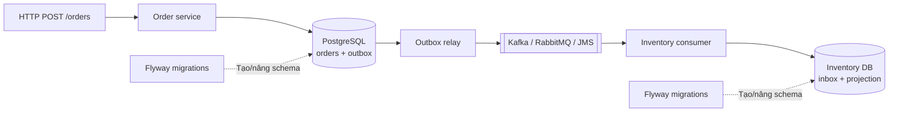
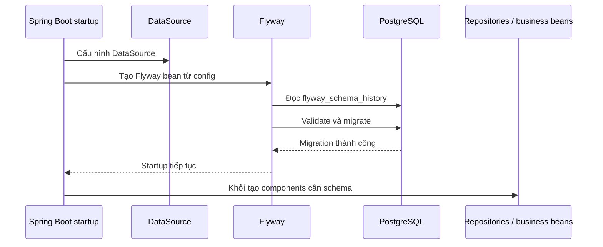
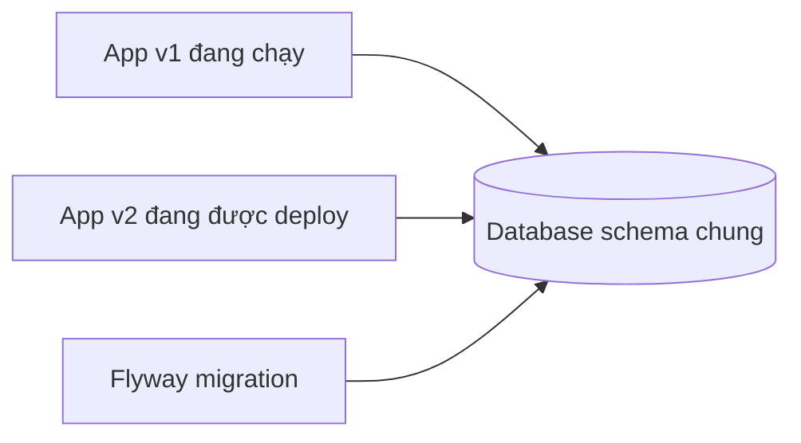
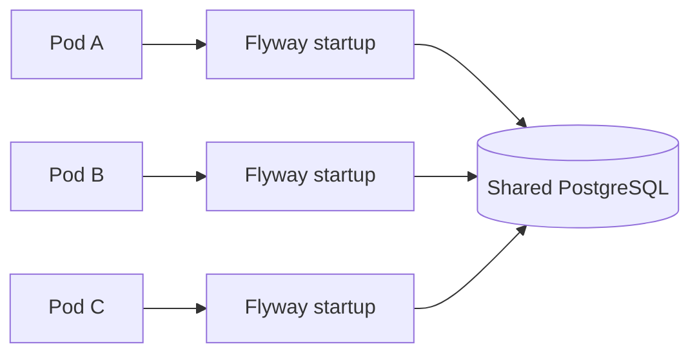
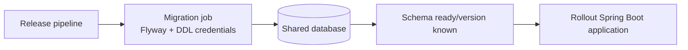

# Module Flyway theo hệ quản trị và phụ thuộc cần bổ sung

Một ứng dụng Spring Boot dùng PostgreSQL có thể kết nối database và chạy `JdbcTemplate` bình thường, nhưng ngay khi khởi động Flyway lại thất bại với thông báo như **`Unsupported Database`** hoặc **`No database found to handle...`**. Nguyên nhân có thể không nằm ở JDBC URL, password hay SQL migration. Trong các thế hệ Flyway gần đây, khả năng hỗ trợ nhiều hệ quản trị được **tách khỏi `flyway-core` thành các module database-specific**; ứng dụng cần có đúng module đó trong **runtime classpath** cùng JDBC driver tương ứng.

Một tình huống khác: nhóm phát triển thêm dependency Flyway vào một Gradle subproject chuyên lưu migration scripts, nhưng service Spring Boot cuối cùng không mang dependency đó vào runtime. Kết quả là chạy local có vẻ đúng, còn image production thiếu module hoặc chọn version khác. Hoặc test dùng H2 nên toàn bộ migration pass, trong khi PostgreSQL production không chạy được cú pháp SQL của H2.

Bài thuộc chương **Khởi tạo và migration** của module **SPRING_BOOT_INTEGRATION**. Trong module này, Spring Boot tích hợp hệ thống qua HTTP client, SQL, cache, broker thông điệp và các adapter Spring Integration. Vì vậy, Flyway không chỉ là công cụ “tạo bảng”: schema phải được triển khai phù hợp với **hợp đồng dữ liệu, transaction, outbox/inbox, xử lý trùng lặp, lỗi, kiểm thử và observability** của hệ thống tích hợp.

> **Phạm vi phiên bản:** Ví dụ chính dùng Java 17+, Spring Boot 3.x, PostgreSQL và Flyway thế hệ **10 trở lên** khi đã có các module hỗ trợ database được tách riêng. Spring Boot 3.x không phải một phiên bản duy nhất: các bản Boot cũ hơn có thể quản lý Flyway 9.x; Boot mới hơn có thể quản lý Flyway 10.x/11.x. Spring Boot 4.x và các bản Flyway tiếp theo có thể thay đổi artifact, package, API và phạm vi hỗ trợ. **Luôn kiểm tra dependency tree, documentation và support matrix của đúng phiên bản được chọn**, thay vì ép các tọa độ trong ví dụ cho mọi dự án.

## 1. Mục tiêu học tập

Sau bài này, bạn có thể:

1. Phân biệt **Flyway core**, **Flyway database module**, **JDBC driver**, **Spring Boot auto-configuration** và **Flyway Gradle/Maven plugin/CLI**.
2. Giải thích vì sao một database kết nối được bằng JDBC vẫn có thể bị Flyway báo không hỗ trợ.
3. Khai báo dependency phù hợp cho PostgreSQL, MySQL/MariaDB, Oracle hoặc SQL Server theo phiên bản Flyway đang dùng.
4. Dùng Spring Boot dependency management/BOM để tránh xung đột `flyway-core` và database module.
5. Xác định **runtime classpath** thật của ứng dụng, thay vì chỉ nhìn dependency trong một module khác.
6. Cấu hình Flyway locations, schemas, history table, baseline và đường kết nối bằng Spring Boot properties.
7. Thiết kế migration có thứ tự, tương thích với rolling deployment và không phá producer/consumer đang hoạt động.
8. Phân biệt startup migration, pipeline migration, database locking và transactional DDL giữa các hệ quản trị.
9. Kiểm thử migrations bằng Testcontainers cùng database engine với production.
10. Chẩn đoán lỗi unsupported database, missing driver, checksum mismatch, quyền schema, failed migration và startup race.

## 2. Flyway làm gì trong một ứng dụng tích hợp?

**Flyway** quản lý sự phát triển có kiểm soát của database schema bằng những migration được đánh version và lưu lịch sử thực thi. Thay vì mỗi developer tự chạy SQL, đội dự án ghi migration vào source control và triển khai theo quy trình lặp lại được.

Ví dụ một hệ thống nhận lệnh tạo đơn hàng:



Flyway có trách nhiệm:

- Tạo bảng, index, constraints, sequences và các database objects theo migration.
- Kiểm tra những migration nào đã được áp dụng.
- Thực hiện các migration còn thiếu theo thứ tự phù hợp.
- Phát hiện khác biệt checksum của versioned migration đã chạy.
- Cung cấp dấu vết schema version phục vụ triển khai và điều tra.

Flyway **không** tự:

- Đảm bảo tính đúng đắn của event JSON/Avro hoặc HTTP response.
- Biến transaction SQL và broker send thành một distributed transaction.
- Kiểm soát mọi ứng dụng đang sử dụng schema có tương thích hay không.
- Giải quyết deadlock, idempotency, duplicate messages hoặc dữ liệu sai business rule.
- Bảo đảm mọi câu DDL rollback được trên mọi database.
- Tự tính toán thứ tự rollout an toàn cho nhiều service.

Migration giúp tạo và thay đổi **hợp đồng lưu trữ**; tính nhất quán end-to-end vẫn phải được thiết kế ở application và các adapter tích hợp.

## 3. Năm mảnh ghép thường bị nhầm lẫn

| Thành phần | Vai trò | Ví dụ |
| --- | --- | --- |
| **Flyway core** | Migration engine, history, versioning, scanning, orchestration | `org.flywaydb:flyway-core` |
| **Flyway database module** | Logic nhận diện và hỗ trợ một họ database cụ thể ở các Flyway version có module tách riêng | `org.flywaydb:flyway-database-postgresql` |
| **JDBC driver** | Giao thức kết nối/SQL transport tới database | `org.postgresql:postgresql` |
| **Spring Boot Flyway auto-configuration** | Phát hiện Flyway trên classpath, tạo/configure bean, gọi migrate theo lifecycle | Một phần của Spring Boot auto-configuration |
| **Flyway CLI / Maven / Gradle plugin** | Chạy migrations từ pipeline hoặc lệnh build, ngoài application bootstrap nếu được chọn | Flyway CLI hoặc build plugin phù hợp |

**Quan trọng:** Ba mảnh `flyway-core` + database module + JDBC driver có chức năng **khác nhau**. Chúng không thay thế lẫn nhau.

### 3.1. Flyway core là gì?

`flyway-core` cung cấp những khả năng nền tảng như:

- Tìm migration scripts trong configured locations.
- Quản lý metadata/history và thứ tự version.
- Thực thi migration qua nguồn kết nối đã cấu hình.
- Validate trạng thái migration, checksum và naming.
- Hỗ trợ Flyway Java API và các integration liên quan.

Ở Flyway 10+, nhiều database engines cần module hỗ trợ được tách riêng. **Chỉ có core chưa chắc đủ** để core nhận diện database bạn đang dùng.

### 3.2. Database-specific module là gì?

Module như `flyway-database-postgresql` cung cấp phần hỗ trợ PostgreSQL cho Flyway trong các bản sử dụng mô hình module này. Một database module có thể chứa:

- Cơ chế xác định vendor/version mà engine hỗ trợ.
- Cấu hình SQL grammar và khả năng của database.
- Logic liên quan migrations, locking/history hoặc statements theo dialect.
- Database type/provider integration mà Flyway phát hiện qua runtime classpath.

Không nên tự gọi những class nội bộ của module trong business code. Thông thường chỉ cần **đặt dependency ở runtime**, để Flyway nạp provider theo cơ chế đã thiết kế.

### 3.3. JDBC driver là gì?

`org.postgresql:postgresql` cho phép Java kết nối PostgreSQL theo JDBC. Driver giải quyết:

- URL `jdbc:postgresql://...`.
- TCP/TLS và authentication theo driver.
- JDBC `Connection`, `Statement`, `ResultSet`.
- Mapping JDBC types và protocol.

Driver **không** cung cấp versioned migration engine. Ngược lại, module Flyway PostgreSQL **không** thay thế pgJDBC driver.

### 3.4. Spring Boot auto-configuration làm gì?

Khi `Flyway` có trên classpath, có một datasource phù hợp và các điều kiện được thỏa, Spring Boot có thể tạo `Flyway` bean và chạy migration ở startup, thường trước khi các phần phụ thuộc schema như JPA được sử dụng.

Nhưng Spring Boot **không tự tải từ Internet module Flyway còn thiếu** chỉ vì `spring.datasource.url` trỏ tới PostgreSQL. Build phải khai báo module phù hợp.

### 3.5. CLI/plugin không nhất thiết nằm trong app

Một pipeline có thể chạy:

```text
Flyway CLI / Gradle task -> Database schema update
                                        |
                                        v
                              Spring Boot runtime
```

Đó là mô hình **migration ngoài ứng dụng**. Việc có Flyway Gradle plugin trong build không mặc nhiên khiến ứng dụng Spring Boot có `Flyway` và database module ở `runtimeClasspath`. Hai runtime này phải được xem xét riêng.

## 4. Tại sao phiên bản Flyway quan trọng?

### 4.1. Sự thay đổi theo thế hệ

Trong các thế hệ cũ, nhiều khả năng database được gói trong `flyway-core`. Ở thế hệ Flyway 10+ nhiều database hỗ trợ được chuyển sang **những module riêng**, với quy tắc artifact và support matrix tùy engine/version.

Hệ quả:

- Một hướng dẫn dành cho Flyway 8/9 có thể chỉ thêm `flyway-core` và hoạt động.
- Cùng hướng dẫn đó đem sang Flyway 10+ có thể thiếu database module.
- Một Spring Boot version cũ quản lý Flyway 9 có thể **không tương thích** khi người dùng chỉ ép `flyway-core` lên 11 mà không xem xét Boot integration và modules.
- Dependency tree có thể chứa core v11 nhưng database module v10 do explicit override, tạo lỗi runtime khó chẩn đoán.

**Không áp dụng một bảng dependency cho mọi đời Flyway**. Trước khi chỉnh build, xác định:

1. Phiên bản Spring Boot thực tế.
2. Flyway version Boot BOM đang quản lý.
3. Hệ quản trị và major version của database.
4. Artifact database support dành cho chính Flyway version đó.
5. Driver JDBC tương thích với JVM/database version.
6. License/edition nếu dùng khả năng Flyway hoặc database không thuộc phạm vi community của bản đang chọn.

### 4.2. Một quy tắc tương thích cốt lõi

```text
Spring Boot version
      |
      v
Managed Flyway version
      |
      +--> flyway-core : cùng phiên bản
      |
      +--> Flyway database module : cùng phiên bản
      |
      +--> JDBC driver : tương thích JVM / database / Boot BOM
```

**Không phải JDBC driver phải có cùng version với Flyway.** Điều cần đồng bộ là các artifact **của Flyway** với nhau; driver có hệ version riêng.

### 4.3. Khi nào nên override version Flyway?

Chỉ cân nhắc override khi:

- Boot BOM đang quản lý Flyway quá cũ để hỗ trợ database mới được triển khai.
- Có bug/security fix đã được đánh giá.
- Dự án phải dùng một database module/feature chỉ có ở một bản Flyway mới hơn.
- Đã kiểm tra compatibility của Spring Boot auto-configuration và Flyway APIs.

Cần đi kèm:

- Dependency tree và runtimeClasspath verification.
- Integration test migration trên database thực.
- Test với metadata/history đã được tạo bởi version cũ.
- Kế hoạch rollback: **rollback Flyway library không có nghĩa rollback schema hoặc history table**.
- Ghi rõ release notes, support matrix, licensing và người phê duyệt.

Không tự nâng từng dependency riêng lẻ trong một multi-module build rồi hy vọng Gradle/Maven tự chọn bộ tương thích.

## 5. Module theo hệ quản trị: chọn đúng artifact

Tên các module dưới đây là **ví dụ thường gặp trong dòng Flyway 10+**. Artifact chính xác, phiên bản hỗ trợ và điều kiện license phải kiểm tra với tài liệu Flyway của version đang sử dụng.

| Database | Module Flyway thường gặp | JDBC driver thường gặp | Ghi chú |
| --- | --- | --- | --- |
| **PostgreSQL** | `org.flywaydb:flyway-database-postgresql` | `org.postgresql:postgresql` | Ví dụ chính trong bài |
| **MySQL** | `org.flywaydb:flyway-mysql` | `com.mysql:mysql-connector-j` | Kiểm tra MySQL version và Flyway support |
| **MariaDB** | `org.flywaydb:flyway-mysql` trong các bản dùng chung module | `org.mariadb.jdbc:mariadb-java-client` | Không suy từ module name rằng driver MySQL và MariaDB phải giống nhau |
| **Oracle Database** | `org.flywaydb:flyway-database-oracle` | `com.oracle.database.jdbc:ojdbc11` hoặc driver phù hợp | Kiểm tra JVM, Oracle version, edition/license |
| **Microsoft SQL Server** | `org.flywaydb:flyway-sqlserver` trong các bản sử dụng artifact này | `com.microsoft.sqlserver:mssql-jdbc` | Xác nhận artifact/support của Flyway version dự án |
| **H2** | Phụ thuộc vào Flyway version; có thể nằm trong core hoặc cơ chế hỗ trợ riêng | `com.h2database:h2` | Không dùng H2 làm bằng chứng migration PostgreSQL/MySQL tương thích |

**Điểm cần nhớ:** Không phải tên module database nào cũng có cùng quy tắc `flyway-database-<vendor>`. Ví dụ những artifact thường gặp có tên `flyway-mysql` hoặc `flyway-sqlserver`. Do đó không tự ghép chuỗi tên dependency từ JDBC URL; hãy dùng module được tài liệu Flyway công bố cho version cụ thể.

### 5.1. PostgreSQL

Nếu ứng dụng kết nối:

```text
jdbc:postgresql://orders-db:5432/orders
```

thì cần **pgJDBC driver** và, với Flyway 10+ tương ứng, **PostgreSQL Flyway database module**. Không chỉ vì hai artifact đều nói “PostgreSQL” mà coi chúng có thể dùng thay nhau.

### 5.2. MySQL và MariaDB

Dù MySQL và MariaDB chia sẻ nguồn gốc, chúng có đặc điểm phiên bản, SQL dialect, transaction/DDL và JDBC driver khác nhau. Với Flyway versions dùng chung `flyway-mysql` để hỗ trợ hai hệ, vẫn phải:

- Dùng JDBC driver đúng engine.
- Kiểm tra database version có nằm trong support matrix.
- Không dùng một bộ migration SQL vendor-specific cho cả hai chỉ vì cùng module.
- Xem `ALTER TABLE`, locking, implicit commits và kiểu dữ liệu riêng.

### 5.3. Oracle

Oracle có driver khác tùy Java version và môi trường. Ví dụ `ojdbc11` phù hợp một số môi trường JVM mới; không suy luận có thể dùng mọi bản driver cho mọi JDK/Oracle. Nhiều DDL Oracle có implicit commit: quy trình phục hồi migration phải tính tới việc không rollback được như PostgreSQL.

### 5.4. SQL Server

SQL Server có JDBC URL, schema namespace và T-SQL riêng. Một migration có thể cần xử lý batch separator và transaction semantics theo Flyway support. Không sao chép SQL `CREATE INDEX CONCURRENTLY` của PostgreSQL sang SQL Server.

### 5.5. Database được quản lý/cloud

Một dịch vụ cloud như AWS RDS PostgreSQL hoặc Azure Database for PostgreSQL vẫn thường cung cấp **PostgreSQL protocol**, nên về cơ bản chọn PostgreSQL JDBC driver/module, nhưng phải kiểm tra:

- Database engine và major/minor version thực.
- IAM/managed auth/TLS/cloud proxy.
- Các extension, quyền DDL, hạn mức và policy.
- Khả năng Flyway version nhận diện vendor/version.
- Feature bị cloud provider hạn chế.

Không dựa vào tên thương mại của cloud service để tự đoán Flyway artifact.

## 6. Spring Boot 3.x + PostgreSQL: Gradle Groovy DSL

### 6.1. Dependencies tối thiểu cho migration khi dùng JDBC

Giả sử project đã có Spring Boot plugin/BOM cấu hình chuẩn:

```groovy
dependencies {
    implementation 'org.springframework.boot:spring-boot-starter-jdbc'

    // Flyway engine.
    implementation 'org.flywaydb:flyway-core'

    // Bắt buộc với các Flyway version dùng module PostgreSQL riêng.
    runtimeOnly 'org.flywaydb:flyway-database-postgresql'

    // JDBC driver thực sự kết nối PostgreSQL.
    runtimeOnly 'org.postgresql:postgresql'

    testImplementation 'org.springframework.boot:spring-boot-starter-test'
}
```

**Vì sao `runtimeOnly` có thể phù hợp cho module và driver?** Business code không gọi API nội bộ Flyway PostgreSQL hay pgJDBC driver trực tiếp. Chúng cần hiện diện khi app khởi động/chạy, nên nằm trong runtime dependency graph. `implementation` cũng có thể đúng cho module nếu project cần compile-time reference, nhưng thường không cần.

**Lưu ý:** Nếu service không cần gọi `Flyway` Java API trực tiếp, `flyway-core` có thể được đặt ở runtime scope trong cấu hình phù hợp. Tuy nhiên dùng `implementation` ở ví dụ giúp rõ engine đang là một phần của ứng dụng. **Phải kiểm tra runtimeClasspath cuối cùng**, không suy từ tên Gradle configuration.

### 6.2. Không tự ghi version nếu BOM đã quản lý

Khi Spring Boot dependency management đang quản lý version Flyway:

```groovy
implementation 'org.flywaydb:flyway-core'
runtimeOnly 'org.flywaydb:flyway-database-postgresql'
```

là hình thức thường phù hợp để chúng cùng bộ phiên bản do Boot cung cấp. Cần xác minh BOM đang quản lý cả hai artifact với đúng version hỗ trợ. Nếu phiên bản Spring Boot quá cũ không quản lý database module mới, phải có chiến lược nâng version hoặc constraint/BOM phù hợp; không mặc định bỏ version luôn giải quyết được.

### 6.3. Không đặt module chỉ ở testImplementation

Sai cho production:

```groovy
dependencies {
    implementation 'org.flywaydb:flyway-core'
    testImplementation 'org.flywaydb:flyway-database-postgresql'
    runtimeOnly 'org.postgresql:postgresql'
}
```

Các tests có thể pass vì test runtime chứa module PostgreSQL. Nhưng app production runtime có thể không có nó.

Đúng nếu migration chạy tại startup production:

```groovy
runtimeOnly 'org.flywaydb:flyway-database-postgresql'
```

**Nếu pipeline riêng thực hiện migration và service runtime được cố ý tắt Flyway**, dependency placement có thể khác. Nhưng đó phải là một quyết định triển khai được ghi rõ, không phải hiệu ứng phụ của test dependencies.

## 7. Spring Boot 3.x + PostgreSQL: Gradle Kotlin DSL

Ví dụ dành cho project dùng `build.gradle.kts`:

```kotlin
dependencies {
    implementation("org.springframework.boot:spring-boot-starter-jdbc")

    implementation("org.flywaydb:flyway-core")
    runtimeOnly("org.flywaydb:flyway-database-postgresql")
    runtimeOnly("org.postgresql:postgresql")

    testImplementation("org.springframework.boot:spring-boot-starter-test")
    testImplementation("org.springframework.boot:spring-boot-testcontainers")
    testImplementation("org.testcontainers:junit-jupiter")
    testImplementation("org.testcontainers:postgresql")
}
```

Trong một Gradle multi-project, dependencies phải được đặt ở **đúng project tạo executable service** hoặc được truyền transitive với scope phù hợp. Việc module `:database-migrations` có `runtimeOnly` không tự làm `:orders-service` nhận module đó nếu cấu hình project dependency không đưa dependency vào runtime graph.

Một cách kiểm tra là xem resolved runtime dependency graph của service trong build system, nhưng bài STEP 4 này chỉ trình bày quy trình, **không chạy build**:

```bash
./gradlew :orders-service:dependencies --configuration runtimeClasspath
```

Trên Windows có thể dùng `gradlew.bat` trong shell tương ứng. Lệnh này chỉ là ví dụ cho project dùng tên `orders-service`; thay bằng Gradle project path thật.

## 8. Maven: Flyway core, module và driver

Với `spring-boot-starter-parent` hoặc BOM tương đương quản lý versions:

```xml
<dependencies>
    <dependency>
        <groupId>org.springframework.boot</groupId>
        <artifactId>spring-boot-starter-jdbc</artifactId>
    </dependency>

    <dependency>
        <groupId>org.flywaydb</groupId>
        <artifactId>flyway-core</artifactId>
    </dependency>

    <dependency>
        <groupId>org.flywaydb</groupId>
        <artifactId>flyway-database-postgresql</artifactId>
        <scope>runtime</scope>
    </dependency>

    <dependency>
        <groupId>org.postgresql</groupId>
        <artifactId>postgresql</artifactId>
        <scope>runtime</scope>
    </dependency>
</dependencies>
```

Nếu không sử dụng parent/BOM quản lý versions, phải khai báo versions tương thích một cách chủ đích. Không thêm `<version>` cho core nhưng quên module, hoặc dùng module đến từ một dependency graph khác.

Để quan sát resolved Maven dependencies:

```bash
./mvnw dependency:tree -Dincludes=org.flywaydb,org.postgresql
```

Cần xem **effective runtime dependencies và đóng gói cuối cùng**; một thư viện khai báo `provided` hoặc bị exclusion có thể không có trong artifact thực thi.

## 9. Thêm module đúng mà Flyway vẫn không khởi động?

Một dependency hợp lệ không đồng nghĩa auto-configuration chạy. Các điều kiện quan trọng:

- Có Flyway core trên runtime classpath.
- Spring Boot Flyway auto-configuration không bị exclude.
- `spring.flyway.enabled` không bị tắt.
- Có `DataSource`/connection details mà Flyway có thể dùng, hoặc Flyway được cấu hình datasource riêng.
- Driver và database module có mặt, tương thích với DB version.
- Có quyền đọc/ghi metadata history và migration targets.
- Resource locations đúng, script names đúng và migration hợp lệ.

Ví dụ:

```yaml
spring:
  datasource:
    url: ${ORDERS_JDBC_URL}
    username: ${ORDERS_DB_USERNAME}
    password: ${ORDERS_DB_PASSWORD}

  flyway:
    enabled: true
    locations:
      - classpath:db/migration
```

Spring Boot thường dùng datasource của ứng dụng khi không có Flyway-specific connection settings. Nhưng nếu có nhiều datasource, custom Flyway bean hoặc custom connection details, hành vi chọn datasource phụ thuộc cấu hình/annotations/conditions thực tế.

### 9.1. Thời điểm migration chạy

Ở mô hình app-managed migration:



Spring Boot có cơ chế điều phối database initialization đối với các thành phần đã biết. Nhưng **không có bảo đảm mọi custom bean/scheduled job tự chờ Flyway** nếu code tạo thread hoặc truy cập SQL không theo lifecycle bình thường. Với custom startup job, phải thiết kế dependency/ordering phù hợp.

### 9.2. Có nên đặt Flyway trong một service không dùng JDBC runtime?

Nếu một worker chỉ dùng Kafka + external HTTP và không truy cập SQL, thêm Flyway starter/core có thể khiến startup không cần thiết phụ thuộc DB. Chỉ đưa Flyway vào runtime cần migration, hoặc dùng pipeline/migration job riêng. **Một service không cần SQL không nên vô tình trở thành SQL-dependent do dependency thừa.**

## 10. Tạo migration scripts đầu tiên

### 10.1. Locations mặc định và naming

Một cấu trúc dự án điển hình:

```text
src/main/resources/
└── db/
    └── migration/
        ├── V1__create_orders.sql
        ├── V2__create_outbox.sql
        └── V3__add_order_source.sql
```

Flyway sẽ tìm migration trong configured locations (thường `classpath:db/migration` với Spring Boot) và xác định phiên bản từ tên file.

- `V1__create_orders.sql`: versioned migration 1.
- `V2__create_outbox.sql`: versioned migration 2.
- `R__refresh_reporting_view.sql`: repeatable migration, chạy lại khi checksum thay đổi theo quy tắc Flyway.

Giữa version và description có **hai dấu gạch dưới**. Tên file và quy tắc migration được cấu hình, không nên thay lung tung sau khi đã chạy ở production.

### 10.2. V1 tạo bảng order

**`V1__create_orders.sql`**

```sql
CREATE TABLE orders (
    order_id UUID PRIMARY KEY,
    tenant_id VARCHAR(64) NOT NULL,
    order_state VARCHAR(32) NOT NULL,
    amount_minor BIGINT NOT NULL CHECK (amount_minor >= 0),
    currency CHAR(3) NOT NULL,
    version BIGINT NOT NULL DEFAULT 1,
    created_at TIMESTAMPTZ NOT NULL DEFAULT now()
);

CREATE INDEX idx_orders_tenant_created
    ON orders (tenant_id, created_at);
```

Bản migration này dùng syntax PostgreSQL như `UUID`, `TIMESTAMPTZ` và `now()`. Nó **không** là migration SQL portable cho H2, Oracle hoặc SQL Server.

### 10.3. V2 tạo outbox

**`V2__create_outbox.sql`**

```sql
CREATE TABLE integration_outbox (
    event_id UUID PRIMARY KEY,
    tenant_id VARCHAR(64) NOT NULL,
    aggregate_type VARCHAR(64) NOT NULL,
    aggregate_id VARCHAR(128) NOT NULL,
    event_type VARCHAR(128) NOT NULL,
    schema_version INTEGER NOT NULL,
    payload_json JSONB NOT NULL,
    status VARCHAR(24) NOT NULL DEFAULT 'READY',
    attempt_count INTEGER NOT NULL DEFAULT 0,
    created_at TIMESTAMPTZ NOT NULL DEFAULT now(),
    published_at TIMESTAMPTZ
);

CREATE INDEX idx_outbox_ready
    ON integration_outbox (created_at, event_id)
    WHERE status = 'READY';
```

Flyway tạo bảng ở đây, nhưng không tự thiết kế:

- Atomicity giữa `orders` và `integration_outbox` trong Spring `@Transactional`.
- Outbox relay polling/CDC và broker acknowledgment.
- Idempotent consumer/inbox.
- Schema contract của `payload_json`.
- Trạng thái, retry, DLQ, reconciliation.

**Flyway migration chỉ tạo cơ sở hạ tầng SQL cho workflow**, không thay application protocol.

### 10.4. V3 thêm trường có tương thích ngược

**`V3__add_order_source.sql`**

```sql
ALTER TABLE orders
ADD COLUMN order_source VARCHAR(32);
```

Đây là một **expand migration**: cột mới nullable giúp service version cũ vẫn insert khi chưa biết `order_source`, còn version mới có thể ghi giá trị. Sau khi backfill và xác nhận writer cũ không còn, mới cân nhắc migration khác để thêm constraint hoặc ngừng field legacy.

Đừng đặt `NOT NULL` không default ngay khi còn application version cũ tạo orders mà chưa điền trường mới.

## 11. Lịch sử Flyway và checksum

### 11.1. flyway_schema_history

Flyway thường ghi lịch sử vào bảng **`flyway_schema_history`**, trong schema được cấu hình theo quy tắc Flyway. Bảng này phản ánh:

- Version và description.
- Script migration đã chạy.
- Checksum.
- Thứ tự và thời điểm thực hiện.
- Trạng thái thành công/thất bại, tùy database và transaction behavior.

Một lần khởi động:

```text
Database chưa có history:
  -> Flyway tạo history table (theo quyền và cấu hình)
  -> chạy V1, V2, V3 theo thứ tự
  -> ghi trạng thái migration

Khởi động lần sau:
  -> đọc history
  -> validate applied migrations
  -> chỉ chạy migration còn thiếu
```

Không tự sửa bảng history bằng SQL thủ công để “đẩy” version trừ khi đang theo quy trình recovery/repair được quản trị và đã hiểu tác động. Metadata history là phần của cơ chế Flyway bảo đảm migrations được theo dõi.

### 11.2. Checksum có ý nghĩa gì?

Flyway lưu checksum của nội dung versioned migration đã thực hiện. Nếu sửa `V1__create_orders.sql` sau khi V1 đã được chạy, việc validate có thể báo checksum mismatch.

**Nguyên tắc tốt: không sửa migration versioned đã phát hành.** Hãy tạo migration mới, ví dụ `V4__add_order_currency_constraint.sql`, thay vì viết lại lịch sử.

Ngoại lệ như thay comment/format hoặc sửa nhầm cần quy trình audit/review và lệnh repair khi thích hợp, không được dùng `repair` như cách mặc định bỏ qua lỗi.

### 11.3. Repeatable migration

`R__refresh_reporting_view.sql` có thể dùng cho view/function được tạo lại khi nội dung thay đổi:

```sql
CREATE OR REPLACE VIEW order_summary AS
SELECT tenant_id,
       count(*) AS order_count,
       sum(amount_minor) AS amount_minor_total
FROM orders
GROUP BY tenant_id;
```

Repeatable migration có cơ chế chạy lại dựa trên checksum; vì thế script nên được thiết kế để chạy lại an toàn theo database dialect, chẳng hạn `CREATE OR REPLACE VIEW` khi hỗ trợ.

Không dùng repeatable migration thay mọi versioned schema change: việc thay field đang được application v1 dùng vẫn cần kế hoạch tương thích và versioned migration phù hợp.

## 12. Flyway locations khi có nhiều hệ quản trị

### 12.1. Vendor-specific directories

Một dự án hỗ trợ PostgreSQL và MySQL có thể cần migration riêng:

```text
src/main/resources/
└── db/
    └── migration/
        ├── postgresql/
        │   ├── V1__create_orders.sql
        │   └── V2__create_outbox.sql
        └── mysql/
            ├── V1__create_orders.sql
            └── V2__create_outbox.sql
```

Trong Spring Boot, cú pháp placeholder `{vendor}` được hỗ trợ ở Flyway locations trong những phiên bản tương ứng:

```yaml
spring:
  flyway:
    locations:
      - classpath:db/migration/{vendor}
```

Spring Boot sẽ xác định vendor từ database đang dùng theo cơ chế của nó, rồi resolve location. Cần kiểm tra **giá trị vendor chính xác** theo Boot/database driver/version; không tự giả định một alias như `postgres`, `postgresql` hay `mariadb` là giống nhau.

### 12.2. Đừng giữ V1 của hai vendors trong cùng location

Nếu một location quét cùng lúc:

```text
db/migration/postgresql/V1__...
db/migration/mysql/V1__...
```

và cả hai được nhận diện, Flyway có thể gặp duplicate migration version hoặc chạy sai dialect. Cần giới hạn locations theo vendor hoặc tổ chức module build riêng rõ ràng.

### 12.3. Common scripts có phải lúc nào cũng portable?

Có thể dùng:

```yaml
spring:
  flyway:
    locations:
      - classpath:db/migration/common
      - classpath:db/migration/{vendor}
```

nhưng phải bảo đảm **version của mỗi migration trên union locations là duy nhất** theo quy tắc Flyway và nội dung common scripts thật sự được cả hai database hỗ trợ. Một SQL có vẻ đơn giản như `BOOLEAN`, `TIMESTAMP WITH TIME ZONE` hay upsert đã có thể khác semantics giữa PostgreSQL, Oracle, SQL Server và MySQL.

## 13. Spring Boot properties quan trọng của Flyway

Ví dụ cấu hình:

```yaml
spring:
  flyway:
    enabled: true
    locations:
      - classpath:db/migration
    validate-on-migrate: true
    baseline-on-migrate: false
    clean-disabled: true
    table: flyway_schema_history
```

| Property | Ý nghĩa | Cảnh báo |
| --- | --- | --- |
| `spring.flyway.enabled` | Bật/tắt tích hợp Flyway của Boot | Tắt không đồng nghĩa database schema đã đúng |
| `spring.flyway.locations` | Danh sách migration resources | Sai đường dẫn có thể khiến Flyway không tìm được scripts |
| `spring.flyway.validate-on-migrate` | Kiểm tra trạng thái migrations khi migrate | Không nên tắt chỉ để startup qua lỗi checksum |
| `spring.flyway.baseline-on-migrate` | Cho phép baseline non-empty schema chưa quản lý bởi Flyway theo điều kiện | Có thể che việc trỏ nhầm database/schema |
| `spring.flyway.baseline-version` | Version history baseline | Phải phù hợp trạng thái schema thực |
| `spring.flyway.schemas` | Schemas Flyway quản lý | Khác quyền search_path/đích SQL cụ thể |
| `spring.flyway.default-schema` | Default schema theo Flyway | Cần khớp namespace database và user |
| `spring.flyway.table` | Tên schema history table | Không đổi vô ý sau khi đã chạy |
| `spring.flyway.clean-disabled` | Không cho clean destructive theo policy | Giữ bảo vệ ở production |
| `spring.flyway.url/user/password` | Connection riêng cho Flyway nếu cần | Tách khỏi datasource app theo cách rõ ràng |

Tên và khả năng của property có thể thay đổi theo Boot/Flyway version. Với Boot 3.x, nên kiểm tra `/actuator/configprops`/environment ở môi trường được bảo vệ, cùng `ConditionEvaluationReport`.

### 13.1. Tránh baseline-on-migrate khi chưa thẩm định

Ví dụ:

```yaml
spring:
  flyway:
    baseline-on-migrate: true
```

Có vẻ tiện khi nhập một database đã có bảng. Nhưng nếu ứng dụng **trỏ nhầm một schema production khác**, Flyway có thể baseline nhầm schema không rỗng và bỏ qua migration được cho là đã có.

Quy trình onboarding database cũ nên:

1. Backup và kiểm kê schema hiện tại.
2. Chọn version baseline tương ứng đúng trạng thái schema.
3. Xác minh dữ liệu, constraints và migrations đã áp dụng ngoài Flyway.
4. Chạy thử trên bản sao database.
5. Baseline theo quy trình được phê duyệt.
6. Sau đó tắt policy baseline tự động nếu không còn nhu cầu.

### 13.2. Không dùng clean để chữa migration lỗi

`flyway clean` có thể xóa objects do nó quản lý theo policy, mang tính **phá hủy dữ liệu**. Giữ `clean-disabled: true` ở môi trường không được phép xóa schema, đặc biệt staging dùng dữ liệu gần production và production.

Không viết startup hook “nếu migrate fail thì clean và chạy lại”. Với database chứa order/outbox/inbox, làm vậy có thể làm mất cả dữ liệu nghiệp vụ và khả năng chống trùng message.

## 14. Tách datasource cho migration khỏi datasource ứng dụng

### 14.1. Vì sao cần hai loại quyền?

Trong production, service xử lý đơn thường cần:

- `SELECT`/`INSERT`/`UPDATE` một số bảng.
- Quyền trên sequences theo business requirement.
- Không cần `DROP TABLE` hay `ALTER TABLE` trong mỗi request.

Ngược lại, Flyway migration có thể cần DDL grants:

- `CREATE/ALTER/DROP` các objects trong schema được quản lý.
- Quyền ghi history table.
- Quyền tạo index hoặc extension nếu được phép.

**Không nên để application runtime sử dụng tài khoản DDL rộng hơn cần thiết** chỉ vì dễ cấu hình Flyway.

### 14.2. Một cấu hình tách biệt

```yaml
spring:
  datasource:
    url: ${ORDERS_JDBC_URL}
    username: ${ORDERS_APP_DB_USER}
    password: ${ORDERS_APP_DB_PASSWORD}

  flyway:
    url: ${ORDERS_JDBC_URL}
    user: ${ORDERS_MIGRATION_DB_USER}
    password: ${ORDERS_MIGRATION_DB_PASSWORD}
    locations:
      - classpath:db/migration
```

Ở cấu hình này, migration có thể sử dụng một connection configuration riêng theo hỗ trợ của Spring Boot. **Không mặc định chỉ đặt một trong ba property `spring.flyway.url/user/password` sẽ cho cùng hành vi ở mọi phiên bản**; nên cấu hình đầy đủ và test effective connection.

Đặc biệt:

- Giữ TLS/hostname verification đúng trên cả hai connection.
- Tránh log secret/password trong Flyway diagnostics.
- Xác minh Flyway user đủ quyền tạo metadata history trong target schema.
- App user sau migration vẫn có quyền CRUD đúng.
- Trong môi trường nhiều schemas, kiểm tra search_path/default schema/schema history location.

### 14.3. Thời điểm cấp quyền DDL

Nếu service tự chạy Flyway tại startup, deployment có thể phải cấp migration credentials trong startup window. Điều này tăng blast radius so với mô hình **migration job riêng** dùng quyền DDL, sau đó service chạy với tài khoản DML giới hạn.

Không có một mô hình đúng cho mọi tổ chức. Điều cần có là **ownership và quyền truy cập rõ**, không dùng superuser cho mọi service.

## 15. Nhiều DataSource và Flyway

### 15.1. Một ứng dụng dùng hai database

Giả sử:

```text
ordersDataSource   -> PostgreSQL orders DB
reportingDataSource -> PostgreSQL analytics DB
```

Spring Boot auto-configuration không tự biết bạn muốn chạy **hai bộ migration độc lập** chỉ vì có hai `DataSource`. Nếu không thiết kế tường minh, nó có thể:

- Chọn một primary/single candidate datasource.
- Không có candidate phù hợp nên không tạo Flyway bean.
- Chạy migrations vào **database sai** khi `spring.flyway.url` trỏ nhầm.
- Dùng một history table/locations không đúng domain.

### 15.2. @FlywayDataSource

Trong một số cấu hình Spring Boot 3.x, `@FlywayDataSource` được dùng để chỉ định datasource dành cho migration:

```java
@Bean("ordersMigrationDataSource")
@FlywayDataSource
DataSource ordersMigrationDataSource() {
    return buildMigrationDataSource();
}
```

Đây là **mẫu cấu trúc**, `buildMigrationDataSource()` do ứng dụng triển khai từ properties/secrets; snippet cần import `org.springframework.boot.autoconfigure.flyway.FlywayDataSource` phù hợp với version.

Nó giúp Boot chọn nguồn kết nối dành cho **một pipeline Flyway auto-configured** theo điều kiện của Boot; **không phải** annotation tự tạo N Flyway runners cho N datasources.

### 15.3. Hai nhóm migration thực sự riêng

Khi phải quản lý hai databases, bạn có thể chọn:

1. **Hai deployment/migration jobs riêng**: mỗi job dùng URL, Flyway config, scripts và history riêng.
2. **Hai Flyway beans do ứng dụng cấu hình tường minh**, cùng lifecycle và migration order riêng.
3. **Một service migration độc lập** quản lý schema của từng database có phân quyền, tránh boot app runtime làm quá nhiều DDL.

Với cách thứ hai, phải kiểm tra Spring Boot auto-configuration back-off và startup order, tránh vô tình chạy một group migrations hai lần. Một khai báo custom `Flyway` có thể khiến nhánh tạo Flyway mặc định không chạy, nên không tự assume vừa có custom Flyway vừa có Flyway auto-configured khác.

### 15.4. Tránh trộn transaction boundary

Nếu một service vừa ghi orders DB vừa ghi reporting DB, Flyway chỉ bảo đảm **mỗi schema được migrate**; nó không tạo transaction phân tán cho hai datasources. Với nghiệp vụ cần đồng bộ, dùng outbox, CDC, idempotent consumption, reconciliation hoặc transaction coordinator nếu thực sự được hỗ trợ và vận hành đúng.

## 16. Multi-tenant: nhiều schema, nhiều database

Có ba mô hình phổ biến:

| Kiểu tenant storage | Ảnh hưởng với Flyway |
| --- | --- |
| Shared database/shared schema, cột `tenant_id` | Thường một migration stream/schema, cần tenant-aware constraints |
| Shared database/separate schemas | Có thể cần migrate từng schema hoặc dùng cấu hình schemas phù hợp |
| Separate database per tenant | Mỗi DB có history/version và lifecycle riêng |

**Đừng tự cho rằng một lần Spring Boot startup sẽ migrate tất cả tenant databases**. Khi số tenant lớn, chạy DDL đồng loạt có thể:

- Tạo lock contention và database load lớn.
- Làm startup lâu, tăng failure blast radius.
- Để tenant ở các schema versions khác nhau sau partial failure.
- Gây khó khăn với rollout/rollback khi service và tenant schema không cùng version.

Cần job orchestration với concurrency limits, tenant-level status, retries có kiểm soát và audit migration history. Với schema-per-tenant, đừng nhầm `spring.flyway.schemas` với việc mỗi tenant tự có history và sequence độc lập; cần kiểm tra cách history table được đặt và cách Flyway version/project hiện sử dụng schemas.

## 17. Migrations và chiến lược expand–migrate–contract

### 17.1. Tại sao cần tương thích ngược?

Một service có thể được rolling deploy: cùng lúc có instance v1 và v2. Nếu migration rename `orders.order_state` thành `status` và xóa cột cũ ngay, instance v1 có thể gặp lỗi SQL dù Flyway migration thành công.



Schema phải tương thích với **các phiên bản application thực sự cùng tồn tại**, không chỉ code mới nhất.

### 17.2. Expand: thêm cột mới không bắt buộc ngay

```sql
ALTER TABLE orders
ADD COLUMN state_code VARCHAR(32);
```

Ở giai đoạn này:

- App v1 tiếp tục dùng `order_state`.
- App v2 biết đọc cả `state_code` và `order_state`.
- App v2 có thể dual-write trong giai đoạn chuyển.
- Backfill dữ liệu cũ bằng batch có kiểm soát.

### 17.3. Migrate: backfill và consistency check

Ví dụ:

```sql
UPDATE orders
SET state_code = order_state
WHERE state_code IS NULL;
```

Với bảng rất lớn, chạy một `UPDATE` toàn bảng có thể gây lock, WAL/undo, replication lag và transaction timeout. Production nên backfill theo batch/điều kiện và có observability.

Cần kiểm tra:

- Số row còn `state_code IS NULL`.
- Tỷ lệ mismatch giữa cột cũ/mới.
- Writer v1 còn phát sinh row mới thiếu cột mới hay không.
- Consumer/ETL/reporting có phụ thuộc cột cũ không.
- Chương trình rollback v1 có còn hoạt động không.

### 17.4. Contract: xóa cột cũ ở release sau

Chỉ khi mọi writer/reader cũ không còn phụ thuộc, mới chạy một migration khác:

```sql
ALTER TABLE orders
DROP COLUMN order_state;
```

Bản chất “contract” là **breaking change có chủ đích**, nên cần bằng chứng compatibility window đã kết thúc. Không chạy cùng deployment với expand nếu còn mixed-version traffic.

### 17.5. Tương thích event/HTTP cũng quan trọng

Nếu schema mới thay ý nghĩa trường `amountMinor` hoặc `status`, outbox event đã lưu có thể chứa payload version cũ. Flyway thay SQL column không tự nâng schema của Kafka event hay HTTP DTO. Cần giữ:

- Event `schemaVersion` và reader backward compatibility.
- Idempotency keys và ordering versions.
- Retry/replay của outbox/DLQ chứa dữ liệu cũ.
- Consumer projections/cache và API của đối tác.

**Database schema migration là một phần của protocol evolution**, không phải bước độc lập với phần còn lại.

## 18. Transactional DDL khác nhau giữa các database

### 18.1. PostgreSQL

Nhiều DDL PostgreSQL có thể chạy trong transaction. Nếu migration fail giữa transaction, những thay đổi được thực hiện trong transaction đó có thể rollback.

Tuy nhiên, **không phải mọi PostgreSQL DDL chạy được trong transaction block**. Ví dụ:

```sql
CREATE INDEX CONCURRENTLY idx_orders_state
ON orders (order_state);
```

`CREATE INDEX CONCURRENTLY` có các ràng buộc đặc biệt: không được thực hiện trong transaction block thông thường. Khi dùng Flyway, cần khai báo script/migration phù hợp để chạy non-transactional theo tài liệu Flyway phiên bản đó.

Một cách thường gặp là file cấu hình tương ứng với migration:

```text
V4__create_order_state_index.sql
V4__create_order_state_index.sql.conf
```

Nội dung config file (theo cú pháp version Flyway hỗ trợ):

```properties
executeInTransaction=false
```

**Không sao chép cơ học:** Tên config file, thuộc tính `executeInTransaction` và cách Flyway gộp/group migrations phụ thuộc phiên bản. Test chính xác trên PostgreSQL, nhất là khi chạy chung transactional và non-transactional migrations.

### 18.2. MySQL/MariaDB

Nhiều DDL trên MySQL/MariaDB có **implicit commits** và không rollback toàn bộ schema changes theo cách người dùng quen với PostgreSQL. Một migration chạy được nửa chừng có thể để lại objects đã tạo.

Hệ quả:

- Cần biết Flyway history phản ánh trạng thái nào sau failure.
- Có thể phải sửa schema thủ công theo runbook rồi mới validate/repair/retry.
- Không mặc định `@Transactional` hoặc Flyway transaction setting có thể hoàn tác mọi `ALTER TABLE`.
- Test các migrations nặng trên chính engine/version.

### 18.3. Oracle

Oracle DDL thường có commit semantics khác PostgreSQL và nhiều thao tác DDL tự commit. Migration failure có thể cần khắc phục thủ công hoặc một forward-fix migration.

### 18.4. SQL Server

SQL Server hỗ trợ transaction cho nhiều thao tác DDL, nhưng vẫn có những câu lệnh và tình huống đặc biệt. Không dùng một ma trận duy nhất để khẳng định tất cả migrations rollback được: phải xem loại lệnh, isolation, locking và Flyway/provider support.

### 18.5. Bài học tổng quát

**Tính nguyên tử của migration là thuộc tính của database engine, câu DDL và cách Flyway thực thi**, không phải chỉ là việc `Flyway.migrate()` được gọi từ Java. Trong production, luôn có backup/rollback hoặc forward-fix plan và migration dry run trên bản sao dữ liệu.

## 19. Migration trong lúc nhiều replica cùng khởi động

### 19.1. Mô hình startup migration

Khi deploy ba replicas đồng thời:



Flyway có cơ chế locking/coordination quanh migration history theo database để giảm concurrent migrations. Nhưng điều đó **không giải quyết mọi vấn đề triển khai**:

- Replica khởi động chậm do chờ migration lock.
- Schema migration nặng gây lock database, làm traffic v1 chậm.
- App v1 còn chạy trong khi schema đã đổi.
- Nhiều service cùng quản lý chung history table/locations gây xung đột.
- Hạ tầng readiness/liveness có thể restart pods trong lúc migration đang chạy lâu.

### 19.2. Mô hình migration job riêng

Một lựa chọn khác:



Lợi ích:

- Có một chủ thể thực thi migration trong release workflow.
- App runtime có thể dùng tài khoản DML ít quyền hơn.
- Dễ audit thời gian, kết quả và phê duyệt migrations.
- Có thể giảm tình trạng nhiều replica cùng chờ lock.

Nhưng phải điều phối thứ tự **expand trước, deploy code tương thích, contract sau**. Job chạy thành công không chứng minh schema tương thích với mọi instance đang xử lý traffic.

### 19.3. Quyền sở hữu schema

Một database dùng chung cho nhiều services cần quy tắc:

- Một service/module là **owner** của schema/migration stream.
- Services khác truy cập qua API/event contract hoặc views được quản lý.
- Không có hai dự án độc lập cùng đặt migration `V12` nhưng khác nội dung vào một Flyway history stream.
- Không chỉnh history table theo từng nhóm mà thiếu điều phối.

Đây là vấn đề kiến trúc và ownership, không được giải quyết bằng cách chỉ tăng timeout của Flyway.

## 20. Khởi tạo dữ liệu: Flyway khác data.sql và Hibernate ddl-auto

### 20.1. Không trộn nhiều cơ chế schema generation vô ý

Spring Boot có thể có những cơ chế như:

- `schema.sql`/`data.sql` initialization.
- Hibernate `ddl-auto`.
- Flyway.
- Liquibase.
- Tooling ngoài ứng dụng.

Nếu nhiều cơ chế cùng tạo/bổ sung bảng, bạn có thể gặp:

- Bảng đã tồn tại.
- Migration history không tương ứng schema thực.
- Script chạy trước/sau JPA theo thứ tự không như dự kiến.
- Schema tự đổi ở dev nhưng prod không có migration tương ứng.

**Khuyến nghị:** Với SQL schema production được Flyway quản lý, chọn Flyway làm **nguồn sự thật** cho DDL; tránh để Hibernate tự tạo/sửa schema production.

### 20.2. Hibernate ddl-auto validate

```yaml
spring:
  jpa:
    hibernate:
      ddl-auto: validate
```

`validate` có thể giúp kiểm tra mapping/entity so với schema đã được migration, nhưng không thay Flyway. Tùy Hibernate dialect và mapping, validation không phát hiện mọi vấn đề về index, constraint, trigger, permissions hay performance.

Trong Spring Boot 3.x, Flyway thường được tổ chức để migration chạy trước khi Hibernate/JPA sử dụng schema theo auto-configuration chuẩn. Với custom initialization flow hoặc explicit beans, phải test startup order.

### 20.3. data.sql có dùng chung được không?

Có thể dùng dữ liệu seed theo nhu cầu test/local, nhưng production cần phân biệt:

- **Reference data** gắn với versioned migration có kiểm soát.
- **Test fixtures** chỉ tồn tại ở tests.
- **Business data** được tạo bởi application flow; không nên bị seed script ghi đè.
- **Sensitive default account/password** không bao giờ hardcode.

Một script seed “chạy lại mọi lần khởi động” có thể nhân đôi dữ liệu hoặc phá idempotency nếu không được thiết kế và giới hạn môi trường.

## 21. Testcontainers: kiểm chứng đúng module và database thực

### 21.1. Vì sao H2 không đủ?

Bài kiểm thử dùng H2 in-memory có thể pass dù:

- PostgreSQL module không nằm trong production runtimeClasspath.
- SQL script dùng `TIMESTAMPTZ`/`JSONB` hoặc index đặc thù không hỗ trợ đúng ở H2.
- PostgreSQL DDL transaction behavior khác.
- Case-sensitive identifiers, collations, timezone, locks khác.
- Quyền user migration/app không đúng.

**Test trên cùng database engine là yêu cầu quan trọng** khi schema migrations là một phần của application startup.

### 21.2. Test dependencies Gradle

```groovy
dependencies {
    implementation 'org.springframework.boot:spring-boot-starter-jdbc'
    implementation 'org.flywaydb:flyway-core'
    runtimeOnly 'org.flywaydb:flyway-database-postgresql'
    runtimeOnly 'org.postgresql:postgresql'

    testImplementation 'org.springframework.boot:spring-boot-starter-test'
    testImplementation 'org.springframework.boot:spring-boot-testcontainers'
    testImplementation 'org.testcontainers:junit-jupiter'
    testImplementation 'org.testcontainers:postgresql'
}
```

### 21.3. Test startup migration với @ServiceConnection

```java
package com.example.integration.migration;

import static org.junit.jupiter.api.Assertions.*;

import org.junit.jupiter.api.Test;
import org.springframework.beans.factory.annotation.Autowired;
import org.springframework.boot.test.context.SpringBootTest;
import org.springframework.boot.testcontainers.service.connection.ServiceConnection;
import org.springframework.jdbc.core.JdbcTemplate;

import org.testcontainers.containers.PostgreSQLContainer;
import org.testcontainers.junit.jupiter.Container;
import org.testcontainers.junit.jupiter.Testcontainers;

@SpringBootTest
@Testcontainers
class FlywayPostgresIT {

    @Container
    @ServiceConnection
    static PostgreSQLContainer<?> postgres =
            new PostgreSQLContainer<>("postgres:16-alpine");

    @Autowired
    JdbcTemplate jdbc;

    @Test
    void migrationCreatedOrdersAndOutboxTables() {
        String orders = jdbc.queryForObject(
            "SELECT to_regclass('public.orders')::text",
            String.class);
        String outbox = jdbc.queryForObject(
            "SELECT to_regclass('public.integration_outbox')::text",
            String.class);

        assertNotNull(orders);
        assertNotNull(outbox);
    }

    @Test
    void flywayHistoryContainsAppliedMigration() {
        Integer count = jdbc.queryForObject("""
                SELECT count(*)
                FROM public.flyway_schema_history
                WHERE success = true
                  AND version = '1'
                """, Integer.class);

        assertNotNull(count);
        assertTrue(count >= 1);
    }
}
```

**Giả định của ví dụ:** Project đặt `V1__create_orders.sql` và `V2__create_outbox.sql` trong `src/main/resources/db/migration`, history nằm ở schema `public` và không có custom Flyway connection URL override. Nếu schema/history table custom, test phải dùng đúng tên thực tế.

`@ServiceConnection` được Spring Boot 3.1+ hỗ trợ cho những Testcontainers tích hợp phù hợp, giúp cung cấp connection details cho auto-configuration. Nó **không tự sửa một Flyway URL hardcode** hoặc custom datasource không dùng connection details của Spring.

### 21.4. Negative tests cần có

| Trường hợp | Kỳ vọng |
| --- | --- |
| Thiếu PostgreSQL Flyway module nhưng Flyway version yêu cầu | Startup migration thất bại có reason rõ |
| Thiếu JDBC driver | Không mở được connection |
| Sai `spring.flyway.locations` | Không tìm thấy migrations cần thiết; test table assertion fail |
| Script `V2` syntax sai | Startup fail, không âm thầm chạy app với schema thiếu |
| Sửa `V1` sau khi đã apply | Validation/checksum mismatch |
| App user không có DDL nhưng migration user có | Migration pass; app chỉ có DML |
| Migration user thiếu quyền history table | Startup fail với error liên quan permission/schema |
| Schema đã có bảng nhưng history rỗng | Baseline/migration policy được kiểm chứng rõ |
| Chạy lại khi history up to date | Không tự áp lại versioned migration |
| Deploy schema mới khi app v1 còn chạy | Compatibility test chứng minh app v1 vẫn hoạt động |
| SQL Server/MySQL variant | Test đúng engine/dialect và module tương ứng |

Không chạy các negative tests bằng cách sửa production credentials hoặc ép `clean` trên database thật.

## 22. Chẩn đoán lỗi khi thiếu module Flyway

### 22.1. Unsupported Database / No database found to handle

Ví dụ message dạng:

```text
org.flywaydb.core.api.FlywayException:
Unsupported Database: PostgreSQL <version>
```

Hoặc:

```text
No database found to handle jdbc:postgresql://...
```

Nguyên nhân khả dĩ:

- Flyway database module tương ứng không có trong runtimeClasspath.
- `flyway-core` và database module không cùng thế hệ/version.
- Database major/minor version mới chưa được Flyway version đang chạy hỗ trợ.
- JDBC metadata/vendor detection không đúng do proxy/driver khác.
- Classloader hoặc packaging loại module/service provider metadata.
- Dùng Flyway CLI/plugin khác version với Flyway trong Spring Boot.

**Không kết luận mọi `Unsupported Database` đều do thiếu dependency.** Nếu module đã có nhưng database release mới hơn support matrix, cần nâng Flyway có kiểm chứng thay vì thêm module lần nữa.

### 22.2. No suitable driver / ClassNotFoundException

```text
No suitable driver found for jdbc:postgresql://...
ClassNotFoundException: org.postgresql.Driver
```

Hướng kiểm tra:

- Có `org.postgresql:postgresql` trong runtime artifact không?
- Driver có bị exclusion hoặc scope `test`/`provided` không?
- JDBC URL có đúng protocol `jdbc:postgresql:` không?
- Có nhiều versions driver hoặc classloader conflict không?
- Trong container image, dependencies có được đóng gói đúng không?

Nếu app dùng driver SQL Server/MySQL/Oracle, type và URL cần thay theo driver đó.

### 22.3. Migration checksum mismatch

```text
Validate failed: Migrations have failed validation
Detected resolved migration not applied to database
Checksum mismatch for migration version ...
```

Đây là một **vấn đề lịch sử migration**, không phải vấn đề thiếu database module nếu Flyway đã đọc được history. Kiểm tra migration file đã bị sửa, version bị đổi tên, profile đang scan nhiều locations hoặc deployment artifact khác nhau.

Không tự bật `validate-on-migrate=false` để qua lỗi. Nếu thực sự cần `repair`, phải điều tra nguyên nhân, sao lưu, review và có audit.

### 22.4. Schema history table không tìm thấy

Nguyên nhân:

- Flyway chưa tạo history vì thiếu quyền.
- `spring.flyway.schemas`/`default-schema` khác dự kiến.
- App trỏ sai database.
- Hai instances dùng locations/history table khác nhau.
- Database non-empty mà chưa baseline theo policy.

Nếu migration scripts đã được chạy thủ công nhưng history không phản ánh, không thể mặc định chạy lại mà không gây duplicate DDL.

### 22.5. Migration thành công nhưng ứng dụng báo relation does not exist

Có thể:

- Flyway chạy trên **datasource khác** với business JDBC.
- History/schema của Flyway khác `search_path` app.
- Tên bảng có quoted case-sensitive identifiers.
- App startup lấy connection trước khi migration kết thúc do custom lifecycle.
- Có nhiều schemas/tenants nhưng chỉ một schema được migrate.
- Query dùng sai table/schema name.

Đừng chỉ nhìn log `Successfully applied migrations` rồi kết luận mọi repository đang truy cập đúng database.

## 23. Kiểm tra dependency graph và packaging

### 23.1. Gradle runtimeClasspath

```bash
./gradlew :orders-service:dependencies --configuration runtimeClasspath
```

Kỳ vọng thấy đúng:

```text
org.flywaydb:flyway-core:<managed-version>
org.flywaydb:flyway-database-postgresql:<same-managed-version>
org.postgresql:postgresql:<driver-version>
```

Các placeholder trong ví dụ chỉ thể hiện vị trí version, **không phải output cụ thể từ build đang chạy**.

### 23.2. Gradle dependencyInsight

```bash
./gradlew :orders-service:dependencyInsight \
  --dependency flyway-core --configuration runtimeClasspath

./gradlew :orders-service:dependencyInsight \
  --dependency flyway-database-postgresql --configuration runtimeClasspath
```

Xem version nào được chọn sau conflict resolution, ai yêu cầu dependency, constraint/BOM nào có tác động. Có thể có Spring Boot BOM và một dependency quản lý khác cùng ảnh hưởng Flyway.

### 23.3. Maven dependency tree

```bash
./mvnw dependency:tree -Dincludes=org.flywaydb
```

Nếu cần, xem effective POM/BOM bằng công cụ Maven phù hợp. Một dependency được khai báo trong parent `dependencyManagement` nhưng không được đưa vào `dependencies` của executable module **không nhất thiết có mặt ở runtime**.

### 23.4. Fat JAR và container image

Khi app đóng gói thành Spring Boot executable JAR:

- Kiểm tra classpath cuối cùng chứa Flyway core, database module và driver.
- Không loại module qua Docker layering/minimization.
- Nếu build native image/AOT, kiểm tra metadata/resource/reflection và support chính thức của tổ hợp Flyway/Boot/database.
- Không copy một JAR từ máy dev chứa khác dependencies với artifact được deploy.
- Nếu dùng **external migration job**, kiểm tra runtime của job; app có thể chủ đích không mang Flyway dependencies.

**Lỗi môi trường không phải lúc nào là lỗi application code.** Một Gradle test runtime đầy đủ không bảo đảm image production chứa cùng dependency graph.

## 24. Flyway Gradle/Maven plugin và CLI: hai runtime riêng

### 24.1. Build plugin không tương đương application dependency

Một project có thể:

```groovy
plugins {
    id 'org.flywaydb.flyway' version '...'
}
```

Điều này đăng ký task/plugin trong Gradle build. Nó không chứng minh Spring Boot runtime đã có `org.flywaydb:flyway-database-postgresql` hoặc pgJDBC.

Đặc biệt khi plugin/task chạy trong **Gradle/plugin classloader**, khả năng nhìn thấy database module và driver có thể phụ thuộc cách plugin hỗ trợ dependencies và configuration. Tài liệu của Flyway Gradle plugin phiên bản cụ thể mới xác định nên khai báo chúng ở `buildscript`/plugin runtime/project dependencies ra sao.

### 24.2. Flyway CLI

Flyway CLI có cơ chế packaging/drivers/modules riêng. Nếu pipeline dùng CLI và service dùng Flyway library từ Spring Boot, bạn phải quản lý:

- Flyway CLI version.
- Flyway library version trong app.
- Database modules/plugins có mặt ở mỗi runtime.
- Locations và placeholders.
- URL/credentials/TLS.
- History table/schema.
- Kết quả validate/migrate.

Không mặc định “CLI migrate pass” chứng minh app Flyway auto-config chạy cùng version hoặc scan cùng scripts.

### 24.3. Chọn một người chịu trách nhiệm migrate

Nếu pipeline đã migrate schema trước rollout và service cũng chạy Flyway tại startup, Flyway thường có history/locking để không chạy lại versioned scripts. Nhưng cấu hình hai bên có thể lệch:

- Locations khác nhau.
- History table khác nhau.
- Flyway versions khác nhau.
- Migration naming/placeholder khác nhau.
- URL và schema khác nhau.

Tốt hơn là **chọn ownership rõ**: pipeline là owner migration, app để `spring.flyway.enabled=false` nếu không tự migrate; hoặc app là owner và pipeline chỉ validate/check artifact. Mỗi thiết kế cần integration test tương ứng.

## 25. Liquibase và Flyway: không nên cùng quản lý một schema vô thức

Flyway và Liquibase đều giải quyết schema migrations nhưng dùng metadata/history và changelog khác nhau. Khi cả hai có trên classpath, Spring Boot có thể auto-configure hai cơ chế theo conditions của từng version.

Nếu cùng migration một schema mà không có ownership riêng:

- Thứ tự application startup trở nên phức tạp.
- Một công cụ không biết những changes mà công cụ kia đã thực hiện.
- Có thể chạm cùng tables/indexes và làm lỗi duplicate DDL.
- Recovery/audit khó theo dõi.

Nếu thật sự phải dùng cả hai:

1. Phân định phạm vi schemas/objects và người sở hữu.
2. Quy định thứ tự và policy deployment.
3. Kiểm thử trạng thái history của cả hai.
4. Không để hai công cụ tạo cùng một object.
5. Có kế hoạch hợp nhất dần hoặc tách ownership nếu rủi ro lớn.

Nếu chỉ dùng Flyway, cân nhắc bỏ dependency/liquibase configuration thừa để giảm startup surprises.

## 26. Kiểm thử migration như một hợp đồng tích hợp

### 26.1. Không chỉ kiểm thử schema hiện tại

Một pipeline schema tốt cần test:

- **Fresh install:** database trống → migrate mọi scripts đến version mới.
- **Upgrade:** database ở version N-1 → migrate tới N mà dữ liệu cũ còn nguyên.
- **Repeat startup:** migrate lại với history đầy đủ không chạy trùng versioned migrations.
- **Rollback application:** code v1 vẫn hoạt động trong cửa sổ schema expand.
- **Mixed versions:** instances v1/v2 cùng truy cập DB.
- **Seed/reference data:** không tạo duplicate business records.
- **Error handling:** migration fail thì app không “ready” sai.
- **Outbox/inbox:** constraints và indexes thực sự bảo vệ idempotency.

### 26.2. Kiểm thử tính nguyên tử của outbox

Nếu service tạo order và outbox:

```java
@Transactional
public void createOrder(...) {
    orderRepository.insert(...);
    outboxRepository.insert(...);
}
```

Migration phải tạo đúng unique constraints. Test cần cố tình làm `INSERT outbox` fail, kiểm tra `orders` cũng rollback. Đây là **hợp đồng giữa schema Flyway và Spring transaction**, không thể chứng minh chỉ bằng “table exists”.

### 26.3. Test nâng cấp với dữ liệu thật được ẩn danh

Một migration kiểu `VARCHAR -> BIGINT` có thể pass trên database trống nhưng fail trên dữ liệu production chứa chuỗi `"N/A"`. Cần:

- Data quality audit trước migration.
- Fixture chứa null, duplicate, overflow, Unicode, timezone và business edge cases.
- Backfill dry run có đo số dòng và thời gian.
- Query kiểm tra row count, constraint và consistency.
- Kế hoạch manual repair khi dữ liệu cũ vi phạm contract.

Không copy dữ liệu production có PII vào CI nếu chưa được cho phép và ẩn danh phù hợp.

## 27. Lỗi migration và quy trình phục hồi

### 27.1. Database transaction rollback được

Với migration PostgreSQL transactional gặp lỗi, phần công việc trong transaction thường rollback theo cơ chế database. Khi sửa lỗi, nên tạo/chỉnh migration chưa triển khai theo quy trình phát hành và chạy lại trên môi trường test.

Nếu migration đã chạy ở **một số môi trường**, không nên âm thầm sửa nội dung và triển khai như thể tất cả môi trường cùng trạng thái. Cần kiểm tra history từng environment.

### 27.2. Database không rollback được DDL

Với MySQL/Oracle hoặc non-transactional PostgreSQL statements, script có thể đã tạo một phần schema:

```text
V5:
  CREATE TABLE A        -> success
  ALTER TABLE B         -> success
  CREATE INDEX C        -> failure

Database còn A và thay đổi trên B.
```

Không đơn giản rerun `V5` rồi mặc định thành công. Một quy trình phục hồi nên:

1. Dừng rollout, ngăn app mới dùng schema đang dang dở.
2. Backup/snapshot metadata và thông tin lỗi.
3. Kiểm kê **objects thật** so với migration steps.
4. Quyết định forward-fix, revert thủ công hoặc khôi phục snapshot theo impact.
5. Đối chiếu Flyway history và trạng thái `failed`.
6. Chỉ dùng Flyway `repair` khi đã xử lý database state thực và có phê duyệt.
7. Rerun validate/migrate trên bản sao trước production.
8. Ghi rõ hậu quả đối với outbox/inbox, API/schema và messages chưa xử lý.

**Flyway repair chủ yếu xử lý metadata/history theo khả năng của version**, không tự hoàn tác DDL nửa chừng hoặc phục hồi dữ liệu đã mất.

### 27.3. Không lạm dụng IF NOT EXISTS

Dùng `CREATE TABLE IF NOT EXISTS` ở mọi migration có thể khiến một schema **không đúng cấu trúc** vẫn “qua” vì bảng đã tồn tại với column/constraint khác.

Flyway đã có history để xác định migration nào cần chạy. `IF NOT EXISTS` có trường hợp hữu ích, nhưng không nên dùng làm cách tránh tìm hiểu trạng thái database.

## 28. Bảo mật migrations và secrets

### 28.1. Quyền tối thiểu theo vai trò

| Vai trò | Quyền phù hợp |
| --- | --- |
| App service runtime | Chỉ những DML/sequence cần thiết; hạn chế DDL |
| Flyway migration job | DDL trên schema được quản lý, history table |
| Read-only reporting | Chỉ SELECT/view theo policy |
| CI test environment | Quyền tạo/xóa test database cô lập |
| DBA/operations | Quyền phục hồi/backup theo quy trình quản trị |

Không chạy Flyway bằng database superuser nếu không có lý do đã được phê duyệt.

### 28.2. TLS và xác minh server

`spring.flyway.url` là một đường kết nối riêng nếu cấu hình như vậy. Phải kiểm soát cùng mức bảo mật với `spring.datasource.url`:

- Verified TLS/certificate/hostname.
- Network allowlist/segmentation.
- Secrets từ nguồn an toàn, không commit.
- Credential rotation, lifecycle của pool/session.
- Hạn chế database/schema được phép migrate.

Không sửa lỗi migration bằng cách trỏ sang database dễ truy cập hơn hoặc tắt TLS verification.

### 28.3. Ngăn chạy nhầm production schema

Trước khi chạy migration destructive hoặc backfill lớn, kiểm tra:

- Environment name và database hostname.
- Database name, schema và history table.
- Migration versions pending.
- Quyền service account.
- Backup/snapshot mới nhất và khả năng restore.
- Release window và thông báo ảnh hưởng tới ứng dụng.
- Quy trình dual-approval nếu tổ chức yêu cầu.

Một migration hợp lệ về SQL vẫn có thể **sai hoàn toàn về môi trường đích**.

## 29. Observability: không chỉ có log “migrate succeeded”

Những tín hiệu cần đo hoặc ghi nhận:

| Tín hiệu | Câu hỏi |
| --- | --- |
| Migration version hiện tại | Môi trường đang ở schema nào? |
| Pending migrations | Release có script chưa áp dụng không? |
| Migration duration | Có DDL/lock/backfill chậm bất thường không? |
| Migration failure count/category | Syntax, quyền, locking, checksum, database module? |
| Startup-to-readiness time | Migration có làm rollout chậm không? |
| DB lock wait và long transactions | Có ảnh hưởng traffic v1 không? |
| Schema backfill progress | Có bao nhiêu row chưa nâng dữ liệu? |
| Outbox/inbox error rate | Schema mới có phá side effects/retry không? |
| App version × schema version | Có version nào đang chạy với schema không tương thích? |
| Replication/WAL lag | Migration có gây áp lực database hay CDC không? |

Không mặc định Spring Boot Actuator tự xuất tất cả các metric trên. Có thể kết hợp logs của Flyway job, pipeline metadata, PostgreSQL metrics, tracing và custom dashboard. Không đưa connection passwords hoặc raw personal data vào migration logs.

### 29.1. Một event log migration hữu ích

```text
operation=database-migrate
service=orders-service
environment=staging
databaseAlias=orders-primary
schema=public
flywayVersion=managed-by-boot
migrationVersion=V3
migrationDescription=add_order_source
status=SUCCESS
durationMs=128
releaseId=deploy-20261121
```

Dùng **alias** hoặc tên đã được chuẩn hóa trong logs, tránh ghi credential nằm trong JDBC URL. Khi migration failure, ghi root cause đã redacted, version/script và trace/deploy ID để điều tra.

### 29.2. Readiness

Nếu ứng dụng yêu cầu schema version mới để xử lý orders mà Flyway migrate thất bại, không nên báo readiness pass rồi tiếp tục nhận requests tạo dữ liệu sai. Có thể fail startup hoặc chặn readiness phù hợp.

Ngược lại, trong mô hình migration job riêng, application cần xác minh **schema đã sẵn sàng** trước rollout, không chỉ phụ thuộc vào việc biến môi trường `spring.flyway.enabled=false` có đúng.

## 30. Troubleshooting theo triệu chứng

| Triệu chứng | Nguyên nhân có thể | Hành động trước tiên |
| --- | --- | --- |
| `Unsupported Database: PostgreSQL ...` | Thiếu module, version Flyway không hỗ trợ database, classloader | Xem dependency graph và support matrix |
| `No database found to handle jdbc:...` | Provider/module không được load hoặc driver/URL khác dự kiến | Kiểm tra Flyway modules trên runtime |
| `No suitable driver` | JDBC driver thiếu/không tương thích | Kiểm tra driver dependency/scope/URL |
| Flyway không chạy dù có scripts | `spring.flyway.enabled=false`, thiếu core/auto-config, profile khác | Xem condition report và effective properties |
| Flyway chạy nhưng không tìm migration | Locations sai, resources không được đóng gói | Kiểm tra runtime resources |
| `Validate failed / checksum mismatch` | Sửa migration đã apply, history khác branch | So file đã deploy và history |
| `Non-empty schema without schema history` | Database có sẵn bảng nhưng chưa được baseline | Audit schema, baseline có kiểm soát |
| Permission denied | Migration user thiếu DDL/history grants | Kiểm tra schema owner và quyền |
| App báo table không tồn tại sau migration | Sai DB/schema/search_path/multiple datasources | So JDBC URLs và target schemas |
| Hai replicas startup chờ lâu | Migration lock/long DDL | Xem DB locks và rollout policy |
| Local pass, production fail | Test H2, module chỉ ở testRuntime, artifact packaging | Testcontainers cùng engine và runtimeClasspath |
| Migration bị đánh fail sau DDL nửa chừng | Database nontransactional DDL | Kiểm tra schema thực, forward-fix/repair có phê duyệt |
| Thêm cột làm app cũ fail | Breaking migration không theo expand-contract | Tách phases, rollback/compatibility strategy |
| Flyway CLI pass, Boot fail | Hai versions/modules/classpaths/locations khác nhau | Kiểm kê cả hai runtime |
| DataSource khác Flyway DataSource | Config Flyway URL/credential/schema riêng | Test đúng bean/endpoint thực |

### 30.1. Một quy trình điều tra nhanh

1. Xác định **Spring Boot version, Flyway version, DB engine/version**.
2. Đọc root cause đầu tiên, không chỉ `BeanCreationException` ở trên cùng.
3. Xác định error thuộc lớp **driver**, **Flyway module**, **Flyway migration**, **database privilege** hay **application schema use**.
4. Kiểm tra `runtimeClasspath` hoặc packaged artifact có core/module/driver phù hợp.
5. Xác minh URL, effective properties, Flyway locations và schema/history table.
6. Kiểm tra history/migrations checksums và DB objects thật.
7. Với lỗi DDL, xác định database có transactional DDL không và các bước nào đã thực hiện.
8. Chạy lại trên test DB snapshot, không trực tiếp thử giải pháp phá hủy dữ liệu trên production.
9. Cập nhật runbook/backfill/rollback/repair plan.
10. Sau phục hồi, kiểm tra các integration workflows: outbox relay, consumer inbox, API, cache/projections và broker backlog.

## 31. Checklist trước khi thêm Flyway vào dự án

- [ ] Biết chính xác Boot/Flyway version, không đoán theo artifact name.
- [ ] Đã xác nhận database engine/version trong Flyway support matrix.
- [ ] Có `flyway-core` theo dependency management phù hợp.
- [ ] Có **database-specific Flyway module** khi version/engine yêu cầu.
- [ ] Có JDBC driver đúng engine và Java runtime.
- [ ] Flyway core và database module cùng bộ version tương thích.
- [ ] Các dependencies cần thiết nằm trong **runtimeClasspath của executable service hoặc migration job**.
- [ ] Đã kiểm tra Spring Boot auto-configuration và `spring.flyway.enabled`.
- [ ] `spring.flyway.locations` trỏ đến scripts được đóng gói.
- [ ] Migration naming/version/checksum policy rõ.
- [ ] Schema history location, baseline và clean policy rõ.
- [ ] Có phân quyền app DML và migration DDL riêng khi thích hợp.
- [ ] Đã xác minh TLS/secret/connection URL của Flyway.
- [ ] Không để Hibernate `ddl-auto=update` cạnh tranh với Flyway production.
- [ ] Dùng expand–migrate–contract khi rolling deploy.
- [ ] Đã kiểm thử trên database cùng engine/version bằng Testcontainers.
- [ ] Đã test fresh install, upgrade, repeated startup và migration failure.
- [ ] Có kế hoạch rollback/forward-fix khi DDL không transactional.
- [ ] Có monitoring migration duration, errors, locks và schema version.
- [ ] Đã kiểm tra schema changes không phá outbox/inbox, API, broker contracts.
- [ ] Có owner rõ của database schema nếu nhiều services cùng sử dụng.

## 32. Câu hỏi tự kiểm tra

1. Vì sao chỉ có `org.flywaydb:flyway-core` có thể chưa đủ để migrate PostgreSQL bằng Flyway 10+?
2. Vai trò của `flyway-database-postgresql` khác `org.postgresql:postgresql` thế nào?
3. Spring Boot starter JDBC có tự cung cấp PostgreSQL Flyway module không?
4. Flyway 9.x và 10.x có thể khác nhau ở cách đóng gói database support ra sao?
5. Vì sao các artifact Flyway nên được version-align với nhau nhưng không phải khớp số version với JDBC driver?
6. `runtimeOnly` cho database module khác `testImplementation` ở điều gì?
7. Tại sao Gradle Flyway plugin không chứng minh Spring Boot executable JAR có module Flyway cần thiết?
8. Nếu CLI migrate pass nhưng app startup fail, cần kiểm tra những runtime nào?
9. `Unsupported Database` có luôn chỉ là do thiếu module không?
10. Cách phân biệt `No suitable driver` với `Unsupported Database`?
11. `flyway_schema_history` giữ những thông tin nào và có nên sửa trực tiếp không?
12. Vì sao không nên sửa `V1__...sql` sau khi đã phát hành?
13. Repeatable migration có phù hợp cho view/function hơn thay đổi schema phá compatibility không?
14. Vì sao database vendor-specific locations cần tránh hai script cùng version trong một tập locations?
15. `baseline-on-migrate=true` có nguy cơ gì khi trỏ nhầm schema?
16. `clean-disabled=true` bảo vệ hệ thống khỏi điều gì?
17. Vì sao migration user cần quyền khác app runtime user?
18. Có hai DataSources thì một `@FlywayDataSource` có tự tạo hai migration streams không?
19. Khi nào nên dùng migration job riêng thay vì chạy trên startup của mọi replicas?
20. Vì sao một migration thêm `NOT NULL` ngay có thể phá app v1 trong rolling deployment?
21. PostgreSQL DDL rollback được toàn bộ trong mọi trường hợp không?
22. MySQL/Oracle DDL có thể để lại những dấu vết nào khi migration fail?
23. Vì sao dùng H2 test không đủ chứng minh PostgreSQL migration đúng?
24. `@ServiceConnection` có tự sửa một Flyway URL hardcode tới production không?
25. Nếu Flyway tạo đúng bảng nhưng JdbcTemplate vẫn báo “relation does not exist”, kiểm tra gì?
26. Outbox/inbox unique constraints liên quan thế nào tới tính nhất quán event processing?
27. Khi schema contract thay đổi, event JSON trong DLQ/outbox có tự được Flyway nâng version không?
28. Những metric nào cho biết migration đang giữ lock làm các service cũ chậm đi?
29. `repair` có thể tự rollback DDL chưa hoàn tất không?
30. Trước khi rollout, cần chứng minh những điều kiện gì về dependency, schema và application compatibility?

### Bài tập thực hành

Xây một Spring Boot service dùng PostgreSQL làm nguồn dữ liệu chính cho orders và outbox:

1. Chọn một Spring Boot 3.x version có Flyway 10+ được quản lý hoặc cấu hình bộ Flyway tương thích rõ ràng.
2. Khai báo `flyway-core`, `flyway-database-postgresql` và `org.postgresql:postgresql` ở runtime đúng của service.
3. Xem resolved dependency graph và bảo đảm **core/module cùng version**, driver ở version phù hợp.
4. Tạo `V1__create_orders.sql`, `V2__create_outbox.sql` và `V3__add_order_source.sql` trong `db/migration`.
5. Cấu hình `spring.flyway.locations`, `validate-on-migrate`, `clean-disabled` và datasource từ biến môi trường.
6. Khởi động PostgreSQL trong Testcontainers, dùng `@ServiceConnection` và xác minh history table có V1/V2/V3.
7. Khởi động ứng dụng lần hai trên database đã migrate, xác minh versioned scripts không chạy lại.
8. Thử bỏ database module khỏi runtimeClasspath test cô lập, quan sát lỗi support của Flyway version đang dùng.
9. Cố tình sửa checksum V1 ở môi trường test, xác minh Flyway chặn startup; phục hồi bằng workflow đúng thay vì tắt validation.
10. Tạo transaction `orders + outbox`, cố tình làm INSERT outbox lỗi và xác minh rollback cả transaction.
11. Thiết kế một schema change theo expand–migrate–contract, chạy app v1 và v2 song song để kiểm chứng compatibility.
12. Chạy backfill với dữ liệu chứa null/duplicate/overflow để quan sát các lỗi thực tế.
13. Mô phỏng migration fail sau một thao tác DDL không transactional (trên engine phù hợp) và viết quy trình phục hồi.
14. Nếu có migration job riêng, tắt Flyway startup của app theo policy và xác minh schema-ready gate.
15. Thu log migration version/duration, DB locks, startup readiness, outbox backlog và duplicate inbox.

**Tiêu chí hoàn thành:** Project có đủ **Flyway engine + database module + JDBC driver** trong đúng runtime, lịch sử migration được quản lý nhất quán, scripts chạy trên PostgreSQL thực, upgrades không phá rolling deployment, và lỗi migration có cách phát hiện/khắc phục mà không đánh đổi dữ liệu nghiệp vụ.

## 33. Ghi nhớ

- **`flyway-core` là engine; database module là hỗ trợ vendor; JDBC driver là lớp kết nối.** Ba dependency có vai trò khác nhau.
- Ở **Flyway 10+**, nhiều database như PostgreSQL cần module riêng, ví dụ `flyway-database-postgresql`. Nhưng artifact/version phải đối chiếu support matrix.
- **Spring Boot auto-configuration không tự tải dependency còn thiếu**; resolved runtime classpath mới quyết định ứng dụng có đủ module để migrate.
- **Version Flyway core và các Flyway database modules phải tương thích**, thường cùng version do Spring Boot BOM quản lý.
- **Build plugin/CLI và ứng dụng Spring Boot có thể dùng classpath khác nhau**; kiểm tra đúng nơi migrations thực thi.
- **Flyway history/checksum bảo vệ thứ tự**, nên không sửa các versioned migrations đã chạy hoặc tắt validation để che lỗi.
- **Migration cần tương thích với app v1/v2 và dữ liệu lịch sử**; dùng expand–migrate–contract trước khi xóa/đổi cột.
- **Transactional DDL phụ thuộc database và câu lệnh**; không giả định mọi migration fail đều rollback.
- **Testcontainers cùng engine production, dependency graph và startup/readiness tests** là cách phát hiện thiếu module/sai dialect/sai permissions sớm.
- Với **SPRING_BOOT_INTEGRATION**, schema Flyway là nền tảng cho HTTP, SQL, cache, outbox, broker và Spring Integration flows; đúng schema không thay thế idempotency, retry, acknowledgment và observability.

### Tài liệu tham khảo

1. [Spring Boot — Database Initialization](https://docs.spring.io/spring-boot/reference/how-to/data-initialization.html)
2. [Spring Boot — SQL Databases](https://docs.spring.io/spring-boot/reference/data/sql.html)
3. [Flyway — Documentation](https://documentation.red-gate.com/fd/)
4. [Flyway — PostgreSQL Database Support](https://documentation.red-gate.com/fd/postgresql-database-277579324.html)
5. [Flyway — MySQL Database Support](https://documentation.red-gate.com/fd/mysql-277579322.html)
6. [Flyway — Oracle Database Support](https://documentation.red-gate.com/fd/oracle-277579325.html)
7. [Flyway — SQL Server Database Support](https://documentation.red-gate.com/fd/sql-server-277579326.html)
8. [Flyway — Migrations](https://documentation.red-gate.com/fd/migrations-271585107.html)
9. [Flyway — Baseline](https://documentation.red-gate.com/fd/baseline-277578493.html)
10. [PostgreSQL — Transactional DDL and SQL Commands](https://www.postgresql.org/docs/current/sql-commands.html)
11. [Spring Boot — Testcontainers](https://docs.spring.io/spring-boot/reference/testing/testcontainers.html)
12. [Spring Framework — Declarative Transaction Management](https://docs.spring.io/spring-framework/reference/data-access/transaction/declarative.html)

**Kết luận:** Khi Flyway báo không hỗ trợ hệ quản trị, đừng vội sửa JDBC URL hoặc migration SQL. Hãy xác định **Flyway version mà Spring Boot thật sự dùng**, kiểm tra **Flyway database module tương ứng** và **JDBC driver** trong runtime classpath của đúng service/job, rồi mới điều tra quyền, history và SQL dialect. Khi việc đóng gói đã chính xác, chất lượng migration còn phụ thuộc vào schema compatibility, transactional DDL, rollout strategy, kiểm thử database thực và cơ chế quan sát. Đó là cách biến khởi tạo schema từ một bước khởi động ngẫu nhiên thành một quy trình tích hợp có thể dự đoán và phục hồi an toàn.
