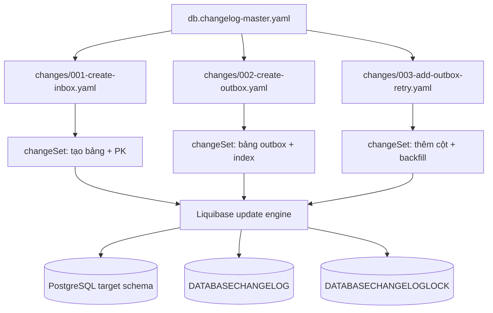
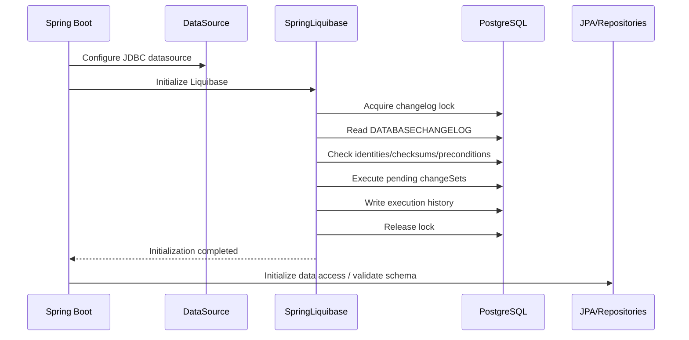
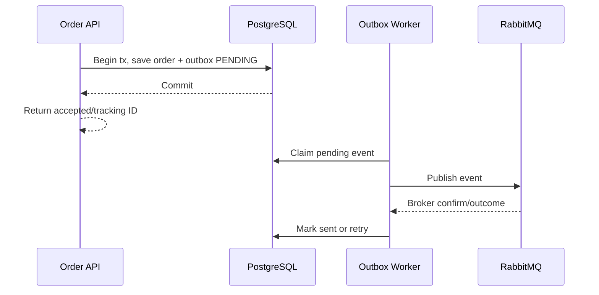
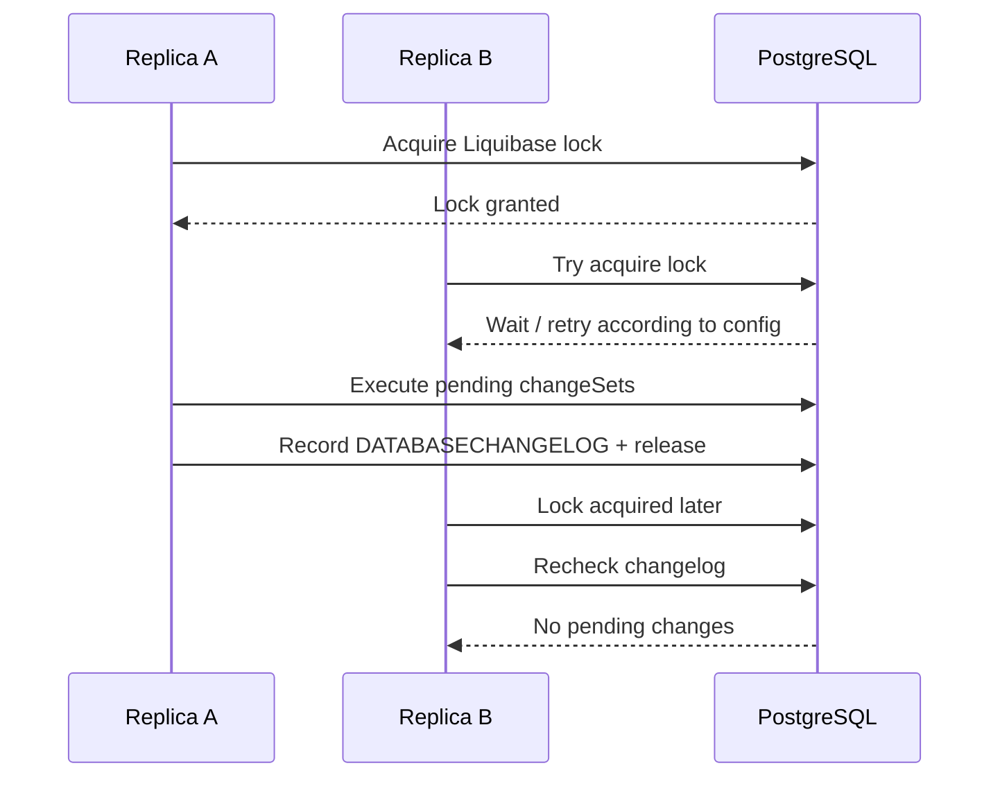
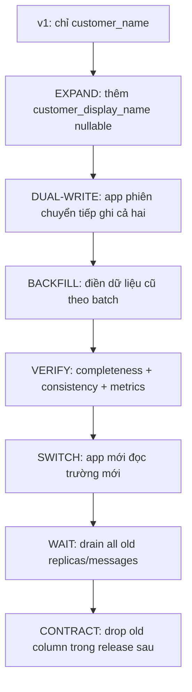
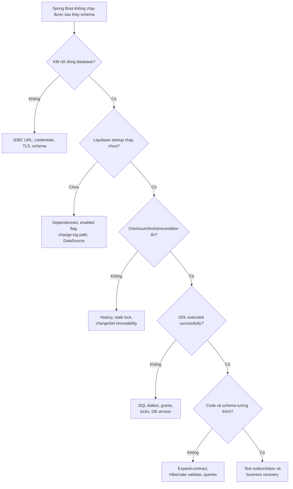

# Tích hợp Liquibase và quản lý changelog

## 1. Vì sao Spring Boot Integration cần migration có lịch sử?

Một hệ thống **SPRING_BOOT_INTEGRATION** thường kết nối HTTP client, cơ sở dữ liệu, cache, broker thông điệp và adapter của Spring Integration. Dữ liệu không chỉ phục vụ CRUD: ứng dụng còn lưu **inbox** để chống xử lý trùng, **outbox** để phát sự kiện bền vững, trạng thái đồng bộ, mã tương quan, kết quả retry và bản ghi audit. Những bảng này phải tồn tại và giữ đúng ràng buộc qua nhiều lần triển khai.

Ví dụ ban đầu dịch vụ nhận sự kiện đơn hàng:

```text
HTTP POST /orders
      |
      v
OrderService
      |
      v
PostgreSQL: orders + integration_outbox
      |
      v
OutboxWorker --> RabbitMQ --> ShippingConsumer
      |
      v
processed_event (inbox ở consumer)
```

Một bản phát hành mới muốn thêm `next_attempt_at` để worker hẹn giờ retry. Nếu chỉ sửa Java entity hoặc trực tiếp chạy `ALTER TABLE` thủ công trên một môi trường, bạn có thể gặp:

- Staging có cột mới, production chưa có: `column does not exist`.
- Hai replicas cùng cố tạo index khi khởi động.
- Bản Java mới chạy với schema cũ và lỗi ngay trước khi xử lý message.
- Test H2 tự tạo schema, nên xanh dù migration PostgreSQL thiếu.
- Bản deployment bị rollback về code cũ, nhưng schema đã thay đổi phá compatibility.
- Một thay đổi nhầm xóa bảng outbox, khiến dữ liệu cần publish bị mất.

**Liquibase** là công cụ quản lý thay đổi schema/cấu trúc cơ sở dữ liệu theo **changelog**, **changeSet**, lịch sử thực thi và cơ chế khóa. Nó giúp trả lời: thay đổi nào đã chạy, ai định nghĩa, theo thứ tự nào, trên database nào và checksum là gì.

### Mục tiêu bài học

Sau bài này, bạn có thể:

1. Thêm Liquibase vào dự án Spring Boot dùng JDBC/JPA.
2. Tổ chức `db.changelog-master.yaml`, `include` và các tệp thay đổi độc lập.
3. Viết `changeSet` tạo bảng, khóa chính, unique constraint, index và bổ sung cột.
4. Hiểu `DATABASECHANGELOG`, `DATABASECHANGELOGLOCK`, identity, checksum và cách xử lý changelog đã chạy.
5. Sử dụng contexts/labels/preconditions đúng ý nghĩa, không làm seed test lọt vào production.
6. Phân biệt Liquibase với Hibernate `ddl-auto` và Spring `schema.sql`.
7. Lập kế hoạch migration không downtime bằng **expand → backfill → contract**.
8. Kiểm thử migration với PostgreSQL Testcontainers, nâng cấp từ schema cũ, concurrency và failure paths.
9. Tổ chức quyền DDL, deployment job, rollback, baseline và giám sát.
10. Liên hệ migration với idempotency, transaction, message retry và khả năng phục hồi dữ liệu.

> Ví dụ chủ yếu sử dụng **Java 17+, Spring Boot 3.x, Liquibase 4.x/nhánh tương thích và PostgreSQL 15+**. Hệ sinh thái này có thay đổi giữa các release; hãy dùng Spring Boot BOM và tài liệu đúng phiên bản dự án. SQL `TIMESTAMP WITH TIME ZONE`, `jsonb` hay `CREATE INDEX CONCURRENTLY` là đặc trưng PostgreSQL, không mặc nhiên chạy trên H2/MySQL.

## 2. Phân biệt schema initialization và migration

| Cơ chế | Mục tiêu | Lịch sử đã chạy? | Phù hợp khi nào? |
| --- | --- | --- | --- |
| Spring Boot `schema.sql`/`data.sql` | Thực thi SQL scripts theo điều kiện cấu hình | Không phải hệ thống versioned change history | Demo/test đơn giản, bootstrap có kiểm soát |
| Hibernate `ddl-auto=create/update` | Tạo hoặc cập nhật schema từ ORM mappings | Không có changelog nghiệp vụ đầy đủ | Prototype/test dùng có chủ đích |
| Hibernate `ddl-auto=validate` | So entity mappings với schema hiện có | Không | Kiểm tra ORM sau migrations |
| **Liquibase** | DDL và đôi khi data migration theo changeSets | Có, qua bảng changelog | Môi trường có lịch sử nâng cấp, production |
| Flyway | Migration theo version/repeatable scripts | Có | Một lựa chọn thay thế Liquibase |
| IaC/DBA scripts | Database provisioning, roles, storage, backup | Tùy quy trình | Các tác vụ quản trị tách ứng dụng |

**Không nên để nhiều cơ chế cùng “sở hữu” một bảng**. Ví dụ Liquibase tạo `orders` nhưng Hibernate `create-drop` lại xóa nó khi context đóng là một xung đột nghiêm trọng.

Một kiến trúc phổ biến:

- Liquibase sở hữu các thay đổi cấu trúc và dữ liệu chuyển đổi đã được version hóa.
- JPA/Hibernate chỉ `validate` khi có entity mappings.
- Spring SQL initialization scripts bị tắt cho schema production.
- Database server, users, storage, backup và HA được cấp bởi infrastructure/DBA; Liquibase không tự tạo một cluster PostgreSQL.

## 3. Mô hình Liquibase: changelog, changeSet và change



Các thuật ngữ:

- **Changelog**: tài liệu YAML, XML, JSON hoặc formatted SQL mô tả danh sách thay đổi và những changelog được include.
- **changeSet**: đơn vị Liquibase theo dõi đã thực thi; có `id`, `author` và nguồn tệp/logical path.
- **change**: thao tác như `createTable`, `addColumn`, `addUniqueConstraint`, `createIndex` hoặc `sql`.
- **Precondition**: kiểm tra điều kiện trước khi chạy, có policy khi không thỏa.
- **Context/label**: metadata và bộ lọc để chọn những changesets trong một lần chạy.
- **Rollback**: tập thao tác dự định đảo một changeSet khi có thể, không tự bảo đảm phục hồi dữ liệu đã xóa.
- **Checksum**: dấu vết của nội dung changeSet để Liquibase phát hiện thay đổi ngoài ý muốn.
- **Changelog lock**: cơ chế tránh hai tiến trình Liquibase cập nhật cùng một database đồng thời.

Liquibase khác ORM: nó không tự suy mọi thay đổi entity thành an toàn, không tự biết một cột nghiệp vụ có thể xóa lúc nào và không bảo đảm backward compatibility giữa các bản ứng dụng.

## 4. Vòng đời khi Spring Boot khởi động

Khi `liquibase-core` có trên classpath và điều kiện auto-configuration thỏa, Spring Boot có thể tạo `SpringLiquibase` để chạy các changeSets chưa áp dụng.



Trong các auto-configurations thông dụng, Spring Boot phối hợp thứ tự database initialization trước những thành phần phụ thuộc schema như JPA. Tuy nhiên, **custom startup beans, nhiều datasources, custom Liquibase instances hoặc manual SQL** có thể làm thứ tự phức tạp hơn; không suy rằng mọi bean tùy chỉnh đều tự đợi migration.

**Không coi Liquibase startup thành công là business readiness đầy đủ.** DB còn phải có quyền đọc/ghi nghiệp vụ, broker phải kết nối được khi cần, worker/outbox phải có khả năng tiếp tục và schema phải tương thích với bản code hiện tại.

## 5. Maven dependencies: Spring JDBC/JPA, Liquibase và driver

Ví dụ ứng dụng JDBC sử dụng PostgreSQL:

```xml
<dependencies>
    <dependency>
        <groupId>org.springframework.boot</groupId>
        <artifactId>spring-boot-starter-jdbc</artifactId>
    </dependency>

    <dependency>
        <groupId>org.liquibase</groupId>
        <artifactId>liquibase-core</artifactId>
    </dependency>

    <dependency>
        <groupId>org.postgresql</groupId>
        <artifactId>postgresql</artifactId>
        <scope>runtime</scope>
    </dependency>
</dependencies>
```

Gradle:

```groovy
dependencies {
    implementation 'org.springframework.boot:spring-boot-starter-jdbc'
    implementation 'org.liquibase:liquibase-core'
    runtimeOnly 'org.postgresql:postgresql'
}
```

Nếu dùng `spring-boot-starter-data-jpa`, nó đã cung cấp nhiều hạ tầng JDBC/Hikari phổ biến, nhưng bạn vẫn cần Liquibase và đúng JDBC driver. Không cần thêm H2 cho production chỉ vì H2 từng được dùng trong unit tests.

**Version management:** để Spring Boot BOM quản lý những bản dependency được nó hỗ trợ; nếu override Liquibase/JDBC driver versions phải kiểm tra release notes và tương thích. Không pha trộn các thư viện Liquibase core/extension khác major không kiểm soát.

Khi dùng database không được hỗ trợ trực tiếp bởi `liquibase-core` trong một tổ hợp phiên bản cụ thể, có thể cần Liquibase extension/driver phù hợp. Không giả định một dependency đủ cho mọi DBMS.

## 6. Spring Boot cấu hình Liquibase qua application.yml

Một ví dụ phù hợp PostgreSQL production:

```yaml
spring:
  datasource:
    url: ${DB_JDBC_URL}
    username: ${DB_USERNAME}
    password: ${DB_PASSWORD}

  liquibase:
    enabled: true
    change-log: classpath:/db/changelog/db.changelog-master.yaml
    drop-first: false

  sql:
    init:
      mode: never

  jpa:
    hibernate:
      ddl-auto: validate
```

Giải thích:

- `spring.datasource.*`: cấu hình JDBC connection dùng bởi ứng dụng khi không có Liquibase-specific DataSource.
- `spring.liquibase.enabled`: có chạy Liquibase khi auto-configuration phù hợp hay không; không nên tắt chỉ để bỏ qua lỗi changelog.
- `spring.liquibase.change-log`: đường dẫn resource master changelog. Spring Boot có default location theo convention, nhưng khai báo tường minh giúp review.
- `spring.liquibase.drop-first=false`: không yêu cầu drop schema/database objects trước migration. **Tuyệt đối không bật drop-first trên dữ liệu cần giữ**.
- `spring.sql.init.mode=never`: tránh scripts `schema.sql`/`data.sql` cùng sở hữu cấu trúc.
- `spring.jpa.hibernate.ddl-auto=validate`: chỉ có tác dụng nếu JPA/Hibernate hiện diện, giúp phát hiện ORM mapping lệch schema.
- Nếu ứng dụng chỉ dùng JDBC, cấu hình `spring.jpa.*` không tạo ra JPA và không ảnh hưởng JDBC schema.
- Các giá trị JDBC URL, user và password được cấp từ secrets/deployment, không commit mật khẩu trong Git.

Đừng dùng một JDBC URL fallback `jdbc:h2:mem:demo` trong production. Thiếu biến `DB_JDBC_URL` phải là **deployment configuration failure**, không được âm thầm tạo một database mới rỗng.

## 7. Dùng một DataSource hay DataSource riêng cho Liquibase?

### Mô hình A: cùng DataSource

Theo cấu hình thông thường, Liquibase dùng kết nối tới database application đang sử dụng. Đơn giản khi app có một datasource và quy trình migration startup được chấp thuận.

Nhược điểm: database user của ứng dụng có thể cần DDL permissions (`CREATE/ALTER/DROP`); đó là quyền rộng hơn nhu cầu DML hằng ngày.

### Mô hình B: credentials/kết nối migration riêng

Spring Boot hỗ trợ một số `spring.liquibase.*` properties để cung cấp connection riêng cho Liquibase, ví dụ:

```yaml
spring:
  datasource:
    url: ${APP_DB_JDBC_URL}
    username: ${APP_DB_USERNAME}
    password: ${APP_DB_PASSWORD}

  liquibase:
    change-log: classpath:/db/changelog/db.changelog-master.yaml
    url: ${MIGRATION_DB_JDBC_URL}
    user: ${MIGRATION_DB_USERNAME}
    password: ${MIGRATION_DB_PASSWORD}
```

Đây là hai bộ **credentials có trách nhiệm khác nhau**, không nhất thiết hai database. Thông thường chúng phải trỏ đúng **cùng logical database/schema** đang phát hành. Một lỗi cấu hình khiến Liquibase migrate database A nhưng app truy vấn database B có thể qua startup không như kỳ vọng ở những môi trường khác nhau.

Khi dùng multiple DataSources hoặc cấu hình một datasource riêng bằng `@LiquibaseDataSource`, phải kiểm tra bean wiring, transaction managers, connection pool và target schema. Không dựa vào quy tắc auto-configuration một datasource khi app thật có ba databases.

### Khi nào tách migration job khỏi app?

Ở production có nhiều replicas, thường tốt hơn khi:

- Một deployment job/CI stage có DDL credentials và chạy migration.
- Ứng dụng production chỉ có quyền DML cần thiết.
- App startup dùng `spring.liquibase.enabled=false` **chỉ khi** quy trình migration độc lập đã được thiết kế/kiểm tra và có schema version guard.
- Deployment chỉ chuyển traffic hoặc tăng replicas sau khi migrations hoàn tất và compatibility đạt.

Tắt Liquibase trong app **không tự bảo đảm** migration job đã chạy. Pipeline phải kiểm tra DATABASECHANGELOG/schema và chặn phát hành nếu sai.

## 8. Tổ chức thư mục changelog dễ review và tái lập

Một cấu trúc tham khảo:

```text
src/main/resources/
  db/
    changelog/
      db.changelog-master.yaml
      changes/
        001-create-processed-event.yaml
        002-create-integration-outbox.yaml
        003-add-outbox-retry-metadata.yaml
        004-create-outbox-worker-index.yaml
```

Quy tắc tổ chức:

1. Tệp master chứa danh sách `include` theo thứ tự chủ đích.
2. Mỗi tệp thay đổi có một hoặc vài changeSets có mục tiêu nghiệp vụ rõ.
3. `id` và `author` ổn định; không tái sử dụng danh tính để viết lại lịch sử.
4. Tên tệp có prefix số để người đọc thấy thứ tự, nhưng **thứ tự thực thi được quyết định bởi changelog/includes và changeSet logic**.
5. Migration nào đã phát hành/thực thi nên được coi là **immutable**.
6. Không lưu raw production credentials, dữ liệu nhạy cảm hoặc biến môi trường bí mật trong migration resources.
7. Ưu tiên cấu trúc theo bounded context/module khi số lượng thay đổi tăng, không gom mọi DDL vào một tệp khổng lồ.
8. Tránh thay đổi path của tệp đã thực thi trừ khi đã hiểu `logicalFilePath` và identity implications.

Có thể dùng XML, JSON hoặc formatted SQL thay YAML. **Chọn một convention nhất quán**, nhất là với escape strings, script paths, schema names và code review.

## 9. Master changelog và include theo thứ tự

Ví dụ `src/main/resources/db/changelog/db.changelog-master.yaml`:

```yaml
databaseChangeLog:
  - include:
      file: changes/001-create-processed-event.yaml
      relativeToChangelogFile: true

  - include:
      file: changes/002-create-integration-outbox.yaml
      relativeToChangelogFile: true

  - include:
      file: changes/003-add-outbox-retry-metadata.yaml
      relativeToChangelogFile: true

  - include:
      file: changes/004-create-outbox-worker-index.yaml
      relativeToChangelogFile: true
```

Điều cần nhớ:

- `databaseChangeLog` là root collection của Liquibase YAML.
- `include` tải changelog con tại vị trí nó được khai báo.
- `relativeToChangelogFile: true` khiến `file` tương đối với changelog đang include.
- Cần đóng gói toàn bộ tệp dưới `src/main/resources` vào JAR/container; test build artifact cần đọc được các resources.
- Đường dẫn và cách resolve resource quyết định identity của changeSet trong `DATABASECHANGELOG`. Không đổi thư mục chỉ để “dọn đẹp” khi changesets đã chạy.
- `includeAll` có thể quét thư mục, nhưng việc kiểm soát tên/thứ tự và nội dung được include phải được kiểm thử; cho production-critical changesets, explicit `include` thường dễ review hơn.

**Không có một phiên bản số duy nhất “hiện tại” chỉ nhờ tên tệp 004.** Nguồn sự thật về history là các bản ghi được Liquibase thực thi trên database đích.

## 10. changeSet đầu tiên: tạo bảng inbox chống xử lý trùng

Ví dụ `changes/001-create-processed-event.yaml`:

```yaml
databaseChangeLog:
  - changeSet:
      id: "001-create-processed-event"
      author: "integration-team"
      changes:
        - createTable:
            tableName: processed_event
            columns:
              - column:
                  name: source_system
                  type: varchar(80)
                  constraints:
                    nullable: false

              - column:
                  name: event_id
                  type: varchar(120)
                  constraints:
                    nullable: false

              - column:
                  name: processed_at
                  type: TIMESTAMP WITH TIME ZONE
                  defaultValueComputed: CURRENT_TIMESTAMP
                  constraints:
                    nullable: false

        - addPrimaryKey:
            tableName: processed_event
            columnNames: source_system,event_id
            constraintName: pk_processed_event
```

Tại sao `PRIMARY KEY (source_system, event_id)` quan trọng?

- Broker có thể redeliver một message khi consumer chết trước ack.
- Cùng `eventId` có thể tồn tại ở **hai** nguồn tích hợp khác nhau; phạm vi khóa phải rõ.
- Unique constraint tại database chống race khi hai consumers cùng xử lý.
- Một kiểm tra `exists()` rồi `insert()` **không atomic** nếu thiếu ràng buộc ở database.
- `processed_at` hỗ trợ audit/retention nhưng không tự xác minh business side effect có hoàn tất hay chưa.

Ví dụ sử dụng `TIMESTAMP WITH TIME ZONE` cho PostgreSQL. Với MySQL/H2, hãy kiểm tra portability và kiểu dữ liệu thực tế, không sao chép SQL type vô điều kiện.

**Quan trọng:** Inbox chỉ là một cấu phần idempotency. Nếu consumer ghi dấu “đã xử lý” trong transaction khác với cập nhật trạng thái nghiệp vụ, crash giữa hai bước vẫn có thể làm mất hoặc lặp side effect.

## 11. changeSet tạo bảng outbox bền vững

Ví dụ `changes/002-create-integration-outbox.yaml`:

```yaml
databaseChangeLog:
  - changeSet:
      id: "002-create-integration-outbox"
      author: "integration-team"
      changes:
        - createTable:
            tableName: integration_outbox
            columns:
              - column:
                  name: event_id
                  type: varchar(120)
                  constraints:
                    primaryKey: true
                    primaryKeyName: pk_integration_outbox
                    nullable: false

              - column:
                  name: destination
                  type: varchar(120)
                  constraints:
                    nullable: false

              - column:
                  name: event_type
                  type: varchar(80)
                  constraints:
                    nullable: false

              - column:
                  name: schema_version
                  type: int
                  constraints:
                    nullable: false

              - column:
                  name: payload_json
                  type: text
                  constraints:
                    nullable: false

              - column:
                  name: status
                  type: varchar(24)
                  defaultValue: PENDING
                  constraints:
                    nullable: false

              - column:
                  name: created_at
                  type: TIMESTAMP WITH TIME ZONE
                  defaultValueComputed: CURRENT_TIMESTAMP
                  constraints:
                    nullable: false
```

Một bảng outbox lưu **intent đã commit** trong cùng PostgreSQL transaction với đơn hàng. Worker sau đó mới phát sang RabbitMQ/Kafka.



**Liquibase tạo schema đúng không đồng nghĩa worker đã an toàn**. Cần thiết kế claim/lease, status transitions, idempotency, index và retry:

- Khi broker unavailable, outbox vẫn `PENDING`.
- Khi publish thành công nhưng confirm mất, worker có thể gửi lặp; consumer phải idempotent.
- Khi ứng dụng crash sau HTTP 202, outbox phải còn trên DB storage phù hợp.
- `payload_json` cần hợp đồng schema/size/PII; không tự nhét file nhiều GB vào cột này.
- `status` phải có tập giá trị và quy trình chuyển trạng thái được kiểm soát; có thể bổ sung check constraint phù hợp DBMS ở migration riêng.

## 12. Thay đổi tiếp theo: thêm metadata retry theo kiểu expand

Bản ứng dụng mới cần `attempt_count` và `next_attempt_at`. Ví dụ `changes/003-add-outbox-retry-metadata.yaml`:

```yaml
databaseChangeLog:
  - changeSet:
      id: "003-add-outbox-retry-metadata"
      author: "integration-team"
      changes:
        - addColumn:
            tableName: integration_outbox
            columns:
              - column:
                  name: attempt_count
                  type: int
                  defaultValueNumeric: 0
                  constraints:
                    nullable: false

              - column:
                  name: next_attempt_at
                  type: TIMESTAMP WITH TIME ZONE

      rollback:
        - dropColumn:
            tableName: integration_outbox
            columnName: next_attempt_at

        - dropColumn:
            tableName: integration_outbox
            columnName: attempt_count
```

Giải thích:

1. Chỉ **thêm** các cột; code cũ vẫn có thể insert outbox events vì `attempt_count` có default.
2. `next_attempt_at` nullable trong giai đoạn đầu, cho phép rows cũ chưa có giá trị.
3. Rollback mẫu xóa cột mới và **mất dữ liệu retry metadata**. Nó chỉ minh họa cú pháp, không phải lời khuyên tự động rollback production.
4. Nếu bảng cực lớn, adding default/not-null/backfill có thể tạo lock/rewrite hay áp lực I/O tùy PostgreSQL version; cần benchmark trên bản production-like.
5. Đừng sửa changeSet `002` đã thực thi để “thêm cột vào createTable”. Đó là thay đổi lịch sử/checksum; hãy tạo changeSet `003` như trên.

**Một migration additive vẫn cần tương thích version.** Nếu các worker cũ dùng `SELECT *` và mapping theo vị trí cột, bổ sung cột có thể phá code; tránh phụ thuộc SQL result order trong integration code.

## 13. Tách index thành changeSet riêng và cân nhắc lock

Ví dụ `changes/004-create-outbox-worker-index.yaml`:

```yaml
databaseChangeLog:
  - changeSet:
      id: "004-create-outbox-worker-index"
      author: "integration-team"
      changes:
        - createIndex:
            tableName: integration_outbox
            indexName: idx_integration_outbox_due
            columns:
              - column:
                  name: status
              - column:
                  name: next_attempt_at
              - column:
                  name: created_at
```

Index giúp những query tìm event `PENDING` hoặc đến hạn retry. Nhưng:

- Một index không tự làm polling query nhanh nếu filter/order/volume không phù hợp. Kiểm tra PostgreSQL `EXPLAIN (ANALYZE, BUFFERS)` trong môi trường cô lập.
- `CREATE INDEX` thường có tác động lock/IO khác nhau theo DBMS và volume.
- PostgreSQL `CREATE INDEX CONCURRENTLY` có thể giảm blocking writes trong nhiều trường hợp, nhưng không chạy bên trong transaction block thông thường.
- Nếu dùng raw SQL `CREATE INDEX CONCURRENTLY` trong Liquibase, cần thiết kế một changeSet riêng với `runInTransaction: false` **sau khi** kiểm tra PostgreSQL-specific semantics, partial failures và cách dọn index invalid.
- Không dùng `runInTransaction: false` cho mọi thay đổi để “nhanh hơn”; có thể để lại schema nửa chừng nếu một lệnh thất bại.

Ví dụ rõ phạm vi PostgreSQL-specific, thay cho generic `createIndex` khi deploy cần tránh lock:

```yaml
databaseChangeLog:
  - changeSet:
      id: "004-pg-create-worker-index-concurrently"
      author: "integration-team"
      runInTransaction: false
      preConditions:
        - onFail: HALT
        - dbms:
            type: postgresql
      changes:
        - sql:
            sql: |
              CREATE INDEX CONCURRENTLY
              idx_integration_outbox_due
              ON integration_outbox
              (status, next_attempt_at, created_at)
```

**Đây là phương án thay thế, không chạy đồng thời cả hai changeSet 004.** Nếu index đã được tạo qua ví dụ generic, SQL concurrent phía trên sẽ trùng tên và lỗi. Bản production nên chọn **một** chiến lược, đặt ID/path nhất quán và chạy test migration từ schema cũ.

## 14. Danh tính changeSet không chỉ là id

Liquibase thông thường nhận diện changeSet bằng tổ hợp:

```text
(id, author, filename/logicalFilePath)
```

Ví dụ:

```text
id = 002-create-integration-outbox
author = integration-team
filename = db/changelog/changes/002-create-integration-outbox.yaml
```

Hệ quả:

- Hai changeSets trùng `id` nhưng khác file/author có thể là hai identities khác nhau; đừng xem `id` riêng lẻ là unique key toàn repository.
- Đổi tên/move file đã áp dụng có thể khiến Liquibase coi changeSet là **một bản khác chưa chạy**, dẫn tới cố tạo bảng/index lần hai.
- Đổi `author` của một migration đã chạy có thể gây kết quả tương tự.
- `logicalFilePath` được dùng để ổn định đường dẫn logic khi tổ chức lại changelogs, nhưng phải được thiết kế nhất quán và test với database đã có history.
- Đổi tên file có số prefix chỉ vì muốn thứ tự đẹp hơn là thay đổi có rủi ro lớn trong repository đã được phát hành.

**Nhận xét quan trọng:** checksum không phải identity. Checksum dùng để xác minh nội dung của changeSet đã biết; identity dùng để biết đây có phải changeSet từng thực thi không.

## 15. DATABASECHANGELOG lưu những gì?

Liquibase tạo/duy trì bảng changelog (tên mặc định thường `DATABASECHANGELOG`) trong database mục tiêu, có các thông tin tương tự:

| Cột/khái niệm | Vai trò |
| --- | --- |
| `ID` | ID của changeSet |
| `AUTHOR` | Tác giả/owner khai báo |
| `FILENAME` | Logical/physical file path được dùng định danh |
| `DATEEXECUTED` | Thời điểm thực thi |
| `ORDEREXECUTED` | Thứ tự thực thi |
| `EXECTYPE` | Kiểu kết quả thực thi, ví dụ EXECUTED/MARK_RAN/RERAN |
| `MD5SUM` | Checksum được Liquibase lưu theo định dạng/version của nó |
| `DESCRIPTION`, `COMMENTS` | Metadata phục vụ điều tra |
| `CONTEXTS`, `LABELS` | Metadata lọc/execution |
| `DEPLOYMENT_ID` | Nhận dạng lần cập nhật (nếu có) |

**Không sửa bảng này thủ công để “sửa lỗi migration”**. Đây là hệ thống audit của công cụ; chỉnh sai có thể khiến changelog tiếp theo chạy lại hoặc bị bỏ qua.

Muốn biết một changeSet có được thực thi trong production không, kiểm tra trạng thái qua Liquibase commands/controlled read-only queries trong môi trường có quyền phù hợp; không dựa duy nhất vào Git commit hoặc tên JAR.

Các lệnh/chi tiết cột có thể khác phiên bản Liquibase; tránh viết tooling phụ thuộc vào internal schema mà không có tests.

## 16. DATABASECHANGELOGLOCK bảo vệ race khi nhiều app start

Bảng `DATABASECHANGELOGLOCK` dùng để điều phối việc cập nhật Liquibase cùng target database. Khi hai app replicas cùng chạy Liquibase:



Tính năng này ngăn **hai Liquibase instances sửa schema đồng thời** theo thiết kế. Nhưng nó **không** bảo đảm:

- Code v2 tương thích code v1 khi hai app versions cùng chạy.
- Mọi request đã dừng trước khi `DROP COLUMN`.
- Một migration lâu không ảnh hưởng startup/readiness hoặc timeouts của orchestrator.
- Business transaction và database migration là atomic với HTTP/broker.
- Schema migration có thể chạy mà không giữ lock với user code hay DBA commands.

Nếu một migration crash hoặc phiên DB bị cắt, lock record có thể cần điều tra. Chỉ dùng công cụ giải phóng lock (ví dụ lệnh Liquibase `releaseLocks`) **sau khi xác nhận không còn Liquibase instance nào đang thực thi**; không tự xóa lock để “chạy lại ngay”. Một process khác thực sự đang thay schema thì mở khóa sẽ gây race nghiêm trọng.

## 17. Checksum: vì sao không sửa changeSet đã phát hành?

Liquibase lưu checksum của nội dung changeSet từng chạy. Ví dụ thay một migration đã áp dụng:

```yaml
# Đã phát hành và chạy trong production:
- changeSet:
    id: "001-create-processed-event"
    author: "integration-team"
    changes:
      - createTable:
          tableName: processed_event
          # ...
```

Sau đó developer sửa type, columnName hoặc logic tạo bảng trong cùng identity. Lần chạy tiếp theo, Liquibase có thể báo **checksum validation error**.

Đó là cơ chế bảo vệ hữu ích, không phải “Liquibase bị hỏng”. Cách xử lý chuẩn:

1. **Nếu changeSet đã chạy ở bất kỳ môi trường bền vững nào:** coi là immutable.
2. Tạo **changeSet mới** để điều chỉnh schema, ví dụ `005-alter-event-id-length`.
3. Nếu cần xem khác biệt giữa environments, so migration history/schema thực tế.
4. Chỉ cân nhắc `validCheckSum`, `clearCheckSums` hoặc thao tác sửa history với sự chấp thuận, hiểu rõ trạng thái DB và mục tiêu; đây không phải “công tắc bỏ qua lỗi” cho pipeline thường ngày.
5. `runOnChange` có thể phù hợp với một số object **tái tạo an toàn** như view/procedure trong quy trình được kiểm soát; không dùng cho DDL phá dữ liệu hay thay đổi business table tùy tiện.
6. `runAlways` làm changeSet có thể chạy lại mỗi lần cập nhật; tránh dùng cho seed data/UPDATE không idempotent hoặc tác vụ dài.

**Một thay đổi chỉ được sửa trực tiếp khi nó chưa thực thi ở bất kỳ database nào thuộc chuỗi triển khai được hỗ trợ** và team đã xác nhận điều đó. Ngay cả test DB cá nhân cũng cần reset có chủ đích sau khi sửa changelog đã chạy ở đó.

## 18. Trình tự thực thi: include, preconditions và checksum không thay transaction safety

Một changelog có thể chứa nhiều changeSets theo thứ tự file. Liquibase sẽ xét changelog records, filters, preconditions và chạy những thay đổi chưa áp dụng phù hợp.

Nhưng:

- **Thứ tự include** quyết định quan hệ phụ thuộc: bảng phải được tạo trước index.
- **Changelog history** không tự xác minh business schema invariant như foreign references hoặc outbox worker correctness.
- **Preconditions** kiểm tra một trạng thái tại thời điểm xét; điều kiện có thể thay đổi do app/DBA đồng thời.
- **ChangeSet transaction** chỉ atomic khi database/loại DDL hỗ trợ và `runInTransaction` phù hợp; MySQL/MariaDB DDL và PostgreSQL `CREATE INDEX CONCURRENTLY` có khác biệt.
- **Lock Liquibase** bảo vệ cập nhật changelog đồng thời, không chặn mọi app queries.
- **Error giữa nhiều changeSets** có thể để những changeSets trước đã commit, một số thay đổi sau chưa chạy.

Do đó pipeline cần test **fresh install**, **upgrade từ phiên bản trước**, **fail halfway** và **restart/resume** — không chỉ chạy master changelog một lần trên DB trống.

## 19. Contexts và labels: chọn migration theo mục đích

Liquibase cung cấp **contexts** và **labels** để lọc changeSets khi chạy. Dễ hiểu nhất:

- **Context** thường mô tả môi trường hoặc pha thực thi, ví dụ `dev`, `test`, `seed`.
- **Label** thường mô tả nhóm tính năng, release, tenant hoặc loại thay đổi, ví dụ `billing`, `ops`.
- Bộ lọc chạy thực tế được truyền qua cấu hình Liquibase/CLI/Spring Boot, **không chỉ** từ tên file.
- Đây là metadata lọc **thay đổi schema**, không phải cơ chế authorization hay feature flag thay thế code.

Ví dụ changeSet có context test:

```yaml
databaseChangeLog:
  - changeSet:
      id: "test-seed-statuses"
      author: "integration-team"
      contextFilter: "@test"
      changes:
        - insert:
            tableName: lookup_status
            columns:
              - column:
                  name: code
                  value: TEST_ONLY
```

Ví dụ Spring Boot test profile:

```yaml
spring:
  liquibase:
    contexts: test
```

**Lưu ý quan trọng về semantics:** với một số cấu hình Liquibase, khi **không chỉ định context filter lúc chạy**, các changeSets có `contextFilter` thông thường vẫn có thể được xét chạy. Tiền tố `@` trong context expression được dùng khi muốn buộc context phải được yêu cầu tường minh theo phiên bản hỗ trợ. Nếu dùng các changeSets nguy hiểm/chỉ test, hãy xác nhận bằng test với **đúng Liquibase version** và cân nhắc tách riêng dev/test root changelog thay vì chỉ dựa vào một chuỗi context.

Với labels, sử dụng `labels` trên changeSet và label filter runtime tương ứng (tên property và syntax phụ thuộc phiên bản). Không đặt tên label `prod` rồi nghĩ nó tự bảo vệ production khỏi changeSet không phù hợp.

**Khuyến nghị vận hành:** schema căn bản mà mọi môi trường cần nên chạy nhất quán; dữ liệu giả, test credentials hoặc destructive seed tuyệt đối không nằm trong đường chạy production thông thường.

## 20. Preconditions: kiểm tra trạng thái trước khi thay đổi

Preconditions giúp Liquibase xác nhận một giả định trước khi chạy migration, ví dụ target DBMS, bảng tồn tại hoặc một column chưa có.

Ví dụ chỉ cho PostgreSQL:

```yaml
databaseChangeLog:
  - changeSet:
      id: "005-add-partner-reference"
      author: "integration-team"
      preConditions:
        - onFail: HALT
        - dbms:
            type: postgresql
        - tableExists:
            tableName: integration_outbox
      changes:
        - addColumn:
            tableName: integration_outbox
            columns:
              - column:
                  name: partner_reference
                  type: varchar(120)
```

**Chú ý:**

- `onFail: HALT` khiến một điều kiện không thỏa chặn migration thay vì âm thầm giả định thành công.
- `onFail: MARK_RAN` có thể khiến Liquibase ghi changeSet là đã xử lý dù không thực thi thay đổi; chỉ dùng khi đó là semantics **được thiết kế rõ**, không dùng để che lệch schema.
- `onFail: CONTINUE` hoặc `WARN` có thể phù hợp một số optional changes, nhưng cần hiểu liệu startup vẫn tiếp tục với schema chưa đáp ứng contract hay không.
- `tableExists` thường cần database metadata query; với hàng nghìn changeSets, preconditions tốn chi phí có thể ảnh hưởng thời gian startup.
- Preconditions là **guard**, không thay changeSet history, code review, backup/restore hoặc validation của dữ liệu nghiệp vụ.

Một anti-pattern là viết `preConditions: tableExists` rồi `MARK_RAN` cho tất cả migrations để pipeline “xanh” trên database bị sai. Khi production drift, bạn cần phát hiện rõ và xử lý theo kế hoạch, không ghi history giả.

## 21. Changelog parameters và cách tránh dữ liệu không đáng tin

Liquibase hỗ trợ parameters để tái sử dụng một số giá trị như schema name. Spring Boot có thể truyền tham số theo namespace `spring.liquibase.parameters.*`:

```yaml
spring:
  liquibase:
    parameters:
      appSchema: integration
```

Và trong changelog (minh họa):

```yaml
databaseChangeLog:
  - changeSet:
      id: "006-create-reference-table"
      author: "integration-team"
      changes:
        - createTable:
            schemaName: ${appSchema}
            tableName: integration_reference
            columns:
              - column:
                  name: reference_id
                  type: varchar(120)
                  constraints:
                    primaryKey: true
                    nullable: false
```

Giới hạn:

- `integration` schema phải được provision và application/Liquibase user có quyền phù hợp.
- Một placeholder dùng để tạo SQL identifier không nên được cấp từ input tùy ý của HTTP caller hoặc JMS message; có nguy cơ SQL injection/configuration drift.
- Một migration đã chạy ở schema này có thể có identity/history khác khi chuyển sang schema khác.
- Default schema, Liquibase changelog table schema và data target schema **có thể khác nhau**; cần cấu hình chính xác.
- Thay schema parameter trong các lần deploy của cùng database có thể làm drift khó chẩn đoán; nên xem đây là thay đổi deployment topology được kiểm soát.

Khi dùng managed databases, secret parameters không nên ghi vào log hoặc source. Cần hiểu giá trị nào xuất hiện trong generated SQL/migration history.

## 22. XML, JSON, YAML và formatted SQL: chọn chuẩn nào?

Liquibase hỗ trợ nhiều dạng changelog. Không có nghĩa các dạng này hoàn toàn tương đương cho mọi extension, quoting hoặc SQL procedure phức tạp.

| Định dạng | Điểm mạnh | Cần chú ý |
| --- | --- | --- |
| YAML | Đọc/soát dễ, change types rõ | Indentation, quoting booleans/numbers, anchors |
| XML | Schema/namespace, tooling, change types rõ | Verbose, entity/parser/security policy |
| JSON | Hợp hệ thống sinh tự động | Dễ dài và khó review manual |
| Formatted SQL | Gần SQL thật, tốt cho DB-specific features | Dễ lệ thuộc một DBMS, parser/directives cần đúng |
| `sqlFile` trong YAML/XML | DDL phức tạp lưu riêng | Đường dẫn, delimiter, encoding, transaction behavior |

Ví dụ Liquibase formatted SQL (minh họa một tệp **riêng** `changes/007-add-outbox-error-code.sql`):

```sql
--liquibase formatted sql

--changeset integration-team:007-add-outbox-error-code
ALTER TABLE integration_outbox
    ADD COLUMN last_error_code VARCHAR(64);

--rollback ALTER TABLE integration_outbox
--rollback     DROP COLUMN last_error_code;
```

Chỉ include tệp SQL đó **nếu** bạn chọn phương án formatted SQL; không tạo cả YAML và formatted SQL có cùng thay đổi rồi chạy cả hai.

Với stored procedures hoặc SQL chứa dấu chấm phẩy bên trong, kiểm tra `splitStatements`, `endDelimiter` và `runInTransaction` theo DBMS/CLI/Liquibase version; không copy delimiter settings giữa PostgreSQL và Oracle tùy tiện.

## 23. sqlFile: tách DDL phức tạp khỏi cấu trúc YAML

Khi có SQL dài/phức tạp, có thể dùng `sqlFile` thay vì viết `sql:` multiline trong changelog.

Giả sử file `changes/sql/008-create-report-view.sql`:

```sql
CREATE VIEW pending_integration_events AS
SELECT event_id, destination, event_type, created_at
FROM integration_outbox
WHERE status = 'PENDING';
```

Changelog `changes/008-create-report-view.yaml`:

```yaml
databaseChangeLog:
  - changeSet:
      id: "008-create-report-view"
      author: "integration-team"
      changes:
        - sqlFile:
            path: sql/008-create-report-view.sql
            relativeToChangelogFile: true
            encoding: UTF-8
      rollback:
        - sql:
            sql: DROP VIEW pending_integration_events
```

**Cần kiểm tra** SQL hỗ trợ dialect của database, quyền tạo view, thứ tự dependencies và rollback không phá object còn được tham chiếu. Một view có thể được `CREATE OR REPLACE` bằng migration mới, nhưng nếu thay đổi signature/view dependencies thì vẫn cần expand–contract và test.

Nếu team chọn quản lý view bằng `runOnChange`, phải đảm bảo câu SQL idempotent và test trên database có version cũ; không đổi tất cả migration thành repeatable changes vô điều kiện.

## 24. Rollback là kế hoạch dữ liệu, không chỉ là câu lệnh đảo ngược

Liquibase có thể tạo hoặc chạy rollback đối với nhiều change types, nhưng **không phải** mọi thay đổi đều có đường đảo ngược an toàn.

| Thay đổi | Rollback kỹ thuật | Rủi ro nghiệp vụ |
| --- | --- | --- |
| Thêm cột nullable | `DROP COLUMN` | Mất dữ liệu được ghi vào cột mới |
| Tạo index | `DROP INDEX` | Query cũ có thể chậm hoặc lỗi nếu hint phụ thuộc |
| Tạo bảng chưa có dữ liệu | `DROP TABLE` | An toàn hơn nếu chắc chắn bảng mới rỗng |
| Drop bảng/cột | Không thể tái tạo dữ liệu chỉ bằng `CREATE` | Cần backup/restore hoặc forward-fix |
| Đổi kiểu dữ liệu | Cast ngược có thể không khả thi | Truncation/overflow/precision |
| Backfill/update hàng triệu rows | Không luôn có dữ liệu gốc để đảo | Phải lưu bản cũ hoặc thiết kế compensating process |
| Rename column | Có thể rename lại | App đang chạy phiên mới/cũ có dependency |

**Chiến lược production thường là roll forward** (tạo migration sửa lỗi) kết hợp rollback ứng dụng có compatibility, thay vì tự động chạy `DROP` trên dữ liệu đang sử dụng.

Trước một migration có nguy cơ phá dữ liệu:

1. Kiểm tra backup gần nhất, restore drill và thời gian khôi phục mục tiêu (RTO/RPO).
2. Xác định app versions nào còn dùng schema cũ.
3. Có dry-run/generate SQL plan và review lock/permissions.
4. Có giới hạn thời gian thực thi và kế hoạch dừng.
5. Chỉ chạy rollback đã được thử trên dữ liệu gần production.
6. Nếu rollback không an toàn, document **forward-fix** và compatibility window.

Một “rollback xanh” trên H2 in-memory không đủ làm bằng chứng có thể rollback PostgreSQL chứa hàng trăm triệu rows.

## 25. Expand → backfill → contract: thay đổi schema không downtime

Giả sử app v1 dùng cột `customer_name`, nhưng v2 cần `customer_display_name`.

**Không làm ngay:**

```sql
ALTER TABLE orders
    DROP COLUMN customer_name;
```

Trong rolling deployment, replicas v1 vẫn có thể đang đọc cột cũ.

Thay vào đó:



Lịch thay đổi:

| Giai đoạn | Schema | Code được phép |
| --- | --- | --- |
| Trước mở rộng | Chỉ `customer_name` | v1 |
| Expand | Cả hai cột, cột mới nullable | v1 và transitional v2 |
| Dual-write/backfill | Cả hai cột có dữ liệu phù hợp | v1 và v2 theo chiến lược |
| Switch | Đọc/ghi cột mới, vẫn giữ cột cũ | v2, không còn phụ thuộc v1 |
| Contract | Xóa cột cũ khi chắc chắn không cần | Chỉ app mới |

Với integration messages, phải còn tính đến **outbox events đang nằm chờ, DLQ/replay, consumer chạy version cũ và job batch**. Có thể một service v1 đã hết pods nhưng payload v1 vẫn chờ xử lý. Database migration và **event schema version** liên quan nhưng không phải cùng một version counter.

## 26. Backfill dữ liệu lớn: đừng gói tất cả vào một transaction khổng lồ

Ví dụ đưa dữ liệu từ cột cũ sang cột mới:

```sql
UPDATE orders
SET customer_display_name = customer_name
WHERE customer_display_name IS NULL;
```

Câu này có thể phù hợp bảng nhỏ, nhưng trên production lớn nó có thể:

- Giữ locks lâu, tăng WAL/disk I/O.
- Chặn writers, tăng replica lag.
- Gây timeout trong startup Liquibase.
- Tạo một transaction rollback rất đắt khi fail.
- Đua với ứng dụng đang ghi vào cả hai cột.

Lựa chọn thường an toàn hơn:

1. Liquibase **thêm schema** và index/constraints phù hợp ở migration ngắn.
2. Một **backfill job** chạy theo batches, khóa/claim rows có kiểm soát, commit mỗi batch và có checkpoint.
3. Code transitional hỗ trợ dual-write để dữ liệu mới không bị bỏ sót.
4. Backfill phải **idempotent**: chạy lại batch không làm dữ liệu sai.
5. Đo progress, rows còn null, query latency, locks/WAL/replica lag.
6. Sau khi kiểm chứng dữ liệu và ứng dụng mới, migration khác mới thêm `NOT NULL`/unique constraint hoặc drop cột cũ.
7. Đối với bảng outbox đang xử lý, backfill không được phát lại side effect hoặc thay `eventId` làm mất idempotency.

Không dùng `runAlways: true` để chạy backfill khổng lồ mỗi lần app start.

## 27. Khóa, thời gian chạy và index trên bảng lớn

Một thay đổi schema là một thao tác lên database đang phục vụ nghiệp vụ, không phải chỉ là file YAML.

Trước khi chạy migration nặng trên PostgreSQL:

- Xem số lượng rows, kích thước bảng/index, tốc độ ghi, replica lag.
- Kiểm tra loại lock của DDL và query workload sẽ bị ảnh hưởng.
- Xác định `lock_timeout` và `statement_timeout` cho session migration nếu tổ chức có policy; phân biệt timeout DB với timeout orchestrator.
- Ước lượng WAL/disk space/CPU và thời gian build index.
- Nếu build index concurrently, kiểm tra constraint của PostgreSQL và partial failure handling.
- Có khả năng ngừng/khôi phục trước thời điểm chuyển traffic.
- Tránh deploy cùng lúc nhiều app versions có incompatible SQL.
- Đặt cảnh báo khi `DATABASECHANGELOGLOCK` giữ quá lâu hoặc application requests bị blocked.

**Liquibase changelog lock không phải row/table lock của câu DDL.** Một migration có thể giữ lock Liquibase hợp lệ nhưng vẫn làm nghẽn writes vào bảng business vì DDL lock. Đây là hai hiện tượng cần quan sát riêng.

## 28. Tương tác với Spring Data JPA và Hibernate

Một mô hình JPA tiêu biểu:

```yaml
spring:
  liquibase:
    enabled: true
    change-log: classpath:/db/changelog/db.changelog-master.yaml

  jpa:
    hibernate:
      ddl-auto: validate
    open-in-view: false

  sql:
    init:
      mode: never
```

Trong đó:

- Liquibase tạo/đổi schema theo history.
- Hibernate `validate` so khớp một phần ORM mappings với database đã tồn tại.
- Hibernate không tự update/create schema production.
- `open-in-view=false` liên quan vòng đời persistence context của HTTP request, **không phải một cấu hình Liquibase**; chỉ cho thấy nên quản lý transaction boundary rõ trong ứng dụng tích hợp.

Một ORM entity không nhất thiết mô tả toàn bộ schema cần migration:

- Partial/expression index PostgreSQL.
- Partitioning, database triggers/functions.
- Unique/check constraints nghiệp vụ.
- Inbox/outbox tables không có entity JPA, nếu dùng JdbcTemplate/jOOQ.
- Database grants, RLS policies, materialized views.
- Data backfills và chuyển đổi dữ liệu giữa versions.

**`ddl-auto=validate` không kiểm tra đầy đủ mọi index/constraint/data invariant.** Phải có migration tests và database-level assertions riêng.

## 29. Tương tác với Spring SQL initialization, Flyway và R2DBC

### schema.sql và data.sql

`spring.sql.init.mode` điều khiển script-based initialization của Spring Boot theo điều kiện tương ứng. Nó **không trực tiếp thay thế** `spring.liquibase.enabled`. Khi Liquibase đã sở hữu schema, hãy tránh để `schema.sql` cũng tạo cùng bảng.

Một config như sau không hợp lý nếu cả hai cố tạo `processed_event`:

```yaml
spring:
  sql:
    init:
      mode: always
  liquibase:
    enabled: true
```

Kết quả phụ thuộc thứ tự/init scripts: bảng trùng, startup lỗi, hoặc schema drift.

### Flyway

Liquibase và Flyway đều là schema migration managers. Có thể tồn tại cùng dependency trong một ứng dụng vì lý do chuyển tiếp, nhưng **không** nên để cả hai tự quản lý cùng một schema mà không có kế hoạch/ownership rõ. History tables riêng không tự phối hợp thứ tự DDL giữa hai công cụ.

### R2DBC

Nếu ứng dụng dùng R2DBC `ConnectionFactory` để truy cập PostgreSQL reactive, cần nhớ **Liquibase thường chạy qua JDBC connection**, không phải tự động thông qua R2DBC client. Có thể cần JDBC driver và `spring.liquibase.url/user/password` hoặc dedicated DataSource được cấu hình tường minh.

Đừng giả định thêm `spring-boot-starter-data-r2dbc` là Liquibase có thể migration database mà không có JDBC infrastructure. Cần kiểm tra Spring Boot auto-configuration conditions và test startup theo stack thực.

## 30. Migration cho nhiều schemas, tenants hoặc DataSources

Một service tích hợp có thể có:

- PostgreSQL database riêng cho orders/inbox/outbox.
- SQL Server legacy chỉ đọc để đồng bộ dữ liệu.
- Một PostgreSQL schema riêng cho audit.
- Multi-tenant: một schema cho mỗi tenant.

Khi đó, “một master changelog cho một DataSource mặc định” có thể không đủ. Cần xác định:

1. Mỗi logical database có changelog và `SpringLiquibase` owner nào?
2. Changelog history/lock nằm ở **schema nào**, target business tables ở schema nào?
3. Bean nào được đánh dấu `@Primary` hoặc `@LiquibaseDataSource`?
4. Credentials nào có quyền DDL? Credentials nào chỉ có DML?
5. Tenant schemas có được provision trước khi migration không?
6. Migration được tuần tự/batch/parallel thế nào mà không vượt DB connection/lock quotas?
7. Nếu tenant A migration thành công, tenant B thất bại, readiness và tenant routing phải xử lý ra sao?
8. Các app versions đang chạy có hỗ trợ tenants ở schema versions khác nhau không?

**Không dùng một `@Transactional` duy nhất để giả định atomic migration qua nhiều databases**. Liquibase update tại DB A không tự rollback các thay đổi đã commit tại DB B.

Với schema-per-tenant hàng nghìn tenants, chạy hàng nghìn migrations trong mỗi application startup có thể khiến service không khởi động được đúng SLA. Thường cần tenant migration orchestrator và audit/progress riêng.

## 31. Baseline database đã tồn tại: không áp createTable một lần nữa

Một hệ thống legacy đã có bảng `orders` và `processed_event`, nhưng chưa từng dùng Liquibase. Nếu bạn thêm `001-create-processed-event` rồi startup, Liquibase có thể cố tạo lại bảng và lỗi.

Một quy trình baseline kiểm soát:

1. **Inventory** database schemas/tables/indexes/constraints thực tế trên dev/staging/prod.
2. Tạo changelog baseline mô tả trạng thái đã có (có thể sử dụng snapshot/diff/generateChangeLog làm điểm bắt đầu).
3. Review thủ công SQL types, defaults, constraints, grants và object ownership; generated changelog không phải chân lý.
4. So sánh **môi trường thực** với baseline, xử lý drift thay vì coi chúng giống nhau.
5. Khi database đã có đúng schema, dùng **changelog synchronization/mark-as-ran** theo công cụ/quy trình được duyệt để ghi history mà không chạy DDL tạo lại.
6. Với database mới, giữ đường **fresh install** có thể tạo schema đúng từ changelog.
7. Áp dụng các changesets mới sau baseline và test nâng cấp từ snapshot dữ liệu cũ.
8. Document backup/restore, target schema và người chịu trách nhiệm xác nhận baseline.

Các lệnh như `changelogSync` có thể **đánh dấu changesets đã chạy mà không thực thi DDL**. Dùng sai trên database rỗng sẽ làm history “xanh” nhưng bảng không tồn tại. Không sử dụng chúng để vượt lỗi startup mà không xác minh trạng thái database.

## 32. Các lệnh Liquibase CLI cần biết nhưng không chạy bừa

Liquibase CLI/Gradle/Maven plugins cung cấp các tác vụ phục vụ review và vận hành. Tên lệnh/flags thay đổi giữa các major versions; các tên dưới đây là **khái niệm/tên thường thấy**, cần xem `--help` của bản đang dùng.

| Tác vụ | Mục tiêu | Cảnh báo |
| --- | --- | --- |
| `validate` | Kiểm tra định dạng/metadata changelog và một số lỗi cấu hình | Không chứng minh DDL sẽ chạy nhanh/an toàn |
| `status` | Liệt kê changeSets pending | Chỉ đúng cho target DB + filters hiện tại |
| `updateSQL`/`update-sql` | Xem SQL dự kiến sẽ chạy | Review theo DBMS thực tế |
| `update` | Chạy pending changeSets | Có thể thay đổi schema thật |
| `history` | Xem lịch sử migrations | DB source of truth |
| `rollbackSQL`/`rollback-sql` | Xem SQL rollback được đề xuất | Không khẳng định dữ liệu được phục hồi |
| `tag` | Đánh dấu mốc phục vụ một số rollback workflows | Không là Git tag/deploy tag mặc định |
| `clearCheckSums` | Xóa/đặt lại checksum history để tính lại | Có thể che sửa đổi changelog trái quy trình |
| `changelogSync` | Mark changesets applied without executing | Chỉ cho baseline đã chứng minh schema tương ứng |
| `releaseLocks` | Giải phóng lock Liquibase trong tình huống đặc biệt | Không làm khi migration thực sự vẫn đang chạy |

**Workflow production:** sử dụng công cụ với connection readonly khi chỉ điều tra nếu chức năng cho phép, và tài khoản migration được cấp quyền đúng khi thực thi. Không chạy `dropAll`, `drop-first` hay `rollback` trên production chỉ để “xem thử”.

Review **generated SQL** quan trọng, nhưng chưa thay việc chạy integration test trên PostgreSQL version thực, vì SQL có thể valid nhưng lock/IO impact không chấp nhận được.

## 33. Kiểm thử fresh database bằng PostgreSQL Testcontainers

Một integration test cần dùng **cùng DBMS family** với production, nhất là khi changelog có PostgreSQL-specific SQL, index/constraint/transaction behavior.

Ví dụ dependencies test thông dụng (artifact versions do BOM tương thích quản lý):

```xml
<dependencies>
    <dependency>
        <groupId>org.springframework.boot</groupId>
        <artifactId>spring-boot-starter-test</artifactId>
        <scope>test</scope>
    </dependency>
    <dependency>
        <groupId>org.springframework.boot</groupId>
        <artifactId>spring-boot-testcontainers</artifactId>
        <scope>test</scope>
    </dependency>
    <dependency>
        <groupId>org.testcontainers</groupId>
        <artifactId>junit-jupiter</artifactId>
        <scope>test</scope>
    </dependency>
    <dependency>
        <groupId>org.testcontainers</groupId>
        <artifactId>postgresql</artifactId>
        <scope>test</scope>
    </dependency>
</dependencies>
```

Ví dụ Spring Boot 3.1+ dùng `@ServiceConnection`:

```java
import static org.assertj.core.api.Assertions.assertThat;

import org.junit.jupiter.api.Test;
import org.springframework.beans.factory.annotation.Autowired;
import org.springframework.boot.test.context.SpringBootTest;
import org.springframework.boot.testcontainers.service.connection.ServiceConnection;
import org.springframework.jdbc.core.JdbcTemplate;
import org.testcontainers.containers.PostgreSQLContainer;
import org.testcontainers.junit.jupiter.Container;
import org.testcontainers.junit.jupiter.Testcontainers;

@SpringBootTest
@Testcontainers
class LiquibaseFreshInstallIT {

    @Container
    @ServiceConnection
    static PostgreSQLContainer<?> postgres =
        new PostgreSQLContainer<>("postgres:16-alpine")
            .withDatabaseName("integration_test")
            .withUsername("integration_test")
            .withPassword("test_password_only");

    @Autowired
    JdbcTemplate jdbc;

    @Test
    void createsInboxOutboxAndHistory() {
        Integer inbox = jdbc.queryForObject(
            """
            SELECT COUNT(*)
            FROM information_schema.tables
            WHERE table_schema = current_schema()
              AND table_name = 'processed_event'
            """, Integer.class
        );

        Integer outbox = jdbc.queryForObject(
            """
            SELECT COUNT(*)
            FROM information_schema.tables
            WHERE table_schema = current_schema()
              AND table_name = 'integration_outbox'
            """, Integer.class
        );

        Integer history = jdbc.queryForObject(
            """
            SELECT COUNT(*)
            FROM databasechangelog
            WHERE id = ?
              AND author = ?
            """,
            Integer.class,
            "001-create-processed-event",
            "integration-team"
        );

        assertThat(inbox).isEqualTo(1);
        assertThat(outbox).isEqualTo(1);
        assertThat(history).isEqualTo(1);
    }
}
```

**Điều kiện chạy:**

- Project có `liquibase-core`, JDBC driver, DataSource và master changelog đúng đường dẫn.
- Changelog từ mục 9–13 được đóng gói trong test classpath.
- `@ServiceConnection` cung cấp JDBC connection details phù hợp cho auto-configured DataSource; không tự rewrite mọi custom DataSource.
- Nếu application context phụ thuộc RabbitMQ/Kafka/HTTP partner khi khởi động, cần mock/cấu hình dependencies test có chủ đích; đừng biến một test migration thành end-to-end test tình cờ.
- Hãy xác nhận Testcontainers thực sự chạy PostgreSQL chứ không bị một test slice thay bằng H2.
- Đây là **test fresh install**; nó không chứng minh upgrade từ production schema cũ sẽ thành công.

Ở những phiên bản Testcontainers mới hơn, coordinates/class APIs có thể thay đổi; dùng dependencies tương thích Spring Boot BOM đang chạy.

## 34. Kiểm thử upgrade từ schema đã có dữ liệu

Migration quan trọng phải được test với **database đã ở bản trước**, có dữ liệu và bất biến nghiệp vụ.

Một kịch bản:

1. Start PostgreSQL container trống.
2. Áp dụng **chỉ changelog của release N** để tạo schema cũ (bằng test-specific changelog hoặc versioned fixture được quản lý).
3. Chèn các rows thực tế: outbox `PENDING`/`SENT`, eventId trùng nguồn khác nhau, timestamp cũ và các corner cases.
4. Áp dụng changelog của release N+1 (Liquibase update).
5. Assert cột mới tồn tại, dữ liệu cũ còn và defaults đúng.
6. Chạy repository queries/worker code N+1, xác minh claim/retry/unique constraints.
7. Chạy lại Liquibase trên **cùng database** để xác minh pending count bằng 0, không tạo bảng/index trùng.
8. Kiểm tra checksum/history/lock và khả năng phục hồi khi migration bị ngắt.
9. Với rolling deployments, chạy cả **mẫu truy vấn của app N** và N+1 trong compatibility window.
10. Nếu migration có backfill, thử restart job ở giữa và assert dữ liệu cuối cùng đúng/idempotent.

Không nên “test upgrade” bằng cách khởi động một PostgreSQL container mới ở bước 4 rồi so với schema cũ ở container khác. Cần giữ **cùng database instance và dữ liệu đã seed** qua toàn bộ quá trình.

## 35. Migration tests phải kiểm tra ràng buộc chứ không chỉ bảng tồn tại

Một test chỉ assert `information_schema.tables` có `processed_event` chưa đủ. Với Spring Boot Integration, các ràng buộc dữ liệu quyết định độ tin cậy.

Ma trận:

| Kiểm tra | Tại sao quan trọng? |
| --- | --- |
| Unique key `(source_system,event_id)` | Chống redelivery/race giữa consumers |
| Nullability `event_id` | Chặn message không có identity |
| Default `status=PENDING` | Event mới không bị mất khỏi worker polling |
| Index `status,next_attempt_at` | Giữ latency tốt khi backlog lớn |
| Foreign key/ownership | Không ghi reference tới bản ghi không tồn tại |
| CHECK constraint business | Chặn trạng thái/giá trị không hợp lệ khi phù hợp |
| Type/timestamp/precision | Không mất thời điểm, tiền hoặc ID do cast |
| Column add compatibility | App cũ insert được khi code mới triển khai |
| Transaction rollback | Một DML operation fail không để record nửa chừng |
| Duplicate insert concurrency | Hai workers không cùng thành công với một event ID |
| Permission grants | App DML role đọc/ghi được, nhưng không nhất thiết có DDL |
| Index/constraint validation | Migration không chỉ tạo object tên đúng mà còn hoạt động |

Một ví dụ kiểm tra unique constraint thực tế:

```java
import static org.assertj.core.api.Assertions.assertThatThrownBy;

import org.springframework.dao.DuplicateKeyException;

void duplicateEventIdIsRejected(JdbcTemplate jdbc) {
    jdbc.update(
        """
        INSERT INTO processed_event(source_system, event_id)
        VALUES (?, ?)
        """,
        "partner-erp", "evt-1001"
    );

    assertThatThrownBy(() -> jdbc.update(
        """
        INSERT INTO processed_event(source_system, event_id)
        VALUES (?, ?)
        """,
        "partner-erp", "evt-1001"
    )).isInstanceOf(DuplicateKeyException.class);
}
```

Method trên là **đoạn test minh họa**, cần đặt trong JUnit class và bảo đảm transaction/test data isolation. Nếu database type và Spring exception translation khác, `DataIntegrityViolationException` có thể là assertion tổng quát hơn; chọn theo PostgreSQL driver/stack thực tế.

Một index `idx_integration_outbox_due` tồn tại không bảo đảm query planner sẽ chọn index; nếu hiệu năng là yêu cầu, có performance test trên dữ liệu representative.

## 36. Test failure giữa chừng, checksum mismatch và lock recovery

Bốn tình huống test nên xuất hiện trong pipeline release:

### A. Một changeSet sai SQL

- Cố tình tạo migration lỗi trong môi trường thử nghiệm cô lập.
- Chạy update, assert startup/deployment không báo thành công.
- Kiểm tra những changesets trước đã commit, changeSet lỗi có hoặc chưa lưu history tùy DBMS/transaction semantics.
- Sửa bằng **migration mới hoặc sửa changeSet chưa phát hành** theo ownership rules; không sửa history bừa.
- Chạy lại và xác minh trạng thái nhất quán.

### B. Đổi changeSet đã chạy

- Áp dụng changeSet cũ.
- Thay nội dung cùng `id/author/path` trong test fixture.
- Xác minh Liquibase phát hiện checksum mismatch trong điều kiện thông thường.
- Không tự dùng `clearCheckSums` để làm test xanh.

### C. Hai instances cùng migrate

- Chạy Liquibase instances tới cùng một database trống hoặc schema có pending migrations.
- Xác minh cơ chế lock/serialization hoặc khả năng retry/timeout đúng.
- Không kỳ vọng cả hai cùng tạo bảng/index.
- Kiểm tra startup probe khi một migration bị giữ lock lâu.

### D. Mất kết nối hoặc process crash

- Mô phỏng connection drop/kill worker trong một migration có độ dài kiểm soát.
- Kiểm tra trạng thái DDL thực, history, lock và transaction.
- Xác định quy trình release lock khi thật sự stale, không xóa bất kỳ lock nào mà không xác minh owner.
- Test restart/resume và rollback/forward-fix đúng DBMS.

Những test này không thay thế backup/restore drill. Một lần rollback thành công của transaction không chứng minh đã khôi phục được dữ liệu bị xóa bởi changeSet khác.

## 37. Quy trình CI/CD: ai có quyền chạy migration?

Một pipeline mẫu:

```mermaid
flowchart LR
    PR["PR: changelog + code"] --> STATIC["Validate & review generated SQL"]
    STATIC --> FRESH["Testcontainers fresh DB"]
    FRESH --> UPGRADE["Upgrade test from N to N+1"]
    UPGRADE --> STAGE["Staging with prod-like data"]
    STAGE --> PRE["Backup / lock & downtime review"]
    PRE --> JOB["One authorized migration job"]
    JOB --> VERIFY["Verify schema/history/health"]
    VERIFY --> APP["Rolling app deployment"]
    APP --> OBS["Observe errors, backlog and performance"]
```



Một số tổ chức cho phép Liquibase chạy lúc từng app replica startup; một số chọn migration job độc lập. **Không có cách nào luôn tốt nhất**:

| Hình thức | Lợi ích | Rủi ro chính |
| --- | --- | --- |
| Chạy khi app startup | Ít bước thủ công, môi trường tự khởi tạo | App cần DDL permission, startup chậm, replicas cùng tranh lock |
| Job độc lập trước deploy | Phân quyền rõ, có approval/gating | Phải đồng bộ code/schema version và xử lý job failure |
| DBA chạy theo lịch | Kiểm soát vận hành cao | Cần phối hợp release, tránh schema drift |
| Pipeline automated riêng | Repeatable và có audit | Quyền secrets, concurrency, rollback policy phải chặt |

Các điểm kiểm soát:

- Một owner chịu trách nhiệm migration trên **mỗi logical database/schema**.
- Production DDL credentials không nằm trong tất cả application pods.
- Changelog và ứng dụng được version/tag cùng release artifact.
- Chặn deploy nếu migration fail, không cố “continue anyway”.
- Thông báo các teams dùng chung database khi có destructive changes.
- Không tự gọi `dropAll` để reset production giữa các lần thử.
- Có connection/timeouts và lock failure policy để job không treo vô hạn.
- Sau migrate, kiểm tra history/constraints, application health, outbox/backlog và business errors.

## 38. Những lỗi thường gặp và cách chẩn đoán

| Triệu chứng | Nguyên nhân khả dĩ | Hành động ưu tiên |
| --- | --- | --- |
| `Liquibase failed to start` | Changelog path, YAML syntax, credentials, DDL SQL | Đọc cause stack, kiểm tra resource/DB |
| `ChangeLogParseException` | YAML indentation, include path, format | Validate changelog, đúng đường dẫn classpath |
| `ValidationFailedException` / checksum mismatch | ChangeSet đã chạy bị sửa | Compare Git history/DB change log, tạo new changeSet |
| `relation already exists` | Baseline chưa được mark, duplicate DDL | So history và schema, không che bằng MARK_RAN bừa |
| `column does not exist` | App mới chạy khi migration thiếu | Verify target DB/schema, changeSet history |
| `permission denied for schema/table` | DDL role thiếu quyền hoặc sai schema | Kiểm tra Liquibase credentials/GRANT |
| `Waiting for changelog lock` | Instance khác đang migrate hoặc lock stale | Xác định owner, không release tùy tiện |
| Rollout timeout trong migration | DDL table lock, backfill dài, DB tải cao | Query/lock monitoring, tách job |
| H2 test xanh, PostgreSQL fail | SQL dialect, data types, constraint behavior | Testcontainers đúng engine |
| Test không thấy bảng từ Liquibase | `spring.liquibase.enabled=false`, test slices | Kiểm tra context/properties/DB instance |
| App kết nối schema A, Liquibase sửa schema B | Wrong URL/default-schema/credentials | Verify connection details có kiểm soát |
| Hibernate tự xóa/tạo bảng | `ddl-auto=create/create-drop` | Chuyển về validate/none có chủ đích |
| Chạy `schema.sql` trùng DDL | Hai schema owners | Tắt/giới hạn script init |
| Index create timeout/lock | Bảng lớn, transaction DDL | DB-specific index strategy, staging benchmark |
| Changelog đổi file path → chạy lại | Identity includes path | logicalFilePath planning / restore old path |
| `runAlways` làm seed duplicate | Lặp DML thiếu idempotency | Migrations immutable, riêng seed policy |
| Không thấy event sau deploy | Outbox schema/worker query lệch | Verify columns/index/status, backlog |
| Database lock hết nhưng app vẫn lỗi | Migration hoàn tất nhưng code incompatible | Rolling compatibility, schema+business tests |
| Baseline sync xong nhưng bảng thiếu | Mark-ran sai | Reconcile actual schema, sửa quy trình baseline |

### Sơ đồ chẩn đoán ngắn



**Không chữa sai tầng:** chạy `clearCheckSums` để vượt checksum mismatch có thể che drift; bật `ddl-auto=update` để sửa migration lỗi làm hỏng ownership; xóa `DATABASECHANGELOGLOCK` khi process khác đang migrate có thể tạo race.

## 39. Hai mươi anti-pattern phải tránh

1. **Sửa một changeSet đã phát hành:** checksum mismatch hoặc lịch sử không nhất quán.
2. **Di chuyển/đổi tên changelog đã chạy tùy tiện:** Liquibase identity bao gồm file path.
3. **Dùng `runAlways` cho seed không idempotent:** dữ liệu trùng mỗi lần deploy.
4. **Dùng `runOnChange` cho schema phá dữ liệu:** vô tình chạy lại thay đổi nguy hiểm.
5. **Dùng `MARK_RAN` khi precondition fail để app vẫn start:** làm history báo sai schema.
6. **Dùng `clearCheckSums` để “fix” mọi lỗi checksum:** mất bảo vệ thay đổi ngoài quy trình.
7. **Bật `drop-first` trong production:** có nguy cơ xóa dữ liệu.
8. **Vừa dùng Liquibase vừa Hibernate `create-drop`:** hai cơ chế tranh quyền sở hữu bảng.
9. **Để `schema.sql` chạy `always` cùng Liquibase:** startup DDL trùng hoặc race.
10. **Cho mỗi app replica giữ DDL credentials dài hạn:** tăng blast radius và startup risk.
11. **Tin Liquibase lock giải quyết rolling deployment compatibility:** code cũ vẫn có thể dùng schema cũ.
12. **Drop/rename cột trước khi hết replicas/jobs cũ:** app cũ lỗi.
13. **Backfill hàng triệu rows trong một transaction startup:** lock/WAL/timeout.
14. **Tin index creation luôn online:** DBMS và table size quyết định.
15. **Đổi `runInTransaction=false` cho mọi changeSet:** tăng partial update risk.
16. **Dựa vào test H2 cho PostgreSQL-specific DDL:** không test đúng engine/locks.
17. **Chỉ test fresh install, không test upgrade với dữ liệu cũ:** migration N→N+1 có thể fail.
18. **Không kiểm tra actual target DB/schema:** Liquibase “xanh” trên database khác app.
19. **Mark baseline đã chạy mà không kiểm tra schema:** lịch sử giả nhưng object thiếu.
20. **Không có backup/restore rehearsal và forward-fix:** rollback DDL không đủ cứu dữ liệu.

Ngoài ra, đừng coi Liquibase là **distributed transaction coordinator** cho PostgreSQL, RabbitMQ và HTTP partner. Schema migrations và message consistency là hai vấn đề liên quan nhưng độc lập.

## 40. Tình huống thực tế: triển khai outbox retry trên 8 replicas

Ứng dụng Spring Boot có:

- 8 replicas xử lý API tạo đơn hàng và publish RabbitMQ qua outbox.
- PostgreSQL có 20 triệu rows trong `integration_outbox`.
- Bản v1 dùng `status` và `created_at`.
- Bản v2 thêm `attempt_count`, `next_attempt_at` và index để giảm retry storm.
- Team muốn nâng một lần, dùng `ddl-auto=update` vì sợ Liquibase startup bị lock.
- Một developer sửa changeSet tạo bảng cũ thay vì tạo migration mới.
- Production vẫn còn workers v1 đang claim outbox.
- Một batch backfill chạy một transaction khổng lồ và gây tăng WAL/lock wait.

### Thiết kế khắc phục

**Bước 1 — Chốt schema owner.** Liquibase quản lý bảng outbox; Hibernate `validate` nếu dùng ORM. Không để `ddl-auto=update` thay migration được review.

**Bước 2 — Giữ changeSet cũ immutable.** Không sửa file 002. Tạo changeSet 003 để thêm cột; code v1 vẫn insert được nhờ defaults/nullable.

**Bước 3 — Phân tích index strategy.** Với 20 triệu rows, benchmark index build trên PostgreSQL production-like, cân nhắc `CREATE INDEX CONCURRENTLY` trong changeSet riêng và hiểu transaction limitations.

**Bước 4 — Không backfill toàn bộ khi startup.** Triển khai backfill worker theo batches, có checkpoint, giới hạn áp lực DB. Mọi bước idempotent và có progress metrics.

**Bước 5 — Kiểm tra compatibility.** v1/v2 workers cùng chạy trong rollout; schema mới không làm query cũ fail. Chỉ khi toàn bộ v1 đã thoát và hàng đợi cũ xử lý xong mới nghĩ tới contract phase.

**Bước 6 — Chọn cách chạy Liquibase.** Production dùng một migration job với DDL account; app replicas dùng DML account. Migration job phải hoàn tất và verify trước khi đổi traffic, thay vì để cả 8 replicas tranh lock để chạy DDL nặng.

**Bước 7 — Kiểm thử trên cùng DBMS.** PostgreSQL Testcontainers test fresh install, upgrade N→N+1 có rows `PENDING`/`SENT` và concurrent event claims. H2 smoke test không đủ cho index/transaction behavior.

**Bước 8 — Theo dõi outbox.** Đo pending age, retry attempts, duplicate count, DB lock waits, index usage và broker publish result. Không nhầm migration thành công với outbox workflow đã khỏe.

**Bước 9 — Chuẩn bị recovery.** Backup/restore và forward-fix plan; nếu migration 003 hoàn tất nhưng application v2 gặp bug, rollback ứng dụng được phép vì 003 additive.

**Bước 10 — Tạo bước contract sau đó.** Khi dữ liệu và clients chuyển sang schema mới, có thể thêm `NOT NULL`, giới hạn trạng thái hoặc drop cột cũ trong **một release khác** sau đánh giá.

Kết quả mong muốn: một migration có thể lặp lại về mặt **quy trình triển khai** (chạy update lần nữa không làm DDL đã áp dụng chạy lại), dữ liệu chưa publish không biến mất, và code cũ/mới cùng hoạt động trong cửa sổ rollout.

## 41. Bài tập tư duy và đáp án gợi ý

### A. ChangeSet bị sửa sau khi đã chạy

**Đề:** Developer đổi `event_id varchar(120)` thành `varchar(160)` ngay trong changeSet `001` vì nghĩ “chưa ai cần bảng cũ nữa”. Staging báo checksum mismatch.

**Phân tích:** Liquibase đang phát hiện thay đổi lịch sử hợp lệ. Không xóa `DATABASECHANGELOG` hoặc clear checksums chỉ để vượt lỗi. Giữ lại 001 như đã chạy và tạo changeSet mới `ALTER/modifyDataType` phù hợp PostgreSQL, kiểm thử upgrade.

### B. Startup migration bị khóa

**Đề:** Replica B báo `Waiting for changelog lock` trong khi A đang tạo index trên bảng 20 triệu rows. Có nên gọi `releaseLocks` không?

**Phân tích:** Không khi A thực sự đang chạy. Cần quan sát DB operations/lock, timeout policy và để A hoàn tất hoặc dừng có kiểm soát. Chỉ dùng releaseLocks nếu xác minh lock stale và migration owner chấp thuận.

### C. Liquibase báo thành công nhưng app vẫn thiếu bảng

**Đề:** Changelog history ghi 001 EXECUTED, nhưng `JdbcTemplate` báo `relation processed_event does not exist`.

**Phân tích:** Kiểm tra database/schema/search_path mà Liquibase đã kết nối so với app; `spring.liquibase.url` có thể trỏ DB A còn `spring.datasource.url` trỏ DB B. Ngoài ra cần xem schemaName, grants, quoting và baseline mark-ran. Không tạo bảng bằng Hibernate tạm để che vấn đề.

### D. Context test không chạy như mong đợi

**Đề:** Một `changeSet` gắn `contextFilter: dev` xuất hiện trong master changelog của production. Team cho rằng nếu không đặt `spring.liquibase.contexts` thì Liquibase chắc chắn bỏ qua.

**Phân tích:** Đây là giả định nguy hiểm về context semantics. Cần dùng explicit required contexts (nếu version hỗ trợ), tách test changelog, test deploy filters và tuyệt đối không đưa dữ liệu/test credentials nguy hiểm vào đường production.

### E. Liquibase và message schema version

**Đề:** Changelog mới nhất là 014, vậy mọi event `schemaVersion` phải chuyển thành 14?

**Phân tích:** Không. Liquibase changeSet identity/version mô tả thay đổi **database schema**; `schemaVersion` trong JSON/JMS/Kafka là hợp đồng payload. Chúng cần compatibility nhưng không nhất thiết tăng cùng nhau.

## 42. Checklist trước khi chấp nhận migration

- [ ] Module Spring Boot đúng `DataSource`, JDBC driver, Liquibase dependencies và change-log path.
- [ ] Chỉ một schema owner chính; `schema.sql`, Hibernate DDL và Flyway không xung đột.
- [ ] Database production có migration credentials DDL được quản lý riêng khi cần; app runtime chỉ có quyền phù hợp.
- [ ] Root `db.changelog-master.yaml` include thay đổi theo thứ tự rõ và mọi resources được đóng gói.
- [ ] Mỗi changeSet có `id`, `author` và path ổn định; không sửa changeSet đã phát hành.
- [ ] Không chuyển file path/author bừa gây identity khác; dùng `logicalFilePath` có chủ đích nếu cần.
- [ ] `DATABASECHANGELOG` và `DATABASECHANGELOGLOCK` được hiểu/giám sát; không sửa tay.
- [ ] Có chính sách checksum, `runOnChange`, `runAlways`, validCheckSum rõ và hạn chế.
- [ ] Contexts/labels/preconditions được test cả khi runtime filter thiếu; không để test data lọt vào production.
- [ ] Có fresh-install test trên PostgreSQL Testcontainers với migration từ đầu.
- [ ] Có upgrade N→N+1 test **cùng database** với dữ liệu và constraints.
- [ ] Có kiểm tra unique keys, nullable/defaults, indexes, business invariants, idempotency.
- [ ] Có rollback/forward-fix plan, backup/restore rehearsal và manual approval cho destructive changes.
- [ ] Có expand–backfill–contract plan cho đổi tên/xóa/thu hẹp columns trong rolling deployment.
- [ ] Backfill lớn chạy batch/idempotent/có checkpoint và theo dõi lock/WAL/replica lag.
- [ ] Index/DDL trên bảng lớn được review về lock và transaction behavior theo DBMS.
- [ ] Không chạy `drop-first`/`create-drop` trên dữ liệu cần giữ.
- [ ] Schema của ứng dụng v1/v2 và message/replay compatibility được xem xét riêng.
- [ ] Liquibase job/startup failure làm deployment fail rõ, không che bằng `MARK_RAN`/clear checksums.
- [ ] Có metrics về migration duration, pending changes, lock wait, DB errors và outbox backlog.
- [ ] Secrets, DB names, SQL generated output và migration logs không làm lộ thông tin nhạy cảm.
- [ ] Đã xác minh version Spring Boot/Liquibase/driver/PostgreSQL và extension modules tương thích.
- [ ] Quy trình release/rollback ghi rõ ai sở hữu production schema và ai được phép chạy DDL.

**Ghi nhớ:** Liquibase cho phép biến schema thành **một lịch sử thay đổi có thể review và kiểm thử**. `changeSet` không phải file SQL tùy tiện được chạy lại mỗi startup; `DATABASECHANGELOG` quản lý identity/checksum và `DATABASECHANGELOGLOCK` giúp tránh nhiều migration sessions chạy cùng lúc. Nhưng Liquibase **không tự bảo đảm zero downtime, rollback dữ liệu, transaction xuyên PostgreSQL–HTTP–broker hoặc exactly-once processing**. Với **SPRING_BOOT_INTEGRATION**, kết hợp changelog immutable, migration job/permissions, expand–contract, kiểm thử trên DBMS thật, unique constraints, outbox/inbox và quan sát hệ thống mới tạo được nền tảng tích hợp đáng tin cậy.

## Tài liệu tham khảo

- [Spring Boot Reference – Database Initialization](https://docs.spring.io/spring-boot/reference/how-to/data-initialization.html): SQL scripts, JPA/Hibernate, Flyway và Liquibase.
- [Spring Boot Reference – SQL Databases](https://docs.spring.io/spring-boot/reference/data/sql.html): DataSource, JDBC/JPA và database startup.
- [Spring Boot Common Application Properties](https://docs.spring.io/spring-boot/appendix/application-properties/): `spring.liquibase.*`, `spring.sql.init.*` và `spring.jpa.hibernate.ddl-auto`.
- [Liquibase Documentation – Get Started](https://docs.liquibase.com/start/home.html): changelogs, changeSets và execution history.
- [Liquibase Documentation – Changelog Files](https://docs.liquibase.com/concepts/changelogs/home.html): YAML/XML/JSON/SQL changelog organization.
- [Liquibase Documentation – Changesets](https://docs.liquibase.com/concepts/changelogs/changeset.html): identity, checksums, runOnChange/runAlways và rollback.
- [Liquibase Documentation – Contexts](https://docs.liquibase.com/concepts/changelogs/attributes/contexts.html): context filters và explicit contexts.
- [Liquibase Documentation – Precondition](https://docs.liquibase.com/concepts/changelogs/preconditions.html): checks và failure policies.
- [Liquibase Documentation – DATABASECHANGELOG](https://docs.liquibase.com/concepts/tracking-tables/databasechangelog-table.html): lịch sử thực thi.
- [Liquibase Documentation – DATABASECHANGELOGLOCK](https://docs.liquibase.com/concepts/tracking-tables/databasechangeloglock-table.html): locking semantics.
- [PostgreSQL Documentation](https://www.postgresql.org/docs/): ALTER TABLE, transaction isolation, indexing concurrently, locks và WAL.
- [Testcontainers for Java – PostgreSQL](https://java.testcontainers.org/modules/databases/postgres/): database integration tests với container thật.
- [Spring Boot Reference – Testcontainers](https://docs.spring.io/spring-boot/reference/testing/testcontainers.html): `@ServiceConnection` và database connection details.

Những tài liệu trên có thể phản ánh bản Liquibase/Spring Boot mới hơn dự án. Trước khi đưa changesets vào production, kiểm tra **Liquibase version, Spring Boot BOM, JDBC driver, PostgreSQL phiên bản triển khai và SQL dialect/permissions thực tế**; luôn test cả đường tạo mới và đường upgrade từ schema cũ có dữ liệu.
