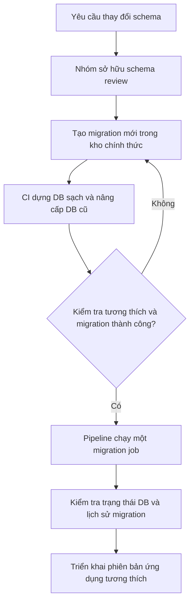

# Chọn công cụ migration duy nhất cho cùng một schema

## 1. Vấn đề cần giải quyết

Trong một ứng dụng Spring Boot, cấu trúc cơ sở dữ liệu thường thay đổi theo thời gian: thêm bảng, thêm cột, tạo chỉ mục, bổ sung ràng buộc hoặc chuyển đổi dữ liệu cũ. Những thay đổi này phải được thực hiện theo thứ tự có thể truy vết, có thể lặp lại khi dựng môi trường mới và phải tương thích với phiên bản ứng dụng đang triển khai.

Một lỗi kiến trúc thường gặp là **để nhiều cơ chế cùng có quyền thay đổi DDL trên một schema**:

- Flyway thực thi các file SQL versioned migration.
- Liquibase thực thi các changeset trong changelog.
- Hibernate tự tạo hoặc cập nhật bảng theo entity khi bật `ddl-auto=update`, `create` hoặc `create-drop`.
- Spring Boot chạy `schema.sql` hoặc các script khởi tạo khác.
- Một script triển khai thủ công hoặc một service khác sửa bảng mà không ghi vào lịch sử migration chính thức.

Mỗi cơ chế có cách xác định “đã chạy” riêng. Hai công cụ có thể thấy một database hợp lệ theo lịch sử của mình nhưng không có bằng chứng rằng công cụ còn lại đã sửa những gì. Ví dụ, Flyway đã tạo cột `status`, Liquibase vẫn có thể thử tạo cột đó vì changeset của Liquibase chưa được ghi nhận. Kết quả có thể là startup lỗi, thay đổi DDL chạy sai thứ tự, drift giữa các môi trường hoặc khó xác định ai chịu trách nhiệm khi có sự cố.

**Nguyên tắc:** với mỗi schema do một nhóm ứng dụng quản lý, chọn **một nguồn sự thật và một cơ chế thực thi migration chính thức**. Flyway hoặc Liquibase có thể là lựa chọn phù hợp; điều cần tránh là cả hai cùng quản lý thay đổi cho cùng một tập đối tượng của schema.

Ở đây, “schema” là không gian chứa các đối tượng dữ liệu mà nhóm chịu trách nhiệm (bảng, view, constraint, index, sequence…). Một database server có thể có nhiều database hoặc schema độc lập. Quy tắc sở hữu cần được xác định theo phạm vi đối tượng thực tế, không chỉ theo hostname của máy chủ.

## 2. Những cơ chế khởi tạo khác nhau trong Spring Boot

| Cơ chế | Vai trò chính | Cách sử dụng khi đã có migration chuẩn |
| --- | --- | --- |
| **Flyway** | Quản lý migration có thứ tự, lịch sử và checksum, thường ưu tiên SQL | Dùng làm công cụ duy nhất nếu nhóm chọn Flyway |
| **Liquibase** | Quản lý changeset và changelog, hỗ trợ XML/YAML/JSON/SQL | Dùng làm công cụ duy nhất nếu nhóm chọn Liquibase |
| **Hibernate DDL** | Tạo/cập nhật schema theo mô hình JPA | Đặt `validate` hoặc `none`, tránh `update`/`create` ở môi trường được quản lý |
| **Spring SQL initialization** | Chạy `schema.sql` và `data.sql` theo cấu hình | Tắt khởi tạo schema bằng script chung khi migration là chủ sở hữu |
| **SQL chạy tay** | Sửa trực tiếp database qua console hoặc script riêng | Chỉ dùng theo quy trình vận hành được kiểm soát; phản ánh thay đổi vào lịch sử migration được phê duyệt |

### Vì sao Hibernate `ddl-auto=update` không thay thế được migration?

Hibernate có thể phát hiện một phần thay đổi từ entity và cập nhật DDL, nhưng mô hình entity không mô tả đầy đủ mọi thay đổi cần vận hành: tạo index có chủ đích, chuyển đổi dữ liệu nhiều bước, đổi tên cột an toàn, quản lý view, hoặc tương thích giữa phiên bản cũ và mới. Chế độ `update` cũng không tạo lịch sử migration có thứ tự tương đương Flyway/Liquibase.

Trong hệ thống tích hợp Spring Boot, có thể còn các bảng do JDBC, jOOQ, Spring Integration, adapter hoặc thành phần khác sử dụng mà JPA không sở hữu. Bởi vậy, `ddl-auto=validate` chỉ nên là phép kiểm tra bổ sung cho các entity JPA; nó **không xác nhận toàn bộ schema** hay thay thế kiểm thử migration.

### Vì sao `spring.jpa.defer-datasource-initialization=true` không giải quyết xung đột?

Thuộc tính này điều chỉnh thời điểm chạy một số script SQL initialization so với quá trình khởi tạo JPA. Nó không biến Flyway, Liquibase, Hibernate và `schema.sql` thành một bộ điều phối có chung lịch sử. Nếu mục tiêu là một nguồn migration duy nhất, cần tắt các cơ chế ghi DDL ngoài nguồn đã chọn.

## 3. Chọn Flyway hay Liquibase

Không có công cụ tốt nhất cho mọi tổ chức. Hãy chọn **một công cụ phù hợp với quy trình thực tế** và ghi quyết định đó vào tài liệu kiến trúc của service.

| Tiêu chí | Flyway | Liquibase |
| --- | --- | --- |
| Cách viết chủ đạo | Migration SQL theo thứ tự phiên bản; có thể dùng Java migration trong trường hợp cần thiết | Changelog chứa changeset, thường viết bằng YAML/XML/JSON/SQL |
| Cách nhóm kiểm soát thay đổi | Rất trực tiếp khi nhóm quen đọc, review và chạy SQL đặc thù của DB | Thuận tiện khi nhóm muốn mô tả thay đổi có cấu trúc, dùng labels/contexts và quy trình changeset |
| Lịch sử thực thi | Bảng lịch sử schema của Flyway, gồm trạng thái và checksum | Các bảng `DATABASECHANGELOG` và `DATABASECHANGELOGLOCK` |
| Database-specific DDL | Thuận lợi với SQL gốc của PostgreSQL, MySQL… | Cũng hỗ trợ SQL gốc bên cạnh change types trừu tượng |
| Rollback | Không nên mặc định mọi migration đều có rollback tự động | Có cơ chế rollback cho nhiều dạng thay đổi, nhưng khả năng hoàn tác phụ thuộc change type, định nghĩa và DB |
| Chi phí chuyển đổi | Thấp nếu hệ thống và CI/CD đang dùng Flyway ổn định | Thấp nếu hệ thống và CI/CD đang dùng Liquibase ổn định |

Cách ra quyết định:

1. **Hệ thống đã có một công cụ hoạt động ổn định:** mặc định tiếp tục dùng công cụ đó cho cùng schema. Không thêm công cụ còn lại chỉ vì một migration đặc biệt; hãy kiểm tra liệu công cụ hiện tại đã hỗ trợ SQL tùy chỉnh hay chưa.
2. **Ứng dụng mới, nhóm quen SQL và DDL theo database:** Flyway là lựa chọn dễ hiểu, dễ review với quy ước `V1__...sql`, `V2__...sql`.
3. **Ứng dụng mới, nhóm có nhu cầu changelog khai báo, labels/contexts hoặc quy trình changeset thống nhất:** Liquibase là lựa chọn hợp lý.
4. **Nhiều service cùng tác động vào một schema:** trước hết quyết định service/team hoặc pipeline nào sở hữu schema. Lựa chọn thư viện chỉ là bước sau. Hai service dùng cùng Flyway nhưng có hai tập migration và hai lịch sử không được phối hợp vẫn có thể gây xung đột.
5. **Nhiều schema độc lập trên cùng máy chủ:** có thể tách chủ sở hữu theo schema; cần định nghĩa rõ search path, quyền DB, bảng lịch sử và pipeline chạy migration. Nếu có thể, thống nhất một công cụ trong cùng nền tảng để đơn giản vận hành.

Một quyết định ngắn có thể ghi như sau:

> Schema `public` của database `orders` thuộc nhóm Orders. Flyway là nguồn migration duy nhất. Các thay đổi DDL được review trong `src/main/resources/db/migration` và chạy bởi pipeline triển khai. Runtime JPA chỉ dùng `validate`; `schema.sql` không được dùng để tạo bảng. Nhóm tích hợp khác cần thay đổi bảng phải gửi PR vào kho migration của nhóm Orders.

Điểm quan trọng của quyết định này là **phạm vi sở hữu, vị trí thay đổi và người thực thi**; chỉ ghi “chúng tôi dùng Flyway” vẫn còn thiếu.

## 4. Ví dụ A — Chọn Flyway cho một schema PostgreSQL

Giả sử service Spring Boot quản lý bảng `public.customer_profiles` để đồng bộ hồ sơ khách hàng với hệ thống ngoài. Nhóm quyết định mọi thay đổi cấu trúc của schema này đi qua Flyway.

### 4.1. Chỉ khai báo dependency của công cụ được chọn

Ví dụ Maven với Spring Boot dependency management:

```xml
<dependency>
    <groupId>org.flywaydb</groupId>
    <artifactId>flyway-core</artifactId>
</dependency>

<!-- Với các dòng Flyway yêu cầu module hỗ trợ PostgreSQL riêng -->
<dependency>
    <groupId>org.flywaydb</groupId>
    <artifactId>flyway-database-postgresql</artifactId>
</dependency>
```

Thêm JDBC driver PostgreSQL theo cấu hình project. Không thêm `liquibase-core` chỉ để chạy một đoạn SQL khác: Flyway đã hỗ trợ SQL migration. Thành phần Flyway hỗ trợ database cụ thể có thể phụ thuộc phiên bản Flyway/Spring Boot; kiểm tra các dependency mà BOM và driver của project đang quản lý.

### 4.2. Cấu hình Spring Boot

```yaml
spring:
  datasource:
    url: ${DB_URL}
    username: ${DB_USERNAME}
    password: ${DB_PASSWORD}

  flyway:
    enabled: true
    locations: classpath:db/migration

  liquibase:
    enabled: false

  sql:
    init:
      mode: never

  jpa:
    hibernate:
      ddl-auto: validate
```

Giải thích:

- `spring.flyway.enabled=true`: Flyway được phép chạy migration từ vị trí đã khai báo.
- `spring.liquibase.enabled=false`: bảo đảm Liquibase không tự chạy nếu dependency xuất hiện qua thay đổi cấu hình hoặc module khác.
- `spring.sql.init.mode=never`: tắt cơ chế script initializer của Spring Boot; `schema.sql`/`data.sql` không còn là nguồn tạo schema.
- `spring.jpa.hibernate.ddl-auto=validate`: nếu service sử dụng JPA, chỉ kiểm tra mapping liên quan sau khi schema được chuẩn bị. Nếu không sử dụng JPA thì không cần phần `spring.jpa`.
- Biến môi trường cấp credential theo quy trình bảo mật của hệ thống; ví dụ rút gọn này chưa tách tài khoản runtime và tài khoản migration.

Với service không sử dụng JPA hoặc không muốn Hibernate kiểm tra mapping khi khởi động, có thể chọn `ddl-auto=none`. Tránh `update`, `create`, `create-drop` ở môi trường đã đưa vào quy trình migration.

### 4.3. Một lịch sử migration có thứ tự

Cấu trúc resource:

```text
src/main/resources/
└── db/
    └── migration/
        ├── V1__create_customer_profiles.sql
        └── V2__add_display_name.sql
```

File `V1__create_customer_profiles.sql`, ví dụ dành cho PostgreSQL:

```sql
CREATE TABLE public.customer_profiles (
    id BIGINT GENERATED BY DEFAULT AS IDENTITY PRIMARY KEY,
    external_id VARCHAR(100) NOT NULL UNIQUE,
    email VARCHAR(320),
    created_at TIMESTAMPTZ NOT NULL DEFAULT CURRENT_TIMESTAMP
);
```

File `V2__add_display_name.sql`:

```sql
ALTER TABLE public.customer_profiles
    ADD COLUMN display_name VARCHAR(120);
```

Khi dựng database mới, Flyway thực thi từ V1 đến V2. Khi nâng cấp database đã áp dụng V1, Flyway chỉ chạy V2. Lịch sử và checksum của các migration đã thực thi được lưu trong bảng lịch sử Flyway của schema được cấu hình.

**Không sửa nội dung V1 đã triển khai** để thêm cột mới: làm vậy thay đổi checksum và khiến lịch sử ở môi trường cũ không nhất quán. Hãy tạo V2 (và các phiên bản tiếp theo). Một schema có dữ liệu thật còn cần kế hoạch tương thích ứng dụng trước/sau khi cột được thêm.

## 5. Ví dụ B — Nếu chọn Liquibase thì để Liquibase sở hữu schema

Một nhóm khác có thể chọn Liquibase ngay từ đầu. Khi đó, không giữ Flyway chạy song song trên schema ấy.

Dependency Maven:

```xml
<dependency>
    <groupId>org.liquibase</groupId>
    <artifactId>liquibase-core</artifactId>
</dependency>
```

Cấu hình:

```yaml
spring:
  datasource:
    url: ${DB_URL}
    username: ${DB_USERNAME}
    password: ${DB_PASSWORD}

  flyway:
    enabled: false

  liquibase:
    enabled: true
    change-log: classpath:db/changelog/db.changelog-master.yaml

  sql:
    init:
      mode: never

  jpa:
    hibernate:
      ddl-auto: validate
```

Ví dụ `src/main/resources/db/changelog/db.changelog-master.yaml`:

```yaml
databaseChangeLog:
  - changeSet:
      id: 001-create-customer-profiles
      author: integration-team
      changes:
        - createTable:
            schemaName: public
            tableName: customer_profiles
            columns:
              - column:
                  name: id
                  type: BIGINT
                  autoIncrement: true
                  constraints:
                    primaryKey: true
                    nullable: false
              - column:
                  name: external_id
                  type: VARCHAR(100)
                  constraints:
                    nullable: false
                    unique: true
```

Liquibase nhận diện changeset thông qua tổ hợp định danh trong changelog, ghi lịch sử vào `DATABASECHANGELOG` và sử dụng khóa vận hành trong `DATABASECHANGELOGLOCK`. Một changeset đã chạy phải được xem là lịch sử bất biến; khi cần đổi schema, tạo changeset kế tiếp.

Hai ví dụ Flyway và Liquibase **là hai phương án thay thế**, không phải hai bước cần kết hợp trong cùng một ứng dụng. Đừng áp dụng ví dụ V1 của Flyway rồi chạy changeset Liquibase tạo lại bảng `customer_profiles`.

## 6. Quy trình phát triển và triển khai an toàn

### 6.1. Một thay đổi schema đi qua một đường duy nhất



Đối với hệ thống có nhiều replica, nên có **một điểm thực thi migration được điều phối**, chẳng hạn job riêng trong pipeline/CD hoặc một cơ chế chạy được kiểm soát. Flyway và Liquibase đều có cơ chế hạn chế chạy trùng trong phạm vi riêng, nhưng cơ chế đó không đồng bộ Flyway với Liquibase và không thay thế một kế hoạch rollout.

Có hai cách triển khai phổ biến:

- **Migration chạy khi Spring Boot khởi động:** thuận tiện với hệ thống nhỏ và ít replica. Các instance cần cùng cấu hình và chỉ dùng một engine. Khi lỗi migration, startup nên thất bại để không chạy ứng dụng trên schema không phù hợp.
- **Migration chạy bằng job trước khi khởi động ứng dụng:** phù hợp khi cần DBA approval, phân quyền DDL, nhiều replica hoặc rollout tách giai đoạn. Sau khi job thành công mới khởi động/rolling update ứng dụng; trong runtime profile có thể tắt migration startup. Job phải dùng đúng version artifact và đúng database.

Khi tách job migration, runtime nên dùng tài khoản chỉ có quyền DML cần thiết, còn tài khoản DDL chỉ cấp cho job. Cấu hình `spring.flyway.enabled=false` hoặc `spring.liquibase.enabled=false` ở runtime **chỉ an toàn nếu có job khác thật sự chạy migration trước đó**.

### 6.2. Áp dụng expand → migrate → contract

Khi có nhiều version ứng dụng chạy cùng lúc, thay đổi DDL cần tương thích ngược một khoảng thời gian.

Ví dụ đổi tên cột `customer_name` thành `display_name`:

1. **Expand:** thêm cột `display_name` nullable bằng migration mới, không xóa `customer_name`.
2. **Migrate:** triển khai code có thể đọc dữ liệu cũ, ghi dữ liệu theo chiến lược chuyển tiếp; backfill dữ liệu có kiểm soát.
3. **Verify:** kiểm tra số lượng bản ghi, dữ liệu lỗi, độ trễ đồng bộ và các consumer đang truy cập cột cũ.
4. **Contract:** chỉ tạo migration bỏ `customer_name` sau khi không còn instance hoặc tích hợp nào phụ thuộc cột đó.

Đối với bảng lớn, thêm index, sửa type hoặc backfill có thể gây lock/IO lớn. Thiết kế migration theo đặc tính PostgreSQL/MySQL/DB đang sử dụng, thử trên khối lượng dữ liệu gần thực tế và đặt ngưỡng theo dõi phù hợp. Không giả định DDL luôn rollback được bằng một transaction: một số database hoặc thao tác DDL có implicit commit.

### 6.3. Dữ liệu khởi tạo cũng cần ranh giới sở hữu

Phân biệt ba loại dữ liệu:

- **Reference data bắt buộc để ứng dụng vận hành:** đưa vào migration chính thức hoặc quy trình data migration có version và kiểm tra idempotency phù hợp.
- **Dữ liệu demo/test:** dùng test fixture hoặc profile thử nghiệm, không trộn vào lịch sử sản xuất nếu không cần.
- **Dữ liệu nghiệp vụ thay đổi theo thời gian:** đi qua API, worker, batch job hoặc luồng nghiệp vụ thông thường; không cập nhật tùy tiện bằng `data.sql` lúc mỗi lần startup.

Migration schema và migration dữ liệu liên quan có thể chạy cùng công cụ, nhưng những đợt backfill lớn nên được thiết kế riêng để có thể tạm dừng, chạy lại và quan sát tiến độ an toàn.

## 7. Trường hợp nhiều service hoặc nhiều schema

Giả sử có database server chứa hai schema:

| Phạm vi | Chủ sở hữu | Nguồn migration được phép |
| --- | --- | --- |
| `orders` | Orders service/team | Một bộ migration do nhóm Orders quản lý |
| `analytics` | Reporting service/team | Một bộ migration tách biệt, chỉ sửa `analytics` |
| Bảng `orders.outbox_events` | Orders team, được Integration worker đọc | Vẫn thuộc migration của Orders, Integration worker không tự `ALTER TABLE` |
| Bảng `analytics.integration_checkpoint` | Reporting/Integration team theo thỏa thuận | Migration của chủ sở hữu `analytics` |

Có thể chọn công cụ khác nhau cho **các schema thực sự độc lập**, nhưng phải cấu hình đúng schema đích, metadata table, search path và quyền truy cập để không ghi nhầm. Sử dụng một công cụ thống nhất cho toàn tổ chức thường giảm số cách vận hành, nhưng điều kiện bắt buộc là **không có hai nguồn DDL cùng sửa một schema**.

Với hai microservice đang viết trực tiếp vào cùng một schema, trước tiên phải xử lý tranh chấp ownership: phân chia schema, hoặc chỉ định một repository/pipeline migration chung và quy trình review thay đổi. Việc cả hai cùng dùng Flyway không tự bảo đảm không xung đột nếu mỗi service có version history và file migration độc lập.

## 8. Nếu hệ thống đã từng chạy cả Flyway lẫn Liquibase

Đây là tình huống cần **kiểm kê và chuyển quyền kiểm soát có chủ đích**. Đơn giản xóa một dependency có thể khiến lịch sử và trạng thái thực tế không còn được quản lý đúng.

### 8.1. Kiểm kê trước khi thay đổi

Thu thập ít nhất:

- Công cụ nào đang bật trong từng môi trường và mỗi app/worker/job nào có quyền DDL.
- Schema thực tế có bảng, cột, index, constraint, view nào; đối chiếu với định nghĩa kỳ vọng.
- Lịch sử Flyway và Liquibase đang ghi nhận những migration/changeset nào, có lỗi hoặc phiên bản chưa đồng bộ không.
- Có script `schema.sql`, `data.sql`, `import.sql`, Hibernate `ddl-auto` hay thao tác DDL thủ công nào khác không.
- Cửa sổ triển khai, các service phụ thuộc và phương án khôi phục database đã được kiểm chứng.

Ví dụ câu lệnh PostgreSQL để **kiểm tra sự hiện diện** của các bảng metadata phổ biến:

```sql
SELECT table_schema, table_name
FROM information_schema.tables
WHERE table_schema = 'public'
  AND LOWER(table_name) IN (
      'flyway_schema_history',
      'databasechangelog',
      'databasechangeloglock'
  )
ORDER BY table_name;
```

Nếu biết đúng schema và tên bảng, có thể đọc lịch sử tương ứng:

```sql
-- Khi Flyway sử dụng bảng lịch sử mặc định ở schema public:
SELECT installed_rank, version, description, success
FROM public.flyway_schema_history
ORDER BY installed_rank DESC;

-- Khi Liquibase sử dụng tên bảng mặc định ở schema public:
SELECT id, author, filename, dateexecuted, exectype
FROM public.databasechangelog
ORDER BY dateexecuted DESC;
```

Tên bảng, schema và quyền truy cập có thể đã được tùy chỉnh. Có bảng metadata **không đủ để kết luận công cụ còn hoạt động**: cần đối chiếu cấu hình deployment và logs. Không tự tạo/xóa bảng lịch sử để làm cho migration “chạy lại”.

### 8.2. Chuyển sang một nguồn migration

1. **Tạm dừng mọi thay đổi DDL từ nhiều nguồn:** khóa phạm vi và thời điểm cutover, sao lưu và kiểm tra khả năng restore.
2. **Chọn công cụ tiếp tục sử dụng:** ưu tiên bộ lịch sử có thể đối chiếu đầy đủ với schema hiện tại và phù hợp pipeline quản trị.
3. **Đối chiếu trạng thái vật lý:** xác định từng thay đổi đã có trong database, chưa chạy hoặc chỉ chạy một phần; giải quyết drift trước khi ghi nhận baseline.
4. **Thiết lập mốc chuyển giao có kiểm chứng:** nếu cần Flyway baseline hoặc Liquibase changelogSync, chỉ dùng sau khi xác minh rằng tất cả đối tượng mà mốc ấy đại diện đã thực sự tồn tại và đúng cấu trúc. Những lệnh này có thể **đánh dấu đã thực thi mà không tạo DDL**.
5. **Tắt engine cũ ở tất cả entry point:** ứng dụng, batch, migration job, profile và pipeline; giữ lại lịch sử cũ phục vụ audit.
6. **Tạo migration tiếp theo chỉ ở nguồn mới:** chạy thử trên bản sao trạng thái cũ và database mới theo kế hoạch bootstrap đã chọn; triển khai có kiểm tra và khả năng khôi phục.

Không dùng `baselineOnMigrate`, `repair`, xóa checksum hay sửa trực tiếp bảng history chỉ để làm biến mất thông báo lỗi. Những thao tác đó có thể che giấu drift; trước hết phải hiểu nguyên nhân và lập biên bản đối chiếu thay đổi thực tế.

## 9. Kiểm thử giúp phát hiện hai nguồn DDL và drift

Một quy trình CI đáng tin cậy nên kiểm tra ít nhất các tình huống sau:

| Tình huống | Mục tiêu kiểm tra |
| --- | --- |
| **Dựng database trống** | Toàn bộ migration của công cụ được chọn chạy theo đúng thứ tự, cho ra schema cần thiết |
| **Nâng cấp từ phiên bản trước** | Migration mới chạy trên dữ liệu/mô hình cũ, không chỉ thành công khi dựng lại từ đầu |
| **Khởi động ứng dụng** | JPA `validate` (nếu dùng) và các adapter JDBC/jOOQ truy vấn thành công |
| **Hai phiên bản ứng dụng chạy xen kẽ** | Schema sau expand vẫn phục vụ consumer cũ trước khi contract |
| **Cấu hình startup của từng profile** | Chỉ một engine có quyền quản lý schema; SQL initializer và Hibernate DDL không tự sửa cấu trúc |
| **Migration thất bại** | Pipeline dừng rollout, báo rõ lỗi; kế hoạch restore/khắc phục xử lý được DDL đã chạy một phần |
| **Nhiều replica** | Chỉ có một đường chạy migration được điều phối, không có app/job khác ghi DDL ngoài lịch sử chính thức |

Testcontainers với cùng loại database như production giúp kiểm tra sự khác biệt về cú pháp DDL, kiểu dữ liệu và transaction. Dùng H2 trong test nhưng PostgreSQL/MySQL ở production có thể bỏ sót lỗi riêng của engine. Không bật Hibernate `create-drop` trong integration test rồi xem đó là bằng chứng file migration production chạy được.

Ví dụ kiểm tra cấu hình khi review: tìm các dependency Flyway/Liquibase, `spring.flyway.enabled`, `spring.liquibase.enabled`, `spring.sql.init.mode`, `spring.jpa.hibernate.ddl-auto` và mọi migration job trong pipeline. Kiểm tra cả cấu hình profile và biến môi trường vì chúng có thể ghi đè YAML mặc định.

## 10. Dấu hiệu sai cấu hình và hướng xử lý

| Triệu chứng | Nguyên nhân cần xem xét | Hướng xử lý |
| --- | --- | --- |
| Startup báo “table already exists” | Hai engine cùng tạo bảng, hoặc schema đã được tạo bằng tay | Đối chiếu history và schema vật lý; chỉ giữ nguồn migration chính thức |
| Flyway báo checksum mismatch | Migration đã chạy bị chỉnh sửa hoặc history sai | Khôi phục tính bất biến và kiểm tra drift; tạo migration mới cho thay đổi mới |
| Liquibase báo checksum/changeset lỗi | Changeset cũ thay đổi, path/ID thay đổi, hoặc trạng thái không khớp | Kiểm tra changelog identity và database trước khi quyết định cách khắc phục |
| Dev chạy tốt nhưng prod thiếu cột | Dev dùng Hibernate `update` hoặc `schema.sql` ngoài migration | Tắt cơ chế tạo schema phụ, kiểm thử dựng mới/nâng cấp bằng engine thật |
| Hai pod triển khai đồng thời thấy DDL lạ | Nhiều entry point chạy migration hoặc hai engine khác nhau | Kiểm tra job/startup config và thiết lập một quyền thực thi rõ ràng |
| Migration job thành công nhưng ứng dụng vẫn fail | JPA/entity, schema mặc định, quyền tài khoản hoặc ứng dụng yêu cầu schema mới hơn | So sánh version artifact, schema target, quyền và tương thích rollout |

Đặc biệt, đừng giải quyết một lỗi bằng cách bật thêm engine còn lại hoặc bật `ddl-auto=update`. Biện pháp tạm thời đó làm mất khả năng xác định đường thay đổi chính thức và thường tạo lỗi lớn hơn ở lần nâng cấp tiếp theo.

## 11. Checklist ra quyết định cho nhóm Spring Boot Integration

Trước khi chấp nhận một thay đổi schema, xác nhận:

- [ ] Phạm vi schema và nhóm sở hữu đã được ghi rõ; các ứng dụng tích hợp biết phải gửi thay đổi qua đâu.
- [ ] Chỉ Flyway **hoặc** Liquibase được chọn làm nguồn migration chính thức cho phạm vi này.
- [ ] App và job không đồng thời có nguồn DDL thứ hai (`schema.sql`, Hibernate `update/create`, script thủ công không kiểm soát).
- [ ] Migration có định danh bất biến, được review cùng code cần thay đổi schema.
- [ ] CI kiểm thử cả bootstrap database mới và nâng cấp database đang có dữ liệu.
- [ ] Rollout có thứ tự phù hợp với service đang hoạt động, áp dụng expand/contract khi cần.
- [ ] Tài khoản, quyền DDL, backup/restore, log và lịch sử migration đủ để chẩn đoán.
- [ ] Mọi môi trường dùng cùng một nguồn lịch sử; khác biệt profile và job đã được rà soát.

**Kết quả mong muốn:** bất kỳ khi nào cần trả lời “bảng hoặc cột này được tạo khi nào, bởi ai, với phiên bản nào?”, nhóm có thể tìm được một lịch sử migration nhất quán và một đường triển khai được kiểm soát. Đó là nền tảng để Spring Boot tích hợp HTTP, JDBC/jOOQ, JPA, cache, broker và các adapter khác mà không gặp sự cố do schema bị nhiều nguồn tự ý thay đổi.
