# Migration khi có nhiều DataSource hoặc tài khoản riêng

Một ứng dụng Spring Boot có thể đọc/ghi nhiều cơ sở dữ liệu: cơ sở dữ liệu đơn hàng, cơ sở dữ liệu audit, kho báo cáo, hoặc những schema do các nhóm khác nhau sở hữu. Khi đó, việc đặt vài tệp `V1__*.sql` vào `db/migration` không đủ để bảo đảm migration chạy đúng nơi, đúng tài khoản và đúng thời điểm. Mỗi đích dữ liệu cần có lịch sử phiên bản, quyền hạn, thứ tự khởi tạo và quy trình triển khai rõ ràng.

Bài học tập trung vào cách tổ chức **schema migration** trong các luồng tích hợp Spring Boot dùng JDBC/JPA và nhiều `DataSource`, với Flyway làm ví dụ chính và Liquibase làm lựa chọn tương đương. Mục tiêu là cập nhật cấu trúc dữ liệu an toàn trước khi HTTP API, consumer, scheduled job hoặc adapter tích hợp bắt đầu sử dụng cấu trúc mới.

## 1. Xác định chính xác ranh giới migration

Ba khái niệm sau thường bị nhầm lẫn:

| Khái niệm | Ví dụ | Hệ quả đối với migration |
| --- | --- | --- |
| Nhiều `DataSource` | `ordersDataSource` trỏ đến `orders_db`, `auditDataSource` trỏ đến `audit_db` | Cần xác định rõ migration chạy trên từng đích; không suy từ `@Primary`. |
| Nhiều schema trong một database | Schema `orders` và `audit` cùng nằm trong `platform_db` | Cần tách location, schema mặc định và nơi lưu bảng lịch sử migration. |
| Nhiều tài khoản trên cùng database | `orders_app` chạy nghiệp vụ, `orders_migrator` thay đổi DDL | Cần tách thông tin đăng nhập runtime và migration; cùng database không có nghĩa cùng quyền. |

Một ứng dụng có thể đồng thời rơi vào cả ba trường hợp. Ví dụ, dịch vụ xử lý đơn hàng truy cập hai database bằng hai tài khoản runtime, còn mỗi database có một tài khoản migration riêng.

Các nguyên tắc thiết kế:

1. **Mỗi ranh giới schema có một bên sở hữu migration rõ ràng.** Hai ứng dụng không nên cùng sửa bảng bằng hai bộ migration độc lập nếu không có quy ước ownership và phát hành chung.
2. **Phiên bản được theo dõi trên chính đích được migrate.** Với Flyway, bảng `flyway_schema_history` nằm trong database/schema tương ứng; cùng tên bảng ở hai database riêng không gây xung đột.
3. **Ứng dụng chỉ được khởi tạo sau migration bắt buộc của nó.** Nếu JPA kiểm tra schema hoặc một consumer chạy trước DDL, quá trình khởi động có thể thất bại dù migration cuối cùng vẫn thành công.
4. **Tài khoản runtime ưu tiên quyền DML; tài khoản migration chỉ có quyền DDL cần thiết.** Không sử dụng superuser cho migration theo thói quen.
5. **Không có giao dịch ACID chung cho hai database độc lập chỉ vì chúng cùng được migrate trong một lần khởi động.** Nếu database thứ hai lỗi sau khi database thứ nhất đã migrate, cần quy trình xử lý từng đích.

## 2. Ví dụ nghiệp vụ và kiến trúc

Giả sử dịch vụ `order-service` nhận HTTP request đặt hàng, lưu đơn vào `orders_db`, đồng thời ghi sự kiện audit vào `audit_db`. Hai database dùng PostgreSQL và có thể nằm trên các máy chủ khác nhau:

```mermaid
flowchart TB
    Start["Khởi động order-service"] --> FM["Flyway: orders migrations"]
    Start --> AM["Flyway: audit migrations"]
    FM -->|"orders_migrator (DDL)"| ODB[("orders_db")]
    AM -->|"audit_migrator (DDL)"| ADB[("audit_db")]
    FM --> Ready{"Các migration bắt buộc thành công?"}
    AM --> Ready
    Ready -->|Có| App["HTTP API / service / consumer"]
    Ready -->|Không| Stop["Khởi động thất bại"]
    App -->|"orders_app (DML)"| ODB
    App -->|"audit_app (DML)"| ADB
```



Ở đây Flyway có hai cấu hình tách biệt. `orders_db` quản lý phiên bản đơn hàng, còn `audit_db` quản lý phiên bản nhật ký. Khởi động ứng dụng phải dừng nếu một migration bắt buộc không thành công; điều đó không tự động hoàn tác migration đã hoàn tất trên database kia.

## 3. Tổ chức tệp migration theo từng đích

Với Flyway, chọn các đường dẫn resource không giao nhau:

```text
src/main/resources/
└── db/
    └── migration/
        ├── orders/
        │   ├── V1__create_orders.sql
        │   └── V2__add_order_external_ref.sql
        └── audit/
            ├── V1__create_audit_events.sql
            └── V2__add_audit_correlation_id.sql
```

Trong trường hợp này, `V1` của `orders` và `V1` của `audit` là hai chuỗi phiên bản **độc lập**. Không buộc cả hai database phải có cùng số version; version phản ánh thay đổi schema của từng đích.

Ví dụ `db/migration/orders/V1__create_orders.sql`:

```sql
CREATE TABLE orders (
    id           BIGINT GENERATED BY DEFAULT AS IDENTITY PRIMARY KEY,
    customer_ref VARCHAR(80) NOT NULL,
    status       VARCHAR(24) NOT NULL,
    created_at   TIMESTAMPTZ NOT NULL DEFAULT CURRENT_TIMESTAMP
);
```

Ví dụ `db/migration/audit/V1__create_audit_events.sql`:

```sql
CREATE TABLE audit_events (
    id          BIGINT GENERATED BY DEFAULT AS IDENTITY PRIMARY KEY,
    order_id    BIGINT NOT NULL,
    event_type  VARCHAR(80) NOT NULL,
    occurred_at TIMESTAMPTZ NOT NULL DEFAULT CURRENT_TIMESTAMP
);
```

Không khai báo foreign key từ `audit_events.order_id` sang `orders.id` khi chúng ở hai database PostgreSQL riêng. Tính nhất quán xuyên database thuộc về thiết kế luồng nghiệp vụ, ví dụ event/outbox, xử lý trùng lặp và cơ chế bù trừ, chứ không thể được bảo đảm bằng một khóa ngoại thông thường.

## 4. Cấu hình Spring Boot với hai DataSource runtime và hai tài khoản migration

Ví dụ dưới đây dành cho Spring Boot 3.x, Java 17+ và Flyway. Các dependency Maven cần có là JDBC starter, PostgreSQL driver, Flyway Core; với các phiên bản Flyway mới có thể cần thêm module hỗ trợ PostgreSQL:

```xml
<dependencies>
    <dependency>
        <groupId>org.springframework.boot</groupId>
        <artifactId>spring-boot-starter-jdbc</artifactId>
    </dependency>
    <dependency>
        <groupId>org.postgresql</groupId>
        <artifactId>postgresql</artifactId>
        <scope>runtime</scope>
    </dependency>
    <dependency>
        <groupId>org.flywaydb</groupId>
        <artifactId>flyway-core</artifactId>
    </dependency>
    <dependency>
        <groupId>org.flywaydb</groupId>
        <artifactId>flyway-database-postgresql</artifactId>
    </dependency>
</dependencies>
```

Sử dụng dependency management của phiên bản Spring Boot đang chạy để các module Flyway có phiên bản tương thích. Nếu dự án có JPA thì thêm starter JPA và cấu hình `EntityManagerFactory`/transaction manager cho từng database theo nhu cầu.

### 4.1. Khai báo thông tin kết nối

`application.yml`:

```yaml
spring:
  flyway:
    enabled: false # Không để auto-configuration tự chọn một DataSource

app:
  datasource:
    orders:
      url: jdbc:postgresql://localhost:5432/orders_db
      username: orders_app
      password: ${ORDERS_APP_PASSWORD}
      hikari:
        maximum-pool-size: 10
    audit:
      url: jdbc:postgresql://localhost:5432/audit_db
      username: audit_app
      password: ${AUDIT_APP_PASSWORD}
      hikari:
        maximum-pool-size: 5

  migration:
    orders:
      url: jdbc:postgresql://localhost:5432/orders_db
      username: orders_migrator
      password: ${ORDERS_MIGRATION_PASSWORD}
    audit:
      url: jdbc:postgresql://localhost:5432/audit_db
      username: audit_migrator
      password: ${AUDIT_MIGRATION_PASSWORD}
```

Các biến môi trường chỉ là ví dụ về nguồn cấu hình; trong môi trường triển khai nên lấy mật khẩu từ hệ thống quản lý secret và kiểm soát quyền đọc. Không commit mật khẩu thật vào repository hoặc ghi chuỗi kết nối chứa mật khẩu vào log.

Điểm quan trọng: `spring.flyway.enabled: false` chỉ **tắt phần tự động tạo/chạy Flyway của Spring Boot**. Các bean Flyway khai báo thủ công ở phần tiếp theo vẫn chạy do chính ứng dụng gọi qua lifecycle. Nếu bỏ thiết lập này mà vẫn có nhiều cấu hình Flyway/DataSource, rất dễ gặp hành vi khởi tạo không như dự kiến hoặc bean không đơn trị.

### 4.2. Tạo hai DataSource để chạy nghiệp vụ

Sử dụng `DataSourceProperties` giúp ánh xạ thuộc tính `url` sang `jdbcUrl` của Hikari chính xác. Bean `@Primary` giải quyết các điểm tiêm phụ thuộc chỉ có một `DataSource` mặc định; nơi nào cần `audit` vẫn phải dùng `@Qualifier`.

```java
import com.zaxxer.hikari.HikariDataSource;
import javax.sql.DataSource;
import org.springframework.beans.factory.annotation.Qualifier;
import org.springframework.boot.autoconfigure.jdbc.DataSourceProperties;
import org.springframework.boot.context.properties.ConfigurationProperties;
import org.springframework.context.annotation.Bean;
import org.springframework.context.annotation.Configuration;
import org.springframework.context.annotation.Primary;

@Configuration(proxyBeanMethods = false)
public class RuntimeDataSourceConfig {

    @Bean("ordersDataSourceProperties")
    @Primary
    @ConfigurationProperties("app.datasource.orders")
    DataSourceProperties ordersProperties() {
        return new DataSourceProperties();
    }

    @Bean("ordersDataSource")
    @Primary
    @ConfigurationProperties("app.datasource.orders.hikari")
    HikariDataSource ordersDataSource(
            @Qualifier("ordersDataSourceProperties") DataSourceProperties properties) {
        return properties.initializeDataSourceBuilder()
                .type(HikariDataSource.class)
                .build();
    }

    @Bean("auditDataSourceProperties")
    @ConfigurationProperties("app.datasource.audit")
    DataSourceProperties auditProperties() {
        return new DataSourceProperties();
    }

    @Bean("auditDataSource")
    @ConfigurationProperties("app.datasource.audit.hikari")
    HikariDataSource auditDataSource(
            @Qualifier("auditDataSourceProperties") DataSourceProperties properties) {
        return properties.initializeDataSourceBuilder()
                .type(HikariDataSource.class)
                .build();
    }
}
```

Trong service hoặc repository dùng JDBC, tiêm tường minh `@Qualifier("ordersDataSource")` hay `@Qualifier("auditDataSource")`; có thể khai báo riêng hai `JdbcTemplate` và hai `PlatformTransactionManager` với tên rõ ràng. `@Primary` chỉ là giá trị mặc định cho injection, không phải cơ chế lựa chọn đích migration.

### 4.3. Bind tài khoản migration độc lập

Tạo tệp `MigrationTargets.java`:

```java
import org.springframework.boot.context.properties.ConfigurationProperties;

@ConfigurationProperties(prefix = "app.migration")
public record MigrationTargets(Target orders, Target audit) {
    public record Target(String url, String username, String password) {
    }
}
```

Thông tin `app.migration.*` tách khỏi `app.datasource.*`. Flyway mở kết nối bằng tài khoản `*_migrator`, còn Spring Data/JDBC truy cập bằng tài khoản `*_app`. Dùng `record` và `@EnableConfigurationProperties` giúp bind qua constructor trong Spring Boot 3.x; cần bảo đảm ba thuộc tính của từng target được cung cấp ở môi trường chạy.

### 4.4. Tạo và chạy từng Flyway đúng một lần

Tạo `MigrationConfig.java`:

```java
import org.flywaydb.core.Flyway;
import org.springframework.beans.factory.annotation.Qualifier;
import org.springframework.boot.context.properties.EnableConfigurationProperties;
import org.springframework.context.annotation.Bean;
import org.springframework.context.annotation.Configuration;

@Configuration(proxyBeanMethods = false)
@EnableConfigurationProperties(MigrationTargets.class)
public class MigrationConfig {

    @Bean(name = "ordersFlyway", initMethod = "migrate")
    Flyway ordersFlyway(MigrationTargets targets) {
        MigrationTargets.Target db = targets.orders();

        return Flyway.configure()
                .dataSource(db.url(), db.username(), db.password())
                .locations("classpath:db/migration/orders")
                .table("flyway_schema_history")
                .validateMigrationNaming(true)
                .load();
    }

    @Bean(name = "auditFlyway", initMethod = "migrate")
    Flyway auditFlyway(MigrationTargets targets) {
        MigrationTargets.Target db = targets.audit();

        return Flyway.configure()
                .dataSource(db.url(), db.username(), db.password())
                .locations("classpath:db/migration/audit")
                .table("flyway_schema_history")
                .validateMigrationNaming(true)
                .load();
    }
}
```

Ở đây `@Bean(initMethod = "migrate")` yêu cầu Spring gọi `Flyway.migrate()` khi tạo mỗi bean. Cả hai bean singleton được tạo trong quá trình khởi động application context; nếu một lời gọi `migrate()` ném exception, ứng dụng sẽ không khởi động thành công.

Đây là **một chiến lược khởi chạy có chủ đích**: tắt auto-configuration Flyway và tự quản lý hai bean. Không đồng thời thêm `FlywayMigrationInitializer` hoặc gọi `migrate()` từ `ApplicationRunner` cho chính các bean này, vì điều đó tạo thêm một đường chạy migration và làm thứ tự khởi tạo khó kiểm soát.

Khi áp dụng vào dự án thật, hãy chuẩn hóa tên bean, location và thuộc tính target theo bounded context của nhóm. Với nhiều database hơn, có thể trích một hàm tạo cấu hình Flyway dùng chung, nhưng vẫn phải có danh sách target rõ ràng, owner và chính sách failure của từng target.

## 5. Đảm bảo JPA, JDBC và consumer chỉ hoạt động sau migration

Đặc biệt với JPA, `hibernate.hbm2ddl.auto=validate` (hoặc `spring.jpa.hibernate.ddl-auto=validate` cho cấu hình tự động) có thể kiểm tra bảng khi `EntityManagerFactory` được tạo. Khi Flyway được cấu hình thủ công, Spring Boot không nhất thiết suy ra quan hệ khởi tạo giữa từng `EntityManagerFactory` và Flyway tương ứng.

Với hai `EntityManagerFactory` khai báo thủ công, gắn phụ thuộc theo đúng database:

```java
@Bean("ordersEntityManagerFactory")
@DependsOn("ordersFlyway")
LocalContainerEntityManagerFactoryBean ordersEntityManagerFactory(
        EntityManagerFactoryBuilder builder,
        @Qualifier("ordersDataSource") DataSource dataSource) {
    return builder
            .dataSource(dataSource)
            .packages("com.example.orders.entity")
            .persistenceUnit("orders")
            .build();
}

@Bean("auditEntityManagerFactory")
@DependsOn("auditFlyway")
LocalContainerEntityManagerFactoryBean auditEntityManagerFactory(
        EntityManagerFactoryBuilder builder,
        @Qualifier("auditDataSource") DataSource dataSource) {
    return builder
            .dataSource(dataSource)
            .packages("com.example.audit.entity")
            .persistenceUnit("audit")
            .build();
}
```

Đây là hai phương thức minh họa để đặt trong cấu hình JPA đầy đủ, nơi cũng cần khai báo `JpaTransactionManager`, `@EnableJpaRepositories` và package entity/repository tương ứng. Với JDBC thuần, áp dụng nguyên tắc tương tự cho bean nào thực hiện truy vấn ngay trong lúc khởi tạo. Service xử lý request, listener hoặc scheduled task thông thường chỉ chạy sau khi context khởi động thành công, nhưng luồng khởi tạo tùy biến cần được kiểm tra riêng.

Các lưu ý:

- Không cho Hibernate tự tạo/sửa bảng (`ddl-auto=update`) song song với Flyway hoặc Liquibase. Migrations là nguồn thay đổi cấu trúc; `validate` có thể dùng để phát hiện mismatch khi thứ tự chạy đã đúng.
- Với hai transaction manager, đặt tên và chọn tường minh, ví dụ `@Transactional("ordersTransactionManager")`. Một `@Transactional` đơn lẻ không mặc nhiên tạo giao dịch xuyên hai database.
- Nếu migration chạy từ deployment job trước khi mở ứng dụng (thay vì từ Spring context), điều kiện sẵn sàng của database phải được kiểm soát ở pipeline; không đặt `@DependsOn` tới bean Flyway không tồn tại trong profile ứng dụng đó.

## 6. Biến thể: nhiều schema trong cùng một database

Nếu `orders` và `audit` nằm trong `platform_db` nhưng thuộc **hai schema PostgreSQL**, có thể dùng cùng JDBC URL nhưng đặt schema mặc định khác nhau:

```java
Flyway ordersFlyway = Flyway.configure()
        .dataSource(url, ordersMigratorUser, ordersMigratorPassword)
        .schemas("orders")
        .defaultSchema("orders")
        .locations("classpath:db/migration/orders")
        .table("flyway_schema_history")
        .load();

Flyway auditFlyway = Flyway.configure()
        .dataSource(url, auditMigratorUser, auditMigratorPassword)
        .schemas("audit")
        .defaultSchema("audit")
        .locations("classpath:db/migration/audit")
        .table("flyway_schema_history")
        .load();
```

Kết quả mong muốn là `orders.flyway_schema_history` và `audit.flyway_schema_history`. Schema cần tồn tại hoặc được tạo bởi tài khoản có quyền thích hợp; nếu DBA quản lý schema, cân nhắc cấu hình `createSchemas(false)` và cấp quyền đúng trước khi migration chạy. Khi câu SQL có tên bảng không kèm schema, cần xác nhận `search_path`/schema mặc định của connection; ở những hệ thống nhạy cảm, viết tên đầy đủ như `orders.orders` sẽ ít mơ hồ hơn.

**Không** cấu hình hai bộ migration cùng sử dụng `public.flyway_schema_history` nhưng quản lý hai location/version không liên quan. Flyway sẽ coi chúng là một chuỗi lịch sử, khiến checksum/version và ownership trở nên sai lệch. Nếu hai luồng cùng sở hữu một schema, ưu tiên hợp nhất thành một chuỗi migration do một bên quản lý.

## 7. Tách quyền migration và quyền runtime

Một phương án phân quyền điển hình cho PostgreSQL:

| Tài khoản | Nhiệm vụ | Quyền khuyến nghị |
| --- | --- | --- |
| `orders_app` | Truy vấn và cập nhật đơn hàng trong runtime | `CONNECT`, `USAGE` schema, DML trên các bảng cần dùng, quyền sequence thích hợp; không có quyền tạo/sửa/xóa schema/table. |
| `orders_migrator` | Chạy các SQL `V*.sql` của orders | `CONNECT`, `USAGE` và quyền tạo/alter/drop những đối tượng thuộc phạm vi orders; quyền với bảng lịch sử Flyway. |
| `audit_app` | Ghi/đọc audit trong runtime | Quyền DML giới hạn trên audit. |
| `audit_migrator` | Quản lý DDL audit | Quyền DDL giới hạn trên schema audit và bảng lịch sử tương ứng. |

Quyền cụ thể còn phụ thuộc schema owner và cách PostgreSQL quản lý object ownership. Ví dụ, `GRANT CREATE ON SCHEMA ...` giúp tạo bảng, nhưng để `ALTER` hoặc `DROP` một bảng đã tồn tại, tài khoản migration còn phải sở hữu đối tượng đó (hoặc có mô hình role kế thừa quyền sở hữu phù hợp). Quyền DML mặc định cho các bảng và sequence **mới** cũng cần được DBA cấu hình nếu ứng dụng không phải owner.

Với database đang vận hành, quyền nên được cấp và kiểm thử trước khi đổi credential:

1. DBA tạo role/schema, cấp quyền DDL cho migrator và DML cho app theo phạm vi.
2. Chạy migration bằng migrator, xác minh bảng lịch sử và các đối tượng được tạo đúng owner.
3. Dùng app account thực hiện thử `SELECT`/`INSERT`/`UPDATE` trên môi trường kiểm thử và xác minh tài khoản này không thể thực hiện DDL ngoài ý muốn.
4. Quản lý credential độc lập, phân quyền secret cho job migration và workload ứng dụng; hỗ trợ rotation mà không cần đổi mã nguồn.

Không nhúng mật khẩu admin hoặc dùng tài khoản superuser cho mọi migration chỉ để vượt qua lỗi `permission denied`. Lỗi quyền thường cho thấy cần chỉnh ownership, grant hoặc schema target.

## 8. Nếu dùng Liquibase thay Flyway

Liquibase có cùng nguyên tắc **một changelog + một connection migration + một bộ bảng tracking/lock cho mỗi ranh giới schema**. Để tự cấu hình nhiều target, tắt auto-configuration Liquibase (`spring.liquibase.enabled: false`), sau đó khai báo từng `SpringLiquibase` với DataSource migration phù hợp.

```java
import org.springframework.jdbc.datasource.DriverManagerDataSource;
import liquibase.integration.spring.SpringLiquibase;

@Bean("ordersLiquibase")
SpringLiquibase ordersLiquibase(MigrationTargets targets) {
    MigrationTargets.Target db = targets.orders();
    var migrationDataSource =
            new DriverManagerDataSource(db.url(), db.username(), db.password());

    var liquibase = new SpringLiquibase();
    liquibase.setDataSource(migrationDataSource);
    liquibase.setChangeLog("classpath:db/changelog/orders/master.yaml");
    liquibase.setShouldRun(true);
    return liquibase;
}

@Bean("auditLiquibase")
SpringLiquibase auditLiquibase(MigrationTargets targets) {
    MigrationTargets.Target db = targets.audit();
    var migrationDataSource =
            new DriverManagerDataSource(db.url(), db.username(), db.password());

    var liquibase = new SpringLiquibase();
    liquibase.setDataSource(migrationDataSource);
    liquibase.setChangeLog("classpath:db/changelog/audit/master.yaml");
    liquibase.setShouldRun(true);
    return liquibase;
}
```

`SpringLiquibase` thực thi changelog trong vòng đời khởi tạo bean. Nếu mỗi database có `EntityManagerFactory` riêng, đặt `@DependsOn("ordersLiquibase")` hoặc `@DependsOn("auditLiquibase")` tương ứng. Mặc định Liquibase dùng bảng `DATABASECHANGELOG` và `DATABASECHANGELOGLOCK`; với các schema khác nhau trong cùng database, cần cấu hình `defaultSchema` và nơi đặt bảng tracking/lock cho đúng ranh giới.

Đoạn ví dụ dùng `DriverManagerDataSource` cho kết nối migration đơn giản, không lập pool runtime. Trong hệ thống thật có thể cung cấp `DataSource` migration riêng từ secret manager và cấu hình pool/lifecycle nếu cách triển khai đòi hỏi. Chọn **một** công cụ làm nguồn thay đổi cấu trúc của mỗi schema; không để Flyway và Liquibase cùng sửa những đối tượng đó theo hai lịch sử độc lập.

## 9. Chạy migration lúc khởi động hay từ release job?

| Cách chạy | Phù hợp | Điều cần kiểm soát |
| --- | --- | --- |
| Khi tạo Spring context, như ví dụ Flyway ở trên | Local, test, môi trường ít replica hoặc yêu cầu khởi động đơn giản | Mỗi replica có thể cùng thử migration; cơ chế locking của công cụ cần hoạt động, quyền DDL có mặt trong môi trường runtime. |
| Job migration trong pipeline/CD trước khi triển khai app | Production có nhiều replica, cần phê duyệt DDL và tách secret | Job kết thúc thành công trước rollout; workload runtime không được tự chạy DDL; migration không tương thích ngược phải được chia giai đoạn. |
| Migration có điều phối theo tenant | Multi-tenant database-per-tenant hoặc nhiều schema | Theo dõi version từng tenant, giới hạn số job đồng thời, phát hiện tenant lỗi và có cơ chế retry an toàn. |

Trong môi trường nhiều replica, Flyway và Liquibase sử dụng cơ chế khóa lịch sử để tránh chạy cùng một version đồng thời trên cùng đích. Tuy nhiên, việc để tất cả replica cùng có quyền migration vẫn làm tăng độ phức tạp của credential, thời gian khởi động và xử lý lỗi. Release job riêng thường phù hợp hơn với môi trường sản xuất yêu cầu kiểm soát thay đổi chặt chẽ.

Nếu chuyển từ migration lúc khởi động sang release job, hãy chuyển cấu hình runner/bean Flyway sang tiến trình job và điều chỉnh dependency khởi tạo của app. Chỉ tắt một property mà vẫn để `@DependsOn` trỏ vào bean đã bị loại bỏ sẽ làm context khởi động lỗi. Pipeline phải xác nhận từng target hoàn tất migration trước khi deploy phiên bản ứng dụng yêu cầu schema mới.

### Triển khai an toàn với hai database

Tránh một release bắt buộc thay đổi phá vỡ tương thích trên cả hai database cùng lúc. Dùng chiến lược **expand–migrate–contract**:

1. **Expand:** thêm cột/bảng/index theo cách phiên bản ứng dụng cũ vẫn chạy; nếu thêm cột `NOT NULL`, cân nhắc giai đoạn backfill và default trước khi áp constraint.
2. **Migrate:** triển khai phiên bản ứng dụng đọc/ghi cấu trúc mới và chuyển dữ liệu theo batch nếu cần.
3. **Contract:** chỉ xóa cột/bảng/cơ chế cũ sau khi mọi replica, consumer, tác vụ nền và hệ thống tích hợp không còn phụ thuộc.

Nếu migration của `orders_db` thành công nhưng `audit_db` thất bại, hãy dừng rollout, giữ ứng dụng ở phiên bản tương thích, sửa nguyên nhân và chạy lại migration của đích lỗi. Không giả định có rollback tự động xuyên database. Lệnh `repair`, `baseline` hoặc thao tác sửa history của Flyway/Liquibase phải là hoạt động được xem xét riêng; không dùng để che giấu sự khác biệt giữa schema thực và history.

Đối với PostgreSQL, nhiều thao tác DDL có thể chạy trong transaction, nhưng một số thao tác (ví dụ `CREATE INDEX CONCURRENTLY`) yêu cầu cách xử lý ngoài transaction. Hành vi transactional migration còn phụ thuộc công cụ, loại câu lệnh và database. Cần xác minh điều này trong thử nghiệm triển khai, nhất là khi một tệp migration có nhiều lệnh.

## 10. Kiểm chứng trên môi trường test

Để xác nhận **đúng đích, đúng quyền và đúng thứ tự**, không chỉ kiểm tra application trả HTTP 200.

### 10.1. Kiểm tra history trên từng database

Kết nối riêng vào `orders_db` và `audit_db`, rồi chạy:

```sql
SELECT installed_rank, version, description, success
FROM flyway_schema_history
ORDER BY installed_rank;
```

Kỳ vọng: `orders_db` chỉ có migration của `db/migration/orders`; `audit_db` chỉ có migration của `db/migration/audit`. Tên bảng history giống nhau là hợp lệ vì mỗi bảng nằm ở database riêng. Kiểm tra bảng `orders` và `audit_events` đúng nơi, kể cả khi cả hai có phiên bản `V1`.

### 10.2. Các tình huống kiểm thử có giá trị

| Kiểm thử | Kết quả mong đợi |
| --- | --- |
| Database mới hoàn toàn | Từng bộ migration khởi tạo đúng bảng và history, app khởi động. |
| Khởi động app lần thứ hai | Không chạy lại version đã apply; schema không đổi ngoài mong muốn. |
| Mật khẩu `audit_migrator` sai | App/job báo thất bại rõ ràng; không ghi nhận audit migration thành công. |
| Thay nội dung migration đã apply | Validation phát hiện checksum không khớp; quy trình phát hành dừng để điều tra. |
| `orders_app` thử thực hiện DDL trong test | Bị từ chối nếu nguyên tắc phân quyền đã cấu hình đúng. |
| JPA dùng schema mới ngay khi khởi động | `EntityManagerFactory` chỉ validate sau khi Flyway của database tương ứng hoàn tất. |
| Hai instance khởi động đồng thời | Không xuất hiện hai lần ghi cùng một version; kiểm tra locking và timeout thực tế. |

Có thể dùng Testcontainers dựng hai PostgreSQL database độc lập, chạy ứng dụng với cùng cấu hình bean, rồi truy vấn từng bảng history. Khi mô phỏng failure, lưu lại hiện trạng cả **hai** database để kiểm chứng cách phục hồi; không mặc định việc rollback database thứ hai sẽ đưa database thứ nhất về version cũ.

### 10.3. Chẩn đoán lỗi thường gặp

| Triệu chứng | Nguyên nhân nên kiểm tra | Hướng xử lý |
| --- | --- | --- |
| Migration chạy ở database chính nhưng bỏ sót database phụ | Dựa vào `@Primary` hoặc chỉ cấu hình `spring.flyway.*` cho một target | Khai báo Flyway/Liquibase riêng cho từng `DataSource` hoặc từng target migration. |
| `NoUniqueBeanDefinitionException` cho `DataSource` | Có nhiều bean cùng kiểu, vị trí injection không chỉ định đích | Dùng `@Qualifier`, và `@Primary` có chủ đích cho mặc định. |
| `permission denied for schema` hoặc `must be owner of table` | Migrator thiếu quyền hoặc owner không khớp | Kiểm tra schema ownership, role inheritance và grant; không dùng superuser làm giải pháp mặc định. |
| Flyway báo database không được hỗ trợ | Thiếu module database đặc thù hoặc version Flyway không tương thích | Kiểm tra phiên bản cùng dependency `flyway-database-postgresql`. |
| JPA báo bảng/cột chưa tồn tại | JPA validate trước migration | Thiết lập quan hệ `@DependsOn` hoặc đảm bảo release job đã chạy trước khi khởi động app. |
| `Validate failed: checksum mismatch` | Sửa một migration đã apply hoặc drift giữa file và history | Điều tra và khôi phục file version đã phát hành; tạo migration mới cho thay đổi tiếp theo. |
| `relation already exists` trên database cũ chưa có history | Schema đã tồn tại trước khi áp dụng công cụ migration | Lập kế hoạch baseline riêng sau khi đối chiếu schema; không bật `baselineOnMigrate` bừa bãi. |
| Hai ứng dụng ghi chung history và có version trùng | Trùng ownership của schema hoặc location/version | Quy định một owner và một chuỗi version cho phạm vi đó; tách schema/history nếu thực sự độc lập. |
| Một database đã nâng cấp, database còn lại thất bại | Hai migration không nằm trong một giao dịch phân tán | Dừng release, giữ tương thích, sửa target lỗi và chạy lại; dùng quy trình bù trừ khi cần. |

## 11. Checklist áp dụng cho dự án Spring Boot Integration

Trước khi đưa migration đa nguồn dữ liệu vào vận hành, nhóm phụ trách nên xác nhận:

- [ ] Có danh sách các database/schema và owner rõ ràng; mỗi target có location/changelog đúng phạm vi.
- [ ] Mỗi target có history/lock riêng và được kiểm tra ngay trên database thực.
- [ ] Các `DataSource` runtime được chọn bằng tên/`@Qualifier`; `@Primary` chỉ dùng khi thật sự có mặc định.
- [ ] App account không có quyền DDL vượt nhu cầu; migration account đủ quyền sở hữu và thay đổi bảng theo phạm vi.
- [ ] Quyết định rõ migration chạy khi app start hay từ job; không có đường khởi chạy ngoài ý muốn.
- [ ] JPA schema validation, consumer và scheduled task chỉ chạy sau migration cần thiết.
- [ ] SQL đã được thử trên database mới, database đã có dữ liệu, khởi động lại và tình huống migration lỗi.
- [ ] Schema tương thích với rolling deployment, event consumer và các ứng dụng còn dùng version cũ.
- [ ] Có cách quan sát version, thời gian chạy, target lỗi và kế hoạch xử lý khi chỉ một phần các database đã migrate.

**Bài tập thực hành:** tạo hai PostgreSQL database `orders_db`, `audit_db` và bốn role tương ứng như ví dụ; triển khai hai tệp `V1` bằng hai Flyway bean, sau đó thêm `V2` chỉ cho audit. Quan sát history độc lập, xác minh `orders_db` vẫn ở `V1`, rồi cố tình dùng credential migrator audit sai để xác nhận ứng dụng dừng khởi động và không ghi nhận `V2` ở audit. Cuối cùng thử lại với secret đúng và kiểm tra `V2` chỉ được áp dụng một lần.

Khi mỗi schema có owner, tài khoản, lịch sử phiên bản và thứ tự khởi tạo rõ ràng, migration trở thành một phần có thể kiểm soát của luồng tích hợp Spring Boot, kể cả khi HTTP API, JPA, broker và tác vụ nền cùng phụ thuộc vào nhiều nguồn dữ liệu.
