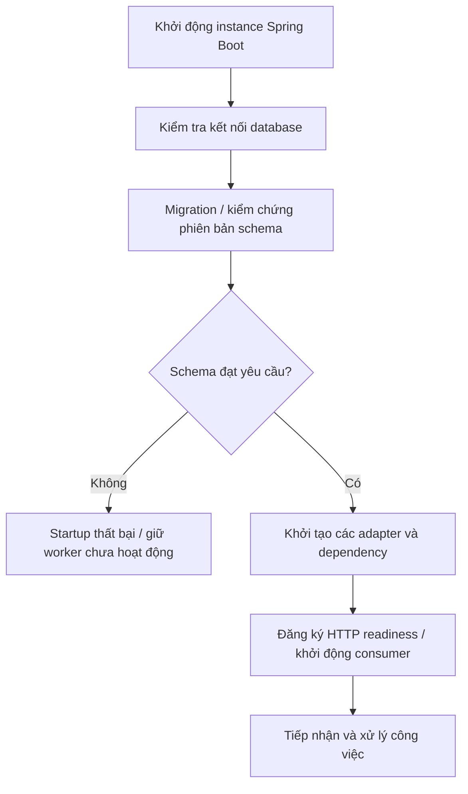
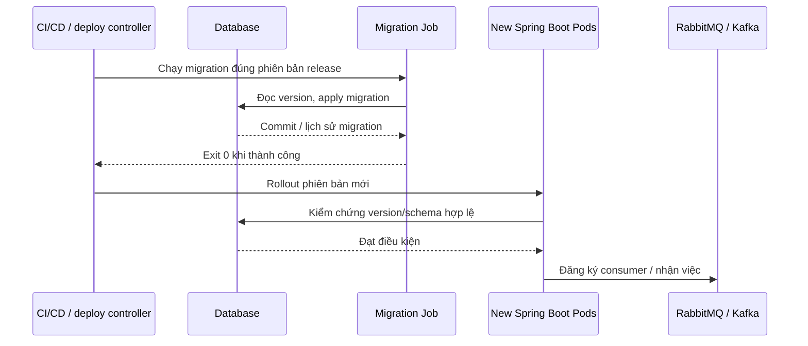
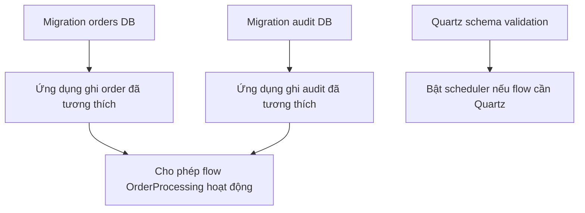

# Migration trước khi ứng dụng bắt đầu tiếp nhận công việc

## 1. Bài toán: ứng dụng mới khởi động trước khi schema sẵn sàng

Trong module **Spring Boot Integration**, một instance có thể nhận HTTP request, đọc/ghi cơ sở dữ liệu qua JDBC/JPA/R2DBC, tiêu thụ RabbitMQ hoặc Kafka, chạy Quartz và đẩy dữ liệu sang HTTP API, cache hay broker khác. Những luồng này sử dụng **hợp đồng dữ liệu** chung với database: tên bảng, cột, kiểu dữ liệu, constraint, index và các bản ghi cấu hình hoặc tham chiếu.

Giả sử phiên bản mới của dịch vụ đồng bộ đơn hàng cần thêm cột `external_reference`. Nếu consumer RabbitMQ bắt đầu xử lý `OrderCreated` trước khi migration tạo cột, thao tác INSERT/UPDATE có thể thất bại. Lỗi này có thể làm message bị phát lại nhiều lần, tăng backlog hoặc chuyển vào DLQ. Nếu HTTP endpoint đã nhận traffic, người dùng có thể nhận `500` trong khi pod vẫn đang hiển thị trạng thái chạy.

**Yêu cầu:** mọi đường tiếp nhận công việc **phụ thuộc schema mới** chỉ được kích hoạt khi migration cần thiết đã hoàn thành và ứng dụng đã xác minh database đúng phiên bản. Đường tiếp nhận bao gồm HTTP, consumer, scheduled task, Spring Integration inbound adapter và các job chạy nền; không thể chỉ dựa vào một trạng thái “JVM đã mở”.



Sơ đồ là **mục tiêu thiết kế**. Không phải mọi loại listener của Spring tự động chờ `ApplicationReadyEvent` hoặc HTTP readiness. Các cơ chế khởi chạy và cổng kiểm soát phải được lựa chọn theo từng integration.

## 2. Bốn mốc cần phân biệt khi khởi động

| Mốc | Điều đang diễn ra | Có thể nhận công việc chưa? |
| --- | --- | --- |
| **Database reachable** | Mạng và credentials đủ để kết nối tới database. | Chưa; có thể schema chưa đúng. |
| **Schema migrated/validated** | Migration phù hợp đã chạy; version và invariant cần thiết được xác minh. | Mới đủ điều kiện dữ liệu, chưa chứng minh dependency khác sẵn sàng. |
| **Spring context refreshed** | Các bean được tạo, context refresh hoàn tất, các bean `SmartLifecycle` có thể đã bắt đầu. | Có thể có listener/scheduler đang nhận việc nếu không chặn riêng. |
| **Application ready** | Sau `ApplicationRunner`/`CommandLineRunner`, Spring Boot phát `ApplicationReadyEvent` và chuyển readiness sang trạng thái chấp nhận traffic trong vòng đời khởi động thành công. | HTTP có thể được route nếu probe/orchestrator cấu hình đúng; consumer không tự bị ràng buộc bởi probe HTTP. |

Ví dụ Spring Boot với Flyway auto-configuration thường thực hiện migration **trong quá trình tạo/khởi tạo bean trước khi ứng dụng hoàn tất startup**. Tuy nhiên, không nên suy ra mọi mã tự viết hoặc mọi listener đều đợi đúng barrier: các adapter có thể là `SmartLifecycle` và bắt đầu ở thời điểm context refresh, còn `ApplicationRunner` chạy sau đó.

### 2.1. Readiness, liveness và startup probe khác nhau

- **Readiness probe**: nói với Kubernetes hoặc load balancer rằng instance hiện có nên nhận **request từ tuyến traffic do nó quản lý** hay không. Một pod không Ready thường không được chọn qua Service endpoint, nhưng vẫn có thể tự kết nối broker và consume.
- **Liveness probe**: kiểm tra tiến trình có nên bị restart hay không. Không nên đồng nhất lỗi migration/dependency tạm thời với trạng thái tiến trình “chết”; restart loop có thể làm sự cố nặng hơn.
- **Startup probe**: cho ứng dụng thêm thời gian khởi động trước khi các probe khác được đánh giá theo cấu hình. Không thực hiện migration thay cho ứng dụng.

Nếu hệ thống có worker chỉ consume Kafka/RabbitMQ và không phục vụ HTTP, **readiness HTTP không phải hàng rào đủ**. Cần trì hoãn đăng ký listener hoặc khởi chạy worker sau khi có bằng chứng schema hợp lệ.

## 3. Những gì migration cần đảm bảo và không thể đảm bảo

Migration thường là một chuỗi thay đổi có phiên bản và được quản lý bằng **Flyway** hoặc **Liquibase**:

- **DDL:** tạo bảng, thêm cột, index, constraint, schema, view.
- **Data migration:** chuyển dữ liệu cũ sang định dạng mới, bổ sung giá trị mặc định hoặc tạo reference data khi cần.
- **Version tracking:** lưu lịch sử migration/changeset và phát hiện thay đổi ngoài ý muốn.
- **Concurrency control:** công cụ có cơ chế phối hợp hoặc lock tùy DBMS/công cụ để tránh cùng một migration bị áp dụng đồng thời không kiểm soát.

Migration không tự giải quyết idempotency của message broker, transaction phân tán, API phía ngoài hay thứ tự triển khai của nhiều phiên bản ứng dụng. Trên một hệ thống đang rolling update, **schema đã nâng cấp** vẫn có thể không tương thích với **instance cũ chưa tắt**. Vì vậy, yêu cầu “migration trước khi nhận việc” phải đi cùng **expand–migrate–switch–contract** khi cần zero/low downtime.

### 3.1. Hai cách tổ chức phổ biến

| Mô hình | Cách chạy | Phù hợp | Điểm cần kiểm soát |
| --- | --- | --- | --- |
| **Migration khi startup của ứng dụng** | Flyway/Liquibase được Spring Boot khởi chạy cùng application context. | Một dịch vụ/DB đơn giản, startup được quản lý tốt. | Không cho listener tự viết chạy trước; nhiều pod khởi động đồng thời; startup có thể kéo dài. |
| **Migration như bước triển khai riêng** | Một Kubernetes Job, CI/CD stage hoặc tác vụ vận hành chạy migration trước khi rollout app. | Nhiều replica, migration dài hoặc cần kiểm soát thay đổi. | Phải kiểm tra job thành công **và** ứng dụng kiểm chứng schema/version lúc khởi động; quy trình rollout cần fail-closed. |

Không nên trộn hai mô hình thiếu chủ ý, ví dụ CI đã chạy migration rồi mọi pod vẫn tự thực hiện script `DROP/CREATE` hoặc cơ chế SQL initializer không tương thích.

## 4. Cấu hình Flyway trong Spring Boot

Flyway áp dụng các file migration theo thứ tự version, thường đặt trong `classpath:db/migration` và đặt tên như `V1__create_orders.sql`, `V2__add_external_reference.sql`. Với mô hình một database JDBC, cấu hình minh họa:

```yaml
spring:
  datasource:
    url: ${ORDERS_JDBC_URL}
    username: ${ORDERS_DB_USER}
    password: ${ORDERS_DB_PASSWORD}
  flyway:
    enabled: true
    locations: classpath:db/migration
    validate-on-migrate: true
    clean-disabled: true
  sql:
    init:
      mode: never
  jpa:
    hibernate:
      ddl-auto: validate
```

Ví dụ trên **dành cho ứng dụng JDBC/JPA có Flyway và JDBC driver phù hợp**:

1. `spring.flyway.enabled` bật cơ chế Flyway do Boot quản lý khi dependency/auto-configuration hiện diện.
2. `locations` chỉ định bộ migration. Thư mục cần nằm đúng đường dẫn trong artifact được đóng gói.
3. `validate-on-migrate` giúp kiểm tra tính phù hợp của lịch sử migration trước khi thực thi, theo khả năng kiểm tra của Flyway.
4. `clean-disabled` ngăn thao tác `clean` xóa schema qua Flyway trong trường hợp cấu hình tương ứng.
5. `spring.sql.init.mode: never` tránh đồng thời chạy cơ chế `schema.sql/data.sql` không có chủ đích.
6. `ddl-auto: validate` chỉ có ý nghĩa khi ứng dụng dùng **JPA/Hibernate**; nó xác minh mapping ở mức Hibernate hỗ trợ, và không thay thế migration.

Một ứng dụng chỉ dùng **Spring Data R2DBC** không tự chạy Flyway trên `ConnectionFactory` R2DBC: Flyway thực hiện migration qua JDBC. Cần cấu hình một đường JDBC riêng cho migration hoặc thực hiện bằng job chuyên trách, có driver và quyền database phù hợp.

### 4.1. Migration SQL nên nhỏ, rõ mục tiêu

Ví dụ mở rộng schema PostgreSQL theo cách tương thích bước đầu:

```sql
-- V3__add_external_reference.sql
ALTER TABLE orders
    ADD COLUMN external_reference VARCHAR(100);

CREATE INDEX idx_orders_external_reference
    ON orders (external_reference);
```

Trong thực tế, việc tạo index trên bảng lớn có thể giữ lock hoặc gây áp lực I/O. Với PostgreSQL, `CREATE INDEX CONCURRENTLY` có hạn chế riêng về transaction; cần migration tương ứng và cấu hình Flyway phù hợp nếu dùng cơ chế đó. Cần tính thời gian DDL và khả năng rollback cho đúng DBMS.

**Cảnh báo:** đổi schema trong môi trường nhiều pod thường cần giữ tương thích với phiên bản cũ. Việc thêm một cột nullable thường an toàn hơn việc ngay lập tức xóa/đổi tên cột cũ; nhưng mức an toàn còn phụ thuộc câu query, trigger, view và ràng buộc thực tế.

### 4.2. Một số lỗi startup phải chặn dịch vụ nhận việc

| Lỗi | Ví dụ | Hành động |
| --- | --- | --- |
| Không kết nối được DB | Credentials sai, DNS lỗi, network timeout | Fail startup hoặc giữ barrier đóng; theo dõi nguyên nhân thay vì bắt đầu consumer. |
| Migration không có quyền | `permission denied for schema` | Cấp quyền migration đúng vai trò; tách tài khoản vận hành khi cần. |
| Chênh lệch lịch sử migration | Checksum của file version cũ bị sửa | Điều tra thay đổi và sửa bằng quy trình được phê duyệt; không tự `repair` để che lỗi. |
| DDL không tương thích | Thiếu bảng/index hoặc constraint conflict | Dừng rollout, backup và xác định migration tiến lên/khôi phục phù hợp. |
| Version schema sai | Code mới cần cột chưa được áp dụng | Không cho nhận traffic/consume; phát tín hiệu lỗi rõ ràng. |

Chỉ để `DataSource` kết nối thành công không đủ. Việc “chạy được query SELECT 1” cũng chưa chứng minh các bảng, cột và constraint của nghiệp vụ đã đúng phiên bản.

## 5. Cấu hình Liquibase: cơ chế khác, cùng mục tiêu

Liquibase quản lý các changeset qua changelog và thường sử dụng bảng `DATABASECHANGELOG`, `DATABASECHANGELOGLOCK` để theo dõi/điều phối migration.

```yaml
spring:
  liquibase:
    enabled: true
    change-log: classpath:db/changelog/db.changelog-master.yaml
```

Ví dụ changelog tự chứa:

```yaml
databaseChangeLog:
  - changeSet:
      id: 003-add-external-reference
      author: integration-team
      changes:
        - addColumn:
            tableName: orders
            columns:
              - column:
                  name: external_reference
                  type: varchar(100)
```

Changelog là **ví dụ cấu trúc**; với dự án thật, file tổng có thể dùng `include`/`includeAll`, preconditions và quy tắc rollback tùy DBMS. Không nên để cả Flyway và Liquibase cùng quản lý một tập bảng/schema trừ khi đã có ranh giới trách nhiệm rõ; khi chỉ dùng một công cụ, cấu hình công cụ còn lại phải nhất quán.

### 5.1. Nếu migration cần dữ liệu ngoài DB

Không giả định changelog có thể an toàn gọi HTTP API hoặc publish message trong cùng transaction với DDL. Một migration nên tập trung vào trạng thái database; nếu cần đồng bộ dữ liệu từ hệ thống ngoài, hãy tách thành **backfill job có checkpoint và idempotency**, điều phối sau khi schema cần thiết đã tồn tại và trước khi bật những tính năng phụ thuộc dữ liệu mới.

## 6. Vì sao `ApplicationReadyEvent` chưa đủ để bảo vệ consumer?

Một ứng dụng có thể thực hiện migration tự viết trong `ApplicationRunner`:

```java
@Component
class ManualMigrationRunner implements ApplicationRunner {
    @Override
    public void run(ApplicationArguments args) {
        migrationService.verifyAndMigrate();
    }
}
```

Nhưng `ApplicationRunner` chạy **sau giai đoạn refresh context**. Nhiều listener container và inbound adapter triển khai `SmartLifecycle` và có thể tự khởi động trong quá trình refresh. Nếu những listener đó đặt `autoStartup=true`, chúng có thể đã nhận message **trước khi runner hoàn thành**.

Vì vậy, cần chọn một trong hai hướng:

- **Ưu tiên migration trong bước khởi tạo có barrier rõ ràng**, chẳng hạn Flyway/Liquibase được Boot phối hợp với khởi tạo database, hoặc một job bên ngoài đã được chờ hoàn tất trước khi tạo pod.
- **Với listener cần kiểm soát thủ công**, cấu hình không auto-start, rồi chỉ khởi động sau khi schema đã được kiểm chứng và readiness điều kiện của ứng dụng đã đạt.

Không chỉ đặt `@EventListener(ApplicationReadyEvent.class)` để ghi log “migration xong” trong khi listener đã auto-start từ trước.

### 6.1. Ví dụ giữ RabbitMQ listener chưa hoạt động tới lúc sẵn sàng

```java
import org.springframework.amqp.rabbit.annotation.RabbitListener;
import org.springframework.stereotype.Component;

@Component
class OrderMessageHandler {
    @RabbitListener(
        id = "orders-inbound",
        queues = "orders.inbound",
        autoStartup = "false")
    public void handle(OrderCreatedEvent event) {
        // Handler nghiệp vụ: kiểm tra schema/hợp đồng trước deployment,
        // thực thi idempotent và xử lý lỗi theo chính sách listener.
    }
}
```

Nếu code cần chủ động mở listener sau khi ứng dụng sẵn sàng, có thể truy cập registry:

```java
import org.springframework.amqp.rabbit.listener.MessageListenerContainer;
import org.springframework.amqp.rabbit.listener.RabbitListenerEndpointRegistry;
import org.springframework.boot.context.event.ApplicationReadyEvent;
import org.springframework.context.event.EventListener;
import org.springframework.stereotype.Component;

@Component
class StartInboundAfterReady {
    private final RabbitListenerEndpointRegistry registry;

    StartInboundAfterReady(RabbitListenerEndpointRegistry registry) {
        this.registry = registry;
    }

    @EventListener(ApplicationReadyEvent.class)
    public void startInbound() {
        MessageListenerContainer listener =
                registry.getListenerContainer("orders-inbound");
        if (listener == null) {
            throw new IllegalStateException("Missing orders-inbound listener");
        }
        listener.start();
    }
}
```

Với cấu hình này, listener được đăng ký nhưng **không auto-start**, rồi được start sau khi các bước startup đồng bộ hoàn tất và `ApplicationReadyEvent` được phát. Tuy nhiên, đây chỉ là **một barrier đơn giản**: nếu ứng dụng cần xác thực migration của database khác hoặc readiness của API/broker, phải kiểm tra điều kiện đó **trước khi gọi `listener.start()`**. Lỗi từ việc start phải được báo rõ, không âm thầm cho phép instance nhận việc.

`OrderCreatedEvent` là DTO minh họa, giả sử đã có converter và mô hình acknowledgement phù hợp. Nếu converter/queue chưa đúng, listener có thể thất bại vì một lý do khác với migration; cần phân biệt khi giám sát.

### 6.2. Kafka, Quartz, Spring Integration và tác vụ định kỳ

| Cổng nhận việc | Cơ chế cần để ý | Cách kiểm soát phù hợp |
| --- | --- | --- |
| `@KafkaListener` | Listener container có thể tự khởi động và join group | Dùng `autoStartup = "false"` hoặc cấu hình container tương đương; start qua `KafkaListenerEndpointRegistry` sau barrier. |
| `@RabbitListener` | Bắt đầu consumer, nhận delivery và giữ unacked | Tắt auto-start, dùng registry/container và readiness phù hợp. |
| Quartz scheduler | Scheduler có thể bắt đầu bắn trigger khi startup | Cấu hình `spring.quartz.auto-startup: false` khi cần; gọi `Scheduler.start()` sau migration/validation. |
| Spring Integration inbound endpoint | Nhiều adapter là `SmartLifecycle`, có thể auto-start | Cấu hình `autoStartup=false`, giữ endpoint ID để start sau barrier bằng lifecycle/Control Bus thích hợp. |
| `@Scheduled` | Lập lịch bằng infrastructure của Spring, không tuân theo HTTP readiness | Không dùng readiness làm bảo đảm; tách scheduler cho tới khi schema sẵn sàng hoặc thiết kế gate thực thi rõ ràng. |
| HTTP endpoint | Server có thể mở socket khi context đang khởi động | Kết hợp readiness routing và kiểm tra tại nơi nhận nếu topology có đường gọi trực tiếp không qua probe. |

Đặc biệt, khi có consumer đã kết nối tới broker, pod không Ready vẫn có thể nhận message. **Tắt auto-start là quyết định về listener lifecycle, không phải thuộc tính của readiness probe.**

## 7. Mô hình triển khai riêng: migration job trước rollout

Với nhiều replica, tốt nhất thường là **một bước migration có danh tính độc lập** rồi mới triển khai phiên bản ứng dụng cần schema mới.



**Điều kiện điều phối:** nếu migration job thất bại, rollout phải **dừng**. Job thành công nhưng ứng dụng không thể đọc schema mục tiêu cũng phải dẫn đến startup failure hoặc giữ inbound chưa hoạt động. Chỉ dựa vào tên migration job ở pipeline mà không thực sự kiểm tra exit code và version là không đủ.

### 7.1. Vì sao init container không tự bảo đảm chỉ chạy một lần?

Kubernetes `initContainer` chạy **theo từng pod**. Nếu ba pod mới được khởi tạo, cả ba init container có thể cùng thực hiện migration. Flyway/Liquibase có cơ chế lock/điều phối ở mức công cụ nhưng không nên lạm dụng để thay thế thiết kế quy trình triển khai. Để có một lần migration được điều phối trước rollout, dùng **một Kubernetes Job hoặc giai đoạn CI/CD riêng**, đợi nó thành công rồi mới thay workloads.

Job cần giới hạn quyền, timeout, số lần retry và theo dõi log. DDL có tính lặp hay không phụ thuộc công cụ và database; không tự động retry mọi lỗi migration mù quáng khi chưa xác định transaction DDL đã rollback hay chỉ chạy được một phần.

### 7.2. Container nhận việc phải kiểm tra contract/version nào?

Không nên chỉ kiểm tra `MAX(installed_version)` từ bảng history rồi so với chuỗi version app nếu có migration riêng cho nhiều dịch vụ hoặc nhiều datasource. Cần xác định:

- Migration dành cho **database/schema nào**, do **ứng dụng hoặc nhóm nào** sở hữu?
- Version schema tối thiểu/tối đa mà phiên bản app hỗ trợ là gì?
- Các bảng/cột/index/constraint bắt buộc đã tồn tại và ở trạng thái phù hợp chưa?
- Backfill nào bắt buộc hoàn tất trước khi bật tính năng, backfill nào chạy nền sau khi app đã đọc tương thích?

Một mô hình ứng dụng có thể dùng `Flyway.validate()` hoặc cơ chế version/compatibility riêng do deployment kiểm tra. Tránh biến startup check thành một thay đổi DDL ngoài kiểm soát khi nhiệm vụ của instance chỉ là **xác minh**.

## 8. Không dừng toàn bộ luồng trong rolling update: expand–contract

Giả sử database có cột `legacy_ref`, còn code mới muốn dùng `external_reference`. Nếu deployment làm:

```sql
ALTER TABLE orders DROP COLUMN legacy_ref;
```

trước khi tất cả pod cũ đã ngừng đọc/ghi `legacy_ref`, pod cũ có thể lỗi ngay. “Migration chạy trước app mới” không có nghĩa migration **an toàn với app cũ** trong cùng thời điểm rollout.

Một quy trình thay đổi tương thích hơn:

| Pha | Database | Code đang chạy | Điều kiện chuyển pha |
| --- | --- | --- | --- |
| **Expand** | Thêm cột `external_reference` nullable; giữ `legacy_ref` | Phiên bản cũ vẫn dùng cột cũ | Migration hoàn tất; app cũ vẫn chạy được |
| **Compatible rollout** | Có cả hai cột | Code mới đọc cột mới nếu có, fallback cột cũ; ghi hai nơi hoặc có cơ chế đồng bộ phù hợp | Pod mới xử lý dữ liệu đúng, không làm mất cập nhật |
| **Backfill** | Bổ sung dữ liệu `external_reference` còn thiếu theo batch | Hai phiên bản có thể cùng tồn tại trong cửa sổ thiết kế | Checkpoint, độ phủ dữ liệu, error budget đạt |
| **Switch** | Dữ liệu mới đầy đủ | Code mới dùng cột mới làm nguồn chính | Không còn pod/job cần cột cũ |
| **Contract** | Loại `legacy_ref` và cơ chế tương thích cũ theo migration sau | Chỉ code tương thích schema mới | Có kiểm tra, backup và kế hoạch rollback |

Không bắt buộc luôn **dual-write**: có thể dùng cách khác, nhưng phải chọn một cơ chế duy trì dữ liệu nhất quán trong khoảng hai phiên bản cùng chạy. Backfill cần có khóa phân trang/checkpoint và idempotency; với bảng lớn, không cố nhồi toàn bộ backfill vào một giao dịch startup dài làm khóa bảng và kéo dài downtime.

### 8.1. Đảm bảo hợp đồng sự kiện và database cùng tiến hóa

Trong hệ thống tích hợp, schema database và schema message thường thay đổi lệch thời điểm. Consumer mới có thể gặp sự kiện cũ còn trong queue, còn consumer cũ có thể nhận sự kiện được producer mới phát. Vì vậy:

- Dùng version/event contract có khả năng đọc tương thích; trường mới ban đầu nên optional hoặc có default rõ ràng khi hợp đồng cho phép.
- Chỉ bật producer phát payload mới sau khi các consumer cần thiết hiểu được định dạng đó, hoặc áp dụng chiến lược versioning.
- Không coi migration DB thành công là đủ để message cũ/new tự tương thích.
- Xem xét dữ liệu được phát lại từ DLQ nhiều ngày sau khi migration kết thúc; cần giữ đường deserialize và mapping phù hợp trong cửa sổ giữ message.

## 9. Nhiều database, tenant và cơ sở hạ tầng khác nhau

Một Spring Boot Integration có thể dùng `ordersDataSource`, `auditDataSource` và database riêng cho Quartz. Chạy Flyway cho một datasource không có nghĩa **cả ba schema đều hợp lệ**. Phải định nghĩa thứ tự migration theo phụ thuộc nghiệp vụ.



Nếu chỉ luồng audit phụ thuộc một migration khác thì có thể cô lập **riêng luồng audit** thay vì ngừng toàn bộ hệ thống. Tuy nhiên, nếu xử lý một đơn hàng cần cả orders và audit, chỉ bật flow sau khi cả hai DB đạt điều kiện. Tương tự, Redis schema/serialization version, Kafka topic/ACL và HTTP API contract có thể cần bước chuẩn bị ngoài migration SQL.

### 9.1. Migration trên nhiều tenant

Với database riêng theo tenant, việc “migrated=true” cần xét **từng tenant**. Một tenant đã thành công không có nghĩa tenant khác đã đạt phiên bản. Có thể dùng rollout theo nhóm tenant, giới hạn số migration đồng thời và chỉ route tenant đã đạt điều kiện. Lưu trạng thái version/changelog/lock cho từng database và có cơ chế báo cáo tenant bị lỗi.

Nếu nghiệp vụ cho phép tiếp tục phục vụ tenant tốt khi tenant khác lỗi, readiness và routing phải có mô hình **theo tenant** thay vì một cờ toàn hệ thống quá thô. Nhưng không được route request tới tenant chưa đạt schema yêu cầu.

## 10. Thiết kế fail-closed, retry và rollback đúng lớp

### 10.1. Migration thất bại: không chuyển thành lỗi nghiệp vụ

Nếu schema chưa sẵn sàng, listener RabbitMQ không nên nhận message rồi trả lỗi giống như “đơn hàng không hợp lệ”. Đó là lỗi hạ tầng/deployment. Tạm dừng listener hoặc chặn khởi tạo giúp tránh vòng lặp NACK/requeue nóng và hạn chế làm đầy DLQ do một sự cố schema chung.

Nếu một message đã đến trong lúc pod mất readiness hoặc đang ngừng, quy tắc ACK/NACK và transaction phải đủ an toàn để message có thể phát lại. Với at-least-once, xử lý trùng lặp theo `eventId` hoặc khóa nghiệp vụ; việc migration xong và replay message không tạo exactly-once.

### 10.2. Rollback code không đồng nghĩa rollback schema

Nhiều DBMS không hỗ trợ hoàn tác DDL an toàn theo cách đơn giản, nhất là sau khi code mới đã ghi dữ liệu dạng mới. Kế hoạch rollback thực tế nên ưu tiên:

1. Dùng migration **expand tương thích ngược** để phiên bản code cũ vẫn hoạt động trong giai đoạn rollback.
2. Nếu migration đã thay đổi dữ liệu, xác định code cũ có đọc được cấu trúc mới hay không.
3. Với bước contract/destructive, chuẩn bị backup/restore, maintenance window hoặc migration tiến lên có kiểm soát; không tự `DROP`/`repair` history để ép code cũ chạy.
4. Đối chiếu queue, outbox, idempotency và lịch Quartz sau rollback để tránh phát lại tác động ngoài ý muốn.

### 10.3. Retry migration cần biết trạng thái DB

Nếu mất kết nối giữa migration, một DDL có thể đã commit ở server trong khi client báo timeout. Chạy lại mù có thể gặp `column already exists` hoặc lịch sử migration chưa cập nhật. Cần kiểm tra **schema thật và bảng history** trước khi khôi phục; Flyway `repair`/Liquibase `changelogSync` chỉ dùng khi hiểu rõ tình trạng và có quy trình phê duyệt thích hợp.

## 11. Kiểm thử đúng ranh giới trước khi nhận công việc

Không chỉ kiểm tra rằng ứng dụng có thể khởi động trên một DB mới hoàn toàn. Cần mô phỏng **DB đang ở phiên bản cũ, nhiều instance đang chạy và có traffic/message đến**.

### 11.1. Bộ tình huống kiểm thử tối thiểu

| Tình huống | Kết quả mong muốn |
| --- | --- |
| DB ở version cũ, migration thành công | Migration chạy đúng một lần theo cơ chế quản lý; app mới xử lý được |
| Migration SQL lỗi hoặc checksum sai | Startup/rollout dừng, inbound chưa hoạt động |
| DB credential sai trong khi migration | Không consume, không ghi nhận nhầm lỗi dữ liệu nghiệp vụ |
| Pod mới bị kill giữa rollout | Pod cũ/new tương thích schema, message có thể phục hồi, không tạo side effect trùng |
| Nhiều pod cùng khởi động | Không reset schema; migration được điều phối và lock đúng |
| App cũ chạy khi schema đã expand | App cũ vẫn đọc/ghi được trong cửa sổ triển khai |
| Hàng triệu row cần backfill | Có checkpoint, giới hạn tài nguyên và không chặn startup không cần thiết |
| Backfill chưa xong | Chỉ tính năng cần dữ liệu đầy đủ bị giữ lại, hoặc code có fallback hợp lệ |
| DLQ phát lại message cũ sau deploy | Consumer đọc/ánh xạ payload cũ đúng hợp đồng |
| Readiness fail nhưng listener còn auto-start | Test phải phát hiện và yêu cầu cấu hình gate riêng |

### 11.2. Test ứng dụng nhận message quá sớm

Một test tích hợp có thể dùng PostgreSQL và RabbitMQ/Kafka qua Testcontainers:

1. Chuẩn bị database ở schema `V2`, trong khi app mới yêu cầu `V3`; phát message `OrderCreated` vào queue.
2. Cho migration `V3` chạy với cơ chế tạm chặn/giả lập thời gian xử lý.
3. Xác minh **không có handler thực thi SQL phụ thuộc V3 trước khi migration hoàn thành**.
4. Khi migration hoàn thành, bật listener; kiểm tra message được xử lý và ACK/commit theo chính sách.
5. Cho migration thất bại; xác minh listener chưa hoạt động và message vẫn có đường phục hồi.
6. Chạy hai replica để kiểm tra lock, failover và khả năng đọc schema tương thích khi một pod cũ đang hoạt động.

Đo sự kiện bằng hook/metric/log hoặc truy vấn DB có điều kiện rõ ràng; tránh dựa vào `Thread.sleep` rồi đoán mốc migration. Đây là kiểm thử **thứ tự thực thi và side effect**, khác với unit test chỉ gọi parser SQL.

## 12. Giám sát và runbook khi migration chặn startup

Một dashboard tối thiểu có thể theo dõi:

| Tín hiệu | Điều cần biết |
| --- | --- |
| Migration duration, success/failure, target version | Bước DDL mất bao lâu, có chạy đủ và đúng release không? |
| Schema version/validation state theo database | Mỗi DB/tenant đã đạt contract mà app yêu cầu chưa? |
| Startup/readiness duration | Có pod chờ migration quá lâu hoặc restart loop không? |
| Listener/consumer started count | Có consumer nào bắt đầu trước barrier không? |
| Queue lag, unacked/redelivery, DLQ | Có backlog, retry hoặc mất cân bằng do worker chưa sẵn sàng không? |
| HTTP error rate và latency | Có tuyến request được route sớm hoặc schema mismatch không? |
| DB lock/connection wait | Migration gây khóa bảng hoặc cạn pool không? |
| Business success/idempotency conflicts | Khi mở lại luồng, các việc bị dồn có xử lý đúng và không lặp side effect không? |

Runbook khi rollout dừng ở migration:

1. **Giữ barrier đóng:** dừng hoặc giữ listener/scheduler của bản mới, không bỏ qua bước validate schema chỉ để pod Ready.
2. **Xác định phạm vi:** DB/schema/tenant nào đang lỗi, bản code cũ còn hoạt động không, traffic và backlog ở đâu.
3. **Thu thập bằng chứng:** log migration, version table, câu DDL đang chạy, lock, connection error và trạng thái deployment; không in secret.
4. **Quyết định phục hồi:** sửa hạ tầng, hoàn tất migration an toàn, dùng migration tiến lên hoặc rollback code tương thích; việc restore phải xét side effect của các giao dịch đã chạy.
5. **Mở lại có kiểm soát:** canary một nhóm instance hoặc một nhánh inbound, quan sát error rate, latency, redelivery và dữ liệu nghiệp vụ trước khi tăng toàn tải.
6. **Hậu kiểm:** ghi rõ nguyên nhân, thời gian mất khả năng xử lý, version schema thực tế, số việc phải replay và hành động ngăn lặp.

### 12.1. Những lỗi thiết kế hay gặp

| Lỗi | Vì sao nguy hiểm | Hướng xử lý |
| --- | --- | --- |
| Chạy migration trong `ApplicationRunner` nhưng listener auto-start | Listener có thể tiêu thụ trước runner | Migration trước context hoặc tắt listener auto-start |
| Cho rằng readiness tắt mọi consumer | Broker hoạt động độc lập với HTTP routing | Gate riêng cho Kafka/RabbitMQ/Quartz/adapter |
| Chạy `schema.sql` cùng Flyway mà không có thiết kế | DDL có thể xung đột hoặc thứ tự khó dự đoán | Một nguồn sự thật cho schema và thứ tự migration |
| Cho Hibernate `ddl-auto=update` tự sửa schema production | Khó review/rollback thay đổi | Dùng versioned migration; Hibernate validate khi phù hợp |
| Mọi pod chạy DDL riêng khi startup | Đụng lock, tăng latency và nguy cơ race | Một migration job được điều phối, hoặc kiểm soát concurrency rõ |
| Rename/drop cột ngay trước rolling deploy | Pod cũ còn dùng schema cũ | Expand–contract theo nhiều release |
| Backfill khối lượng lớn trong một transaction startup | Giữ lock, vượt thời gian khởi động, khó khôi phục | Backfill có checkpoint và rate limit |
| Chỉ test trên DB rỗng | Không phát hiện dữ liệu cũ/constraint/index conflict | Test migration từ snapshot/schema phiên bản trước |
| Bắt lỗi migration rồi tiếp tục chạy | Luồng nhận việc với schema không đủ | Fail-closed và giám sát nguyên nhân |
| DDL đã chạy một phần rồi tự reset bảng history | Mất dấu vết migration, sai trạng thái | Kiểm tra DB thật và recovery có kiểm soát |

## 13. Checklist trước khi đưa vào vận hành

1. Đã liệt kê mọi **đường nhận việc**: HTTP, Kafka/RabbitMQ consumer, Quartz, `@Scheduled`, Spring Integration inbound adapter và batch job chưa?
2. Từng luồng cần schema/contract nào và dựa vào database/tenant nào? Có bảng phụ thuộc và schema version tối thiểu chưa?
3. Migration được chạy ở đâu: Boot startup, Kubernetes Job hay CI/CD? Có ai chịu trách nhiệm điều phối và theo dõi kết quả không?
4. Flyway/Liquibase là nguồn sự thật cho schema chưa? SQL initializer/Hibernate DDL có xung đột không?
5. Nếu migration lỗi, các đường inbound có **không được khởi động** hay không?
6. Readiness chỉ kiểm soát HTTP route hay đã có gate riêng cho consumer và scheduler?
7. Khi nhiều instance chạy song song, cơ chế lock và thứ tự rollout có đúng không? Init container có vô tình chạy migration mỗi pod không?
8. Có giữ tương thích với code cũ trong rolling update không? Bước DROP/rename/NOT NULL đã được dời đến pha contract chưa?
9. Backfill dữ liệu lớn có checkpoint, idempotency, giới hạn tải và cơ chế resume sau lỗi chưa?
10. Khi message bị phát lại hoặc service rollback, có đảm bảo contract sự kiện, transaction, outbox và chống trùng lặp không?
11. Có test từ database phiên bản cũ, test migration failure và kiểm tra consumer không xử lý trước barrier chưa?
12. Dashboard, cảnh báo, backup và runbook có đủ để biết migration nào chặn instance và mở lại an toàn không?

**Điểm cần nhớ:** “Migration trước khi ứng dụng tiếp nhận công việc” là một **hàng rào vận hành** giữa chuẩn bị dữ liệu và mở các điểm nhận việc. Với Spring Boot, Flyway/Liquibase hoặc migration job có thể chuẩn bị schema, nhưng HTTP readiness không tự chặn broker consumer và scheduler. Cần kiểm soát lifecycle từng inbound adapter, xác minh schema đúng phiên bản, giữ tương thích khi rolling update và bảo toàn idempotency khi những công việc bị dồn được xử lý trở lại.
