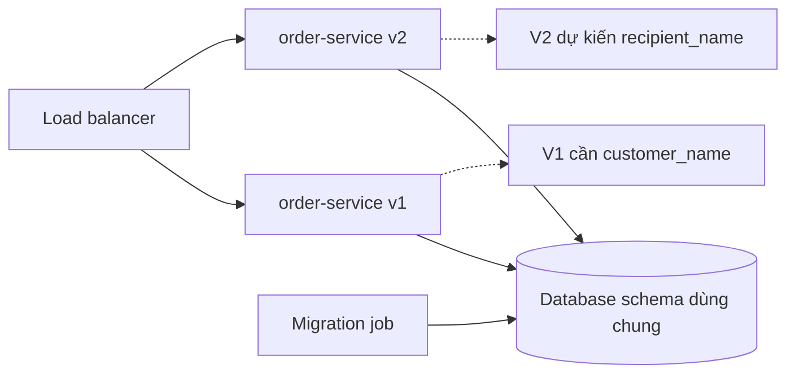
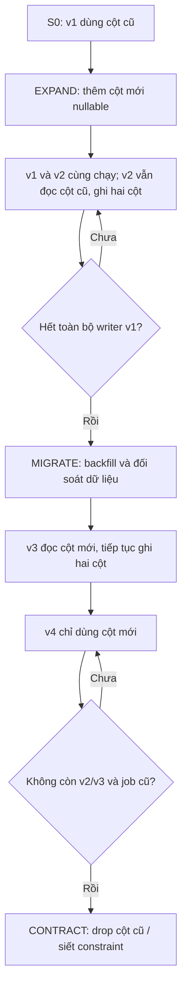

# Tương thích schema khi nhiều phiên bản ứng dụng cùng chạy

> **Chương:** Khởi tạo và migration  
> **Phạm vi module:** `SPRING_BOOT_INTEGRATION` — tổ chức tích hợp trong Spring Boot qua HTTP client, cơ sở dữ liệu, cache, broker thông điệp và adapter của Spring Integration, với trọng tâm là cấu hình, hợp đồng dữ liệu, giao dịch, xử lý lỗi và trùng lặp, kiểm thử, quan sát.

Khi triển khai một ứng dụng Spring Boot theo kiểu rolling update, blue/green hoặc canary, **phiên bản cũ và phiên bản mới có thể cùng đọc, ghi một database trong một khoảng thời gian**. Schema của database lại là tài nguyên dùng chung: chỉ cần đổi tên một cột trước khi mọi instance cũ dừng hoạt động, những instance đó có thể lỗi ngay cả khi bản release mới hoạt động tốt.

Vì vậy, migration an toàn không chỉ là một file SQL chạy thành công. Nó là **một chuỗi thay đổi schema, dữ liệu và ứng dụng** sao cho mọi tổ hợp phiên bản có thể cùng chạy trong cửa sổ triển khai đều có hợp đồng đọc/ghi tương thích. Cách tiếp cận thường dùng là **expand → migrate → contract**: mở rộng schema trước, đưa dữ liệu và hành vi ứng dụng qua dạng mới khi vẫn hỗ trợ dạng cũ, rồi mới loại bỏ cấu trúc cũ khi có bằng chứng không còn bên phụ thuộc.

## 1. Mục tiêu học tập

Sau bài này, bạn có thể:

1. Phân biệt **schema migration**, **data migration**, **triển khai ứng dụng** và **chuyển đổi hợp đồng dữ liệu**.
2. Xây dựng ma trận tương thích giữa phiên bản ứng dụng và schema trong rolling/blue-green/canary deployment.
3. Áp dụng expand–migrate–contract cho thêm cột, đổi tên cột, thay kiểu dữ liệu và thay đổi constraint.
4. Chọn chiến lược đọc và ghi khi app cũ vẫn đang chạy, tránh mất dữ liệu hoặc đọc nhầm giá trị chưa đồng bộ.
5. Thiết kế backfill theo batch, có thể chạy lại, quan sát được, đồng thời giảm rủi ro lock và tải database.
6. Sắp xếp Flyway/Liquibase, Spring Boot/JPA và công cụ triển khai theo thứ tự an toàn; định nghĩa điều kiện chuyển giai đoạn.
7. Phân biệt rollback ứng dụng với rollback schema và hiểu giới hạn khi đã có dữ liệu theo định dạng mới.
8. Kiểm thử nhiều phiên bản cùng chạy, kể cả tác vụ tích hợp bất đồng bộ, event/outbox và job nền.

## 2. Vì sao thay schema trong rolling deployment nguy hiểm?

Giả sử ứng dụng `order-service v1` sử dụng bảng:

```sql
CREATE TABLE orders (
    id BIGINT PRIMARY KEY,
    customer_name VARCHAR(200) NOT NULL,
    status VARCHAR(30) NOT NULL
);
```

Code v1 đọc `customer_name`:

```sql
SELECT id, customer_name, status
FROM orders
WHERE id = :id;
```

Đội phát triển muốn đổi tên cột `customer_name` thành `recipient_name` và triển khai v2. Nếu migration trực tiếp:

```sql
-- NGUY HIỂM khi instance v1 vẫn hoạt động.
ALTER TABLE orders RENAME COLUMN customer_name TO recipient_name;
```

thì v1 có thể lỗi ngay ở truy vấn hoặc lệnh ghi tiếp theo. Đây là **breaking change của hợp đồng database** dù database đã chạy migration không lỗi và code v2 đã compile.



Trong thực tế còn có các tác nhân chạy với phiên bản không đồng đều: scheduled job, consumer JMS/Kafka, outbox publisher, batch worker, báo cáo, CDC reader hoặc một dịch vụ khác được cấp quyền truy cập trực tiếp. Một instance v1 không còn nhận HTTP request vẫn có thể đang xử lý message tồn đọng. Vì thế tiêu chí “load balancer đã chuyển hết traffic sang v2” **chưa đủ** để xóa cấu trúc cũ.

### 2.1. Các loại thay đổi và mức độ rủi ro

| Thay đổi | Có thể gây lỗi cho phiên bản cũ thế nào? | Hướng thực hiện |
|---|---|---|
| Thêm cột nullable chưa được code cũ dùng | Thường tương thích với code cũ, nhưng còn phụ thuộc SQL `INSERT` và ORM | Expand trước, test các câu SQL cũ. |
| Thêm cột `NOT NULL` không có default | `INSERT` cũ thiếu cột mới có thể thất bại | Thêm nullable/default phù hợp, backfill, mới siết constraint. |
| Đổi tên hoặc xóa cột | Code cũ không còn tìm được cột | Thêm cột mới, chuyển đổi qua nhiều release, drop sau. |
| Đổi kiểu dữ liệu | Lỗi parse, truncate, precision, mapping JPA hoặc index | Dùng cột mới hoặc kiểu trung gian, convert và kiểm dữ liệu trước. |
| Giảm độ dài cột | Lệnh ghi của app cũ có thể không còn hợp lệ | Kiểm tra dữ liệu và tất cả writer, giới hạn giá trị tại ứng dụng trước. |
| Thêm unique/FK/check constraint | Dữ liệu lịch sử có thể vi phạm, writer cũ có thể tiếp tục tạo dữ liệu vi phạm | Dọn dữ liệu, chuyển logic ghi, đo violation rồi mới enforce. |
| Đổi ý nghĩa field/enum | SQL có thể vẫn chạy nhưng nghiệp vụ hiểu sai trạng thái | Dùng version và giai đoạn tương thích ngữ nghĩa. |
| Xóa table, index hoặc đổi khóa chính | Query, writer, báo cáo hoặc join cũ có thể lỗi/khóa lâu | Đo dependency, chuyển dữ liệu và traffic trước; đánh giá lock riêng. |

Đừng gọi mọi thay đổi “thêm cột là an toàn” mà không kiểm tra mã cũ. SQL dạng `INSERT INTO orders VALUES (...)` không liệt kê tên cột có thể hỏng khi schema thêm cột; ứng dụng cũ cũng có thể dùng `SELECT *` và bộ mapping phụ thuộc số cột. Cần kiểm thử hợp đồng SQL thực tế.

## 3. Tương thích phải xét theo *reader*, *writer* và *schema*

Ba câu hỏi không thể gộp lại:

- **Reader:** phiên bản đó có đọc đúng dữ liệu được writer khác tạo ra không?
- **Writer:** phiên bản đó có ghi dữ liệu mà reader của phiên bản khác hiểu được không?
- **Schema:** câu SQL, ORM mapping và constraint hiện có có chấp nhận cả hai phiên bản không?

Ví dụ ma trận cho một đợt thay đổi có cửa sổ song song:

| App đang chạy | Schema cũ S0 | Schema mở rộng S1 | Schema đã contract S2 |
|---|---|---|---|
| v1 chỉ biết `customer_name` | Hợp lệ | **Phải giữ tương thích** trong lúc rolling | Không hợp lệ nếu đã drop cột cũ. |
| v2 đọc cột cũ, ghi cả cũ và mới | Chưa hợp lệ trước khi có cột mới | Hợp lệ | Không hợp lệ sau khi drop cột cũ. |
| v3 đọc cột mới, còn ghi cả hai | Chưa hợp lệ | Hợp lệ **sau backfill và bảo đảm đồng bộ** | Không hợp lệ nếu vẫn ghi cột cũ đã bị drop. |
| v4 chỉ đọc/ghi cột mới | Chưa hợp lệ | Hợp lệ | Hợp lệ. |

Không có ma trận nào đúng cho mọi dự án: mỗi cột “hợp lệ” cần được chứng minh bằng test thật và hợp đồng nghiệp vụ. Ma trận minh họa một kế hoạch rõ ràng, trong đó **schema S1 tồn tại qua nhiều release**, còn S2 chỉ xuất hiện khi không còn binary nào đòi hỏi cột cũ.

**Backward compatibility** của migration nghĩa là schema mới vẫn phục vụ được code cũ trong phạm vi cần giữ lại. **Forward compatibility** của code nghĩa là code đã được chuẩn bị để chạy với schema/mô hình dữ liệu ở giai đoạn kế tiếp. Với rolling deployment, cần kiểm tra cả hai hướng, không chỉ code mới chạy được sau migration.

## 4. Expand → migrate → contract: chuỗi thay đổi an toàn



### 4.1. Expand: chỉ thêm khả năng

Ở giai đoạn đầu, giữ cột `customer_name` và thêm `recipient_name`:

```sql
-- Ví dụ PostgreSQL; thực hiện trước khi triển khai binary tham chiếu cột mới.
ALTER TABLE orders
ADD COLUMN recipient_name VARCHAR(200);
```

**Vì sao để nullable?** Dữ liệu hiện tại chưa có giá trị `recipient_name`; v1 chưa biết và sẽ không ghi cột mới. Ép `NOT NULL` ngay có thể khiến lệnh ghi của v1 hoặc migration lịch sử thất bại.

Lệnh thêm cột có thể cần lock metadata/database trong thời gian nhất định. Độ nhanh/chậm và loại lock phụ thuộc DBMS, phiên bản, table size và lệnh cụ thể; cần kiểm tra trên hệ thống tương đương production. Đừng gộp `ADD COLUMN` cùng một lần cập nhật hàng chục triệu dòng vào một migration chạy trong transaction dài nếu chưa đo tải.

Sau expand, cả binary v1 và v2 phải chạy được trên schema S1. **Không triển khai v2 trước khi migration expand đã thành công.**

### 4.2. Migrate code: viết được dữ liệu mới mà không bỏ dữ liệu cũ

Phiên bản v2 tiếp tục **đọc giá trị cũ làm nguồn sự thật**, đồng thời cập nhật hai cột khi thay đổi tên người nhận:

```java
import org.springframework.jdbc.core.JdbcTemplate;
import org.springframework.stereotype.Service;
import org.springframework.transaction.annotation.Transactional;

@Service
class RecipientNameService {
    private final JdbcTemplate jdbc;

    RecipientNameService(JdbcTemplate jdbc) {
        this.jdbc = jdbc;
    }

    @Transactional
    public void renameRecipient(long orderId, String newName) {
        int updated = jdbc.update(
            """
            UPDATE orders
               SET customer_name = ?, recipient_name = ?
             WHERE id = ?
            """,
            newName, newName, orderId);

        if (updated != 1) {
            throw new IllegalArgumentException("Order does not exist");
        }
    }
}
```

Trong ví dụ này, hai cột được ghi trong **một transaction database**, do đó nếu lệnh ghi thất bại thì không có trạng thái “đã cập nhật chỉ một cột”. Với workflow thực tế, cần validation, optimistic locking hoặc cơ chế xử lý đồng thời nếu nhiều writer có thể sửa cùng order.

**Bẫy khi song song v1/v2:** v1 chỉ ghi `customer_name`; v2 ghi cả hai. Nếu v2 bắt đầu **ưu tiên đọc `recipient_name` ngay lập tức**, một lệnh cập nhật của v1 sau đó có thể làm cột cũ thay đổi trong khi cột mới vẫn giữ giá trị trước đó. Khi đó v2 đọc **dữ liệu cũ** dù cả hai cột đều không null.

Vì thế giai đoạn v1 còn chạy, v2 vẫn đọc **cột cũ là nguồn sự thật**. Không coi `COALESCE(recipient_name, customer_name)` là giải pháp chung cho bài toán đồng bộ: `COALESCE` chỉ giải quyết `NULL`, không phát hiện **giá trị mới nhưng đã lỗi thời**.

Nếu yêu cầu bắt buộc cho phiên bản mới đọc cột mới trong khi v1 còn ghi cột cũ, cần cơ chế đồng bộ mọi writer tại DB (ví dụ trigger được kiểm chứng cẩn thận), một lớp tương thích, hoặc tạm thời chuyển quyền ghi một chiều. Trigger hai chiều có thể sinh recursion, lock, xung đột hoặc cập nhật vượt dự kiến; phải thiết kế và thử nghiệm riêng, không áp dụng máy móc.

### 4.3. Migrate data: đợi writer cũ rút hết rồi backfill

Khi tất cả v1 writer đã dừng, chỉ còn v2 luôn ghi cả hai cột trong một transaction, có thể backfill các bản ghi lịch sử:

```sql
-- PostgreSQL: chạy trên một khoảng id nhỏ cho mỗi lượt.
UPDATE orders
   SET recipient_name = customer_name
 WHERE id >= :from_id
   AND id < :to_id
   AND recipient_name IS DISTINCT FROM customer_name;
```

`IS DISTINCT FROM` là cú pháp PostgreSQL xử lý so sánh `NULL` rõ ràng; DBMS khác có cách tương đương. Batch theo range ID chỉ là một chiến lược; với ID không liên tục, hot rows hoặc bảng phân vùng, cần chọn cách chia lô thực tế.

Sau mỗi batch, ghi checkpoint, số dòng đã cập nhật và latency. Có thể chạy lại an toàn về **kết quả cuối** vì lần chạy sau chỉ sửa các hàng còn khác nhau, với điều kiện mọi writer đang hoạt động đều thực hiện dual-write đúng hợp đồng. Nếu một writer cũ lại xuất hiện, điều kiện an toàn này không còn đúng; cần dừng cutover và khắc phục.

Đối soát:

```sql
-- Chỉ dùng query tổng hợp trên table lớn khi đã đánh giá chi phí scan.
SELECT COUNT(*) AS mismatched_rows
FROM orders
WHERE recipient_name IS DISTINCT FROM customer_name;
```

Mục tiêu đạt `mismatched_rows = 0` sau khi đã xác nhận không còn writer cũ, dữ liệu không tiếp tục bị thay đổi qua đường bỏ sót và transaction đang diễn ra đã hoàn tất.

**Không nên backfill toàn bộ dữ liệu trong một transaction khổng lồ** ở bảng lớn. Nó có thể kéo dài lock, tạo WAL/redo/replication lag, tiêu tốn I/O và làm tăng p99 latency. Hãy chọn batch size dựa trên đo đạc, có cơ chế pause/resume, giới hạn tốc độ, kiểm soát connection pool và theo dõi replica/CDC.

### 4.4. Cutover reader: đổi sang cột mới

Sau khi đã đối soát và xác nhận chỉ còn writer dual-write, triển khai v3:

- v3 **đọc `recipient_name`**;
- v3 **vẫn ghi cả `recipient_name` và `customer_name`**;
- v2 vẫn còn trong rolling window có thể đọc cột cũ vì mọi writer còn sống tiếp tục duy trì cả hai cột.

Không bỏ dual-write ngay trong v3. Nếu v4 bắt đầu chỉ ghi cột mới trong lúc v2 vẫn đang đọc cột cũ, v2 có thể đọc dữ liệu lỗi thời. Vì vậy chỉ chuyển sang v4 sau khi **không còn reader dựa vào cột cũ**, bao gồm consumer/job có thể bị restart từ image cũ.

### 4.5. Contract: chỉ xóa sau khi không còn phụ thuộc

Khi toàn bộ ứng dụng và job đã chạy phiên bản chỉ đọc/ghi cột mới, các ràng buộc mới được kiểm chứng, và rollback target không còn cần cột cũ, có thể contract:

```sql
-- Ví dụ sau cùng; thực hiện trong release tách biệt.
ALTER TABLE orders
ALTER COLUMN recipient_name SET NOT NULL;

ALTER TABLE orders
DROP COLUMN customer_name;
```

Trước `SET NOT NULL`, cần bảo đảm dữ liệu cũ đã được backfill, tất cả writer không còn ghi null và xem xét chi phí kiểm tra/lock theo DBMS đang chạy. Có thể dùng constraint được xác minh theo nhiều bước hoặc cơ chế online schema change nếu DB hỗ trợ. `DROP COLUMN` là thay đổi **mang tính phá vỡ tương thích** và trong một số DB vẫn có rủi ro lock, ảnh hưởng view, trigger, báo cáo hoặc external query.

Sau khi drop, rollback về v1/v2/v3 trong ma trận ví dụ không còn an toàn. Kế hoạch ứng phó cần được quyết định **trước** thời điểm contract.

## 5. Cách xử lý những thay đổi schema phổ biến

### 5.1. Thêm cột mới

Quy trình phổ biến:

1. Thêm cột nullable hoặc default an toàn cho mọi writer còn sống.
2. Cập nhật reader mới để chịu được giá trị `NULL`/mặc định cho dữ liệu lịch sử.
3. Cập nhật writer mới để ghi giá trị đầy đủ; giữ code cũ tương thích.
4. Backfill dữ liệu theo batch khi cần.
5. Bảo đảm không còn writer có thể tạo giá trị không hợp lệ rồi mới thêm `NOT NULL`/`CHECK`.

Đặc biệt, `DEFAULT` có thể giúp câu `INSERT` cũ **không liệt kê cột** tạo dữ liệu hợp lệ. Nhưng nó không cứu được writer **ghi tường minh `NULL`**. Về ngữ nghĩa, default cũng chỉ đúng khi nó thực sự đại diện cho trạng thái nghiệp vụ hợp lệ.

### 5.2. Thêm unique constraint

Ví dụ thêm khóa nghiệp vụ `external_order_id` cho lệnh từ hệ thống đối tác:

```sql
ALTER TABLE orders
ADD COLUMN external_order_id VARCHAR(80);
```

Không nên thêm `UNIQUE NOT NULL` ngay khi dữ liệu lịch sử chưa có giá trị. Hãy:

- Quy định hợp đồng định danh đối tác (`tenantId` + `externalOrderId` hay ID toàn cục), normalizing và độ dài.
- Đưa code mới vào ghi key, kiểm tra/idempotency khi xử lý lại HTTP request hoặc message.
- Backfill và xử lý bản ghi thiếu/trùng từ trước; dừng các writer cũ còn tạo dữ liệu không có key.
- Tạo chỉ mục/unique constraint bằng cơ chế ít gây lock phù hợp DBMS, đo tải và kiểm tra xem toàn bộ dữ liệu đã đáp ứng chưa.
- Cuối cùng thêm `NOT NULL` nếu nghiệp vụ yêu cầu, sau khi mọi writer đã tương thích.

Với PostgreSQL, `CREATE UNIQUE INDEX CONCURRENTLY` có thể giúp giảm mức độ chặn ghi so với xây index thông thường nhưng **không được chạy trong transaction block**. Cần phân tách Flyway migration hoặc cấu hình thực thi phù hợp với phiên bản Flyway/DB đang dùng. Công cụ và hành vi rollback index xây dở cũng phải được test; không giả định “concurrently” tức là không có bất cứ lock/chi phí nào.

### 5.3. Đổi kiểu dữ liệu hoặc tách một cột thành nhiều cột

Ví dụ tách `full_address` thành `street`, `city`, `postal_code`. Thêm cột mới, cập nhật parser/writer và backfill có khả năng đánh dấu **record không chuyển đổi được**. Không ép mọi giá trị lịch sử thành dữ liệu hợp lệ bằng một giá trị giả nếu điều đó làm sai nghiệp vụ.

Khi code cũ tiếp tục ghi `full_address`, việc chỉ đọc các cột mới có thể gây stale data tương tự ví dụ đổi tên. Cần xác định cột nào là nguồn sự thật trong mỗi giai đoạn, bảo đảm tất cả writer đồng bộ hoặc chỉ chuyển reader khi writer cũ đã biến mất và đã đối soát.

Nếu một phép chuyển đổi mất thông tin (ví dụ giảm precision, đổi đơn vị tiền tệ hay bỏ field), **rollback schema có thể không tái tạo được dữ liệu cũ**. Khi đó phải có bản sao/snapshot, lộ trình chuyển đổi phục hồi hoặc biện pháp rollback nghiệp vụ phù hợp.

### 5.4. Đổi enum hoặc ý nghĩa một giá trị

Một database vẫn có cột `status VARCHAR` nhưng v3 viết trạng thái `PARTIALLY_RESERVED` mà v1 không hiểu; đây vẫn là **breaking change ngữ nghĩa**. Có thể phải:

- Cho v1 có fallback an toàn cho trạng thái chưa biết trước khi v3 bắt đầu phát sinh giá trị mới.
- Dùng capability flag để trì hoãn ghi trạng thái mới cho tới khi không còn v1.
- Versioning theo payload/event nếu dữ liệu đi qua broker/HTTP.

Migration schema không thể tự giải quyết mọi thay đổi về quy tắc nghiệp vụ.

## 6. Flyway và Liquibase trong Spring Boot

### 6.1. Một cơ chế schema migration có chủ sở hữu

Trong Spring Boot, Flyway/Liquibase giúp quản lý các migration có thứ tự và ghi nhận phiên bản đã áp dụng. Ví dụ khi dùng Flyway:

```text
db/migration/
  V20261121_01__add_recipient_name.sql
  V20261121_02__add_auxiliary_index.sql
  ...
```

Minh họa `V20261121_01__add_recipient_name.sql`:

```sql
ALTER TABLE orders
ADD COLUMN recipient_name VARCHAR(200);
```

Ví dụ cấu hình Spring Boot:

```yaml
spring:
  flyway:
    enabled: true
  jpa:
    hibernate:
      ddl-auto: validate
```

`ddl-auto: validate` dùng Hibernate kiểm tra mapping so với schema khi khởi động. Nó **không chạy schema migration** và không tự bảo đảm nhiều phiên bản ứng dụng tương thích. Tránh để Hibernate tự thay schema ở production qua `create`/`create-drop`; với môi trường có migration được quản trị, nên có một nguồn kiểm soát DDL rõ ràng. Nếu ứng dụng không dùng JPA, phần cấu hình JPA không cần thiết.

**Lưu ý về quyền chạy migration:** Spring Boot có thể chạy Flyway khi khởi động nếu Flyway được bật và có dependency thích hợp. Flyway quản lý history/locking để phối hợp migration, nhưng việc **mỗi instance có quyền DDL và chạy migration trên startup** vẫn có thể khiến thứ tự rollout khó kiểm soát. Trong môi trường production nhiều instance, một pattern rõ ràng là:

1. Chạy **migration job riêng** với quyền DDL theo quy trình deploy.
2. Đợi job thành công và schema đạt version tối thiểu.
3. Sau đó mới rollout app version tương thích; các app instance thường dùng DB credential với quyền DML cần thiết và không tự thay schema.

Nếu vẫn chạy migration lúc startup, phải kiểm tra thứ tự deploy, phiên bản migration bundling và việc nhiều instance/phiên bản cùng khởi động. Chỉ có Flyway lock không thay thế ma trận tương thích ứng dụng.

### 6.2. Phân biệt schema migration với backfill dài

| Công việc | Nơi nên đặt | Vì sao |
|---|---|---|
| Thêm cột/constraint đơn giản, nhanh đã được đo | Flyway/Liquibase migration | Có thứ tự và version rõ ràng. |
| Chỉ mục DB cần chế độ ngoài transaction | Migration tách riêng có cấu hình phù hợp | DB có thể cấm một số DDL trong transaction. |
| Backfill hàng triệu record | Batch job riêng có checkpoint/metrics | Có thể tạm dừng, chạy lại và hạn chế tải. |
| Kích hoạt reader dùng cột mới | Release ứng dụng hoặc feature flag được kiểm soát | Chỉ bật khi dữ liệu và các writer đã sẵn sàng. |
| Drop schema cũ | Migration contract trong release sau | Cho đủ thời gian xác nhận dependency và rollback plan. |

Liquibase cũng có thể quản lý changeset, precondition và trạng thái thay đổi. Chọn **một cơ chế có chủ sở hữu rõ ràng cho cùng schema**, tránh để nhiều ứng dụng/service độc lập đưa ra DDL trái nhau.

### 6.3. DDL và giao dịch phụ thuộc DBMS

Đừng mặc định mọi migration SQL đều atomic như cùng một transaction nghiệp vụ:

- PostgreSQL hỗ trợ transaction cho nhiều loại DDL, nhưng một số lệnh như `CREATE INDEX CONCURRENTLY` có quy tắc riêng.
- MySQL và nhiều DBMS khác có implicit commit hoặc khả năng online DDL khác nhau theo engine, version và lệnh.
- DDL có thể chờ lock hoặc giữ lock lâu dù lệnh chạy nhanh trên database test nhỏ.
- Replica/CDC và transaction log có thể chịu tải lớn khi đổi schema hoặc backfill.

Với mỗi migration production, cần biết rõ DBMS/version, lock, thời gian thực thi, hành vi rollback và tác động lên replica, không sao chép mù quáng câu SQL từ môi trường khác.

## 7. Triển khai nhiều phiên bản: thứ tự và cổng kiểm soát

Một lịch triển khai an toàn cần mô tả ai được phép chạy ở mỗi bước.

| Giai đoạn | Schema | Binary/worker được phép | Điều kiện để đi tiếp |
|---|---|---|---|
| A — Hiện tại | S0: chỉ cột cũ | v1 | Có baseline, metric và kế hoạch migration. |
| B — Expand | S1: có cột mới nullable | v1 | Migration thành công; v1 vẫn hoạt động bình thường. |
| C — Dual-write | S1 | v1 + v2, rồi chỉ v2 | Mọi v1 writer (kể cả job/consumer) đã dừng; v2 đọc cũ và ghi đôi. |
| D — Backfill | S1 | v2 | Đối soát không còn mismatch; xử lý record lỗi; có bằng chứng không còn v1 writer. |
| E — New-read | S1 | v2 + v3, rồi chỉ v3 | v3 đọc mới và còn ghi đôi; mọi v2 reader cũ dần rút hết. |
| F — New-only | S1 | v3 + v4, rồi chỉ v4 | Không còn reader dựa vào cột cũ; v4 chỉ đọc/ghi mới. |
| G — Contract | S2: bỏ cột cũ | v4 trở lên | Không còn code/job cũ; rollback target đã thay đổi; duyệt drop. |

**Rolling deployment:** route traffic có thể thay đổi trước khi các request dài và consumer hoàn tất. Kiểm tra cả instance draining, scheduled task, connection pool, retry queue và pod tự restart từ image cũ.

**Blue/green:** hai môi trường dùng chung database vẫn chịu ràng buộc tương thích. Chuyển traffic không tự biến database thành hai schema độc lập; việc rollback traffic về môi trường blue sau contract có thể lỗi.

**Canary:** nhóm nhỏ v3 đọc cột mới khi v2 vẫn ghi đôi chỉ an toàn nếu backfill hoàn tất và không còn v1 chỉ ghi cột cũ. Canary không phải lý do bỏ qua điều kiện dữ liệu.

Feature flag có thể hữu ích để tách deploy binary khỏi thời điểm chuyển read/write, nhưng flag phải được rollout nhất quán và có cơ chế khôi phục. Nếu việc bật flag đổi nguồn dữ liệu chuẩn, cần biết chính xác writer/reader nào đã nhận cấu hình.

### 7.1. Gate bằng bằng chứng thay vì chỉ thời gian

Trước mỗi bước quan trọng, cần kiểm tra:

- **Mọi writer cũ đã rút hết:** instance, consumer, job theo lịch, worker batch, tool admin và bản rollback tự động.
- **Mọi reader cũ đã rút hết:** truy vấn báo cáo, API, data export, CDC connector và background worker.
- **Dữ liệu đã đối soát:** số record thiếu/sai, trường hợp outlier, độ trễ replica; không chỉ “backfill job đã báo finished”.
- **Không có lỗi mới trong window:** SQL errors, constraint violations, mismatch, p95/p99 latency và số message xử lý thất bại.
- **Rollback target khả thi:** binary rollback còn đọc/ghi được schema hiện tại và dữ liệu được tạo sau rollout.

Khi một gate chưa đạt, **dừng chuyển giai đoạn**; rollback phần ứng dụng nếu thực sự an toàn, hoặc giữ schema mở rộng và khắc phục tiếp.

## 8. Rollback ứng dụng khác rollback database

Giả sử đã expand S1 và đang chạy v2. Nếu v2 có bug, có thể rollback code về v1 vì v1 vẫn sử dụng cột cũ và S1 vẫn có cột đó. Điều này là ưu điểm của expansion có tương thích ngược.

Nhưng sau khi v4 ngừng ghi cột cũ, nếu rollback về v2/v1 thì code cũ có thể thấy **dữ liệu lỗi thời**; nếu đã drop cột cũ, rollback code có thể fail ngay. Đừng xem `ALTER TABLE ... ADD COLUMN` ngược lại là đủ để phục hồi giá trị lịch sử và mọi tác dụng phụ đã phát sinh.

| Thời điểm | Khả năng rollback code | Cần chuẩn bị |
|---|---|---|
| Sau expand, chưa đổi writer | Thường trở lại v1 được | Giữ cột cũ và default/constraint tương thích. |
| v1 và v2 cùng chạy | Có thể trở lại v1 nếu v2 vẫn duy trì dữ liệu cũ | Test dữ liệu v2 đã tạo với v1; tắt feature chưa tương thích. |
| v3 đọc mới, ghi đôi | Trở lại v2 có thể còn khả thi | Bảo đảm cả hai cột có dữ liệu nhất quán. |
| v4 chỉ ghi mới | Rollback về v2/v1 có thể đọc cũ đã stale | Cần resync, chế độ read-only hoặc roll-forward thay thế. |
| Đã contract drop cột cũ | Không rollback binary cũ trực tiếp | Chỉ target tương thích S2; khôi phục DB theo quy trình có xem xét mất dữ liệu. |

**Forward-only migration** thường dễ kiểm soát hơn việc tự chạy “down migration” khi đã có dữ liệu nghiệp vụ theo schema mới. Nếu cần backup/restore, phải tính khoảng thời gian mất dữ liệu và tác động từ các hệ thống khác; database restore có thể khiến event/outbox đã gửi không còn khớp trạng thái hiện tại.

Với thao tác phá vỡ tương thích, nên giữ bản sao/snapshot phù hợp và có runbook phục hồi. Snapshot không thay thế chiến lược duy trì writer/reader trong rolling window.

## 9. Schema compatibility còn liên quan hệ thống tích hợp

Trong `SPRING_BOOT_INTEGRATION`, schema không chỉ phục vụ controller và repository. Nó còn là điểm giao giữa HTTP, cache, broker, outbox và các adapter.

### 9.1. Transaction và outbox

Giả sử service ghi order và outbox trong cùng transaction:

```sql
BEGIN;
UPDATE orders SET status = :new_status WHERE id = :order_id;
INSERT INTO outbox_events (event_id, event_type, payload)
VALUES (:event_id, 'OrderUpdated', :payload);
COMMIT;
```

Migration có thể thay cột DB nhưng consumer bên ngoài vẫn đang đọc **event payload schema cũ**. Không đổi tên `customerName` thành `recipientName` trong message rồi giả định tất cả consumer nâng cấp cùng lúc. Có thể cần:

- Thêm field mới cùng với field cũ trong event ở giai đoạn chuyển đổi; consumer mới ưu tiên trường hợp hợp lệ theo contract.
- Dùng `schemaVersion`/event version khi thay đổi không tương thích, có converter rõ ràng.
- Giữ parser cũ đủ lâu để xử lý message tồn đọng, DLQ và replay sau nhiều ngày.
- Tránh phát event mới từ dữ liệu backfill nếu không thực sự là thay đổi nghiệp vụ, hoặc đánh dấu sự kiện migration rõ ràng để không tạo tác dụng phụ.

DB transaction và publish broker là hai ranh giới khác nhau. Outbox hỗ trợ giữ ý định phát event cùng commit DB, nhưng publisher/consumer vẫn phải idempotent vì message có thể được phát lại. Schema migration không tự thay đổi yêu cầu đó.

### 9.2. Cache, search index và derived data

Redis/cache có thể chứa DTO serial hóa theo cấu trúc cũ. Code mới đọc cache cũ phải chịu được field thiếu, version không khớp hoặc có kế hoạch invalidation. Đổi schema DB chưa chắc đã cập nhật cache/search index ngay.

Nếu một record mới chỉ được ghi theo format mới trong khi job đọc cache/search chưa nâng cấp, dữ liệu hiển thị có thể sai dù database migration thành công. Cần thêm chiến lược invalidate/rebuild, TTL và quan sát độ lệch.

### 9.3. CDC, replica và external consumers

Change Data Capture (CDC) và các hệ thống báo cáo có thể phụ thuộc trực tiếp tên cột, kiểu cột và thứ tự thay đổi. Thêm/xóa cột có thể ảnh hưởng schema registry hoặc connector mapping. Hãy xác định rõ owner và compatibility contract của từng consumer, đồng thời đo replication lag khi backfill.

Một báo cáo chạy mỗi tuần có thể không lộ lỗi trong vài phút canary. Vì thế phạm vi gate phải bao gồm các tác vụ ít chạy, không chỉ traffic online.

### 9.4. HTTP API và schema DB cần tiến hóa độc lập

Không để DTO HTTP hay event payload tự động phản ánh entity JPA nếu điều đó khiến rename DB thành breaking change của API. Sử dụng mapping rõ ràng giữa schema lưu trữ và hợp đồng bên ngoài:

```text
DB (customer_name / recipient_name)
    ↓ mapper có kiểm soát
HTTP response (recipientName) — contract API/version riêng
    ↓
Event payload (customerName, recipientName, schemaVersion) — vòng đời riêng
```

Các hợp đồng có thể cần nhiều cửa sổ tương thích khác nhau. Một column drop an toàn cho database chưa chắc đã an toàn cho event replay.

## 10. Kiểm thử ma trận phiên bản bằng database thật

Unit test chỉ chứng minh một phiên bản xử lý một cấu trúc dữ liệu giả lập. Để chứng minh rollout an toàn, cần **integration test với DBMS thực hoặc container cùng engine**, migration scripts và ít nhất các cặp phiên bản có thể cùng chạy.

| Test | Thiết lập | Kỳ vọng |
|---|---|---|
| v1 trên S1 sau expand | Chạy câu SQL/JPA từ v1 trên schema đã thêm cột | Đọc/ghi như trước, không lỗi mapping/constraint. |
| v2 trên S1 | Đọc cột cũ, ghi cả hai | Transaction cập nhật hai cột nhất quán. |
| v1 + v2 đồng thời | v1 cập nhật tên sau một lần cập nhật của v2 | Reader v2 đọc đúng giá trị cũ làm nguồn chuẩn; không ưu tiên giá trị mới đã stale. |
| Backfill chạy lại | Chạy một batch hai lần, cắt giữa chừng rồi tiếp tục | Không nhân dữ liệu, có checkpoint, số mismatch cuối về 0. |
| v2 + v3 đồng thời | Cả hai ghi đôi; v3 đọc mới | Dữ liệu không lệch khi transaction hoàn tất. |
| v3 + v4 đồng thời | v3 ghi đôi, v4 ghi mới | Không còn reader cũ; v3 và v4 đều đọc cột mới. |
| Contract sau v4 | Chạy drop cột cũ và test v4 | Không có SQL hoặc job nào còn tham chiếu cột cũ. |
| Rollback tại từng gate | Quay về binary target được chỉ định | Binary cũ đọc/ghi dữ liệu được tạo bởi binary mới mà không mất ý nghĩa. |
| Concurrent backfill và traffic | Dùng dữ liệu lớn, insert/update trong lúc backfill | Lock/latency và replica lag trong ngân sách, kết quả cuối đúng. |
| Event/backlog | Replay event/outbox cũ sau nâng cấp | Consumer vẫn parse được và xử lý trùng lặp an toàn. |

### 10.1. Test bản ghi cũ và mới

Tập dữ liệu kiểm thử nên gồm:

- Bản ghi trước migration chỉ có `customer_name`.
- Bản ghi do v1 tạo trong khi S1 đã tồn tại.
- Bản ghi do v2 tạo, cả hai cột đã có.
- Bản ghi được v1 cập nhật **sau** v2 để chứng minh vấn đề stale data nếu đọc cột mới quá sớm.
- Bản ghi có ký tự Unicode, giá trị sát giới hạn độ dài, trường hợp null và dữ liệu không hợp lệ.
- Bản ghi bị hai request/consumer cập nhật cạnh tranh; kiểm tra locking/version semantics.

Với JPA, thực hiện test query thật, mapping, projection, `@Column` và lazy load liên quan. Bật `hibernate.hbm2ddl.auto=validate` có thể bắt lỗi mapping thiếu cột, nhưng một migration chạy “validate pass” **không chứng minh dual-write hay ngữ nghĩa dữ liệu đúng**.

### 10.2. Test migration failure và retry

Một migration có thể lỗi do lock timeout, thiếu quyền DDL, duplicate key hoặc DB connection. Cần biết framework ghi nhận trạng thái migration thế nào, tác dụng phụ còn lại nếu DDL không transactional và cách khôi phục **một lần chạy dở**. Không tự chỉnh bảng lịch sử Flyway/Liquibase bằng tay khi chưa hiểu trạng thái và cơ chế repair được công cụ hỗ trợ.

Backfill cần test restart khi vừa commit một batch, khi chưa commit, và khi app vẫn ghi đồng thời. **Idempotency ở mức dữ liệu** quan trọng hơn việc “job chỉ được chạy một lần”.

## 11. Quan sát migration trên production

Migration là thay đổi có thể ảnh hưởng cả hiệu năng lẫn tính đúng. Các tín hiệu nên có:

| Tín hiệu | Tác dụng |
|---|---|
| Schema/migration version đã áp dụng, thời điểm chạy | Đối chiếu đúng schema với binary đang rollout. |
| Số instance/consumer mỗi app version còn hoạt động | Xác nhận gate rút hết reader/writer cũ. |
| Backfill checkpoint, rows/sec, error count, mismatch count | Biết tiến độ và tính đúng, có thể pause/resume. |
| DB lock wait, transaction duration, deadlock | Phát hiện DDL hoặc batch chiếm tài nguyên quá mức. |
| Database CPU, I/O, WAL/redo, replication lag | Đo tác động của backfill/online DDL. |
| HTTP error rate, SQL exception, p95/p99 | Biết ứng dụng có lỗi do schema hay tài nguyên không. |
| Consumer lag, DLQ, outbox backlog | Phát hiện worker bị kẹt hoặc message không còn parse được. |
| Tỷ lệ đọc dữ liệu fallback, null hoặc mismatch | Xác định code có còn phụ thuộc định dạng cũ không. |

Đặt ngưỡng cảnh báo và lệnh dừng/backoff trước khi chạy. Metric không nên mang `orderId`/customer name thành label có độ phân tán cao hoặc log dữ liệu nhạy cảm từ backfill. Khi cần điều tra một bản ghi, dùng correlation/business ID trong log có kiểm soát quyền truy cập.

### 11.1. Runbook vận hành cho từng phase

Một kế hoạch triển khai có thể ghi:

```text
Phase EXPAND
  Owner: nhóm database / migration job
  Precondition: backup/checkpoint, kiểm tra lock và v1 test pass
  Action: add recipient_name nullable
  Verify: schema đúng; v1 vẫn đọc/ghi
  Abort: nếu DDL chờ lock hoặc lỗi

Phase DUAL-WRITE
  Owner: nhóm ứng dụng
  Precondition: EXPAND đã hoàn tất
  Action: rollout v2, đọc cũ, ghi cả hai
  Verify: transaction, metric mismatch, kiểm tra v1/v2
  Gate: tất cả v1 writer đã dừng

Phase BACKFILL
  Owner: nhóm migration
  Action: cập nhật từng batch, checkpoint và giới hạn tải
  Verify: mismatch = 0; không còn writer chỉ ghi cũ

Phase NEW-READ / NEW-ONLY
  Owner: nhóm ứng dụng
  Action: rollout v3 đọc mới/ghi đôi, sau đó v4 chỉ dùng mới
  Verify: reader/writer cũ hết; rollback target rõ

Phase CONTRACT
  Owner: nhóm database / release
  Gate: tất cả dependency đã chuyển; đã duyệt rủi ro rollback
  Action: siết constraint, drop cột cũ ở release riêng
  Verify: v4 và job/consumer chạy ổn, không có SQL lỗi
```

Đây là ví dụ cấu trúc runbook, không phải lệnh tự động chạy. Trong dự án thực tế, phải gắn release ID, danh sách job/consumer liên quan, thời điểm kiểm tra và cách đóng băng deploy nếu gate thất bại.

## 12. Những cách làm dễ gây sự cố

**“Migration SQL chạy thành công nghĩa là release an toàn.”** SQL success chỉ chứng minh database chấp nhận DDL ở thời điểm đó; nó không kiểm tra code cũ, job còn chạy hay reader/writer có hiểu cùng dữ liệu không.

**“Rename cột một lần rồi rollout đồng loạt.”** Rolling deployment không có thời điểm tất cả instance đồng bộ tuyệt đối; code cũ đang chạy sẽ lỗi khi cột biến mất.

**“V2 dual-write nên có thể đọc cột mới ngay.”** V1 vẫn có thể chỉ cập nhật cột cũ, khiến cột mới stale. Đọc cột cũ cho đến khi hết writer v1 và backfill/đối soát hoàn tất, hoặc xây cơ chế đồng bộ thực sự.

**“`COALESCE(new, old)` luôn giải quyết được đồng bộ.”** Không. Khi `new` tồn tại nhưng đã lỗi thời thì `COALESCE` vẫn trả nó. Cần xác định source of truth theo giai đoạn.

**“Chỉ cần kiểm tra web pod là đủ.”** JMS/Kafka consumer, batch scheduler, outbox publisher, báo cáo và job trên image cũ cũng có thể tiếp tục ghi dữ liệu theo schema cũ.

**“Thêm NOT NULL không default là chuyện nội bộ của DB.”** App cũ không biết cột mới có thể tạo bản ghi thiếu giá trị, làm `INSERT` bị từ chối. Cần cập nhật writer trước hoặc thiết kế default thực sự hợp lệ.

**“Backfill có thể chạy cùng một transaction khổng lồ.”** Với dữ liệu lớn, transaction dài tăng lock, log volume và lag. Chạy batch nhỏ, checkpoint, có thể tiếp tục và đo tải.

**“Rollback code luôn dễ như redeploy image trước.”** Sau new-only hoặc contract, image cũ có thể đọc dữ liệu stale hoặc lỗi schema. Rollback plan phải gắn với từng phase.

**“Đã đổi tên cột DB thì cũng có thể đổi ngay event JSON.”** Queue backlog, DLQ/replay và consumer cũ có vòng đời riêng. Event contract cần versioning/tương thích độc lập.

## 13. Bài thực hành tổng hợp

Hãy xây một ứng dụng Spring Boot `order-service` dùng PostgreSQL, Spring Data JDBC/JPA hoặc `JdbcTemplate`, Flyway và một consumer/outbox đơn giản:

1. Tạo schema S0 với `orders(id, customer_name, status)` và một binary v1 đọc/ghi `customer_name`. Viết test v1 trên S0.
2. Tạo Flyway migration thêm `recipient_name` nullable, chạy S1 trước khi deploy v2. Test binary v1 vẫn đọc/ghi được.
3. Viết v2 đọc `customer_name` và dual-write hai cột trong cùng transaction DB. Chạy thử v1/v2 đồng thời và kiểm tra tình huống v1 cập nhật sau v2.
4. Tắt **mọi writer v1**, kể cả consumer/job; thêm job backfill cập nhật theo ID batch, checkpoint và giới hạn tốc độ.
5. Đối soát số bản ghi lệch, kiểm tra lag và lỗi; triển khai v3 đọc `recipient_name` trong khi tiếp tục dual-write.
6. Khi hết reader v2, triển khai v4 chỉ dùng `recipient_name`. Giữ S1 đủ thời gian quan sát và kiểm tra khả năng rollback được chỉ định.
7. Trong release sau, contract bằng cách siết constraint phù hợp rồi drop `customer_name`; xác nhận chỉ v4+ được phép kết nối.
8. Tạo một event `OrderUpdated` trong outbox; giữ consumer parse được message cũ trong suốt rollout, kể cả trường hợp replay từ DLQ.
9. Đo SQL errors, p95/p99, backfill rows/sec, mismatch count và consumer lag. Thử một migration lỗi hoặc backfill bị dừng giữa chừng rồi tiếp tục.

**Điều kiện nghiệm thu:**

- v1 hoạt động trên schema expand S1, v2/v3/v4 tuân theo ma trận version được định nghĩa.
- Không có khoảng thời gian nào reader mới đọc giá trị `recipient_name` lỗi thời do writer cũ chưa đồng bộ.
- Mỗi batch backfill có thể chạy lại an toàn; dữ liệu được đối soát trước cutover.
- Schema contract chỉ diễn ra sau khi chứng minh không còn binary, job và consumer cần cột cũ.
- Rollback target và thao tác khôi phục được xác định theo từng phase; dữ liệu/event sau migration vẫn có hợp đồng rõ.
- Có bằng chứng test và metric cho ảnh hưởng transaction, SQL, broker/outbox và hiệu năng.

## 14. Câu hỏi tự đánh giá

**1. Vì sao chỉ đổi tên cột bằng `ALTER TABLE RENAME COLUMN` nguy hiểm khi rolling update?**  
Vì app cũ vẫn có thể đọc/ghi bằng tên cột cũ và sẽ lỗi ngay sau migration, dù instance mới chạy đúng.

**2. V2 ghi cả `customer_name` và `recipient_name`. Có thể cho v2 đọc ưu tiên `recipient_name` khi v1 vẫn hoạt động không?**  
Chưa thể khẳng định an toàn: v1 chỉ ghi cột cũ nên cột mới có thể trở nên stale. V2 cần đọc nguồn cũ cho đến khi loại bỏ writer v1 và backfill/đối soát xong, trừ khi có đồng bộ bổ sung đã được chứng minh.

**3. Điều kiện tối thiểu để thêm `NOT NULL` cho cột mới là gì?**  
Mọi bản ghi hiện có thỏa constraint; mọi writer còn sống tạo giá trị hợp lệ (hoặc có default đúng nghiệp vụ); migration được thử với load/lock/DBMS thực tế.

**4. Nếu backfill đã chạy xong nhưng còn một consumer phiên bản v1 trong DLQ có thể được replay, có nên contract ngay không?**  
Không. Cần xem phiên bản consumer nào sẽ xử lý replay và liệu worker còn ghi schema cũ hay không. Chỉ contract khi mọi đường chạy cũ đã được chuyển đổi hoặc cách ly.

**5. Vì sao Flyway version không chứng minh schema tương thích nhiều ứng dụng?**  
Flyway theo dõi các migration đã áp dụng; nó không hiểu toàn bộ SQL, DTO, reader/writer và job đang chạy ở mọi binary. Cần matrix test và gate triển khai.

**6. Khi v4 chỉ ghi cột mới đã chạy vài ngày, rollback về v1 có an toàn không?**  
Không mặc định. Cột cũ có thể stale hoặc đã bị drop. Cần kế hoạch đồng bộ dữ liệu/rollback tương thích hoặc chọn roll-forward.

**7. Vì sao migration database và version sự kiện từ broker phải được quản lý riêng?**  
Vì event có thể còn trong queue, DLQ hoặc được replay sau khi schema DB đổi; consumer cần hiểu payload được tạo bởi phiên bản khác, độc lập với việc tên cột DB đã thay.

Tương thích schema khi nhiều phiên bản Spring Boot cùng chạy là **bài toán phối hợp hợp đồng dữ liệu, thứ tự triển khai và trạng thái thực tế của các writer/reader**. Expand giữ tương thích, migrate chuyển cả dữ liệu và hành vi, contract dọn cấu trúc cũ khi đã có bằng chứng mọi bên phụ thuộc đều sẵn sàng. Nếu kiểm soát được các gate, transaction, backfill, event contract, rollback và quan sát, hệ thống tích hợp có thể tiến hóa schema mà vẫn phục vụ yêu cầu đang chạy và công việc bất đồng bộ tồn đọng.
