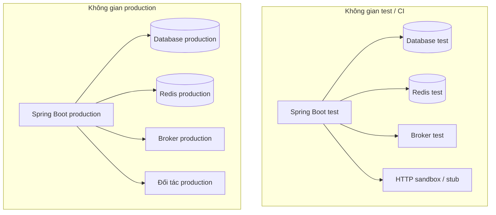

# Tách dữ liệu thử nghiệm khỏi dữ liệu production trong Spring Boot

## 1. Vì sao phải tách dữ liệu?

Trong một ứng dụng Spring Boot có tích hợp cơ sở dữ liệu, cache, HTTP API và broker thông điệp, **dữ liệu thử nghiệm** không chỉ là vài hàng có tiền tố `TEST_`. Một bài kiểm thử có thể ghi vào database, phát sự kiện Kafka, gửi email, cập nhật Redis hoặc gọi API của đối tác. Nếu một trong các kết nối đó trỏ đến production, việc chạy test hay khởi tạo môi trường có thể tác động đến người dùng thật.

Mục tiêu của việc tách dữ liệu là tạo ra ranh giới có thể kiểm chứng giữa các môi trường:

- **Development:** dữ liệu giả lập để lập trình, có thể xóa và dựng lại.
- **Test/CI:** dữ liệu xác định trước hoặc được tạo trong mỗi lượt chạy; kết quả không phụ thuộc dữ liệu của lần chạy trước.
- **Staging/UAT:** cấu hình và luồng xử lý gần production nhưng tài nguyên, tài khoản và dữ liệu phải được cô lập; dữ liệu sao chép từ production (nếu thật sự cần) phải qua quy trình làm sạch và phê duyệt.
- **Production:** dữ liệu nghiệp vụ thật, chịu yêu cầu về toàn vẹn, bảo mật, sao lưu và kiểm soát thay đổi.

**Nguyên tắc cốt lõi:** mọi thao tác ghi, xóa, migration, phát sự kiện và gọi dịch vụ bên ngoài từ môi trường thử nghiệm chỉ được phép tác động lên tài nguyên thử nghiệm. Tách bằng tên bản ghi hoặc một cờ `is_test` trong cùng database không tạo ra ranh giới an toàn đủ mạnh.

### Phạm vi cần tách

| Thành phần tích hợp | Ví dụ tài nguyên production | Ranh giới khuyến nghị cho môi trường thử nghiệm |
|---|---|---|
| Database quan hệ | PostgreSQL lưu đơn hàng thật | Instance/database riêng, người dùng và quyền riêng; CI ưu tiên container tạm thời |
| Redis/cache | Key phiên đăng nhập, cache giá | Instance hoặc cluster riêng; key prefix chỉ là lớp phòng vệ bổ sung |
| Kafka/RabbitMQ/JMS | Topic/queue sự kiện giao dịch | Cluster/vhost hoặc tài nguyên riêng, ACL riêng, consumer group và DLQ riêng |
| HTTP/REST/gRPC | API thanh toán, vận chuyển, đối tác | Sandbox hoặc stub/mock server; thông tin xác thực sandbox riêng |
| Object storage | Bucket hóa đơn và chứng từ | Bucket/namespace và quyền truy cập riêng; vòng đời xóa dữ liệu thử nghiệm |
| Email/SMS/webhook | Người nhận và endpoint thật | Mail sink, fake gateway, endpoint sandbox; chặn outbound ngoài danh sách cho phép |
| Scheduler/batch | Job đối soát hoặc xóa dữ liệu | Tắt job không cần thiết; job cần test chạy trên dữ liệu và đích nhận được cô lập |
| Log, trace, báo cáo | Dữ liệu cá nhân trong payload | Telemetry môi trường riêng; che thông tin nhạy cảm và giới hạn quyền đọc |

Tách database nhưng vẫn dùng chung topic Kafka hoặc cùng API thanh toán production là **chưa tách hệ thống tích hợp**. Đầu ra của một adapter có thể trở thành đầu vào của hệ thống khác.

## 2. Mô hình cô lập theo môi trường



Sơ đồ trên biểu diễn hai nhóm tài nguyên không có đường kết nối chéo. Trong triển khai thực tế, nên phòng vệ ở nhiều lớp, vì một cấu hình sai vẫn có thể vượt qua quy ước đặt tên:

1. **Danh tính và quyền:** service account/test credential chỉ có quyền trên tài nguyên test; account production không được cấp cho pipeline thử nghiệm.
2. **Mạng:** môi trường CI/dev không có đường mạng hoặc chính sách cho phép truy cập database, broker và API nhạy cảm của production.
3. **Cấu hình:** mỗi profile dùng endpoint riêng; cấu hình bắt buộc thiếu phải khiến ứng dụng không thể khởi động, thay vì mặc định sang production.
4. **Vòng đời dữ liệu:** test có bước tạo fixture, kiểm tra kết quả và dọn dữ liệu; production có chính sách backup, migration và kiểm toán riêng.
5. **Quan sát và kiểm tra:** ghi nhận môi trường đang chạy, đích kết nối, lần chạy migration và các tác động bên ngoài, nhưng không ghi mật khẩu hay dữ liệu cá nhân vào log.

Không nên coi Spring profile là biện pháp bảo mật duy nhất. `@ActiveProfiles("test")` chọn cấu hình test trong Spring Test, nhưng không tự hạn chế tài khoản, quyền truy cập mạng hoặc ngăn một biến môi trường ưu tiên cao hơn ghi đè JDBC URL.

## 3. Thiết kế cấu hình Spring Boot theo nguyên tắc an toàn

### 3.1. Cấu hình dùng chung

Giả sử hệ thống sử dụng PostgreSQL, Flyway và một HTTP client gọi đối tác. Những thiết lập dùng chung có thể là:

```yaml
# src/main/resources/application.yml
spring:
  sql:
    init:
      mode: never
  jpa:
    hibernate:
      ddl-auto: validate
  flyway:
    enabled: true
```

Ý nghĩa:

- `spring.sql.init.mode: never` tránh tự chạy `schema.sql`/`data.sql` qua bộ khởi tạo SQL mặc định. Nó **không** vô hiệu hóa Flyway, Liquibase, `@Sql` hoặc mã tự viết để nạp dữ liệu.
- `ddl-auto: validate` cho Hibernate kiểm tra ánh xạ với schema hiện tại, tránh tạo lại hoặc sửa schema một cách tự phát. Nếu không dùng JPA/Hibernate, không cần thuộc tính này.
- Flyway chạy các migration có kiểm soát. Khi dùng Liquibase thay Flyway, chọn một cơ chế migration chính và cấu hình tương ứng.

Không đặt JDBC URL production, mật khẩu hoặc thông tin kết nối dùng chung với production vào `application.yml`. Các thông tin nhạy cảm nên đến từ secret manager hoặc nguồn cấu hình bảo mật do hệ thống triển khai cấp.

### 3.2. Profile production

```yaml
# src/main/resources/application-prod.yml
spring:
  datasource:
    url: ${PROD_JDBC_URL}
    username: ${PROD_DB_USER}
    password: ${PROD_DB_PASSWORD}

app:
  partner:
    base-url: ${PROD_PARTNER_URL}
```

Các biến không có giá trị mặc định để thiếu biến thì khởi động thất bại. Người dùng và secret production chỉ được phân phối cho workload production. Không gán profile `prod` cho job CI hoặc máy lập trình viên để “tiện chạy thử”.

### 3.3. Profile test dùng database tạm thời

Ví dụ dưới đây minh họa **Testcontainers JDBC URL** cho bài test tích hợp:

```yaml
# src/test/resources/application-test.yml
spring:
  datasource:
    url: jdbc:tc:postgresql:16-alpine:///integration_test
    driver-class-name: org.testcontainers.jdbc.ContainerDatabaseDriver
    username: test
    password: test
  sql:
    init:
      mode: never
  jpa:
    hibernate:
      ddl-auto: validate
  flyway:
    enabled: true

app:
  partner:
    base-url: ${TEST_PARTNER_STUB_URL}
```

Ví dụ cần JDBC driver PostgreSQL và thư viện Testcontainers JDBC/PostgreSQL trong phụ thuộc test, đồng thời máy chạy test có container runtime. URL `jdbc:tc:` tạo database phục vụ kiểm thử; không chỉ định host production. Biến `TEST_PARTNER_STUB_URL` phải trỏ đến mock server hoặc sandbox của đối tác.

**Chú ý thứ tự ưu tiên cấu hình:** biến môi trường `SPRING_DATASOURCE_URL`, tham số dòng lệnh hoặc nguồn cấu hình có độ ưu tiên cao hơn có thể ghi đè URL trong `application-test.yml`. Do đó, cần kiểm soát biến môi trường trong CI, cấp quyền mạng tối thiểu và kiểm tra endpoint được phép trước khi chạy test. Có thể dùng `@DynamicPropertySource` để đưa URL của container vào Spring Test với độ ưu tiên cao hơn cấu hình ứng dụng thông thường.

### 3.4. Thay thế kết nối bằng Testcontainers trong kiểm thử tích hợp

```java
@Testcontainers
@SpringBootTest
@ActiveProfiles("test")
class OrderRepositoryIntegrationTest {

    @Container
    static PostgreSQLContainer<?> postgres =
            new PostgreSQLContainer<>("postgres:16-alpine")
                    .withDatabaseName("integration_test")
                    .withUsername("test")
                    .withPassword("test");

    @DynamicPropertySource
    static void useTestDatabase(DynamicPropertyRegistry properties) {
        properties.add("spring.datasource.url", postgres::getJdbcUrl);
        properties.add("spring.datasource.username", postgres::getUsername);
        properties.add("spring.datasource.password", postgres::getPassword);
    }

    @Autowired
    JdbcTemplate jdbcTemplate;

    @Test
    void connectsToIsolatedDatabase() {
        Integer result = jdbcTemplate.queryForObject("SELECT 1", Integer.class);
        assertThat(result).isEqualTo(1);
    }
}
```

Ví dụ dùng JUnit Jupiter, Spring Test, AssertJ và Testcontainers; cần khai báo các import/phụ thuộc tương ứng. Trong một bài test thực tế, chọn **một** trong hai cách cấu hình kết nối ở trên: JDBC URL `jdbc:tc:` hoặc container khai báo bằng `@Container` và `@DynamicPropertySource`. Cách thứ hai thuận tiện khi cần dùng cùng container cho nhiều thành phần trong bài test. Không cần khai báo đồng thời hai container cho cùng một datasource.

Nếu dùng `@DataJpaTest`, kiểm tra việc Spring Boot có tự thay datasource bằng database nhúng hay không; có thể đặt `@AutoConfigureTestDatabase(replace = AutoConfigureTestDatabase.Replace.NONE)` khi muốn chắc chắn test dùng PostgreSQL container.

## 4. Tạo và quản lý dữ liệu mẫu

### 4.1. Phân biệt schema migration và fixture

**Schema migration** thay đổi cấu trúc hoặc dữ liệu nền được quản lý phiên bản. **Test fixture** tạo bản ghi phục vụ từng kịch bản kiểm thử. Không nên trộn dữ liệu fixture (đơn hàng giả, tài khoản giả) vào migration áp dụng cho mọi môi trường.

Ví dụ file migration `src/main/resources/db/migration/V1__create_orders.sql`:

```sql
CREATE TABLE orders (
    id BIGINT PRIMARY KEY,
    external_ref VARCHAR(64) NOT NULL UNIQUE,
    status VARCHAR(32) NOT NULL
);
```

Fixture chỉ dành cho test, đặt ở `src/test/resources/fixtures/orders.sql`:

```sql
INSERT INTO orders (id, external_ref, status)
VALUES (9001, 'TEST-ORDER-9001', 'NEW');
```

Test dùng fixture:

```java
@SpringBootTest
@ActiveProfiles("test")
@Transactional
@Sql("/fixtures/orders.sql")
class OrderQueryIntegrationTest {

    @Autowired
    JdbcTemplate jdbcTemplate;

    @Test
    void readsTestFixture() {
        Integer count = jdbcTemplate.queryForObject(
                "SELECT COUNT(*) FROM orders WHERE external_ref = ?",
                Integer.class,
                "TEST-ORDER-9001"
        );

        assertThat(count).isEqualTo(1);
    }
}
```

Ở ví dụ này, `@Sql` nạp fixture trước phương thức test; `@Transactional` thường giúp rollback các thay đổi trong cùng transaction của thread chạy test. Tuy nhiên, **không được mặc định mọi tác động đều rollback**:

- Với `@SpringBootTest(webEnvironment = RANDOM_PORT)`, request HTTP được server xử lý trong thread/transaction khác; transaction của test không rollback thay đổi từ server.
- Thông điệp đã gửi vào broker, HTTP call bên ngoài, nội dung cache hay object storage không thuộc transaction của `@Transactional` ở test.
- Test bất đồng bộ có thể tiếp tục chạy sau khi method test kết thúc, dẫn đến dữ liệu nhiễu giữa các ca kiểm thử.

Với các trường hợp đó, sử dụng database/container tạm thời cho từng phạm vi test, key/topic riêng, cleanup rõ ràng hoặc fixture có định danh duy nhất theo lượt chạy. Có thể dùng `@Sql` với `executionPhase = AFTER_TEST_METHOD` cho việc xóa dữ liệu do test tạo ra; phải cân nhắc ràng buộc khóa ngoại và giao dịch của lệnh cleanup.

### 4.2. Dữ liệu giả lập tốt cần có đặc điểm gì?

Một bộ fixture hữu ích nên **đủ giống hành vi nghiệp vụ** nhưng không chứa thông tin cá nhân hoặc bí mật thật. Chẳng hạn, với luồng đồng bộ đơn hàng sang đối tác, nên có các ca:

| Kịch bản | Dữ liệu mẫu | Điều cần kiểm chứng |
|---|---|---|
| Thành công | Đơn `TEST-ORDER-9001`, trạng thái `NEW` | Ghi DB, gửi một thông điệp, chuyển trạng thái đúng |
| Bị từ chối | Mã mặt hàng không hợp lệ | Ghi nhận lỗi hợp đồng dữ liệu; không tạo đơn production |
| Trùng lặp | Cùng `external_ref` gửi hai lần | Idempotency hoặc unique constraint ngăn xử lý trùng |
| Lỗi tạm thời | Stub trả HTTP `503` hoặc broker mất kết nối | Retry có giới hạn, backoff và ghi nhận dead letter khi cần |
| Đồng thời | Nhiều worker cùng xử lý một khóa nghiệp vụ | Khóa/constraint và transaction bảo vệ tính nhất quán |
| Migration | Cơ sở dữ liệu trống được nâng lên phiên bản hiện tại | Migration chạy đúng thứ tự và schema khớp ứng dụng |

Ưu tiên dữ liệu tổng hợp có seed cố định khi cần tái hiện lỗi, định danh duy nhất khi test chạy song song, và kích thước bộ dữ liệu đủ nhỏ để CI ổn định. Nếu cần kiểm tra hiệu năng bằng dữ liệu lớn, dùng generator riêng và môi trường được cô lập.

### 4.3. Khi bắt buộc tham khảo dữ liệu production

Không dùng bản sao production trực tiếp cho máy cá nhân hoặc pipeline CI. Trường hợp cần dữ liệu giống production để điều tra lỗi, nên thực hiện qua quy trình đã kiểm soát:

1. Xác định mục đích, phạm vi cột/bảng và thời gian lưu; ưu tiên dữ liệu tổng hợp nếu đáp ứng được.
2. Trích xuất tối thiểu qua kênh được cấp quyền, tại môi trường an toàn.
3. Xóa hoặc thay thế thông tin định danh và bí mật; bảo toàn khóa ngoại và quan hệ cần thiết cho kiểm thử. Hash đơn giản của email/số điện thoại không tự động bảo đảm ẩn danh.
4. Thay endpoint, token, địa chỉ email/số điện thoại và tài khoản nhận thanh toán bằng giá trị sandbox.
5. Kiểm tra kết quả làm sạch và quyền truy cập, sau đó mới nhập vào vùng test biệt lập.
6. Đặt thời hạn xóa dữ liệu và lưu dấu vết ai đã trích xuất, làm sạch, sử dụng.

Việc tuân thủ yêu cầu bảo vệ dữ liệu cá nhân tùy thuộc loại dữ liệu và quy định áp dụng cho tổ chức. Mục tiêu kỹ thuật là tránh để dữ liệu thật hoặc thông tin có thể tái nhận dạng xuất hiện trong test report, log, trace và snapshot CI.

## 5. Cô lập các adapter ngoài database

### HTTP client và API đối tác

Với `RestClient`, `WebClient`, OpenFeign hoặc adapter HTTP của Spring Integration, URL gốc và credential phải tách theo môi trường. Trong integration test, dùng WireMock, MockWebServer hoặc sandbox được cấp riêng; kiểm thử phản hồi thành công, timeout, lỗi hợp đồng và retry. Không gửi request ghi/xóa lên API production chỉ vì endpoint là “dễ truy cập nhất”.

Nếu dịch vụ có webhook callback, callback của test cũng phải quay về endpoint test. Kiểm tra cả **đường về** vì webhook có thể làm thay đổi trạng thái nghiệp vụ ngay cả khi lệnh gọi ban đầu đã sử dụng sandbox.

### Broker thông điệp và Spring Integration

Các luồng `IntegrationFlow`, Kafka listener, RabbitMQ listener và JMS listener thường khởi động khi ứng dụng lên. Điều này nguy hiểm nếu test dùng chung broker:

- Kafka: dùng cluster hoặc topic riêng, ACL riêng và consumer group riêng; không cho test producer publish vào topic production. Đặt tên consumer group khác nhau không ngăn producer ghi nhầm topic.
- RabbitMQ: ưu tiên vhost, exchange, queue, binding và credential riêng; DLQ cũng thuộc môi trường thử nghiệm.
- JMS và adapter khác: xác định destination, quyền producer/consumer và chính sách retry tương tự.
- Với luồng không cần chạy trong bài test, tắt auto-start của listener/adapter tương ứng; với luồng cần kiểm chứng, dùng broker test hoặc container tạm thời.

Một message có thể được redeliver sau lỗi hoặc sau khi consumer khởi động lại. Vì vậy fixture và bài test phải kiểm tra **idempotency**, transaction boundary, retry và dead-letter behavior, thay vì chỉ kiểm tra “đã gửi một message”.

### Cache, file và tác vụ nền

Redis test cần instance/cluster và quyền riêng. Chỉ đổi logical database index (`0`, `1`, …) hoặc thêm tiền tố key là chưa đủ nếu vẫn dùng cùng Redis server và quyền quản trị. TTL giúp dọn fixture nhưng không thay thế cô lập.

Với S3-compatible storage, filesystem shared volume hoặc FTP/SFTP adapter, tạo bucket/path/credential test; áp dụng chính sách tự xóa và cấm quyền xóa trên tài nguyên production. Với scheduler (`@Scheduled`), Quartz, Spring Batch và polling adapter của Spring Integration, xác định rõ job nào chạy ở test; job không cần test nên được vô hiệu hóa theo cấu hình. Nếu cần test job, metadata tables và nguồn/đích dữ liệu của job cũng phải tách.

## 6. Kiểm soát khởi tạo database và migration

Việc tách dữ liệu có liên hệ trực tiếp với schema initialization và Flyway/Liquibase:

| Thực hành | Test/CI | Production |
|---|---|---|
| Khởi tạo schema | Chạy các migration thật trên database rỗng, độc lập | Migration có review, backup và kế hoạch triển khai |
| Nạp fixture | Qua `@Sql`, factory/seed chuyên dụng hoặc setup test | Không tự nạp fixture của test |
| Hibernate DDL | Ưu tiên `validate` để kiểm tra tương thích | `validate` hoặc chính sách xác minh schema đã định |
| Xóa/dựng lại dữ liệu | Được phép trong vùng test được nhận diện rõ | Không chạy lệnh xóa/recreate dùng cho test |
| Retry và rollback | Test lỗi giữa chừng, dữ liệu dư và khả năng chạy lại | Kịch bản phục hồi migration và tương thích khi triển khai theo đợt |

Không dùng `ddl-auto: create` hoặc `create-drop` ở cấu hình chung, vì giá trị cấu hình có thể bị áp dụng nhầm tới database quan trọng. Không gọi `Flyway.clean()` hoặc `DROP SCHEMA` từ code khởi động thông thường. Nếu automation test cần xóa sạch schema, thao tác phải có xác nhận rõ ràng rằng đích là database tạm thời và credential chỉ có quyền trên database đó.

Khi migration bổ sung một cột `NOT NULL`, thay đổi unique constraint hoặc backfill dữ liệu, hãy kiểm thử ít nhất hai tình huống: khởi tạo từ database trống và nâng cấp từ phiên bản schema trước đó với dữ liệu tổng hợp. Test chạy trên database rỗng sẽ không phát hiện đầy đủ lỗi khi dữ liệu cũ có `NULL`, mã trùng hoặc sai định dạng.

## 7. Phòng tránh test vô tình chạm production

Các sự cố thường bắt đầu từ thao tác nhỏ: sao chép `.env` của production, chạy lại job batch bằng cùng credentials, dùng DNS alias chung hoặc quên đổi URL webhook. Để tránh lỗi này, áp dụng nhiều lớp kiểm soát thay vì chỉ kiểm tra tên profile.

### Hàng rào trước khi chạy

- **Fail closed:** không có cấu hình test hợp lệ thì không chạy; không dùng `production` làm default/fallback cho endpoint.
- **Chính sách quyền:** CI chỉ có secret test, token sandbox và quyền tạo/xóa trên tài nguyên test.
- **Network egress:** từ runner test chỉ cho phép đến Testcontainers, mock server hoặc endpoint sandbox cần thiết; từ chối host/IP production.
- **Nhận diện đích:** xác minh database name/host, broker cluster, topic, bucket, partner URL theo allowlist môi trường. Nếu dùng guard trong ứng dụng, guard cần kiểm tra trước những thao tác ghi hoặc chạy migration; guard sau khi kết nối không thay thế quyền và firewall.
- **Triển khai:** tách cấu hình, secret và service account theo namespace/workload; hạn chế khả năng người dùng CI bật profile `prod`.

### Hàng rào khi test chạy

Ghi log tối thiểu tên môi trường, mã pipeline và **định danh không nhạy cảm** của endpoint/container; có thể gắn nhãn `environment=test` trong metric và trace. Theo dõi số bản ghi tạo/xóa, message gửi/nhận, retry và callback. Không log JDBC password, token, toàn bộ payload của đơn hàng hoặc dữ liệu cá nhân.

Với những test có tác động bên ngoài, thêm assertion kiểm tra đúng đích nhận và số lần gửi. Chẳng hạn, test một luồng đơn hàng có thể xác nhận mock HTTP server nhận đúng một `POST` với idempotency key dự kiến và broker test không có message dư sau xử lý.

### Nếu phát hiện test đã kết nối production

Dừng job hoặc listener liên quan, ngăn kết nối tiếp theo và bảo toàn log/audit để xác định phạm vi tác động. Thu hồi hoặc xoay vòng credential bị dùng sai, kiểm tra những thay đổi trên database, broker và dịch vụ đối tác; đánh giá khả năng khôi phục qua quy trình vận hành/incident response của hệ thống. Không cố tự sửa dữ liệu production bằng một script test thứ hai khi chưa xác định được đầy đủ hậu quả.

## 8. Quy trình triển khai thực tế

Giả sử nhóm xây dựng dịch vụ Spring Boot nhận đơn từ REST API, lưu PostgreSQL, publish Kafka và gọi HTTP đối tác. Một quy trình test tích hợp có thể là:

1. **Dựng môi trường:** pipeline khởi chạy PostgreSQL/Kafka test container và HTTP stub; cấp credentials test theo phiên chạy.
2. **Gắn kết nối:** cấu hình `@ActiveProfiles("test")`, `@DynamicPropertySource` hoặc `@ServiceConnection` (nếu phiên bản Spring Boot hỗ trợ) để trỏ vào container tương ứng.
3. **Khởi tạo schema:** Flyway/Liquibase chạy các migration hiện hành; test xác minh schema và các constraint quan trọng.
4. **Tạo dữ liệu:** nạp fixture tổng hợp cho ca thành công, trùng lặp, timeout và thất bại giữa các bước.
5. **Chạy luồng:** gọi API qua test client, chờ xử lý bất đồng bộ có giới hạn thời gian, kiểm tra DB, message và HTTP request ở đích thử nghiệm.
6. **Dọn và đối chiếu:** kết thúc container và dữ liệu tạm, xác nhận không còn job/consumer ngoài phạm vi; lưu artifact test đã loại thông tin nhạy cảm.

**Các tiêu chí nghiệm thu nên kiểm chứng được:**

| Tiêu chí | Cách xác nhận |
|---|---|
| Test không có quyền ghi production | Credential CI bị từ chối trên DB/broker/object storage production; chính sách mạng chặn đường kết nối |
| Test tái lập được | Hai lần chạy từ môi trường sạch cho kết quả giống nhau, không phụ thuộc dữ liệu dư |
| Migration hoạt động thực tế | Chạy migration trên DB trống và DB giả lập phiên bản cũ, kiểm tra constraint/DDL |
| Không phát sinh tác động bên ngoài | Stub/sandbox nhận đúng request; outbound đến endpoint không cho phép bị chặn |
| Đường lỗi được kiểm thử | Trùng lặp, retry, dead letter, timeout và transaction boundary đều có ca test |
| Có thể truy vết | Báo cáo thể hiện môi trường, version migration, test run và sự kiện liên quan mà không lộ secret |

## 9. Những lỗi thiết kế dễ mắc

**“Đã có `@ActiveProfiles("test")` nên an toàn.”** Profile chỉ chọn nguồn cấu hình; môi trường và CLI vẫn có thể ghi đè thuộc tính. Cần giới hạn network, secret và quyền sử dụng tài nguyên.

**“Thêm tiền tố `test_` vào hàng trong database production là đủ.”** Test vẫn có thể tác động transaction, lock, migration, index hoặc trigger của production. Hãy dùng tài nguyên độc lập.

**“`@Transactional` đảm bảo test nào cũng sạch.”** Rollback của test không bao phủ request HTTP ở thread khác và không thu hồi message/event đã gửi. Cần vùng dữ liệu riêng và cleanup phù hợp.

**“Đã mock HTTP nên không cần tách broker/cache.”** Những side effect từ messaging, cache và scheduled task vẫn có thể chạm dịch vụ thật. Kiểm kê từng adapter và cả chiều nhận dữ liệu.

**“Dùng bản sao production sẽ cho test sát thực nhất.”** Bản sao thô chứa rủi ro về dữ liệu cá nhân, token và endpoint thật. Dữ liệu tổng hợp thường dễ tái hiện hơn; bản trích từ production chỉ phù hợp khi có nhu cầu rõ ràng và đã xử lý an toàn.

## 10. Ghi nhớ khi áp dụng

Tách dữ liệu thử nghiệm trong Spring Boot là một **thiết kế ranh giới môi trường cho toàn bộ luồng tích hợp**, từ khởi tạo schema đến database, cache, message broker, API đối tác và các adapter bất đồng bộ. Spring profile, Testcontainers, Flyway/Liquibase, fixture và `@Sql` giúp bài test tái lập được; quyền, secret và chính sách mạng giúp ngăn cấu hình sai biến thành sự cố production. Kết quả cần đạt là đội ngũ có thể chạy lại test và migration trên dữ liệu chủ động kiểm soát, đồng thời chứng minh được rằng thao tác thử nghiệm không làm thay đổi dữ liệu hay hệ thống production.
