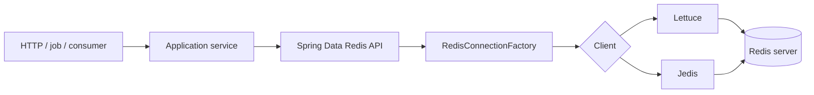

# spring-boot-starter-data-redis và lựa chọn client Redis

## 1. Redis nằm ở đâu trong hệ thống tích hợp Spring Boot?

Trong mô-đun **SPRING_BOOT_INTEGRATION**, một ứng dụng Spring Boot không chỉ gọi HTTP hoặc truy cập cơ sở dữ liệu quan hệ mà còn phải tích hợp cache, broker thông điệp và các adapter khác. Redis thường tham gia luồng này để lưu dữ liệu truy cập nhanh, trạng thái có thời hạn, giới hạn tốc độ hoặc khóa đánh dấu xử lý trùng lặp. Redis là một dịch vụ chạy độc lập; thêm dependency Spring Boot không tự khởi động một Redis server.

Khi tích hợp Redis cần phân biệt ba lớp:

1. **Spring Data Redis** cung cấp API và abstraction như `RedisConnectionFactory`, `StringRedisTemplate`, `RedisTemplate`, repository và các API reactive.
2. **Redis client** (thường là **Lettuce** hoặc **Jedis**) thực hiện kết nối mạng, giao thức Redis, quản lý tài nguyên và gửi lệnh.
3. **Redis server** lưu dữ liệu trong bộ nhớ và áp dụng các chính sách TTL, eviction, persistence hoặc replication tùy cấu hình hạ tầng.

`spring-boot-starter-data-redis` tập hợp dependency cần thiết và kích hoạt cơ chế auto-configuration của Spring Boot. Trong Spring Boot 3.x, client mặc định của starter là Lettuce. Jedis là lựa chọn thay thế khi ứng dụng có yêu cầu tương thích hoặc vận hành phù hợp hơn.



**Mục tiêu bài học:** cấu hình được kết nối Redis bằng starter; chọn client theo kiểu xử lý blocking/reactive và yêu cầu vận hành; dùng API đúng tầng; nhận diện các vấn đề về serializer, timeout, pooling, TTL, giao dịch và kiểm thử.

## 2. Khởi tạo tích hợp với starter

Với Maven, thêm dependency sau vào một ứng dụng Spring Boot đã được quản lý phiên bản qua Spring Boot parent/BOM:

```xml
<dependency>
    <groupId>org.springframework.boot</groupId>
    <artifactId>spring-boot-starter-data-redis</artifactId>
</dependency>
```

Trong cấu hình mặc định, ứng dụng dùng Lettuce. Ví dụ `application.yml` cho một Redis standalone, phù hợp với **Spring Boot 3.x**:

```yaml
spring:
  data:
    redis:
      host: localhost
      port: 6379
      database: 0
      connect-timeout: 2s
      timeout: 2s
      client-type: lettuce
```

- `connect-timeout` giới hạn thời gian thiết lập kết nối; `timeout` giới hạn thời gian chờ thao tác theo cấu hình client.
- `database: 0` chọn logical database trong chế độ standalone thông thường. Redis Cluster chỉ hỗ trợ database 0.
- Host, port và credential ở môi trường thật thường lấy từ biến môi trường hoặc hệ thống quản lý secret. Không đặt mật khẩu thật trong repository.
- Nếu Redis yêu cầu ACL/TLS, cấu hình `username`, `password` và SSL theo phiên bản Spring Boot, hạ tầng và chính sách bảo mật đang sử dụng.

Spring Boot tự tạo `RedisConnectionFactory` và các template mặc định khi thỏa điều kiện dependency/configuration. Các template dùng chung connection factory; ứng dụng thường **không cần tự tạo kết nối trong từng request**.

> **Lưu ý phiên bản:** ví dụ cấu hình dùng namespace `spring.data.redis.*` của Spring Boot 3.x. Nếu đang bảo trì phiên bản Boot cũ hoặc nâng cấp lên major mới, phải đối chiếu metadata cấu hình và các phiên bản Spring Data Redis/client do BOM quản lý. Tránh trộn phiên bản `lettuce-core`, `jedis` và Spring Data Redis một cách tùy tiện.

## 3. API nào nên dùng?

| Nhu cầu | API thường dùng | Lưu ý |
| --- | --- | --- |
| Đọc/ghi khóa và chuỗi | `StringRedisTemplate` | Khóa và giá trị là chuỗi; dễ tương tác với Redis CLI và dịch vụ khác. |
| Đọc/ghi object hoặc cấu trúc dữ liệu | `RedisTemplate<K,V>` | Phải chọn serializer rõ ràng cho key/value/hash. |
| Làm cache cho lời gọi service | Spring Cache (`@Cacheable`, `@CacheEvict`) | Chính sách key, TTL và invalidation vẫn phải được thiết kế. |
| Reactive pipeline | `ReactiveStringRedisTemplate`, `ReactiveRedisTemplate` | Cần reactive connection factory, thông thường là Lettuce. |
| Tác vụ cần lệnh đặc thù | `RedisConnection` hoặc script Redis | Cần hiểu atomicity và khả năng hỗ trợ của client/Redis server. |

Ví dụ lưu một JSON đã được ứng dụng serialize vào Redis bằng `StringRedisTemplate`:

```java
import java.time.Duration;
import org.springframework.data.redis.core.StringRedisTemplate;
import org.springframework.stereotype.Service;

@Service
public class ProductCache {
    private final StringRedisTemplate redis;

    public ProductCache(StringRedisTemplate redis) {
        this.redis = redis;
    }

    public void putJson(String productId, String json) {
        redis.opsForValue().set(key(productId), json, Duration.ofMinutes(5));
    }

    public String getJson(String productId) {
        return redis.opsForValue().get(key(productId)); // null nếu không có key
    }

    public void evict(String productId) {
        redis.delete(key(productId));
    }

    private String key(String productId) {
        return "catalog:product:v1:" + productId;
    }
}
```

Ở đây `json` là chuỗi JSON hợp lệ do tầng ứng dụng tạo và đọc lại theo một hợp đồng dữ liệu đã thống nhất. Trong ứng dụng thực, nên có DTO/schema cố định, validation cho `productId` và quy tắc xử lý lỗi deserialize. Tiền tố `catalog:product:v1:` tách namespace và phiên bản cấu trúc dữ liệu để hỗ trợ thay đổi schema.

**Vì sao không lưu object tùy ý bằng serializer mặc định?** Serializer Java nhị phân có thể gây phụ thuộc vào class Java, khó tương tác đa ngôn ngữ và tạo rủi ro khi deserialize dữ liệu không tin cậy. Với luồng tích hợp nhiều dịch vụ, nên ưu tiên String/JSON hoặc một định dạng có schema và cấu hình serializer tường minh; kiểm soát cả key, hash key, value và hash value. Tránh trộn nhiều kiểu serializer trên cùng namespace.

## 4. Chọn Lettuce hay Jedis?

Cả hai là Redis client cho Java. Việc chọn client không làm thay đổi chức năng cơ bản của Redis, nhưng ảnh hưởng đến mô hình I/O, reactive support, quản lý connection và hoạt động khi tải cao.

| Tiêu chí | Lettuce | Jedis |
| --- | --- | --- |
| Cách tiếp cận chính | Dựa trên Netty, hỗ trợ đồng bộ, bất đồng bộ và reactive | API đồng bộ/ blocking là cách dùng phổ biến với Spring Data Redis |
| Client mặc định trong starter Boot 3.x | Có | Không |
| Spring Data Redis reactive | Phù hợp qua reactive connection factory | Không phải lựa chọn cho reactive connection factory của Spring Data Redis |
| Dùng chung kết nối | Nhiều lệnh thông thường có thể dùng connection Lettuce được chia sẻ an toàn theo cơ chế client | Kết nối đồng bộ phải được quản lý theo luồng, thường thông qua pool |
| Pooling | Tùy tải và loại lệnh; không mặc định cần pool cho mọi tác vụ | Thường cấu hình pool cho nhiều request đồng thời |
| Khi nên cân nhắc | Hầu hết ứng dụng mới, WebFlux hoặc cần API async/reactive | Ứng dụng đang dùng Jedis ổn định, cần API/hành vi Jedis cụ thể |

**Mặc định thực dụng:** bắt đầu bằng Lettuce nếu chưa có ràng buộc đặc biệt. Chuyển sang Jedis khi có lý do đo đạc được hoặc yêu cầu tương thích cụ thể. Hiệu năng không thể kết luận chỉ từ tên client: latency thực tế còn phụ thuộc lệnh Redis, kích thước payload, network RTT, topology, số connection, retry và tải server.

### 4.1. Lettuce: chia sẻ kết nối có kiểm soát

Lettuce sử dụng Netty và hỗ trợ các thao tác đồng bộ, async, reactive. Với lệnh Redis thông thường, Lettuce có thể dùng connection chia sẻ thay vì mở một socket mới cho mỗi thread. Vì vậy, không nên bật connection pool chỉ theo thói quen. Pool có thể hữu ích với lệnh blocking, thao tác cần connection chuyên biệt hoặc khi thiết kế xử lý yêu cầu nhiều connection song song.

Ví dụ cấu hình pool cho Lettuce **khi đã xác định cần pooling**:

```xml
<dependency>
    <groupId>org.apache.commons</groupId>
    <artifactId>commons-pool2</artifactId>
</dependency>
```

```yaml
spring:
  data:
    redis:
      client-type: lettuce
      lettuce:
        pool:
          max-active: 16
          max-idle: 8
          min-idle: 0
          max-wait: 1s
```

Các con số là ví dụ khởi đầu, không phải giá trị tối ưu cho mọi hệ thống. Phải đo số connection, thời gian chờ pool và p95/p99 latency trước khi điều chỉnh. Nếu ứng dụng chặn hàng trăm luồng nhưng pool chỉ có 16 connection, request có thể phải chờ dù Redis server chưa quá tải.

### 4.2. Jedis: client đồng bộ và pool

Nếu dùng Jedis, khai báo client và chỉ định lựa chọn ở cấu hình. Ví dụ Maven để thay client mặc định:

```xml
<dependency>
    <groupId>org.springframework.boot</groupId>
    <artifactId>spring-boot-starter-data-redis</artifactId>
    <exclusions>
        <exclusion>
            <groupId>io.lettuce</groupId>
            <artifactId>lettuce-core</artifactId>
        </exclusion>
    </exclusions>
</dependency>

<dependency>
    <groupId>redis.clients</groupId>
    <artifactId>jedis</artifactId>
</dependency>

<dependency>
    <groupId>org.apache.commons</groupId>
    <artifactId>commons-pool2</artifactId>
</dependency>
```

```yaml
spring:
  data:
    redis:
      client-type: jedis
      jedis:
        pool:
          max-active: 16
          max-idle: 8
          min-idle: 0
          max-wait: 1s
```

Đối với Jedis đồng bộ, connection đang thực hiện thao tác không nên được chia sẻ tùy tiện giữa các thread. Spring Data Redis và cấu hình pool quản lý việc mượn/trả connection cho các thao tác thường gặp; tránh tự tạo `new Jedis(...)` bên trong controller/service. Nếu cần reactive end-to-end, chọn Lettuce và reactive template thay vì bọc lệnh Jedis blocking trong `Mono`.

### 4.3. Blocking hay reactive phụ thuộc toàn bộ luồng

Ví dụ một API WebMVC gọi database qua JDBC rồi đọc Redis bằng `StringRedisTemplate` vẫn là luồng blocking hợp lệ. Trong WebFlux/reactive pipeline, nên dùng `ReactiveStringRedisTemplate` với Lettuce:

```java
import reactor.core.publisher.Mono;
import org.springframework.data.redis.core.ReactiveStringRedisTemplate;

public class ReactiveProductCache {
    private final ReactiveStringRedisTemplate redis;

    public ReactiveProductCache(ReactiveStringRedisTemplate redis) {
        this.redis = redis;
    }

    public Mono<String> findJson(String productId) {
        return redis.opsForValue().get("catalog:product:v1:" + productId);
    }
}
```

`Mono.empty()` biểu thị không có key, còn lỗi kết nối phát ra dưới dạng error signal. Không gọi `block()` ngay trong event-loop của WebFlux. Reactive Redis không tự động biến truy cập JDBC/blocking HTTP thành non-blocking.

## 5. Thiết kế hợp đồng dữ liệu và vòng đời key

Redis nhanh nhưng không giải quyết thay ứng dụng câu hỏi dữ liệu nào được phép giữ lại, ai sở hữu và khi nào hết hiệu lực.

**Đặt key có cấu trúc.** Ví dụ `<service>:<entity>:<schema-version>:<id>`. Namespace giúp tránh xung đột giữa nhiều ứng dụng dùng chung Redis. Đảm bảo phần định danh không chứa dữ liệu cá nhân nhạy cảm hoặc giá trị không được kiểm soát.

**Chọn TTL theo tính đúng đắn của nghiệp vụ.** `opsForValue().set(key, value, Duration.ofMinutes(5))` ghi giá trị kèm TTL trong cùng thao tác; tốt hơn mô hình `SET` rồi `EXPIRE` tách biệt vì tiến trình có thể chết giữa hai lệnh. Cache sản phẩm có thể chấp nhận stale vài phút; token chống xử lý trùng lặp hoặc trạng thái thanh toán cần quy tắc và thời hạn khác.

**Chọn serializer cố định.** Thống nhất kiểu key, encoding, schema của value và cách xử lý dữ liệu cũ khi thay phiên bản. Không đọc lại JSON chưa biết phiên bản như một DTO mới rồi giả định luôn tương thích.

**Kiểm soát kích thước và cardinality.** Không đặt những object cực lớn vào một key; không tạo key vô hạn mà không có TTL hoặc chính sách xóa. Hạn chế `KEYS *` trên hệ thống lớn; dùng `SCAN` để duyệt key khi thực sự cần.

**Phân biệt TTL và eviction.** TTL quy định lúc key hết hạn; eviction là cơ chế Redis loại bỏ key khi chạm giới hạn bộ nhớ theo `maxmemory-policy`. Cache có thể mất key sớm hơn TTL, vì thế miss phải được xử lý bình thường.

Khi dùng Spring Cache, có thể để tầng service giữ abstraction cache:

```java
@Cacheable(cacheNames = "productById", key = "#productId")
public ProductDto findProduct(String productId) {
    return repository.load(productId);
}
```

Để dùng annotation này, cần bật caching (ví dụ `@EnableCaching`) và cấu hình `CacheManager` phù hợp. Với Redis CacheManager do Boot tự cấu hình, có thể đặt TTL chung:

```yaml
spring:
  cache:
    type: redis
    redis:
      time-to-live: 10m
      cache-null-values: false
```

Quyết định **cache-aside** vẫn thuộc ứng dụng: định nghĩa thời điểm evict/update sau ghi database, độ stale cho phép và xử lý đồng thời khi nhiều request bị cache miss. `@Cacheable` gọi nội bộ từ cùng object có thể không đi qua Spring proxy, nên không được giả định annotation luôn chạy trong mọi đường gọi.

## 6. Connection, topology và bảo mật

### 6.1. Các mô hình Redis thường gặp

| Mô hình | Ứng dụng cần biết | Điểm cần kiểm tra |
| --- | --- | --- |
| Standalone | Một endpoint Redis | Host/port, credential, timeout, backup và mức chấp nhận gián đoạn |
| Sentinel | Giám sát primary và hỗ trợ phát hiện/failover | Tên primary, danh sách Sentinel, quyền truy cập, failover trong lúc đang có request |
| Redis Cluster | Sharding dữ liệu qua nhiều hash slot | Danh sách node ban đầu, redirect, multi-key command trong cùng hash slot |
| Managed Redis | Endpoint và chính sách do nhà cung cấp quản lý | TLS/ACL, network access, cách provider xử lý failover, cluster mode |

Spring Data Redis hỗ trợ cấu hình Sentinel/Cluster thông qua connection factory; không nên viết code tự chuyển endpoint theo lỗi request. Trong Cluster, một số thao tác nhiều key hoặc Lua script yêu cầu các key nằm cùng hash slot (dùng hash tag khi thật sự cần), nên thiết kế key phải tính đến kiểu thao tác dự kiến.

### 6.2. Đừng biến timeout thành retry vô hạn

Ứng dụng nên đặt timeout hữu hạn cho kết nối và thao tác, đồng thời giới hạn số retry ở tầng thích hợp. Retry liên tục trong sự cố mạng có thể làm tăng tải và kéo dài thời gian response. Cần phân loại:

- **Redis chỉ làm cache:** cache miss/timeout có thể cho phép đọc lại database nếu DB chịu được tải và cơ chế fallback được kiểm soát.
- **Redis giữ trạng thái nghiệp vụ quan trọng:** không mặc nhiên bỏ qua lỗi Redis vì có thể làm sai quy tắc giới hạn tốc độ, khóa hoặc chống xử lý trùng.
- **Lệnh ghi có side effect:** timeout không chứng minh lệnh chưa chạy trên Redis. Trước khi retry, phải xét lệnh có idempotent hay không (ví dụ `SET` cùng giá trị khác với `INCR`).

Cấu hình retry ở client, topology failover và application service phải nhất quán. Ghi log có context đủ để truy vết mà không lộ password, token hoặc payload nhạy cảm.

### 6.3. Credential, TLS và nhiều môi trường

Dùng Redis ACL với quyền tối thiểu theo ứng dụng; cung cấp password/username qua secret manager hoặc biến môi trường. Bật TLS khi hạ tầng yêu cầu, xác thực chứng chỉ theo chính sách triển khai. Phân tách key namespace và quyền truy cập giữa môi trường dev/staging/prod; các số database logic của Redis không tương đương cô lập bảo mật.

## 7. Atomicity, idempotency và giao dịch với hệ thống khác

Redis hỗ trợ thao tác đơn lẻ có tính atomic như lệnh SET với điều kiện NX và thời hạn EX/PX. Trong Spring Data Redis, ví dụ đặt dấu xử lý lần đầu:

```java
Boolean first = redis.opsForValue().setIfAbsent(
    "orders:request:v1:" + requestId,
    "processing",
    Duration.ofMinutes(10)
);
if (Boolean.TRUE.equals(first)) {
    // Request đầu tiên giành được marker.
}
```

Kết quả `false` nghĩa là key đã tồn tại; `null` có thể xuất hiện trong một số ngữ cảnh pipeline/transaction, không nên tự diễn giải thành thành công. **Marker này chưa phải một quy trình idempotency hoàn chỉnh:** nếu ghi marker xong rồi giao dịch database thất bại, request kế tiếp có thể bị chặn đến khi TTL hết. Một quy trình thực tế cần trạng thái processing/succeeded/failed, xử lý crash/retry, thời hạn phù hợp và quy tắc về kết quả trả lại cho request lặp.

Các lệnh Redis như `MULTI/EXEC`, Lua script hoặc atomic command chỉ bảo đảm trong phạm vi Redis theo đặc tính từng cơ chế. Chúng **không tạo một distributed transaction tự động** giữa Redis, PostgreSQL, HTTP API và message broker. Với nghiệp vụ vừa ghi database vừa phát sự kiện, có thể cân nhắc transactional outbox, consumer idempotent và cơ chế bù trừ thay vì xem Redis như nơi đảm bảo exactly-once toàn hệ thống.

## 8. Quan sát vận hành và xử lý sự cố

Nên kết hợp metric từ ứng dụng, client và Redis server:

- **Ứng dụng:** số request, p95/p99 latency, tỷ lệ cache hit/miss, fallback, retry, timeout và lỗi deserialize.
- **Client:** số connection, pool active/idle/wait (nếu dùng pool), lỗi kết nối, lệnh chậm; mức hỗ trợ metric cụ thể phụ thuộc client và instrumentation đã bật.
- **Redis server:** memory, eviction, expired keys, connected clients, rejected connections, command latency, replication/failover và network throughput.

Spring Boot Actuator có thể cung cấp Redis health indicator khi có dependency và cấu hình tương ứng. Health check cho biết mức khả dụng tại thời điểm kiểm tra, không thay thế metric về latency hoặc tỷ lệ cache miss. Chỉ công khai endpoint/chi tiết vận hành theo quyền truy cập phù hợp.

| Hiện tượng | Nguyên nhân cần kiểm tra | Hành động ban đầu |
| --- | --- | --- |
| `Connection refused` | Redis chưa chạy, sai endpoint/port, network policy | Xác minh endpoint, DNS, firewall, container network |
| `NOAUTH` / `WRONGPASS` | Thiếu hoặc sai credential/ACL | Kiểm tra cấu hình secret, username và quyền |
| `RedisCommandTimeoutException` | Network chậm, server tải cao, lệnh nặng, client bị nghẽn | Đo latency, kiểm tra slow log và kích thước payload |
| Chờ mượn connection lâu | Pool quá nhỏ, connection bị giữ lâu, lệnh blocking | Xem metric pool, loại lệnh, sau đó điều chỉnh |
| Giá trị đọc ra lỗi định dạng | Key trùng namespace, serializer/schema khác nhau | Kiểm tra prefix, serializer và phiên bản dữ liệu |
| Cache miss tăng đột biến | TTL/eviction, failover, nhiều key đồng thời hết hạn | Xem memory/eviction và chiến lược làm mới cache |
| Multi-key lỗi trong Cluster | Key không cùng hash slot | Thiết kế lại thao tác/key hoặc dùng hash tag phù hợp |

Một lỗi Redis không nên chỉ được ghi là `500 Internal Server Error`. Log nên mang operation, loại lỗi, correlation/trace ID và thời gian; không ghi nguyên payload nhạy cảm. Với cache, cần theo dõi liệu fallback có đang dồn tải lên database (cache stampede) hay không.

## 9. Kiểm thử tích hợp Redis thật

Unit test của service có thể mock template để kiểm tra nhánh ứng dụng, nhưng không xác nhận serializer, TTL, cấu hình client, network timeout hoặc cú pháp lệnh. Cần ít nhất một nhóm integration test chạy với Redis thật, ví dụ sử dụng Testcontainers.

Bổ sung dependency kiểm thử `org.testcontainers:testcontainers` và `org.testcontainers:junit-jupiter` phù hợp với BOM/phiên bản của dự án, sau đó:

```java
import static org.assertj.core.api.Assertions.assertThat;

import org.junit.jupiter.api.Test;
import org.springframework.beans.factory.annotation.Autowired;
import org.springframework.boot.test.context.SpringBootTest;
import org.springframework.test.context.DynamicPropertyRegistry;
import org.springframework.test.context.DynamicPropertySource;
import org.testcontainers.containers.GenericContainer;
import org.testcontainers.junit.jupiter.Container;
import org.testcontainers.junit.jupiter.Testcontainers;
import org.testcontainers.utility.DockerImageName;
import org.springframework.data.redis.core.StringRedisTemplate;

@Testcontainers
@SpringBootTest
class RedisIntegrationTest {
    @Container
    static GenericContainer<?> redis = new GenericContainer<>(
        DockerImageName.parse("redis:7-alpine")
    ).withExposedPorts(6379);

    @DynamicPropertySource
    static void redisProperties(DynamicPropertyRegistry properties) {
        properties.add("spring.data.redis.host", redis::getHost);
        properties.add("spring.data.redis.port", () -> redis.getMappedPort(6379));
    }

    @Autowired
    StringRedisTemplate template;

    @Test
    void writesAndReadsString() {
        template.opsForValue().set("test:redis:ping", "pong");
        assertThat(template.opsForValue().get("test:redis:ping"))
            .isEqualTo("pong");
    }
}
```

Bài test này cần Docker/Container runtime và Spring Boot 3.x. Trong suite thật nên tạo key riêng từng test và xác minh thêm TTL, serialization, phản ứng khi cache miss, xử lý Redis không khả dụng, behavior sau reconnect/failover nếu hệ thống dùng Sentinel/Cluster. Khi yêu cầu client đặc thù, chạy kiểm thử với đúng client và topology của production.

## 10. Tình huống chọn client trong thực tế

Giả sử dịch vụ catalog có luồng: HTTP request → đọc cache Redis → cache miss thì gọi database → lưu cache với TTL → trả JSON. Đầu tiên dùng `spring-boot-starter-data-redis` + Lettuce và `StringRedisTemplate` hoặc Spring Cache. Thiết kế key `catalog:product:v1:<id>` và TTL phù hợp với thời gian chấp nhận dữ liệu cũ. Khi cập nhật product, thực hiện invalidation có chủ đích. Đo cache hit ratio, latency và lượng truy cập dồn về DB trước khi thay đổi pooling.

Nếu dịch vụ chuyển sang WebFlux và toàn bộ luồng dữ liệu tương thích reactive, dùng Lettuce cùng `ReactiveStringRedisTemplate`, bảo đảm các thành phần downstream không chặn event-loop. Nếu tổ chức đã có thư viện và kiểm thử vận hành gắn chặt với Jedis trong một ứng dụng WebMVC blocking, có thể cấu hình Jedis và pool đúng cách, sau đó benchmark trên workload thực tế trước khi quyết định đổi.

**Checklist khi đưa vào production:**

1. Xác nhận Redis dùng để cache hay giữ trạng thái ảnh hưởng tính đúng đắn; xác định fallback tương ứng.
2. Khóa version qua Spring Boot BOM; kiểm tra client thực sự được auto-configure.
3. Chọn API đồng bộ hoặc reactive nhất quán với request pipeline.
4. Chuẩn hóa namespace key, schema, serializer, TTL và invalidation.
5. Cấu hình connection/command timeout, credential/TLS và topology thực tế.
6. Theo dõi latency, lỗi, pool (nếu có), memory, eviction và cache hit ratio.
7. Kiểm thử Redis thật, xử lý retry/timeout và các tình huống dữ liệu trùng lặp.

Lựa chọn giữa Lettuce và Jedis là một quyết định ở **tầng giao tiếp Redis**. Tính đúng đắn của tích hợp còn phụ thuộc vào hợp đồng dữ liệu, cách quản lý thời hạn, giới hạn lỗi và hành vi của những hệ thống khác trong cùng luồng nghiệp vụ.
