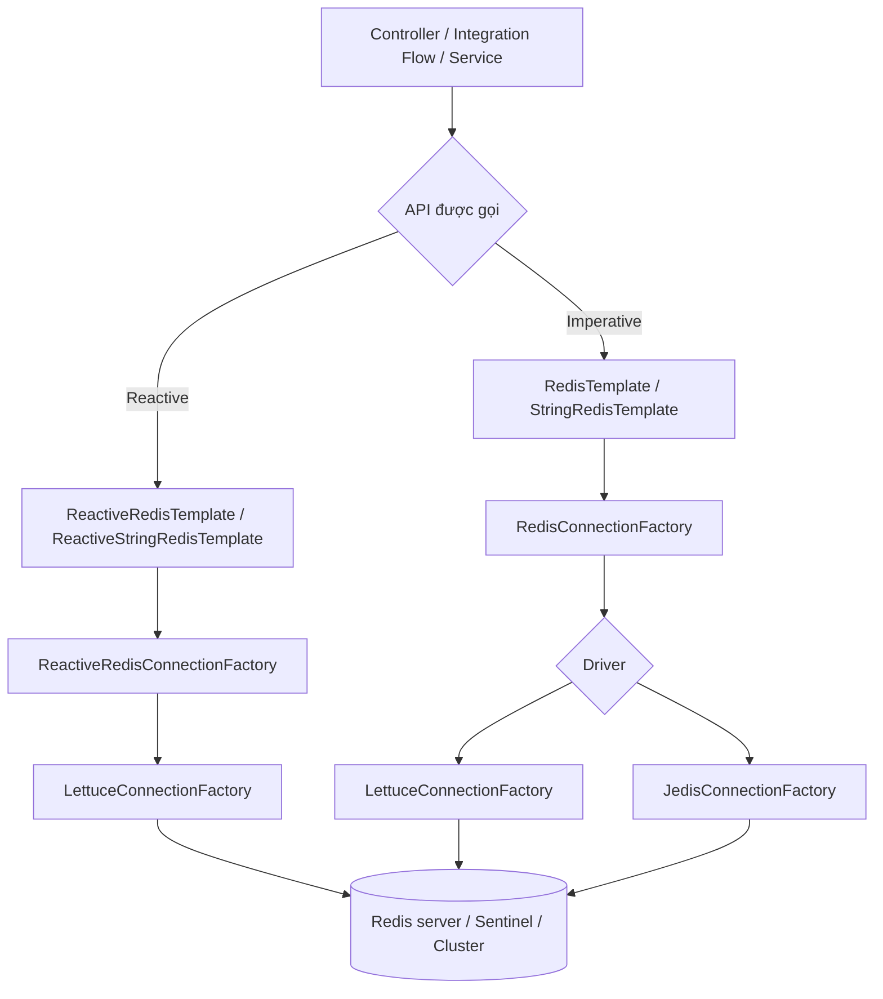
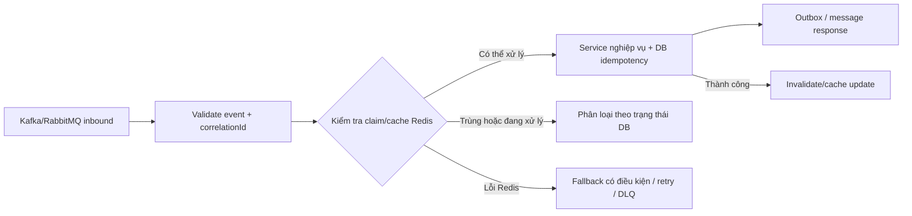

# Lettuce, Jedis và phạm vi hỗ trợ reactive

> **Chương:** Redis  
> **Phạm vi:** Trong module **SPRING_BOOT_INTEGRATION**, Redis thường làm cache, kho dữ liệu khóa–giá trị ngắn hạn, nơi lưu trạng thái hoặc thành phần phối hợp cho luồng tích hợp HTTP, cơ sở dữ liệu, broker và Spring Integration. Bài học phân biệt hai Redis client Java phổ biến là **Lettuce** và **Jedis**, xác định khi nào Spring Boot/Spring Data Redis thực sự cung cấp API **reactive**, và cách lựa chọn an toàn dựa trên giao dịch, lỗi, trùng lặp, kiểm thử và quan sát.

## 1. Redis client, Spring Data Redis và Spring Boot là ba tầng khác nhau

Một ứng dụng Java không “nói chuyện” trực tiếp với Redis chỉ vì có annotation `@Service` hoặc `@Cacheable`. Thông thường nó đi qua ba tầng:

| Tầng | Thành phần | Trách nhiệm |
| --- | --- | --- |
| **Client driver** | **Lettuce** hoặc **Jedis** | Thiết lập kết nối, gửi lệnh Redis, nhận phản hồi, xử lý protocol/network |
| **Spring Data Redis** | `RedisConnectionFactory`, `RedisTemplate`, `StringRedisTemplate`, `ReactiveRedisTemplate` | Tạo abstraction cho các lệnh, serializer, callback và API xử lý dữ liệu |
| **Spring Boot auto-configuration** | Redis auto-configuration, properties và bean điều kiện | Đọc cấu hình, lựa chọn driver hiện diện, dựng connection factory/template khi đủ điều kiện |

`spring-boot-starter-data-redis` thường kéo Spring Data Redis và **Lettuce** mặc định. Spring Boot hỗ trợ cấu hình cơ bản cho cả Lettuce và Jedis; muốn đổi driver cần chọn dependency và cấu hình đúng. Starter `spring-boot-starter-data-redis-reactive` cũng tồn tại để đặt tên nhất quán với các starter reactive khác, nhưng không có nghĩa chỉ starter này mới cho phép dùng API Redis reactive: starter Redis thông thường với Lettuce và các dependency phù hợp cũng có thể hỗ trợ.

### Sơ đồ quan hệ



Điểm quan trọng trong sơ đồ: `LettuceConnectionFactory` có thể cung cấp cả kết nối imperative và reactive; `JedisConnectionFactory` phục vụ API imperative của Spring Data Redis. **Không có nhánh reactive tương đương cho Jedis trong Spring Data Redis hiện hành.**

## 2. So sánh Lettuce và Jedis

| Tiêu chí | Lettuce | Jedis |
| --- | --- | --- |
| Mô hình thư viện | Dựa trên Netty, hỗ trợ synchronous, asynchronous và reactive ở mức client | Tập trung vào API đồng bộ trong tích hợp Spring Data Redis |
| Hỗ trợ `RedisTemplate` | Có | Có |
| Hỗ trợ `ReactiveRedisTemplate` qua Spring Data Redis | **Có** | **Không** |
| `RedisConnectionFactory` thường dùng | `LettuceConnectionFactory` | `JedisConnectionFactory` |
| `ReactiveRedisConnectionFactory` | `LettuceConnectionFactory` | Không được Jedis cung cấp |
| Connection sharing | Có thể chia sẻ một native connection thread-safe cho nhiều lệnh thông thường; một số thao tác cần kết nối riêng | Thường dùng connection/pool theo vòng đời lời gọi; không xem một kết nối Jedis thường là thread-safe để dùng tùy tiện giữa nhiều thread |
| Pool | Hỗ trợ pooling khi cần và được cấu hình | Pooling là lựa chọn phổ biến cho luồng đồng bộ nhiều request |
| Redis standalone, Sentinel, Cluster | Có các chế độ tương ứng | Có các chế độ tương ứng, nhưng chi tiết tính năng và cấu hình có thể khác |
| Khi nên chọn | Cần reactive API, muốn client linh hoạt và kết nối chia sẻ hiệu quả | Hệ thống imperative đã tiêu chuẩn hóa trên Jedis, hoặc cần hành vi/tính năng Jedis cụ thể |

**Lettuce không làm mọi đoạn Java trở thành non-blocking.** Nếu tầng ứng dụng gọi `StringRedisTemplate.opsForValue().get(...)`, đây vẫn là API *imperative* trả kết quả trực tiếp và block caller trong lúc chờ. Ngược lại, `ReactiveStringRedisTemplate.opsForValue().get(...)` trả `Mono<String>`, chỉ tương tác theo subscription và tham gia flow reactive.

**Jedis không có nghĩa kém hơn trong mọi hoàn cảnh.** Một dịch vụ Spring MVC dùng lệnh Redis ngắn và số kết nối được kiểm soát vẫn có thể sử dụng Jedis hợp lý. Quyết định nên dựa trên kiến trúc blocking/reactive, tải thực tế, khả năng vận hành, tính năng cần dùng và hỗ trợ phiên bản.

## 3. Reactive là thuộc tính của API và pipeline, không phải chỉ của dependency

Trong lập trình reactive với Spring, `Mono<T>` đại diện kết quả bất đồng bộ tối đa một phần tử và `Flux<T>` đại diện luồng nhiều phần tử. Spring Data Redis reactive sử dụng **Project Reactor** và kết nối **Lettuce**. Các thao tác có thể được kết hợp trong pipeline, truyền completion, error và cancellation về subscriber.

| Trường hợp | Có thực sự reactive không? | Vì sao? |
| --- | --- | --- |
| Dùng Lettuce qua `StringRedisTemplate` | **Không**, ở API đang gọi | Phương thức lấy giá trị trả `String` ngay và đồng bộ |
| Dùng Lettuce qua `ReactiveStringRedisTemplate` | **Có**, ở lớp Redis access | API trả `Mono`/`Flux`, dùng reactive driver |
| Dùng Jedis qua `StringRedisTemplate` | **Không** | Spring Data Redis với Jedis là imperative |
| Dùng Jedis rồi bọc `Mono.just(redisTemplate.opsForValue().get(k))` | **Không** | Lệnh blocking được thực thi trước khi `Mono` ra đời |
| Dùng Jedis + `Mono.fromCallable(...).subscribeOn(Schedulers.boundedElastic())` | **Adapter cách ly blocking**, chưa phải reactive driver | Có thể tránh chặn event-loop nhưng vẫn chiếm thread và connection khi I/O |
| Dùng WebFlux controller trả `Mono` nhưng gọi JPA/Jedis đồng bộ trên event-loop | **Luồng bị blocking tại đoạn gọi đó** | Return type reactive không sửa bản chất I/O |

### Tác động đến backpressure và concurrency

Reactive không đồng nghĩa Redis server có thể tự giảm tốc mọi nguồn dữ liệu. Reactive Streams cho phép trao đổi nhu cầu trong chuỗi publisher/subscriber; lệnh Redis đơn lẻ vẫn phụ thuộc mạng, tải Redis, kích thước payload và cấu hình timeout. Nếu một consumer phát hàng triệu thao tác bằng `flatMap` không giới hạn concurrency, phía Redis có thể bị quá tải dù API dùng `Mono`.

Nên đặt giới hạn concurrency, timeout và giới hạn buffer ở điểm đọc/ghi Redis hoặc broker. Với pipeline thực tế, đừng giữ kết nối hay subscription vô hạn mà không có chính sách hủy, retry hoặc giám sát.

## 4. Cấu hình Spring Boot với Lettuce mặc định

Ví dụ Maven cho ứng dụng Spring Boot được quản lý phiên bản bằng Boot BOM hoặc starter parent:

```xml
<dependency>
    <groupId>org.springframework.boot</groupId>
    <artifactId>spring-boot-starter-data-redis</artifactId>
</dependency>
```

Ví dụ cấu hình trong dòng **Spring Boot 3.x**:

```yaml
spring:
  data:
    redis:
      host: ${REDIS_HOST:localhost}
      port: ${REDIS_PORT:6379}
      password: ${REDIS_PASSWORD:}
      connect-timeout: 2s
      timeout: 3s
      client-type: lettuce
  cache:
    type: redis
management:
  health:
    redis:
      enabled: true
```

`spring.cache.type=redis` chỉ có ý nghĩa khi ứng dụng dùng Spring Cache abstraction và có hạ tầng cache cần thiết. Nó **không** tự bật `@Cacheable` cho mọi phương thức; thường phải bật caching có chủ đích bằng `@EnableCaching`. Nếu chỉ dùng `RedisTemplate` để đọc/ghi khóa, có thể bỏ phần cấu hình `spring.cache.*`.

Trong môi trường production, mật khẩu và thông tin xác thực cần lấy từ secret manager hoặc biến môi trường, không ghi literal trong repository. Nếu server yêu cầu TLS, thêm cấu hình SSL phù hợp với Boot version và chứng chỉ đã cấp; không coi URI `redis://` mặc định là truyền an toàn trên mạng công cộng.

**Tự động cấu hình thường gặp** khi đủ điều kiện:

- `RedisConnectionFactory` triển khai bằng `LettuceConnectionFactory`.
- `RedisTemplate<Object,Object>` (bean tên `redisTemplate`) và `StringRedisTemplate` cho cách gọi imperative.
- Các bean `ReactiveRedisTemplate` và `ReactiveStringRedisTemplate` khi `ReactiveRedisConnectionFactory` cùng các class cần thiết hiện diện.
- `RedisCacheManager` trong trường hợp Spring Cache abstraction và điều kiện cache Redis được thỏa mãn.

Bean được tạo chính xác phụ thuộc classpath, version, thuộc tính và các bean do ứng dụng định nghĩa. Spring Boot có thể **back off** khi ứng dụng tự cung cấp bean tương ứng. Khi điều kiện không rõ, xem *Condition Evaluation Report* bằng chế độ debug hoặc endpoint `conditions` của Actuator trong môi trường được kiểm soát.

### Không cần đổi sang “reactive starter” chỉ để dùng API reactive

Ví dụ:

```xml
<!-- Một starter hợp lệ cho cả API imperative và reactive với Lettuce -->
<dependency>
    <groupId>org.springframework.boot</groupId>
    <artifactId>spring-boot-starter-data-redis</artifactId>
</dependency>
```

`spring-boot-starter-data-redis-reactive` là một lựa chọn dependency tiện lợi để diễn đạt ý định sử dụng reactive. Điều quan trọng cần xác minh là **Lettuce, Project Reactor và reactive connection factory có mặt**, không phải chỉ kiểm tra tên starter.

## 5. Ví dụ Java imperative với StringRedisTemplate

Một luồng tích hợp xử lý đơn hàng có thể cache trạng thái ngắn hạn để tránh gọi lại HTTP API đối tác quá thường xuyên. Với Spring MVC hoặc worker imperative, `StringRedisTemplate` đơn giản và phù hợp:

```java
package com.example.integration.cache;

import java.time.Duration;
import java.util.Optional;
import org.springframework.data.redis.core.StringRedisTemplate;
import org.springframework.stereotype.Service;

@Service
public class OrderStatusCache {
    private static final Duration TTL = Duration.ofMinutes(5);
    private final StringRedisTemplate redis;

    public OrderStatusCache(StringRedisTemplate redis) {
        this.redis = redis;
    }

    public void put(String orderId, String status) {
        redis.opsForValue().set(key(orderId), status, TTL);
    }

    public Optional<String> find(String orderId) {
        return Optional.ofNullable(
                redis.opsForValue().get(key(orderId))
        );
    }

    public void evict(String orderId) {
        redis.delete(key(orderId));
    }

    private String key(String orderId) {
        return "integration:order-status:v1:" + orderId;
    }
}
```

**Hành vi:** mỗi phương thức gọi Redis đồng bộ. TTL giúp tránh dữ liệu nằm vô hạn trong cache, nhưng không bảo đảm dữ liệu luôn mới. Ứng dụng vẫn cần chính sách cache miss, invalidation và fallback khi Redis tạm không sẵn sàng.

Sử dụng `StringRedisTemplate` ở ví dụ để key/value được serialize thành string dễ hiểu. Với `RedisTemplate<K,V>`, phải **chọn serializer rõ ràng** cho key và value; không nên dựa vào serialization mặc định khi hai phiên bản ứng dụng cùng đọc chung dữ liệu. Dữ liệu bí mật hoặc token cần có TTL và quy định bảo mật thích hợp.

## 6. Ví dụ Java reactive với ReactiveStringRedisTemplate

Với Lettuce và hạ tầng reactive, có thể thiết kế service mà caller nhận publisher:

```java
package com.example.integration.cache;

import java.time.Duration;
import org.springframework.data.redis.core.ReactiveStringRedisTemplate;
import org.springframework.stereotype.Service;
import reactor.core.publisher.Mono;

@Service
public class ReactiveOrderStatusCache {
    private static final Duration TTL = Duration.ofMinutes(5);
    private final ReactiveStringRedisTemplate redis;

    public ReactiveOrderStatusCache(
            ReactiveStringRedisTemplate redis) {
        this.redis = redis;
    }

    public Mono<Boolean> put(String orderId, String status) {
        return redis.opsForValue()
                .set(key(orderId), status, TTL);
    }

    public Mono<String> find(String orderId) {
        return redis.opsForValue().get(key(orderId));
    }

    public Mono<Boolean> evict(String orderId) {
        return redis.delete(key(orderId))
                .map(deleted -> deleted > 0);
    }

    private String key(String orderId) {
        return "integration:order-status:v1:" + orderId;
    }
}
```

Lưu ý rằng `find()` hoàn tất **không phát giá trị** khi key không tồn tại; đây là `Mono.empty()`, không nên nhầm với lỗi kết nối. Phương thức `put()` trả `Mono<Boolean>` thể hiện kết quả Redis operation; **chưa có lệnh Redis nào phải diễn ra chỉ vì đối tượng `Mono` được tạo**. Framework hoặc caller cần subscribe, thường bằng cách trả publisher trực tiếp lên tầng WebFlux hoặc nối trong integration flow.

Ví dụ caller có fallback khi không có cache entry:

```java
public Mono<String> getStatus(String orderId) {
    return cache.find(orderId)
            .switchIfEmpty(partnerClient.fetchStatus(orderId))
            .timeout(Duration.ofSeconds(4));
}
```

Đây là đoạn minh họa tích hợp: `cache` là `ReactiveOrderStatusCache`, `partnerClient.fetchStatus()` giả định trả `Mono<String>` non-blocking. Nếu fallback gọi HTTP client đồng bộ hoặc JPA blocking trực tiếp, chuỗi Reactor vẫn có điểm chặn cần xử lý riêng.

**Thận trọng về cache fallback:** `switchIfEmpty` dùng khi Redis trả không có key; lỗi Redis sẽ đi qua kênh `onError`, không tự coi là miss. Có thể quyết định degrade gracefully khi Redis down, nhưng phải phân biệt với lỗi downstream và giới hạn tải để tránh cache outage làm đối tác bị gọi dồn dập.

### 6.1. Khi cần serialize DTO reactive

`ReactiveRedisTemplate<K,V>` cho phép cấu hình `RedisSerializationContext` theo serializer riêng. Với DTO JSON, chọn serializer theo schema/version và bảo đảm khả năng đọc lại khi nâng cấp. Không xem `ReactiveRedisTemplate` là giải pháp tự động cho schema evolution. Khi nhiều dịch vụ chia sẻ key, cần thống nhất prefix/version, TTL và format value; nếu không, một thay đổi Java class có thể làm các service cũ không deserialize được.

## 7. Đổi sang Jedis khi ứng dụng imperative cần

Trong một dự án Spring Boot dùng Maven, có thể loại dependency Lettuce mặc định và thêm Jedis:

```xml
<dependency>
    <groupId>org.springframework.boot</groupId>
    <artifactId>spring-boot-starter-data-redis</artifactId>
    <exclusions>
        <exclusion>
            <groupId>io.lettuce</groupId>
            <artifactId>lettuce-core</artifactId>
        </exclusion>
    </exclusions>
</dependency>

<dependency>
    <groupId>redis.clients</groupId>
    <artifactId>jedis</artifactId>
</dependency>
```

Chọn driver phù hợp theo cấu hình Spring Boot 3.x:

```yaml
spring:
  data:
    redis:
      host: ${REDIS_HOST:localhost}
      port: ${REDIS_PORT:6379}
      connect-timeout: 2s
      timeout: 3s
      client-type: jedis
```

Spring Boot có thể tạo `JedisConnectionFactory` và các template imperative khi đủ điều kiện. Code sử dụng `StringRedisTemplate` ở mục trước hầu như không đổi vì nó lập trình theo Spring Data Redis abstraction.

**Giới hạn then chốt:** Jedis ở tầng Spring Data Redis **không triển khai reactive driver**, nên cấu hình này không cung cấp `ReactiveRedisConnectionFactory` hoặc `ReactiveStringRedisTemplate` tương đương từ Jedis. Ứng dụng inject reactive template có thể lỗi khởi động nếu không tồn tại một reactive connection factory khác.

Không nên giữ cả Lettuce lẫn Jedis trên classpath rồi giả định Boot “tự chọn đúng” theo mục đích của từng service. Nếu thực sự cần dùng cả hai, nên định nghĩa bean rõ ràng và xác định chúng phục vụ luồng nào, quản lý pool, timeout và bean injection với qualifier thích hợp.

## 8. Connection sharing, pool và timeout

### 8.1. Lettuce có phải luôn cần connection pool?

Không. Lettuce có khả năng chia sẻ native connection thread-safe cho các lệnh thông thường và sử dụng cơ chế I/O bất đồng bộ; vì vậy không nhất thiết mở một connection Redis cho mỗi request đồng thời. Một số thao tác như blocking commands, transaction hoặc Pub/Sub có yêu cầu kết nối/vòng đời riêng. Tùy workload, có thể cần pool hoặc các connection riêng có kiểm soát.

Với Jedis, cấu hình pool phù hợp rất quan trọng trong ứng dụng imperative nhiều request. Nhưng pool không thể bù cho Redis server quá tải, network latency hoặc câu lệnh Redis nặng.

Nếu cần pooling với Boot 3.x, thêm thư viện pool phù hợp (thường là `commons-pool2`) và cấu hình theo driver/phiên bản:

```yaml
spring:
  data:
    redis:
      client-type: jedis
      jedis:
        pool:
          max-active: 16
          max-idle: 8
          min-idle: 1
          max-wait: 1s
```

Với Lettuce, cấu hình pool tương ứng nằm dưới `spring.data.redis.lettuce.pool.*` nếu workload cần. Không bật pool chỉ theo thói quen: cần đo connection count, throughput, độ trễ P95/P99, thời gian chờ mượn connection và timeout. Chọn các giá trị theo giới hạn Redis server và tổng số instance ứng dụng, không chỉ dựa vào số thread của một instance.

### 8.2. Các timeout khác nhau

| Timeout / giới hạn | Bảo vệ phần nào? | Lưu ý |
| --- | --- | --- |
| **Connect timeout** | Thời gian thiết lập kết nối mạng | Khác với thời gian chạy Redis command |
| **Command/read timeout** | Thời gian chờ thực thi/phản hồi lệnh Redis | Lệnh timeout có thể đã được Redis xử lý ở phía server |
| **Pool wait timeout** | Thời gian chờ mượn connection từ pool | Giúp tránh chờ vô hạn khi pool cạn |
| **Reactive timeout** bằng `Mono.timeout(...)` | Giới hạn thời gian của publisher ở cấp application | Cancellation không có nghĩa có thể hoàn tác lệnh đã gửi |
| **Business deadline** | Giới hạn tổng thời gian xử lý request tích hợp | Bao gồm HTTP, cache, DB, broker; thường nhỏ hơn deadline ở caller |

Không coi `Mono.timeout` là một transaction rollback, và không mặc định retry sau timeout là an toàn cho lệnh có side effect như tăng counter hoặc tạo claim.

## 9. Những điểm dễ nhầm với Redis cache và Spring Cache

Redis vừa là datastore, vừa có thể là backend của Spring Cache abstraction. Hai cách lập trình này có trách nhiệm khác nhau:

| Cách dùng | API điển hình | Bạn tự quản lý |
| --- | --- | --- |
| Gọi Redis trực tiếp | `StringRedisTemplate` / `ReactiveStringRedisTemplate` | Key, TTL, serializer, missing key, lỗi, refresh, atomicity |
| Spring Cache abstraction | `@Cacheable` / `@CachePut` / `@CacheEvict` + `CacheManager` | Quy tắc cache name/key, TTL và consistency; chọn cache provider |
| Redis cho state coordination | `SET NX EX`, Lua script, counter, distributed lock | Tính nguyên tử, lease, gia hạn, cạnh tranh, failover |
| Redis pub/sub hoặc stream | Redis messaging/stream APIs | Delivery guarantee, consumer group, ack, retry, retention |

**Không đồng nhất Spring Cache với Redis reactive API.** Spring Framework đã có cải tiến cache cho phương thức trả reactive type ở một số phiên bản, nhưng semantics thực tế phụ thuộc `CacheManager` và khả năng bất đồng bộ của cache backend. Việc annotating một method bằng `@Cacheable` không có nghĩa hệ thống tự dùng `ReactiveRedisTemplate` hay end-to-end non-blocking. Khi ứng dụng yêu cầu reactive chặt chẽ, cần xác minh implementation cụ thể hoặc chủ động sử dụng reactive Redis API.

### 9.1. Cache-aside và tính nhất quán

Trong cache-aside, service đọc cache trước; miss thì gọi DB hoặc HTTP đối tác và ghi cache với TTL. Khi dữ liệu nguồn thay đổi, cache có thể stale đến khi invalidate hoặc hết TTL. Nếu hai caller cùng miss, chúng có thể cùng gọi downstream (*cache stampede*). Có thể dùng jitter cho TTL, giới hạn concurrency hoặc cơ chế single-flight nếu phù hợp.

Không dùng cache để quyết định duy nhất các quy tắc nghiệp vụ quan trọng nếu việc cache mất dữ liệu hoặc stale gây sai lệch. Ví dụ Redis mất key không chứng minh đơn hàng chưa được tạo trong database.

## 10. Redis trong luồng tích hợp: idempotency, transaction và lỗi

### 10.1. Claim chống xử lý trùng là thao tác nguyên tử

Một workflow nhận event từ broker có thể muốn tránh hai worker xử lý đồng thời cùng event. Redis có lệnh **`SET key value NX EX`** (chỉ set khi key chưa tồn tại và đặt TTL cùng thao tác), tương đương API:

```java
import java.time.Duration;
import org.springframework.data.redis.core.ReactiveStringRedisTemplate;
import reactor.core.publisher.Mono;

public Mono<Boolean> tryClaim(
        ReactiveStringRedisTemplate redis,
        String eventId,
        String token) {
    return redis.opsForValue().setIfAbsent(
            "integration:claim:v1:" + eventId,
            token,
            Duration.ofMinutes(2)
    );
}
```

`token` nên là giá trị ngẫu nhiên duy nhất cho lần claim. Nếu cần nhả claim khi thất bại, không gọi `DEL` trần vì lease có thể đã hết hạn rồi được worker khác lấy; thay vào đó dùng thao tác **so sánh token rồi xóa nguyên tử**, chẳng hạn Lua script phù hợp. TTL cần dài hơn thời gian thao tác kỳ vọng hoặc có cơ chế gia hạn an toàn.

**Giới hạn:** Redis claim chỉ hỗ trợ điều phối tạm thời, không bảo đảm nghiệp vụ “exactly once”. Redis có thể failover, key hết hạn trong lúc task còn chạy, hoặc trạng thái bị mất do chính sách persistence. Với thanh toán, đơn hàng và cập nhật quan trọng, **database unique constraint / inbox idempotency record** và transaction nghiệp vụ mới nên là nơi bảo vệ tính đúng đắn. Redis có thể đóng vai trò giảm tải hoặc chống chạy song song trong điều kiện bình thường.

### 10.2. Redis transaction khác transaction cơ sở dữ liệu

Redis hỗ trợ một số cơ chế nguyên tử và lệnh như `MULTI/EXEC` hoặc Lua; Spring Data Redis có API tương ứng theo khả năng driver và kiểu kết nối. Điều đó **không biến Redis thành một phần của transaction JPA/JDBC**.

`@Transactional` trên service dùng `JpaTransactionManager` không tự rollback giá trị Redis đã ghi nếu DB transaction thất bại. Tương tự, nếu gửi message broker hoặc gọi HTTP API trước khi DB commit, một rollback DB không thể tự đảo ngược các side effect đó.

Một quy trình “ghi DB rồi publish event” đáng tin cậy có thể dùng **transactional outbox**: lưu bản ghi nghiệp vụ và outbox trong cùng DB transaction, sau đó publisher gửi event; consumer dùng idempotency key để chịu được thông điệp lặp lại. Redis cache chỉ nên được cập nhật hoặc xóa theo chiến lược consistency đã định, ví dụ sau commit hoặc bằng event xử lý bù.

### 10.3. Redis mất kết nối phải được xử lý thế nào?

Phân loại theo mục đích sử dụng:

- **Cache đọc phụ trợ:** có thể *fail open* và đọc từ nguồn thật khi Redis down, nhưng cần circuit breaker/giới hạn tải để không làm sập DB hoặc HTTP đối tác.
- **Cache ghi:** có thể ghi thất bại mà không hủy transaction nghiệp vụ nếu dữ liệu nguồn vẫn được lưu đúng; cần quyết định điều này trong contract.
- **Deduplication/lock/coordination:** nếu Redis unavailable, không tự xử lý như “chưa có key”; cần quy định *fail closed* hoặc chuyển sang cơ chế durable để không gây xử lý trùng.
- **Redis pub/sub:** không có bảo đảm lưu bền vững cho subscriber offline; nếu cần replay/ack, phải cân nhắc Redis Streams hoặc broker phù hợp và vẫn kiểm thử cơ chế delivery.

Không retry vô hạn lỗi xác thực hoặc cấu hình sai. Timeout mạng hoặc transient error có thể retry có giới hạn và backoff **khi thao tác idempotent** hoặc có cách kiểm tra kết quả sau timeout.

## 11. Khi tích hợp Spring Integration hoặc message broker

Một flow có thể đi từ Kafka/RabbitMQ đến adapter Redis rồi gọi HTTP đối tác hoặc DB:



Điểm cần chốt:

1. **Message broker acknowledgment:** việc một lệnh Redis thành công không có nghĩa toàn bộ nghiệp vụ đã commit. Cấu hình ack/retry/requeue nằm ở inbound adapter và consumer container.
2. **Blocking boundary:** nếu flow dùng reactive transport nhưng gọi `StringRedisTemplate`/Jedis trực tiếp trên event-loop, phải chuyển qua cách ly thread thích hợp hoặc dùng Lettuce reactive API. Chọn `Schedulers.boundedElastic()` chỉ là biện pháp bao bọc blocking có giới hạn, không xóa đi chi phí connection/thread.
3. **Trace:** gắn correlation ID từ message vào logs/tracing. Không dùng business ID riêng biệt làm metric tag vì cardinality quá cao.
4. **Ranh giới nguồn dữ liệu:** trạng thái Redis có thể bị evict/expire, nên hệ thống vẫn phải biết tra cứu kết quả chính thức từ DB hoặc service chủ nguồn.

## 12. Quan sát và vận hành client Redis

| Tín hiệu | Chẩn đoán |
| --- | --- |
| **Connection count, connect failures, reconnects** | Có vấn đề mạng, TLS, credentials hoặc quá nhiều instance không? |
| **Command latency P50/P95/P99** | Redis có chậm do tải, command nặng, payload lớn hay mạng không? |
| **Command timeout/error rate** | Redis có đang quá tải hoặc request deadline quá ngắn không? |
| **Pool active/idle/wait time** (nếu dùng pool) | Pool bị cạn hoặc cấu hình quá lớn so với server? |
| **Cache hit/miss/eviction** | Cache có giảm tải hay sinh nhiều lần gọi lại downstream? |
| **Redis INFO, memory, evicted keys** | Redis có bị áp lực bộ nhớ và chính sách eviction ảnh hưởng tính đúng đắn không? |
| **Consumer lag, retry, DLQ** | Redis outage có làm tắc luồng broker hoặc đẩy lỗi sang hệ khác không? |

Spring Boot Actuator có thể cung cấp health/metrics khi thêm dependency và cấu hình cần thiết. Không mặc định endpoint health là phép thử toàn diện cho mọi key, cluster node hoặc contract; và không công khai chi tiết thông tin hạ tầng. Với Lettuce/Netty, đo cả độ trễ command và saturation ở application; với Jedis pool, theo dõi số connection đang được mượn và thời gian chờ.

### Bảo mật và serialization

Đặt Redis trong mạng riêng, dùng xác thực ACL/TLS khi phù hợp, giới hạn quyền theo key pattern/command và không ghi password vào log. Khi nhiều service chia sẻ Redis, dùng namespace key rõ ràng như `integration:orders:v1:<businessKey>`; quy định TTL, format serializer và migration khi đổi schema.

Không dùng Java native serialization cho dữ liệu chia sẻ nếu không kiểm soát tính tương thích và nguy cơ deserialize dữ liệu không tin cậy. Với DTO JSON hoặc binary, đặt tên trường, version/schema và kiểm thử tương thích liên phiên bản. Key chứa thông tin cá nhân nhạy cảm nên được tối thiểu hóa hoặc băm/hàm biến đổi phù hợp với yêu cầu bảo mật.

## 13. Kiểm thử Lettuce, Jedis và reactive behavior

Một bộ kiểm thử có ích cần xác nhận **hành vi** và **điều kiện auto-configuration**, thay vì chỉ kiểm tra application context có bean.

| Ca kiểm thử | Điều cần xác minh |
| --- | --- |
| Khởi động với Lettuce | Có `LettuceConnectionFactory` và template imperative; reactive factory/template xuất hiện khi điều kiện reactive thỏa mãn |
| Khởi động với Jedis | Có `JedisConnectionFactory` và `StringRedisTemplate`; không giả định tồn tại reactive template |
| TTL | Key hết hạn và đọc lại là cache miss, không phải nghiệp vụ thất bại |
| Serializer | Đọc lại được dữ liệu do version trước ghi, key/value đúng encoding |
| Concurrent claim | Hai worker cùng key: thao tác `setIfAbsent` chỉ cho một bên lấy claim ở thời điểm cạnh tranh bình thường |
| Redis outage | Phân biệt cache fallback với lỗi dedup/coordination bắt buộc |
| Reactive cancellation/timeout | Publisher kết thúc đúng, không giữ tài nguyên; timeout không bị hiểu là Redis đã rollback |
| Pool exhaustion | Timeout/wait có giới hạn, không giữ thread chờ vô hạn |
| Broker redelivery | Duplicate message không tạo duplicate DB side effect |
| Failover/cluster | Reconnect và trạng thái cuối hợp đồng không bị hiểu sai |

Đối với Java reactive, `StepVerifier` giúp xác minh các signal của `Mono`/`Flux`. Đối với hành vi Redis thật, nên dùng Redis qua Testcontainers hoặc Redis dành riêng cho integration test. Mock reactive template có thể kiểm tra service logic nhưng **không chứng minh** Redis command, TTL, serializer và kết nối hoạt động chính xác.

Ví dụ kiểm thử ý tưởng với Reactor:

```java
import reactor.test.StepVerifier;

StepVerifier.create(cache.put("order-1", "RECEIVED"))
        .expectNext(true)
        .verifyComplete();

StepVerifier.create(cache.find("order-1"))
        .expectNext("RECEIVED")
        .verifyComplete();
```

Đoạn test giả định `cache` là service reactive ở mục 6, Redis test instance đang chạy và dependency `reactor-test` được khai báo trong scope test. Bài học tập trung vào semantics: bước `put()` phải có subscriber, và `find()` phải trả đúng value khi key còn TTL.

## 14. Các sai lầm dễ mắc

1. **“Lettuce luôn là non-blocking.”** Sai: Lettuce hỗ trợ reactive nhưng `RedisTemplate` là API imperative.
2. **“Dùng WebFlux là Jedis tự hỗ trợ reactive.”** Sai: Spring Data Redis reactive hỗ trợ Lettuce; Jedis không cung cấp reactive connection factory ở tầng đó.
3. **“Đổi sang starter Redis reactive là đã có tốc độ tốt hơn.”** Chưa đủ: cần đo workload, concurrency, command latency, serialization và hành vi của downstream.
4. **“Càng tăng connection pool càng nhanh.”** Sai: quá nhiều kết nối có thể tăng tải và độ phức tạp vận hành; Lettuce nhiều trường hợp không cần pool.
5. **“Redis SET thành công nghĩa là transaction JPA cũng thành công.”** Sai: hai hệ thống có ranh giới transaction riêng.
6. **“Một claim Redis có TTL bảo đảm exactly-once.”** Sai: key có thể hết hạn/mất, worker có thể chết hoặc kết nối mất sau khi side effect đã xảy ra.
7. **“Cache miss và lỗi Redis đều nên gọi HTTP đối tác.”** Sai: fallback khi Redis down có thể dồn tải, và khóa dedup không được coi lỗi là miss.
8. **“`@Cacheable` tự đồng nghĩa với `ReactiveRedisTemplate`.”** Sai: cache abstraction và reactive Redis API là hai cơ chế khác nhau.

## 15. Checklist chọn driver

Trước khi chọn Lettuce hay Jedis, hãy trả lời:

1. Luồng gọi Redis đang chạy trên **Spring MVC/worker imperative** hay **WebFlux/reactive message processing**?
2. Có thật sự cần API `Mono`/`Flux` để xử lý Redis không? Nếu có, **Lettuce** là lựa chọn hỗ trợ reactive qua Spring Data Redis.
3. Cần standalone, Sentinel, Cluster, TLS, pub/sub, stream, pipelining hay transaction nào? Driver và phiên bản hiện có có hỗ trợ đúng nhu cầu không?
4. Timeout/connect timeout/pool được xác định và đo trong workload thật chưa?
5. Cách serialize key/value, TTL, version và invalidation đã được thống nhất giữa các service chưa?
6. Khi Redis down, phần nào có thể fallback, phần nào cần dừng để bảo vệ tính đúng đắn?
7. Nếu Redis hỗ trợ dedup/lock, database hoặc nguồn trạng thái bền vững nào sẽ giữ quyết định cuối cùng?
8. Có integration test với Redis thật, lỗi mạng/timeout, concurrent claim và broker redelivery không?

### Câu hỏi tự kiểm tra

1. `LettuceConnectionFactory` khác `JedisConnectionFactory` ở điểm nào liên quan đến reactive?
2. Vì sao ứng dụng dùng Lettuce nhưng chỉ inject `StringRedisTemplate` chưa phải là ứng dụng non-blocking?
3. Khi `ReactiveStringRedisTemplate.opsForValue().get(k)` không tìm thấy key, nó biểu diễn kết quả thế nào?
4. Khi nào việc bổ sung `spring-boot-starter-data-redis-reactive` không làm thay đổi khả năng reactive của ứng dụng?
5. Khi nào pooling có ích với Lettuce và Jedis? Vì sao không thể chọn số connection chỉ dựa vào số request?
6. Vì sao một lệnh Redis timeout không chứng minh lệnh chưa chạy trên server?
7. Tại sao claim chống trùng trong Redis phải dùng thao tác nguyên tử và token, nhưng vẫn cần constraint ở DB?
8. Nếu một message Kafka được nhận lại sau khi DB đã commit, nên xác định kết quả từ Redis cache hay từ trạng thái bền vững?

**Ghi nhớ:** **Lettuce** hỗ trợ cả cách gọi imperative và reactive trong Spring Data Redis; **Jedis** được tích hợp cho cách gọi imperative. Loại starter, kết nối, API template và toàn bộ pipeline mới quyết định có non-blocking hay không. Redis giúp tăng tốc và phối hợp luồng tích hợp, nhưng độ đúng đắn vẫn phụ thuộc vào TTL/schema, ranh giới giao dịch, idempotency bền vững, chính sách lỗi, kiểm thử và số liệu vận hành.

### Tài liệu tham khảo

- [Spring Boot Reference — Redis](https://docs.spring.io/spring-boot/reference/data/nosql.html): starter, cấu hình Lettuce/Jedis và auto-configuration.
- [Spring Data Redis Reference — Drivers](https://docs.spring.io/spring-data/data-redis/reference/redis/drivers.html): bảng khả năng hỗ trợ của hai connector, bao gồm reactive API và connection pooling.
- [Spring Data Redis Reference](https://docs.spring.io/spring-data/redis/reference/): RedisTemplate, reactive operations, serialization, connection factory và transaction.
