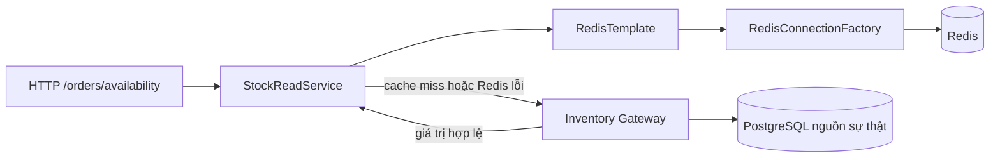
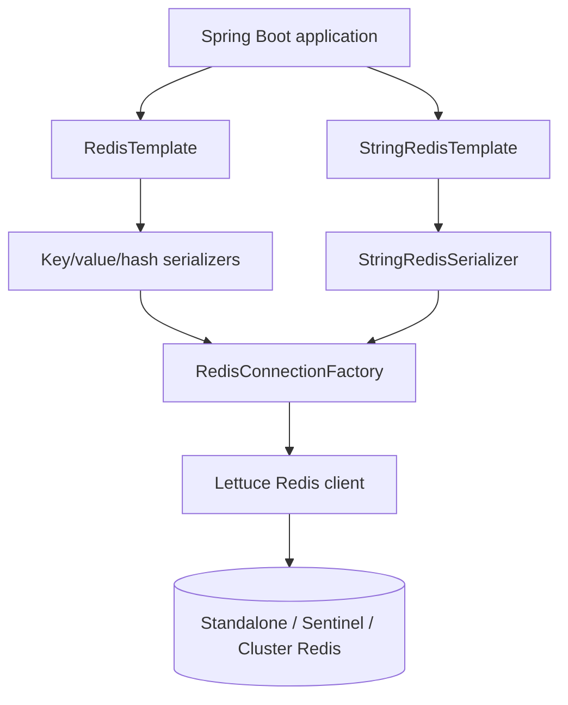
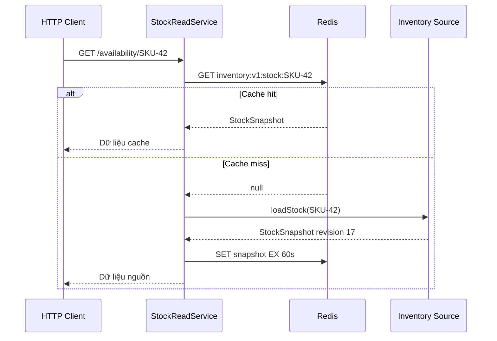

# RedisConnectionFactory, RedisTemplate và StringRedisTemplate

## 1. Bài toán và mục tiêu

Trong hệ thống tích hợp, một service thường đọc dữ liệu từ database hoặc gọi HTTP tới một hệ thống khác nhiều lần. Nếu một kết quả được truy vấn lặp lại với tần suất cao nhưng chỉ thay đổi theo chu kỳ, **Redis** có thể giảm tải cho nguồn dữ liệu. Redis cũng được dùng cho counter, trạng thái tạm thời, khóa phân tán có kiểm soát hoặc dữ liệu phục vụ idempotency ngắn hạn. Tuy nhiên, Redis chỉ hữu ích khi ứng dụng xác định rõ **định dạng lưu trữ, thời hạn dữ liệu, xử lý lỗi và nguồn sự thật**.

Spring Data Redis có ba thành phần cần hiểu trước khi dùng:

- **`RedisConnectionFactory`:** cung cấp kết nối tới Redis theo driver, cấu hình xác thực, TLS và topology.
- **`RedisTemplate<K,V>`:** API thao tác Redis theo kiểu key/value tùy chọn serializer, dùng cho chuỗi, đối tượng, hash, list, set, sorted set và nhiều thao tác khác.
- **`StringRedisTemplate`:** biến thể chuyên dùng **key và value chuỗi**, với serializer cho chuỗi UTF-8; thuận tiện cho counter, flag, token tham chiếu, trạng thái đơn giản và kiểm tra bằng `redis-cli`.

Bài thuộc chương **Redis** trong module **SPRING_BOOT_INTEGRATION**. Module tổ chức tích hợp Spring Boot qua HTTP client, cơ sở dữ liệu, cache, broker thông điệp và các adapter Spring Integration, tập trung vào **cấu hình, hợp đồng dữ liệu, giao dịch, lỗi, xử lý trùng lặp, kiểm thử và quan sát** các luồng tích hợp thực tế. Vì vậy, bài không chỉ gọi `get`/`set` mà còn giải thích cách bảo vệ dữ liệu nghiệp vụ khi cache miss, Redis mất kết nối, message bị gửi lại hoặc database đã commit nhưng cache chưa được cập nhật.

Sau bài học, bạn có thể:

1. Giải thích đường đi từ `RedisTemplate` hoặc `StringRedisTemplate` qua `RedisConnectionFactory` tới Redis server.
2. Cấu hình Spring Boot với Redis standalone, hiểu sự khác biệt khi dùng Sentinel/Cluster và TLS.
3. Tạo `RedisTemplate<String, StockSnapshot>` sử dụng JSON có định dạng ổn định và biết vì sao serializer mặc định có thể gây khó đọc dữ liệu.
4. Sử dụng `StringRedisTemplate` với TTL, counter, hash và thao tác `setIfAbsent` có điều kiện.
5. Triển khai cache-aside cho dữ liệu tồn kho, phân biệt consistency của Redis cache và transaction database.
6. Kiểm thử serializer/TTL/connection bằng Redis thật; quan sát pool, latency, cache hit/miss và lỗi tích hợp.

> **Giả định phiên bản:** Các ví dụ dùng Java 17+, Spring Boot 3.2+ và Spring Data Redis 3.x theo BOM của Spring Boot, với **Lettuce** là driver được ưu tiên trong mẫu. API và tên property có thể thay đổi theo các phiên bản Spring Boot, Spring Data Redis và Redis server. Đoạn Java lược bỏ `import` thông dụng; cần bổ sung theo package khi đặt vào dự án.

### 1.1. Tình huống thực hành: đọc tồn kho qua Redis cache

Một **Order Service** cần hiển thị số lượng tồn kho dự kiến cho từng SKU. **Inventory Service** có PostgreSQL làm nguồn dữ liệu chính. Nếu mỗi yêu cầu xem sản phẩm đều gọi Inventory API, network và database có thể bị quá tải. Ta bổ sung Redis cache với key:

```text
inventory:v1:stock:SKU-42
```

và giá trị JSON:

```json
{
  "sku": "SKU-42",
  "available": 8,
  "revision": 17
}
```

Ứng dụng đọc cache trước; nếu không có hoặc Redis gặp lỗi tạm thời, nó đọc Inventory từ nguồn dữ liệu gốc. Kết quả hợp lệ được cache với **TTL hữu hạn**. Khi Inventory cập nhật tồn kho, cần chính sách invalidation hoặc version-aware update để giảm thời gian dữ liệu cũ tồn tại.



**Giới hạn nghiệp vụ:** số lượng tồn kho ở cache chỉ dùng để **hiển thị/ước tính**, không phải bằng chứng cho phép giữ hàng. Khi đặt đơn, Inventory phải kiểm tra tồn kho atomically trong database. Nếu trạng thái cần độ chính xác cao, phải đọc từ nguồn nhất quán theo contract hoặc chấp nhận cơ chế xác nhận bất đồng bộ.

## 2. Ba thành phần phối hợp với nhau như thế nào?



| Thành phần | Chịu trách nhiệm | Không tự giải quyết |
|---|---|---|
| `RedisConnectionFactory` | Cấu hình và cấp connection Redis cho Spring Data Redis; hỗ trợ driver và topology đã chọn | Không quyết định cách JSON DTO được serialize |
| `RedisTemplate<K,V>` | Chuyển lời gọi Spring thành Redis command, dùng serializer cho key/value/hash, quản lý resource theo template | Không tự đảm bảo cache consistency với PostgreSQL |
| `StringRedisTemplate` | Sẵn các serializer chuỗi cho key/value/hash, thuận tiện cho data dạng text | Không serialize Java object thành JSON theo ý bạn |
| `RedisSerializer<T>` | Định nghĩa byte representation khi ghi/đọc Redis | Không quyết định TTL, retry hay transaction phân tán |
| Redis server | Thực thi command, lưu dữ liệu, áp TTL và chính sách persistence/replication | Không tự thực hiện transaction SQL hoặc xác nhận nghiệp vụ HTTP |

### 2.1. Redis là hệ thống lưu byte; serializer là hợp đồng dữ liệu

Redis nhận key/value ở dạng byte. Một Java object được ghi bằng `RedisTemplate` phải đi qua serializer; đọc lại phải dùng **serializer tương thích**. Nếu ứng dụng A ghi Java serialization nhị phân còn ứng dụng B cố dùng `StringRedisTemplate` đọc cùng key, dữ liệu có thể không đọc được hoặc bị hiểu sai.

```text
Java key   -- keySerializer --> Redis bytes
Java value -- valueSerializer --> Redis bytes
Redis bytes -- deserializer --> Java value
```

Hợp đồng cache cần quy định **key naming, value format, schema/version, TTL và ownership**. Không coi việc đổi Java class là tự động đổi dữ liệu đã lưu trong Redis. Redis cache đã chứa giá trị cũ có thể tồn tại sau deploy; cần nâng version key hoặc có logic đọc tương thích.

### 2.2. Vì sao template không thay thế connection factory?

`RedisTemplate` sử dụng `RedisConnectionFactory` để lấy kết nối khi thực hiện command. Nhiều template có thể chia sẻ một connection factory và pool; mỗi template có serializer/đối tượng dữ liệu khác nhau. Không cần tự tạo một `LettuceConnectionFactory` mới cho mỗi template.

Các đối tượng `RedisTemplate` thường được cấu hình một lần và **dùng lại dưới dạng bean singleton sau khi initialization hoàn tất**. Không thay serializer của một template đã được sử dụng bởi nhiều thread trong runtime; việc thay cấu hình giữa chừng có thể làm các luồng ghi/đọc không đồng nhất. Connection/native resource có lifecycle riêng do factory/driver quản lý; tránh tự lưu một `RedisConnection` và chia sẻ nó tùy tiện giữa các request.

## 3. Cài dependency và cấu hình kết nối Spring Boot

### 3.1. Dependency Maven và Gradle

Với Spring Boot parent/BOM:

```xml
<dependencies>
    <dependency>
        <groupId>org.springframework.boot</groupId>
        <artifactId>spring-boot-starter-data-redis</artifactId>
    </dependency>
    <dependency>
        <groupId>org.apache.commons</groupId>
        <artifactId>commons-pool2</artifactId>
    </dependency>
    <dependency>
        <groupId>org.springframework.boot</groupId>
        <artifactId>spring-boot-starter-test</artifactId>
        <scope>test</scope>
    </dependency>
</dependencies>
```

Tương ứng Gradle Kotlin DSL:

```kotlin
dependencies {
    implementation("org.springframework.boot:spring-boot-starter-data-redis")
    implementation("org.apache.commons:commons-pool2")
    testImplementation("org.springframework.boot:spring-boot-starter-test")
}
```

- Starter Redis thường cung cấp Spring Data Redis và **Lettuce** theo cấu hình Boot phổ biến.
- `commons-pool2` cần khi bật **pooling qua Lettuce** trong cấu hình ví dụ; nếu không dùng pool, cân nhắc bỏ dependency thay vì chỉ thêm theo thói quen.
- Redis driver là **khác** JDBC/R2DBC driver: không dùng `DataSource` hay `ConnectionFactory` của R2DBC cho Redis.
- Dù Lettuce có thể cung cấp API bất đồng bộ/reactive, `RedisTemplate` và `StringRedisTemplate` trong bài này là các API **đồng bộ (blocking đối với caller)**. Phần WebFlux sẽ cần API reactive riêng; xem mục 9.

### 3.2. Cấu hình Redis standalone cho môi trường local

```yaml
# application.yml — giá trị mặc định minh họa local development
spring:
  data:
    redis:
      host: ${REDIS_HOST:localhost}
      port: ${REDIS_PORT:6379}
      username: ${REDIS_USERNAME:default}
      password: ${REDIS_PASSWORD:}
      database: 0
      client-type: lettuce
      connect-timeout: 2s
      timeout: 2s
      lettuce:
        pool:
          enabled: true
          max-active: 16
          max-idle: 8
          min-idle: 1
          max-wait: 500ms

integration:
  cache:
    stock:
      ttl: 60s
```

**Cách hiểu:**

| Property | Vai trò |
|---|---|
| `spring.data.redis.host/port` | Redis endpoint theo mô hình standalone |
| `username/password` | Redis ACL hoặc mật khẩu theo server; không commit secret thật |
| `database` | Chỉ số logical DB trong standalone theo hỗ trợ server; không coi là cô lập quyền |
| `connect-timeout` | Giới hạn chờ thiết lập kết nối |
| `timeout` | Giới hạn thời gian cho command theo cấu hình Lettuce/Boot |
| `lettuce.pool.max-active` | Giới hạn connection đang hoạt động trong pool được bật |
| `lettuce.pool.max-wait` | Thời gian tối đa chờ tài nguyên pool |
| `integration.cache.stock.ttl` | Property **ứng dụng tự định nghĩa** để chọn TTL; Redis không tự hiểu property này |

Pool là tài nguyên **theo instance**, không phải theo toàn cluster ứng dụng. Nếu có 8 replicas và mỗi replica được phép dùng 16 connection, tổng giới hạn theo phép nhân đơn giản có thể lên tới **128 connection** riêng cho pool đó, chưa kể app khác hoặc kết nối ngoài pool. Lettuce còn có khả năng tái sử dụng/multiplex kết nối theo cách của driver; không suy diễn mỗi request Redis nhất thiết dùng một socket riêng.

**Cấu hình local không TLS** (`localhost:6379`) chỉ phù hợp môi trường phát triển cô lập. Production phải bật TLS/ACL/secret management và hạn chế network access theo mô hình triển khai, xem mục 10.

### 3.3. Spring Boot auto-configuration tạo những bean nào?

Khi có starter và cấu hình Redis hợp lệ, Spring Boot thường tạo:

1. `RedisConnectionFactory`, mặc định là `LettuceConnectionFactory` với driver Lettuce khi không có factory tùy chỉnh.
2. Một bean `redisTemplate` với kiểu tổng quát (thường `RedisTemplate<Object,Object>`) nếu chưa có bean cùng tên cần thiết.
3. Một bean `stringRedisTemplate` để thao tác dữ liệu chuỗi, nếu chưa có bean phù hợp.

Chi tiết phụ thuộc phiên bản Boot, classpath và các `@ConditionalOn...`. Không nên tự tạo một connection factory mới chỉ để thay đổi serializer: hãy tạo **template riêng** và inject factory do Boot quản lý. Khi muốn nhiều Redis servers, cần nhiều connection factory/bean có `@Qualifier` rõ ràng; các mặc định auto-configuration không đủ để lựa chọn server theo ý muốn.

## 4. RedisConnectionFactory và đời sống kết nối

### 4.1. RedisConnectionFactory là abstraction của Spring Data Redis

Interface `org.springframework.data.redis.connection.RedisConnectionFactory` tạo `RedisConnection` cho các thao tác đồng bộ. Trong cấu hình Lettuce, implementation phổ biến là `LettuceConnectionFactory`. Nó biết Redis host/port, authentication, TLS, database/topology và các tùy chọn client theo cấu hình được áp dụng.

```java
// Quan sát loại factory thực trong một ứng dụng Spring Boot
@Component
public class RedisConnectionInspector {
    private final RedisConnectionFactory connectionFactory;

    public RedisConnectionInspector(
            RedisConnectionFactory connectionFactory
    ) {
        this.connectionFactory = connectionFactory;
    }

    public String driverClassName() {
        return connectionFactory.getClass().getSimpleName();
    }
}
```

Đoạn mã chỉ cho biết loại factory đang inject, **không kiểm tra Redis có thể nhận command**. Muốn kiểm tra kết nối, dùng health indicator phù hợp hoặc thực hiện command trên tài nguyên test, có timeout và khả năng xử lý lỗi.

### 4.2. Khi nào cần tạo factory thủ công?

Phần lớn ứng dụng chỉ cần `spring.data.redis.*`. Một custom factory có thể hợp lý nếu phải dùng topology đặc biệt, cấu hình SSL/client độc lập, nhiều Redis server hoặc điều kiện dependency không được Boot auto-configure theo ý định.

Ví dụ **phương án thay thế** cho auto-configuration khi muốn custom Lettuce client:

```java
// Ví dụ standalone factory thủ công: chỉ dùng khi có chủ đích.
@Configuration(proxyBeanMethods = false)
public class CustomRedisFactoryConfiguration {

    @Bean
    RedisConnectionFactory redisConnectionFactory(
            @Value("${app.redis.host}") String host,
            @Value("${app.redis.port}") int port
    ) {
        RedisStandaloneConfiguration server =
                new RedisStandaloneConfiguration(host, port);

        LettuceClientConfiguration client =
                LettuceClientConfiguration.builder()
                        .commandTimeout(Duration.ofSeconds(2))
                        .build();

        return new LettuceConnectionFactory(server, client);
    }
}
```

Đoạn này **không bao gồm ACL/password/TLS**, chỉ có ý nghĩa minh họa API factory trong môi trường test/local. Khi định nghĩa bean `RedisConnectionFactory` thủ công, Boot có thể không tạo factory mặc định và các property `spring.data.redis.*` không nhất thiết còn được áp vào bean bạn tự xây. Vì vậy **không áp dụng đoạn này cùng YAML production ở mục 3 như một cấu hình hoàn chỉnh**.

### 4.3. Có nên lấy RedisConnection trực tiếp?

Trong Spring Data Redis, nên ưu tiên API của `RedisTemplate` thay vì tự quản lý `RedisConnection`. Nếu bắt buộc gọi low-level API, phải đảm bảo đóng/trả tài nguyên theo hợp đồng của driver và transaction context:

```java
try (RedisConnection connection =
             redisConnectionFactory.getConnection()) {
    String pong = connection.ping();
    assertEquals("PONG", pong);
}
```

Đây là ví dụ trong **kiểm thử**; không khuyến nghị gọi `PING` trên mọi HTTP request. Một connection có thể được driver quản lý và chia sẻ phía dưới theo cơ chế của Lettuce; việc cất một `RedisConnection` lâu dài hoặc dùng chung ngoài chính sách threading của client có thể gây lỗi. `RedisTemplate` giúp quản lý vòng đời tài nguyên cho những thao tác phổ biến.

### 4.4. Các topology kết nối không tương đương

- **Standalone:** chọn một host/port/database.
- **Sentinel:** Sentinel phát hiện master và failover; cấu hình danh sách node Sentinel và master name. Client phải hỗ trợ reconnect/refresh topology, test failover thực.
- **Redis Cluster:** chia key theo hash slot, client cần khám phá topology và xử lý `MOVED`/`ASK` theo driver; Cluster thường chỉ có **logical DB 0**, không dùng `database: 1` như standalone.
- **Managed Redis:** TLS, DNS, user/secret rotation, proxy và failover phụ thuộc nhà cung cấp.

Không sao chép nguyên một Redis standalone URL thành nhiều node và cho rằng đã có Cluster/HA. Khi dùng multi-key operation hoặc Lua script trên Redis Cluster, các key tham gia có thể phải nằm **cùng hash slot**; có thể dùng hash tag như `stock:{SKU-42}:data` và `stock:{SKU-42}:lock` nếu quy trình thật sự cần thao tác đa key cùng slot.

## 5. RedisTemplate: generic type và serializer

### 5.1. Generic trong Java không quyết định byte format trong Redis

`RedisTemplate<K,V>` là abstraction theo kiểu Java. Hai template `RedisTemplate<String,StockSnapshot>` và `RedisTemplate<String,String>` **không tự động ghi tương thích** chỉ vì đều dùng key kiểu `String`. Kết quả phụ thuộc vào các serializer được cấu hình:

| Serializer | Dạng dữ liệu | Ưu điểm | Điều cần chú ý |
|---|---|---|---|
| `StringRedisSerializer` | UTF-8 text | Dễ đọc bằng CLI, phù hợp key và value chuỗi | Không tự xử lý Java DTO |
| `JdkSerializationRedisSerializer` | Java serialization nhị phân | Có thể lưu một số `Serializable` object | Phụ thuộc class/serialVersionUID, khó trao đổi liên dịch vụ, có rủi ro giải tuần tự hóa |
| `Jackson2JsonRedisSerializer<T>` | JSON cho một kiểu dữ liệu cụ thể | Hợp lý cho cache DTO được kiểm soát | Cần đồng nhất schema/version, ObjectMapper/modules và kiểu DTO |
| `GenericJackson2JsonRedisSerializer` | JSON có thông tin type theo cấu hình | Hữu ích với dữ liệu nhiều kiểu trong môi trường đáng tin cậy | Polymorphic type metadata và deserialization cần đánh giá bảo mật; không chấp nhận type tùy ý từ dữ liệu không đáng tin |
| `GenericToStringSerializer<T>` | Chuyển số/kiểu có converter phù hợp sang chuỗi | Thuận tiện cho giá trị scalar | Cần converter rõ ràng và thống nhất cách đọc |

`RedisTemplate<Object,Object>` do auto-configuration tạo có thể sử dụng **JDK serialization** như mặc định của `RedisTemplate` ở nhiều phiên bản Spring Data Redis. Điều này làm key/value nhìn giống dữ liệu nhị phân trong `redis-cli`, đồng thời tăng coupling với Java class. **Không dùng mặc định đó để xây hợp đồng cache giữa nhiều dịch vụ mà không xác minh serializer thực tế.**

Một best practice dễ vận hành: key dùng text theo namespace cố định; value JSON có schema/version rõ hoặc byte format được chốt bằng contract; serializer là một phần của hạ tầng nên phải được test cùng dữ liệu cũ khi nâng cấp.

### 5.2. Tạo typed RedisTemplate cho StockSnapshot

DTO ví dụ không có `Instant` hay kiểu thời gian đặc biệt, để serialization JSON đơn giản:

```java
// StockSnapshot.java
public record StockSnapshot(
        String sku,
        long available,
        long revision
) {}
```

Cấu hình một bean dùng JSON cho value, chuỗi cho key và hash key:

```java
// StockRedisConfiguration.java — imports rút gọn
@Configuration(proxyBeanMethods = false)
public class StockRedisConfiguration {

    @Bean("stockRedisTemplate")
    public RedisTemplate<String, StockSnapshot> stockRedisTemplate(
            RedisConnectionFactory connectionFactory
    ) {
        RedisTemplate<String, StockSnapshot> template =
                new RedisTemplate<>();
        template.setConnectionFactory(connectionFactory);

        StringRedisSerializer keySerializer =
                new StringRedisSerializer();
        Jackson2JsonRedisSerializer<StockSnapshot> valueSerializer =
                new Jackson2JsonRedisSerializer<>(
                        StockSnapshot.class);

        template.setKeySerializer(keySerializer);
        template.setValueSerializer(valueSerializer);
        template.setHashKeySerializer(keySerializer);
        template.setHashValueSerializer(valueSerializer);
        template.setEnableDefaultSerializer(false);

        return template;
    }
}
```

`Jackson2JsonRedisSerializer` thuộc `org.springframework.data.redis.serializer`. Ví dụ gắn nó cho value và hash value kiểu `StockSnapshot`. **Không** dùng template này để ghi một chuỗi bất kỳ vào hash value nếu serializer chỉ được thiết kế cho StockSnapshot. Nếu cache cần nhiều loại DTO, tạo template được định danh riêng cho từng contract hoặc dùng serializer có type mapping được kiểm soát và test.

Ở Spring Data Redis 3.x, constructor truyền class như trên là lựa chọn thực hành phù hợp. Nếu DTO chứa `Instant`, `LocalDateTime` hoặc kiểu đặc biệt, phải thống nhất ObjectMapper cùng các module Jackson cần thiết; cũng cần thử đọc dữ liệu từ phiên bản schema trước đó. Một số overload/constructor của serializer thay đổi giữa các phiên bản, nên không trộn ví dụ Spring Data Redis 2.x/3.x mà không kiểm tra.

**Vì sao `setEnableDefaultSerializer(false)`?** Nó khiến code không âm thầm quay về JDK serialization nếu quên cài một serializer, làm định dạng key/value dễ kiểm soát hơn. Khi dùng các command khác, phải đảm bảo serializer tương ứng đã được gắn.

### 5.3. Sử dụng typed template

```java
// Ví dụ trong một service/adapter đồng bộ
@Component
public class StockCacheAdapter {
    private final RedisTemplate<String, StockSnapshot> redis;

    public StockCacheAdapter(
            @Qualifier("stockRedisTemplate")
            RedisTemplate<String, StockSnapshot> redis
    ) {
        this.redis = redis;
    }

    public StockSnapshot find(String sku) {
        return redis.opsForValue()
                .get("inventory:v1:stock:" + sku);
    }

    public void put(StockSnapshot snapshot) {
        redis.opsForValue().set(
                "inventory:v1:stock:" + snapshot.sku(),
                snapshot,
                Duration.ofSeconds(60));
    }

    public Boolean evict(String sku) {
        return redis.delete("inventory:v1:stock:" + sku);
    }
}
```

`ValueOperations.set(key, value, Duration)` ghi giá trị cùng TTL qua thao tác Redis phù hợp; không cần thêm `expire` ở câu lệnh riêng cho trường hợp này. `get` trả về `null` khi key không tồn tại; code ở tầng ứng dụng phải phân biệt **cache miss** với lỗi kết nối/deserialize. Kết quả `delete` kiểu `Boolean` phản ánh việc xóa key theo API; không biến việc key vốn không có thành lỗi nghiệp vụ.

Khi ghép key từ `sku`, cần validate input và quy tắc ký tự để tránh key dài bất thường, collision hoặc lộ dữ liệu nhạy cảm. Trong hệ thống đa tenant, namespace phải chứa tenant hoặc cách cô lập dữ liệu tương đương **kèm authorization**, không chỉ tin vào một tiền tố chuỗi do caller cung cấp.

### 5.4. Kiểm tra dữ liệu thực đã ghi

Với template cấu hình ở trên, một key có thể đọc bằng `redis-cli`:

```text
GET inventory:v1:stock:SKU-42
{"sku":"SKU-42","available":8,"revision":17}

TTL inventory:v1:stock:SKU-42
54
```

Đây là **kết quả minh họa**, TTL thực tế thay đổi theo thời gian; `TTL` tính bằng giây có thể trả `-2` khi key không tồn tại, `-1` khi key tồn tại nhưng không có expiration. Đừng coi giá trị TTL trong ví dụ là kết quả cố định phải assert.

Không mở công cụ CLI bằng tài khoản production chỉ để thử serializer. Test bằng Redis riêng với namespace test, còn môi trường thực dùng công cụ vận hành theo quyền được cấp và chính sách audit.

### 5.5. Thay serializer là thay hợp đồng dữ liệu

Giả sử release A ghi value nhị phân JDK với key `inventory:v1:stock:SKU-42`; release B chuyển sang JSON nhưng vẫn dùng key đó. Nếu release B đọc value cũ bằng Jackson, lỗi decode có thể xuất hiện trong một thời gian cho tới khi key hết TTL.

Các chiến lược migration:

1. **Version key**: chuyển sang `inventory:v2:stock:{sku}`; dữ liệu cũ tự expire, tránh decode nhầm.
2. **Read old/write new** nếu buộc phải chuyển dữ liệu không mất cache warmup; cần một adapter migration có giới hạn thời gian và kiểm thử tương thích.
3. **Invalidate có kiểm soát** các key do chính service sở hữu, rồi warm lại từ source of truth; không `FLUSHALL` trên Redis chung.
4. Với nhiều version ứng dụng chạy đồng thời, không để hai bên ghi định dạng khác nhau vào cùng namespace.

## 6. StringRedisTemplate: khi nào nên dùng?

`StringRedisTemplate` là `RedisTemplate<String,String>` với các serializer dành cho chuỗi. Spring Boot thường auto-configure bean này khi có `RedisConnectionFactory`. Tương tác với `redis-cli` dễ hiểu hơn vì key và value được ghi bằng UTF-8 chứ không phải Java serialization.

### 6.1. Lưu trạng thái/cursor tạm thời

```java
// ReconciliationCursorStore.java
@Component
public class ReconciliationCursorStore {
    private final StringRedisTemplate redis;

    public ReconciliationCursorStore(StringRedisTemplate redis) {
        this.redis = redis;
    }

    public void remember(String tenant, String cursor) {
        String key = "integration:v1:cursor:" + tenant;
        redis.opsForValue().set(
                key, cursor, Duration.ofHours(6));
    }

    public String find(String tenant) {
        return redis.opsForValue().get(
                "integration:v1:cursor:" + tenant);
    }
}
```

`remember` là một cache cho cursor tạm thời, **không** phải thay thế an toàn cho offset/tiến độ cần lưu bền xuyên Redis eviction/failover. Nếu cursor quyết định có bỏ sót dữ liệu trong quá trình đồng bộ, nguồn lưu trạng thái nên là database hoặc broker checkpoint đúng semantics, hoặc có cơ chế khôi phục/replay từ nguồn.

### 6.2. Thao tác trên hash

```java
String key = "integration:v1:job:job-42";

stringRedisTemplate.opsForHash()
        .put(key, "status", "PENDING");
stringRedisTemplate.opsForHash()
        .put(key, "attempts", "2");

Object status = stringRedisTemplate.opsForHash()
        .get(key, "status");

stringRedisTemplate.expire(key, Duration.ofMinutes(30));
```

Hash giúp gom nhiều field trong một Redis key. Với `StringRedisTemplate`, key, hash field và hash value là chuỗi; code đọc trả về kiểu `Object` theo generic inference của HashOperations, có thể ép chuỗi sau khi xác minh đúng dữ liệu. **TTL áp lên toàn key hash**, không phải từng field riêng. Nếu cần TTL riêng cho từng field, phải thiết kế lại key hoặc kiểm tra những tính năng/version Redis hỗ trợ tương ứng.

### 6.3. `setIfAbsent` với TTL: một thao tác có điều kiện

```java
String key = "integration:v1:work-in-progress:reserve-O-1001";
Boolean acquired = stringRedisTemplate.opsForValue()
        .setIfAbsent(
                key, "worker-7", Duration.ofMinutes(2));

if (Boolean.TRUE.equals(acquired)) {
    // Chỉ worker này thấy key chưa tồn tại tại thời điểm Redis SET NX.
    // Công việc thật vẫn cần idempotency và chính sách hết hạn lease.
}
```

`setIfAbsent(key,value,ttl)` tương ứng cách ghi có điều kiện và expiration trong một lệnh Redis phù hợp, tránh race của mẫu `SETNX` rồi `EXPIRE` ở hai lệnh tách rời. Tuy nhiên **nó không tự là distributed lock hoàn chỉnh hoặc exactly-once**: lease có thể hết hạn trong khi worker còn chạy, Redis có thể failover hoặc key có thể bị evict, và hai worker có thể lần lượt làm cùng nghiệp vụ. Nếu triển khai lock, cần token ngẫu nhiên, release theo so sánh chủ sở hữu bằng thao tác atomic (ví dụ Lua script), TTL/renewal và bảo vệ resource bằng fencing token khi phù hợp.

Trong hệ thống giữ hàng, **database unique constraint trên `operationId` và transaction xử lý reservation** mới là hàng rào cuối chống xử lý trùng. Redis marker có thể giảm request lặp tạm thời nhưng không thay thế logic này.

### 6.4. Counter, TTL và vấn đề tính nguyên tử

```java
String key = "integration:v1:request-count:2026-11-21";
Long count = stringRedisTemplate.opsForValue()
        .increment(key);
if (count != null && count == 1L) {
    stringRedisTemplate.expire(key, Duration.ofDays(2));
}
```

`INCR` là thao tác atomic trên Redis cho một key. Nhưng **`INCR` và `EXPIRE` trong ví dụ là hai command riêng**. Nếu process crash sau increment đầu tiên mà trước expire, key có thể tồn tại không TTL. Nếu counter này chỉ dùng thống kê thử nghiệm thì có thể chấp nhận; nếu dùng **rate limiting có tính an toàn hoặc quota**, cần dùng Lua script/transaction hoặc thuật toán đồng bộ atomic, xử lý clock và quota theo nhiều replica. Redis counter không tự phân biệt một request gửi lại với hai request hợp lệ.

### 6.5. Khi nào không nên dùng StringRedisTemplate?

- Khi value là DTO phức tạp mà team muốn type-safe serialization/deserialization tự động, một typed `RedisTemplate` có serializer rõ ràng dễ bảo trì hơn.
- Khi dữ liệu cần hiệu suất/format nhị phân chuyên biệt và có schema rõ ràng, có thể dùng `RedisTemplate` với byte serializer hoặc adapter low-level được kiểm chứng.
- Khi đang chạy request reactive trên Netty event loop, `StringRedisTemplate` vẫn là **blocking API**; phải dùng `ReactiveStringRedisTemplate`/`ReactiveRedisTemplate` hoặc cô lập blocking calls phù hợp.

Tuy nhiên, nếu dùng JSON nhưng muốn version/validation hoàn toàn do ứng dụng kiểm soát, `StringRedisTemplate` cộng một `ObjectMapper` được cấu hình có thể là lựa chọn rất minh bạch: ứng dụng tự gọi `writeValueAsString`/`readValue`, và dữ liệu trong Redis vẫn là JSON UTF-8 có thể đọc bằng CLI.

## 7. Thực hành cache-aside với RedisTemplate

### 7.1. Nguyên tắc cache-aside

Trong **cache-aside**, ứng dụng quản lý việc đọc/ghi cache:

1. Tìm key trong Redis.
2. Nếu **hit**: trả dữ liệu cache khi contract cho phép chấp nhận độ cũ.
3. Nếu **miss**: đọc từ source of truth (PostgreSQL hoặc Inventory API).
4. Validate dữ liệu từ source; ghi Redis với TTL và trả kết quả.
5. Khi dữ liệu gốc thay đổi, invalidation/update cache được thực hiện theo chính sách nhất quán đã định.



Trường hợp Redis lỗi khác với cache miss về mặt vận hành. Cả hai có thể dẫn đến đọc nguồn gốc, nhưng **phải đo riêng**: cache miss thông thường không phải sự cố; Redis timeout/connection failure là tín hiệu hạ tầng cần cảnh báo.

### 7.2. Adapter nguồn sự thật

```java
// StockOrigin.java
public interface StockOrigin {
    // Có thể được triển khai bằng HTTP client hoặc truy vấn DB.
    // Ví dụ này chọn API đồng bộ cùng RedisTemplate.
    StockSnapshot load(String sku);
}
```

Nếu implementation là WebClient reactive hoặc R2DBC, đừng gọi `.block()` trên event loop để ép vào interface đồng bộ. Khi dùng WebFlux, chọn `ReactiveRedisTemplate` và `Mono<StockSnapshot>` cho toàn pipeline, hoặc cô lập phần blocking legacy trên scheduler phù hợp có giới hạn.

### 7.3. Service đọc cache và graceful degradation

```java
// StockReadService.java — imports rút gọn
@Service
public class StockReadService {
    private static final Logger log =
            LoggerFactory.getLogger(StockReadService.class);

    private final RedisTemplate<String, StockSnapshot> redis;
    private final StockOrigin origin;
    private final Duration ttl;

    public StockReadService(
            @Qualifier("stockRedisTemplate")
            RedisTemplate<String, StockSnapshot> redis,
            StockOrigin origin,
            @Value("${integration.cache.stock.ttl:60s}") Duration ttl
    ) {
        if (ttl.isZero() || ttl.isNegative()) {
            throw new IllegalArgumentException(
                    "stock TTL phải lớn hơn 0");
        }
        this.redis = redis;
        this.origin = origin;
        this.ttl = ttl;
    }

    public StockSnapshot getStock(String sku) {
        if (sku == null || !sku.matches("[A-Za-z0-9_-]{1,80}")) {
            throw new IllegalArgumentException("SKU không hợp lệ");
        }
        String key = "inventory:v1:stock:" + sku;

        try {
            StockSnapshot cached = redis.opsForValue().get(key);
            if (cached != null) {
                return cached;
            }
        } catch (DataAccessException ex) {
            log.warn("Redis read failed; fallback to source: type={}",
                    ex.getClass().getSimpleName());
        }

        // Source of truth có timeout và error policy riêng.
        StockSnapshot fresh = origin.load(sku);
        if (fresh == null || !sku.equals(fresh.sku())
                || fresh.available() < 0
                || fresh.revision() < 0) {
            throw new IllegalStateException(
                    "StockOrigin trả dữ liệu không hợp lệ");
        }

        try {
            redis.opsForValue().set(key, fresh, ttl);
        } catch (DataAccessException ex) {
            // Quyết định nghiệp vụ: cache không được phép làm hỏng
            // một truy vấn đọc đã nhận được dữ liệu nguồn hợp lệ.
            log.warn("Redis write failed; return source: type={}",
                    ex.getClass().getSimpleName());
        }
        return fresh;
    }
}
```

Các exception Redis được Spring chuyển thành các loại `DataAccessException` tùy tình huống. Code trên chọn **fail-open cho truy vấn đọc hiển thị**, tức là Redis lỗi thì đọc nguồn và chỉ log/metric mà không làm toàn bộ endpoint fail. Đối với một chức năng đòi hỏi bảo đảm an toàn như thanh toán hoặc khóa giữ hàng, fail-open có thể **không** đúng: phải lựa chọn fail-closed hoặc đọc nguồn nhất quán theo hợp đồng.

**Không catch mọi `RuntimeException`:** lỗi lập trình, dữ liệu nguồn vi phạm contract hoặc vấn đề authorization không nên bị che thành cache miss. Một exception serialization có thể xảy ra trong Redis adapter tùy cách chuyển đổi; cần log theo loại, kiểm tra schema và tránh cứ ghi lại dữ liệu sai vào cùng key.

### 7.4. TTL, stale data và cache stampede

TTL 60 giây là **chính sách chấp nhận độ cũ tối đa trong điều kiện thuận lợi**, không phải sự đảm bảo cập nhật đúng 60 giây theo lịch. Giá trị có thể bị evict sớm vì memory policy, Redis failover hoặc thao tác admin; cũng có thể stale suốt thời gian TTL khi dữ liệu gốc vừa đổi.

**Cache stampede** xảy ra khi nhiều request cùng cache miss cho một key nóng. Tất cả cùng gọi source, khiến Redis không còn giảm tải ở đúng thời điểm cần thiết. Một số hướng xử lý:

- TTL **jitter**: phân tán thời điểm hết hạn, ví dụ 50–70 giây thay vì tất cả key cùng 60 giây.
- **Single-flight** trong một instance: đồng nhất các request đang chờ cùng SKU vào một lần load; không tự coi giải pháp này bảo vệ cả cluster.
- Dùng **distributed short lease** với token và giới hạn chờ nếu phù hợp; khi không lấy được lease vẫn cần cách đọc nguồn/return stale theo contract.
- **Stale-while-revalidate** với metadata timestamp nếu chấp nhận stale có kiểm soát; tuyệt đối không dùng stale cho quyết định giảm tồn kho/thu tiền.
- Giới hạn concurrency/rate limit ở Inventory source, timeout ngắn và circuit breaker khi downstream quá tải.

Giải pháp **negative caching** (lưu tạm `NOT_FOUND`) có thể giảm tải khi SKU không tồn tại, nhưng phải có key/schema riêng và TTL ngắn hơn nếu dữ liệu có thể xuất hiện sau đó. Không lưu `null` hoặc `available=0` để đại diện mọi loại lỗi HTTP/DB: điều đó khiến dữ liệu không tồn tại và hệ thống lỗi bị nhập làm một.

### 7.5. Invalidate sau khi thay đổi database

Nếu Inventory Service thay đổi tồn kho, không nên xóa cache trước khi transaction SQL chắc chắn đã commit. Một cách tổ chức trong ứng dụng đơn instance là phát domain event rồi xử lý **sau commit**:

```java
// Ví dụ minh họa sự kiện nội bộ
public record StockChanged(String sku, long revision) {}

@Component
public class StockCacheInvalidator {
    private final RedisTemplate<String, StockSnapshot> redis;

    public StockCacheInvalidator(
            @Qualifier("stockRedisTemplate")
            RedisTemplate<String, StockSnapshot> redis
    ) {
        this.redis = redis;
    }

    @TransactionalEventListener(
            phase = TransactionPhase.AFTER_COMMIT
    )
    public void onStockChanged(StockChanged event) {
        redis.delete("inventory:v1:stock:" + event.sku());
    }
}
```

Đoạn này giả định `StockChanged` được publish trong **một transaction Spring đang chạy**, sự kiện đồng bộ có lifecycle phù hợp và handler không phải là một cơ chế phát bền. Nếu process crash **ngay sau database commit nhưng trước Redis delete**, invalidation có thể bị mất. Với nhiều service/instance, dùng **transactional outbox** trong cùng database transaction, phát event và cho consumer invalidate; còn có thể duplicate event, nên handler phải idempotent.

**Race đáng lưu ý:**

```text
T1: Reader cache miss, đọc source revision=17.
T2: Writer cập nhật database revision=18, commit, xóa Redis key.
T3: Reader (vẫn cầm revision=17) ghi cache revision=17.
T4: Request mới đọc cache cũ cho tới lúc TTL hết.
```

Delete-after-commit **không loại bỏ mọi race**. Với cache phục vụ quyết định quan trọng, cân nhắc version-aware write atomic (ví dụ Redis Lua script kiểm tra revision của giá trị đang lưu hoặc nguồn version), cache invalidation có thứ tự, TTL ngắn hoặc bỏ cache ở lộ trình phải nhất quán mạnh. Một `GET` rồi `SET` tách biệt để kiểm tra revision ở Redis **không atomic** khi nhiều writer chạy đồng thời.

### 7.6. Key version, tenant và kích thước

Một cấu trúc key dễ vận hành:

```text
inventory:v1:stock:{tenant}:{sku}
integration:v1:cursor:{jobName}
idempotency:v1:reservation:{operationId}
```

Tên key phải có giới hạn độ dài và quy tắc escape nếu tenant/SKU có dấu phân cách. Không đặt token, mật khẩu hoặc dữ liệu cá nhân nguyên văn vào key: tên key vẫn có thể xuất hiện trong lệnh/metric/diagnostic. Trong Cluster, cặp ngoặc nhọn `{...}` là hash tag có ý nghĩa cho **key slot**; nếu dùng literal `{tenant}`/`{sku}` trong convention, cần xác định rõ phần nào là biến được thay bằng giá trị thật và mục đích hash slot, không để hai tenant vô tình trộn key.

Không sử dụng `KEYS inventory:*` trên Redis production lớn để dọn cache thường xuyên: nó có thể gây thao tác nặng và ảnh hưởng latency. Ưu tiên key cụ thể, version namespace, `SCAN` với pagination và giới hạn vận hành; `SCAN` không phải một snapshot atomic và có thể lặp/không thấy key nếu tập dữ liệu thay đổi trong khi scan.

## 8. Nguyên tử thao tác, transaction Redis và giới hạn nhất quán

### 8.1. Một lệnh Redis atomic không có nghĩa toàn luồng atomic

Redis thực thi các lệnh cơ bản với ngữ nghĩa nguyên tử trong phạm vi key/instance theo lệnh. Ví dụ:

- `SET key value EX 60` đặt value và TTL trong một lệnh.
- `SET key value NX EX 60` chỉ đặt khi key chưa tồn tại và gắn TTL ngay lúc đó.
- `INCR key` tăng counter nguyên tử cho một key.

Nhưng một chuỗi `GET → gọi HTTP → UPDATE SQL → SET Redis` **không** là một transaction chung. Nếu service crash giữa các bước, các hệ thống có thể thấy trạng thái khác nhau. Kể cả khi Spring quản lý transaction JDBC/JPA/R2DBC, RedisTemplate không tự được enlist vào cùng distributed transaction đó.

### 8.2. MULTI/EXEC và pipelining không giống nhau

| Cơ chế | Mục đích | Lưu ý |
|---|---|---|
| Redis `MULTI/EXEC` | Xếp lệnh và thực thi tuần tự theo transaction của Redis | Không phải SQL rollback; một lỗi runtime trong lệnh không nhất thiết rollback các lệnh đã thực thi |
| `WATCH` | Theo dõi key để thực hiện optimistic transaction | Có thể abort khi key thay đổi; cần retry giới hạn |
| Redis pipelining | Gửi nhiều command để giảm round-trip | Không bảo đảm atomicity chỉ vì gửi cùng pipeline |
| Lua script/function | Thực thi logic trên Redis server một cách atomic theo mô hình script | Phải giới hạn thời gian thực thi, kiểm tra khả năng Cluster, tránh script chặn server |
| SQL transaction | Atomicity cho các bảng theo transaction manager database | Không đồng thời commit Redis hay HTTP |

**Ví dụ:** đếm request và đặt TTL trong hai command riêng có cửa sổ crash. Nếu quota phụ thuộc kết quả, dùng Lua script atomic:

```lua
-- KEYS[1] = counter key; ARGV[1] = TTL giây hợp lệ.
local next = redis.call('INCR', KEYS[1])
if next == 1 then
  redis.call('EXPIRE', KEYS[1], tonumber(ARGV[1]))
end
return next
```

Spring Data Redis hỗ trợ gọi Redis script qua `RedisTemplate.execute(RedisScript, ...)`; với `StringRedisTemplate` truyền key/argument dạng chuỗi và chọn result serializer/type phù hợp. Redis Cluster yêu cầu các key được script truy cập đáp ứng ràng buộc hash slot; script dài hoặc truy cập key không công bố đúng có thể gây sự cố vận hành. Đừng dùng Lua script làm nơi thay thế business transaction PostgreSQL.

### 8.3. Redis marker có thay thế idempotency database?

Một service tiêu thụ RabbitMQ/Kafka/JMS có thể nhận lại `ReserveStockRequested` sau khi đã commit SQL nhưng trước broker ack. Dùng Redis marker `operationId` với TTL để giảm xử lý lặp đôi khi hữu ích, nhưng:

- TTL hết hạn, Redis eviction hoặc failover có thể làm mất marker.
- Marker được ghi trước SQL commit: khi SQL rollback, message lần sau có thể bị hiểu nhầm là đã xử lý.
- Marker được ghi sau SQL commit: crash ở giữa làm message lặp chưa có marker.
- Broker có thể gửi duplicate sau một khoảng thời gian dài hơn TTL.

Do đó, **unique constraint trên operation ID và transaction SQL idempotent** vẫn là cơ chế bảo vệ quan trọng. Redis có thể là lớp tối ưu hoặc cache trạng thái, không phải nguồn chứng nhận “đã giữ hàng đúng một lần” khi quy trình đòi hỏi độ tin cậy cao.

## 9. RedisTemplate đồng bộ và ReactiveRedisTemplate trong WebFlux

### 9.1. RedisTemplate có phải reactive vì Lettuce dùng Netty?

**Không.** Dù Lettuce có khả năng non-blocking ở tầng client, các lời gọi `RedisTemplate.opsForValue().get(...)` và `StringRedisTemplate.opsForValue().set(...)` ở trên là API **đồng bộ**. Caller đợi command hoàn thành. Nếu gọi trực tiếp trên Netty event-loop của WebFlux, latency Redis lớn có thể làm nghẽn những request khác dùng cùng thread.

Spring Data Redis cung cấp:

- `ReactiveRedisConnectionFactory`: abstraction cấp kết nối Redis reactive.
- `ReactiveRedisTemplate<K,V>`: template reactive với `Mono`/`Flux` và serialization context.
- `ReactiveStringRedisTemplate`: biến thể reactive chuyên cho chuỗi.

LettuceConnectionFactory trong cấu hình hỗ trợ phù hợp có thể cung cấp API connection đồng bộ và reactive, nhưng **hai template không phải hai kiểu sử dụng cùng một method**. Cần tạo/inject đúng interface và không chặn Reactor event loop.

### 9.2. Ví dụ ReactiveStringRedisTemplate

```java
// ReactiveCursorStore.java — imports rút gọn
@Component
public class ReactiveCursorStore {
    private final ReactiveStringRedisTemplate redis;

    public ReactiveCursorStore(ReactiveStringRedisTemplate redis) {
        this.redis = redis;
    }

    public Mono<Boolean> remember(String jobName, String cursor) {
        String key = "integration:v1:cursor:" + jobName;
        return redis.opsForValue()
                .set(key, cursor, Duration.ofHours(6));
    }

    public Mono<String> find(String jobName) {
        return redis.opsForValue()
                .get("integration:v1:cursor:" + jobName);
    }
}
```

Khi key không tồn tại, `ReactiveStringRedisTemplate.opsForValue().get` thường hoàn thành bằng **`Mono.empty()`** thay vì phát một giá trị `null`. Caller có thể dùng `switchIfEmpty(...)` để đọc nguồn gốc. Ngược lại, trong API đồng bộ `StringRedisTemplate`, `get` trả về `null` khi miss.

`Mono<Boolean>` chỉ thực thi khi có subscription. Controller WebFlux có thể trả Publisher để framework subscribe; một job imperative cần adapter quản lý vòng đời/completion/error. Không gọi `.subscribe()` rồi bỏ qua kết quả, cũng không `.block()` trong reactive request handler.

### 9.3. Reactive cache-aside về mặt ý tưởng

```java
Mono<StockSnapshot> getStock(String sku) {
    String key = "inventory:v1:stock:" + sku;

    return reactiveStockCache.find(key)
            .switchIfEmpty(Mono.defer(() ->
                    reactiveStockOrigin.load(sku)
                            .flatMap(snapshot ->
                                    reactiveStockCache
                                            .put(key, snapshot,
                                                    Duration.ofSeconds(60))
                                            .thenReturn(snapshot))));
}
```

Ví dụ là **phác thảo luồng**, trong đó `reactiveStockCache`/`reactiveStockOrigin` phải được định nghĩa bằng interface trả Publisher tương ứng. Production cần thêm input validation, lỗi Redis fallback, TTL/serializer, đồng thời bảo đảm `put` thất bại không làm mất kết quả nguồn theo chính sách. Dùng `onErrorResume` ở **nhánh cache cụ thể** thay vì bắt mọi lỗi toàn chuỗi rồi giả thành cache miss.

**Không dùng `Schedulers.boundedElastic()` như lựa chọn mặc định cho mọi Redis call.** Nó có thể là giải pháp cách ly tạm thời cho một API blocking legacy được giới hạn, nhưng không biến `RedisTemplate` thành reactive và vẫn có chi phí thread/queue. Nếu workload WebFlux sử dụng Redis thường xuyên, `ReactiveRedisTemplate` thường phù hợp hơn.

## 10. Bảo mật Redis, HA và giới hạn tài nguyên

### 10.1. TLS, authentication và ACL

Redis không nên được mở trực tiếp trên Internet. Trong production, triển khai theo mạng riêng, firewall/network policy, TLS, Redis ACL và tài khoản ứng dụng có ít quyền nhất.

Ví dụ hướng cấu hình TLS khi Redis endpoint đã có chứng chỉ và trust đúng:

```yaml
# application-prod.yml — chỉ là trích đoạn
spring:
  data:
    redis:
      host: ${REDIS_HOST}
      port: ${REDIS_TLS_PORT:6380}
      username: ${REDIS_USERNAME}
      password: ${REDIS_PASSWORD}
      ssl:
        enabled: true
      connect-timeout: 2s
      timeout: 2s
```

Cổng `6380` là **ví dụ**, không phải cổng TLS bắt buộc của mọi Redis. Truststore/CA riêng, client certificate/mTLS, SSL bundle hoặc cấu hình driver phải được thiết lập theo Spring Boot/Redis client và hạ tầng triển khai; chỉ `ssl.enabled=true` chưa chứng minh certificate chain và hostname được kiểm tra đúng. Kiểm thử CA sai/hostname sai để bảo đảm kết nối bị từ chối. Không bỏ kiểm tra TLS để xử lý lỗi mạng tạm thời.

Redis ACL cần giới hạn các command/key patterns phù hợp với service. Ví dụ, một cache reader có thể chỉ cần `GET`/`MGET`, còn service sở hữu cache được cấp thêm `SET`/`DEL`/`EXPIRE` theo policy. **Redis logical database index không phải ranh giới bảo mật**; nếu nhiều tenant hoặc nhiều ứng dụng cùng Redis, dùng ACL, namespace và cô lập hạ tầng phù hợp.

### 10.2. Topology và failover

| Topology | Ý nghĩa | Điều cần kiểm chứng |
|---|---|---|
| Standalone | Một node Redis | Mất node ảnh hưởng cache; nguồn dữ liệu chính phải có fallback |
| Sentinel | Theo dõi master và chuyển vai trò khi failover | Client discovery, failover delay, retry, old connection cleanup |
| Cluster | Phân mảnh dữ liệu theo hash slot | Topology refresh, MOVED/ASK, hash tags và multi-key constraints |
| Managed Redis | Nhà cung cấp quản lý phần hạ tầng | Endpoint/TLS/ACL, bảo đảm SLA, policy eviction, maintenance/failover |

**HA không đồng nghĩa không mất dữ liệu:** replication và failover vẫn có thể có cửa sổ mất write tùy Redis configuration và độ bền được cam kết. Vì vậy đừng dùng một key Redis tạm thời làm nguồn duy nhất ghi nhận thanh toán hoặc reservation đã commit. Với cache-aside, nguồn sự thật là database/Inventory, Redis là lớp tăng tốc có thể tái tạo.

### 10.3. Memory, eviction và TTL

Redis lưu dữ liệu trong memory theo mô hình và các module được triển khai. Cần quy định:

- `maxmemory`/eviction policy theo tải (ví dụ `allkeys-lru`, `volatile-ttl` hoặc các policy phù hợp phiên bản), và tác động lên cache key có/không có TTL.
- Kích thước value và số key trung bình; một DTO JSON lớn nhân lên hàng triệu SKU có thể tốn đáng kể RAM.
- TTL phù hợp mức chấp nhận dữ liệu cũ, thêm jitter khi có nhiều key hết hạn cùng lúc.
- Tỷ lệ hit/miss, evicted/expired keys, memory fragmentation và slow commands.
- Chính sách bảo vệ Redis khi database/downstream đang outage, vì mất cache có thể gây **thundering herd** về nguồn gốc.

`RedisTemplate` không tự áp TTL cho toàn bộ key. Một lời gọi `set(key,value)` không đặt expiration, key có thể tồn tại tới khi bị xóa/evict. Hãy dùng `set(key,value,Duration)`, `expire` hoặc chính sách lifecycle có chủ đích và kiểm thử TTL.

### 10.4. Timeout, retry và circuit breaker

Khi Redis chậm hoặc mất kết nối, tránh retry vô hạn cho mỗi HTTP request. Một endpoint đọc hàng nghìn cache keys có thể gây bão connection và làm hỏng cả dịch vụ nếu tất cả đều chờ timeout dài.

- Đặt **connect timeout, command timeout và pool acquire timeout** có ngân sách; tránh timeout lớn hơn deadline của HTTP inbound.
- Với cache read, có thể **fallback** nguồn gốc và mở circuit breaker trong outage; rate limit fallback để không làm database sập.
- Với cache write, cân nhắc log/metric rồi trả dữ liệu nguồn đã lấy được nếu cache chỉ là tối ưu.
- Với lock, rate limit hoặc idempotency marker, cần đánh giá **fail-open hay fail-closed** theo an toàn nghiệp vụ; không dùng cùng chiến lược fallback như cache hiển thị.
- Khi retry, chỉ retry những lỗi có khả năng phục hồi và dùng backoff/jitter; tránh nhân nhiều tầng retry Redis + HTTP + broker mà không có ngân sách tổng.

## 11. Kiểm thử RedisConnectionFactory và hai template

### 11.1. Những cấp test nên có

| Loại test | Điều kiểm chứng | Giới hạn |
|---|---|---|
| Unit test cache service | Hit/miss, TTL truyền đúng, Redis lỗi fallback, input validation | Không chứng minh serializer, TCP/TLS, Redis server |
| Serialization test | Một DTO ghi/đọc lại đúng format và version | Có thể không kiểm tra failover/pool |
| Integration test Redis thật | Kết nối factory, key/value, hash, TTL, `setIfAbsent`, kiểu dữ liệu | Không tự kiểm chứng HA/TLS production nếu chỉ local plaintext |
| End-to-end integration | HTTP → service → Redis cache → database/source | Cần tài nguyên test đầy đủ; không chỉ mock gateway |
| Resilience test | Redis timeout/offline/eviction, fallback, stampede, failover | Cần điều khiển network/cluster; tốn tài nguyên hơn |

**Không dùng embedded fake Redis rồi tuyên bố đã kiểm tra topology Sentinel/Cluster hoặc Redis ACL.** Các hành vi protocol, persistence, transaction và networking có thể khác với Redis thật.

### 11.2. Testcontainers Redis thực, không cần Redis production

Để kiểm thử thao tác và serializer, có thể dùng `GenericContainer` của Testcontainers với image Redis được pin phiên bản. Thêm vào Maven test:

```xml
<dependency>
    <groupId>org.testcontainers</groupId>
    <artifactId>junit-jupiter</artifactId>
    <scope>test</scope>
</dependency>
```

Ví dụ test tách context chỉ gồm Redis auto-configuration và `StockRedisConfiguration`, tránh khởi tạo HTTP client, JPA, broker hay job khác của ứng dụng:

```java
// RedisTemplatesIT.java — imports/static imports lược bỏ
@Testcontainers
@SpringBootTest(
        classes = RedisTemplatesIT.RedisTestApplication.class,
        webEnvironment = SpringBootTest.WebEnvironment.NONE,
        properties = {
                "spring.data.redis.username=",
                "spring.data.redis.password="
        }
)
class RedisTemplatesIT {
    @Container
    static GenericContainer<?> redisServer =
            new GenericContainer<>(
                    DockerImageName.parse("redis:7.4-alpine"))
                    .withExposedPorts(6379);

    @DynamicPropertySource
    static void redisProperties(DynamicPropertyRegistry registry) {
        registry.add("spring.data.redis.host",
                redisServer::getHost);
        registry.add("spring.data.redis.port",
                () -> redisServer.getMappedPort(6379));
    }

    @SpringBootConfiguration
    @EnableAutoConfiguration
    @Import(StockRedisConfiguration.class)
    static class RedisTestApplication {}

    @Autowired
    @Qualifier("stockRedisTemplate")
    RedisTemplate<String, StockSnapshot> stockTemplate;

    @Autowired
    StringRedisTemplate strings;

    @Test
    void writesJsonAndReadsSameStockSnapshot() {
        String key = "it:v1:stock:" + UUID.randomUUID();
        StockSnapshot expected =
                new StockSnapshot("SKU-42", 8, 17);

        try {
            stockTemplate.opsForValue().set(
                    key, expected, Duration.ofSeconds(30));

            assertEquals(expected,
                    stockTemplate.opsForValue().get(key));
            assertEquals(Boolean.TRUE, strings.hasKey(key));

            Long ttl = stockTemplate.getExpire(
                    key, TimeUnit.SECONDS);
            assertNotNull(ttl);
            assertTrue(ttl >= 0 && ttl <= 30);
        } finally {
            stockTemplate.delete(key);
        }
    }

    @Test
    void stringTemplateUsesConditionalWriteWithTtl() {
        String key = "it:v1:claim:" + UUID.randomUUID();
        try {
            assertEquals(Boolean.TRUE,
                    strings.opsForValue().setIfAbsent(
                            key, "worker-A", Duration.ofSeconds(30)));
            assertEquals(Boolean.FALSE,
                    strings.opsForValue().setIfAbsent(
                            key, "worker-B", Duration.ofSeconds(30)));
            assertEquals("worker-A",
                    strings.opsForValue().get(key));
        } finally {
            strings.delete(key);
        }
    }
}
```

Các import chính: `org.testcontainers.containers.GenericContainer`, `org.testcontainers.utility.DockerImageName`, `org.testcontainers.junit.jupiter.Container/Testcontainers`, `org.springframework.test.context.DynamicPropertySource/DynamicPropertyRegistry`, `org.springframework.boot.SpringBootConfiguration`, `org.springframework.boot.autoconfigure.EnableAutoConfiguration`, `org.springframework.context.annotation.Import`, `org.springframework.boot.test.context.SpringBootTest` và `java.util.UUID`. Cần môi trường container (Docker hoặc runtime tương thích), test dependencies và mạng cho image đã chọn.

Test đầu tiên chứng minh **hai template đang dùng cùng Redis server và key text tương thích**: typed template lưu DTO, `StringRedisTemplate.hasKey` kiểm tra key tồn tại. Nó không chứng minh `StringRedisTemplate` đọc được DTO thành object vì template đó chỉ dùng value chuỗi. Bài test thứ hai chứng minh hành vi `setIfAbsent` tại Redis server và TTL gắn cùng lúc, **không phải** cơ chế lock phân tán đầy đủ.

Nếu test thất bại vì kết nối hoặc serializing record, kiểm tra Redis client, Jackson dependency, serializer và actual property bindings thay vì thay sang dữ liệu sản xuất để thử. Với TLS/ACL/failover cần những integration test riêng bật đúng cấu hình, vì image Redis local trên cổng `6379` không kiểm chứng các chính sách đó.

### 11.3. Kiểm thử trường hợp cache miss và Redis unavailable

Trong unit test `StockReadService`, mock `RedisTemplate`/`ValueOperations` và `StockOrigin` để xác minh:

1. **Hit:** Redis trả `StockSnapshot`, `StockOrigin.load` không được gọi.
2. **Miss:** Redis trả `null`, `StockOrigin.load` được gọi đúng một lần và template `set` dùng TTL dự kiến.
3. **Redis read error:** Redis adapter ném `DataAccessException`, service đọc source và trả dữ liệu hợp lệ; có metric ghi lỗi.
4. **Redis write error:** source đã trả giá trị đúng, không biến lỗi ghi cache thành lỗi nghiệp vụ chỉ dành cho read-only endpoint.
5. **Source error:** không biến lỗi truy cập Inventory thành giá `0` hoặc cached object giả; áp policy fallback/stale có chủ đích.
6. **Invalid SKU:** bị chặn trước khi tạo key Redis hoặc gửi request ra ngoài.

Với Redis thật, bổ sung kiểm tra TTL hết hạn bằng timeout có biên độ, test nhiều request đồng thời vào một key cache miss và xác minh giới hạn tải của source. Test failover có thể cần một Redis Sentinel/Cluster fixture hoặc công cụ gây lỗi mạng; dùng một container standalone không đủ để kết luận ứng dụng đã chịu được chuyển master.

### 11.4. Tránh các test không ổn định

Không assert `TTL(key)==30` ngay sau khi ghi; thời gian có thể đã trôi qua và Redis làm tròn số giây. Không sử dụng cùng key cố định giữa nhiều test song song, không `FLUSHALL` trên Redis dùng chung, không phụ thuộc thứ tự test hoặc server Redis chạy trong máy developer. Với test throughput, đo histogram nhiều lần trên môi trường ổn định thay vì ép một request hoàn thành chính xác trong vài mili giây.

## 12. Quan sát, chẩn đoán và vận hành

### 12.1. Các tín hiệu cần theo dõi

| Nơi quan sát | Chỉ số/sự kiện quan trọng | Điều cần suy luận |
|---|---|---|
| Application cache | Hit/miss ratio, stale reads nếu có version, số lần fallback | Cache có thực sự giảm tải nguồn dữ liệu? |
| Redis driver | Connect timeout, command timeout, reconnect, pool acquire wait | Kết nối hoặc pool có bão hòa? |
| Redis server | Used memory, evictions, expired keys, connected clients | Memory policy và số key có phù hợp? |
| Redis command | Latency p95/p99, slowlog, command count, key cardinality | Có key quá lớn hoặc lệnh chậm? |
| Database/HTTP source | QPS và p95/p99 trong lúc Redis miss/outage | Mất cache có gây overload ngược dòng? |
| Business | Tỷ lệ số lượng hiển thị khác số lượng được giữ thành công | Cache có bị dùng sai làm nguồn sự thật? |
| Integration | Outbox pending, invalidation delay, duplicate event | Dữ liệu cache có được làm mới theo contract? |

Redis có các công cụ như `INFO`, `SLOWLOG` và monitoring của nhà cung cấp; Spring Boot Actuator có thể có Redis health contributor khi dependency và cấu hình phù hợp. Spring/Micrometer có thể thu một phần metric client/server tùy instrumentation đang bật. **Không mặc định** tất cả các metric trong bảng tự xuất hiện chỉ vì thêm starter Redis.

Một health check đơn giản thành công **không chứng minh** serialization, TTL, failover, ACL từng key hoặc đường đi end-to-end với database. Một Redis cache đang khỏe nhưng `StockReadService` luôn miss vì khác key serializer vẫn là lỗi tích hợp.

### 12.2. Metric không được làm bùng cardinality

Không dùng giá trị `sku`, `tenantId`, `orderId`, `operationId`, Redis raw key hoặc URI chứa dữ liệu người dùng làm **nhãn metric**. Mỗi SKU tạo thêm một time series có thể làm Prometheus/monitoring quá tải. Dùng nhãn hữu hạn: `cache_name=stock`, `operation=get/set/delete`, `outcome=hit/miss/error`, `client=lettuce` và một số nhóm exception đã được rút gọn.

Khi cần truy vấn một key cụ thể để điều tra, log đã được kiểm soát truy cập có thể lưu correlation ID hoặc key đã được ẩn/được phép theo chính sách dữ liệu. Không log Redis password, TLS key, JWT, value chứa PII hoặc dữ liệu nhạy cảm từ broker/HTTP.

### 12.3. Tình huống chẩn đoán có thứ tự

Khi cache đột nhiên miss hàng loạt sau deploy:

1. Kiểm tra namespace/key prefix, version key và tenant routing có thay đổi không.
2. Kiểm tra template đang inject đúng bean `@Qualifier` và cùng `RedisConnectionFactory`.
3. Kiểm tra serializer của **cả key và value**; so sánh byte/text bằng công cụ Redis an toàn trong môi trường test.
4. Kiểm tra Redis DB index/topology/vhost tương đương (Redis dùng ACL/DB, không có RabbitMQ vhost) và endpoint host/port đã đúng chưa.
5. Kiểm tra TTL, eviction policy, memory usage, key cardinality và lỗi connection.
6. Kiểm tra source-of-truth latency, vì cache miss có thể chỉ là hệ quả trong khi database/HTTP đang bị quá tải.

Khi có `SerializationException`:

- Xác định key được ghi từ bản release/serializer nào.
- So sánh schema JSON, type mapping và các module Jackson.
- Chuyển key version hoặc chạy migration an toàn; không thử deserialize JDK object không đáng tin bằng cách tắt kiểm tra type.

Khi lỗi timeout:

- Phân biệt **connect timeout**, **pool wait**, **command timeout** và ứng dụng bị chặn event loop.
- Xem Redis server có CPU/memory/slow commands lớn không, và app có dùng `KEYS`, script dài hoặc payload khổng lồ không.
- Kiểm tra DNS/TLS, max connections, Redis Cluster topology refresh và network policy.
- Đo backend fallback traffic để tránh khiến Inventory/PostgreSQL chịu thêm quá tải trong Redis outage.

## 13. So sánh nhanh và checklist triển khai

### 13.1. Chọn đối tượng Spring Data Redis nào?

| Tình huống | Nên bắt đầu với | Lý do |
|---|---|---|
| Key/value chuỗi, flag, counter, cursor tạm | `StringRedisTemplate` | UTF-8 dễ đọc, API đơn giản |
| DTO cache có schema rõ, gọi theo MVC/imperative | `RedisTemplate<K,V>` với serializer được chọn | Type-safe, kiểm soát JSON/version |
| Một thao tác low-level không được template hỗ trợ thuận tiện | `RedisConnectionFactory` + resource management rõ | Kiểm soát command, nhưng tăng trách nhiệm lifecycle |
| WebFlux/R2DBC reactive pipeline | `ReactiveRedisTemplate` hoặc `ReactiveStringRedisTemplate` | Không chặn event loop theo API reactive |
| Một key dùng chung nhiều microservice | Contract JSON/text + version key + serializer thống nhất | Tránh coupling Java serialization |
| Giữ hàng/thu tiền cần exactly-once nghiệp vụ | Transaction/unique constraint ở database | Redis marker có TTL không phải bằng chứng bền |

### 13.2. Checklist trước khi đẩy production

- [ ] Cấu hình `spring.data.redis.*` đúng topology; không khai báo factory thủ công gây mất cấu hình Boot ngoài ý muốn.
- [ ] Driver/Lettuce, pool dependency và số connection tính theo **tất cả replicas**.
- [ ] Key namespace, version, tenant và kích thước key được quy định và validate.
- [ ] Key/value/hash serializer được cấu hình; test round-trip và khả năng đọc dữ liệu phiên bản cũ.
- [ ] Mọi cache key có TTL/invalidation lifecycle rõ ràng; không lưu vô hạn vì quên expiration.
- [ ] Redis miss khác Redis outage trong log/metrics; có fallback/circuit breaker phù hợp.
- [ ] Không dùng cache stale làm điều kiện duy nhất cho quyết định đặt hàng/thanh toán.
- [ ] Redis/SQL/HTTP/broker có transaction boundary và idempotency rõ, đặc biệt khi invalidation event bị trùng hoặc thất lạc.
- [ ] WebFlux dùng reactive Redis API thay vì blocking `RedisTemplate` trực tiếp trên event loop.
- [ ] TLS, Redis ACL/least privilege, secret rotation, network policy và quota được kiểm thử.
- [ ] Có test Redis thật cho serializer, TTL, `setIfAbsent`, lỗi mạng và trường hợp deploy thay version.
- [ ] Có dashboard hit/miss, pool, timeout, evictions, memory và cảnh báo nguồn dữ liệu bị quá tải do fallback.

### 13.3. Các lỗi thường gặp

| Dấu hiệu | Nguyên nhân thường gặp | Cách khắc phục |
|---|---|---|
| `StringRedisTemplate.get` trả null dù typed template đã ghi | Key serializer khác hoặc đang đọc sai DB/topology/key prefix | Đặt `StringRedisSerializer` cho key của typed template; kiểm tra endpoint/key |
| `SerializationException` khi đọc value | Value cũ dùng JDK serialization, value mới dùng JSON hoặc DTO thay đổi | Version namespace và migration có kiểm soát |
| `ClassCastException` khi dùng default template | Generic/type/serializer không thống nhất | Tạo typed template riêng, kiểm tra runtime type và wire format |
| Redis có key không TTL | Dùng `set(key,value)` hoặc tách INCR/EXPIRE rồi crash | Set với `Duration` ngay, hoặc atomic script phù hợp |
| Nhiều request cùng gọi Inventory khi cache miss | Cache stampede, TTL đồng loạt hết | Jitter, single-flight, rate limit và fallback có giới hạn |
| Cache trả dữ liệu cũ sau SQL commit | Invalidation trễ, race giữa reader/writer | TTL ngắn, event/outbox, revision-aware update |
| Redis lỗi làm cả endpoint đọc dừng | Chưa tách cache optimization với source-of-truth | Fail-open cho read-only flow thích hợp, metric và circuit breaker |
| WebFlux latency tăng khi Redis chậm | Gọi blocking RedisTemplate trên Netty event loop | Dùng ReactiveRedisTemplate hoặc cô lập blocking I/O đúng cách |
| Redis Cluster báo cross-slot | Multi-key operation trên nhiều hash slot | Thiết kế hash tag/single-key operation theo Cluster |
| Lỗi auth hoặc TLS | Sai ACL, secret, CA/SAN, kết nối không đúng cổng | Kiểm tra config môi trường; không tắt certificate validation |
| Pool timeout khi tăng replicas | Pool theo instance làm tổng connection tăng quá mức | Tính capacity tổng, giảm concurrency, đo lệnh chậm |
| Message bị xử lý hai lần dù có Redis flag | TTL, eviction, crash window, Redis/DB không atomic | Dùng DB unique constraint và idempotency transaction |

### 13.4. Bài tập thực hành

**Bài tập A – So sánh serializer:** dùng typed `RedisTemplate<String,StockSnapshot>` ghi một SKU và `StringRedisTemplate` kiểm tra `hasKey`. Dùng Redis test để đọc raw JSON, thay value serializer sang JDK trong một test riêng và giải thích vì sao cùng một key không còn đọc được bằng JSON decoder.

**Bài tập B – TTL và fallback:** cho cache TTL 5 giây trong test, kiểm tra hit trước expiry, đọc nguồn sau expiry, rồi mô phỏng Redis connection error. Viết assert rằng read-only endpoint vẫn trả dữ liệu nguồn hợp lệ nhưng metric cache error tăng.

**Bài tập C – Hai instance và data race:** mô phỏng reader đọc revision 17, writer commit revision 18 và invalidate, reader ghi lại 17. Đề xuất một cách version-aware cache put hoặc quy tắc bỏ cache cho luồng cần tính đúng mạnh.

**Bài tập D – Idempotency:** gửi lại cùng `ReserveStockRequested(operationId)` sau khi SQL đã commit. Chứng minh unique constraint ở database ngăn giữ hàng lần thứ hai, dù Redis marker đã hết hạn.

### 13.5. Câu hỏi tự kiểm tra

1. `RedisConnectionFactory` chịu trách nhiệm gì và có khác `DataSource`/R2DBC `ConnectionFactory` không?
2. Vì sao hai `RedisTemplate<String, V>` có thể ghi key/value không tương thích mặc dù cùng kiểu key?
3. `StringRedisTemplate` khác `RedisTemplate` mặc định chủ yếu ở điểm nào?
4. Vì sao nên version namespace khi chuyển từ JDK serialization sang JSON?
5. `setIfAbsent(key,value,Duration)` an toàn hơn `setIfAbsent` rồi `expire` ở điểm nào, và vì sao nó chưa phải distributed lock hoàn chỉnh?
6. TTL và eviction của Redis ảnh hưởng tới cache-aside ra sao?
7. Tại sao xóa cache sau database commit vẫn có thể xảy ra stale repopulation?
8. Vì sao một cache miss và một Redis timeout nên có metric riêng?
9. `RedisTemplate` có blocking đối với caller không, và WebFlux nên ưu tiên API nào?
10. Sự khác nhau giữa Redis MULTI/EXEC, pipelining và transaction SQL?
11. Khi nào Redis Cluster đòi các key cùng hash slot?
12. Test với Redis container standalone kiểm chứng gì, và chưa kiểm chứng điều gì về TLS/Sentinel/Cluster?
13. Redis marker có thể đảm bảo exactly-once khi broker redeliver một command không? Vì sao?

**Ghi nhớ:** `RedisConnectionFactory` quản lý **kết nối Redis**, `RedisTemplate<K,V>` quản lý **các command theo key/value và serializer đã chọn**, còn `StringRedisTemplate` chuyên dụng cho **dữ liệu chuỗi** dễ trao đổi và quan sát. Khi tích hợp Spring Boot với Redis, hãy chốt **key contract + serializer + TTL + topology + timeout + quyền truy cập**, coi Redis cache là lớp có thể tái tạo, thiết kế fallback và invalidation đúng mức nhất quán, kiểm thử với Redis thật và bảo vệ nghiệp vụ cuối cùng bằng transaction/idempotency ở nguồn dữ liệu có thẩm quyền.
