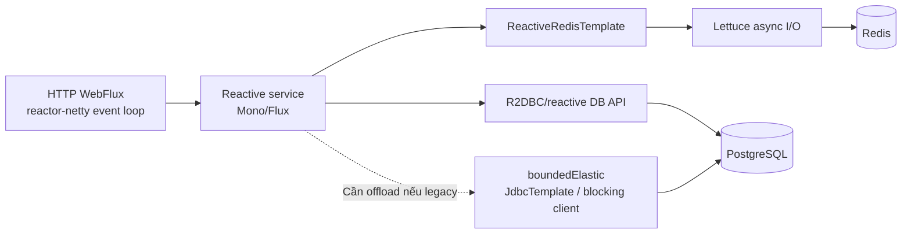
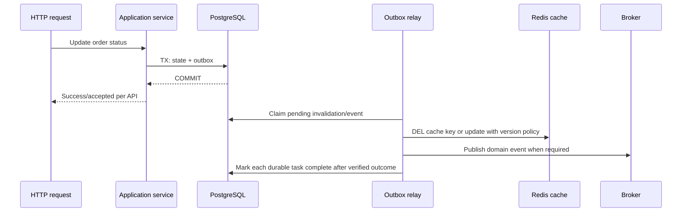

# ReactiveRedisTemplate và giới hạn không chặn luồng

> **Chương:** Redis  
> **Module:** `SPRING_BOOT_INTEGRATION` — tích hợp các hệ thống trong Spring Boot qua HTTP client, cơ sở dữ liệu, cache, message broker và adapter Spring Integration. Trọng tâm gồm cấu hình, hợp đồng dữ liệu, transaction, phân loại lỗi, chống xử lý trùng lặp, kiểm thử và observability.
>
> **Ngữ cảnh API:** Java 17+, Spring Boot 3.x, Spring Data Redis reactive và Project Reactor. Ví dụ dùng Redis qua **Lettuce** và Spring WebFlux. Các property, API serializer và tính năng tương tác với Spring Cache có thể thay đổi theo phiên bản Spring Boot/Spring Data Redis; phải đối chiếu dependency/BOM thực tế. Đây là bài về lập trình phản ứng và ranh giới I/O, không phải tuyên bố Redis cung cấp exactly-once hoặc transaction chung với database.

## 1. Bài toán: WebFlux dùng Redis nhưng request vẫn bị treo

Một API của Order Service phục vụ truy vấn trạng thái đơn hàng:

```text
GET /orders/{orderId}/summary
    → Redis cache
    → Nếu cache miss: đọc PostgreSQL
    → Cập nhật cache TTL
    → Trả dữ liệu cho HTTP client
```

Đội phát triển đã dùng Spring WebFlux và mong muốn xử lý nhiều request đồng thời với số thread hợp lý. Nhưng một implementation có thể vô tình chặn event-loop:

```java
// Anti-pattern trong WebFlux handler:
OrderSummary summary = redisTemplate.opsForValue().get(key);
return Mono.just(summary);
```

Ở đây `RedisTemplate` là API **đồng bộ**. Lệnh `get` có thể chờ network I/O ngay trên thread đang gọi. Một sai lầm khác:

```java
// Anti-pattern: đổi sang API reactive nhưng lại block để lấy giá trị:
OrderSummary summary = reactiveRedisTemplate.opsForValue()
    .get(key)
    .block();
```

`ReactiveRedisTemplate` trả về `Mono`/`Flux`, nhưng `.block()` lại biến lời gọi thành chờ đồng bộ và có thể bị Reactor từ chối nếu chạy trên thread được đánh dấu non-blocking. Các yêu cầu bị chậm, latency tăng, thread bị chiếm, trong khi ứng dụng tưởng mình đã “reactive”.

Mục tiêu của bài là **hiểu chính xác “không chặn luồng” nghĩa là gì**, áp dụng ReactiveRedisTemplate đúng vào pipeline, giới hạn các bước vẫn blocking, thiết kế timeout/cache policy và không nhầm cache Redis với nguồn chân lý hay broker bền vững.

### Mục tiêu học tập

Sau bài này, bạn có thể:

1. Phân biệt `RedisTemplate`, `ReactiveRedisTemplate` và `ReactiveStringRedisTemplate`.
2. Biết vai trò của `ReactiveRedisConnectionFactory`, Lettuce, Reactor `Mono/Flux` và subscription.
3. Xây dựng API cache-aside không dùng `block()`, có TTL và fallback rõ ràng.
4. Thiết kế serialization, key namespace, type/version và cache invalidation.
5. Phát hiện JDBC, file I/O, `Thread.sleep`, CPU-heavy deserialization và lời gọi HTTP blocking trong luồng reactive.
6. Dùng `Schedulers.boundedElastic()` có kiểm soát cho legacy blocking I/O khi chưa thể thay thế bằng reactive driver.
7. Giới hạn concurrency, timeout, kích thước dữ liệu, retry và tránh cache stampede.
8. Hiểu giới hạn atomicity của Redis, database transaction, inbox/outbox và idempotency.
9. Kiểm thử bằng Reactor `StepVerifier` cùng Redis thực tế, kiểm tra memory, latency và kết quả khi Redis mất kết nối.

## 2. ReactiveRedisTemplate giải quyết vấn đề nào?

Spring Data Redis cung cấp hai nhóm API nổi bật:

| API | Kiểu kết quả | Phong cách gọi | Phù hợp |
|---|---|---|---|
| `RedisTemplate<K,V>` | `V`, `Boolean`, `Long`, `List<V>`… | Đồng bộ, thread có thể chờ I/O | MVC, batch/job blocking, code đã quản lý thread truyền thống |
| `ReactiveRedisTemplate<K,V>` | `Mono<V>`, `Flux<V>`, `Mono<Boolean>`… | Non-blocking reactive pipeline với driver phù hợp | WebFlux, reactive event processing, hệ thống cần compose publisher |
| `ReactiveStringRedisTemplate` | `Mono<String>`/`Flux<String>` và operation result | Bản chuyên biệt cho String key/value | Cache key/string token, JSON string, counters đơn giản |

**Lưu ý:** Một REST controller chạy bằng Spring MVC **vẫn có thể** dùng ReactiveRedisTemplate, nhưng nếu controller nhận kết quả bằng `block()` thì không thu được đặc tính end-to-end non-blocking. Ngược lại, một ứng dụng WebFlux **có thể** dùng RedisTemplate nhưng sẽ chặn thread nếu gọi trực tiếp trên event-loop.

Spring Data Redis reactive dựa trên `ReactiveRedisConnectionFactory` và reactive driver; với Spring Boot starter phổ biến, **Lettuce** là lựa chọn hỗ trợ API reactive. Không suy ra mọi Redis client/connection factory trên classpath đều hỗ trợ reactive interface.

### 2.1. “Reactive” không có nghĩa Redis server xử lý mọi lệnh song song

“Non-blocking” ở đây chủ yếu nói về **mô hình phía client**: thay vì giữ một thread chờ socket trả kết quả, driver và Reactor điều phối việc nhận phản hồi. Redis vẫn có giới hạn CPU/network, bộ nhớ, băng thông, lock contention, lệnh nặng và quy trình eviction/replication.

Nếu Redis bị quá tải, 10.000 `Mono` đang chờ vẫn là 10.000 tác vụ tồn tại. Không chặn một thread cho mỗi request **không có nghĩa** có thể bỏ qua connection limits, timeout, backpressure hoặc memory.

### 2.2. Sơ đồ ranh giới



Đường Redis/Lettuce có thể bất đồng bộ mà **đường JDBC vẫn blocking**. Cần xem **toàn pipeline** thay vì chỉ một bean.

## 3. Reactor Mono, Flux và thời điểm lệnh Redis thực thi

Phần lớn lệnh reactive Redis trả về:

- `Mono<T>`: có thể phát **0 hoặc 1** giá trị, sau đó complete/error.
- `Flux<T>`: có thể phát nhiều giá trị, complete/error.
- `Mono<Boolean>`: kết quả lệnh như `SET`/`EXPIRE` theo API.
- `Mono<Long>`: số item bị xóa/đếm kết quả khi thích hợp.

Ví dụ:

```java
Mono<String> read = redis.opsForValue().get("order:summary:42");
```

Ở đây `read` là một **Publisher**. Khi ứng dụng subscribe (trực tiếp hoặc do WebFlux subscribe để viết HTTP response), lệnh mới tham gia quá trình thực thi. Cách driver chuẩn bị command có thể có chi tiết nội bộ riêng; điểm quan trọng trong thiết kế ứng dụng là không coi việc tạo `Mono` đồng nghĩa giá trị đã có trong bộ nhớ hoặc command đã hoàn thành.

### 3.1. Không làm mất kết quả bằng subscribe() thủ công

```java
// Không làm trong request handler:
redis.opsForValue().set(key, value).subscribe();
return Mono.just("accepted");
```

Ở đây ứng dụng tạo một subscription bị tách khỏi request lifecycle. Lệnh Redis có thể lỗi sau khi response đã trả về; cancellation/tracing, retry và error handling không còn nối đúng pipeline. Với dữ liệu cần độ tin cậy, đây không phải cách thay cho một job/outbox.

Cách compose:

```java
return redis.opsForValue()
    .set(key, value, Duration.ofMinutes(3))
    .thenReturn("stored");
```

WebFlux quản lý subscription, error và cancellation của publisher được trả về. **Không** tự gọi `subscribe()` trong service để “kích hoạt” một thao tác rồi bỏ future.

### 3.2. Cold Publisher và nhiều subscription

Với nhiều pipeline Redis, **mỗi subscription có thể tạo một execution mới**. Nếu:

```java
Mono<Boolean> operation = redis.opsForValue().set(key, value);
operation.subscribe();
operation.subscribe();
```

bạn có thể gửi cùng lệnh hai lần. Đặc biệt với `INCR`, `LPUSH` hoặc side effect khác, phải cân nhắc việc retry/resubscribe sẽ lặp thao tác. Chia sẻ publisher bằng `cache()` hay `share()` cũng có lifecycle/memory semantics riêng; không sử dụng chúng để “giải quyết” nghiệp vụ exactly-once.

## 4. Tạo Spring Boot project có Reactive Redis

Gradle Groovy DSL:

```gradle
dependencies {
    implementation("org.springframework.boot:spring-boot-starter-webflux")
    implementation("org.springframework.boot:spring-boot-starter-data-redis-reactive")
    implementation("org.springframework.boot:spring-boot-starter-actuator")

    testImplementation("org.springframework.boot:spring-boot-starter-test")
    testImplementation("io.projectreactor:reactor-test")
}
```

Với Spring Boot 3.x, starter Redis reactive thông dụng dựa trên Lettuce. Không tự thêm nhiều client version xung đột; để Spring Boot BOM quản lý Spring Data Redis, Lettuce, Reactor và Netty phù hợp.

```yaml
spring:
  data:
    redis:
      host: ${REDIS_HOST:localhost}
      port: ${REDIS_PORT:6379}
      timeout: 2s

management:
  endpoints:
    web:
      exposure:
        include: health,info,metrics
```

Các biến môi trường trong ví dụ phục vụ local/test; production cần Redis endpoint, TLS, credential, timeout và ACL phù hợp. Không mặc định `localhost` ở production. `spring.data.redis.timeout` là cấu hình timeout của client/connection theo phiên bản; không xem nó là **deadline end-to-end của mọi request HTTP**.

### 4.1. Đăng ký template tự động hay tự tạo?

Spring Boot có thể auto-configure `ReactiveRedisConnectionFactory`/`ReactiveStringRedisTemplate`/`ReactiveRedisTemplate` khi dependency, loại factory và bean conditions phù hợp. Nhưng:

- Template mặc định có serializer nhất định; đừng đoán serializer chính xác cho DTO mà chưa xem bean.
- Khi có nhiều Redis connection factory, cần chỉ rõ qualifier/template đúng.
- Tạo bean `ReactiveRedisTemplate<String,OrderSummary>` riêng giúp chốt contract serializer cho value.
- Tạo một connection factory tùy chỉnh có thể khiến auto-configuration mặc định back off hoặc không áp dụng property trước đó.

Đừng coi việc có bean template là bằng chứng Redis server đang hoạt động. Startup có thể tạo bean thành công nhưng lệnh đầu tiên lỗi khi kết nối.

## 5. ReactiveStringRedisTemplate: ví dụ ghi/đọc đơn giản

`ReactiveStringRedisTemplate` là điểm bắt đầu thuận tiện khi cả key và value là chuỗi:

```java
import java.time.Duration;
import org.springframework.data.redis.core.ReactiveStringRedisTemplate;
import org.springframework.stereotype.Service;
import reactor.core.publisher.Mono;

@Service
public class ReactiveSessionTokenStore {
    private final ReactiveStringRedisTemplate redis;

    public ReactiveSessionTokenStore(ReactiveStringRedisTemplate redis) {
        this.redis = redis;
    }

    public Mono<Boolean> put(String tokenReference, String value) {
        String key = "session:v1:" + tokenReference;
        return redis.opsForValue().set(key, value, Duration.ofMinutes(15));
    }

    public Mono<String> find(String tokenReference) {
        return redis.opsForValue().get("session:v1:" + tokenReference);
    }

    public Mono<Boolean> remove(String tokenReference) {
        return redis.delete("session:v1:" + tokenReference)
            .map(count -> count > 0);
    }
}
```

Ví dụ chỉ minh họa reactive API. Nếu `tokenReference` là dữ liệu từ người dùng, phải xác minh cấu trúc/kích thước và bảo đảm key không gây cross-tenant access. Không lưu access token hoặc secret thô trong Redis/log khi không cần; nếu lưu session/token, phải có mô hình bảo mật, TTL, eviction, rotation và quyền truy cập riêng.

**Chú ý semantics:** `GET` một key không tồn tại thường complete **không phát value** (`Mono.empty()`), không tự ném `KeyNotFoundException`. `SET` trả `Mono<Boolean>` cho kết quả được client diễn giải theo command; nó **không phải xác nhận business transaction xuyên database**.

### 5.1. SET với TTL và lệnh EXPIRE tách rời

```java
// Một lệnh Redis gắn TTL cùng SET:
redis.opsForValue().set(key, value, Duration.ofMinutes(5));
```

Cách này thường tốt hơn:

```java
// Hai lệnh độc lập; crash/lỗi giữa chúng có thể để key không có TTL:
redis.opsForValue().set(key, value)
    .then(redis.expire(key, Duration.ofMinutes(5)));
```

Với cache có quy tắc sống tối đa, dùng **SET kèm expiration trong một command** để không tồn tại cửa sổ dữ liệu thiếu TTL nếu process chết sau SET.

### 5.2. Cache TTL không bằng thời hạn nghiệp vụ

Redis expiration có thể làm key biến mất khi thời gian đến hạn; eviction do memory policy cũng có thể xóa key sớm hơn TTL. Vì vậy TTL không được dùng làm **chứng cứ** token đã được revoke thành công ở mọi nơi hoặc một event không còn cần idempotency. Cache là lớp tăng tốc, không phải log giao dịch.

## 6. ReactiveRedisTemplate<K,V> và serializer rõ ràng

Khi value là DTO, bạn có thể chọn serialized JSON/CBOR/bytes tùy contract. Ví dụ minh họa type và bean:

```java
public record OrderSummary(
    String orderId,
    String tenantId,
    String status,
    long version
) {}
```

```java
import org.springframework.context.annotation.Bean;
import org.springframework.context.annotation.Configuration;
import org.springframework.data.redis.connection.ReactiveRedisConnectionFactory;
import org.springframework.data.redis.core.ReactiveRedisTemplate;
import org.springframework.data.redis.serializer.Jackson2JsonRedisSerializer;
import org.springframework.data.redis.serializer.RedisSerializationContext;
import org.springframework.data.redis.serializer.RedisSerializer;

@Configuration(proxyBeanMethods = false)
class OrderRedisConfiguration {

    @Bean
    ReactiveRedisTemplate<String, OrderSummary> orderSummaryRedis(
            ReactiveRedisConnectionFactory connectionFactory) {

        RedisSerializationContext<String, OrderSummary> context =
            RedisSerializationContext
                .<String, OrderSummary>newSerializationContext(
                    RedisSerializer.string())
                .value(new Jackson2JsonRedisSerializer<>(OrderSummary.class))
                .build();

        return new ReactiveRedisTemplate<>(connectionFactory, context);
    }
}
```

**Ghi chú version:** `Jackson2JsonRedisSerializer`, constructor và config Jackson có thay đổi/deprecation ở một số nhánh Spring Data Redis. Hãy chọn serializer/API JSON được phiên bản đang dùng hỗ trợ và viết test round-trip; không copy snippet sang major khác mà không compile. Có thể cần `ObjectMapper` tùy chỉnh theo hợp đồng (Java Time, enum, field names) thay vì serializer mặc định.

### 6.1. Vì sao serializer phải được quản trị?

Redis chỉ giữ bytes. Nếu producer và consumer đọc cùng key bằng serializers không tương thích, `GET` có thể trả dữ liệu sai/deserialize error hoặc không thể đọc record cũ sau nâng cấp.

- Chốt key prefix, value type/schema version.
- Với JSON, quản lý Jackson modules, enum/time representation và unknown fields.
- Tránh bật polymorphic default typing cho payload không tin cậy.
- Không sử dụng Java native serialization (`JdkSerializationRedisSerializer`) để chia dữ liệu giữa nhiều service/untrusted contexts khi không có quy trình bảo mật phù hợp.
- Có chiến lược migration/dual-read khi đổi serializer hoặc schema.
- Test việc đọc cache key được ghi bởi phiên bản ứng dụng trước.

### 6.2. Mối quan hệ giữa key và tenant

Key `order:42` có thể xung đột giữa hai tenant. Dùng namespace rõ:

```text
order-summary:v2:<tenantId>:<orderId>
```

Đầu vào phải được normalize/escape theo quy tắc để tránh ghép key mơ hồ; không để người dùng yêu cầu `KEYS *` hoặc chọn Redis namespace tùy ý. Key prefix giúp vận hành nhưng **không thay ACL** hoặc tenant authorization ở service.

## 7. Cache-aside không chặn: cache hit, cache miss và TTL

Một pattern thông dụng:

1. Tìm trong Redis.
2. Nếu hit, trả value.
3. Nếu miss, đọc nguồn chính (PostgreSQL qua **R2DBC** trong ứng dụng reactive).
4. Ghi lại cache với TTL.
5. Trả value cho HTTP caller.

Ví dụ interface do ứng dụng định nghĩa:

```java
import reactor.core.publisher.Mono;

public interface ReactiveOrderSummaryRepository {
    Mono<OrderSummary> findByTenantAndId(String tenantId, String orderId);
}
```

Implementation cache-aside:

```java
import java.time.Duration;
import org.springframework.beans.factory.annotation.Qualifier;
import org.springframework.data.redis.core.ReactiveRedisTemplate;
import org.springframework.stereotype.Service;
import reactor.core.publisher.Mono;

@Service
public class ReactiveOrderSummaryService {

    private static final Duration CACHE_TTL = Duration.ofMinutes(3);

    private final ReactiveRedisTemplate<String, OrderSummary> redis;
    private final ReactiveOrderSummaryRepository database;

    public ReactiveOrderSummaryService(
            @Qualifier("orderSummaryRedis")
            ReactiveRedisTemplate<String, OrderSummary> redis,
            ReactiveOrderSummaryRepository database) {
        this.redis = redis;
        this.database = database;
    }

    public Mono<OrderSummary> find(String tenantId, String orderId) {
        String key = "order-summary:v2:" + tenantId + ":" + orderId;

        return redis.opsForValue().get(key)
            .switchIfEmpty(Mono.defer(() ->
                database.findByTenantAndId(tenantId, orderId)
                    .flatMap(summary ->
                        redis.opsForValue()
                            .set(key, summary, CACHE_TTL)
                            .thenReturn(summary)
                    )
            ));
    }
}
```

Điều đúng trong ví dụ:

- Không có `.block()` hoặc `subscribe()` thủ công.
- `switchIfEmpty(Mono.defer(...))` chỉ kích hoạt đọc DB khi cache miss; tránh tính toán/fetch sớm ở nhánh fallback.
- `set(key, summary, ttl)` ghi cache với expiration.
- `database.findByTenantAndId` là **API reactive thực sự**; bản thân interface `Mono<T>` chưa chứng minh implementation non-blocking nếu bên trong lại gọi JDBC.
- Nếu DB không có row, `Mono.empty()` truyền ra; controller quyết định HTTP `404`.
- Lỗi Redis/DB sẽ **propagate** theo pipeline; chưa có cache-down fallback ở đoạn cơ bản này.

### 7.1. Ghi cache thất bại thì có nên trả dữ liệu DB?

Cache là lớp tùy chọn trong nhiều hệ thống. Nếu Redis SET lỗi sau khi DB đọc thành công, trả `500` có thể không phù hợp vì đã có dữ liệu chính xác. Có thể thiết kế **best-effort write** cho lỗi hạ tầng Redis có thể nhận diện:

```java
return database.findByTenantAndId(tenantId, orderId)
    .flatMap(summary ->
        redis.opsForValue()
            .set(key, summary, CACHE_TTL)
            .thenReturn(summary)
            .onErrorResume(
                org.springframework.data.redis.RedisConnectionFailureException.class,
                ex -> Mono.just(summary)
            )
    );
```

Đoạn này xử lý **lỗi kết nối Redis** trong cache write; không “nuốt” mọi exception như serializer lỗi, dữ liệu sai type hoặc bug. Nếu muốn fallback khi timeout Redis, cần thêm timeout policy có kiểm soát và phân biệt rõ lỗi cache với lỗi DB.

### 7.2. Đừng để fallback ghi cache làm chậm HTTP response vô hạn

Một đường đọc DB rồi ghi cache đồng bộ theo reactive chain vẫn **chờ kết quả SET** trước khi trả summary. Có thể dùng timeout ngắn cho cache write hoặc thiết kế write-behind riêng; nhưng đừng tách bằng `subscribe()` không quản lý và cho rằng đã có background job bền vững.

## 8. Controller WebFlux nhận Mono mà không chặn

Ví dụ HTTP endpoint:

```java
import org.springframework.http.HttpStatus;
import org.springframework.web.bind.annotation.GetMapping;
import org.springframework.web.bind.annotation.PathVariable;
import org.springframework.web.bind.annotation.RequestMapping;
import org.springframework.web.bind.annotation.RestController;
import org.springframework.web.server.ResponseStatusException;
import reactor.core.publisher.Mono;

@RestController
@RequestMapping("/tenants/{tenantId}/orders")
class OrderSummaryController {

    private final ReactiveOrderSummaryService service;

    OrderSummaryController(ReactiveOrderSummaryService service) {
        this.service = service;
    }

    @GetMapping("/{orderId}/summary")
    Mono<OrderSummary> summary(
            @PathVariable String tenantId,
            @PathVariable String orderId) {

        return service.find(tenantId, orderId)
            .switchIfEmpty(Mono.error(new ResponseStatusException(
                HttpStatus.NOT_FOUND, "Order not found")));
    }
}
```

WebFlux có thể subscribe vào `Mono` và viết response khi có dữ liệu. Nhưng controller này **chưa có authentication/authorization**: một client không được phép truy cập tenant khác không thể chỉ bị chặn bằng key prefix. Trong production, cần xác thực danh tính caller, ánh xạ tenant và validate ID trước khi tạo Redis key hoặc query DB.

Không nên luôn tạo `Mono.error(...)` với dữ liệu từ user mà ghi thông báo chứa PII vào response; trả mã lỗi ổn định/ProblemDetail theo API contract.

## 9. Reactive không tự lan sang JDBC hoặc HTTP đồng bộ

Một anti-pattern dễ bỏ qua:

```java
public Mono<OrderSummary> find(String orderId) {
    OrderSummary summary = jdbcTemplate.queryForObject(
        "SELECT ... WHERE order_id = ?",
        orderRowMapper,
        orderId
    );

    return Mono.just(summary);
}
```

Lệnh `JdbcTemplate.queryForObject` thực thi **ngay trước khi trả Mono** và chặn thread hiện tại. Wrap bằng `Mono.just` không làm nó bất đồng bộ.

Một anti-pattern khác:

```java
public Mono<OrderSummary> find(String orderId) {
    return Mono.defer(() ->
        Mono.just(jdbcTemplate.queryForObject(
            "SELECT ... WHERE order_id = ?",
            orderRowMapper,
            orderId
        ))
    );
}
```

`Mono.defer` làm lời gọi chỉ chạy khi subscribe, nhưng **vẫn chặn thread subscriber**. Laziness không đồng nghĩa non-blocking.

### 9.1. Ưu tiên driver reactive khi phù hợp

Nếu xây service WebFlux thật sự cần end-to-end nonblocking với PostgreSQL, cân nhắc R2DBC và một API như `DatabaseClient`/reactive repository. Phải kiểm tra transaction, dialect, driver và tính năng SQL thực tế; R2DBC không phải thay thế một-một cho mọi tính năng JDBC/jOOQ JDBC.

### 9.2. Không vì reactive mà viết lại toàn hệ thống vô điều kiện

Một ứng dụng Spring MVC + JDBC + RedisTemplate có thể rất phù hợp với workload và pool size đã giới hạn. Chuyển sang reactive làm code và debugging phức tạp hơn; lợi ích rõ nhất khi có nhiều I/O chờ, cần concurrency cao và phần lớn dependency có API nonblocking. Chọn mô hình theo SLA, throughput, tài nguyên và kinh nghiệm vận hành, không theo tên thư viện.

## 10. Bọc legacy blocking I/O bằng boundedElastic

Khi chưa thể chuyển PostgreSQL client sang R2DBC, dùng `Mono.fromCallable` kết hợp `Schedulers.boundedElastic()` để di chuyển blocking call ra khỏi event-loop:

```java
import org.springframework.jdbc.core.JdbcTemplate;
import org.springframework.stereotype.Repository;
import reactor.core.publisher.Mono;
import reactor.core.scheduler.Schedulers;

@Repository
class LegacyJdbcOrderReader {

    private final JdbcTemplate jdbc;

    LegacyJdbcOrderReader(JdbcTemplate jdbc) {
        this.jdbc = jdbc;
    }

    Mono<OrderSummary> find(String tenantId, String orderId) {
        return Mono.fromCallable(() ->
                jdbc.queryForObject(
                    """
                    SELECT order_id, tenant_id, status, version
                    FROM order_summary
                    WHERE tenant_id = ? AND order_id = ?
                    """,
                    (rs, rowNum) -> new OrderSummary(
                        rs.getString("order_id"),
                        rs.getString("tenant_id"),
                        rs.getString("status"),
                        rs.getLong("version")
                    ),
                    tenantId, orderId
                )
            )
            .subscribeOn(Schedulers.boundedElastic());
    }
}
```

**Ý nghĩa:**

- `Mono.fromCallable` trì hoãn lời gọi cho tới khi subscribe.
- `subscribeOn(Schedulers.boundedElastic())` cho phép chạy blocking JDBC ở scheduler dành cho việc chặn có giới hạn.
- Không dùng `Schedulers.parallel()` để chạy chờ socket/SQL blocking kéo dài; scheduler đó được thiết kế cho công việc CPU ngắn.
- `boundedElastic` không tạo ra I/O nonblocking. Nó dùng **các thread riêng có giới hạn** để chờ I/O; khi tải vượt khả năng có queue/delay.
- Nếu JDBC không tìm thấy hàng, `queryForObject` có thể ném `EmptyResultDataAccessException`; phải phân loại đó thành “not found” ở adapter nếu muốn trả `Mono.empty()`.

### 10.1. Tách lỗi “not found” khỏi lỗi thật

```java
return Mono.fromCallable(() ->
        jdbc.queryForObject(SQL, rowMapper, tenantId, orderId))
    .subscribeOn(Schedulers.boundedElastic())
    .onErrorResume(
        org.springframework.dao.EmptyResultDataAccessException.class,
        ex -> Mono.empty()
    );
```

`SQL` và `rowMapper` là các biến/field đã định nghĩa trong repository thực tế. Đừng dùng `onErrorResume(Exception.class, ex -> Mono.empty())` vì sẽ làm DB timeout, mất quyền hoặc lỗi mapping bị hiểu thành “không có đơn hàng”.

### 10.2. Boundary của @Transactional khi chuyển thread

Transaction imperative của Spring thường dựa trên **ThreadLocal**. `subscribeOn` và `publishOn` có thể chuyển thread; `@Transactional` được đặt ở method đã trả `Mono` nhưng chỉ thực sự chạy SQL về sau **không tự bảo đảm** JDBC transaction context đi cùng pipeline.

Đối với legacy JDBC:

- Đặt `@Transactional` lên method **đồng bộ thực hiện SQL** được gọi từ thread của `boundedElastic` qua Spring proxy.
- Hoặc dùng `TransactionTemplate` thực thi toàn đơn vị JDBC bên trong `fromCallable`, rồi offload cả callable.
- Không giữ JDBC transaction mở qua một chuỗi reactive gồm network Redis/HTTP dài.
- Nếu dùng R2DBC, Spring reactive transaction infrastructure dựa trên Reactor context và `ReactiveTransactionManager`, khác `PlatformTransactionManager` imperative.

## 11. Tách ranh giới database transaction bằng TransactionTemplate

Ví dụ application service phải ghi một bảng outbox từ JDBC nhưng được kích hoạt trong WebFlux:

```java
import org.springframework.stereotype.Service;
import org.springframework.transaction.support.TransactionTemplate;
import reactor.core.publisher.Mono;
import reactor.core.scheduler.Schedulers;

@Service
class LegacyOrderCommandAdapter {

    private final TransactionTemplate transactions;
    private final JdbcOrderCommandRepository repository;

    LegacyOrderCommandAdapter(
            TransactionTemplate transactions,
            JdbcOrderCommandRepository repository) {
        this.transactions = transactions;
        this.repository = repository;
    }

    Mono<Long> accept(OrderCommand command) {
        return Mono.fromCallable(() -> {
                Long id = transactions.execute(status -> {
                    long orderId = repository.insertOrder(command);
                    repository.insertOutbox(command.eventId(), orderId);
                    return orderId;
                });
                return java.util.Objects.requireNonNull(id);
            })
            .subscribeOn(Schedulers.boundedElastic());
    }
}
```

`JdbcOrderCommandRepository` và `OrderCommand` là các type ứng dụng tự định nghĩa. Mọi SQL trong callback phải dùng **cùng datasource/transaction manager**. Mẫu này không làm JDBC nonblocking nhưng có transaction boundary đúng, tránh giữ transaction open khi Redis không sẵn sàng.

### 11.1. Không có transaction nguyên tử JDBC + Redis

Một `@Transactional` JDBC hoặc `TransactionTemplate` không mặc nhiên bao gồm Redis. Nếu ghi PostgreSQL thành công rồi Redis SET thất bại, database đã có dữ liệu mới nhưng cache có thể cũ.

Chiến lược phổ biến:

1. **Database là nguồn chân lý**.
2. Commit DB trước.
3. Invalidate/update cache sau commit qua code có kết quả theo dõi hoặc qua outbox event.
4. Cho TTL và version-check bảo vệ độ trễ nhất quán.
5. Dùng reconciliation nếu cache miss/invalidation thất bại.

Nếu transaction DB rollback, không nên phát cache update như thể thay đổi đã commit.

## 12. Giới hạn của Spring Cache @Cacheable với reactive Redis

Spring Cache abstraction (`@Cacheable`/`CacheManager`) và Spring Data Redis reactive **không phải một API**.

- `RedisCacheManager`/RedisCache thường dựa trên Redis cache implementation theo giao diện Spring Cache, không đồng nghĩa dùng `ReactiveRedisTemplate`/Lettuce reactive operations.
- Một số phiên bản Spring Framework hỗ trợ phương thức trả `Mono`/`Flux` trong caching abstraction, nhưng cần xem **cách cache provider thực hiện I/O** và semantics của cache async.
- `@Cacheable` không tự hứa mọi Redis call là nonblocking trên WebFlux event-loop.
- `@Cacheable` không thay thế key/version/TTL/tenant policy hoặc kiểm soát stale cache khi database cập nhật.

Nếu yêu cầu rõ ràng là **Redis I/O không chặn và fallback được compose trong Reactor**, dùng `ReactiveRedisTemplate` trực tiếp trong adapter thường giúp nhìn thấy các bước get/set/delete/timeout. Nếu đội đã có Spring Cache abstraction phù hợp và throughput không cần reactive, không nhất thiết chuyển đổi.

## 13. Cache miss, timeout và Redis unavailable

Một cache có thể thất bại ở nhiều mức:

| Tình huống | Biểu hiện reactive | Chính sách |
|---|---|---|
| Key không tồn tại | `Mono.empty()` | Đọc DB/source of truth |
| Redis kết nối thất bại | `Mono.error(...)` | Fallback DB nếu cache không critical, ghi metric |
| Redis timeout | `TimeoutException` trong pipeline | Bỏ cache và fallback, có deadline |
| Serializer sai/schema cache cũ | Deserialization error | Không nên âm thầm coi là missing nếu contract sai |
| Redis memory eviction | Key biến mất sớm | Đọc DB và refill |
| DB unavailable sau cache miss | DB publisher error | Propagate/5xx theo API, không bịa dữ liệu |
| Redis hit nhưng value stale | Cache trả object cũ | Version/invalidation/TTL/consistency policy |

### 13.1. Tạo một lớp đọc cache best-effort rõ ràng

```java
import java.time.Duration;
import java.util.concurrent.TimeoutException;
import org.springframework.data.redis.RedisConnectionFailureException;
import reactor.core.publisher.Mono;

Mono<OrderSummary> cacheRead(String key) {
    return redis.opsForValue().get(key)
        .timeout(Duration.ofMillis(250))
        .onErrorResume(RedisConnectionFailureException.class, ex -> {
            cacheFailureCounter.increment();
            return Mono.empty();
        })
        .onErrorResume(TimeoutException.class, ex -> {
            cacheTimeoutCounter.increment();
            return Mono.empty();
        });
}
```

Các biến `redis`, `cacheFailureCounter`, `cacheTimeoutCounter` là dependency đã inject/khởi tạo trong một adapter thực tế. Đoạn này chỉ minh họa cách **giới hạn thời gian cache read** và fallback cho hai nhóm lỗi đã xác định; không được copy như một class độc lập chưa có field.

Khi `cacheRead` trả empty, nhánh database mới chạy qua `switchIfEmpty(Mono.defer(...))`. **Không** làm fallback cho mọi exception bằng cách nuốt lỗi serializer, schema hoặc bug lập trình; các lỗi ấy thường cần alert/quarantine key.

### 13.2. Timeout ở Reactor và timeout ở client

`timeout(Duration)` tạo deadline cho publisher tại tầng Reactor. `spring.data.redis.timeout` và Lettuce command timeout là cơ chế phía client. Chúng bổ sung nhưng không thay thế nhau; một timeout phía caller **không chắc command đã được hủy ở Redis server** nếu command đã gửi.

Đặc biệt, nếu timeout một lệnh `INCR` hoặc Lua script rồi retry vô điều kiện, lệnh đầu có thể đã thực thi. Cần thiết kế idempotency/result reconciliation cho write commands; timeout không chứng minh command chưa chạy.

## 14. Retry: chỉ khi an toàn và có ngân sách

`retryWhen(Retry.backoff(...))` có thể phù hợp với lỗi mạng tạm thời trong một số lệnh **đọc**. Với lệnh ghi có side effect, retry có nguy cơ chạy hai lần nếu kết quả lần đầu không chắc chắn.

```java
import java.time.Duration;
import reactor.util.retry.Retry;

Mono<OrderSummary> readWithBoundedRetry(String key) {
    return redis.opsForValue().get(key)
        .retryWhen(
            Retry.backoff(2, Duration.ofMillis(80))
                .maxBackoff(Duration.ofMillis(300))
                .filter(error -> error instanceof
                    org.springframework.data.redis.RedisConnectionFailureException)
        )
        .timeout(Duration.ofMillis(800));
}
```

Đây là minh họa cho **GET** có thể retry giới hạn; ngay cả với GET, tổng deadline và tải Redis phải được cân nhắc. `maxBackoff` không bao gồm hoàn toàn mọi thời gian command, scheduling và connection delay; deadline ngoài là lớp bảo vệ thêm.

### 14.1. Vì sao không retry INCR một cách mù quáng?

```text
Client gửi INCR counter
Redis thực thi thành công
Phản hồi bị mất trên mạng
Client thấy TimeoutException
Client retry INCR
Counter tăng 2 thay vì 1
```

Redis cung cấp atomicity cho một lệnh riêng lẻ, nhưng **không tạo exactly-once across network timeouts**. Với side effect bắt buộc chính xác, dùng request ID/logic idempotent ở database hoặc Redis Lua/function có ID đã xử lý và TTL/lifecycle phù hợp; kiểm thử failure-injection.

### 14.2. Không nhân retry giữa nhiều tầng

HTTP client, service, Redis adapter, broker consumer và outbox relay có thể mỗi nơi retry 3 lần; tổng số attempts có thể bùng nổ. Chọn **owner retry** cho từng loại lỗi và giới hạn tổng thời gian/request budget.

## 15. Concurrency và backpressure với Flux

Một pipeline reactive có thể dùng `flatMap` để phát nhiều yêu cầu Redis đồng thời. Nếu không giới hạn, số lượng command đang chờ và lượng dữ liệu giữ trong RAM có thể tăng.

```java
import reactor.core.publisher.Flux;

Flux<OrderSummary> summaries =
    Flux.fromIterable(orderIds)
        .flatMap(
            orderId -> orderService.find(tenantId, orderId),
            32 // Giới hạn số inner publisher đồng thời.
        );
```

`flatMap(..., 32)` giúp đặt mức concurrency trong pipeline, nhưng **không tự tạo global rate limit** trên nhiều request HTTP hoặc nhiều pod. Nếu một request đã giữ hàng nghìn orderIds trong memory, mức 32 không giải quyết hết rủi ro input quá lớn; cần giới hạn số item ngay ở HTTP/controller/validation.

### 15.1. flatMap và concatMap khác nhau

- `flatMap` có thể phát kết quả không theo thứ tự input.
- `flatMapSequential` giữ thứ tự output theo input nhưng có thể phải buffer.
- `concatMap` xử lý lần lượt theo thứ tự, ít song song hơn.

Nếu order event xử lý cùng aggregate cần thứ tự, không dùng `flatMap` concurrency cao rồi cho rằng thứ tự được bảo toàn. Với cache lookup độc lập không yêu cầu ordering, `flatMap` có thể phù hợp.

### 15.2. Backpressure không thay giới hạn nguồn dữ liệu

`Flux`/Reactive Streams có cơ chế demand/backpressure, nhưng không phải mọi API/broker/proxy đều propagates backpressure giống nhau. Redis server và network đã nhận command có thể tiếp tục xử lý dù downstream cancel. Cần giới hạn queue, connection/pool và request rate tại ingress.

## 16. Đừng dùng collectList vô hạn hoặc lưu mọi key trong RAM

`ReactiveRedisTemplate` có các thao tác trả `Flux` để quét hoặc đọc nhiều phần tử. Một anti-pattern:

```java
return redis.scan()
    .collectList(); // Có thể giữ số lượng key rất lớn trong heap.
```

Ở đây code giả định biến `redis` là template và API scan tương ứng; mục đích minh họa rủi ro `collectList` với dữ liệu không giới hạn.

### 16.1. SCAN thay vì KEYS

Khi cần quét key trong production, tránh `KEYS *` trên tập dữ liệu lớn vì nó có thể gây việc xử lý nặng ở Redis. Redis `SCAN` giúp duyệt tăng dần:

```java
import org.springframework.data.redis.core.ScanOptions;
import reactor.core.publisher.Flux;

Flux<String> keys = redis.scan(
    ScanOptions.scanOptions()
        .match("order-summary:v2:*")
        .count(100)
        .build()
);
```

**Giới hạn của SCAN:**

- `count(100)` là hint, không phải bảo đảm mỗi lần chỉ trả đúng 100 key.
- Scan không tạo snapshot toàn bộ; key thêm/xóa trong lúc quét có thể ảnh hưởng kết quả.
- Theo ngữ nghĩa Redis SCAN, có thể thấy key lặp; consumer cần dedup khi side effect yêu cầu.
- Quét toàn keyspace vẫn tốn I/O/CPU nếu làm liên tục.

Không lấy SCAN làm cơ chế phân phối task đúng một lần. Với danh sách công việc bền vững, dùng bảng DB/outbox, Redis Streams có ACK policy hoặc broker chuyên biệt theo yêu cầu.

### 16.2. Tránh N+1 Redis khi có batch API phù hợp

Nếu cần đọc 500 key, có thể cân nhắc thao tác multi-get/batch theo API hỗ trợ thay vì phát 500 command nhỏ không kiểm soát. Nhưng multi-get trả một collection có kích thước tương ứng; giới hạn số keys và tổng bytes. Đo benchmark thực tế: một lần MGET quá lớn cũng có thể gây latency spike.

## 17. Atomic operations trong Redis: SET NX, INCR và Lua

Redis có atomicity đối với **một command** như `SET key value NX EX seconds` hoặc `INCR` theo mô hình Redis. Spring Data Redis reactive có API tương ứng.

### 17.1. SET if absent với TTL

```java
import java.time.Duration;
import reactor.core.publisher.Mono;

Mono<Boolean> tryClaim(String jobId, String ownerToken) {
    String key = "job-claim:v1:" + jobId;
    return redis.opsForValue()
        .setIfAbsent(key, ownerToken, Duration.ofSeconds(30));
}
```

Nếu kết quả `true`, caller đã đặt key khi chưa tồn tại theo semantics của command. Nhưng **đây chưa là distributed lock hoàn chỉnh**:

- Lease có thể hết hạn trước khi worker xử lý xong.
- Worker A hết lease, worker B lấy key; A vẫn có thể tiếp tục side effect nếu không có fencing token/DB state check.
- Xóa lock bằng `DEL` đơn thuần khi A kết thúc có thể xóa lock **đang thuộc B**.
- Redis failover/replication có thể tác động bảo đảm lock; phải đánh giá mô hình consistency/durability của Redis topology.

Nếu thực hiện unlock theo owner token, cần **atomic compare-and-delete** bằng Lua/Redis Function (hoặc API lock được kiểm chứng), không dùng `GET` rồi `DEL` tách rời.

### 17.2. INCR là atomic nhưng không thay transaction nghiệp vụ

```java
Mono<Long> next =
    redis.opsForValue().increment("metrics:orders:accepted");
```

Đây có thể là một counter kỹ thuật, nhưng nếu lệnh gửi lại sau timeout, đếm có thể tăng nhiều lần. Đừng lấy giá trị counter làm bằng chứng chính xác số đơn đã commit trừ khi có reconciliation/unique business IDs.

### 17.3. Nhiều lệnh không tự atomic

```java
redis.opsForValue().increment(key)
    .then(redis.expire(key, Duration.ofMinutes(1)));
```

Hai lệnh độc lập có cửa sổ lỗi/crash giữa chúng. Với rate limiter yêu cầu atomically “tăng + đặt TTL khi mới tạo + trả remaining quota”, thường cần **Lua script/Redis Function** hoặc thư viện đã kiểm chứng.

Không suy ra “vì Redis mỗi lệnh atomic nên chuỗi `flatMap`/`then` gồm nhiều lệnh cũng atomic”.

## 18. Redis transaction và PostgreSQL transaction không nối thành một

Redis có các primitive như `MULTI/EXEC`, WATCH, Lua scripts và Redis Functions tùy phiên bản. Nhưng:

- `ReactiveRedisTemplate` sử dụng reactive connection và API thích hợp; transaction/pipelining phải tuân theo connection context của driver, không tự có bởi Reactor `then`.
- `@Transactional` của JDBC không tự quản lý Redis operations.
- `@Transactional` reactive/R2DBC cũng không tự tạo distributed transaction PostgreSQL–Redis.
- Redis replication/persistence khác mô hình WAL/durability của database giao dịch.

### 18.1. Nếu cần ghi DB và invalidation cache

Một flow thực dụng:



Hình minh họa **ý tưởng**: nếu relay thực hiện cả Redis và broker, phải quản lý **trạng thái hoàn thành riêng cho từng side effect**, vì cache invalidation thành công không có nghĩa broker publish thành công và ngược lại. Trên thực tế có thể tách thành hai loại outbox jobs hoặc hai subscribers độc lập.

### 18.2. Không cache trạng thái “đã xử lý event” trước DB commit

Nếu đánh dấu `processed:eventId` trong Redis trước, rồi transaction PostgreSQL rollback, lần redelivery có thể thấy cache key và bỏ qua event hợp lệ. Muốn exactly-once business effect, dùng **unique constraint và transaction DB** làm nguồn chân lý; Redis dedup chỉ là lớp tối ưu tùy chọn sau khi đã xét failure modes.

## 19. Cache consistency: TTL, stale value và race khi ghi

Cache-aside rất phổ biến nhưng có một race:

```text
T1: Reader thấy Redis cache miss
T2: Reader bắt đầu đọc DB, nhận version=5
T3: Writer cập nhật DB thành version=6 và DEL cache key
T4: Reader ghi version=5 vào Redis sau invalidation
T5: Các request khác thấy dữ liệu cũ cho tới TTL hoặc invalidation mới
```

Vì vậy, `DB commit → DEL cache` chưa loại bỏ tất cả race trong môi trường concurrent. Cần chọn consistency theo nghiệp vụ:

1. **TTL ngắn và chấp nhận eventual consistency** khi dữ liệu không critical.
2. **Version key/value** và compare logic để tránh ghi đè bởi phiên bản thấp hơn.
3. **Event-driven invalidation** với retry và reconciliation.
4. **Không cache** những quyết định đòi hỏi đọc trạng thái chính xác tuyệt đối như xác nhận thanh toán nếu không có guard ở DB.
5. **Read-through/versioned cache** qua một adapter có policy rõ.

### 19.1. Cache miss không thể coi là dữ liệu không tồn tại

Redis miss có thể do TTL, eviction hoặc Redis outage. Nếu nguồn DB trả dữ liệu hợp lệ, trả dữ liệu đó. Chỉ kết luận HTTP 404 khi **source of truth** không tìm thấy record, không phải chỉ vì key Redis không tồn tại.

### 19.2. Negative caching

Caching kết quả “không tìm thấy” có thể giảm tải DB khi client liên tục hỏi ID không tồn tại, nhưng cần:

- TTL ngắn và representation sentinel tách biệt với JSON null.
- Key tenant-aware, policy authorization rõ.
- Không làm người dùng không thấy dữ liệu mới tạo vì negative cache còn sống.
- Phân biệt backend “not found” với backend error; không cache lỗi DB như not-found.

## 20. Cache stampede, hot keys và distributed locks

Nếu một key hết TTL và có hàng nghìn request đồng thời, tất cả có thể miss và cùng gọi PostgreSQL. Đây là **cache stampede**.

Các cách kiểm soát:

- TTL jitter để nhiều key không hết hạn cùng thời điểm.
- Request coalescing/single-flight **trong một instance** cho những key phổ biến, có giới hạn map/lifecycle.
- Lock/lease Redis với owner token và fencing phù hợp khi cần phối hợp đa instance.
- Stale-while-revalidate nếu contract chấp nhận dữ liệu cũ có giới hạn.
- Rate limiting/backpressure ở API và DB.
- Warmup/batch refresh có giám sát thay vì poll mọi key không giới hạn.

Không dùng `Mono.cache()` trên một map toàn cục không có eviction: việc cache publisher trong JVM có thể tích lũy dữ liệu vô hạn. Nếu dùng single-flight, quy định thời gian tồn tại entry và cách loại bỏ khi success/error/cancellation.

### 20.1. Hot key và latency

Một key “trạng thái chiến dịch” có thể được đọc hàng triệu lần. Dù mỗi GET rất nhỏ, Redis/network có thể trở thành bottleneck. Cân nhắc local cache ngắn hạn, replica đọc khi phù hợp consistency, batching, response caching ở edge và giới hạn traffic. Nhưng caching nhiều tầng làm invalidation phức tạp; cần ownership rõ.

## 21. Redis Pub/Sub khác Redis Streams và cache

Redis được dùng cho nhiều pattern, mỗi pattern có delivery contract khác:

| Redis feature | Mục đích | Bảo đảm cần hiểu |
|---|---|---|
| Strings/Hashes/Sets | Cache, counter, lookup | Phụ thuộc TTL/eviction và policy dữ liệu |
| Pub/Sub | Phát thông điệp tới subscriber **đang online** | Không có backlog/replay kiểu durable queue cho người vắng mặt |
| Redis Streams | Lưu log stream entries; consumer groups, ACK/pending | Cần vận hành pending, reclaim, retention và idempotency |
| Lists/Blocking pop | Work queue đơn giản | Cần thiết kế ACK/requeue/recovery nếu không muốn mất task |
| Keyspace notifications | Quan sát biến động key/expiration | Không dùng làm nguồn sự kiện nghiệp vụ chắc chắn |
| Lua/Functions | Gộp logic thao tác Redis atomic ở server | Không tự tạo transaction với PostgreSQL |

`ReactiveRedisTemplate` có API cho nhiều loại operation, nhưng việc một operation trả `Flux` **không làm nó trở thành broker bền vững**.

### 21.1. Pub/Sub không phải outbox

Nếu một event thanh toán chỉ được phát qua Redis Pub/Sub mà subscriber đang offline, subscriber có thể **bỏ lỡ** event. Với nghiệp vụ cần replay/ACK, dùng Redis Streams được thiết kế đúng hoặc Kafka/RabbitMQ/Pulsar có chính sách phù hợp, kết hợp inbox/outbox.

### 21.2. Streams có ACK nhưng vẫn có redelivery

Consumer group của Redis Streams có pending entries. Worker crash trước ACK khiến entry tồn tại trong pending và cần reclaim/khôi phục. Vì vậy, **at-least-once và idempotency** vẫn quan trọng. Redis Streams không mặc nhiên thay một hệ streaming chuyên dụng cho mọi workload; phải đánh giá retention, cluster topology và vận hành.

## 22. Reactive context, ThreadLocal và observability

Reactive pipeline có thể đổi thread. Một số thông tin truyền thống như MDC `ThreadLocal`, security context hoặc imperative transaction context không tự được giữ đúng qua mọi operator nếu không có cơ chế context propagation.

- Reactor dùng `Context` cho metadata theo subscription.
- Spring Security reactive dùng cơ chế security context tương thích Reactor khi cấu hình.
- Micrometer tracing/context propagation phụ thuộc dependency và instrumentation.
- Không tự lấy `ThreadLocal` của HTTP thread để quyết định tenant bên trong Redis callback nếu thread có thể đổi.

### 22.1. Correlation ID và tenant

Một request có thể mang `correlationId` phục vụ trace, nhưng **tenantId trong Redis key phải lấy từ danh tính đã được xác thực**, không chỉ từ một HTTP query parameter. Dữ liệu trong Redis có thể chứa PII hoặc thông tin nội bộ; không log full cached object hoặc credentials.

### 22.2. Đừng đặt event ID vào metric label

Event IDs/order IDs có cardinality rất cao; nếu làm tag Micrometer cho từng event, backend metrics dễ phình lớn. Dùng metric theo loại operation, status, cache hit/miss, exception class và environment; đưa event ID vào structured logs/traces theo retention/masking policy.

## 23. Bảo mật Redis khi dùng cache reactive

Reactive template không giảm yêu cầu bảo mật:

1. Dùng TLS/authentication/ACL theo deployment, không hard-code credential.
2. Giới hạn network access, namespace/key prefix, không dùng tài khoản admin cho service thường.
3. Xác định **dữ liệu nào được phép cache**; tránh cache password, access token thô, thông tin thanh toán nhạy cảm nếu không thật sự cần.
4. Mã hóa dữ liệu nhạy cảm theo chính sách và kiểm soát backup/snapshot.
5. Có TTL/retention và cơ chế xóa theo yêu cầu dữ liệu cá nhân.
6. Không để user input tự do tạo Redis command, pattern `KEYS` hoặc keyspace access.
7. Tránh log value khi serializer lỗi và tránh expose `/actuator/configprops` hoặc Redis metrics không masking trên Internet.
8. Với multi-tenant, ràng buộc quyền trước khi đọc/ghi key; key prefix chỉ hỗ trợ tổ chức dữ liệu.

Nếu Redis bị flush/evict, hệ thống phải biết tự phục hồi cache từ nguồn chính; nếu cache chứa **duy nhất một trạng thái nghiệp vụ**, cần đánh giá lại lựa chọn Redis persistence/HA và không gọi đó là “cache”.

## 24. Kiểm thử API Reactive Redis bằng StepVerifier

Reactor Test cung cấp `StepVerifier` để kiểm tra tín hiệu publisher:

```java
import static org.assertj.core.api.Assertions.assertThat;
import java.time.Duration;
import org.junit.jupiter.api.Test;
import reactor.core.publisher.Mono;
import reactor.test.StepVerifier;

class ReactivePipelineTest {

    @Test
    void emitsOneValueThenCompletes() {
        Mono<String> result = Mono.just("DELIVERED")
            .map(String::toLowerCase);

        StepVerifier.create(result)
            .expectNext("delivered")
            .verifyComplete();
    }

    @Test
    void emptyPublisherIsNotAnError() {
        StepVerifier.create(Mono.<String>empty())
            .verifyComplete();
    }
}
```

Đây là unit test Reactor **không kết nối Redis**. Nó minh họa cách quan sát `onNext`/`onComplete` và phân biệt empty với error. Không kết luận serializer/TTL/connection đúng chỉ từ một test `Mono.just`.

### 24.1. Test service bằng fake reactive ports

Tách database/cache thành interface ứng dụng giúp test cache miss/hit mà không dựng Redis. Với mock/fake, có thể xác minh:

- Cache hit không gọi database.
- Cache miss gọi DB đúng một lần.
- Redis connection failure fallback nếu policy cho phép.
- Redis cache write timeout không làm response giữ mãi.
- DB error không bị hiểu là 404.
- Không có `block()` trong service.

Tuy nhiên, cần integration test để chứng minh Lettuce command/serializer đúng trên Redis server thật.

## 25. Integration test với Redis thật và Testcontainers

Ví dụ dùng Testcontainers GenericContainer, Docker phải khả dụng trong môi trường test:

```gradle
dependencies {
    testImplementation("org.testcontainers:junit-jupiter")
    testImplementation("org.testcontainers:testcontainers")
    testImplementation("io.projectreactor:reactor-test")
}
```

```java
import java.time.Duration;

import org.junit.jupiter.api.Test;
import org.springframework.beans.factory.annotation.Autowired;
import org.springframework.boot.test.context.SpringBootTest;
import org.springframework.test.context.DynamicPropertyRegistry;
import org.springframework.test.context.DynamicPropertySource;
import org.springframework.data.redis.core.ReactiveStringRedisTemplate;
import org.testcontainers.containers.GenericContainer;
import org.testcontainers.junit.jupiter.Container;
import org.testcontainers.junit.jupiter.Testcontainers;
import reactor.test.StepVerifier;

@Testcontainers
@SpringBootTest
class ReactiveRedisIntegrationTest {

    @Container
    static final GenericContainer<?> redisServer =
        new GenericContainer<>("redis:7.4-alpine")
            .withExposedPorts(6379);

    @DynamicPropertySource
    static void redisProps(DynamicPropertyRegistry registry) {
        registry.add("spring.data.redis.host", redisServer::getHost);
        registry.add("spring.data.redis.port",
            () -> redisServer.getMappedPort(6379));
    }

    @Autowired
    ReactiveStringRedisTemplate redis;

    @Test
    void writesReadsAndExpiresWithTtl() {
        String key = "test:reactive-redis:order-42";

        StepVerifier.create(
            redis.opsForValue().set(key, "READY", Duration.ofSeconds(30))
        )
            .expectNext(true)
            .verifyComplete();

        StepVerifier.create(redis.opsForValue().get(key))
            .expectNext("READY")
            .verifyComplete();

        StepVerifier.create(redis.getExpire(key))
            .assertNext(ttl -> org.assertj.core.api.Assertions
                .assertThat(ttl).isPositive())
            .verifyComplete();
    }
}
```

Đây là **ví dụ tích hợp** cần dependency Spring Boot/Testcontainers/JUnit tương thích và Docker, không chạy trong STEP 4. Test dùng key cố định chỉ phù hợp khi Redis container cô lập; trong suite chạy song song nên tạo key unique và cleanup sau test.

**Lưu ý:** `getExpire(key)` trả `Mono<Duration>`; khi key không tồn tại hoặc không có expiration, kết quả có semantics đặc thù được Spring Data Redis ánh xạ từ TTL của Redis. Test nên xác minh giá trị dương/không vượt TTL dự kiến thay vì đòi đúng 30 giây tuyệt đối sau khi đã qua network delay.

### 25.1. Test serialization theo version

Với `ReactiveRedisTemplate<String,OrderSummary>`, một integration test nên:

1. Ghi DTO có orderId, tenantId, status và version.
2. Đọc lại và assert từng field, không chỉ value không-null.
3. Ghi bằng serializer/schema cũ rồi đọc bằng code mới.
4. Test key đã hết TTL và dữ liệu Redis bị xóa sớm.
5. Test một payload Redis bị corrupt/sai type: lỗi phải được phát hiện, không bị xem im lặng là cache miss.

## 26. Test performance và failure modes của “nonblocking”

Chỉ kiểm tra functional correctness chưa đủ khi mục tiêu là không chặn thread.

### 26.1. Những thí nghiệm nên có

| Thử nghiệm | Quan sát |
|---|---|
| Redis response chậm nhưng còn kết nối | WebFlux event-loop có bị giữ chờ không, cache timeout hoạt động? |
| Redis mất kết nối | Fallback DB có đúng policy, latency có bị kéo dài? |
| 1.000 request đồng thời cùng một key miss | Cache stampede và số query DB tăng bao nhiêu? |
| `flatMap` concurrency 8/32/128 | Throughput, pending commands, memory và latency |
| Cached object rất lớn | CPU serialize/deserialize có chiếm event-loop không? |
| Redis hết memory/evict nhiều | Cache hit ratio và DB load biến động |
| DB dùng JDBC trong pipeline | Blocking thread có được offload đúng boundedElastic không? |
| Redis GET/SET bị timeout | Lỗi read vs write được phân loại, không retry side effect mù? |
| Shutdown giữa lúc write Redis | Response/side effect có outcome không chắc chắn? |
| Cache value version cũ | Parser/migration/fallback có báo lỗi và metrics? |

### 26.2. Dùng BlockHound và profiling một cách có kiểm soát

BlockHound có thể giúp phát hiện một số blocking calls trên thread được Reactor xem là nonblocking trong test/dev, nhưng khả năng tương thích với JDK, bytecode instrumentation và Reactor version cần kiểm tra. Nó **không phát hiện được mọi CPU stall hoặc mọi blocking path** và không nên được coi là bằng chứng duy nhất “ứng dụng không chặn”.

Kết hợp thread dumps, JFR/async profiler, Reactor metrics, Redis command latency và HTTP p95/p99. Quan sát cả **JDBC pool pending** nếu có bridge sang blocking code.

### 26.3. Đọc số liệu đúng

Một pipeline nonblocking có thể đạt concurrency cao với ít thread hơn, nhưng nếu Redis là nút thắt, p99 vẫn tệ. Sửa bằng caching policy, batching, data shape, payload size, backpressure, Redis topology hoặc giảm tải ở nguồn, không chỉ tăng thread count.

## 27. Troubleshooting: dấu hiệu và cách chẩn đoán

| Triệu chứng | Khả năng cao | Hướng xử lý |
|---|---|---|
| `block()` ném IllegalStateException trên reactor thread | Đã gọi blocking terminal operator trong event-loop | Trả publisher trực tiếp; không `block()` |
| WebFlux latency cao dù có reactive template | JDBC/RestClient blocking, JSON CPU-heavy, Redis chậm | Profiling toàn pipeline, offload/đổi driver |
| Redis GET miss nhưng code vào error handler | Nhầm `Mono.empty` với error | `switchIfEmpty` để xử lý miss |
| Cache luôn rỗng sau SET | Key prefix, serializer, database index, TTL sai | Test round-trip cùng template và Redis endpoint |
| Redis SET thành công nhưng dữ liệu DB cũ | Cache invalidation race | Version policy, TTL, outbox/reconciliation |
| `Mono` không có hành động | Publisher bị bỏ không subscribe bởi caller | Compose/trả publisher tới WebFlux |
| Redis ghi hai lần | Publisher được subscribe/retry hai lần | Đánh giá lệnh có side effect và subscription ownership |
| `onErrorResume` che lỗi mapping | Fallback bắt mọi exception | Chỉ bắt lỗi cache hạ tầng đã phân loại |
| Event loop bị chặn trong `map` | Parse JSON lớn hoặc gọi blocking client | Tách CPU workload/legacy I/O, giới hạn payload |
| `boundedElastic` bị nghẽn | Quá nhiều JDBC/HTTP blocking calls | Bounded concurrency, pool size, load shedding |
| Cache hit thấp sau deploy | Đổi key prefix/schema, eviction hoặc TTL quá ngắn | Versioned key migration, memory/TTL metrics |
| OOM từ scan | `collectList` toàn keyspace | Bounded streaming, scan page/limit, không scan vô hạn |
| Redis command timeout rồi INCR sai | Command đã thực thi, retry lặp | Idempotency/reconciliation |
| Redis PUB/SUB mất event khi pod offline | Pub/Sub không có replay bền vững | Redis Streams/broker và outbox |
| Transaction DB commit nhưng cache còn stale | Redis ngoài JDBC transaction | Post-commit invalidation, outbox, version-check |
| Test chạy với mock Redis nhưng prod lỗi serializer | Mock không mô phỏng bytes/driver | Integration test Redis thật |

Không “sửa” vấn đề bằng cách tăng timeout vô hạn, tăng concurrency không giới hạn hoặc tắt mọi error handler. Những thay đổi đó thường biến lỗi thấy rõ thành backlog hoặc mất dữ liệu khó truy vết.

## 28. Chọn RedisTemplate hay ReactiveRedisTemplate?

| Câu hỏi | Gợi ý |
|---|---|
| Ứng dụng là Spring MVC + JDBC, tải vừa phải? | `RedisTemplate` đồng bộ thường đủ rõ và dễ vận hành. |
| Ứng dụng WebFlux, phần lớn I/O đã nonblocking? | `ReactiveRedisTemplate`/`ReactiveStringRedisTemplate` phù hợp. |
| Có một vài JDBC API chưa thể đổi? | Bridge qua `boundedElastic` có giới hạn, hoặc giữ MVC nếu đơn giản hơn. |
| Cần cache JSON object nhiều version? | Typed serializer, key namespace/version, round-trip/migration tests. |
| Cần atomic counter/SET NX? | Redis command atomic; outcome qua network vẫn có thể không chắc chắn. |
| Cần work queue bền vững với ACK/replay? | Không dùng Pub/Sub; cân nhắc Redis Streams, Kafka/Rabbit/Pulsar hoặc DB outbox. |
| Cần cập nhật DB và cache nhất quán? | DB là source of truth, invalidation/version/outbox và reconciliation. |
| Cần reactive transaction với PostgreSQL? | R2DBC/`ReactiveTransactionManager` theo khả năng driver, không trộn tùy ý với JDBC transaction. |
| Cần giảm p99 khi Redis outage? | Cache-read timeout ngắn, fallback có giới hạn và circuit breaker/load shedding phù hợp. |
| Không có bằng chứng WebFlux hiện bị giới hạn bởi blocking? | Benchmark trước; không chuyển cả stack chỉ vì tên “reactive”. |

## 29. Checklist triển khai Redis reactive trong hệ tích hợp

1. **Driver:** dùng Lettuce/reactive connection factory hỗ trợ `ReactiveRedisTemplate` và phiên bản BOM phù hợp.
2. **Context:** dùng WebFlux/reactive pipeline khi thật sự cần, không có `.block()` hoặc `.subscribe()` lạc khỏi lifecycle.
3. **Serialization:** key/value serializer được chọn tường minh, có test round-trip và migration.
4. **Key design:** namespace/version/tenant rõ, không chấp nhận key tùy ý từ user và có authorization.
5. **TTL:** SET kèm TTL, tránh cache sống mãi ngoài ý muốn; hiểu eviction và eventual consistency.
6. **Miss vs error:** `Mono.empty` cho cache miss, lỗi Redis/serializer/DB được phân biệt.
7. **Fallback:** nếu cache optional, fallback DB khi Redis hỏng với deadline; không nuốt toàn bộ exception.
8. **Blocking boundary:** JDBC/RestClient/file blocking được thay bằng reactive API hoặc offload sang `boundedElastic` có giới hạn.
9. **Transaction:** DB và Redis không nằm trong một transaction chung; cập nhật cache sau commit có policy.
10. **Retry:** read có thể retry bounded, write/INCR phải xét uncertain outcome và idempotency.
11. **Concurrency:** `flatMap` có giới hạn, không quét/tích lũy toàn keyspace, total inflight theo pod/cụm có ngân sách.
12. **Stampede:** TTL jitter/single-flight/lease theo mức consistency, không tự tạo lock thiếu fencing.
13. **Broker:** cache/Pub/Sub khác queue bền vững; event quan trọng cần outbox/inbox và delivery contract.
14. **Security:** TLS/ACL/secrets/PII/tenant isolation/retention, tránh log payload.
15. **Observability:** cache hit/miss, timeout, Redis latency, command failures, thread saturation, p95/p99 và DB load.
16. **Testing:** StepVerifier, Redis Testcontainers, serializer round-trip, cache outage, concurrent miss và failure injection.
17. **Release:** thay schema/key/serializer có backward compatibility/dual-read/rollout và rollback plan.
18. **Runbook:** Redis down, eviction storm, hot key, stale cache và cache flush có quy trình xử lý rõ.

## 30. Tự kiểm tra kiến thức

**Câu 1:** `ReactiveRedisTemplate.opsForValue().get(key)` có làm thread chờ network như RedisTemplate không?  
**Trả lời:** Với reactive driver như Lettuce và pipeline được compose đúng, I/O được thực hiện theo nonblocking model; nhưng serialization, callback CPU-heavy hoặc phần code khác vẫn có thể làm thread bận.

**Câu 2:** Tại sao `Mono.just(jdbcTemplate.queryForObject(...))` không nonblocking?  
**Trả lời:** JDBC được gọi **ngay trước** khi tạo Mono và chặn thread hiện tại. Cần reactive DB driver hoặc `Mono.fromCallable(...).subscribeOn(Schedulers.boundedElastic())` cho legacy code.

**Câu 3:** `Mono.defer` có tự chuyển blocking call sang scheduler khác không?  
**Trả lời:** Không. Nó chỉ trì hoãn thực thi tới subscription; muốn offload cần scheduler phù hợp.

**Câu 4:** `GET` một key không tồn tại được biểu diễn như thế nào?  
**Trả lời:** Thường `Mono.empty()`; dùng `switchIfEmpty` cho cache miss, không coi như lỗi kết nối Redis.

**Câu 5:** `SET key value TTL` có ưu điểm nào so với `SET` rồi `EXPIRE`?  
**Trả lời:** TTL được đặt trong cùng command, tránh khoảng trống giữa hai lệnh khi process crash.

**Câu 6:** Có thể gọi `.subscribe()` trong service rồi trả HTTP `202` để bảo đảm cache đã lưu?  
**Trả lời:** Không. Nó tách việc ghi khỏi request/error/cancellation lifecycle và không có xác nhận bền vững. Compose publisher hoặc dùng job/outbox quản lý.

**Câu 7:** Redis `INCR` là atomic, vậy retry khi timeout có an toàn không?  
**Trả lời:** Không chắc. Lệnh đầu có thể đã thực thi rồi mất response; retry có thể tăng lần hai.

**Câu 8:** `flatMap(..., 32)` có phải giới hạn 32 Redis commands cho toàn cluster?  
**Trả lời:** Không. Đây là concurrency cục bộ của operator/pipeline; cần giới hạn ở mức ingress/pod/cụm nếu có SLO/rate limit tổng.

**Câu 9:** `ReactiveRedisTemplate` có biến `@Transactional` JDBC thành transaction chung với Redis không?  
**Trả lời:** Không. Database và Redis có ranh giới transaction khác nhau; DB là nguồn chân lý, cache invalidation/consistency cần thiết kế.

**Câu 10:** Redis Pub/Sub có bảo đảm consumer offline sẽ nhận event khi quay lại không?  
**Trả lời:** Không. Pub/Sub truyền tới subscriber đang kết nối; event quan trọng cần cơ chế lưu bền vững/replay như Streams hoặc broker phù hợp.

**Câu 11:** Vì sao `collectList()` trên Redis SCAN có thể nguy hiểm?  
**Trả lời:** Nó có thể tích lũy toàn bộ keyspace vào heap dù API từng bước có vẻ reactive.

**Câu 12:** Dùng `@Cacheable` trong WebFlux có đồng nghĩa Redis I/O không chặn?  
**Trả lời:** Không mặc nhiên. Cần kiểm tra cache provider/framework version và actual implementation; `ReactiveRedisTemplate` cung cấp API nonblocking rõ ràng hơn cho đường Redis.

**Câu 13:** Redis key không có dữ liệu có được trả HTTP 404 ngay không?  
**Trả lời:** Không nếu Redis chỉ là cache. Phải kiểm tra nguồn dữ liệu chính rồi mới quyết định not-found.

**Câu 14:** Khi hai instance cùng cache miss và đọc DB, làm sao tránh stampede?  
**Trả lời:** Dùng TTL jitter, coalescing/lock có lease/fencing được thiết kế đúng, rate limiting hoặc stale-while-revalidate theo mức consistency; không chỉ tăng Redis concurrency.

### Tài liệu để đối chiếu theo phiên bản

- [Spring Data Redis — Reference](https://docs.spring.io/spring-data/redis/reference/).
- [Spring Data Redis — Reactive Redis](https://docs.spring.io/spring-data/redis/reference/redis/reactive.html).
- [Spring Boot — Redis](https://docs.spring.io/spring-boot/reference/data/nosql.html#data.nosql.redis).
- [Project Reactor — Reference Guide](https://projectreactor.io/docs/core/release/reference/).
- [Redis — Commands and data types](https://redis.io/docs/latest/commands/).

Tài liệu và code trong bài có thể cần điều chỉnh theo release train, Redis server version và client serializer hiện tại. Đặc biệt, không suy từ một unit test hay API trả `Mono` rằng toàn bộ HTTP–database–cache–broker pipeline đều nonblocking.

---

Trong chương **Redis** của `SPRING_BOOT_INTEGRATION`, cần nhớ: **`ReactiveRedisTemplate` giúp giao tiếp Redis theo Publisher và I/O không chặn với driver thích hợp, nhưng không làm JDBC, HTTP đồng bộ, serialization nặng, business transaction hoặc Redis server trở thành không chặn**. Độ tin cậy và khả năng mở rộng phụ thuộc vào cách compose `Mono/Flux`, giới hạn concurrency và timeout, TTL/serializer/key design, khả năng fallback theo source of truth, idempotency/outbox cùng kiểm thử, bảo mật và observability.
