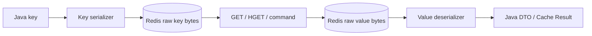

# Serializer cho khóa, giá trị và khả năng đọc dữ liệu giữa các phiên bản

Trong **SPRING_BOOT_INTEGRATION**, Spring Boot thường dùng Redis làm cache kết quả HTTP client, lưu trạng thái ngắn hạn của một luồng đồng bộ, giới hạn tốc độ, hỗ trợ Spring Integration hoặc duy trì dữ liệu trung gian giữa các adapter. Một bản ghi Redis có thể được tạo bởi phiên bản ứng dụng hôm qua và được đọc bởi phiên bản mới hôm nay. Nếu hai phiên bản sử dụng **serializer khác nhau**, cùng một khóa trong Redis có thể trở thành “không tìm thấy”, “không đọc được”, hoặc tệ hơn là **đọc được nhưng sai ý nghĩa nghiệp vụ**.

Bài thuộc chương **Redis**, tập trung vào **serializer cho khóa, giá trị và khả năng đọc dữ liệu giữa các phiên bản**. Ta sẽ hiểu dữ liệu Redis ở mức bytes, phân biệt serializer của `RedisTemplate`, `StringRedisTemplate` và Spring Cache, thiết kế keyspace cùng value schema có phiên bản, chọn chiến lược JSON có kiểu rõ ràng, xử lý key/value đã tồn tại khi nâng cấp và kiểm thử bằng Redis thật. Các ví dụ đặt trong bối cảnh module tích hợp Spring Boot qua HTTP client, database, cache, broker thông điệp và Spring Integration, với trọng tâm hợp đồng dữ liệu, lỗi, xử lý trùng, transaction và quan sát.

> Các ví dụ hướng đến **Java 17+, Spring Boot 3.x, Spring Data Redis 3.x, Spring Data Redis với Lettuce và Jackson 2.x** tương ứng BOM của dự án. Redis server có thể chạy độc lập hoặc cluster; tính tương thích cụ thể của API serializer phụ thuộc phiên bản thư viện. Code sử dụng tên miền, key và payload giả định, không đại diện dữ liệu khách hàng thật.

## 1. Mục tiêu học tập

Sau bài này, bạn có thể:

1. Giải thích tại sao **Redis lưu bytes**, không lưu Java object, và vì sao key serializer quan trọng ngang value serializer.
2. Phân biệt `StringRedisSerializer`, `JdkSerializationRedisSerializer`, JSON có kiểu cụ thể, JSON đa hình, binary codec và khi nào nên sử dụng mỗi loại.
3. Cấu hình `RedisTemplate<String, T>` với **key, value, hash key và hash value serializers** rõ ràng.
4. Hiểu rằng `StringRedisTemplate`, `RedisTemplate` và Spring Cache/`RedisCacheManager` **có những đường serialization riêng**, không tự dùng chung một cấu hình.
5. Thiết kế keyspace có namespace/tenant/version và value chứa **schemaVersion** theo một hợp đồng có thể kiểm thử.
6. Đọc lại dữ liệu cũ bằng **version-aware decoder/upcaster** hoặc chuyển tiếp bằng dual-read/dual-write có giới hạn.
7. Chọn TTL, invalidation, fallback và rollout tránh rò dữ liệu, mất cache hoặc ghi đè thông tin mới bằng schema cũ.
8. Kiểm thử byte representation, trường hợp thiếu/khác kiểu, failover, race, duplicate và observability khi ứng dụng dùng Redis cùng DB và broker.

## 2. Redis không lưu Java object: key và value đều là bytes

Về cơ bản, Redis làm việc với **binary-safe strings** và các cấu trúc như Hash, List, Set, Sorted Set hoặc Stream. Một lệnh `SET` nhận một key và value là những dãy bytes, dù `redis-cli` thường hiển thị chúng dưới dạng text.

```text
Java: "cache:order:v2:tenant-7:ORD-42"
    -- StringRedisSerializer UTF-8 -->
Redis key bytes: 63 61 63 68 65 3a 6f 72 64 65 72 ...

Java: OrderCacheEntryV2(...)
    -- JSON serializer -->
Redis value bytes:
{"schemaVersion":2,"orderId":"ORD-42","status":"PAID",...}
```

Khi đọc:



Serializer là **một phần của hợp đồng lưu trữ**, không chỉ là cấu hình tiện lợi:

- Nếu **key serializer thay đổi**, key bytes khác nhau dù cùng Java `String`. Một app có thể đọc `null` và tưởng cache miss, trong khi key cũ vẫn tồn tại dưới bytes khác.
- Nếu **value serializer thay đổi**, app tìm thấy key nhưng có thể không decode được value.
- Nếu cùng codec JSON nhưng **schema hoặc ý nghĩa trường thay đổi**, app vẫn parse được mà trả dữ liệu sai.
- Nếu Redis Hash có field name và field value, hai phần đó có **hashKeySerializer/hashValueSerializer** riêng.
- Nếu dùng Spring Cache abstraction, `@Cacheable`/`RedisCacheManager` quyết định cách tạo key và value; một `RedisTemplate` khác không tự sửa được chúng.

### 2.1. Kiểm tra dữ liệu thực chứ không đoán từ Redis CLI

Giả sử app A ghi key `cache:order:v2:tenant-7:ORD-42` bằng UTF-8, app B lại dùng JDK serialization cho key. Hai key có thể hiển thị/tương tác như hai dãy bytes hoàn toàn khác nhau. Lệnh:

```bash
redis-cli --raw GET 'cache:order:v2:tenant-7:ORD-42'
```

chỉ thấy giá trị khi **key raw bytes** tương ứng đã tồn tại, không chứng minh app B tạo cùng bytes. Với dữ liệu binary như JDK serialization, output terminal có thể khó đọc hoặc gây nhiễu; hãy dùng tooling/hex dump/test an toàn trong môi trường phát triển và **không log dữ liệu Redis có PII/secret**.

### 2.2. Định dạng dữ liệu của Redis khác schema Java

| Tầng | Có thể thay đổi độc lập? | Ví dụ thay đổi gây lỗi |
| --- | --- | --- |
| Java DTO | Có | Đổi class/package, record field, enum value |
| Serializer/codec | Có | JDK binary → JSON, Jackson typing strategy |
| Key format | Có | `cache:order:123` → `cache:order:v2:123` |
| Value schema | Có | `total` → `amount`, thêm `schemaVersion` |
| Redis TTL | Có | 60 giây → 10 phút, thay freshness contract |
| Business semantics | Có, phải quản trị | Số tiền từ major units → minor units |
| Redis deployment | Có | Standalone → Cluster, đổi database index/prefix |

**Byte compatibility chưa đủ.** JSON v1 và v2 đều là UTF-8 nhưng không nhất thiết có cùng ý nghĩa. Ngược lại, thay một Java package name không làm dữ liệu JSON hỏng nếu codec không chứa class name và schema được giữ ổn định.

## 3. Serializer của khóa: dễ bị bỏ qua nhất

Đối với ứng dụng cần chia sẻ cache giữa nhiều phiên bản và có thể kiểm tra bằng Redis CLI, **key dạng chuỗi UTF-8 ổn định** thường là lựa chọn dễ vận hành:

```text
cache:order:v2:tenant-7:ORD-42
cache:catalog:v3:partner-a:product-991
integration:rate-limit:v1:client-7:20261121
```

Ví dụ Java:

```java
import org.springframework.data.redis.serializer.StringRedisSerializer;
import java.nio.charset.StandardCharsets;

StringRedisSerializer serializer = new StringRedisSerializer();
byte[] rawKey = serializer.serialize(
        "cache:order:v2:tenant-7:ORD-42");
String key = serializer.deserialize(rawKey);
```

`StringRedisSerializer` dùng UTF-8, không tự thêm schema, escaping hay logic tenant. Chỉ định một key format thôi chưa đủ; phải xác định rõ:

1. **Namespace**: cache, lock, rate-limit, integration work state, stream và business status không dùng chung tiền tố vô tình.
2. **Entity/operation**: `order`, `catalog`, `sync-checkpoint`.
3. **Version**: đại diện key-format/value compatibility theo chính sách, không phải Java app release number.
4. **Tenant/source/partner**: bổ sung nếu business ID không duy nhất toàn hệ hoặc cần authorization isolation.
5. **Identifier**: giá trị đã validate; không cho caller chèn dấu phân cách tùy tiện.
6. **TTL**: cache lifetime, negative entry và freshness được quy định.

### 3.1. Key collision và ký tự phân cách

Nếu chỉ nối:

```java
String key = "cache:order:" + tenantId + ":" + orderId;
```

thì cặp `tenant="a:b", orderId="c"` và `tenant="a", orderId="b:c"` tạo cùng chuỗi `cache:order:a:b:c`. Chưa kể key quá dài, Unicode normalization hoặc attacker dùng key không được kiểm soát làm tăng RAM.

Ví dụ helper **theo một hợp đồng ID giới hạn ký tự**:

```java
import java.util.regex.Pattern;

public final class OrderCacheKeys {
    private static final Pattern SAFE_PART =
            Pattern.compile("[A-Za-z0-9._-]{1,128}");

    private OrderCacheKeys() {}

    public static String v2(String tenantId, String orderId) {
        requirePart(tenantId, "tenant");
        requirePart(orderId, "order");
        return "cache:order:v2:" + tenantId + ":" + orderId;
    }

    private static void requirePart(String part, String field) {
        if (part == null || !SAFE_PART.matcher(part).matches()) {
            throw new IllegalArgumentException("Invalid " + field + " key");
        }
    }
}
```

Đây là quy ước **ứng dụng**, không phải giới hạn Redis bắt buộc. Nếu ID thực có dấu hai chấm, Unicode hoặc dấu cách, hãy thiết kế escaping/length-prefix hoặc deterministic encoded component với contract rõ. **Không** lowercase/case-fold order ID nếu đối tác định nghĩa nó case-sensitive, và không dùng raw email/token/PII làm key hiển thị ở công cụ vận hành.

### 3.2. Keyspace version không đồng nghĩa value schemaVersion

| Nơi đặt version | Mục đích | Ví dụ |
| --- | --- | --- |
| Prefix trong key | Cách ly dữ liệu hai format để app cũ/mới không đọc nhầm | `cache:order:v1:...` và `cache:order:v2:...` |
| Field trong value | Cho decoder biết payload đang theo schema nào | `"schemaVersion":2` |
| Cache name của Spring Cache | Tách cache vùng/contract | `orderLookupV2` |
| Broker event schema version | Version của message phát đi | `OrderChangedV2` |

Có thể dùng **cả key version và value schemaVersion**: key version giúp routing và dọn dữ liệu cũ, value version giúp phát hiện nội dung không khớp khi migration/invalidation hoặc hệ thống khác ghi nhầm. Nếu chỉ dựa vào key name để đoán schema, khi dữ liệu bị ghi nhầm vào key v2 thì parser có thể đọc sai mà không báo lỗi.

## 4. So sánh các serializer thường gặp

| Serializer / codec | Biểu diễn | Ưu điểm | Rủi ro và giới hạn |
| --- | --- | --- | --- |
| `StringRedisSerializer` | UTF-8 string | Dễ kiểm tra, ổn định cho key/counter/plain text | Không tự biểu diễn cấu trúc typed DTO hay schema. |
| `JdkSerializationRedisSerializer` | Java Object Serialization binary | Có thể deserialize object Java tương thích khi tin cậy cả hai phía | Gắn với class/`serialVersionUID`, khó cross-language, chi phí bytes, rủi ro deserialization; **tránh dùng cho cache contract mới**. |
| `Jackson2JsonRedisSerializer<T>` | JSON cho kiểu Java cụ thể | Dễ kiểm soát DTO, không cần metadata class tùy ý nếu cấu hình đúng | Đổi field/schema/class có thể lỗi, phải quản lý JavaTime/enum/null/unknown-field policy. |
| `GenericJackson2JsonRedisSerializer` | JSON đa hình với type metadata theo cấu hình | Dùng khi cache chứa nhiều kiểu object Java | Type info như `@class` và default typing có thể phụ thuộc class/package, tăng rủi ro gadget/unsafe polymorphism nếu dữ liệu không tin cậy. |
| Custom `RedisSerializer<T>` | JSON envelope hoặc binary schema đã định nghĩa | Có thể đọc v1/v2, đặt validation và error classification rõ | Cần tự sở hữu migration/schema tests và không chôn logic quá lớn trong codec. |
| Protobuf/Avro/CBOR/MessagePack | Binary/tập quy tắc schema tương ứng | Nhỏ, nhanh hoặc có schema registry khi thiết kế phù hợp | Không tự tương thích nếu thay semantics; cần version/codec/migration và tooling. |

### 4.1. Vì sao native Java serialization không thích hợp làm hợp đồng dài hạn?

Một `RedisTemplate` không được cấu hình có thể dùng **JDK serialization mặc định** cho những phần mà nó được phép tự tạo serializer, tùy class/version/config. Khi value là `com.example.v1.OrderCache`, bytes có thông tin class và cấu trúc serialization. Nếu deploy v2 đổi package/class hoặc `serialVersionUID`, việc deserialize có thể thất bại dù payload nghiệp vụ chưa thay đổi.

Thêm nữa, Java deserialization trên dữ liệu không tin cậy có **rủi ro thực thi gadget chains** tùy thư viện/classpath, là lớp nguy cơ bảo mật khác với parse JSON typed DTO. Không dùng `JdkSerializationRedisSerializer` làm “đường đọc cứu hộ” cho những bytes Redis có thể bị hệ khác/attacker sửa. Khi migration legacy JDK bytes, dùng quy trình offline/isolated có nguồn tin cậy và ràng buộc class filters phù hợp; ưu tiên chuyển một lần sang format đã khai báo.

### 4.2. JSON không tự động tương thích

Giả sử v1 lưu:

```json
{"orderId":"ORD-42","total":"125.00","state":"PAID"}
```

và v2 Java DTO đổi tên `total` thành `amount`, `state` thành `status`. `Jackson2JsonRedisSerializer<OrderCacheV2>` có thể vẫn tạo object với trường null/unknown tùy ObjectMapper; nếu không có validation, service có thể tin một `null` là “không có đơn hàng” hoặc mặc định status thành `NEW`. **Thành công deserialize không có nghĩa payload hợp lệ về business semantics**.

### 4.3. Không bật default typing tùy tiện

Nếu value JSON chứa type metadata như `"@class":"com.example.SecretType"` và decoder chấp nhận tự chọn class từ dữ liệu, kẻ tấn công hoặc cache bị nhiễm có thể tác động việc instantiate các kiểu Java ngoài dự kiến. Khi cần đa hình, dùng allowlist subtype/`PolymorphicTypeValidator` và contract cố định; với cache một DTO, **ưu tiên serializer có kiểu cụ thể** hoặc version-aware codec đọc JSON tree rồi map vào những type đã được code cho phép.

## 5. Spring Boot cấu hình Redis connection khác với serialization policy

Dependency cho Redis access:

```xml
<dependency>
    <groupId>org.springframework.boot</groupId>
    <artifactId>spring-boot-starter-data-redis</artifactId>
</dependency>
```

Ví dụ Gradle Groovy DSL:

```groovy
dependencies {
    implementation 'org.springframework.boot:spring-boot-starter-data-redis'
    implementation 'org.springframework.boot:spring-boot-starter-validation'
    testImplementation 'org.springframework.boot:spring-boot-starter-test'
}
```

Với Spring Boot 3.x, starter thường đưa **Spring Data Redis + Lettuce** lên classpath. Khi auto-configuration đáp ứng điều kiện, Boot có thể tạo `RedisConnectionFactory`, một `RedisTemplate<Object,Object>` và `StringRedisTemplate`. Cache abstraction còn phụ thuộc `@EnableCaching` và cấu hình cache phù hợp. Những beans đó **không có nghĩa Boot đã chọn JSON versioned DTO serializer theo nghiệp vụ của bạn**.

Ví dụ cấu hình Redis connection và timeout:

```yaml
spring:
  data:
    redis:
      host: ${REDIS_HOST:localhost}
      port: ${REDIS_PORT:6379}
      username: ${REDIS_USERNAME:}
      password: ${REDIS_PASSWORD:}
      connect-timeout: 2s
      timeout: 2s
      client-type: lettuce
```

Đây là cấu hình minh họa cho Redis standalone. Ở Redis Cluster/Sentinel/managed cloud, chọn topology, TLS, authentication, database index và reconnect policy theo deployment. Không giả định `spring.data.redis.database` có ý nghĩa chọn logical database khác 0 trong Redis Cluster; nhiều Redis Cluster setups chỉ hỗ trợ DB 0. Các properties phải được xác nhận trên đúng phiên bản Boot và cấu hình connector đang dùng.

### 5.1. Ba con đường gọi Redis thường gặp

| API | Chọn serializer ở đâu? | Điểm dễ nhầm |
| --- | --- | --- |
| `StringRedisTemplate` | Spring Data Redis cấu hình key/value/hash string serializers | Ghi `"123"` thành bytes UTF-8, không phù hợp lưu typed Java object mà không tự encode JSON. |
| `RedisTemplate<K,V>` | `setKeySerializer`, `setValueSerializer`, `setHashKeySerializer`, `setHashValueSerializer` | Có thể tạo key bytes/value bytes khác `StringRedisTemplate` nếu không set đồng nhất. |
| Spring Cache (`@Cacheable`/`RedisCacheManager`) | `RedisCacheConfiguration` của từng cache hoặc defaults | Không tự lấy value serializer đã set ở một `RedisTemplate` bean khác. |

Trong Spring Data Redis, những đường như Redis Streams, Pub/Sub listener container, Redis message converters và Spring Integration Redis adapters cũng có **hợp đồng serialization riêng** theo converter/adapter đã cấu hình. Không được suy “Redis đang dùng JSON” chỉ vì một `RedisTemplate` đã đổi value serializer.

### 5.2. Redis TTL không phải serializer

`EXPIRE` hoặc `opsForValue().set(key, value, Duration)` đặt thời hạn cho **key**, độc lập với schema JSON của value. JSON có field `expiresAt` không tự làm Redis xóa key đúng lúc; Redis key có TTL không tự bảo đảm dữ liệu phản ánh database mới nhất.

Nếu cache được dùng cho quyền truy cập/nhóm của người dùng, TTL/freshness cần tính đến thu hồi quyền. Nếu Redis unavailable, không tự mặc định “tất cả user đều có role admin” hay dựa vào giá trị stale vô hạn để cấp quyền.

## 6. Thiết kế value schema có phiên bản và kiểu rõ ràng

Đối với ví dụ cache order projection từ PostgreSQL hoặc HTTP partner, chọn DTO **riêng cho Redis**, không serialize JPA entity:

```java
import java.math.BigDecimal;
import java.time.Instant;

public record OrderCacheEntryV2(
        int schemaVersion,
        String orderId,
        String status,
        BigDecimal amount,
        String currency,
        Instant updatedAt
) {}
```

Một value:

```json
{
  "schemaVersion": 2,
  "orderId": "ORD-42",
  "status": "PAID",
  "amount": 125.00,
  "currency": "USD",
  "updatedAt": "2026-11-20T10:30:00Z"
}
```

Đây là **cache projection**: nó chứa đúng những trường ứng dụng cần đọc nhanh, có schema và source-of-truth rõ ràng. Không thêm vào `OrderCacheEntryV2` những fields nội bộ JPA như lazy relation graph, Hibernate proxy hoặc database credentials. Nếu HTTP response cần cấu trúc khác, map từ cache/domain sang DTO public riêng.

### 6.1. Hợp đồng giá trị phải xác định từng field

| Trường | Ngữ nghĩa | Validation quan trọng |
| --- | --- | --- |
| `schemaVersion` | Phiên bản payload Redis, không phải app release | Chỉ nhận version đã hỗ trợ. |
| `orderId` | Business ID của order trong keyspace tương ứng | Không rỗng; phải khớp key yêu cầu; scope tenant theo context. |
| `status` | Trạng thái projection, ví dụ `NEW/PAID/CANCELLED` | Enum/vocabulary có policy; unknown state không âm thầm thành NEW. |
| `amount` | Số tiền đơn vị lớn đã xác nhận, biểu diễn decimal | `BigDecimal`, scale/precision và dấu theo loại nghiệp vụ. |
| `currency` | ISO 4217 code trong allowlist của hệ | Không tự chấp nhận mọi string ba chữ. |
| `updatedAt` | Mốc cập nhật từ nguồn sự thật hoặc projection | Không thay bằng `Instant.now()` ở lúc cache read nếu cần so thứ tự. |

**Không coi `updatedAt` là TTL.** TTL nằm trên Redis key và phụ thuộc chiến lược cache. Ngược lại, payload đã được cache lại với TTL mới không có nghĩa dữ liệu nghiệp vụ bên trong cũng mới hơn.

### 6.2. Vì sao không dùng tên Java class trong payload?

Giả sử cache v1 chứa:

```json
{"@class":"com.example.orders.v1.CachedOrder","orderId":"ORD-42"}
```

Sau refactor, class được chuyển tới `com.example.integration.cache.OrderSnapshot`. Decoder dựa trên class name cũ có thể thất bại khi class không còn. Nếu codec dùng field `schemaVersion` và DTO được chọn **tường minh ở code**, việc đổi package Java không nhất thiết làm mất khả năng đọc payload v1.

Vì thế, với cache dùng chung giữa các phiên bản ứng dụng, **schema đã công bố** quan trọng hơn việc để serializer tự nhét metadata class implementation. Chỉ dùng polymorphic type metadata nếu thật sự cần và có allowlist an toàn.

### 6.3. Tách version format và thay đổi nghiệp vụ

Không nhất thiết đổi `v2` → `v3` khi thêm một field *optional* không ảnh hưởng consumer cũ. Nhưng nếu `amount` từ major units thành minor units hoặc `status="S"` đổi nghĩa, đó là **semantic breaking change** dù JSON vẫn parse được. Khi đó phải version hóa và có migration test; không dựa vào việc Jackson “ignore unknown properties” để tuyên bố backward-compatible.

## 7. Cấu hình `RedisTemplate<String, OrderCacheEntryV2>` với serializers đầy đủ

Trong ứng dụng dùng Spring Data Redis 3.x với Jackson 2.x, có thể dùng `Jackson2JsonRedisSerializer<T>` cho **một kiểu DTO cụ thể**, đồng thời dùng `StringRedisSerializer` cho tất cả các phần tên key/field.

```java
import com.fasterxml.jackson.databind.ObjectMapper;
import org.springframework.context.annotation.Bean;
import org.springframework.context.annotation.Configuration;
import org.springframework.data.redis.connection.RedisConnectionFactory;
import org.springframework.data.redis.core.RedisTemplate;
import org.springframework.data.redis.serializer.Jackson2JsonRedisSerializer;
import org.springframework.data.redis.serializer.StringRedisSerializer;

@Configuration(proxyBeanMethods = false)
public class OrderRedisTemplateConfiguration {

    @Bean("orderCacheRedisTemplate")
    RedisTemplate<String, OrderCacheEntryV2> orderCacheRedisTemplate(
            RedisConnectionFactory connectionFactory,
            ObjectMapper objectMapper) {

        var keys = new StringRedisSerializer();
        var values = new Jackson2JsonRedisSerializer<>(
                objectMapper, OrderCacheEntryV2.class);

        RedisTemplate<String, OrderCacheEntryV2> template =
                new RedisTemplate<>();
        template.setConnectionFactory(connectionFactory);
        template.setKeySerializer(keys);
        template.setValueSerializer(values);
        template.setHashKeySerializer(keys);
        template.setHashValueSerializer(values);
        template.afterPropertiesSet();
        return template;
    }
}
```

**Điểm chính:**

1. `RedisConnectionFactory` do Boot quản lý chịu trách nhiệm connection/cluster/TLS, **không quy định kiểu JSON nghiệp vụ**.
2. `ObjectMapper` được Boot cấu hình thường có JavaTime support khi dependency phù hợp; cần **test thật** việc round-trip `Instant`, `BigDecimal` và enum. Đừng tự thay bằng `new ObjectMapper()` rồi quên JavaTimeModule.
3. Các key và hash field names được UTF-8; `HGETALL`, `GET` và tooling sẽ dùng cùng bytes nếu key formats trùng.
4. Value và hash value đều JSON của **`OrderCacheEntryV2`**. Không dùng template chuyên biệt này cho Redis counter, lock token, arbitrary Hash fields hoặc message kiểu khác.
5. Dù DTO là typed, value **không tự được validate chỉ nhờ deserialize**. Nếu payload sai schema/field nghiệp vụ, cần kiểm tra và phân loại lỗi.

Với phiên bản thư viện mới hơn, constructor/API hoặc tên Jackson serializer có thể thay đổi; code cần đồng bộ với Spring Data Redis trong BOM của dự án. Không tự nâng độc lập Spring Data/Jackson chỉ để lấy một overload.

### 7.1. Ghi, đọc, kiểm tra và đặt TTL

```java
import java.time.Duration;
import java.time.Instant;
import org.springframework.beans.factory.annotation.Qualifier;
import org.springframework.data.redis.core.RedisTemplate;
import org.springframework.stereotype.Repository;

@Repository
public final class OrderCacheAdapter {
    private static final Duration TTL = Duration.ofMinutes(5);
    private final RedisTemplate<String, OrderCacheEntryV2> redis;

    public OrderCacheAdapter(
            @Qualifier("orderCacheRedisTemplate")
            RedisTemplate<String, OrderCacheEntryV2> redis) {
        this.redis = redis;
    }

    public void put(String tenantId, OrderCacheEntryV2 order) {
        if (order == null
                || order.schemaVersion() != 2
                || order.orderId() == null) {
            throw new IllegalArgumentException("Invalid v2 cache value");
        }
        redis.opsForValue().set(
                OrderCacheKeys.v2(tenantId, order.orderId()),
                order, TTL);
    }

    public OrderCacheEntryV2 find(
            String tenantId, String orderId) {
        var value = redis.opsForValue().get(
                OrderCacheKeys.v2(tenantId, orderId));

        if (value == null) {
            return null; // Cache miss, not proof the order does not exist.
        }
        if (value.schemaVersion() != 2
                || !orderId.equals(value.orderId())
                || value.status() == null
                || value.updatedAt() == null) {
            throw new InvalidCachedOrderException(
                    "Invalid cached order projection");
        }
        return value;
    }
}

class InvalidCachedOrderException extends RuntimeException {
    InvalidCachedOrderException(String message) {
        super(message);
    }
}
```

Trong project thật, các top-level `public` types trong snippets cần file `.java` riêng. Code trên minh họa lifecycle và contract; hệ thống thực cần validation đầy đủ amount/currency/status và authorization tenant phía service. **TTL đặt cùng lệnh ghi** giúp tránh tạo cache entry không hết hạn khi ứng dụng quên `expire` ở bước sau.

Nếu key đã có v1 data không tương thích mà app v2 vẫn đọc cùng key, `Jackson2JsonRedisSerializer<OrderCacheEntryV2>` không tự upcast. Vì vậy ví dụ **dùng key v2 riêng**. Đối với nhu cầu đọc nhiều version cùng một key, cần codec riêng được trình bày ở phần sau.

### 7.2. Vì sao không serialize JPA entity trực tiếp?

Một JPA entity có lazy collection, Hibernate proxy, bidirectional relations hoặc field nội bộ. Jackson có thể tải thêm nhiều dữ liệu ngoài ý muốn hoặc tạo JSON lệ thuộc persistence implementation. Lưu **projection DTO** ổn định với field contract và TTL riêng, không cache EntityManager/proxy. Khi entity thay đổi, adapter mapping từ entity sang `OrderCacheEntryV2` vẫn có thể giữ nguyên schema JSON cho rolling deployments.

## 8. `StringRedisTemplate` là công cụ hữu ích cho JSON protocol có chủ đích

Trong một số hệ, thay vì dựa vào typed `RedisTemplate` để đọc/ghi value, ứng dụng muốn **sở hữu codec tại một lớp riêng** để hỗ trợ v1/v2. Có thể dùng `StringRedisTemplate` cho key UTF-8 và value **JSON string**, sau đó tự parse qua một codec có version.

```java
import java.time.Duration;
import org.springframework.data.redis.core.StringRedisTemplate;

public final class RawJsonOrderCache {
    private final StringRedisTemplate redis;
    private final VersionedOrderCacheCodec codec;

    public RawJsonOrderCache(
            StringRedisTemplate redis,
            VersionedOrderCacheCodec codec) {
        this.redis = redis;
        this.codec = codec;
    }

    public void put(String tenantId, OrderCacheEntryV2 value) {
        String key = OrderCacheKeys.v2(tenantId, value.orderId());
        redis.opsForValue().set(
                key, codec.encode(value), Duration.ofMinutes(5));
    }

    public OrderCacheEntryV2 read(String tenantId, String orderId) {
        String raw = redis.opsForValue().get(
                OrderCacheKeys.v2(tenantId, orderId));
        return raw == null ? null : codec.decode(raw);
    }
}
```

`VersionedOrderCacheCodec` là **component do ứng dụng sở hữu**, sẽ được định nghĩa bên dưới. Phương pháp này dễ xem raw JSON bằng Redis CLI, dễ test migration, nhưng **phải đảm bảo chỉ đúng codec ghi vào keyspace đó**. Nếu app khác dùng StringRedisTemplate lưu raw integer hoặc Java serialization vào cùng key, không có magic nào giúp tự phát hiện mọi format đáng tin cậy.

### 8.1. String storage và typed JSON khác nhau thế nào?

| Thao tác | `StringRedisTemplate` + codec | Typed `RedisTemplate` |
| --- | --- | --- |
| Chọn key bytes | String serializer (UTF-8) | Do `setKeySerializer` |
| Chọn JSON schema | Codec ứng dụng | RedisSerializer của value |
| Đọc v1 rồi upcast | Dễ đặt tại `codec.decode` | Cần custom RedisSerializer hoặc migration trước |
| Dùng Redis CLI kiểm tra | Có thể đọc JSON text | Có thể đọc nếu typed JSON serializer không mã hóa binary |
| Mất type safety trước decode | Raw string, codec kiểm soát | RedisTemplate có generic type nhưng runtime decode vẫn có thể lỗi |
| Hiệu năng | Thêm bước String → bytes/JSON theo runtime | Serializer làm bytes trực tiếp, cần benchmark theo workload |

Không có lựa chọn “đúng cho mọi cache”. Với một typed DTO duy nhất và keyspace v2 tách biệt, typed template thường đơn giản. Với cache cần **chuyển dữ liệu nhiều phiên bản**, explicit codec có thể giúp giữ policy và test rõ hơn.

## 9. Redis Hash có serializer cho **field name** và **field value**

Đối với Redis Hash:

```text
Redis key      = cache:order-hash:v2:tenant-7:ORD-42
Hash field     = snapshot
Hash field val = {"schemaVersion":2,...}
```

Ba loại bytes đều quan trọng:

- `keySerializer` cho tên Redis key.
- `hashKeySerializer` cho field name `snapshot`.
- `hashValueSerializer` cho value của field.

Một `RedisTemplate<String, OrderCacheEntryV2>` được cấu hình phần 7 có thể dùng `opsForHash()` để ghi `snapshot` theo JSON typed:

```java
String redisHashKey = "cache:order-hash:v2:tenant-7:ORD-42";
redis.opsForHash().put(redisHashKey, "snapshot", orderEntry);
redis.expire(redisHashKey, java.time.Duration.ofMinutes(5));
```

**Hai lệnh `HSET` và `EXPIRE` không tự là một transaction nguyên tử**; crash giữa hai lệnh có thể để lại hash không TTL. Nếu cần đảm bảo TTL khi khởi tạo Hash, dùng script/transaction thích hợp và kiểm thử atomicity hoặc chọn String `SET key value EX` cho một snapshot đơn giản. Redis TTL áp vào **cả Hash key**, không phải từng field trong các phiên bản Redis phổ thông; các tính năng field-level expiration mới (nếu server hỗ trợ) cần được quản lý như một contract khác.

### 9.1. Không lấy hash value serialization của một template áp cho mọi field

Nếu Hash chứa:

```text
field=status        -> plain string "PAID"
field=attemptCount  -> decimal integer "3"
field=snapshot      -> JSON OrderCacheEntryV2
```

thì một `hashValueSerializer` typed `OrderCacheEntryV2` **không thể đọc chính xác cả ba field**. Thiết kế có thể:

1. Dùng StringRedisTemplate và chuẩn hóa từng field dưới dạng text, có schema rõ; hoặc
2. Mỗi Hash chuyên biệt chỉ chứa một kiểu value; hoặc
3. Dùng converter/codec theo field với allowlist, giữ type information ngoài payload nếu cần.

Tránh biến Hash thành “túi chứa Java objects bất kỳ” rồi bật generic polymorphic deserialization không kiểm soát. Với dữ liệu cần truy vấn nhiều field bằng Redis hash operations, thiết kế format/TTL/invariant theo đặc tính Redis Hash thực, không chỉ copy pattern của JSON document.

## 10. Version-aware codec: đọc v1, chuyển thành DTO v2

Khi nhiều phiên bản ứng dụng cùng chạy hoặc Redis giữ dữ liệu qua deployment, một codec phải phân biệt **payload schema** với code phiên bản mới. Với ví dụ này, nguồn sự thật (PostgreSQL) cho phép tái tạo cache, nên dữ liệu cũ chỉ là optimization; tuy vậy ta muốn đọc v1 khi có thể để tránh cache miss tăng đột biến.

Giả sử trước đây ứng dụng v1 lưu:

```json
{
  "schemaVersion": 1,
  "orderId": "ORD-42",
  "state": "PAID",
  "total": "125.00",
  "currency": "USD",
  "updatedAt": "2026-11-20T10:30:00Z"
}
```

Ứng dụng v2 thay `state` bằng `status` và `total` bằng `amount`, nhưng **không đổi đơn vị tiền**. Ta có thể định nghĩa một phép chuyển rõ:

```text
v1.state    -> v2.status
v1.total    -> v2.amount (decimal major units)
v1.currency -> v2.currency
v1.updatedAt -> v2.updatedAt
v1.orderId  -> v2.orderId
v2.schemaVersion = 2
```

Vì v1 còn đủ dữ liệu về amount/currency/time, phép chuyển **có thể an toàn sau validation**. Nếu v1 không có currency mà hệ thống mới hỗ trợ nhiều loại tiền, không được “tự đặt USD” chỉ vì phần lớn dữ liệu trước kia là USD.

### 10.1. Codec không phụ thuộc class name trong JSON

```java
import com.fasterxml.jackson.core.JsonProcessingException;
import com.fasterxml.jackson.databind.JsonNode;
import com.fasterxml.jackson.databind.ObjectMapper;
import java.math.BigDecimal;
import java.math.RoundingMode;
import java.time.Instant;
import java.time.OffsetDateTime;
import java.time.format.DateTimeParseException;
import java.util.Currency;
import java.util.Locale;
import java.util.Set;
import java.util.regex.Pattern;
import org.springframework.stereotype.Component;

@Component
public final class VersionedOrderCacheCodec {
    private static final Set<String> STATUSES =
            Set.of("NEW", "PAID", "CANCELLED");
    private static final Set<String> CURRENCIES =
            Set.of("USD", "VND");
    private static final Pattern ORDER_ID =
            Pattern.compile("[A-Za-z0-9._-]{1,128}");

    private final ObjectMapper mapper;

    public VersionedOrderCacheCodec(ObjectMapper mapper) {
        this.mapper = mapper;
    }

    public String encode(OrderCacheEntryV2 value) {
        validate(value);
        try {
            return mapper.writeValueAsString(value);
        } catch (JsonProcessingException error) {
            throw new InvalidOrderCachePayloadException(
                    "Cannot encode v2 cache payload", error);
        }
    }

    public OrderCacheEntryV2 decode(String json) {
        if (json == null || json.isBlank()) {
            throw new InvalidOrderCachePayloadException(
                    "Empty cache payload");
        }

        try {
            JsonNode root = mapper.readTree(json);
            if (root == null || !root.isObject()) {
                throw new InvalidOrderCachePayloadException(
                        "Cache payload is not an object");
            }

            JsonNode version = root.get("schemaVersion");
            if (version == null || !version.isInt()) {
                throw new InvalidOrderCachePayloadException(
                        "Missing or invalid cache schema version");
            }

            OrderCacheEntryV2 result = switch (version.intValue()) {
                case 1 -> new OrderCacheEntryV2(
                        2,
                        requiredText(root, "orderId"),
                        requiredText(root, "state"),
                        requiredDecimal(root, "total"),
                        requiredText(root, "currency"),
                        requiredInstant(root, "updatedAt"));
                // Bind BigDecimal directly from the original JSON tokens,
                // not from a JsonNode that may have converted decimals
                // into double precision under a default mapper policy.
                case 2 -> mapper.readValue(
                        json, OrderCacheEntryV2.class);
                default -> throw new InvalidOrderCachePayloadException(
                        "Unsupported cache schema version");
            };

            validate(result);
            return result;
        } catch (JsonProcessingException
                 | NumberFormatException
                 | DateTimeParseException error) {
            throw new InvalidOrderCachePayloadException(
                    "Malformed cache payload", error);
        }
    }

    private static String requiredText(
            JsonNode root, String name) {
        JsonNode node = root.get(name);
        if (node == null || !node.isTextual()
                || node.textValue().isBlank()) {
            throw new InvalidOrderCachePayloadException(
                    "Invalid cache field: " + name);
        }
        return node.textValue();
    }

    private static BigDecimal requiredDecimal(
            JsonNode root, String name) {
        JsonNode node = root.get(name);
        if (node == null
                || !(node.isTextual() || node.isNumber())) {
            throw new InvalidOrderCachePayloadException(
                    "Invalid cache decimal field: " + name);
        }
        return new BigDecimal(node.asText());
    }

    private static Instant requiredInstant(
            JsonNode root, String name) {
        return OffsetDateTime.parse(
                requiredText(root, name)).toInstant();
    }

    private static void validate(OrderCacheEntryV2 value) {
        if (value == null || value.schemaVersion() != 2
                || value.orderId() == null
                || !ORDER_ID.matcher(value.orderId()).matches()
                || value.status() == null
                || !STATUSES.contains(value.status())
                || value.currency() == null
                || !CURRENCIES.contains(value.currency())
                || value.amount() == null
                || value.amount().signum() <= 0
                || value.amount().precision() > 19
                || value.updatedAt() == null) {
            throw new InvalidOrderCachePayloadException(
                    "Invalid canonical cache value");
        }

        int fractionDigits = Currency
                .getInstance(value.currency())
                .getDefaultFractionDigits();
        try {
            value.amount().setScale(
                    fractionDigits, RoundingMode.UNNECESSARY);
        } catch (ArithmeticException error) {
            throw new InvalidOrderCachePayloadException(
                    "Unsupported money scale", error);
        }
    }
}
```

```java
public final class InvalidOrderCachePayloadException
        extends RuntimeException {
    public InvalidOrderCachePayloadException(String message) {
        super(message);
    }

    public InvalidOrderCachePayloadException(
            String message, Throwable cause) {
        super(message, cause);
    }
}
```

**Đặc tính của codec:**

- Chỉ hỗ trợ schema versions `1` và `2`; unknown version bị **từ chối**, không mặc định map sang v1.
- Không lấy `@class` hoặc tên Java class từ payload để quyết định instantiate object nào.
- Các field được đọc tường minh; wrong type/missing field bị phân loại lỗi hợp đồng.
- Việc đổi `total` sang `amount` và `state` sang `status` là **upcast**, không thay đổi business meaning.
- `Instant` được chuẩn hóa từ một chuỗi có offset; không thay timestamp thiếu bằng đồng hồ hiện tại.
- `BigDecimal` giữ precision; số tiền không hợp lệ/scale không phù hợp bị từ chối thay vì làm tròn ngầm.

Trong nhánh v2, codec deserialize **trực tiếp từ JSON gốc sang `BigDecimal` typed field** để tránh mất precision khi một cấu hình Jackson đọc JSON floating-point vào `DoubleNode`. Nếu muốn đọc số decimal qua `JsonNode` ở mọi phiên bản, phải cấu hình tree parser dùng BigDecimal/precision phù hợp và có test round-trip cho những giá trị lớn, nhiều chữ số; không convert tiền qua `double`.

**Giới hạn triển khai:** mã trên dùng status/currency policy đơn giản cho một loại projection đơn hàng dương; refund hoặc financial correction có quy tắc khác và không nên cố nhét vào DTO này. JSON có field thừa hiện được bỏ qua do code chỉ lấy field allowlisted; nếu cần strict schema, thêm kiểm tra tập tên fields cho từng version. Đối với replay lịch sử, giữ golden fixtures và version hóa chính **quy tắc upcast**.

### 10.2. Không mặc định payload thiếu version là v1

Giả sử trước thời điểm có schemaVersion, ứng dụng lưu `{"state":"PAID"}`. Có thể viết heuristic “nếu thiếu version thì coi là 1”, nhưng đây là một hành vi nguy hiểm nếu Redis có những payload khác vô tình dùng cùng keyspace.

Một lựa chọn tốt hơn:

1. Xác định **legacy key prefix** rõ (ví dụ `cache:order:legacy:...`) và nguồn nào từng ghi.
2. Dùng **legacy decoder riêng** chỉ được phép chạy trên prefix đó, test với bytes thật.
3. Chuyển sang v2 trong một bước migration/upcast có audit, giữ TTL phù hợp.
4. Khi hết thời gian tương thích, xóa code legacy và dọn keyspace cũ theo kế hoạch.

Không đặt một “try every serializer until one works” cho dữ liệu production — vừa khó phân loại lỗi, vừa có thể kích hoạt đường Java deserialization không an toàn.

## 11. Spring Cache/`@Cacheable` có cấu hình serializer riêng

Nếu code sử dụng:

```java
@Cacheable(cacheNames = "orderLookupV2")
public OrderCacheEntryV2 findOrder(...) {
    // ...
}
```

thì value thường do **`CacheManager`** serialize, **không phải** `orderCacheRedisTemplate` phần 7. Với cache Redis, hãy cấu hình `RedisCacheConfiguration` cho cache name cụ thể.

### 11.1. CacheManager chuyên biệt cho order V2

```java
import com.fasterxml.jackson.databind.ObjectMapper;
import java.time.Duration;
import java.util.Map;
import org.springframework.cache.annotation.EnableCaching;
import org.springframework.context.annotation.Bean;
import org.springframework.context.annotation.Configuration;
import org.springframework.data.redis.cache.RedisCacheConfiguration;
import org.springframework.data.redis.cache.RedisCacheManager;
import org.springframework.data.redis.connection.RedisConnectionFactory;
import org.springframework.data.redis.serializer.Jackson2JsonRedisSerializer;
import org.springframework.data.redis.serializer.RedisSerializationContext;
import org.springframework.data.redis.serializer.StringRedisSerializer;

@Configuration(proxyBeanMethods = false)
@EnableCaching
public class OrderCacheManagerConfiguration {

    @Bean("orderCacheManager")
    RedisCacheManager orderCacheManager(
            RedisConnectionFactory factory,
            ObjectMapper objectMapper) {

        var keySerializer = new StringRedisSerializer();
        var valueSerializer =
                new Jackson2JsonRedisSerializer<>(
                        objectMapper, OrderCacheEntryV2.class);

        RedisCacheConfiguration ordersV2 =
                RedisCacheConfiguration.defaultCacheConfig()
                        .entryTtl(Duration.ofMinutes(5))
                        .disableCachingNullValues()
                        .computePrefixWith(
                                name -> "cache:" + name + ":")
                        .serializeKeysWith(
                                RedisSerializationContext.SerializationPair
                                        .fromSerializer(keySerializer))
                        .serializeValuesWith(
                                RedisSerializationContext.SerializationPair
                                        .fromSerializer(valueSerializer));

        return RedisCacheManager.builder(factory)
                .cacheDefaults(ordersV2)
                .withInitialCacheConfigurations(
                        Map.of("orderLookupV2", ordersV2))
                .disableCreateOnMissingCache()
                .build();
    }
}
```

Ở đây chỉ khai báo cache `orderLookupV2`, có value schema `OrderCacheEntryV2`. **Không** dùng CacheManager này cho những cache trả `ProductDto`, `UserProfile` hoặc collection khác loại: typed serializer có thể parse sai. Với nhiều cache names, cung cấp configuration/serializer **tương ứng từng cache**; hoặc thiết kế shared JSON envelope có type discriminator allowlisted và schema rõ ràng.

### 11.2. Cache key theo tenant và invocation từ Spring proxy

```java
import org.springframework.cache.annotation.Cacheable;
import org.springframework.stereotype.Service;

@Service
public final class OrderLookupService {
    private final OrderReadRepository source;

    public OrderLookupService(OrderReadRepository source) {
        this.source = source;
    }

    @Cacheable(
        cacheManager = "orderCacheManager",
        cacheNames = "orderLookupV2",
        key = "#tenantId + ':' + #orderId",
        unless = "#result == null")
    public OrderCacheEntryV2 findOrder(
            String tenantId, String orderId) {

        // Method này chỉ được gọi sau authorization ở service ngoài.
        // Khi cache HIT, @Cacheable bỏ qua TOÀN BỘ method body này.
        return source.findProjection(tenantId, orderId);
    }
}

public interface OrderReadRepository {
    OrderCacheEntryV2 findProjection(
            String tenantId, String orderId);
}
```

Mỗi top-level `public` type được đặt trong file Java riêng. Với `@Cacheable`, method phải được gọi **qua Spring proxy**; self-invocation trong cùng class thường không kích hoạt cache advice. Khi project biên dịch không giữ Java parameter names, SpEL `#tenantId`/`#orderId` có thể cần metadata hoặc dùng `#p0`/`#p1`, nên phải có integration test cho cache key thực tế.

**Không xem cache key là authorization.** Với `@Cacheable`, **cache hit bỏ qua toàn bộ method body**, vì vậy một lần kiểm tra quyền nằm trong `source.findProjection(...)` **không đủ** để bảo vệ hit. Phải kiểm tra authorization **trước khi gọi bean có `@Cacheable`**, bằng một Spring service riêng được controller/consumer sử dụng:

```java
import org.springframework.stereotype.Service;

@Service
public final class AuthorizedOrderReadService {
    private final TenantAccessPolicy policy;
    private final OrderLookupService cache;

    public AuthorizedOrderReadService(
            TenantAccessPolicy policy, OrderLookupService cache) {
        this.policy = policy;
        this.cache = cache;
    }

    public OrderCacheEntryV2 findOrder(
            String tenantId, String orderId) {
        // tenantId phải được xác thực, không chỉ lấy raw query parameter.
        policy.requireReadOrder(tenantId, orderId);
        // Gọi QUA bean proxy khác để @Cacheable có hiệu lực.
        return cache.findOrder(tenantId, orderId);
    }
}

public interface TenantAccessPolicy {
    void requireReadOrder(String tenantId, String orderId);
}
```

Controller/consumer phải gọi `AuthorizedOrderReadService`, không gọi thẳng `OrderLookupService`. Quyền được xác định từ principal/context đáng tin, và backend source vẫn có thể enforce tenant scope như một lớp phòng vệ. Nếu policy được thay đổi, cần thiết kế TTL/invalidation thích hợp; một cache value cũ không được trở thành cách bỏ qua quyết định phân quyền.

### 11.3. Cấu hình `spring.cache.redis.*` không tự ảnh hưởng mọi RedisTemplate

Boot có properties như:

```yaml
spring:
  cache:
    type: redis
    redis:
      time-to-live: 5m
      cache-null-values: false
      use-key-prefix: true
```

Những properties này hướng đến **cache abstraction auto-configuration**, không tự thay `RedisTemplate` custom. Khi ứng dụng khai báo `RedisCacheManager` riêng, cần kiểm tra các Boot cache properties được áp dụng còn hay không; đừng đặt TTL ở YAML rồi giả định custom manager dùng TTL đó. Các cache nên có unit/integration test xác minh key prefix, TTL và value bytes thực tế.

## 12. Lựa chọn chiến lược tương thích khi rolling deployment

Một release theo rolling deployment có thể có **pod v1 và v2 cùng truy cập Redis** vài phút hoặc lâu hơn. Phải phân biệt **hai chiều đọc**:

| Writer | Reader | Điều kiện thành công |
| --- | --- | --- |
| v1 ghi key v1/schema1 | v1 đọc key v1/schema1 | Đường hiện tại tiếp tục hoạt động. |
| v1 ghi key v1/schema1 | v2 đọc key v1/schema1 | v2 có legacy decoder/upcaster và policy cho phép. |
| v2 ghi key v2/schema2 | v2 đọc key v2/schema2 | JSON typed hoặc codec v2 tương thích. |
| v2 ghi schema2 vào key **v1** | v1 đọc schema2 | **Có thể hỏng** nếu v1 không hiểu field/semantics mới. |
| v2 ghi key v2 | v1 chỉ tìm key v1 | v1 không đọc dữ liệu v2, nhưng vẫn có thể tự tái tạo cache v1 nếu source chịu tải. |

### 12.1. Ba chiến lược chính

**A. Versioned key + lazy refill (phù hợp cache tái tạo được):**

```text
v1: GET cache:order:v1:tenant:ORD-42
v2: GET cache:order:v2:tenant:ORD-42
          miss -> đọc PostgreSQL/source -> ghi JSON v2 với TTL
```

Ưu điểm: không phải deserialize format cũ; hai phiên bản không ghi đè nhau. Nhược điểm: **cache miss hàng loạt sau rollout**, tăng tải DB/HTTP partner; cần warm-up/rate limit/bulkhead và quan sát.

**B. Dual-read + upcast (khi v1 có dữ liệu sử dụng được):**

```text
v2 GET key v2
     found -> validate v2
     miss  -> GET key v1
              found -> decode v1, upcast, validate
                       -> optionally write key v2
              miss  -> source-of-truth read
```

Ưu điểm: giảm cold cache trong rollout. Nhược điểm: decoder legacy tồn tại trong code, cần TTL/migration correctness và test các trường hợp v1 bị hỏng.

**C. Dual-write có giới hạn thời gian:**

```text
v2 application writes:
   cache:order:v1:* -> old format (chỉ khi contract cũ biểu diễn được)
   cache:order:v2:* -> new format
```

Ưu điểm: v1 readers vẫn có dữ liệu warm trong rollout. Nhược điểm: hai writes Redis **không mặc nhiên atomic**, có thể sinh inconsistency; nếu semantics v2 không thể downcast an toàn thì **không được dual-write v1 giả**. Nếu dữ liệu cần tính đúng đắn chứ không chỉ cache optimization, chọn nguồn sự thật/reconciliation thay vì tin hai cache keys luôn đồng bộ.

### 12.2. Chọn theo loại dữ liệu

| Loại dữ liệu Redis | Chiến lược thường phù hợp | Lý do |
| --- | --- | --- |
| Catalog cache từ DB/partner | Key v2 và lazy refill hoặc dual-read | Có thể tái tạo; ưu tiên đơn giản/TTL. |
| Token/permission cache nhạy cảm | Tách version + giới hạn freshness, policy fail-safe | Không được dùng schema cũ để cấp quyền cao không hợp lệ. |
| Rate-limit counter | Giữ key format/number representation ổn định qua deploy | Đổi prefix có thể reset hạn mức bất ngờ. |
| Distributed lock | Không thay serializer/token format giữa chừng nếu workers cũ còn hoạt động | Thay key/owner semantics có thể phá mutual exclusion. |
| Inbox/checkpoint có yêu cầu durability | Nên dùng DB/inbox nguồn sự thật hoặc cơ chế bền vững kiểm chứng | Cache migration không được làm mất tiến độ/uniqueness. |
| Redis Stream events | Versioned event payload và consumer compatibility | Không dùng chiến lược cache key v2 như bản sao của stream offset/ack. |

### 12.3. Quy trình triển khai expand → migrate → contract

1. **Contract:** định nghĩa schema v2, key v2, golden samples, scope tenant và TTL.
2. **Expand readers:** deploy v2 reader hiểu v1/v2 nếu dự kiến dual-read; đừng đổi format của key v1 khi old readers còn chạy.
3. **Migrate lazily hoặc warm-up:** giới hạn tốc độ làm nóng, kiểm tra CPU/network/memory và lỗi decode.
4. **Switch writers:** ghi key v2; chỉ dual-write v1 nếu downcast không mất nghĩa và được kiểm chứng.
5. **Observe:** tỷ lệ v1 fallback, decode errors, stale value, source DB load và cache miss.
6. **Retire:** khi tất cả old readers đã ngừng và TTL/key lifetime đủ dài đã qua, bỏ đường ghi/đọc v1.
7. **Clean up:** dọn keyspace v1 theo policy có kiểm soát; không dùng `FLUSHDB`/`KEYS *` trong Redis dùng chung.

**Đừng xóa key v1 ngay lúc release v2** nếu pod v1 vẫn đang hoạt động. Nhưng cũng đừng giữ vô hạn support cho JDK serialized legacy data có rủi ro bảo mật nếu chúng có thể được sửa bởi thành phần không tin cậy.

## 13. TTL khi migration: đừng vô tình làm dữ liệu cũ “trẻ lại”

Trong một cache, **tương thích schema** và **tính mới của dữ liệu** là hai điều kiện độc lập. Nếu một v1 value chỉ còn sống 10 giây nhưng migration upcast rồi đặt TTL v2 là 30 phút, dữ liệu cũ có thể được dùng quá lâu so với hợp đồng freshness.

### 13.1. Cách xử lý đơn giản: legacy read, không tự kéo dài TTL

Khi dữ liệu v1 còn được xem là hợp lệ, reader v2 có thể **đọc fallback v1 nhưng không ghi v2 ngay lập tức**:

```java
import org.springframework.data.redis.core.StringRedisTemplate;
import org.springframework.stereotype.Repository;

@Repository
public final class CompatibleOrderCacheReader {
    private final StringRedisTemplate redis;
    private final VersionedOrderCacheCodec codec;

    public CompatibleOrderCacheReader(
            StringRedisTemplate redis,
            VersionedOrderCacheCodec codec) {
        this.redis = redis;
        this.codec = codec;
    }

    public OrderCacheEntryV2 get(
            String tenantId, String orderId) {
        String v2 = redis.opsForValue().get(
                OrderCacheKeys.v2(tenantId, orderId));
        if (v2 != null) {
            return verifyOrderId(orderId, codec.decode(v2));
        }

        String v1 = redis.opsForValue().get(
                OrderCacheKeys.v1(tenantId, orderId));
        if (v1 != null) {
            // Only use the legacy payload for this read.
            // Do not extend TTL or rewrite blindly.
            return verifyOrderId(orderId, codec.decode(v1));
        }
        return null; // Caller reads from the authoritative source.
    }

    private static OrderCacheEntryV2 verifyOrderId(
            String expectedId, OrderCacheEntryV2 cached) {
        if (!expectedId.equals(cached.orderId())) {
            throw new InvalidOrderCachePayloadException(
                    "Cache key/payload order identity mismatch");
        }
        return cached;
    }
}
```

Bổ sung vào `OrderCacheKeys` (phần 3) cùng chính sách validate các thành phần:

```java
public static String v1(String tenantId, String orderId) {
    requirePart(tenantId, "tenant");
    requirePart(orderId, "order");
    return "cache:order:v1:" + tenantId + ":" + orderId;
}
```

Phương thức `v1` ở đoạn trên nằm **bên trong class `OrderCacheKeys`**, không phải một top-level Java method độc lập. Điều kiện tiên quyết: v1 keyspace thực sự dùng **String UTF-8 + JSON v1**. Nếu legacy app từng ghi JDK serialized key/value, `StringRedisTemplate` sẽ **không** đọc được bằng cách đơn giản thêm prefix v1; phải có migration chuyên biệt với raw bytes và kiểm soát an toàn.

**Tại sao chưa ghi v2?** Upcast một record đã gần hết hạn rồi ghi với TTL mới có thể **kéo dài freshness ngoài ý muốn**. Ở đây value v1 chỉ được dùng trong phạm vi TTL còn hiệu lực của key v1 tại thời điểm `GET`. Nếu cần nghiêm ngặt rằng dữ liệu không được trả khi đã hết hạn trong lúc xử lý, caller cần policy về **freshness timestamp** hoặc kiểm tra/đọc atomically, không chỉ dựa vào snapshot lúc `GET`.

### 13.2. Trường hợp cần migrate và giữ TTL

Redis có `TTL`/`PTTL`:

```text
PTTL key > 0   : còn số mili giây trước khi key hết hạn
PTTL key = -1  : key tồn tại nhưng không có expiration
PTTL key = -2  : key không tồn tại
```

Quy trình copy an toàn về mặt ý định:

1. Đọc value cũ và time-to-live còn lại.
2. Chỉ upcast nếu format, schema, identity và quyền hợp lệ.
3. **Không** chuyển một key v1 có TTL 5 giây thành key v2 sống 1 giờ nếu không có **freshness validation từ nguồn sự thật**.
4. Đặt TTL v2 không vượt `min(oldRemainingTtl, newCacheTtl)` nếu chỉ sao chép dữ liệu cũ.
5. Xử lý race: key v1 có thể hết hạn giữa `GET` và `PTTL`; nếu yêu cầu atomically copy, xem xét Lua/script/transaction phù hợp với topology.
6. Trường hợp `PTTL=-1` phải theo policy riêng (có nên migrate, gán TTL mới, hay yêu cầu đọc lại DB?), không tự xem -1 là “TTL vô hạn hợp lệ”.

**Redis Cluster caveat:** script/transaction thao tác **nhiều keys** thường yêu cầu các keys nằm trên cùng hash slot. Nếu key v1 và v2 khác slot, không thể coi một Lua script đa key là atomic cross-slot; cần thiết kế hash tags ngay từ key format hoặc chọn lazy refill/nguồn sự thật thay vì cố làm transaction cross-shard.

### 13.3. Vấn đề old writer tiếp tục ghi v1

Rolling deployment cho phép app v1 cập nhật cache v1 sau khi app v2 đã tạo cache v2. Nếu v2 luôn đọc v2 trước, nó có thể đọc **bản stale hơn v1**. Đây không chỉ là lỗi deserialization mà là **cache coherence khi có hai writers**.

Các hướng giải quyết tùy hệ:

- Chỉ xem Redis là cache; sau write vào nguồn sự thật, phát invalidation cho cả v1/v2 keys.
- Mang **version/watermark từ database** trong value rồi chỉ chọn bản mới hơn khi nguồn bảo đảm version đó so sánh được.
- Trong thời gian rolling, để một nguồn duy nhất sở hữu cache write hoặc thực hiện coordinated invalidation.
- Đọc source-of-truth thay vì tin giá trị cũ khi có nghi ngờ out-of-order.
- Dùng short TTL như lớp an toàn phụ, không coi TTL là transaction.

**Không** dùng `updatedAt` từ đồng hồ hai máy tự phát làm quy tắc tuyệt đối “lớn hơn luôn đúng” nếu clock skew/corrections có thể xảy ra. Ưu tiên version/sequence do database hoặc aggregate nguồn sự thật cấp.

## 14. Xử lý cache miss, decode error và Redis unavailable đúng nghĩa

Một lỗi điển hình:

```java
try {
    return redis.opsForValue().get(key);
} catch (RuntimeException error) {
    return null;
}
```

Đoạn này **gom mọi lỗi thành cache miss**, khiến ứng dụng không phân biệt Redis mất kết nối, payload không tương thích, dữ liệu bị nhiễm hoặc sai quyền. Có thể làm database bị quá tải khi cache outage và che khuất rollout lỗi.

### 14.1. Phân biệt các tình huống

| Kết quả Redis read | Ý nghĩa | Hành vi nên cân nhắc |
| --- | --- | --- |
| Key không tồn tại | Cache miss thông thường | Đọc DB/HTTP source, ghi cache khi hợp lệ. |
| Key tồn tại, schema v2 hợp lệ | Cache hit | Validate identity/tenant và dùng theo freshness policy. |
| Key tồn tại, schema v1 hỗ trợ | Legacy hit | Upcast/dual-read, đo tỷ lệ legacy và giữ TTL. |
| Key tồn tại, schema không hỗ trợ | Cache contract mismatch | Ghi metric, fallback an toàn hoặc quarantine/invalidate **đúng keyspace**. |
| Key tồn tại, JSON hỏng | Corruption/serialization error | Không xem dữ liệu là thành công; audit không lộ payload, có thể refetch. |
| Redis timeout/unavailable | Infrastructure failure | Bounded fallback/bulkhead/circuit breaker theo nhu cầu, không retry storm. |
| Cache value mâu thuẫn với key | Identity/tenant mismatch | Từ chối dữ liệu, alert security/contract violation. |
| Value đã cũ theo business version | Stale data | Invalidate/reload theo source-of-truth, không chỉ tăng TTL. |

### 14.2. Fallback DB có giới hạn

Một read-through service có thể:

```text
GET Redis v2
  -> HIT hợp lệ: return cached projection
  -> MISS: load DB (authorized) -> cache SET with TTL -> return
  -> DECODE_ERROR: metric + invalidate owned key (nếu policy cho phép)
                   -> load DB -> refresh v2 -> return
  -> REDIS_UNAVAILABLE: DB fallback có bulkhead/rate limit
                       -> return hoặc fail theo SLA
```

Nếu muốn trả dữ liệu từ DB khi Redis lỗi, việc quyết định đó **phụ thuộc use case**. Cache catalog ít nhạy cảm có thể fallback; một limiter chống lạm dụng hoặc cache phân quyền thì policy fail-open/fail-closed phải được thiết kế bảo mật riêng. Không mặc định cho phép tất cả requests khi Redis giữ quota/rate-limit mà đang unavailable.

**Cache stampede:** nếu 1000 requests cùng gặp miss sau deploy v2, tất cả có thể gọi DB/partner. Cần single-flight/per-key lock (có TTL/ownership an toàn), bounded concurrency, jittered TTL hoặc warm-up có rate limit. Không dùng một Redis lock thiếu atomic release rồi xem như đã tránh mọi race.

### 14.3. Không tự xóa mọi key khi đổi serializer

`FLUSHALL`, `FLUSHDB` hoặc một job `KEYS cache:*` rồi `DEL` hàng loạt trên Redis dùng chung có thể xóa session, rate limiter, lock, delayed jobs hoặc pending work của các hệ khác. Khi dọn keyspace cũ:

- Chọn **prefix sở hữu rõ ràng** và version/tenant policy.
- Dùng `SCAN` có giới hạn/rate limit nếu cần quét; `SCAN` không là consistent snapshot và Redis Cluster cần duyệt các nodes/shards phù hợp.
- Ưu tiên TTL tự hết hạn nếu cache thực sự có TTL ngắn.
- Dùng `UNLINK`/batch deletion theo phiên bản Redis/operational policy khi giảm blocking là cần thiết.
- Log số lượng và phạm vi key dọn, không log raw keys chứa PII.

Cache cleanup là một **thao tác vận hành có rủi ro**, không phải một bước “sửa lỗi serializer” bằng mọi giá.

## 15. Serializer cho counter, lock và idempotency key không giống DTO JSON

Không phải mọi value trong Redis đều nên serialize thành JSON object. Một số Redis commands cần **dạng byte cụ thể**:

### 15.1. Counter phải là chuỗi số nguyên Redis hiểu được

Ví dụ một rate-limit counter:

```java
import java.time.Duration;
import org.springframework.data.redis.core.StringRedisTemplate;

String key = "integration:rate-limit:v1:client-7:20261121";
Long count = redis.opsForValue().increment(key);
// Redis INCR thao tác trên string chứa số nguyên dạng Redis hiểu được.
```

Nếu key value từng được ghi bằng Java serialization hoặc JSON string chứa dấu ngoặc kép như `"123"`, `INCR` có thể gặp lỗi “value is not an integer or out of range”. Sử dụng `StringRedisTemplate`/string number format cho counter, còn cache DTO dùng một template/namespace khác.

**Lưu ý TTL:** `INCR` không tự bảo đảm key mới có expiration; thực hiện `INCR` rồi `EXPIRE` bằng hai lệnh có race/crash window. Với limiter đòi hỏi tính nhất quán, dùng Lua script/Redis function hoặc thuật toán đã được kiểm thử để **tăng và đặt TTL nguyên tử** khi cần. Không đặt TTL cho mọi lần INCR nếu thuật toán là fixed window và muốn expiration theo lần đầu; đó là một chính sách khác.

### 15.2. Lock token không phải cache projection

Một distributed lock thường dùng:

```text
SET lock:order:ORD-42 <random-owner-token> NX PX <leaseMillis>
```

Token cần duy nhất theo owner và giữ nguyên bytes khi so sánh lúc unlock. Không serialize token thành một Java object có class metadata rồi để ứng dụng phiên bản mới không đọc được. Dùng string/token bytes và **chỉ xóa lock nếu value vẫn khớp owner**, theo thao tác atomic (script/server function hỗ trợ); `GET` rồi `DEL` rời nhau có race.

**Không** coi lock lease là một transaction dài hạn bảo vệ mọi side effect. Lease có thể hết hạn khi worker còn chạy; một worker khác có thể vào vùng critical section. Với cập nhật nghiệp vụ quan trọng, dùng fencing token/DB conditional updates/unique constraints tùy invariant.

### 15.3. Redis `SETNX` không thay transaction inbox trong DB

`opsForValue().setIfAbsent(key, token, Duration)` có thể là bước claim tạm thời, nhưng:

1. Redis key có thể hết hạn trước khi DB transaction commit.
2. Process có thể crash sau claim nhưng trước side effect.
3. Redis persistence/failover có các giới hạn durability và consistency riêng.
4. Operation có thể ghi DB xong nhưng crash trước khi xóa/ghi trạng thái Redis.

Vì vậy **không dùng một cache key `processed:true` đơn lẻ làm bằng chứng exactly-once cho việc thanh toán**. Với Kafka/RabbitMQ/HTTP replay, dùng durable inbox/unique constraint cùng transaction nguồn sự thật; Redis chỉ có thể hỗ trợ optimization/rate limiting với semantics được định nghĩa riêng.

## 16. Redis Streams, Pub/Sub và Spring Integration: đừng dùng cache serializer thay event contract

Redis có thể được dùng làm **message transport** bên cạnh cache. Một event lưu trong Redis Stream có thể chứa các field:

```text
XADD integration:orders:events:v1 * \
  schemaVersion 1 \
  eventId evt-42 \
  orderId ORD-42 \
  state PAID
```

Các field/value bytes của Stream được converter/serializer của producer/consumer lựa chọn. **Đừng** nhầm chúng với `RedisTemplate.setValueSerializer` của một cache DTO rồi mặc định mọi Stream reader biết đọc Java object. Đặt event schema và converter riêng, giữ `eventId`, `schemaVersion` và idempotency theo hợp đồng.

### 16.1. Streams và Pub/Sub có semantics khác nhau

| Cơ chế | Điểm cần nhớ | Tác động serializer |
| --- | --- | --- |
| Redis Pub/Sub | Gửi trực tiếp tới subscribers đang kết nối; **không lưu message để replay** nếu subscriber offline | Producer/consumer phải dùng cùng message format, không tự có schema registry. |
| Redis Streams | Entry được giữ theo retention/trimming policy, có consumer groups và pending entries | Các consumer đang chạy v1 có thể gặp event v2 nếu format dùng chung stream. |
| Spring Integration Redis adapters | Chuyển giữa Redis và `Message<?>` của Spring Integration theo adapter/converter | Message headers/payload có vòng đời riêng; không nên deserialize arbitrary Java class từ input. |
| Redis keyspace notifications | Notification phụ thuộc server config, không phải durable event log | Không dùng để bảo đảm business event delivery. |

### 16.2. Version hóa message riêng với cache key

Trong Redis Stream:

```text
Stream key: integration:orders:events:v1
Message field: schemaVersion=1
Message ID: Redis Stream entry ID
Business event ID: evt-42
```

**Redis Stream ID không tự là business idempotency ID** nếu cùng business operation có thể được publish lại thành hai entries. Consumer cần kiểm tra `eventId`/business aggregate key theo contract. Khi thay event schema, cân nhắc expand readers, versioned stream/key, backward-compatible field additions hoặc migration quy định; không chỉ đổi serializer của cache order.

Trong Spring Integration flow, đưa payload qua transformer có kiểu rõ và error channel phù hợp. Không copy toàn bộ Redis/Kafka headers sang HTTP đối tác nếu chúng chứa dữ liệu nội bộ; chỉ allowlist correlation ID và business metadata cần thiết. Khi Redis Stream consumer xử lý message lỗi, ack/reclaim/DLT/retry phải theo durable processing policy, không báo thành công chỉ vì một JSON decoder đã parse xong.

## 17. Kiểm thử byte format và khả năng đọc giữa các phiên bản

Một unit test chỉ gọi `mapper.writeValueAsString` chưa chứng minh Spring Data Redis đã cấu hình **đúng key/hash serializers**. Ngược lại, test Redis GET/SET thông thường chưa chứng minh JSON v1 được upcast đúng khi DTO đổi field. Cần ít nhất ba lớp test:

1. **Codec/unit test:** raw v1/v2 fixtures, unknown version, field missing/wrong type, money/time precision.
2. **Serializer compatibility test:** bytes UTF-8 cho key và JSON cho value, không có JDK serialization hay `@class` không mong muốn.
3. **Integration test trên Redis thật:** Spring Boot context, RedisTemplate và StringRedisTemplate cùng đọc đúng key bytes, TTL, cache manager, concurrent rollout/fallback.

### 17.1. JUnit golden fixture cho codec v1/v2

```java
import static org.junit.jupiter.api.Assertions.*;

import com.fasterxml.jackson.databind.ObjectMapper;
import com.fasterxml.jackson.databind.SerializationFeature;
import com.fasterxml.jackson.databind.json.JsonMapper;
import com.fasterxml.jackson.datatype.jsr310.JavaTimeModule;
import java.math.BigDecimal;
import java.time.Instant;
import org.junit.jupiter.api.Test;

class VersionedOrderCacheCodecTest {
    private final ObjectMapper mapper = JsonMapper.builder()
            .addModule(new JavaTimeModule())
            .disable(SerializationFeature.WRITE_DATES_AS_TIMESTAMPS)
            .build();
    private final VersionedOrderCacheCodec codec =
            new VersionedOrderCacheCodec(mapper);

    @Test
    void readsLegacyV1AndUpcastsWithoutLosingMoney() {
        String v1 = """
                {
                  "schemaVersion": 1,
                  "orderId": "ORD-42",
                  "state": "PAID",
                  "total": "125.00",
                  "currency": "USD",
                  "updatedAt": "2026-11-20T17:30:00+07:00"
                }
                """;

        OrderCacheEntryV2 result = codec.decode(v1);

        assertEquals(2, result.schemaVersion());
        assertEquals("ORD-42", result.orderId());
        assertEquals("PAID", result.status());
        assertEquals(new BigDecimal("125.00"), result.amount());
        assertEquals("USD", result.currency());
        assertEquals(
                Instant.parse("2026-11-20T10:30:00Z"),
                result.updatedAt());
    }

    @Test
    void typedV2RoundTripRetainsDecimalScaleAndInstant() {
        var value = new OrderCacheEntryV2(
                2, "ORD-42", "PAID",
                new BigDecimal("125.00"), "USD",
                Instant.parse("2026-11-20T10:30:00Z"));

        String json = codec.encode(value);
        assertTrue(json.contains("\"schemaVersion\":2"));
        assertFalse(json.contains("\"@class\""));
        assertEquals(value, codec.decode(json));
    }

    @Test
    void rejectsUnsupportedSchemaInsteadOfGuessing() {
        String v3 = """
                {"schemaVersion":3,"orderId":"ORD-42"}
                """;
        assertThrows(InvalidOrderCachePayloadException.class,
                () -> codec.decode(v3));
    }

    @Test
    void rejectsMissingBusinessFieldAndUnknownStatus() {
        String bad = """
                {
                  "schemaVersion": 1,
                  "orderId": "ORD-42",
                  "state": "SHIPPED",
                  "total": "125.00",
                  "currency": "USD",
                  "updatedAt": "2026-11-20T10:30:00Z"
                }
                """;
        assertThrows(InvalidOrderCachePayloadException.class,
                () -> codec.decode(bad));
    }
}
```

Đoạn test dùng `JavaTimeModule` và `WRITE_DATES_AS_TIMESTAMPS=false` để cố định ISO-8601 representation. Test phải chạy trên **cấu hình ObjectMapper tương thích với bean Spring Boot đang sử dụng**, không chỉ một mapper tự tạo trong unit test; thêm test context để phát hiện custom ObjectMapper module/feature không được áp trong production.

### 17.2. Kiểm tra key serializer ra đúng UTF-8 bytes

```java
import static org.junit.jupiter.api.Assertions.*;

import java.nio.charset.StandardCharsets;
import org.junit.jupiter.api.Test;
import org.springframework.data.redis.serializer.StringRedisSerializer;

class RedisKeyContractTest {
    @Test
    void orderKeyBytesStayStable() {
        String key = OrderCacheKeys.v2("tenant-7", "ORD-42");
        byte[] encoded = new StringRedisSerializer().serialize(key);

        assertEquals("cache:order:v2:tenant-7:ORD-42", key);
        assertArrayEquals(
                key.getBytes(StandardCharsets.UTF_8),
                encoded);
    }
}
```

Đây là **byte-level contract test**. Nó giúp phát hiện một thay đổi tưởng nhỏ như thêm dấu `:`, đổi prefix, encode không phải UTF-8 hoặc vô tình dùng JDK key serializer. Với Unicode IDs mà nghiệp vụ cho phép, cần thêm golden bytes và quy tắc Unicode normalization/escaping riêng; helper mẫu của bài chỉ cho phép ASCII safe characters.

### 17.3. Testcontainers: test RedisTemplate và StringRedisTemplate đọc cùng bytes

Ví dụ dependency Gradle:

```groovy
dependencies {
    testImplementation 'org.springframework.boot:spring-boot-starter-test'
    testImplementation 'org.testcontainers:junit-jupiter'
}
```

Một integration test dùng Redis container thật:

```java
import static org.junit.jupiter.api.Assertions.*;

import java.math.BigDecimal;
import java.time.Duration;
import java.time.Instant;
import org.junit.jupiter.api.Test;
import org.springframework.beans.factory.annotation.Autowired;
import org.springframework.beans.factory.annotation.Qualifier;
import org.springframework.boot.test.context.SpringBootTest;
import org.springframework.data.redis.core.RedisTemplate;
import org.springframework.data.redis.core.StringRedisTemplate;
import org.springframework.test.context.DynamicPropertyRegistry;
import org.springframework.test.context.DynamicPropertySource;
import org.testcontainers.containers.GenericContainer;
import org.testcontainers.junit.jupiter.Container;
import org.testcontainers.junit.jupiter.Testcontainers;
import org.testcontainers.utility.DockerImageName;

@SpringBootTest
@Testcontainers
class OrderRedisSerializationIT {
    @Container
    static final GenericContainer<?> redisServer =
            new GenericContainer<>(
                    DockerImageName.parse("redis:7-alpine"))
                    .withExposedPorts(6379);

    @DynamicPropertySource
    static void redisProperties(DynamicPropertyRegistry registry) {
        registry.add("spring.data.redis.host",
                redisServer::getHost);
        registry.add("spring.data.redis.port",
                () -> redisServer.getMappedPort(6379));
    }

    @Autowired
    @Qualifier("orderCacheRedisTemplate")
    RedisTemplate<String, OrderCacheEntryV2> typed;

    @Autowired
    StringRedisTemplate strings;

    @Test
    void typedAndStringAccessAgreeOnKeyAndJsonFormat() {
        String key = OrderCacheKeys.v2(
                "tenant-7", "ORD-42");
        OrderCacheEntryV2 entry = new OrderCacheEntryV2(
                2, "ORD-42", "PAID",
                new BigDecimal("125.00"),
                "USD",
                Instant.parse("2026-11-20T10:30:00Z"));

        try {
            typed.opsForValue().set(
                    key, entry, Duration.ofSeconds(45));

            assertEquals(entry,
                    typed.opsForValue().get(key));

            String rawJson = strings.opsForValue().get(key);
            assertNotNull(rawJson);
            assertTrue(rawJson.contains("\"schemaVersion\":2"));
            assertTrue(rawJson.contains("\"orderId\":\"ORD-42\""));

            Long ttl = strings.getExpire(
                    key, java.util.concurrent.TimeUnit.SECONDS);
            assertNotNull(ttl);
            assertTrue(ttl > 0 && ttl <= 45);
        } finally {
            strings.delete(key);
        }
    }
}
```

Test giả định ứng dụng có bean `OrderRedisTemplateConfiguration` trên Spring context scan/import và không dùng connection factory khác cho hai templates. `@SpringBootTest` dùng application context thật có thể khởi động thêm những service khác; khi cần cô lập, tạo test configuration chỉ import Redis auto-configuration và bean serializer thuộc bài. Với Redis Cluster, thêm integration test multi-node/topology và keyslot/TTL theo môi trường tương đương production.

**Giới hạn:** đây là kiểm thử Redis serialization/TTL, **không tự chứng minh** Redis Cluster failover, TLS, Redis ACL, keyspace consistency khi nhiều writers, rollback DB, Spring Cache manager hay broker redelivery. Mỗi đặc tính quan trọng cần test phù hợp.

### 17.4. Kiểm thử Spring Cache riêng

Với `@Cacheable` và `RedisCacheManager` ở phần 11, một integration test nên gọi service **qua Spring bean proxy** hai lần rồi xác minh repository chỉ bị gọi một lần khi cache hit. Đồng thời dùng `StringRedisTemplate` đọc key thực để kiểm tra:

```text
cache:orderLookupV2:tenant-7:ORD-42
```

và value có JSON v2. Đừng chỉ assert method trả đúng kết quả; nếu RedisCacheManager vẫn dùng JDK default serializer, method có thể chạy thành công trong test Java cùng version nhưng fail sau deploy. Với test cache key có SpEL, xác minh tham số `tenantId`/`orderId` thực sự được đọc đúng từ method signature.

### 17.5. Matrix kiểm thử giữa các versions

| Writer/Reader | Fixture | Kỳ vọng |
| --- | --- | --- |
| v1 JSON writer → v1 reader | Legacy key + payload thật | Vẫn hoạt động trong thời gian rolling. |
| v1 JSON writer → v2 codec | `schemaVersion=1` | Upcast đúng amount/status/time, không mất precision. |
| v2 typed writer → v2 reader | `schemaVersion=2` | Round-trip exact, không `@class`/JDK bytes. |
| v2 writer → v1 reader | v1 key không bị đè bởi v2 schema | Old reader không đọc nhầm payload mới. |
| Unknown v3 → v2 reader | `schemaVersion=3` | Fail có mã lỗi; không silently default. |
| JSON thiếu/khác kiểu | null, boolean, malformed decimal | Báo contract error, không biến thành cache hit hợp lệ. |
| Key bytes khác nhau | String serializer vs JDK legacy key | Nhận diện namespace/serializer mismatch, không suy cache miss từ Java key. |
| Redis Hash field khác kiểu | counter/plain text trong typed hash | Không dùng typed DTO serializer để đọc arbitrary fields. |
| TTL cũ gần hết | v1 fallback rồi migration | Không kéo dài freshness ngoài policy. |
| Nhiều pods khác version | Rolling rollout + updates | Không đọc stale v2 sau v1 update, invalidation đúng. |
| Redis unavailable | Disconnect/timeout thật | DB fallback bounded hoặc fail closed theo use case. |
| Consumer replay | Kafka/RabbitMQ redelivery | Durable inbox/idempotency không dựa vào cache serializer. |

Khi test migration legacy **JDK serialized values**, cần fixture binary đã được tạo trong môi trường tin cậy có whitelist/class filter; không tùy tiện tạo một endpoint thử deserialize arbitrary bytes do người dùng cung cấp.

## 18. Bảo mật khi deserialize dữ liệu Redis

Redis là một hệ thống lưu dữ liệu có ACL/authentication/TLS và có thể được dùng chung bởi nhiều applications. Không được xem dữ liệu trong Redis **mặc định đáng tin** chỉ vì cache nằm sau firewall.

### 18.1. Những nguy cơ chính

| Nguy cơ | Biện pháp |
| --- | --- |
| Java deserialization gadget attacks | Không dùng JDK serialization cho untrusted cache payloads; migration legacy trong môi trường cô lập, có allowlist/serialization filters. |
| Jackson polymorphic/default typing không kiểm soát | Dùng typed DTO/explicit schemaVersion và subtype allowlist; không instantiate class theo raw `@class`. |
| Cache poisoning | Validate key–value identity, business schema, tenant scope và write permissions. |
| Key collision giữa tenants | Namespace/tenant key được validate; authorization được kiểm tra ở source/service. |
| JSON/XML/CSV payload quá lớn | Giới hạn raw bytes, nesting, number length và parse time; không log toàn payload. |
| Secret hoặc PII trong keys | Tránh chứa raw token/email/PII trong Redis key; hạn chế access to `SCAN`/monitoring. |
| Ghi nhầm namespace | Redis ACL theo app/command/key prefix khi server hỗ trợ, kết hợp policy trong code. |
| Không mã hóa connection | Bật TLS, kiểm chứng certificate, quản lý secret/rotation theo Redis deployment. |
| Cache data stale dùng để cấp quyền | TTL/freshness/invalidation và policy fail-safe riêng cho authorization. |
| Redis outage làm bỏ quota/lock | Thiết kế fail-open/fail-closed và fallback theo tác động bảo mật của từng operation. |

### 18.2. Key name dễ bị lộ hơn bạn nghĩ

Redis key có thể xuất hiện trong metric/log, CLI, APM, monitoring, error trace hoặc kết quả `SCAN`. Với identifier là email/phone/token, key mang dữ liệu nhạy cảm ngay cả khi value đã được encrypt. Có thể dùng **opaque ID hoặc keyed hash** của định danh có namespace khi cần, nhưng phải xác định rotation/collision/lookup strategy; hash đơn giản của email không tự bảo đảm ẩn danh.

### 18.3. Invalidation và isolation

Một consumer nhận broker message `OrderChanged` có thể evict cache order. Đừng lấy `cacheKey` nguyên văn từ message rồi gọi `redis.delete(rawKey)`, vì producer ngoài có thể cố ý chọn key của tenant/namespace khác. Hãy lấy business fields đã validate rồi **tự xây key** bằng `OrderCacheKeys` và policy tenant. Trong Spring Integration, dùng message transformer/handler giới hạn inputs, không chuyển mọi header tùy ý thành Redis command.

**Không** dùng `RedisTemplate.execute(RedisScript, keys, args)` với script text do HTTP client gửi, cũng không cho query tự chọn arbitrary Redis command từ một field JSON. Dữ liệu nguồn chỉ là dữ liệu; cú pháp lệnh và keyspace được xác định trong code/config đáng tin.

## 19. Observability và chẩn đoán lỗi serializer trong sản xuất

Một release có thể làm tỷ lệ cache hit giảm từ 95% xuống 20% mà không có HTTP exception rõ ràng. Nguyên nhân có thể là **đổi key serializer/prefix**, không phải Redis bị mất dữ liệu. Ngược lại, tỷ lệ cache hit vẫn cao nhưng giá trị sai status do schema compatibility cũng là sự cố.

### 19.1. Các chỉ số nên đo

| Tín hiệu | Ý nghĩa | Cảnh báo |
| --- | --- | --- |
| Cache hit/miss theo **cache name + version** | Nhìn rollout v1/v2 có gây cold cache không | Miss đột biến sau deploy. |
| Legacy fallback v1 count | Có bao nhiêu reads còn phải upcast | Không giảm theo TTL/deprecation plan. |
| Deserialize error count | Payload hỏng, unknown schema, JSON type mismatch | Đột ngột tăng hoặc tỷ lệ cao. |
| Key/payload identity mismatch | Có writer sai key/tenant hoặc cache poisoning | Cần cảnh báo ưu tiên cao. |
| Redis connection/command latency p95/p99 | Redis server, network, client pool có đang chậm | Command timeout hoặc connection pool saturation. |
| Redis memory, eviction, key expirations | Cache bị evict vì maxmemory hay hết TTL đúng kỳ vọng | Evictions cao làm DB/HTTP downstream bị dồn tải. |
| DB/source fallback latency | Cost khi Redis miss/unavailable | Cache outage kéo DB/broker pipeline quá SLA. |
| Stale cache read/invalidation lag | Projection đã cũ so với source-of-truth | Trả trạng thái sai dù deserialization thành công. |
| Serialization payload size | JSON schema v2 có phình to không | Memory/network tăng bất thường. |
| Cache schema versions in use | Dữ liệu nào còn v1/v2 | Có thể retire decoder/old namespace chưa. |
| Rate limiter/lock failures | Redis value type hoặc TTL sai | Business concurrency/security bị ảnh hưởng. |
| Broker/Stream consumer lag | Event converter/schema mismatch | Luồng đồng bộ không theo kịp vì poison message. |

**Không dùng `orderId`, raw key, JSON payload, token hoặc tenant ID tự do làm metric tags**: số lượng time series có thể tăng vô hạn và làm lộ dữ liệu. Dùng tên cache/operation/version/error category hữu hạn; correlation ID có thể nằm trong tracing/log đã được bảo vệ.

### 19.2. Phân loại lỗi có mã ổn định

```text
component=redis_order_cache
cache=orderLookupV2
operation=decode
outcome=error
error_code=UNSUPPORTED_SCHEMA_VERSION
expected_schema=2
observed_schema=3
fallback=authoritative_db
elapsed_ms=5
correlation_id=trace-123
```

Không cần ghi raw JSON để biết decoder gặp version 3. Error codes ví dụ:

```text
KEY_SERIALIZER_MISMATCH
VALUE_SERIALIZER_MISMATCH
UNSUPPORTED_SCHEMA_VERSION
MISSING_REQUIRED_FIELD
INVALID_MONEY_PRECISION
KEY_PAYLOAD_IDENTITY_MISMATCH
REDIS_UNAVAILABLE
CACHE_STALE
CACHE_MISS
```

Các codes là taxonomy ứng dụng. Một lỗi parser chưa chắc kết luận được là `VALUE_SERIALIZER_MISMATCH`; có thể là dữ liệu corrupt hoặc writer khác ghi sai namespace. Đừng chẩn đoán chỉ bằng exception message; kiểm tra **bytes và writer provenance** trong môi trường được phép.

### 19.3. Runbook khi rollout làm cache bị lỗi

1. **Xác nhận connection**: ứng dụng đang vào Redis instance/cluster/database index nào? Host/TLS/auth đúng không?
2. **Xác nhận key bytes**: `StringRedisSerializer` hay JDK serializer? Prefix v1/v2, tenant và separator có đúng contract?
3. **Xác nhận Redis type**: value là String/Hash/Stream? Lệnh `GET` lên Hash sẽ nhận `WRONGTYPE`, không phải deserialize failure.
4. **Xác nhận raw value format**: JSON UTF-8, JDK binary hay custom codec? Không hiển thị secret/PII trên log/terminal không được bảo vệ.
5. **Xác nhận schemaVersion**: decoder đang đọc nhầm v1/v2, thiếu field hay đổi semantic?
6. **Xác nhận ObjectMapper**: JavaTimeModule, BigDecimal, enum coercion, polymorphic typing/unknown fields và BOM version.
7. **Xác nhận TTL/freshness**: key có expiration, đã stale, migration có kéo dài TTL không, Redis evictions thế nào?
8. **Xác nhận CacheManager**: `@Cacheable` có dùng RedisCacheManager/serializer khác template không, Spring proxy và key generator có áp dụng không?
9. **Xác nhận multi-writer**: old pods còn ghi key v1/v2, partner update/invalidation có đến sau không?
10. **Phục hồi theo đúng cache policy**: fallback bounded, clear đúng namespace phiên bản, lazy refill/warm-up; không `FLUSHALL` theo phản xạ.

### 19.4. Bảng lỗi thường gặp

| Triệu chứng | Nguyên nhân có thể | Cách xử lý |
| --- | --- | --- |
| `GET` trả null dù key thấy trong Redis CLI | Java key được JDK serialized, string key khác bytes | Đọc cấu hình key serializer và keyspace thực. |
| `SerializationException` hoặc `InvalidClassException` sau deploy | Legacy JDK serialized class/version không tương thích | Không giải mã tùy tiện; migrate an toàn hoặc refill từ DB. |
| `ClassCastException` từ `LinkedHashMap` sang DTO | Generic JSON deserialize ra Map thay vì type cụ thể | Typed serializer/explicit DTO mapping và subtype policy. |
| Payload JSON chứa `@class` cũ | Generic Jackson polymorphic type metadata phụ thuộc class/package | Đổi sang stable schema envelope; migration có kiểm soát. |
| `Instant` thành số hoặc parse lỗi | ObjectMapper thiếu JavaTimeModule/dates config khác | Cố định JSON format và golden test qua Boot bean. |
| `125.00` thành số double thiếu precision | Parse qua `double`/`DoubleNode` | Deserialize trực tiếp sang `BigDecimal` hoặc BigDecimal-enabled parser. |
| Value parse thành object nhưng `status=null` | v1 `state` bị map thẳng vào v2 `status` | Upcast có version, validate required fields. |
| `INCR` báo integer error | Key chứa JSON/JDK binary thay vì numeric string | Chọn string serializer + counter keyspace riêng. |
| `HGET` không đọc được field | `hashKeySerializer` khác String; field bytes không khớp | Cấu hình hashKey/hashValue rõ. |
| Key không expire | Gọi `SET` rồi quên `EXPIRE`; hash HSET không có TTL | `SET` với TTL một lệnh hoặc atomic policy. |
| `@Cacheable` dùng format khác `RedisTemplate` | RedisCacheManager độc lập | Cấu hình RedisCacheConfiguration và test on-wire bytes. |
| V2 cache stale sau rolling update | Old app ghi v1, v2 vẫn giữ projection cũ | Invalidate cả hai versions/so source version. |
| DB quá tải sau release | Key prefix đổi → cache miss đồng loạt | Warm-up/rate limit/bulkhead/lazy migration. |
| Migration tự kéo TTL lên dài hơn | Copy v1 value sang v2 với TTL mới | Giữ remaining TTL hoặc refill nguồn sự thật. |
| Cluster script cross-slot | Key v1/v2 nằm các hash slots khác nhau | Không yêu cầu multi-key atomic cross-slot; chọn key design hoặc workflow khác. |
| Consumer Stream báo lỗi deserialization | Event converter/schema khác cache serializer | Tách contract event và adapter converter khỏi cache template. |

**Không tăng connection pool hoặc timeout để sửa một value serializer mismatch.** Và không đổi `FAIL_ON_UNKNOWN_PROPERTIES` sang ignore trên toàn ứng dụng chỉ để che cache schema lỗi — hành động đó có thể cho dữ liệu sai vượt qua validation.

## 20. Checklist thiết kế serializer và tương thích phiên bản

Trước khi phát hành một phiên bản Spring Boot Integration dùng Redis, hãy xác nhận:

1. **Ownership:** Redis keyspace nào thuộc cache, counter, lock, rate-limit, Stream hoặc integration checkpoint? Có phân quyền/prefix tránh ghi đè giữa các ứng dụng?
2. **Key bytes:** serializer cho key được set tường minh; UTF-8/escape/namespace/tenant/identifier có golden tests?
3. **Value codec:** String/Jackson typed/custom JSON/JDK legacy/binary schema được chọn có lý do và tài liệu hóa?
4. **Hash serialization:** cả `keySerializer`, `valueSerializer`, `hashKeySerializer`, `hashValueSerializer` đều được hiểu đúng, không dùng typed DTO cho arbitrary hash fields?
5. **Cache abstraction:** `@Cacheable` thực sự dùng `RedisCacheManager` được cấu hình, không nhầm với `RedisTemplate` bean?
6. **Schema contract:** value có `schemaVersion`, field semantics, required/optional rules, enum, amount scale/timezone và unknown-field policy?
7. **Security:** không dùng Java native serialization cho input không tin cậy, không bật default polymorphic typing tùy tiện; Redis TLS/ACL/secret isolation được kiểm soát?
8. **Key/value identity:** order ID trong value phải khớp key; tenant được xác thực từ server context, không do caller tự chọn?
9. **Versioning:** đổi Java package không phá payload; mọi breaking semantic change có key/value version và upcaster/migration riêng?
10. **Rolling deployment:** v1/v2 readers/writers coexist thế nào; old app có còn đọc key v1, v2 có đè v1 hay gây stale cache không?
11. **TTL:** ghi cùng lệnh khi có thể, negative cache/freshness rõ; migration không kéo dài tuổi dữ liệu cũ ngoài policy?
12. **Fallback:** Redis miss, decode error, Redis unavailable, stale value được phân loại và fallback bounded đúng SLA/security policy?
13. **Data correctness:** Redis cache không thay nguồn sự thật; idempotency/unique key/DB transaction và outbox/inbox vẫn bảo vệ HTTP/broker redelivery?
14. **Redis operations:** `INCR`, locks, `SETNX`, Hash/Stream commands có dùng đúng byte format, TTL và atomicity phù hợp?
15. **Testing:** codec v1/v2, unknown version, monetary precision, JavaTime, raw key bytes, typed template, Spring Cache, Hash và Testcontainers có chạy?
16. **Multi-instance:** v1/v2 rolling, race invalidation, Redis Cluster hash slots, TTL/eviction/failover được kiểm tra trên môi trường tương ứng?
17. **Observability:** metric theo cache/version/error category, legacy hit, decode failure, evictions, downstream fallback load, không log raw key/PII?
18. **Migration runbook:** expand/readers, refilling/dual-read, cutover/writers, retire v1, dọn keyspace đúng prefix và rollback rõ?
19. **Data retention:** Redis keys/backup/quarantine có TTL, quyền, encryption/retention phù hợp; không lưu token/user secret vượt thời hạn cần thiết?
20. **Downstream events:** Redis Streams/PubSub và Spring Integration có event schema/ack/retry riêng, không bị lẫn serializer của cache DTO?

**Ghi nhớ:** Redis lưu **bytes**, nên serializer của **key, value, hash field và hash value** chính là hợp đồng lưu trữ giữa các phiên bản. Một cấu hình Spring Boot cho `RedisConnectionFactory` không tự bảo đảm các hợp đồng đó thống nhất; `StringRedisTemplate`, typed `RedisTemplate` và `RedisCacheManager` cần được kiểm tra riêng. Hãy ưu tiên **key UTF-8 có namespace/tenant/version rõ**, **value DTO/JSON có schemaVersion**, explicit validation và codec/upcaster chỉ cho các phiên bản được phép. Khi nâng cấp, kiểm soát **rolling reads/writes, TTL, invalidation, cold cache và fallback**; khi đọc được bytes không đồng nghĩa dữ liệu đã đúng nghĩa. Trong luồng Spring Boot kết hợp HTTP, database, Redis, Kafka/RabbitMQ và Spring Integration, serializer tốt giúp dữ liệu dễ đọc qua các release, nhưng **transaction, idempotency, authorization và observability** mới bảo vệ sự đúng đắn của toàn hệ thống.
