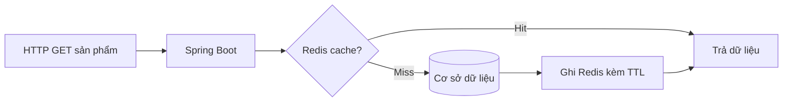

# TTL, thao tác nguyên tử và quản lý vòng đời dữ liệu trong Redis

Trong hệ thống tích hợp xây dựng bằng Spring Boot, Redis thường lưu những dữ liệu có vòng đời ngắn: kết quả truy vấn được cache, bộ đếm giới hạn truy cập, trạng thái xử lý yêu cầu, mã xác minh hoặc khóa phối hợp giữa các instance. Ba câu hỏi cần trả lời cho mỗi loại dữ liệu là **nó tồn tại bao lâu**, **thao tác nào cần thực hiện nguyên tử** và **hệ thống sẽ làm gì khi dữ liệu hết hạn, bị xóa hoặc Redis không sẵn sàng**.

Bài này tập trung vào TTL (time to live), tính nguyên tử của lệnh Redis và thiết kế vòng đời dữ liệu khi tích hợp Redis với HTTP, cơ sở dữ liệu và các luồng xử lý bất đồng bộ trong Spring Boot. Ví dụ sử dụng Redis cùng `StringRedisTemplate` của Spring Data Redis; thời lượng được chọn để minh họa, không phải giá trị mặc định cho mọi hệ thống.

## 1. Phân biệt hết hạn, xóa và loại bỏ vì thiếu bộ nhớ

**TTL** là khoảng thời gian còn lại trước khi một key bị coi là hết hạn. Redis hỗ trợ độ chính xác đến mili giây, dù việc thu hồi bộ nhớ và phát thông báo có thể diễn ra sau thời điểm đó. TTL áp dụng cho **key**: các phần tử trong một hash, list hoặc set thông thường cùng chia sẻ vòng đời của key chứa chúng.

| Cơ chế | Điều kiện xảy ra | Hệ quả đối với ứng dụng |
| --- | --- | --- |
| Hết hạn (expiration) | Key có thời điểm hết hạn; Redis xác định thời điểm đó đã qua | Key không còn được xem là hợp lệ; lần đọc tiếp theo có thể trả về không tồn tại |
| Xóa tường minh (deletion) | Ứng dụng gọi `DEL`/`UNLINK` hoặc ghi đè/xóa dữ liệu | Dữ liệu biến mất theo quyết định nghiệp vụ hoặc thao tác vận hành |
| Loại bỏ (eviction) | Redis chạm giới hạn bộ nhớ và chính sách `maxmemory-policy` cho phép loại bỏ key | Key có thể biến mất **trước TTL**; không thể dựa vào TTL như cam kết lưu giữ |
| Mất hoặc khôi phục dữ liệu | Redis gặp sự cố, cấu hình persistence/replication/failover khác nhau | Khả năng giữ được trạng thái phụ thuộc kiến trúc triển khai và mức bền vững đã cấu hình |

Không nên dùng Redis TTL làm đồng hồ kích hoạt nghiệp vụ chính xác, lưu hồ sơ kiểm toán duy nhất hay bảo đảm một dữ liệu sẽ luôn tồn tại đủ số giây đã định. Ví dụ, hạn giữ yêu cầu chống trùng lặp trong Redis không thay thế được ràng buộc duy nhất của cơ sở dữ liệu nếu việc tạo đơn hàng phải tuyệt đối không trùng.

## 2. Lệnh TTL và quy tắc thay đổi thời hạn

Các lệnh cơ bản có thể thử bằng `redis-cli`:

```redis
SET catalog:item:42 '{"name":"Bàn phím"}' EX 300
TTL catalog:item:42
PTTL catalog:item:42

EXPIRE catalog:item:42 600
PERSIST catalog:item:42

SET checkout:token:abc "PENDING" NX EX 120
GET checkout:token:abc
```

| Lệnh | Ý nghĩa |
| --- | --- |
| `EXPIRE key seconds`, `PEXPIRE key milliseconds` | Đặt khoảng sống tương đối tính từ lúc thực hiện lệnh |
| `EXPIREAT key unix-seconds`, `PEXPIREAT key unix-milliseconds` | Đặt thời điểm hết hạn tuyệt đối |
| `TTL key`, `PTTL key` | Đọc khoảng thời gian còn lại, đơn vị giây hoặc mili giây |
| `PERSIST key` | Bỏ thời hạn, chuyển key thành không tự hết hạn |
| `SET key value EX seconds` hoặc `PX milliseconds` | Ghi giá trị cùng TTL trong **một lệnh** |
| `SET key value NX EX seconds` | Chỉ tạo khi key chưa tồn tại; đồng thời gắn TTL |
| `SET key value KEEPTTL` | Thay giá trị và giữ hạn cũ, nếu phiên bản Redis hỗ trợ tùy chọn này |
| `GETEX key EX seconds` | Đọc và làm mới hạn trong một lệnh; phù hợp một số kiểu hết hạn theo lần truy cập |

Giá trị trả về của `TTL`/`PTTL` rất quan trọng:

- `-2`: key không tồn tại (bao gồm trường hợp đã hết hạn).
- `-1`: key tồn tại nhưng **không có TTL**.
- `0` hoặc số dương: thời gian còn lại; `0` có thể xuất hiện do phép làm tròn hoặc key sắp hết hạn.

Không nên diễn giải `-1` là “còn một giây”; đây thường là dấu hiệu sai vòng đời đối với cache hoặc lease vốn phải có hạn.

### 2.1. Lệnh nào giữ TTL và lệnh nào làm mất TTL?

Với key đang có thời hạn, những lệnh **thay thế toàn bộ giá trị** như `SET key value` mặc định xóa thời hạn cũ, trừ khi đặt TTL mới hoặc dùng `KEEPTTL`. Ngược lại, nhiều lệnh **cập nhật nội dung** như `INCR`, `HSET`, `LPUSH` thường giữ nguyên TTL của key đang tồn tại.

```redis
SET counters:views 5 EX 60
INCR counters:views
TTL counters:views
# Vẫn còn TTL (đã giảm theo thời gian)

SET counters:views 10
TTL counters:views
# -1: SET thông thường đã bỏ TTL
```

**Quy tắc thiết kế:** thao tác tạo key tạm nên gắn hạn ngay lúc tạo; thao tác cập nhật key tạm phải kiểm tra xem mình muốn **giữ nguyên**, **kéo dài** hay **thay mới** thời hạn. Không mặc định “mọi lần ghi đều tự làm mới TTL”.

### 2.2. Hạn tuyệt đối và hạn trượt

**Hạn tuyệt đối (absolute/fixed expiration):** một mã xác minh được phát lúc 10:00 và chỉ có hiệu lực 5 phút, bất kể được đọc bao nhiêu lần. Mỗi lần đọc không làm tăng TTL.

**Hạn trượt theo hoạt động (sliding/idle expiration):** phiên làm việc hết hạn sau 20 phút không có hoạt động hợp lệ. Ứng dụng cần cập nhật thời hạn khi có hoạt động thực sự, chẳng hạn bằng `GETEX` hoặc thao tác nguyên tử tương đương.

Với phiên đăng nhập, nên cân nhắc đồng thời **idle timeout** và **absolute maximum lifetime**. Nếu chỉ gia hạn trượt vô hạn, một phiên bị lạm dụng có thể tiếp tục sống quá lâu. Redis TTL đơn lẻ không tự thực thi cả hai giới hạn nếu ứng dụng không lưu và kiểm tra thêm thời điểm hết hạn tuyệt đối.

### 2.3. Hết hạn không đồng nghĩa với nhận được sự kiện đúng giờ

Redis dọn key hết hạn khi truy cập (lazy expiration) và trong các vòng quét nền (active expiration). Vì vậy không được thiết kế tác vụ thanh toán, hoàn hàng hoặc phát thông báo dựa vào việc nhận được một sự kiện `expired` đúng khoảnh khắc TTL về 0.

Keyspace notifications có thể bật với cấu hình phù hợp, ví dụ `notify-keyspace-events Ex` để nhận sự kiện hết hạn ở kênh keyevent. Tuy nhiên đây là thông báo kiểu Pub/Sub, không lưu bền để phát lại; consumer ngắt kết nối có thể bỏ lỡ. Trong Redis Cluster còn cần chú ý các node phát sự kiện riêng. Các hạn chót nghiệp vụ cần nơi lưu bền cùng cơ chế quét/lập lịch và retry độc lập.

## 3. Nguyên tử ở phạm vi lệnh Redis

Redis xử lý mỗi lệnh thông thường như một thao tác nguyên tử đối với dữ liệu mà lệnh đó tác động. Nhưng **hai lệnh liên tiếp từ ứng dụng không tự tạo thành một giao dịch nguyên tử**. Những request khác có thể xen giữa hai lệnh, hoặc ứng dụng có thể lỗi sau lệnh đầu tiên.

| Cách làm | Rủi ro | Cách phù hợp |
| --- | --- | --- |
| `GET` rồi `SET` để tăng bộ đếm | Hai request cùng đọc một số, ghi đè kết quả của nhau | `INCR`/`INCRBY` |
| `SETNX` rồi `EXPIRE` để tạo khóa có hạn | Chết tiến trình giữa hai lệnh làm key không có TTL | `SET key token NX PX ttl` |
| `INCR` rồi `EXPIRE` khi khởi tạo cửa sổ giới hạn | Hỏng giữa hai lệnh để lại bộ đếm không hết hạn | Lua script hoặc transaction/thiết kế khác thực hiện logic như một đơn vị |
| `GET` để so token rồi `DEL` khi nhả khóa | Khóa có thể hết hạn và thuộc về người khác trước khi `DEL` | Lua so token và xóa trong cùng script |
| Kiểm tra cache miss rồi truy vấn DB | Nhiều request cùng miss, cùng tải DB | Chấp nhận tải lặp nhỏ, hoặc áp dụng single-flight/khóa có hạn và cơ chế fallback |

Các công cụ nguyên tử có phạm vi khác nhau:

- **Lệnh đơn:** ưu tiên khi Redis đã có primitive phù hợp, như `INCR`, `SET ... NX EX`, `HINCRBY` hoặc `SADD`.
- **Lua script:** cho phép nhóm kiểm tra và thay đổi nhiều bước thành một thao tác nguyên tử trên Redis. Script phải ngắn, có thời gian chạy bị chặn và chỉ truy cập các key phù hợp với ràng buộc triển khai.
- **`MULTI`/`EXEC`:** gom lệnh thực thi tuần tự, không có lệnh khác xen vào lúc thực thi; không tự cung cấp nhánh điều kiện dựa trên kết quả lệnh trước trong cùng transaction. Redis không rollback các lệnh đã chạy giống giao dịch SQL khi một lệnh bên trong bị lỗi.
- **`WATCH` + `MULTI`/`EXEC`:** kiểm soát cạnh tranh kiểu optimistic locking; ứng dụng phải tự retry khi dữ liệu theo dõi thay đổi.

Với Redis Cluster, các thao tác nhiều key trong cùng script/transaction cần key nằm trong cùng hash slot. Nếu thực sự cần nhóm key, có thể dùng hash tag có chủ đích như `order:{123}:state` và `order:{123}:lock`. Tránh đưa quá nhiều dữ liệu không liên quan vào cùng slot vì sẽ tạo điểm nóng.

Một script nguyên tử trên Redis **không đồng nghĩa** với giao dịch phân tán nguyên tử giữa Redis, PostgreSQL, HTTP đối tác và message broker. Nếu yêu cầu đã cập nhật DB rồi Redis gặp lỗi, hệ thống vẫn cần cơ chế idempotency, đối soát hoặc retry ở lớp nghiệp vụ.

## 4. Tích hợp Spring Boot: tạo key có TTL đúng cách

Ứng dụng Spring Boot có thể dùng `spring-boot-starter-data-redis` (thường sử dụng Lettuce) và inject `StringRedisTemplate`. Ví dụ cấu hình kết nối ở môi trường phát triển:

```yaml
spring:
  data:
    redis:
      host: localhost
      port: 6379
      timeout: 2s
```

Thiết lập TTL ngay cùng thao tác ghi:

```java
@Service
public class VerificationCodeStore {
    private final StringRedisTemplate redis;

    public VerificationCodeStore(StringRedisTemplate redis) {
        this.redis = redis;
    }

    public void save(String requestId, String hashedCode) {
        redis.opsForValue().set(
                "verify:v1:" + requestId,
                hashedCode,
                Duration.ofMinutes(5));
    }

    public boolean reserveOnce(String requestId) {
        Boolean created = redis.opsForValue().setIfAbsent(
                "verify:used:v1:" + requestId,
                "1",
                Duration.ofMinutes(10));
        return Boolean.TRUE.equals(created);
    }
}
```

`opsForValue().set(key, value, Duration)` gửi lệnh ghi có hạn; `setIfAbsent(key, value, Duration)` tương ứng ý tưởng `SET ... NX` với TTL. `Boolean.TRUE.equals(...)` tránh xử lý sai trường hợp API trả về `null` trong những ngữ cảnh đặc biệt. Tuy nhiên, thao tác “đánh dấu dùng một lần” ở ví dụ chỉ quản lý cờ trong Redis: nếu hành động nghiệp vụ phải duy nhất ngay cả sau khi Redis mất dữ liệu thì cần lưu trạng thái bền vững ở DB.

Đặt tên key theo phạm vi rõ ràng như `service:feature:v1:entity-id`; cân nhắc môi trường và tenant. Không đặt mã xác minh, token thô hoặc dữ liệu cá nhân nhạy cảm trong **tên key**. Tên key có thể xuất hiện ở log, công cụ giám sát và lệnh quản trị. Giới hạn độ dài key và số lượng key có thể phát sinh từ đầu vào HTTP.

## 5. Trường hợp A: cache có TTL, cập nhật và invalidation

Ví dụ API đọc sản phẩm: khi cache miss, service truy vấn DB, lưu kết quả trong Redis với TTL, rồi trả dữ liệu. Khi sản phẩm thay đổi, service cần xóa hoặc cập nhật cache liên quan.



Khi dùng Spring Cache, có thể gán TTL riêng theo tên cache thay vì tự gọi Redis cho mọi API:

```java
@Configuration
@EnableCaching
public class CacheTtlConfig {
    @Bean
    RedisCacheManagerBuilderCustomizer redisCacheTtls() {
        return builder -> builder.withCacheConfiguration(
                "catalog",
                RedisCacheConfiguration.defaultCacheConfig()
                        .entryTtl(Duration.ofMinutes(5))
                        .disableCachingNullValues());
    }
}
```

```java
@Cacheable(cacheNames = "catalog", key = "#productId")
public ProductView findProduct(String productId) {
    return repository.loadProductView(productId);
}
```

Ví dụ giả định ứng dụng đã bật Spring Cache, có thư viện Redis Cache và cấu hình serializer phù hợp với kiểu `ProductView`. Cache `catalog` hết hạn sau năm phút kể từ khi ghi; Spring Cache không tự biến mỗi lần đọc thành gia hạn trượt. Cấu hình cụ thể có thể khác theo phiên bản Spring Boot/Spring Data Redis.

Để dữ liệu cập nhật kịp thời, kết hợp TTL với invalidation như `@CacheEvict` sau khi cập nhật thành công. Khi thao tác ghi DB nằm trong transaction, cần xem xét **thời điểm xóa cache so với commit**; xóa trước commit có thể dẫn đến request khác nạp lại dữ liệu cũ. Nếu đồng bộ cache giữa nhiều service, hãy xác định chủ sở hữu dữ liệu, cơ chế truyền thay đổi và hành vi khi sự kiện invalidation bị mất.

Một TTL ngắn giúp giới hạn thời gian stale, nhưng làm tăng cache miss và tải xuống DB. TTL dài giảm tải nhưng tăng độ trễ phản ánh thay đổi. Khi số lượng key rất lớn cùng được tạo ở một thời điểm, có thể thêm **jitter** (độ lệch TTL có giới hạn) cho các key cache tạo thủ công để tránh hết hạn đồng loạt. TTL không thay thế được chiến lược chống cache stampede cho dữ liệu nóng.

## 6. Trường hợp B: bộ đếm có thời hạn và tránh race condition

Giả sử một API cần đếm số request theo một cửa sổ bắt đầu từ lần gọi đầu tiên. Cách triển khai không an toàn là:

```java
Long count = redis.opsForValue().increment(key);
if (count != null && count == 1L) {
    redis.expire(key, Duration.ofMinutes(1));
}
```

`INCR` tự nó là nguyên tử, nhưng client có thể ngắt sau `INCR` và trước `EXPIRE`, khiến key không có hạn. Lua script dưới đây thực hiện cả hai trong một lượt, đồng thời sửa trường hợp key cũ vô tình thiếu TTL:

```lua
local count = redis.call('INCR', KEYS[1])
if count == 1 or redis.call('PTTL', KEYS[1]) == -1 then
    redis.call('PEXPIRE', KEYS[1], ARGV[1])
end
return count
```

Từ Spring Data Redis, gọi script bằng `StringRedisTemplate`:

```java
@Service
public class FixedWindowCounter {
    private static final DefaultRedisScript<Long> COUNT_SCRIPT =
            new DefaultRedisScript<>(
                    """
                    local count = redis.call('INCR', KEYS[1])
                    if count == 1 or redis.call('PTTL', KEYS[1]) == -1 then
                        redis.call('PEXPIRE', KEYS[1], ARGV[1])
                    end
                    return count
                    """,
                    Long.class);

    private final StringRedisTemplate redis;

    public FixedWindowCounter(StringRedisTemplate redis) {
        this.redis = redis;
    }

    public long increment(String clientId, Duration window) {
        long milliseconds = window.toMillis();
        if (milliseconds < 1) {
            throw new IllegalArgumentException("window must be >= 1 ms");
        }

        String key = "rate:requests:v1:" + clientId;
        Long count = redis.execute(
                COUNT_SCRIPT,
                List.of(key),
                Long.toString(milliseconds));
        if (count == null) {
            throw new IllegalStateException("No counter result from Redis");
        }
        return count;
    }
}
```

Cần import `org.springframework.data.redis.core.script.DefaultRedisScript`, `org.springframework.data.redis.core.StringRedisTemplate`, `java.time.Duration` và `java.util.List`, cùng các annotation Spring tương ứng. Sử dụng client ID đã chuẩn hóa hoặc băm nếu thông tin định danh có thể nhạy cảm.

Với giới hạn `100 request/60 giây`, ứng dụng có thể từ chối khi giá trị trả về lớn hơn `100`. Đây là cửa sổ cố định **tính từ request đầu tiên**; nó vẫn cho phép burst ở ranh giới giữa hai cửa sổ và không phải thuật toán sliding window/token bucket. Nếu yêu cầu giới hạn chặt, cần chọn thuật toán đúng, cân nhắc chi phí lưu trữ, sự sai lệch thời gian giữa các node và hành vi khi Redis lỗi.

Đừng mặc định “Lua nguyên tử” là “mỗi HTTP request được tính đúng một lần”: nếu Redis đã tăng bộ đếm nhưng client mất kết nối trước khi nhận phản hồi rồi retry, bộ đếm có thể tăng thêm. Tính exactly-once cần cơ chế nhận diện yêu cầu và trạng thái bền vững phù hợp.

## 7. Trường hợp C: xử lý trùng lặp yêu cầu (idempotency)

Một HTTP client hoặc consumer message broker có thể retry khi timeout. Với thao tác tạo thanh toán/đơn hàng, Redis giúp từ chối xử lý đồng thời, nhưng **bằng chứng kết quả nghiệp vụ** cần có vòng đời rõ ràng:

1. Client gửi `Idempotency-Key`; server ràng buộc key với người dùng, endpoint và dấu vân tay payload. Hai payload khác nhau dùng cùng key phải bị phát hiện xung đột.
2. Server thử tạo trạng thái `PROCESSING` bằng `SET ... NX EX`. Chỉ request lấy được quyền mới tiến hành xử lý; request đến sau cần xem trạng thái và được trả kết quả/đợi/thông báo đang xử lý theo hợp đồng API.
3. Transaction DB ghi kết quả nghiệp vụ, có **unique constraint** hoặc bảng idempotency bền vững để chặn ghi trùng ngay cả khi Redis mất key hoặc lease hết hạn.
4. Sau commit, ghi trạng thái `COMPLETED` kèm mã tham chiếu/kết quả an toàn để trả lại cho lần retry. TTL của kết quả phải dài hơn khoảng thời gian client có thể retry; chọn dựa trên SLA thực tế.
5. Nếu xử lý thất bại, phân biệt lỗi có thể retry, lỗi nghiệp vụ cố định và tình huống chưa rõ DB đã commit hay chưa. Không xóa cờ `PROCESSING` của người khác bằng lệnh `DEL` vô điều kiện.

Ví dụ phân bố key:

```text
idem:checkout:v1:<tenant>:<request-id> -> PROCESSING/<owner-token>, TTL ngắn
idem:checkout-result:v1:<tenant>:<request-id> -> reference/result, TTL theo retry window
Database: unique(tenant_id, idempotency_key) + trạng thái/kết quả bền vững
```

Đây là **một thiết kế khái niệm**: nếu dùng hai key trong Redis, phải xác định rõ trạng thái cạnh tranh và thứ tự chuyển tiếp; việc ghi hai key riêng lẻ không nguyên tử. Có thể gói thay đổi trạng thái Redis trong Lua, nhưng vẫn không tạo transaction chung với DB. Khi Redis `PROCESSING` hết hạn trong lúc xử lý chậm, request khác có thể tiếp tục; unique constraint ở DB và cơ chế kiểm tra kết quả trước khi thực hiện lại là lớp bảo vệ chính.

Khi cập nhật DB và phát thông điệp sang broker, có thể dùng **transactional outbox** để lưu sự kiện cùng transaction DB, sau đó phát lại có kiểm soát. Consumer cần idempotent theo event ID; Redis có thể giảm xử lý lặp trong thời gian ngắn nhưng không đóng vai trò bằng chứng duy nhất rằng sự kiện đã hoàn thành.

## 8. Trường hợp D: khóa ngắn hạn (lease) và giải phóng đúng chủ sở hữu

Khóa Redis kiểu lease có thời hạn hữu ích để giảm công việc trùng lặp, chẳng hạn chỉ một instance nạp lại dữ liệu cache. Lệnh giành quyền là `SET lock-key random-token NX PX ttl`. Mỗi người giữ khóa phải có **token riêng, khó đoán**; không dùng giá trị cố định như `"LOCKED"`.

```java
@Service
public class RedisLease {
    private static final DefaultRedisScript<Long> RELEASE =
            new DefaultRedisScript<>(
                    """
                    if redis.call('GET', KEYS[1]) == ARGV[1] then
                        return redis.call('DEL', KEYS[1])
                    end
                    return 0
                    """,
                    Long.class);

    private final StringRedisTemplate redis;

    public RedisLease(StringRedisTemplate redis) {
        this.redis = redis;
    }

    public boolean acquire(String lockKey, String ownerToken, Duration lease) {
        if (lease.toMillis() < 1) {
            throw new IllegalArgumentException("Lease must be positive");
        }
        return Boolean.TRUE.equals(
                redis.opsForValue().setIfAbsent(lockKey, ownerToken, lease));
    }

    public boolean release(String lockKey, String ownerToken) {
        Long removed = redis.execute(RELEASE, List.of(lockKey), ownerToken);
        return Long.valueOf(1L).equals(removed);
    }
}
```

Caller tạo `ownerToken` riêng, chẳng hạn `UUID.randomUUID().toString()`, và chỉ nhả khóa với token đã dùng khi giành quyền. Lua so sánh token trước khi xóa để tránh tình huống A giữ khóa, TTL hết, B giành lại khóa rồi A vô tình xóa khóa của B.

Ngay cả khi release đúng token, **lease không bảo đảm loại trừ tuyệt đối**: A có thể bị dừng lâu hơn TTL rồi tiếp tục ghi DB, đồng thời B đã giành khóa mới. Với cập nhật có tính đúng đắn cao, cần thêm kiểm soát phiên bản hoặc **fencing token tăng đơn điệu được phía tài nguyên đích kiểm tra**, hoặc dùng transaction/unique constraint DB phù hợp. Nếu gia hạn lease, việc kiểm tra token và gia hạn cũng phải nguyên tử; phải định nghĩa rõ xử lý khi gia hạn thất bại.

Không giữ lease qua tác vụ không có giới hạn thời gian như gọi HTTP đối tác có thể treo vô hạn. Timeout của HTTP, TTL lease, ngân sách retry và khả năng quan sát phải được thiết kế cùng nhau.

## 9. Thiết kế vòng đời theo từng loại key

Một key nên có đủ các thuộc tính: **chủ sở hữu**, **cách tạo**, **điều kiện gia hạn**, **thời hạn**, **cách xóa hoặc vô hiệu hóa** và **phương án khi Redis lỗi**.

| Dữ liệu | Ví dụ chính sách TTL | Quy tắc cập nhật/xóa | Nếu key biến mất sớm |
| --- | --- | --- | --- |
| Cache danh mục | Vài chục giây đến vài phút tùy mức chấp nhận stale | Ghi cùng TTL; xóa sau cập nhật DB; có thể thêm jitter | Đọc lại DB và tái tạo cache |
| Phiên hoặc mã xác minh | Idle timeout và/hoặc hạn tuyệt đối theo chính sách bảo mật | Gia hạn khi có hoạt động hợp lệ; mã một lần phải được kiểm tra và tiêu thụ an toàn | Yêu cầu xác thực hoặc cấp lại theo quy trình |
| Bộ đếm giới hạn | Bằng chiều dài cửa sổ đếm | Tăng và đặt hạn nguyên tử, không gia hạn ngoài ý muốn | Chính sách fail-open/fail-closed phải xác định rõ |
| Cờ xử lý yêu cầu | Lease ngắn, đủ bao phủ tác vụ có timeout | Trạng thái thuộc về token; đối soát kết quả DB | Tra DB trước khi quyết định chạy lại |
| Kết quả idempotency | Ít nhất bằng cửa sổ retry đã công bố | Lưu kết quả theo key và payload đã xác minh | DB là nguồn sự thật để ngăn tạo trùng |
| Khóa phối hợp | Lease ngắn, có phương án gia hạn hợp lệ | Giải phóng khi token còn khớp | Tác vụ có thể chạy đồng thời, cần lớp bảo vệ ở đích |
| Log kiểm toán/giao dịch | Theo quy định lưu trữ nghiệp vụ | Lưu bền ở kho dữ liệu phù hợp | Không dùng Redis TTL làm nguồn lưu duy nhất |

Các giá trị trên là **gợi ý cách chọn**, không phải cấu hình bắt buộc. Nếu thời gian retry tối đa của đối tác là 24 giờ, lưu kết quả idempotency trong 5 phút là không đáp ứng hợp đồng. Nếu cache sản phẩm có thể cũ tối đa 30 giây, cấu hình TTL 10 phút là quá dài trừ khi có invalidation đáng tin cậy.

Nên quyết định chính sách khi Redis không sẵn sàng theo độ quan trọng của từng chức năng:

- Cache tra cứu: có thể đọc DB trực tiếp, kèm giới hạn tải để tránh làm quá tải hệ thống gốc.
- Rate limiting hoặc chống lạm dụng: cân nhắc chính sách hạn chế tạm thời hoặc cơ chế thay thế; fail-open có thể là rủi ro bảo mật.
- Idempotency tài chính: kiểm tra trạng thái bền vững trong DB; đừng cho phép tạo lại chỉ vì Redis lỗi.
- Khóa tối ưu hiệu năng: có thể chuyển sang DB lock hoặc hoãn công việc, tùy hậu quả chạy trùng.

Khi ứng dụng dùng Redis làm cache, bộ đếm, broker tạm và lease cùng lúc, nên tách prefix, chính sách TTL và quyền thao tác. Ở tải lớn có thể cần tách Redis deployment để tránh tác vụ dùng nhiều bộ nhớ gây eviction cho dữ liệu nhạy cảm.

## 10. Quan sát và kiểm thử các trạng thái biên

Redis có các chỉ số hữu ích qua `INFO stats` và hệ thống metrics: `expired_keys`, `evicted_keys`, `keyspace_hits`, `keyspace_misses`. Kết hợp chúng với bộ nhớ sử dụng, độ trễ lệnh, lỗi kết nối, timeout, tỷ lệ cache hit và số lần lấy/nhả lease thất bại. Phân biệt **expired** (hết TTL) với **evicted** (bị loại vì áp lực bộ nhớ), vì cách khắc phục khác nhau.

Tránh dùng `KEYS *` ở production để dò toàn bộ dữ liệu. Nếu cần kiểm tra theo prefix, dùng `SCAN` có kiểm soát; nếu cần kiểm tra TTL, lấy mẫu một tập key đại diện. Không log giá trị hoặc key chứa dữ liệu bí mật. Với script, theo dõi thời gian chạy và giới hạn khối lượng xử lý trong một lệnh, vì script dài có thể làm chậm các client Redis khác.

Bảng tình huống nên đưa vào kiểm thử tích hợp với Redis thật (chẳng hạn Testcontainers), thay vì chỉ mock `RedisTemplate`:

| Tình huống | Kỳ vọng |
| --- | --- |
| Ghi cache có TTL, đọc ngay rồi đọc sau khi hết hạn | Trước hạn đọc được; sau hạn xem như miss; có thể tái nạp từ DB |
| `SET` lại một key tạm không kèm TTL | Phát hiện `TTL = -1`, xác nhận đã chọn đúng lệnh ghi |
| Hai request tăng counter đồng thời | Không mất lần tăng; key vẫn có hạn |
| Client ngắt kết nối sau lệnh Redis nhưng trước phản hồi | Retry không làm phát sinh tác dụng nghiệp vụ trùng ngoài dự kiến |
| Hai instance cùng xin lease | Chỉ một instance giành quyền khi key còn tồn tại |
| Lease A hết hạn, B giành lại rồi A release | A không xóa được lease của B |
| Đang xử lý yêu cầu thì cờ Redis hết hạn | DB unique/idempotency bảo vệ khỏi ghi trùng |
| Redis không truy cập được hoặc bị eviction | Ứng dụng đi vào chính sách lỗi đã định, có metrics và cảnh báo |
| Nhiều key cache nóng hết hạn cùng lúc | Tải DB và độ trễ vẫn trong ngưỡng; có bảo vệ trước stampede |

Có thể thử nhanh việc giữ TTL của phép tăng:

```redis
SET demo:count 0 EX 15
INCR demo:count
TTL demo:count
SET demo:count 99
TTL demo:count
# Kết quả cuối phải là -1 vì SET đã xóa TTL
DEL demo:count
```

## 11. Checklist khi triển khai

Trước khi đưa một luồng tích hợp vào production, cần trả lời được:

1. **Vòng đời:** key nào là tạm, TTL bao lâu, do ai quản lý, khi nào bị xóa hoặc gia hạn?
2. **Nguyên tử:** đoạn nào gồm nhiều lệnh có thể gặp race? Có thể thay bằng một lệnh Redis, Lua hoặc kiểm soát cạnh tranh thích hợp không?
3. **Tính đúng đắn:** nếu Redis xóa key sớm, failover hoặc client retry, DB/broker có còn đảm bảo idempotency và nhất quán không?
4. **Lỗi và khôi phục:** tác vụ có timeout, retry có giới hạn, xử lý trạng thái không rõ và đường fallback không?
5. **Vận hành:** có metric hết hạn/eviction, latency, memory, tỷ lệ miss và test cho cạnh tranh, TTL cùng Redis outage không?

Điểm mấu chốt là **TTL quản lý hiệu lực tạm thời**, **lệnh hoặc script nguyên tử quản lý cạnh tranh trong Redis**, còn **tính đúng đắn xuyên HTTP, DB và message broker** phải được bảo vệ bằng giao dịch, ràng buộc dữ liệu, idempotency và cơ chế khôi phục ở đúng lớp của hệ thống.
