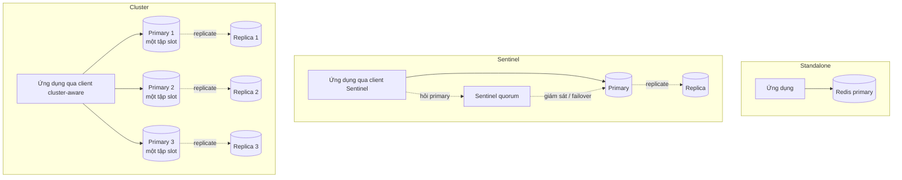

# Standalone, Sentinel hoặc Cluster theo môi trường

## 1. Bài toán triển khai Redis trong Spring Boot Integration

Redis thường đứng giữa các luồng tích hợp của ứng dụng Spring Boot: lưu cache cho HTTP client, giảm tải cơ sở dữ liệu, giữ trạng thái ngắn hạn, điều tiết lưu lượng hoặc hỗ trợ consumer của Kafka/RabbitMQ và các adapter Spring Integration. Khi chọn hạ tầng Redis, câu hỏi đầu tiên không chỉ là **Redis chạy ở đâu**, mà là **mất một node sẽ ảnh hưởng thế nào, cần bao nhiêu dữ liệu, mỗi giây có bao nhiêu thao tác và dữ liệu có thể mất hay không**.

Ba cách triển khai quen thuộc là:

1. **Standalone:** một Redis server độc lập, thường đơn giản để phát triển hoặc chạy một workload nhỏ chấp nhận gián đoạn.
2. **Sentinel:** một Redis primary với replica, được các Redis Sentinel theo dõi và điều phối failover. Mô hình này tăng tính sẵn sàng, nhưng không phân mảnh dữ liệu theo nhiều primary.
3. **Redis Cluster:** nhiều primary chia không gian key thành các hash slot, có thể có replica và tự động failover trong cluster. Mô hình này phục vụ mở rộng dung lượng/throughput theo chiều ngang, kèm ràng buộc về thao tác đa khóa.

**Điểm cốt lõi:** Sentinel và Cluster giải quyết các vấn đề khác nhau. Sentinel chủ yếu tự động hóa phát hiện lỗi và thay primary của một nhóm dữ liệu; Cluster bổ sung **sharding**. Cả hai không biến Redis thành cơ sở dữ liệu strongly consistent hay bảo đảm không mất dữ liệu khi xảy ra failover. Chọn topology theo tính chất nghiệp vụ và mục tiêu vận hành, không chọn dựa riêng vào nhãn `dev`, `staging` hay `production`.

### Mục tiêu học tập

- Giải thích khác biệt giữa Standalone, Sentinel và Cluster, bao gồm failover, scale, replication và các rủi ro.
- Chọn topology cho local/CI, staging, production và các dịch vụ có yêu cầu khác nhau.
- Cấu hình Spring Boot với Spring Data Redis/Lettuce cho từng topology qua profile và biến môi trường.
- Hiểu Redis Cluster hash slot, hash tag, giới hạn lệnh đa khóa và hành vi chuyển hướng `MOVED`/`ASK`.
- Thiết kế timeout, fallback, quan sát và kiểm thử để các tích hợp HTTP, database, cache và broker không bị Redis kéo theo khi sự cố.

## 2. So sánh ba topology

| Tiêu chí | Standalone | Sentinel | Cluster |
| --- | --- | --- | --- |
| Mục tiêu chính | Vận hành đơn giản | High availability cho một nhóm dữ liệu | High availability và phân mảnh dữ liệu |
| Phân phối key | Một primary | Một primary cho toàn bộ keyspace; replica sao chép | 16.384 hash slot được phân bổ cho nhiều primary |
| Tự động failover | Không có nếu chỉ một server | Có khi Sentinel đạt điều kiện bầu chọn và replica phù hợp | Có khi cluster đạt điều kiện failover và quorum phù hợp |
| Mở rộng ghi | Giới hạn tại primary | Vẫn chủ yếu tại một primary | Chia tải ghi theo các shard |
| Mở rộng bộ nhớ dữ liệu | Một node | Vẫn giới hạn bởi primary (replica chứa bản sao) | Tổng dung lượng trải trên nhiều primary |
| Kiểu kết nối client | Host/port hoặc endpoint | Master name và danh sách Sentinel | Danh sách seed node và hỗ trợ cluster-aware |
| Đa khóa | Không vướng phân mảnh | Không vướng phân mảnh | Các thao tác nhiều key thường phải cùng hash slot |
| Độ phức tạp | Thấp | Trung bình: quorum, replica và discovery | Cao hơn: slot, phân vùng, rebalancing, network |
| Mất dữ liệu khi failover | Có thể mất toàn bộ dữ liệu nếu không có persistence/backup | Vẫn có thể mất các ghi chưa được replica nhận | Vẫn có thể mất các ghi chưa được replica nhận |

**Replica không đồng nghĩa với failover.** Một Standalone có replica đọc vẫn cần cơ chế chuyển primary và client discovery nếu muốn tự động phục hồi. **Sentinel không phải proxy:** ứng dụng kết nối tới Sentinel để tìm primary hiện tại, sau đó client Redis giao tiếp với primary/replica. **Cluster cũng không phải một endpoint đơn:** client cluster-aware có thể phải kết nối trực tiếp tới từng node đang sở hữu slot.



Sơ đồ minh họa vai trò, không phải một cấu hình triển khai hoàn chỉnh. Sentinel thường chạy nhiều tiến trình trên các failure domain khác nhau; Cluster cũng cần phân tán primary và replica sang các máy hoặc vùng sẵn sàng riêng.

## 3. Chọn theo môi trường và nhu cầu nghiệp vụ

### 3.1. Câu hỏi trước khi quyết định

1. Redis là **cache có thể tái tạo** hay **nguồn trạng thái bắt buộc** như session, khóa điều phối hoặc dữ liệu nghiệp vụ?
2. Khối lượng RAM sử dụng, tốc độ tăng key, kích thước mỗi value, peak commands/s và tốc độ ghi là bao nhiêu?
3. Đối với một lần Redis ngừng 30 giây, API có thể trả dữ liệu nguồn, giảm tính năng hay phải ngừng xử lý?
4. Mục tiêu **RTO** (thời gian phục hồi) và **RPO** (mức dữ liệu chấp nhận mất) đã được xác định chưa?
5. Có dùng transaction/Lua/multi-key trên nhiều key hay có thể thiết kế key cùng slot?
6. Hạ tầng có nhiều availability zone, hostname/port công khai với client và cơ chế phát hiện node phù hợp không?
7. Có cần dịch vụ Redis được quản lý (managed Redis) thay vì tự vận hành các tiến trình không?

### 3.2. Ma trận gợi ý

| Môi trường/tình huống | Topology xuất phát hợp lý | Điều cần kiểm chứng |
| --- | --- | --- |
| Local developer | Standalone trong container hoặc instance local | Serializers, TTL, tên key, timeout và xử lý Redis down |
| Unit/contract test cơ bản | Standalone hoặc fake phù hợp phạm vi test | Hành vi nghiệp vụ; không suy ra failover đã được kiểm thử |
| CI kiểm thử HA | Sentinel topology thật hoặc môi trường kiểm thử tương đương | Client tìm primary mới, write/read sau failover |
| CI kiểm thử sharding | Redis Cluster có đủ node và địa chỉ truy cập được | Cross-slot, redirection, rebalancing, serializer |
| Staging trước khi lên production | Càng sát production topology, network và authentication càng tốt | Failover, ACL/TLS, DNS, latency và giới hạn kết nối |
| Production, dữ liệu nằm trong một primary, cần tự động failover | Sentinel hoặc dịch vụ managed có HA tương đương | Quorum, sức chứa một primary và mất ghi gần thời điểm failover |
| Production, dung lượng/throughput ghi vượt một primary | Cluster hoặc dịch vụ managed chạy cluster mode | Hash slots, hot keys, scale-out, client cluster-aware |
| Production cache nhỏ, có thể mất tạm thời | Standalone vẫn có thể chấp nhận nếu SLO cho phép | Fallback, restart và warm-up, không gây bão tải database |

Đừng áp dụng máy móc quy tắc `dev = Standalone, prod = Cluster`. Một cache 100 MB có thể phục vụ production rất tốt với topology đơn giản, trong khi một hệ thống Redis hàng trăm GB ở staging có thể cần Cluster để tái hiện đúng rủi ro ở production. Nếu dùng managed Redis, cần đọc cách nhà cung cấp cung cấp endpoint, failover, mode cluster, TLS và maintenance; một endpoint HA được nhà cung cấp quản lý có thể **không** yêu cầu khai báo Sentinel ở client.

## 4. Spring Boot và Lettuce: chọn đúng cấu hình

Ví dụ bên dưới dành cho **Spring Boot 3.2+** và Spring Data Redis tương ứng. Tên thuộc tính dùng namespace `spring.data.redis.*` của Spring Boot 3. Cần đối chiếu với phiên bản thực tế khi sử dụng Spring Boot khác.

### 4.1. Dependency

```kotlin
// build.gradle.kts — version do Spring Boot dependency management quản lý
implementation("org.springframework.boot:spring-boot-starter-data-redis")
implementation("org.springframework.boot:spring-boot-starter-actuator")

// Chỉ thêm khi dùng Spring Cache abstraction (@Cacheable, @CacheEvict...)
implementation("org.springframework.boot:spring-boot-starter-cache")

// Chỉ thêm khi cần Lettuce connection pooling
implementation("org.apache.commons:commons-pool2")
```

`spring-boot-starter-data-redis` sử dụng Lettuce theo mặc định trong cấu hình Spring Boot phổ biến. Lettuce có khả năng làm việc với Standalone, Sentinel và Cluster; application code thường chỉ phụ thuộc `RedisConnectionFactory`, `StringRedisTemplate`, `RedisTemplate` hoặc `CacheManager`. Spring Boot tự cấu hình connection factory theo một trong ba nhóm thuộc tính được kích hoạt.

Với những lệnh GET/SET không blocking, Lettuce có thể dùng một native connection thread-safe được chia sẻ; **không tự động cần pool lớn**. Connection pooling chủ yếu hữu ích khi có thao tác dùng dedicated connection như transaction hoặc blocking command, hoặc khi đã đo thấy nhu cầu. Pool quá lớn làm tăng số client connections và áp lực lên Redis.

### 4.2. Local: Standalone

```yaml
# application-local.yml
spring:
  data:
    redis:
      host: localhost
      port: 6379
      connect-timeout: 1s
      timeout: 2s
```

Chạy với profile `local` trên môi trường máy cá nhân. Nếu có Docker Compose, tên host phải được phân giải **từ nơi ứng dụng đang chạy**: ứng dụng chạy trên host có thể dùng `localhost` qua cổng đã publish, còn ứng dụng chạy trong cùng Docker network thường dùng tên service Redis. Không áp cấu hình localhost vào môi trường Kubernetes hoặc máy chủ từ xa.

Standalone thuận tiện để kiểm thử đọc/ghi, TTL và serializer, nhưng một bài test Standalone **không** xác minh khả năng client xử lý failover Sentinel hay redirection của Cluster.

### 4.3. Staging/production cần HA mà chưa cần sharding: Sentinel

```yaml
# application-sentinel.yml
spring:
  data:
    redis:
      username: ${REDIS_DATA_USERNAME}
      password: ${REDIS_DATA_PASSWORD}
      connect-timeout: 1s
      timeout: 2s
      sentinel:
        master: mymaster
        nodes:
          - ${REDIS_SENTINEL_1}  # ví dụ: sentinel-a.internal:26379
          - ${REDIS_SENTINEL_2}
          - ${REDIS_SENTINEL_3}
        username: ${REDIS_SENTINEL_USERNAME}
        password: ${REDIS_SENTINEL_PASSWORD}
```

Ở đây `mymaster` là **tên logical master do Sentinel giám sát**, không phải hostname của primary. `sentinel.nodes` là các Sentinel endpoint (`host:port`, thường cổng 26379), **không phải** danh sách primary/replica của Redis. Mỗi Sentinel cần nhận diện cùng tên master; địa chỉ Redis được Sentinel công bố phải truy cập được từ ứng dụng.

`spring.data.redis.username/password` là thông tin xác thực vào Redis data node; `sentinel.username/password` là thông tin xác thực vào Sentinel khi Sentinel được bảo vệ bằng ACL. Trường credential nào cần cấu hình phụ thuộc vào cơ chế bảo mật thực tế; các biến môi trường không nên có giá trị mặc định kiểu password thật. Nếu Sentinel không dùng ACL, bỏ những trường Sentinel credential thay vì đặt chuỗi rỗng để đoán hành vi.

Sentinel thường được triển khai với ít nhất **ba Sentinel trên các failure domain khác nhau**. Ví dụ quorum=2 cho ba Sentinel: phải đủ Sentinel đồng ý primary bị lỗi để đánh dấu objectively down; để bầu leader và hoàn tất failover còn cần đa số Sentinel có quyền tham gia. Redis replication là bất đồng bộ; sau khi primary hỏng vẫn có khả năng mất một số ghi vừa được xác nhận.

### 4.4. Production cần sharding: Cluster

```yaml
# application-cluster.yml
spring:
  data:
    redis:
      username: ${REDIS_CLUSTER_USERNAME}
      password: ${REDIS_CLUSTER_PASSWORD}
      connect-timeout: 1s
      timeout: 2s
      cluster:
        nodes:
          - ${REDIS_CLUSTER_SEED_1}  # ví dụ: redis-a.internal:6379
          - ${REDIS_CLUSTER_SEED_2}
          - ${REDIS_CLUSTER_SEED_3}
        max-redirects: 5
      lettuce:
        cluster:
          refresh:
            adaptive: true
            period: 30s
```

Các `cluster.nodes` chỉ là **seed nodes** để ứng dụng khám phá topology; client phải truy cập được địa chỉ các node thực tế mà cluster quảng bá, kể cả sau reshard và failover. Trên Redis Cluster có bật TLS, cần bổ sung cấu hình TLS tương ứng với môi trường, chẳng hạn `spring.data.redis.ssl.enabled: true` trên phiên bản Boot hỗ trợ. Khi nằm sau NAT, Docker port mapping hoặc proxy không hỗ trợ Cluster, client rất dễ nhận địa chỉ node nội bộ và kết nối thất bại.

`max-redirects` giới hạn số lần client xử lý redirection trong một thao tác; tăng nó quá cao không sửa được DNS/topology sai. Lettuce topology refresh giúp phát hiện phân bố slot thay đổi; nó không thay thế cho việc các node và port được cấu hình/announce đúng. Các thuộc tính refresh cần kiểm tra theo version Lettuce và Spring Boot đang vận hành.

Một Redis Cluster tối thiểu có thể chạy với ba primary, nhưng để chịu lỗi từng primary cần replica phù hợp (mô hình điển hình là **3 primary + 3 replica**, phân tán failure domain). Khả năng còn phục vụ sau sự cố phụ thuộc vào quorum các primary, placement replica và số node thực tế, không chỉ tổng số node.

### 4.5. Chọn profile và secret

```bash
# Ví dụ startup minh họa; secret được cấp bởi runtime/secret manager
java -jar app.jar --spring.profiles.active=local
java -jar app.jar --spring.profiles.active=sentinel
java -jar app.jar --spring.profiles.active=cluster
```

Các profile trên là **phương án thay thế cho nhau** đối với một Redis connection factory; tránh đồng thời kích hoạt hai profile mang cấu hình Sentinel và Cluster cho cùng kết nối. Với ứng dụng vừa cần cache riêng vừa cần Redis hỗ trợ trạng thái, có thể cần **nhiều connection factory có qualifier riêng** cho các instance Redis khác nhau, mỗi factory có topology/credential/timeout xác định. Không đặt secret trực tiếp trong Git hoặc ví dụ triển khai có thể bị sao chép; sử dụng secret manager, biến môi trường hoặc cơ chế cấu hình được bảo vệ.

Nếu Redis được quản lý với một endpoint HA tự cập nhật DNS, ứng dụng có thể cấu hình `host/port` như một kết nối thông thường **theo tài liệu của nhà cung cấp**. Hình thức kết nối đó không đồng nghĩa server chỉ có một node Standalone.

## 5. Ứng dụng Java có thể dùng cùng một giao diện

Với Spring Data Redis, business logic thường không cần biết dữ liệu nằm trên primary nào. Ví dụ một cache trạng thái tồn kho có TTL:

```java
import java.time.Duration;
import java.util.Optional;

import org.springframework.data.redis.core.StringRedisTemplate;
import org.springframework.stereotype.Service;

@Service
public class InventoryCache {
    private static final Duration TTL = Duration.ofSeconds(45);
    private final StringRedisTemplate redis;

    public InventoryCache(StringRedisTemplate redis) {
        this.redis = redis;
    }

    public void put(String tenantId, String sku, boolean available) {
        redis.opsForValue().set(key(tenantId, sku),
                available ? "1" : "0", TTL);
    }

    public Optional<Boolean> find(String tenantId, String sku) {
        String cached = redis.opsForValue().get(key(tenantId, sku));
        if (cached == null) {
            return Optional.empty();
        }
        return switch (cached) {
            case "1" -> Optional.of(true);
            case "0" -> Optional.of(false);
            default -> Optional.empty(); // xem là dữ liệu cache không hợp lệ
        };
    }

    private String key(String tenantId, String sku) {
        // Chỉ dùng tenantId đã xác thực và sku đã chuẩn hóa/validate.
        return "inventory:v1:" + tenantId + ":" + sku;
    }
}
```

Trong ví dụ này, `StringRedisTemplate` được auto-config theo profile đang bật. Chuỗi key có namespace/version và tenant để giảm đụng độ. TTL giới hạn thời gian lưu cache; với tồn kho biến động nhanh, cần chiến lược vô hiệu hóa cache sau khi cập nhật nguồn dữ liệu và đánh giá chấp nhận độ trễ của dữ liệu. Cache miss **không** có nghĩa sản phẩm hết hàng. Giá trị không hợp lệ cần được ghi nhận metric/cleanup, không mặc định biến thành dữ liệu nghiệp vụ đúng.

Nếu Redis là cache có thể tái tạo, khi Redis lỗi tầng gọi có thể truy cập dữ liệu gốc theo **giới hạn tải** và phục hồi theo chính sách. Nhưng nếu Redis lưu giới hạn tiêu thụ API, khóa điều phối, số dư hoặc idempotency key có tác động tiền bạc, việc âm thầm bỏ qua Redis có thể phá vỡ tính đúng đắn: khi đó phải quyết định fail-open/fail-closed và nguồn trạng thái bền vững theo yêu cầu nghiệp vụ.

Không dùng default JDK serialization cho dữ liệu được chia sẻ giữa nhiều ứng dụng/ngôn ngữ mà chưa xét rủi ro bảo mật, tính tương thích và khả năng vận hành. Ưu tiên định dạng có hợp đồng rõ như String/JSON với version nếu phù hợp. `@Cacheable` hoặc `RedisCacheManager` cần thống nhất serializer, TTL theo từng cache và key prefix để tránh xung đột.

## 6. Sentinel: replication, quorum và failover có giới hạn

Mô hình Sentinel thường có một primary, một hoặc nhiều replica, và nhiều Sentinel thực hiện giám sát. Quy trình đơn giản hóa:

1. Redis client kết nối Sentinel để hỏi địa chỉ primary của tên logical master (ví dụ `mymaster`).
2. Ứng dụng gửi lệnh ghi đến primary. Primary gửi dữ liệu đến replica bằng cơ chế replication bất đồng bộ.
3. Khi nhiều Sentinel xác nhận primary không phản hồi theo cấu hình, chúng phối hợp quyết định failover.
4. Sentinel chọn và promote một replica đủ điều kiện thành primary mới; các replica khác được điều chỉnh theo primary mới.
5. Client Sentinel-aware cần cập nhật địa chỉ, kết nối lại và tiếp tục thao tác; một số lệnh đang thực hiện có thể timeout hoặc thất bại trong khoảng chuyển tiếp.

### Giới hạn phải tính đến

- **Không có sharding:** mọi ghi vẫn đi qua một primary; nhiều replica không làm tăng khả năng ghi của nhóm dữ liệu.
- **Không phải zero-downtime tuyệt đối:** trong lúc failover có thể xảy ra connection error, `READONLY`, timeout hoặc downtime ngắn.
- **Không bảo đảm zero-data-loss:** ghi vừa ack tại primary cũ có thể chưa replicate đến primary mới. AOF/RDB giúp khôi phục ở những tình huống nhất định nhưng không biến replication thành đồng bộ tuyệt đối.
- **Quorum cần topology phù hợp:** ba Sentinel trên cùng một VM không giải quyết failure của VM đó. Phân tán failure domain và kiểm tra mạng phân vùng.
- **Replica reads có thể stale:** nếu ứng dụng chủ động đọc từ replica, cần chấp nhận eventual consistency. Đọc ngay sau ghi có thể không thấy dữ liệu vừa cập nhật.

Spring Data Redis/Lettuce có khả năng đọc từ replica khi cấu hình riêng, nhưng cách đọc mặc định và read preference phải được kiểm tra thực tế. Chỉ chuyển hướng cache/query **chấp nhận stale data** sang replica; các thao tác đòi read-your-writes cần một chiến lược phù hợp.

Một Redis primary trong Sentinel nên có đủ dung lượng memory/CPU/network để tiếp nhận **toàn bộ** workload sau khi failover. Nếu replica nhỏ hơn primary, failover có thể thành công về mặt vai trò nhưng dịch vụ vẫn quá tải.

## 7. Cluster: hash slot, hash tag và thao tác nhiều key

Redis Cluster chia keyspace thành **16.384 hash slot**. Mỗi primary chịu trách nhiệm một phần slot và replica theo sát primary đó. Client cluster-aware xác định slot từ key, gửi lệnh đến primary phù hợp hoặc xử lý redirection khi topology thay đổi.

### 7.1. Các ví dụ vị trí key

```text
order:100:status       # Không bảo đảm cùng slot với order:100:items
order:100:items

order:{100}:status     # Hash tag {100} -> cùng slot
order:{100}:items      # Hash tag {100} -> cùng slot

order:{101}:status     # Hash tag {101} -> có thể là slot khác
```

Redis Cluster hash key theo CRC16 và lấy modulo 16384; nếu key chứa hash tag hợp lệ trong cặp `{...}`, phần bên trong được dùng để tính slot. Các lệnh nhiều key như `MGET`, `MSET`, nhiều thao tác transaction hoặc script Lua trên nhiều key thường cần mọi key nằm trong **cùng slot**; nếu không có thể nhận `CROSSSLOT`.

```redis
MGET order:{100}:status order:{100}:items
# Có thể chạy khi cả hai key ở cùng slot.

MGET order:{100}:status order:{101}:status
# Có thể báo CROSSSLOT nếu hai hash tag rơi vào hai slot khác nhau.
```

Hash tag giúp nhóm các key cần thao tác atomically trong phạm vi một slot, nhưng **không** gắn mọi key của một tenant lớn vào một hash tag duy nhất nếu điều đó tạo hotspot. Ví dụ `tenant:{t1}:*` đưa rất nhiều dữ liệu của tenant t1 về một slot; một lựa chọn cân bằng hơn cho dữ liệu theo aggregate là `tenant:t1:order:{100}:status` và `tenant:t1:order:{100}:items`, với điều kiện `100` không bị trùng giữa các tenant. Nếu order ID không duy nhất toàn cục, có thể dùng tag `{t1:100}` để giữ tính duy nhất của nhóm key.

### 7.2. Redirection và rebalancing

- `MOVED` cho biết node khác đang sở hữu slot ổn định hơn. Client dùng thông tin này để gửi lệnh tới đúng node và cập nhật slot cache theo khả năng của driver.
- `ASK` xuất hiện trong quá trình di chuyển slot; client cần xử lý routing tạm thời theo giao thức Cluster.
- Thêm/bớt node và reshard thay đổi chủ sở hữu slot. Các endpoint Redis phải có network reachability từ ứng dụng; startup thành công chỉ với seed node chưa chứng minh toàn bộ slot đã truy cập được.
- Redis Cluster hoạt động với database logical **0**; không lập thiết kế cần `SELECT 1` hoặc database index khác cho từng tenant. Dùng namespace trong key và isolation ở deployment/ACL khi cần.
- Multi-key atomicity không trải qua nhiều slot; hãy thay đổi cách thiết kế key hoặc đưa nghiệp vụ transaction cần tính nhất quán cao về database nguồn.

Trong Spring Boot, dùng `RedisTemplate`, `StringRedisTemplate` hoặc driver cluster-aware do Spring Data Redis cấu hình. Không tự quản lý một kết nối TCP đơn rồi giả định nó biết toàn bộ hash slot. Các khóa cache và Lua script cũ phải được kiểm tra khi chuyển từ Standalone/Sentinel sang Cluster.

## 8. Tính bền vững và an toàn dữ liệu qua mọi topology

Replication, persistence và backup phục vụ những mục tiêu khác nhau:

| Cơ chế | Giúp giải quyết | Không tự bảo đảm |
| --- | --- | --- |
| Replica | Có bản sao dữ liệu và ứng viên failover | Ghi được replicate đồng bộ 100% hoặc mọi lần đọc đều mới |
| Sentinel/Cluster failover | Tự tìm/chọn primary mới khi đủ điều kiện | Không gián đoạn, không mất ghi, không lỗi tạm thời |
| RDB snapshot | Khôi phục từ ảnh chụp tại thời điểm trước đó | Không mất những ghi sau snapshot |
| AOF | Ghi log thao tác để phục hồi theo chính sách fsync | Không mất dữ liệu trong mọi sự cố/partition |
| Backup ngoài hệ thống | Khôi phục sau mất cụm hoặc lỗi vận hành | Không cần diễn tập restore; không cần quản lý retention |
| TTL/eviction | Quản lý vòng đời key và giới hạn RAM | Giữ nguyên mọi dữ liệu khi RAM đầy |

Đặt chính sách `maxmemory` và `maxmemory-policy` theo lớp dữ liệu. Cache có thể chấp nhận eviction; còn một Redis dùng cho session, dedup hoặc khóa thì xóa key sớm có thể làm thay đổi ngữ nghĩa. Khi trộn cache với trạng thái trọng yếu, cần cân nhắc instance riêng để isolation và phân quyền. Theo dõi tổng bộ nhớ sau khi tính fragmentation, replica, buffer, AOF và memory overhead; chọn memory headroom cho failover và data growth.

Nếu thao tác Redis được dùng để chống trùng sự kiện, phát tín hiệu thanh toán hay điều phối ghi cơ sở dữ liệu, cần đánh giá kỹ rủi ro **mất ghi khi failover**. Một khóa `SET NX PX` trên Redis không tự tạo bảo đảm an toàn tuyệt đối cho tài nguyên bên ngoài khi client pause, TTL hết hạn hoặc primary failover. Với tính đúng đắn nghiêm ngặt, cân nhắc unique constraint/giao dịch ở database nguồn, idempotency ở hệ thống đích hoặc fencing token được đích thực thi.

## 9. Timeout, retry và fallback trong các luồng tích hợp

Redis có thể chậm hoặc mất kết nối trong chuyển primary, network partition, reshard hay quá tải. Ứng dụng cần định nghĩa rõ chính sách cho từng loại công việc:

- **Cache lookup tự chọn:** nếu lỗi Redis, có thể lấy từ DB/HTTP gốc nhưng giới hạn concurrency, rate và timeout để tránh cache stampede.
- **Cache write phụ trợ:** có thể ghi log/metric và tiếp tục luồng nghiệp vụ nếu dữ liệu nguồn đã được ghi thành công.
- **Idempotency/lock/quota:** xử lý lỗi theo chính sách nghiệp vụ; không bỏ qua check nếu điều đó cho phép tạo đơn, trừ tiền hoặc nhận message trùng.
- **Consumer broker:** phân biệt lỗi Redis tạm thời với lỗi dữ liệu; retry có backoff, giới hạn số lần, idempotency và dead-letter khi phù hợp. Không ack thành công chỉ vì bước cache/guard thất bại nếu tác vụ chưa thực sự hoàn thành.
- **HTTP API:** trả lỗi có ý nghĩa (ví dụ 503 khi dependency bắt buộc không sẵn sàng) hoặc degraded response rõ ràng; tránh trả dữ liệu mặc định khiến client hiểu nhầm giao dịch đã thành công.

### 9.1. Tránh retry quá mức

Đặt thời gian chờ kết nối (`connect-timeout`), timeout lệnh (`timeout`), giới hạn lời gọi đồng thời và một **deadline end-to-end** cho API hoặc consumer. Nếu mỗi retry kéo dài 2 giây và cùng lúc 500 request đều retry tức thì, sự cố Redis có thể làm cạn thread, connection pool và dồn tải sang database. Chỉ retry lỗi tạm thời với backoff+jitter, và chỉ khi thao tác an toàn khi lặp lại.

**Ví dụ phân biệt:** Retry `GET` sau timeout thường ít rủi ro về side effect; retry `INCR`, `LPUSH`, chuyển trạng thái khóa hay script có tác dụng phụ sau timeout có thể thực thi hai lần nếu lần đầu đã được Redis nhận nhưng response thất lạc. Dùng request ID/idempotency hoặc cơ chế đối soát khi nghiệp vụ yêu cầu.

### 9.2. Cache stampede sau failover

Sau Redis restart hoặc failover, cache miss có thể tăng đột biến. Khi nhiều request đồng thời tìm cùng một SKU, không để chúng đều gọi database/HTTP nguồn:

1. Giới hạn concurrent miss hoặc sử dụng request coalescing/single-flight cho cùng key.
2. Thêm jitter vào TTL để tránh hàng loạt key hết hạn cùng lúc.
3. Có thể dùng stale-while-revalidate khi dữ liệu và nghiệp vụ cho phép.
4. Warm cache có kiểm soát sau deploy/restore; không bắn hàng nghìn request nền ngay lập tức.
5. Quan sát p95/p99 của Redis, miss rate, database connections và độ trễ API không sử dụng cache.

## 10. Kiểm tra connectivity và vận hành

Các lệnh dưới đây chỉ là ví dụ kiểm tra **trong môi trường đã cấp quyền**. Nếu bật TLS, xác thực hoặc chạy qua managed endpoint, bổ sung tham số kết nối theo cấu hình thực tế; không đưa password thẳng vào CLI history.

```bash
# Standalone: node Redis trả lời được không?
redis-cli -h redis-dev.internal -p 6379 PING

# Sentinel: Sentinel nào đang được hỏi và nó thấy primary nào?
redis-cli -h sentinel-a.internal -p 26379 SENTINEL get-master-addr-by-name mymaster
redis-cli -h sentinel-a.internal -p 26379 SENTINEL masters

# Cluster: kết nối kiểu cluster-aware và kiểm tra trạng thái slot
redis-cli -c -h redis-a.internal -p 6379 CLUSTER INFO
redis-cli -c -h redis-a.internal -p 6379 CLUSTER NODES
```

Khi kiểm tra Sentinel/Cluster, cần quan sát **từ cùng mạng nơi application pod/VM chạy**. Việc `PING` thành công ở một seed không đảm bảo các địa chỉ node do Sentinel hoặc Cluster trả về đều truy cập được. Với network policy, firewall, DNS, NAT và TLS, kiểm tra từng node thực sự cần kết nối.

### Metrics và dấu hiệu cảnh báo

| Nhóm | Metric/tín hiệu nên theo dõi | Ý nghĩa |
| --- | --- | --- |
| Ứng dụng | Redis command latency p95/p99, timeout, connection error, pool wait | Sức khỏe đường gọi Redis từ ứng dụng |
| Cache | Hit/miss, số lần fallback, nguồn dữ liệu bị tăng tải | Chất lượng cache và tác động khi Redis suy giảm |
| Redis server | `used_memory`, fragmentation, `evicted_keys`, `expired_keys` | Dung lượng, eviction và vòng đời dữ liệu |
| Client/server | `connected_clients`, `blocked_clients`, rejected connections | Hết kết nối, blocking commands hoặc bất thường |
| Sentinel | Trạng thái primary, replica lag/link, lần failover, quorum | Khả năng tự phục hồi và rủi ro mất ghi |
| Cluster | `cluster_state`, slot ok/pfail/fail, redirection, topology refresh | Tính đầy đủ keyspace và thay đổi quyền sở hữu slot |
| Toàn hệ thống | DB pool, broker lag, HTTP dependency latency, API error rate | Redis outage có đang lan tác động sang hệ khác? |

Actuator có thể cung cấp health contributor cho Redis khi Spring Boot tự cấu hình. Cần xác định Redis là dependency **bắt buộc** cho readiness hay chỉ là cache tùy chọn: nếu cache không sẵn sàng nhưng API vẫn phục vụ được nhờ fallback, buộc mọi instance unready có thể tạo vòng khởi động/lỗi dây chuyền. Ngược lại, nếu Redis giữ trạng thái bắt buộc, readiness phải phản ánh điều kiện xử lý thực tế. Không để Redis health một mình quyết định liveness khi điều đó gây restart liên tục dù Redis mới là thành phần lỗi.

## 11. Kiểm thử theo từng môi trường

| Kịch bản | Thiết lập | Kỳ vọng |
| --- | --- | --- |
| Standalone local | Testcontainers Redis đơn node, GET/SET + TTL | Key/value, serializer, TTL và fallback đúng |
| Redis tắt hoàn toàn | Ngắt server khi có cache miss | API degrade hoặc trả lỗi theo hợp đồng, không treo vô hạn |
| Sentinel failover | Dừng primary trong môi trường test Sentinel thật | Client tìm primary mới, lỗi tạm thời được giới hạn, không mất kết nối mãi |
| Sentinel mất quorum | Cô lập nhiều Sentinel/replica | Hệ thống báo lỗi phù hợp, không giả định luôn failover được |
| Cluster cross-slot | Thử `MGET` hai key khác slot và hai key cùng hash tag | Nhận biết `CROSSSLOT` và quy tắc key đúng |
| Cluster reshard | Chuyển slot từ primary này sang primary khác | Client xử lý `MOVED`/`ASK`, không kẹt topology cũ |
| Cluster node hỏng | Dừng một primary có replica trong test | Failover theo điều kiện quorum, đo latency/error budget |
| Network/TLS/ACL | Sai credential, chứng chỉ, DNS hoặc announced address | Fail có thông báo rõ; không log secret; không treo không giới hạn |
| Nhiều application replica | Tăng số instance cùng dùng Redis | Pool/connections/memory và throughput vẫn trong ngân sách |
| Timeout thao tác ghi | Gây mất response sau khi Redis đã thực thi | Không retry mù các thao tác có side effect |
| Dữ liệu cache hết hạn hàng loạt | Cho TTL cùng thời điểm và phát traffic | Không làm sập DB/HTTP gốc; có giới hạn cache miss |
| Broker consumer dùng Redis | Redelivery khi Redis down rồi up | Không ack sai, không lặp side effect, idempotency có chứng cứ |

**Testcontainers chạy một Redis container Standalone không đủ để tuyên bố hỗ trợ Sentinel/Cluster.** Với topology HA, cần dựng môi trường có nhiều process/node, cấu hình announce address đúng và tạo được failover/resharding thật. Kiểm thử trên staging sát production cũng quan trọng vì lỗi cluster thường đến từ network, DNS, ACL hoặc topology discovery hơn là câu lệnh GET/SET.

### Điều kiện nghiệm thu thực tế

- Với Standalone: ứng dụng biết kết nối thất bại, áp timeout và fallback đúng.
- Với Sentinel: sau khi primary lỗi, ứng dụng tìm được primary mới và không cần đổi host thủ công.
- Với Cluster: tất cả slot truy cập được; key đa khóa được thiết kế hợp lệ; client vẫn hoạt động sau chuyển slot.
- Với cả ba: không lộ thông tin xác thực, TTL và serializer có hợp đồng, không tạo duplicate side effect khi retry, metric chỉ rõ mức suy giảm.

## 12. Chuyển đổi topology mà không phá hợp đồng dữ liệu

Chuyển từ Standalone sang Sentinel thường yêu cầu thiết lập replication và Sentinel, sau đó đổi cách client khám phá primary. Tuy nhiên, **đổi YAML không tự tạo replica/quorum**. Cần chuẩn bị server topology, ACL, network và quy trình promotion.

Chuyển từ Standalone/Sentinel sang Cluster phức tạp hơn vì cần **phân chia keyspace** và đánh giá mọi thao tác đa khóa, Lua, transaction, cấu hình database index, key prefix và giới hạn nóng theo slot. Việc chỉ đổi thuộc tính `spring.data.redis.cluster.nodes` không biến một server thường thành Redis Cluster.

### Quy trình chuyển đổi gợi ý

1. **Kiểm kê:** phân loại cache có thể tái tạo, session/state cần bảo tồn, TTL, serializer, key prefix, Lua/multi-key và peak traffic.
2. **Xác định khả năng rollback:** snapshot/backup và diễn tập restore; ghi rõ RPO/RTO cùng điều kiện dừng cutover.
3. **Chuẩn bị topology đích:** hostname/port/DNS/TLS/ACL, announced address và quota memory/CPU phù hợp, để app thử truy cập từ cùng network.
4. **Dữ liệu:** với cache thuần, có thể tạo cache mới và warm có kiểm soát; với state cần bảo toàn, phải thiết kế migration/synchronization có kiểm chứng tính đầy đủ và tránh mất ghi.
5. **Phần mềm:** kiểm tra client hỗ trợ Sentinel/Cluster, prefix key, hash tag, transaction, timeout và fallback; kiểm thử trước khi chuyển lưu lượng.
6. **Cutover:** chuyển một phần traffic theo chiến lược có thể quan sát, xem latency, hit rate, error, DB load, rồi tăng dần. Cần xác định thời điểm ghi vào nguồn cũ dừng hoặc cách đồng bộ để tránh split-brain ứng dụng.
7. **Sau chuyển đổi:** theo dõi failover/reshard, đối soát dữ liệu cần bảo tồn và dọn hạ tầng cũ sau thời gian an toàn đã định.

Nếu Redis là hệ thống lưu dữ liệu có ý nghĩa nghiệp vụ, không coi nó như cache có thể xóa trắng. TTL, key version, serializer, quyền truy cập và quy tắc idempotency phải tiếp tục đúng sau migration.

## 13. Lỗi thiết kế thường gặp

- **Dùng Sentinel để tăng dung lượng ghi theo chiều ngang:** mọi thao tác ghi vẫn dồn vào primary; khi vượt giới hạn một node cần Cluster hoặc tái thiết kế workload.
- **Dùng Cluster dù chỉ có một bộ key multi-key không thể phân chia:** thao tác sẽ mắc `CROSSSLOT` hoặc dồn vào hot slot; đánh giá lại key model và kiến trúc.
- **Cho rằng replica là backup:** lỗi logic/xóa nhầm key có thể được replicate; cần snapshot và khả năng restore độc lập.
- **Tin rằng failover không mất ghi:** replication không đồng bộ có thể để mất dữ liệu gần thời điểm lỗi; các thao tác cần đúng tuyệt đối phải có bảo đảm ở tầng nghiệp vụ.
- **Chỉ test PING ở seed:** app vẫn có thể không truy cập được node được Cluster/Sentinel công bố.
- **Tăng pool và retry không giới hạn:** khi Redis chậm, số client connections và lời gọi tồn đọng càng tăng.
- **Dùng Redis làm idempotency store nhưng cho phép eviction:** key bị xóa sớm có thể khiến sự kiện/thao tác được thực hiện lại.
- **Chỉ cấu hình timeout mà không có fallback:** API vẫn có thể trả lỗi không kiểm soát hoặc chuyển bão tải sang DB.
- **Đặt secret trong application YAML của repo:** có nguy cơ bị lộ qua source, logs hoặc bản build.
- **Đánh đồng Redis cache với nguồn dữ liệu:** khi cache miss, logic không được suy diễn thành phủ định trạng thái nghiệp vụ.

## 14. Checklist chọn và vận hành

Trước khi triển khai, nhóm tích hợp nên xác nhận:

- [ ] Redis được phân loại: cache có thể tái tạo, session, queue/coordination, idempotency hoặc state quan trọng.
- [ ] RPO/RTO, throughput, kích thước keyspace và độ trễ yêu cầu đã được đo và ghi rõ.
- [ ] Standalone, Sentinel hoặc Cluster được chọn dựa trên HA và sharding; replica/quorum/slot topology có kiểm chứng.
- [ ] Spring Boot profile và credential được cấu hình đúng loại endpoint; không bật đồng thời cấu hình topology mâu thuẫn.
- [ ] Lettuce có connect timeout, command timeout và chính sách retry/fallback đúng với từng nghiệp vụ.
- [ ] TLS/ACL, secret management, network policy và địa chỉ node được công bố đúng trên đường đi từ application.
- [ ] Cache có TTL, namespace, serializer, invalidation và chính sách memory/eviction rõ ràng.
- [ ] Redis Cluster key hash tag, lệnh đa khóa, Lua và slot migration được kiểm tra nếu dùng Cluster.
- [ ] Persistence, backup, restore và chiến lược migration bảo vệ dữ liệu đúng theo phân loại.
- [ ] Dashboard/alert quan sát Redis server, client latency và hậu quả ở DB, HTTP và consumer broker.
- [ ] Đã diễn tập Redis down, Sentinel failover, Cluster reshard, credential lỗi và traffic spike theo môi trường phù hợp.

**Kết quả mong muốn:** cùng một code tích hợp qua `StringRedisTemplate`, `RedisTemplate` hoặc `CacheManager` có thể vận hành trên topology Redis được chọn cho từng môi trường; nhóm phát triển hiểu những gì phải thay đổi ở cấu hình và hạ tầng, những gì **không** được đảm bảo bởi failover, và kiểm chứng được ứng dụng vẫn bảo vệ đúng tính chất nghiệp vụ khi Redis chậm hoặc lỗi.
