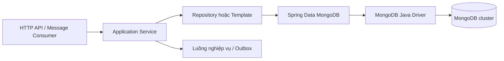

# spring-boot-starter-data-mongodb và lựa chọn driver

Khi tích hợp MongoDB vào ứng dụng Spring Boot, quyết định quan trọng đầu tiên là **dùng Spring Data MongoDB hay gọi MongoDB Java Driver trực tiếp**, sau đó là **chọn driver đồng bộ (synchronous) hay reactive**. Chọn đúng giúp mô hình truy cập dữ liệu phù hợp với luồng xử lý, cách quản lý kết nối, giao dịch, lỗi và kiểm thử. Chọn sai thường dẫn đến chặn luồng reactive, tạo quá nhiều kết nối hoặc xử lý không nhất quán khi một thông điệp được gửi lại.

Bài này nằm trong module **SPRING_BOOT_INTEGRATION**: tổ chức tích hợp hệ thống trong Spring Boot qua HTTP client, cơ sở dữ liệu, cache, broker thông điệp và các adapter của Spring Integration. Vì vậy, MongoDB được xem là **một hệ thống bên ngoài cần tích hợp có kiểm soát**, với hợp đồng dữ liệu, cấu hình, giao dịch, lỗi, chống xử lý trùng, kiểm thử và quan sát vận hành.

Sau bài học, bạn có thể:

- Giải thích quan hệ giữa Spring Boot starter, Spring Data MongoDB, Java driver và MongoDB server.
- Phân biệt `spring-boot-starter-data-mongodb`, `spring-boot-starter-data-mongodb-reactive` và việc chỉ dùng driver thuần.
- Chọn `MongoRepository`/`MongoTemplate` hoặc `ReactiveMongoRepository`/`ReactiveMongoTemplate` theo kiến trúc thực tế.
- Cấu hình URI, kết nối, timeout, pool, bảo mật và quản lý phiên bản dependency.
- Hiểu ranh giới giao dịch, chỉ mục, xử lý trùng thông điệp và các kiểm thử tích hợp cần có.

> **Phạm vi phiên bản:** Ví dụ Java/YAML sử dụng quy ước của **Spring Boot 3.x, Spring Data MongoDB tương ứng và Java 17+**. Một số tên property/auto-configuration có thể đổi giữa các phiên bản lớn của Spring Boot; hãy đối chiếu configuration metadata và dependency BOM của phiên bản dự án trước khi áp dụng. Mã rút gọn import ở một số đoạn để tập trung vào cơ chế chính.

## 1. Phân biệt starter, Spring Data và MongoDB Java Driver

Ba lớp thường bị gọi chung là “MongoDB driver” nhưng đảm nhiệm việc khác nhau:

| Thành phần | Vai trò | Ví dụ |
|---|---|---|
| **MongoDB server/cluster** | Lưu trữ tài liệu BSON, thực thi truy vấn, chỉ mục, replication/transaction | Replica set, sharded cluster, MongoDB Atlas |
| **MongoDB Java Driver** | Triển khai giao thức kết nối và thao tác MongoDB, quản lý topology/connection pool | `mongodb-driver-sync`, `mongodb-driver-reactivestreams` |
| **Spring Data MongoDB** | Mapping giữa đối tượng Java và BSON, repository abstraction, `MongoTemplate` và hỗ trợ transaction | `MongoRepository`, `ReactiveMongoTemplate` |
| **Spring Boot starter** | Gom dependency hợp lệ; cùng auto-configuration của Boot tạo bean khi điều kiện phù hợp | `spring-boot-starter-data-mongodb` |

`spring-boot-starter-data-mongodb` **không phải một MongoDB server nhúng** và cũng không tự cấp một database cho ứng dụng. Khi khởi động, ứng dụng vẫn phải kết nối tới MongoDB thật hoặc một instance dành cho kiểm thử.

Sơ đồ tích hợp điển hình:



Nếu code dùng repository Spring Data, driver vẫn chạy bên dưới. Ngược lại, dùng driver thuần đồng nghĩa bạn tự chịu trách nhiệm nhiều phần mapping, phân loại lỗi, tổ chức query và tích hợp với hệ sinh thái Spring.

## 2. Ba phương án dependency và quy tắc chọn

### 2.1. Starter đồng bộ: `spring-boot-starter-data-mongodb`

Gradle (Groovy DSL):

```groovy
dependencies {
    implementation 'org.springframework.boot:spring-boot-starter-data-mongodb'
}
```

Maven:

```xml
<dependency>
    <groupId>org.springframework.boot</groupId>
    <artifactId>spring-boot-starter-data-mongodb</artifactId>
</dependency>
```

Starter này cung cấp Spring Data MongoDB và **MongoDB synchronous driver** thông qua cây dependency tương thích do Spring Boot quản lý. Các thao tác phổ biến là:

- `MongoRepository<T, ID>`: CRUD, derived query, pagination, aggregation qua repository API.
- `MongoTemplate`: truy vấn linh hoạt với `Query`/`Criteria`, update, bulk operation, aggregation.
- `com.mongodb.client.MongoClient`: client đồng bộ của driver, có thể dùng trực tiếp cho trường hợp đặc biệt.

Với chương trình Spring MVC, scheduled job, batch process hoặc message consumer vận hành trên luồng blocking, **đây thường là lựa chọn mặc định hợp lý**.

### 2.2. Starter reactive: `spring-boot-starter-data-mongodb-reactive`

Gradle:

```groovy
dependencies {
    implementation 'org.springframework.boot:spring-boot-starter-data-mongodb-reactive'
}
```

Starter reactive sử dụng **MongoDB Reactive Streams Driver** (artifact `mongodb-driver-reactivestreams`), cùng abstraction reactive của Spring Data:

- `ReactiveMongoRepository<T, ID>` và `ReactiveMongoTemplate`.
- Kết quả thường được biểu diễn bằng Reactor `Mono<T>` hoặc `Flux<T>`.
- Driver giao tiếp theo Reactive Streams `Publisher<T>`; Spring Data chuyển thành API Reactor thân thiện hơn.

Chọn phương án này khi luồng xử lý có thiết kế reactive từ controller/consumer đến tầng truy cập dữ liệu, đặc biệt khi cần thực hiện nhiều I/O đồng thời mà không chặn các luồng event loop.

**Reactive không đồng nghĩa mọi tác vụ đều chạy nhanh hơn**. Một MongoDB cluster chậm hoặc connection pool nhỏ vẫn làm request phải chờ. Reactive giúp sử dụng luồng hiệu quả hơn trong lúc chờ I/O, nhưng cũng đòi hỏi kiểm soát concurrency, backpressure và cách lan truyền lỗi.

### 2.3. Dùng MongoDB Java Driver trực tiếp

Khi không muốn dùng abstraction của Spring Data, có thể khai báo dependency mức thấp:

```groovy
// Chọn một driver tùy mô hình thực thi:
implementation 'org.mongodb:mongodb-driver-sync'
// hoặc:
implementation 'org.mongodb:mongodb-driver-reactivestreams'
```

Ứng dụng quản lý dependency qua Spring Boot BOM thường được quản lý phiên bản driver tương thích. Nếu không dùng BOM/dependency management, phải chỉ định version rõ ràng và giữ nhất quán các artifact BSON/driver-core. Tránh override thủ công một artifact driver mà bỏ qua các artifact liên quan.

Driver thuần phù hợp khi bạn cần API/codec cụ thể của MongoDB mà Spring Data chưa bao phủ tốt, muốn kiểm soát BSON chi tiết hoặc xây một thư viện độc lập với Spring. Đổi lại, repository, mapping và cấu hình Spring Data không tự xuất hiện chỉ vì có `mongodb-driver-sync` trên classpath.

### 2.4. Bảng quyết định

| Bài toán | Lựa chọn ưu tiên | Lý do |
|---|---|---|
| Spring MVC + JPA/JDBC khác + lưu tài liệu MongoDB | Starter MongoDB **đồng bộ** | Giữ mô hình imperative nhất quán; repository/template dễ đọc |
| Batch job hoặc consumer xử lý từng thông điệp | Starter MongoDB **đồng bộ** | Dễ tích hợp với luồng blocking, timeout và retry có kiểm soát |
| WebFlux + các downstream cũng reactive | Starter MongoDB **reactive** | Truyền `Mono`/`Flux` xuyên tầng ứng dụng, hạn chế blocking |
| Stream nhiều thay đổi MongoDB theo Reactive Streams | Starter **reactive**, kiểm tra change streams | Phù hợp API publisher và xử lý bất đồng bộ |
| Cần codec BSON hoặc lệnh driver đặc thù | Driver thuần, hoặc truy cập driver qua Spring Data | Kiểm soát API mức thấp khi thật sự cần |
| Codebase đang dùng MongoDB driver thuần ổn định | Giữ driver; chuyển từng adapter khi có lợi ích rõ | Hạn chế đổi semantics của mapping và lỗi |
| Module chứa cả blocking và reactive | Tách adapter/repository và cấu hình tường minh | Tránh nhầm `MongoClient`/transaction manager giữa hai mô hình |

Không dựa duy nhất vào tên starter hay số lượng request để chọn driver. Hãy nhìn nơi nhận dữ liệu, loại thread mà ứng dụng đang dùng, khả năng của downstream và cách caller tiêu thụ kết quả.

## 3. Tự động cấu hình MongoDB trong Spring Boot

### 3.1. Một URI trung tâm

Ví dụ với Spring Boot 3.x:

```yaml
# application.yml (môi trường local/development)
spring:
  data:
    mongodb:
      uri: ${MONGODB_URI:mongodb://127.0.0.1:27017/order_integration}
```

URI minh họa trỏ tới database `order_integration`. Trong môi trường production, hãy cấu hình `MONGODB_URI` bằng secret manager hoặc cơ chế cấp biến môi trường an toàn; nên yêu cầu URI có mặt thay vì mặc định rơi về MongoDB localhost.

Các dạng URI phổ biến:

```text
mongodb://127.0.0.1:27017/order_integration

mongodb://db1.example:27017,db2.example:27017/order_integration?replicaSet=rs0&tls=true

mongodb+srv://cluster.example.mongodb.net/order_integration?retryWrites=true&w=majority
```

`mongodb+srv://` sử dụng bản ghi DNS SRV để khám phá host (thường gặp ở MongoDB Atlas). Việc dùng TLS, cơ chế xác thực, danh sách host, replica set và các option phụ thuộc vào chính hạ tầng MongoDB. Không nhúng username/password thật vào source code hoặc log. Nếu password xuất hiện trong URI, phải percent-encode ký tự đặc biệt theo quy tắc URI và che giá trị đó trong thông điệp lỗi.

Với starter đồng bộ, khi điều kiện auto-configuration phù hợp, Spring Boot có thể tạo:

- Bean `com.mongodb.client.MongoClient` để quản lý kết nối.
- `MongoDatabaseFactory`, `MongoTemplate` và infrastructure mapping.
- Repository implementation cho interface kế thừa `MongoRepository` trong phạm vi package được scan.

Với starter reactive, kiểu bean/abstraction tương ứng dùng `com.mongodb.reactivestreams.client.MongoClient`, `ReactiveMongoDatabaseFactory`, `ReactiveMongoTemplate` và reactive repository. Hai kiểu `MongoClient` thuộc **hai package khác nhau**; IDE auto-import sai có thể gây lỗi hoặc dẫn tới sử dụng mô hình không mong muốn.

Thông thường không cần tự tạo `MongoClient` nếu chỉ muốn kết nối theo URI. Để nguyên Spring Boot auto-configuration giúp giữ một điểm cấu hình, quản lý vòng đời bean và áp dụng customizer/observability đã khai báo.

### 3.2. Không nhầm database, collection và cluster

- **Cluster/replica set:** tập máy chủ được driver chọn node để kết nối.
- **Database:** namespace logic, như `order_integration`.
- **Collection:** nhóm tài liệu trong database, như `inventory_snapshots`.
- **Document:** dữ liệu BSON có khóa `_id`; khác bản ghi quan hệ ở cách biểu diễn trường lồng nhau và schema linh hoạt.

URI chỉ định database mặc định của ứng dụng, nhưng collection được xác định bởi tên collection, annotation `@Document` hoặc mã truy vấn. Tránh thiết lập database đồng thời ở URI và property riêng nếu không hiểu rõ quy tắc ưu tiên của phiên bản Boot đang dùng.

### 3.3. Timeout và connection pool

MongoDB Java Driver quản lý pool và lựa chọn máy chủ. Các timeout thường phải phân biệt:

| Thiết lập/khái niệm | Giới hạn điều gì? |
|---|---|
| `serverSelectionTimeoutMS` | Thời gian chờ chọn được MongoDB server phù hợp topology và điều kiện đọc/ghi |
| `connectTimeoutMS` | Thời gian mở một kết nối TCP |
| `socketTimeoutMS` | Thời gian chờ I/O socket ở driver đồng bộ; không đồng nghĩa deadline toàn nghiệp vụ |
| `maxPoolSize` | Số kết nối tối đa trong một pool tới mỗi server phù hợp với driver |
| `waitQueueTimeoutMS` | Thời gian request có thể chờ lấy kết nối từ pool |
| Deadline nghiệp vụ | Tổng thời gian cho thao tác, bao gồm thao tác phụ và retry; cần kiểm soát ở tầng ứng dụng khi cần |

Ví dụ local có giới hạn minh họa (không coi đây là giá trị khuyến nghị chung):

```text
mongodb://127.0.0.1:27017/order_integration?serverSelectionTimeoutMS=3000&connectTimeoutMS=2000&socketTimeoutMS=5000&maxPoolSize=30
```

Đánh giá các giá trị theo tải đồng thời, số replica/node, độ trễ mạng, tài nguyên của ứng dụng và khả năng chịu tải của MongoDB. Ý nghĩa timeout có thể khác giữa driver đồng bộ và reactive hoặc theo phiên bản driver; kiểm tra tài liệu driver đang dùng. Khi ứng dụng bị nghẽn, tăng pool vô hạn thường chỉ chuyển áp lực sang database.

## 4. Làm việc với Spring Data MongoDB đồng bộ

### 4.1. Mapping document và thiết kế hợp đồng dữ liệu

Một tài liệu MongoDB có thể chứa thông tin snapshot tồn kho mà Order Service nhận qua HTTP hoặc broker:

```json
{
  "_id": "snapshot-SKU-42",
  "sku": "SKU-42",
  "available": 12,
  "updatedAt": "2026-11-21T03:00:00Z"
}
```

Dữ liệu lưu thực tế ở BSON; `Instant` được mapper xử lý thành biểu diễn thời gian tương ứng. Đoạn JSON trên nhằm minh họa nội dung, không phải bằng chứng trực tiếp về dạng BSON hoặc định dạng JSON mở rộng khi export.

Có thể ánh xạ sang Java record:

```java
import java.time.Instant;
import org.springframework.data.annotation.Id;
import org.springframework.data.mongodb.core.mapping.Document;

@Document(collection = "inventory_snapshots")
public record InventorySnapshot(
        @Id String id,
        String sku,
        long available,
        Instant updatedAt
) {}
```

Ở Spring Data MongoDB, trường định danh có thể dùng `@Id`, `@MongoId` và quy tắc chuyển đổi định danh. Với business ID phải lưu chính xác dạng chuỗi, đặc biệt khi có chuỗi nhìn giống ObjectId, hãy xem xét `@MongoId(FieldType.STRING)` để kiểm soát BSON type. Quy ước tên trường, null/field thiếu, số nguyên, thời gian và nested object cần thuộc hợp đồng dữ liệu giữa producer và consumer.

Đừng dùng thẳng entity/document MongoDB làm DTO HTTP hoặc payload broker nếu hai hợp đồng thay đổi độc lập. Đặt mapper tại ranh giới giữa transport data và storage model.

### 4.2. Repository để CRUD và truy vấn đơn giản

```java
import java.util.Optional;
import org.springframework.data.mongodb.repository.MongoRepository;

public interface InventorySnapshotRepository
        extends MongoRepository<InventorySnapshot, String> {

    Optional<InventorySnapshot> findBySku(String sku);
}
```

Spring Data tạo implementation theo tên phương thức. Caller dùng nó qua một adapter:

```java
import java.util.Optional;
import org.springframework.stereotype.Service;

@Service
public class InventorySnapshotQueryService {

    private final InventorySnapshotRepository repository;

    public InventorySnapshotQueryService(InventorySnapshotRepository repository) {
        this.repository = repository;
    }

    public Optional<InventorySnapshot> findBySku(String sku) {
        return repository.findBySku(sku);
    }
}
```

`Optional.empty()` ở đây nghĩa là không tìm thấy document; nó **không đại diện cho lỗi kết nối**. Lỗi server selection, timeout, xác thực hoặc query thường được Spring dịch thành các subtype của `DataAccessException`. Business service có thể ánh xạ kết quả không tồn tại sang nghiệp vụ riêng; không được nuốt lỗi hạ tầng rồi trả “hết hàng”.

### 4.3. `MongoTemplate` khi cần truy vấn linh hoạt

Repository là lựa chọn tiện cho use case rõ ràng; `MongoTemplate` hữu ích khi truy vấn động, projection, bulk, aggregation hoặc update có điều kiện:

```java
import org.springframework.data.mongodb.core.MongoTemplate;
import org.springframework.data.mongodb.core.query.Criteria;
import org.springframework.data.mongodb.core.query.Query;

public class InventorySnapshotLookup {

    private final MongoTemplate mongoTemplate;

    public InventorySnapshotLookup(MongoTemplate mongoTemplate) {
        this.mongoTemplate = mongoTemplate;
    }

    public InventorySnapshot findBySku(String sku) {
        Query query = Query.query(Criteria.where("sku").is(sku));
        return mongoTemplate.findOne(query, InventorySnapshot.class);
    }
}
```

`findOne` có thể trả `null` khi không thấy bản ghi; nếu adapter công khai `Optional`, hãy chuyển kết quả sang `Optional.ofNullable(...)`. Với sửa dữ liệu đồng thời, nên dùng thao tác cập nhật có điều kiện ở database (chẳng hạn `findAndModify` hoặc update operator), thay vì luôn “đọc rồi save” khiến cập nhật ghi đè nhau.

### 4.4. Chỉ mục và truy vấn là một phần của hợp đồng tích hợp

Nếu `sku` phải duy nhất, hãy tạo unique index:

```javascript
// mongosh — chạy như một migration hoặc tác vụ quản trị đã kiểm soát
db.inventory_snapshots.createIndex(
  { sku: 1 },
  { unique: true, name: "ux_inventory_snapshots_sku" }
);
```

Unique index bảo vệ ràng buộc **ở database**, kể cả khi hai instance cùng ghi. `findBySku` không tự khiến `sku` trở thành duy nhất. Nếu dữ liệu đã có giá trị trùng, việc tạo unique index sẽ thất bại cho đến khi dữ liệu được làm sạch.

Spring Data hỗ trợ annotation `@Indexed`, `@CompoundIndex` và auto index creation theo cấu hình. Với hệ thống production, nên quản lý thay đổi index qua migration/quy trình triển khai riêng để kiểm soát thời gian build index, tác động tài nguyên, rollback và tương thích phiên bản; không phụ thuộc vào việc mọi instance ứng dụng đều tự tạo index khi khởi động.

Các chỉ số cần kiểm tra gồm `explain()`, số document quét, kích thước index, query latency, phân trang và tốc độ tăng dữ liệu. Mô hình document giảm một số join nhưng không thay thế thiết kế index.

## 5. Làm việc với Spring Data MongoDB reactive

Cùng `InventorySnapshot`, repository reactive trông tương tự nhưng **kiểu trả về và thời điểm thực thi khác**:

```java
import org.springframework.data.mongodb.repository.ReactiveMongoRepository;
import reactor.core.publisher.Mono;

public interface ReactiveInventorySnapshotRepository
        extends ReactiveMongoRepository<InventorySnapshot, String> {

    Mono<InventorySnapshot> findBySku(String sku);
}
```

Adapter reactive có thể giữ nguyên tín hiệu:

```java
import org.springframework.stereotype.Service;
import reactor.core.publisher.Mono;

@Service
public class ReactiveInventorySnapshotQueryService {

    private final ReactiveInventorySnapshotRepository repository;

    public ReactiveInventorySnapshotQueryService(
            ReactiveInventorySnapshotRepository repository) {
        this.repository = repository;
    }

    public Mono<InventorySnapshot> requireSku(String sku) {
        return repository.findBySku(sku)
                .switchIfEmpty(Mono.error(
                        new IllegalArgumentException("Không tìm thấy SKU: " + sku)));
    }
}
```

`Mono<T>` biểu diễn kết quả có tối đa một phần tử hoặc một lỗi; `Flux<T>` dành cho nhiều phần tử. Pipeline reactive thường thực thi khi được subscribe. Trong WebFlux, framework quản lý subscription khi controller trả về `Mono`/`Flux`. Không gọi `subscribe()` ở giữa service để kích hoạt truy vấn rồi bỏ qua tín hiệu lỗi.

Đặc biệt tránh:

```java
// Sai trong event loop/reactive pipeline:
InventorySnapshot snapshot = reactiveRepository.findBySku("SKU-42").block();
```

`block()` buộc luồng hiện tại chờ, thậm chí có thể bị từ chối ở các luồng Reactor không hỗ trợ blocking. Nếu ứng dụng thực chất dùng Spring MVC, JDBC và xử lý blocking trên từng thread, starter đồng bộ thường giúp thiết kế dễ hiểu hơn. Nếu cần kết hợp Mongo reactive với các tác vụ blocking khác, phải có ranh giới thread/scheduler được thiết kế và kiểm thử cẩn thận; chỉ thêm `publishOn`/`subscribeOn` không biến API blocking thành non-blocking.

Với reactive query phức tạp, sử dụng `ReactiveMongoTemplate` thay vì `MongoTemplate`:

```java
return reactiveMongoTemplate.findOne(
        Query.query(Criteria.where("sku").is(sku)),
        InventorySnapshot.class
);
```

Phương thức này trả về `Mono<InventorySnapshot>`. Khi kết hợp nhiều truy vấn, giới hạn concurrency; không tạo `flatMap` không giới hạn đối với hàng nghìn message nếu pool và MongoDB không chịu được tải.

## 6. Khi nào cần dùng Java Driver thuần?

Driver trực tiếp cung cấp API BSON/collection chi tiết, hữu ích cho thao tác chuyên biệt hoặc thư viện không phụ thuộc Spring Data. Ví dụ đồng bộ độc lập:

```java
import com.mongodb.client.MongoClient;
import com.mongodb.client.MongoClients;
import com.mongodb.client.MongoCollection;
import org.bson.Document;
import static com.mongodb.client.model.Filters.eq;

public class RawMongoExample {
    public static void main(String[] args) {
        String uri = System.getenv("MONGODB_URI");

        try (MongoClient client = MongoClients.create(uri)) {
            MongoCollection<Document> collection = client
                    .getDatabase("order_integration")
                    .getCollection("inventory_snapshots");

            Document found = collection.find(eq("sku", "SKU-42")).first();
            System.out.println(found == null ? "Không thấy SKU" : "Có snapshot");
        }
    }
}
```

`try-with-resources` chỉ phù hợp ở đây vì đây là chương trình độc lập. **Trong Spring Boot, nên dùng `MongoClient` như một singleton/bean quản lý vòng đời**, không mở và đóng client mỗi request hoặc mỗi message. Mỗi client có tài nguyên nội bộ và connection pool riêng.

Nếu truy cập MongoDB thấp cấp ngay trong ứng dụng có starter, có thể inject chính `MongoClient` do Boot tạo để dùng chung kết nối. Đừng gọi `MongoClients.create(...)` trong mỗi method của repository tùy biến.

Lưu ý hai package:

```java
// Synchronous driver
com.mongodb.client.MongoClient

// Reactive Streams driver
com.mongodb.reactivestreams.client.MongoClient
```

Reactive driver trả Reactive Streams publisher; không thể thay import sync bằng reactive rồi giữ nguyên thao tác `collection.find(...).first()`. Cũng không nên thêm dependency `mongodb-driver-async` (driver async callback cũ) để bắt đầu một tích hợp reactive mới; hãy dùng Reactive Streams driver của stack hiện hành.

## 7. Driver, transaction và xử lý trùng lặp trong tích hợp

### 7.1. Transaction MongoDB có phạm vi riêng

MongoDB hỗ trợ transaction đa document trên topology phù hợp (như replica set hoặc sharded cluster đủ điều kiện). Transaction phải đi qua session/transaction manager đúng với loại driver và cấu hình Spring Data.

Với Spring Data **đồng bộ**, cấu hình ví dụ:

```java
import org.springframework.context.annotation.Bean;
import org.springframework.context.annotation.Configuration;
import org.springframework.data.mongodb.MongoDatabaseFactory;
import org.springframework.data.mongodb.MongoTransactionManager;

@Configuration
class MongoTransactionConfiguration {

    @Bean
    MongoTransactionManager mongoTransactionManager(
            MongoDatabaseFactory databaseFactory) {
        return new MongoTransactionManager(databaseFactory);
    }
}
```

Sau đó dùng `@Transactional("mongoTransactionManager")` tại service nghiệp vụ khi thật sự cần nhiều thao tác MongoDB trong một transaction; phải kiểm tra môi trường MongoDB hỗ trợ transaction và test cả rollback. Reactive tương ứng cần `ReactiveMongoTransactionManager` và context transaction reactive; không áp dụng máy móc manager blocking cho `Mono`/`Flux`.

Các giới hạn quan trọng:

- `@Transactional` cho MongoDB **không làm một lệnh HTTP sang Inventory hoặc một lần publish broker tham gia cùng ACID transaction**.
- Một SQL transaction của JPA và MongoDB transaction cũng không tự trở thành transaction phân tán.
- Transaction đa document làm tăng chi phí; khi có thể, ưu tiên thiết kế tài liệu và cập nhật nguyên tử trên **một document**.
- Không kéo dài transaction chỉ để đợi HTTP, broker hoặc xử lý CPU nặng.

Khi cần phối hợp MongoDB và broker, cân nhắc **outbox**, trạng thái xử lý, retry có giới hạn và thao tác bù thay vì giả định commit diễn ra cùng lúc ở hai hệ thống.

### 7.2. Chống xử lý trùng khi nhận message

Ví dụ Order Service nhận sự kiện `InventoryUpdated` từ broker và lưu snapshot vào MongoDB. Broker có thể giao lại message sau khi consumer đã ghi thành công nhưng chưa kịp xác nhận (ack). Consumer phải có quy tắc idempotent, đặc biệt với thao tác cộng/trừ số lượng.

Một thiết kế phổ biến:

1. Gắn mỗi event với `eventId` bất biến từ producer.
2. Đặt unique index cho `eventId` trong collection `processed_events` hoặc áp dụng cập nhật có điều kiện theo version của sự kiện.
3. Trong transaction MongoDB phù hợp, ghi dấu đã xử lý và thay đổi dữ liệu nghiệp vụ; nếu event trùng, xử lý theo quy tắc bỏ qua an toàn.
4. Chỉ ack message theo chính sách tiêu thụ sau khi phần ghi dữ liệu cần thiết đã thành công. Nếu cần phát sự kiện tiếp, dùng outbox hoặc cơ chế bù phù hợp.

Với tác vụ chỉ cập nhật snapshot, có thể dùng **upsert có điều kiện trên khóa duy nhất**, nhưng cần xét event đến sai thứ tự: sự kiện cũ không được ghi đè trạng thái mới. Một thao tác `find-then-insert` không được bảo vệ bởi unique index có thể tạo trùng dưới cạnh tranh. Bắt `DuplicateKeyException` để xác định duplicate hợp lệ chỉ sau khi chắc chắn vi phạm đúng khóa idempotency.

Không hứa bảo đảm “exactly once end-to-end” chỉ vì driver có `retryWrites=true`. Retryable writes của MongoDB và idempotency nghiệp vụ giải quyết các vấn đề khác nhau; logic xử lý lặp vẫn phải dựa trên hợp đồng dữ liệu và trạng thái được lưu bền.

### 7.3. Write concern, read concern và read preference

| Khái niệm | Điều cần hiểu khi tích hợp |
|---|---|
| **Write concern** | Mức xác nhận ghi; ảnh hưởng độ bền và latency của kết quả ghi |
| **Read concern** | Mức bảo đảm đọc về mặt nhất quán/hiển thị dữ liệu |
| **Read preference** | Ưu tiên node đọc, chẳng hạn primary hay secondary; có thể ảnh hưởng dữ liệu đọc được và độ trễ |
| **Retryable reads/writes** | Driver có thể tự thử lại một số thao tác đủ điều kiện; không thay thế retry/idempotency của service |

Một HTTP 200 sau ghi không tự bảo đảm consumer khác ở replica phụ đã nhìn thấy phiên bản dữ liệu mới, nếu read preference/read concern không phù hợp. Nên xác định yêu cầu nghiệp vụ: đọc ngay sau ghi, báo cáo chấp nhận trễ, hay trạng thái tài chính cần mức nhất quán mạnh hơn. Cấu hình theo yêu cầu đó cùng đội vận hành MongoDB.

## 8. Lỗi, giới hạn tài nguyên và bảo mật

Spring Data thường chuyển ngoại lệ driver sang họ `org.springframework.dao.DataAccessException`. Một số tình huống cần tách biệt:

| Tình huống | Cách xử lý gợi ý |
|---|---|
| Không có document | Trả `Optional.empty()` hoặc `Mono.empty()`; tùy nghiệp vụ ánh xạ thành “không tìm thấy” |
| Unique index bị vi phạm | Xem xét `DuplicateKeyException`; có thể là duplicate hợp lệ hoặc bug khóa |
| Server selection timeout, mất kết nối | Trạng thái phụ thuộc không sẵn sàng; retry có giới hạn nếu thao tác an toàn |
| Lỗi xác thực/ủy quyền | Sửa secret, role và cấu hình; không retry liên tục cùng credentials |
| Query quá chậm, pool cạn | Kiểm tra index, concurrency, pool metrics, server capacity và deadline |
| Document sai schema/codec | Kiểm tra phiên bản dữ liệu, mapper và migration; không gán mặc định sai âm thầm |
| Transaction conflict/write conflict | Cân nhắc retry **toàn transaction** trong giới hạn, bảo đảm thao tác ngoài transaction không phát sinh lặp |

Retry ở driver, repository, consumer và broker có thể nhân số lần thực thi. Đặt một **ngân sách retry thống nhất**, thêm exponential backoff có jitter, xác định lỗi có thể retry và dừng khi hết deadline. Không retry vô điều kiện cho các thao tác ghi có side effect ngoài MongoDB.

Bảo mật tối thiểu cho integration MongoDB:

- Dùng TLS cho kết nối qua mạng phù hợp, xác thực bằng tài khoản riêng có quyền tối thiểu.
- Secret được cấp qua secret manager/biến môi trường; tránh URI chứa password trong Git, log và stack trace gửi ra ngoài.
- Không chấp nhận URI động từ đầu vào HTTP của người dùng; endpoint MongoDB là cấu hình đáng tin cậy.
- Cấu hình network allowlist, quy tắc rotation credential, backup/restore và quyền truy cập theo môi trường.
- Với dữ liệu cá nhân hoặc nhạy cảm, áp dụng quy tắc retention, phân quyền truy vấn và mã hóa ở mức phù hợp.

## 9. Kiểm thử và quan sát vận hành

### 9.1. Các cấp kiểm thử nên có

| Cấp | Mục tiêu | Cách kiểm tra |
|---|---|---|
| Unit test service | Quyết định nghiệp vụ khi có/không có snapshot, lỗi ghi, event trùng | Fake repository hoặc mock abstraction adapter |
| Repository test | Mapping BSON, derived query, unique index, update có điều kiện | `@DataMongoTest` với MongoDB thực dành cho test |
| Integration test | URI, authentication, connection pool, transaction, timeout, retry | Testcontainers hoặc instance test được quản lý |
| Luồng tích hợp | Event → consumer → MongoDB → ack/outbox, phát lại/trật thứ tự | Test broker + MongoDB, gửi cùng event nhiều lần |

`@DataMongoTest` tạo Spring Data MongoDB slice, nhưng **không tự bảo đảm có một MongoDB test server chạy sẵn**. Có thể dùng Testcontainers cho môi trường cô lập; ví dụ dành cho Spring Boot 3.x và Testcontainers API tương ứng:

```java
import java.time.Instant;
import org.junit.jupiter.api.Test;
import org.springframework.beans.factory.annotation.Autowired;
import org.springframework.boot.test.autoconfigure.data.mongo.DataMongoTest;
import org.springframework.test.context.DynamicPropertyRegistry;
import org.springframework.test.context.DynamicPropertySource;
import org.testcontainers.containers.MongoDBContainer;
import org.testcontainers.junit.jupiter.Container;
import org.testcontainers.junit.jupiter.Testcontainers;
import static org.assertj.core.api.Assertions.assertThat;

@Testcontainers
@DataMongoTest
class InventorySnapshotRepositoryTest {

    @Container
    static final MongoDBContainer mongo = new MongoDBContainer("mongo:7.0");

    @DynamicPropertySource
    static void mongodbProperties(DynamicPropertyRegistry registry) {
        registry.add("spring.data.mongodb.uri", mongo::getReplicaSetUrl);
    }

    @Autowired
    InventorySnapshotRepository repository;

    @Test
    void findsSnapshotBySku() {
        repository.save(new InventorySnapshot(
                "snapshot-SKU-42", "SKU-42", 12L, Instant.now()));

        assertThat(repository.findBySku("SKU-42"))
                .get()
                .extracting(InventorySnapshot::available)
                .isEqualTo(12L);
    }
}
```

Cần các test dependency phù hợp (Spring Boot Test, Testcontainers MongoDB và JUnit integration) cùng Docker/runtime tương thích. Bài test trên chỉ chứng minh tìm được dữ liệu đã lưu; cần thêm test tạo unique index rồi cố ý ghi trùng, mapping date/BSON, transaction trên replica set, lỗi connection, và luồng xử lý event trùng theo yêu cầu dự án. Đừng suy ra transaction production an toàn chỉ từ test repository happy path.

Reactive test có thể dùng `StepVerifier` để kiểm tra `Mono`/`Flux` và Testcontainers MongoDB để kiểm tra hành vi driver thực; cần test cả tín hiệu lỗi, subscription, cancellation và giới hạn concurrency.

### 9.2. Quan sát hệ thống

Spring Boot Actuator/Micrometer và cơ chế đo của MongoDB Java Driver có thể giúp đo health, command timing và pool usage khi được cấu hình đúng với phiên bản/stack. Không mặc định cho rằng chỉ thêm starter đã có đủ dashboard.

Tối thiểu cần theo dõi:

- Kết nối được hay không, lỗi chọn server, lỗi xác thực, timeout và phân bố thời gian truy vấn.
- Số kết nối đang dùng/chờ, pool saturation, số thao tác chậm, số lượng retry.
- Lỗi duplicate key, transaction conflict và số event bị xử lý trùng theo **loại sự kiện**, không dùng eventId làm metric tag.
- Tài nguyên MongoDB: CPU, memory, disk, replication lag, index size và dung lượng collection.
- Correlation ID/trace ID xuyên qua HTTP consumer, message listener và repository adapter khi tích hợp tracing.

Không đưa URI có credentials, truy vấn chứa dữ liệu cá nhân, `eventId`/`sku`/`orderId` có cardinality lớn vào metric tag. Log nên dùng tên collection, operation, thời lượng, mã lỗi, correlation ID; che phần dữ liệu nhạy cảm.

## 10. Những sai lầm thường gặp và cách tránh

1. **Cài cả hai starter theo thói quen:** Spring Boot có thể có nhiều loại client/template; dễ nhầm kiểu bean và repository scanning. Chỉ cài stack cần dùng hoặc cấu hình rõ từng adapter.
2. **Dùng reactive repository rồi `block()` trong event loop:** mất lợi ích non-blocking và có thể gây lỗi runtime. Giữ pipeline reactive từ đầu đến cuối hoặc dùng driver đồng bộ.
3. **Tạo `MongoClients.create` cho mỗi request:** tạo nhiều pool/tài nguyên không cần thiết. Quản lý client như bean dùng lại suốt vòng đời ứng dụng.
4. **Cho rằng repository tự tạo index duy nhất:** query method `findBySku` không bảo đảm uniqueness. Định nghĩa, triển khai và test unique index.
5. **Không chuẩn hóa kiểu `_id`:** String có thể được mapping sang ObjectId nếu thỏa định dạng. Xác định chiến lược BSON type của identifier ngay từ đầu.
6. **Trả “không tìm thấy” cho mọi lỗi MongoDB:** làm mất phân biệt lỗi hạ tầng và lỗi dữ liệu. Phân loại ngoại lệ và truyền thông tin phù hợp cho tầng nghiệp vụ.
7. **Giả định `@Transactional` đồng bộ MongoDB với SQL/HTTP/broker:** cần workflow/outbox/compensation cho tính nhất quán liên hệ thống.
8. **Nhầm retryable writes với chống trùng message:** retry ở tầng driver không thay thế event ID ổn định, unique index và quy tắc idempotency.
9. **Không kiểm thử với MongoDB thật:** mock repository không bắt được vấn đề BSON mapping, index, transaction/topology và network.
10. **Tuning pool mà không đo index/query:** bottleneck ở truy vấn/replication có thể vẫn tồn tại và làm database quá tải khi tăng kết nối.

## 11. Tình huống ứng dụng thực tế

**Tình huống A — snapshot tồn kho trong Order Service.** Ứng dụng Spring MVC gọi Inventory qua HTTP rồi lưu snapshot vào MongoDB để tra cứu nhanh. Starter đồng bộ + `MongoRepository` đủ cho CRUD đơn giản; dùng index trên `sku`, timeout kết nối rõ ràng, và TTL chỉ khi chính sách dữ liệu cho phép.

**Tình huống B — projection từ broker.** Consumer nhận sự kiện cập nhật tồn kho, ghi một bản ghi projection trong MongoDB rồi ack. Chọn driver theo mô hình consumer. Quan trọng nhất là event ID, thứ tự sự kiện, unique index và quy tắc xử lý lại sau sự cố.

**Tình huống C — API WebFlux đọc nhiều document.** Controller trả `Flux<InventorySnapshot>`, service dùng `ReactiveMongoRepository` và giữ pipeline reactive. Áp dụng projection, phân trang/giới hạn dữ liệu, backpressure và giám sát pool; tránh trả toàn collection không giới hạn qua một request.

**Tình huống D — thao tác MongoDB chuyên biệt.** Một adapter cần command hoặc codec BSON đặc thù mà repository/template chưa đáp ứng thuận tiện. Dùng `MongoClient` thuần bên trong adapter, nhưng tận dụng client singleton do Boot quản lý nếu có và giữ hợp đồng lỗi/thời gian chờ thống nhất với phần còn lại.

### Câu hỏi tự kiểm tra

1. Starter MongoDB khác gì Java Driver thuần? Vì sao thêm starter không có nghĩa đã có MongoDB server?
2. Dự án Spring MVC dùng JDBC nên chọn starter đồng bộ hay reactive trong trường hợp truy cập MongoDB thông thường?
3. `MongoRepository` và `MongoTemplate` khác nhau thế nào về mục đích sử dụng?
4. Vì sao `ReactiveMongoRepository` trả `Mono`/`Flux` và không nên gọi `block()` trên event loop?
5. `_id` và `sku` có vai trò khác nhau như thế nào? Vì sao cần unique index cho một business key?
6. Tại sao event broker gửi lại có thể tạo ghi trùng dù MongoDB driver bật retryable writes?
7. `@Transactional` có bảo đảm atomic giữa MongoDB và lệnh HTTP sang Inventory không?
8. Những chỉ số và test nào giúp phát hiện pool cạn, truy vấn không dùng index và event được xử lý lặp?

**Ghi nhớ:** `spring-boot-starter-data-mongodb` phù hợp với luồng đồng bộ; `spring-boot-starter-data-mongodb-reactive` phù hợp với pipeline reactive; driver thuần dành cho nhu cầu kiểm soát thấp hơn mức Spring Data. Thành công của tích hợp MongoDB phụ thuộc thêm vào cấu hình, mô hình document/index, ngữ nghĩa transaction, idempotency, quản lý lỗi và quan sát sản xuất.
