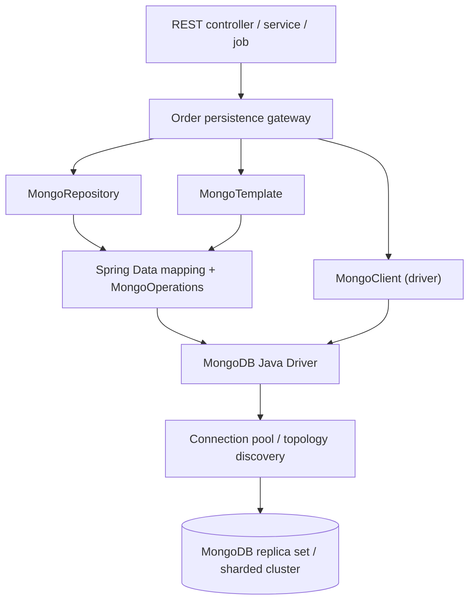
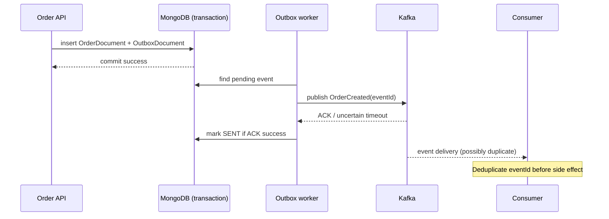
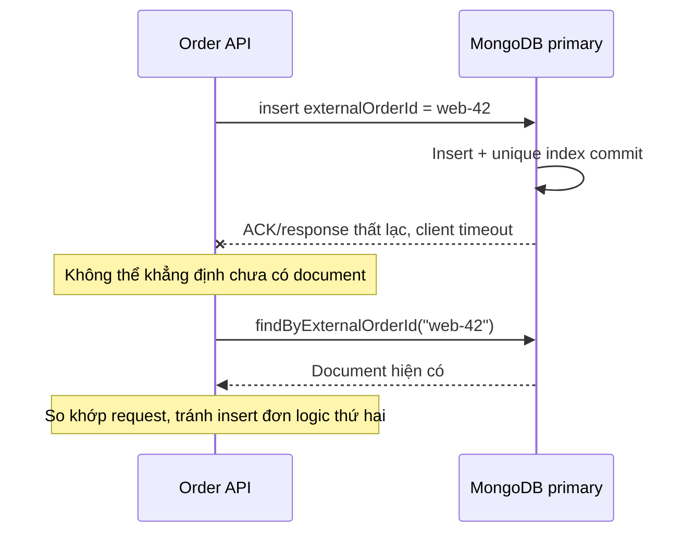
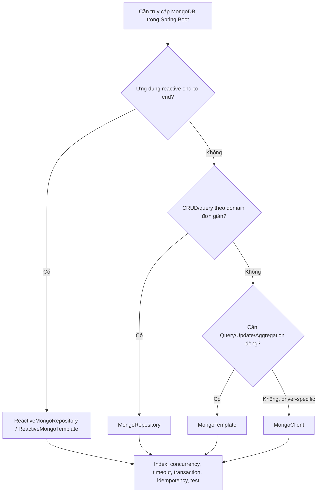

# MongoClient, MongoTemplate và MongoRepository

> **Chương:** MongoDB  
> **Phạm vi:** SPRING_BOOT_INTEGRATION — kết nối và tích hợp hệ thống Spring Boot với cơ sở dữ liệu, HTTP client, cache, broker thông điệp và Spring Integration; chú trọng cấu hình, hợp đồng dữ liệu, giao dịch, lỗi, xử lý trùng lặp, kiểm thử và quan sát.

## 1. Bài toán: ba cách truy cập cùng một MongoDB

Một dịch vụ đặt hàng nhận HTTP `POST /orders`, lưu trạng thái đơn hàng ở MongoDB, đọc dữ liệu phục vụ API tra cứu và phát `OrderCreated` tới Kafka. Khi cần đọc/ghi MongoDB, lập trình viên Spring Boot gặp ba abstraction:

- **`MongoClient`** — client chính thức của MongoDB Java Driver. Cung cấp quyền truy cập thấp tới database, collection, BSON, command, session và những API chuyên biệt. Trong ứng dụng blocking, type là `com.mongodb.client.MongoClient`.
- **`MongoTemplate`** — lớp của **Spring Data MongoDB** bao bọc driver; hỗ trợ `Query`, `Criteria`, `Update`, entity mapping, exception translation, callback và thao tác đặc thù MongoDB.
- **`MongoRepository<T, ID>`** — abstraction repository của Spring Data, phù hợp CRUD và truy vấn thường gặp được sinh từ tên method hoặc `@Query`. Repository thường sử dụng hạ tầng MongoDB/Spring Data phía dưới; không phải một loại kết nối MongoDB riêng.



**Chọn abstraction theo trách nhiệm, không theo giả định tốc độ:** repository cho truy vấn CRUD có contract ổn định; template cho cập nhật nguyên tử, aggregation hoặc query động; driver cho khả năng thấp tầng chưa có abstraction phù hợp. Cả ba vẫn chịu giới hạn kết nối, topology, quyền, read/write concern và lỗi của cùng một MongoDB.

### 1.1. Mục tiêu học tập

Sau bài này, bạn có thể:

1. Thêm đúng starter và cấu hình `spring.data.mongodb.*` theo dòng Spring Boot.
2. Phân biệt bean `MongoClient`, `MongoDatabaseFactory`, `MongoTemplate` và repository.
3. Ánh xạ document bằng `@Document`, `@Id`, `@Field`, `@Indexed` và `@Version`; hiểu giới hạn schema/index.
4. Viết query/update bằng driver, template và repository, lựa chọn từng API theo nhu cầu.
5. Thiết kế unique key, optimistic locking, idempotency và transaction MongoDB phù hợp.
6. Tránh nhầm transaction MongoDB với transaction của PostgreSQL, Kafka hoặc HTTP.
7. Kiểm thử bằng Testcontainers và quan sát lỗi kết nối, truy vấn chậm, pool và replication.

## 2. Cơ sở MongoDB: document, collection, BSON và tính nguyên tử

MongoDB lưu dữ liệu dạng **BSON documents** trong **collections**, thay cho rows trong tables. Một tài liệu ví dụ:

```json
{
  "_id": "order-7f63",
  "externalOrderId": "web-2026-042",
  "customerId": "customer-17",
  "status": "NEW",
  "createdAt": {"$date": "2026-11-21T08:00:00Z"},
  "version": 0
}
```

`{"$date": ...}` là cách **Extended JSON** minh họa BSON Date, không phải cấu trúc mà bạn nhất thiết gửi từ Java. `_id` là khóa định danh document, còn `externalOrderId` là khóa nghiệp vụ dùng để chống tạo đơn trùng.

| Thành phần | Ý nghĩa | Hệ quả thiết kế |
| --- | --- | --- |
| Database | Namespace cấp cao của nhiều collections | Cấu hình database đúng theo môi trường |
| Collection | Nhóm documents, ví dụ `integration_orders` | Cần index, quyền và quy trình thay đổi schema |
| Document | Bản ghi BSON có thể có field lồng nhau/array | Document shape phải có version/contract được kiểm soát |
| `_id` | Định danh duy nhất trong collection | Không nhất thiết là `String`; driver có thể dùng `ObjectId` |
| Secondary index | Tăng tốc query hoặc ràng buộc unique | `@Indexed` là metadata; phải **thực sự tạo index** |
| Atomic single-document write | Ghi một document là thao tác nguyên tử trong điều kiện MongoDB | Phù hợp cập nhật state/counter của một aggregate |
| Multi-document transaction | Gộp nhiều lệnh trên các documents/collections | Cần topology hỗ trợ, session và transaction manager |

MongoDB có thể thay đổi document structure theo thời gian, nhưng **“schema linh hoạt” không có nghĩa không có hợp đồng dữ liệu**. Producer/consumer, mapping Java, validation và index vẫn phải thỏa thuận field bắt buộc, kiểu và version.

### 2.1. Ranh giới tính nhất quán không tự mở rộng qua nhiều hệ thống

Một cập nhật document đơn lẻ có thể là atomic, nhưng quy trình sau không tự atomic:

```text
1. Lưu OrderDocument trong MongoDB
2. Gọi API thanh toán qua HTTP
3. Gửi OrderCreated lên Kafka
```

Nếu bước 1 thành công và bước 3 thất bại, MongoDB không tự rollback bước 1. Ở mục giao dịch/outbox phía sau, bài học sẽ phân biệt **MongoDB transaction** và **cross-system consistency**.

## 3. Dependency, cấu hình kết nối và auto-configuration

Ví dụ bên dưới dùng **Spring Boot 3.2–3.5, Spring Data MongoDB phù hợp với BOM và Java 17+**. Một số tên starter, cấu hình và API thay đổi ở Boot 4; nếu đang dùng dòng khác, hãy đối chiếu tài liệu đúng phiên bản thay vì ghép dependency ngẫu nhiên.

### 3.1. Starter cho mô hình blocking

Gradle (dự án đã áp dụng plugin/BOM Spring Boot):

```groovy
dependencies {
    implementation 'org.springframework.boot:spring-boot-starter-data-mongodb'
    testImplementation 'org.springframework.boot:spring-boot-starter-test'
}
```

Maven (Boot dependency management):

```xml
<dependency>
    <groupId>org.springframework.boot</groupId>
    <artifactId>spring-boot-starter-data-mongodb</artifactId>
</dependency>
```

Starter cung cấp driver blocking và Spring Data MongoDB, giúp Boot tự cấu hình Mongo client, factory, template và repository theo các điều kiện tương ứng.

**Không cần `@EnableMongoRepositories` chỉ để dùng repository trong package được scan mặc định**. Annotation này có ích khi muốn tùy biến vùng scan hoặc nhiều cấu hình MongoDB. Tương tự, không cần tự tạo `MongoTemplate` mỗi khi muốn inject nó.

### 3.2. application.yml — cấu hình theo môi trường

```yaml
spring:
  data:
    mongodb:
      uri: ${MONGODB_URI}
      auto-index-creation: false
```

Một URI không chứa secret, chỉ dùng để minh họa:

```text
mongodb://mongo1.example.invalid:27017,mongo2.example.invalid:27017/orders_db?replicaSet=rs0
```

Với authentication, URI có thể cần username/password và `authSource`; ví dụ `MONGODB_URI` phải được cấp qua secret manager/biến môi trường bảo vệ. **Không ghi URI có credential thật vào Git, log hoặc exception được trả cho HTTP caller.** Trong container, `localhost` thường chỉ container đó; URI phải dùng hostname truy cập được từ network chạy thực tế. Với MongoDB Atlas, có thể dùng `mongodb+srv://...` nếu DNS SRV và TLS đúng theo cấu hình cluster.

Một số nguyên tắc:

- `spring.data.mongodb.uri` là cách khai báo đầy đủ host, database, authentication và replica set. Không cấu hình cùng lúc URI và các property host/port/username rời rạc với ý nghĩa mâu thuẫn.
- Database trong URI cần đúng môi trường; phân biệt database đang dùng với `authSource` (database xác thực).
- `spring.data.mongodb.auto-index-creation: false` nhấn mạnh chính sách quản lý index chủ động. Index tạo tự động mặc định bị tắt ở Spring Data MongoDB 3.x+; cần kiểm chứng trên version triển khai.
- Kết nối TLS, truststore/SSL bundle, timeouts và pool nên được cấu hình theo chính sách hạ tầng; không tắt certificate validation để “chữa” lỗi DNS/TLS.
- Một client có thể cấu hình nhiều host cho replica set, nhưng quyền và topology không tự đúng chỉ vì URI có nhiều server.

### 3.3. Những bean nằm ở đâu trong Spring Boot?

| Bean/type | Chức năng | Đơn vị sở hữu |
| --- | --- | --- |
| `com.mongodb.client.MongoClient` | Driver blocking, khám phá topology, connection pool, raw commands | MongoDB Java Driver / Boot auto-config |
| `MongoDatabaseFactory` | Xác định database và cấp MongoDB operations/session | Spring Data MongoDB |
| `MongoTemplate` | CRUD, query, update, aggregation, mapping | Spring Data MongoDB |
| `MappingMongoConverter` | Chuyển BSON document ↔ Java domain object | Spring Data MongoDB |
| `MongoRepository<...>` bean | Query methods/CRUD sinh từ interface | Spring Data MongoDB repositories |
| `MongoTransactionManager` | Gắn session/transaction MongoDB với thread | Chỉ khi được ứng dụng cấu hình phù hợp |

Mongo client được tạo theo cấu hình Boot khi classpath/conditions phù hợp. **Nếu tự khai báo `MongoClient`**, Boot sẽ dùng bean đó cho `MongoDatabaseFactory` và bạn phải chịu trách nhiệm về các settings tương ứng. Nếu tự cấp `MongoClientSettings`, hãy kiểm tra cơ chế customizer/properties của đúng dòng Boot: một số cách tùy biến có thể bỏ qua `spring.data.mongodb.*`.

Khi không có template/repository, kiểm tra classpath, bean custom, scan package và Conditions Evaluation Report; đừng sửa bằng cách tạo thêm client ngẫu nhiên. **Bean được tạo thành công chưa chứng minh server đang hoạt động** vì driver có thể mở kết nối thực sự ở lần truy vấn đầu.

### 3.4. Mô hình blocking và reactive không hoán đổi type

| Blocking (imperative) | Reactive |
| --- | --- |
| `spring-boot-starter-data-mongodb` | `spring-boot-starter-data-mongodb-reactive` |
| `com.mongodb.client.MongoClient` | `com.mongodb.reactivestreams.client.MongoClient` |
| `MongoTemplate` | `ReactiveMongoTemplate` |
| `MongoRepository<T, ID>` | `ReactiveMongoRepository<T, ID>` |
| `T` / `Optional<T>` / `List<T>` | `Mono<T>` / `Flux<T>` |

Chọn reactive khi toàn pipeline (HTTP/WebFlux, MongoDB, cache và những bước I/O khác) thực sự vận hành theo mô hình non-blocking. **Không gọi blocking `MongoTemplate`/`MongoRepository` trực tiếp trên Reactor Netty event loop**; ngược lại, một ứng dụng MVC/JDBC blocking không nhất thiết chuyển toàn bộ sang reactive chỉ để dùng MongoDB.

## 4. Mô hình domain document và mapping

Một ví dụ nhất quán xuyên suốt bài: lưu một đơn hàng với `externalOrderId` (khóa từ hệ thống nguồn), `customerId`, `status`, thời điểm tạo/cập nhật và version.

### 4.1. Entity OrderDocument

```java
// OrderDocument.java
import java.time.Instant;
import org.springframework.data.annotation.Id;
import org.springframework.data.annotation.Version;
import org.springframework.data.mongodb.core.index.Indexed;
import org.springframework.data.mongodb.core.mapping.Document;

@Document(collection = "integration_orders")
public class OrderDocument {
    @Id
    private String id;

    @Indexed(unique = true)
    private String externalOrderId;

    private String customerId;
    private String status;
    private Instant createdAt;
    private Instant updatedAt;

    @Version
    private Long version;

    public OrderDocument() {
    }

    public OrderDocument(String externalOrderId, String customerId,
                         String status, Instant createdAt) {
        this.externalOrderId = externalOrderId;
        this.customerId = customerId;
        this.status = status;
        this.createdAt = createdAt;
        this.updatedAt = createdAt;
    }

    public String getId() { return id; }
    public String getExternalOrderId() { return externalOrderId; }
    public String getCustomerId() { return customerId; }
    public String getStatus() { return status; }
    public Instant getCreatedAt() { return createdAt; }
    public Instant getUpdatedAt() { return updatedAt; }
    public Long getVersion() { return version; }

    public void setStatus(String status) { this.status = status; }
    public void setUpdatedAt(Instant updatedAt) {
        this.updatedAt = updatedAt;
    }
}
```

Tại đây:

- `@Document` chọn collection; repository/template mapping tự dùng collection đó.
- `@Id` ánh xạ sang `_id`. Với `String id`, Spring Data có quy tắc chuyển đổi String dạng ObjectId khi hợp lệ; đừng đoán kiểu BSON thực mà không kiểm tra mapping.
- `@Indexed(unique = true)` **khai báo mong muốn** có unique index trên `externalOrderId`, không chứng minh index đã tồn tại trong MongoDB.
- `@Version` hỗ trợ optimistic locking ở các thao tác được Spring Data hỗ trợ, đặc biệt khi `save` một entity đã đọc. Đây không phải JPA entity và không có persistence context/dirty checking kiểu Hibernate.
- Trường `Instant` được converter hỗ trợ theo quy tắc date/time của Spring Data/driver; nếu các producer dùng timezone khác nhau, nên thống nhất mốc thời gian UTC.

Với document phức tạp có thể dùng `@Field("external_order_id")` để ánh xạ tên Java khác tên BSON, `@Transient` cho field không lưu, custom converters cho value object, hoặc nested document. Mọi thay đổi mapping **phải đồng bộ với field trong index và query**. Không expose trực tiếp toàn bộ entity trên API nếu nó có thông tin nội bộ hay dữ liệu nhạy cảm.

### 4.2. Tạo index theo quy trình triển khai

Lệnh MongoDB Shell minh họa (chạy trong migration/operations được kiểm soát, không phải lệnh worker cần thực thi):

```javascript
use orders_db

db.integration_orders.createIndex(
  { externalOrderId: 1 },
  { name: "ux_integration_orders_external", unique: true }
)

db.integration_orders.createIndex(
  { status: 1, createdAt: -1 },
  { name: "ix_integration_orders_status_created" }
)
```

**Lưu ý:** index trên `externalOrderId` chỉ hoạt động đúng nếu dữ liệu hiện tại không chứa giá trị trùng/không hợp lệ theo quy tắc uniqueness; cần dọn dữ liệu trước khi áp index. Unique single-field index với document không có field cũng có ràng buộc liên quan `null/missing`; với khóa nghiệp vụ luôn bắt buộc, hãy validate trước khi ghi hoặc cân nhắc partial index phù hợp.

Spring Data MongoDB **không tự tạo index mặc định** ở các phiên bản hiện đại. Với production, ưu tiên migration/index management đã review, xác minh index đã được tạo xong **trước khi nhận ghi đồng thời**. Có thể bật `spring.data.mongodb.auto-index-creation=true` trong môi trường được kiểm soát, nhưng không dùng như lời hứa rằng migration, rollback và đánh giá tác động index đã được xử lý.

### 4.3. Vì sao chỉ kiểm tra `existsBy...` không đủ chống trùng?

Hai request đồng thời cùng `externalOrderId=web-42` có thể cùng nhận `false` từ `existsByExternalOrderId` rồi đều insert. Chỉ thao tác **atomic unique index** ở database mới chặn race một cách đáng tin cậy.

```text
Request A: findByExternalOrderId("web-42") -> empty
Request B: findByExternalOrderId("web-42") -> empty
Request A: insert -> success
Request B: insert -> duplicate key (unique index)
```

Ứng dụng phải diễn giải duplicate theo hợp đồng: có thể là **idempotent replay** nếu cùng request identity/payload, hoặc conflict nếu `externalOrderId` đã bị dùng cho dữ liệu khác.

## 5. MongoClient: làm việc trực tiếp với MongoDB Java Driver

`MongoClient` là client truy cập thấp tầng tới database và collections; nên được dùng như **bean singleton do Spring Boot quản lý**. Driver quản lý connection pooling và topology; không tạo/đóng client trong từng request.

### 5.1. Inject MongoClient mà không tự mở thêm kết nối

```java
import com.mongodb.client.MongoClient;
import com.mongodb.client.MongoCollection;
import com.mongodb.client.MongoDatabase;
import com.mongodb.client.model.Filters;
import com.mongodb.client.model.Projections;
import org.bson.Document;
import org.springframework.data.mongodb.MongoDatabaseFactory;
import org.springframework.stereotype.Component;

@Component
public class RawOrderLookup {
    private final MongoClient client;
    private final MongoDatabaseFactory databaseFactory;

    public RawOrderLookup(MongoClient client,
                          MongoDatabaseFactory databaseFactory) {
        this.client = client;
        this.databaseFactory = databaseFactory;
    }

    public boolean existsByExternalOrderId(String externalId) {
        String databaseName = databaseFactory.getMongoDatabase().getName();
        MongoDatabase db = client.getDatabase(databaseName);
        MongoCollection<Document> collection =
                db.getCollection("integration_orders");

        Document match = collection
                .find(Filters.eq("externalOrderId", externalId))
                .projection(Projections.include("_id"))
                .limit(1)
                .first();

        return match != null;
    }
}
```

Ví dụ trên dùng `MongoDatabaseFactory` để lấy tên database đã được cấu hình, tránh hard-code một database có thể khác staging/prod. Tuy vậy, driver raw **không áp dụng toàn bộ Spring Data mapping/converter, optimistic-lock checks hay domain callbacks**: tên BSON trong filter phải đúng tên field thực ở collection. Nếu entity đổi sang `@Field("external_order_id")`, raw driver vẫn cần dùng `"external_order_id"`.

**Không dùng method `exists...` của ví dụ để bảo đảm không trùng**: xem cuộc đua hai request ở mục 4.3. Nó chỉ thích hợp cho tra cứu/hỗ trợ logic mà không đòi hỏi ràng buộc nguyên tử.

### 5.2. Khi nào dùng raw driver?

| Trường hợp | Driver phù hợp? | Lưu ý |
| --- | --- | --- |
| `ping`, kiểm tra command/collection đặc biệt | Có | Hạn chế quyền thực thi command, không lộ nội dung kết nối |
| Thao tác ít phổ biến chưa được Spring Data hỗ trợ thuận tiện | Có | Kiểm soát BSON, session, error và mapping |
| CRUD thường ngày với OrderDocument | Thường không cần | `MongoTemplate`/repository giảm boilerplate |
| Truy vấn projection/aggregation phức tạp | Có thể; ưu tiên xem API template trước | Tránh tự parse BSON khi converter đã đáp ứng |
| Tự tạo `MongoClient` cho mỗi request | **Không** | Gây nhiều pool, topology threads, connection exhaustion |

Native driver trả exception MongoDB theo hệ driver; khi đi qua `MongoTemplate`/repositories, Spring Data có thể áp dụng exception translation sang các nhóm lỗi dữ liệu. Thiết kế bộ phân loại lỗi **không nên giả định cùng một exception type** cho mọi tầng.

## 6. MongoTemplate: query động và cập nhật nguyên tử

`MongoTemplate` triển khai `MongoOperations`, tạo abstraction thuận tiện cho thao tác MongoDB mà không cần viết raw BSON mọi nơi. Template đặc biệt hữu ích khi query có nhiều điều kiện động hoặc cần atomic update thay vì read-modify-save toàn document.

### 6.1. FindOne, sắp xếp và giới hạn kết quả

```java
import java.util.List;
import java.util.Optional;
import org.springframework.data.domain.Sort;
import org.springframework.data.mongodb.core.MongoTemplate;
import org.springframework.data.mongodb.core.query.Criteria;
import org.springframework.data.mongodb.core.query.Query;
import org.springframework.stereotype.Repository;

@Repository
public class OrderTemplateQueryGateway {
    private final MongoTemplate template;

    public OrderTemplateQueryGateway(MongoTemplate template) {
        this.template = template;
    }

    public Optional<OrderDocument> findByExternalId(String externalId) {
        Query query = Query.query(
                Criteria.where("externalOrderId").is(externalId));
        return Optional.ofNullable(
                template.findOne(query, OrderDocument.class));
    }

    public List<OrderDocument> newestByStatus(String status) {
        Query query = Query.query(Criteria.where("status").is(status))
                .with(Sort.by(Sort.Direction.DESC, "createdAt"))
                .limit(20);
        return template.find(query, OrderDocument.class);
    }
}
```

Spring Data ánh xạ tên field Java vào BSON theo metadata và sử dụng converter để tạo `OrderDocument`. `limit(20)` giúp tránh tải toàn bộ collection trong một HTTP request; nhưng truy vấn nhiều điều kiện vẫn cần index phù hợp để tránh collection scan. Khi sử dụng sort/pagination ở dữ liệu có số lượng rất lớn, cân nhắc stable sort kết hợp tie-breaker và keyset/cursor pagination thay vì `skip` sâu.

### 6.2. UpdateFirst có điều kiện và optimistic concurrency

Giả sử consumer chỉ được chuyển đơn từ `NEW` sang `CONFIRMED` nếu version vẫn như lúc đọc. Có thể dùng **compare-and-set** trực tiếp trong một MongoDB update:

```java
import java.time.Instant;
import com.mongodb.client.result.UpdateResult;
import org.springframework.data.mongodb.core.MongoTemplate;
import org.springframework.data.mongodb.core.query.Criteria;
import org.springframework.data.mongodb.core.query.Query;
import org.springframework.data.mongodb.core.query.Update;
import org.springframework.stereotype.Repository;

@Repository
public class OrderStateGateway {
    private final MongoTemplate template;

    public OrderStateGateway(MongoTemplate template) {
        this.template = template;
    }

    public boolean confirm(String externalOrderId, long expectedVersion) {
        Query query = Query.query(
                Criteria.where("externalOrderId").is(externalOrderId)
                        .and("status").is("NEW")
                        .and("version").is(expectedVersion));
        Update update = new Update()
                .set("status", "CONFIRMED")
                .set("updatedAt", Instant.now());

        UpdateResult result =
                template.updateFirst(query, update, OrderDocument.class);
        return result.getMatchedCount() == 1;
    }
}
```

Điều kiện lọc và update chạy như **một thao tác nguyên tử trên một document**. Nếu không match, kết quả `false` có thể nghĩa là không tồn tại, đã có trạng thái khác hoặc version đã thay đổi; lớp domain cần phân biệt theo chính sách, không tự retry vô hạn.

Khi entity có `@Version` và `Update` không set version, Spring Data MongoDB có thể **tự tăng version** trong những thao tác template hỗ trợ, nhưng **không tự gắn version kỳ vọng vào mọi custom query**. Vì vậy điều kiện `.and("version").is(expectedVersion)` là phần chủ đích để không ghi đè trạng thái từ request cạnh tranh. Kiểm thử rằng version thực sự tăng trong phiên bản Spring Data ứng dụng đang dùng.

### 6.3. Khi nào chọn `save`, `insert`, `updateFirst`, `findAndModify`?

| API | Ngữ nghĩa | Rủi ro cần kiểm soát |
| --- | --- | --- |
| `template.insert(entity)` | Tạo document mới, trùng `_id`/unique key gây lỗi | Cần index và xử lý duplicate theo nghiệp vụ |
| `template.save(entity)` | Insert/update theo định danh; có hỗ trợ `@Version` ở thao tác thích hợp | Không nên dùng để thay thế một partial update mà không hiểu trường nào bị ghi |
| `template.updateFirst(query, update, ...)` | Cập nhật một document match điều kiện | Lọc đúng điều kiện concurrency/status; kiểm tra `matchedCount` |
| `template.updateMulti(query, update, ...)` | Cập nhật nhiều documents match | Có thể tạo tải lớn; không mặc định cả loạt là một transaction |
| `template.findAndModify(query, update, options, ...)` | Atomic find + modify và trả về document trước/sau tùy options | Hữu ích khi phải trả lại trạng thái mới hoặc dành quyền xử lý |
| `template.aggregate(...)` | Pipeline aggregation và projection | Kiểm soát index, memory, giới hạn kết quả và tính tương thích |

**Không đánh đồng** “một lời gọi `updateMulti`” với “transaction đa-document”. Mỗi document được cập nhật nguyên tử nhưng yêu cầu business rằng tất cả cùng commit/rollback cần MongoDB transaction thực thụ nếu topology hỗ trợ.

## 7. MongoRepository: CRUD theo domain contract

Khi nghiệp vụ cần tìm đơn theo ID, theo `externalOrderId`, liệt kê đơn theo trạng thái và lưu document, repository là lựa chọn gọn gàng. Spring Data có thể tạo query từ tên method và bind các domain entity qua mapping metadata.

### 7.1. Định nghĩa repository

```java
import java.util.Optional;
import org.springframework.data.domain.Page;
import org.springframework.data.domain.Pageable;
import org.springframework.data.mongodb.repository.MongoRepository;

public interface OrderRepository
        extends MongoRepository<OrderDocument, String> {

    Optional<OrderDocument> findByExternalOrderId(String externalOrderId);

    boolean existsByExternalOrderId(String externalOrderId);

    Page<OrderDocument> findByStatus(String status, Pageable pageable);
}
```

`MongoRepository<OrderDocument, String>` dùng `String` làm kiểu Java của `@Id`, không phải loại `externalOrderId`. Các method `save`, `insert`, `findById`, `deleteById`, `count`... được cung cấp bởi hạ tầng Spring Data. Không nhất thiết cần implementation class cho interface được scan đúng package.

`Page<T>` có thông tin tổng số bản ghi, nên thường phải có thao tác count bổ sung; với luồng chỉ cần “còn trang tiếp theo không?”, có thể cân nhắc `Slice<T>` hoặc cursor pagination để giảm chi phí ở collection lớn.

### 7.2. Service nhận input nghiệp vụ và lưu document

```java
import java.time.Instant;
import java.util.Objects;
import org.springframework.dao.DuplicateKeyException;
import org.springframework.stereotype.Service;

@Service
public class OrderRegistrationService {
    private final OrderRepository repository;

    public OrderRegistrationService(OrderRepository repository) {
        this.repository = repository;
    }

    public OrderDocument createOrGet(String externalId, String customerId) {
        if (externalId == null || externalId.isBlank()
                || customerId == null || customerId.isBlank()) {
            throw new IllegalArgumentException("Invalid order request");
        }

        OrderDocument newOrder = new OrderDocument(
                externalId, customerId, "NEW", Instant.now());

        try {
            return repository.insert(newOrder);
        } catch (DuplicateKeyException duplicate) {
            OrderDocument existing = repository
                    .findByExternalOrderId(externalId)
                    .orElseThrow(() -> duplicate);

            if (!Objects.equals(existing.getCustomerId(), customerId)) {
                throw new IllegalStateException(
                        "externalOrderId belongs to a different request",
                        duplicate);
            }
            return existing;
        }
    }
}
```

Đây là một **ví dụ đơn giản về idempotent create** theo `externalOrderId` và `customerId`; chỉ đúng khi hợp đồng quy định hai trường đó nhận diện duy nhất một request logic và collection đã có unique index. Với ứng dụng thực, so sánh **mọi tham số nghiệp vụ liên quan** hoặc request fingerprint/canonical hash, không được coi hai đơn khác giá trị/địa chỉ giao hàng là một chỉ vì cùng customer ID.

**Không tự động bắt mọi `DuplicateKeyException` thành “đã thành công”**. Lỗi có thể đến từ constraint khác; nếu lookup sau duplicate không tìm được entry hợp lệ, phải báo lỗi và điều tra. Việc cố gắng insert lại sau timeout với ID mới cũng có thể tạo document trùng nếu chưa có khóa nghiệp vụ duy nhất.

### 7.3. Optimistic locking khi repository.save

```java
import java.time.Instant;
import org.springframework.stereotype.Service;

@Service
public class OrderConfirmationService {
    private final OrderRepository repository;

    public OrderConfirmationService(OrderRepository repository) {
        this.repository = repository;
    }

    public OrderDocument confirmById(String id) {
        OrderDocument order = repository.findById(id).orElseThrow();
        if (!"NEW".equals(order.getStatus())) {
            throw new IllegalStateException(
                    "Only NEW orders can be confirmed");
        }
        order.setStatus("CONFIRMED");
        order.setUpdatedAt(Instant.now());
        return repository.save(order);
    }
}
```

Khi hai luồng cùng đọc phiên bản `version=0` rồi `save`, Spring Data MongoDB với `@Version` thường cho một luồng thành công, luồng còn lại nhận `OptimisticLockingFailureException`. Tính năng này cần write acknowledgement để phát hiện số document match bằng 0; không dùng `WriteConcern.UNACKNOWLEDGED` và vẫn kỳ vọng phát hiện conflict.

Việc retry sau optimistic lock **không phải lúc nào cũng đúng**: phải đọc lại state mới và đánh giá lại quy tắc domain; một event `OrderCancelled` có thể đã thay đổi trạng thái trước khi `confirmById` retry.

### 7.4. So sánh ba tầng API

| Tiêu chí | MongoClient | MongoTemplate | MongoRepository |
| --- | --- | --- | --- |
| Mức trừu tượng | Driver thấp | Spring Data operations | Domain repository cao |
| Kiểu dữ liệu chủ yếu | `MongoDatabase`, `MongoCollection`, `Document`, BSON | `Query`, `Update`, entity Java | Entity Java, `Optional`, `Page` |
| Truy vấn đơn giản | Viết BSON/filter thủ công | Viết Criteria/Query | Derived query method |
| Query động/phức tạp | Linh hoạt thấp tầng | Rất phù hợp | `@Query` hoặc custom fragment khi cần |
| Atomic update/aggregation | Driver API trực tiếp | Rất phù hợp | Có thể dùng custom method/template |
| Mapping/optimistic lock | Tự chịu trách nhiệm | Hỗ trợ theo operation | Hỗ trợ qua Spring Data |
| Control session/command chi tiết | Cao | Qua APIs template/driver | Trừu tượng hóa, không phải mọi nhu cầu đều thuận tiện |
| Mức boilerplate | Cao | Trung bình | Thấp cho CRUD |

Không nhất thiết chọn **chỉ một API cho cả dự án**. Một domain adapter có thể dùng repository để CRUD và template cho compare-and-set, nhưng nên gom chúng vào cùng một **persistence port/gateway** để business service không bị phụ thuộc các chi tiết MongoDB.

## 8. Giao dịch MongoDB và ranh giới tích hợp

### 8.1. Single-document atomicity thường đủ hơn transaction lớn

Trước khi dùng multi-document transaction, kiểm tra có thể mô hình hóa một aggregate thành một document và cập nhật bằng điều kiện nguyên tử không. Ví dụ đánh dấu trạng thái và tăng số lần xử lý trong **cùng một** `updateFirst` thường không cần mở transaction đa-document.

Transaction qua nhiều documents/collections có overhead và yêu cầu MongoDB deployment hỗ trợ. MongoDB transactions được dùng trên replica set/sharded deployment tương thích; **không mặc định một MongoDB standalone test đơn giản cung cấp đầy đủ transaction semantics**.

### 8.2. Đăng ký MongoTransactionManager

Với Spring Data MongoDB imperative:

```java
import org.springframework.context.annotation.Bean;
import org.springframework.context.annotation.Configuration;
import org.springframework.data.mongodb.MongoDatabaseFactory;
import org.springframework.data.mongodb.MongoTransactionManager;

@Configuration(proxyBeanMethods = false)
public class MongoTransactionConfiguration {
    @Bean
    MongoTransactionManager mongoTransactionManager(
            MongoDatabaseFactory databaseFactory) {
        return new MongoTransactionManager(databaseFactory);
    }
}
```

Spring Data MongoDB không mặc nhiên tham gia transaction chỉ vì thêm starter hoặc gắn `@Transactional`. Cần transaction manager phù hợp và topology hỗ trợ, đồng thời template/repository dùng **cùng `MongoDatabaseFactory`** để gắn session vào transaction.

Nếu dự án có cả `JpaTransactionManager` và `MongoTransactionManager`, chỉ rõ manager tại service; `@Transactional` không đủ phân biệt giao dịch ở hai data stores.

### 8.3. Ghi đơn và outbox vào cùng MongoDB transaction

Giả sử cần đồng bộ sự kiện tạo đơn tới Kafka mà không đánh mất ý định phát sự kiện khi broker unavailable. Tạo thêm document outbox:

```java
import java.time.Instant;
import org.springframework.data.annotation.Id;
import org.springframework.data.mongodb.core.mapping.Document;

@Document(collection = "order_outbox")
public class OutboxDocument {
    @Id
    private String eventId;
    private String aggregateId;
    private String eventType;
    private String payloadJson;
    private String status;
    private Instant createdAt;

    public OutboxDocument() {
    }

    public OutboxDocument(String eventId, String aggregateId,
                          String eventType, String payloadJson,
                          Instant createdAt) {
        this.eventId = eventId;
        this.aggregateId = aggregateId;
        this.eventType = eventType;
        this.payloadJson = payloadJson;
        this.status = "PENDING";
        this.createdAt = createdAt;
    }
}
```

```java
import java.time.Instant;
import java.util.UUID;
import org.bson.Document;
import org.springframework.data.mongodb.core.MongoTemplate;
import org.springframework.stereotype.Service;
import org.springframework.transaction.annotation.Transactional;

@Service
public class OrderWithOutboxService {
    private final OrderRepository orders;
    private final MongoTemplate mongoTemplate;

    public OrderWithOutboxService(OrderRepository orders,
                                 MongoTemplate mongoTemplate) {
        this.orders = orders;
        this.mongoTemplate = mongoTemplate;
    }

    @Transactional(transactionManager = "mongoTransactionManager")
    public String createOrder(String externalId, String customerId) {
        OrderDocument order = orders.insert(new OrderDocument(
                externalId, customerId, "NEW", Instant.now()));

        String eventId = UUID.randomUUID().toString();
        String payload = new Document("eventId", eventId)
                .append("externalOrderId", externalId)
                .toJson();
        mongoTemplate.insert(new OutboxDocument(
                eventId, externalId, "OrderCreated",
                payload, Instant.now()));

        return order.getId();
    }
}
```

Ví dụ cố tình **không** gọi Kafka bên trong transaction MongoDB. Một worker riêng đọc `order_outbox` có `status=PENDING`, publish theo event ID rồi cập nhật `SENT` **sau khi Kafka producer ACK**. Worker vẫn có thể publish trùng khi ACK bị mất hoặc crash trước khi đánh dấu `SENT`; consumer phải deduplicate theo `eventId`. Có thể dùng polling với lease/claim có điều kiện hoặc change streams/CDC nếu hạ tầng phù hợp, nhưng cần xử lý resume token và cửa sổ crash.

**Không tự động coi ví dụ là production-ready**: cần tạo collections/indexes **trước** transaction, validate business keys, quy tắc xử lý duplicate, idempotency HTTP, quyền giao dịch và giới hạn retry. MongoDB không cho phép tự do tạo collection/index trong một transaction như thao tác CRUD thông thường.

### 8.4. MongoDB transaction không bao gồm HTTP, Kafka hay PostgreSQL



Transaction MongoDB chỉ bảo vệ các thao tác MongoDB **trong cùng session/manager**. Nếu app còn cập nhật PostgreSQL/JDBC, gửi HTTP hoặc ghi Kafka, không có atomic distributed transaction tự xuất hiện. Giải pháp cần state machine, outbox/inbox, idempotency và reconciliation theo nghiệp vụ.

### 8.5. Read concern, write concern và read preference

| Tùy chọn | Quyết định | Rủi ro nếu hiểu sai |
| --- | --- | --- |
| Write concern | Mức xác nhận ghi (ví dụ `ACKNOWLEDGED`, `MAJORITY`) | ACK không đồng nghĩa downstream đã xử lý |
| Read concern | Cam kết về dữ liệu đọc (ví dụ `local`, `majority`, `snapshot` trong ngữ cảnh hỗ trợ) | Cùng một request ở các replica có thể có mức nhìn dữ liệu khác nhau |
| Read preference | Ưu tiên primary/secondary theo điều kiện topology | Đọc secondary có thể chưa thấy ghi mới do replication lag |
| Retryable writes | Driver có thể retry những thao tác đủ điều kiện | Không phải mọi nghiệp vụ nhiều bước đều idempotent |
| Transaction lifetime | Thời gian transaction giữ resources | Transaction dài dễ conflict/timeout và gây tải replica set |

Tùy chọn hiệu lực nên được quyết định theo SLA nhất quán dữ liệu và topology MongoDB, không chỉ chọn `MAJORITY` “cho chắc” mà bỏ qua latency, timeout và consistency thật. Đối với tài liệu thay đổi trạng thái đơn, cần đọc và ghi trên tập dữ liệu phù hợp để không trả thông tin cũ trái hợp đồng.

## 9. Phân loại lỗi, timeout và retry an toàn

Trong thực tế, đường đi của một yêu cầu có thể là `HTTP → OrderService → MongoRepository → MongoDB → Kafka`. Một lỗi ở MongoDB cần được diễn giải theo nguồn gốc, không chỉ bắt `Exception` rồi lặp lại lời gọi.

| Lỗi/tín hiệu | Loại thường gặp | Hành động |
| --- | --- | --- |
| `DuplicateKeyException` / MongoDB code 11000 | Ràng buộc dữ liệu/khóa trùng | Kiểm tra unique key, so sánh request logic; có thể trả kết quả idempotent cũ hoặc conflict |
| `OptimisticLockingFailureException` | Cạnh tranh cập nhật trạng thái | Đọc lại document và đánh giá business transition; chỉ retry nếu an toàn |
| `MongoTimeoutException` khi chọn server | Có thể tạm thời do topology/mạng/quá tải | Retry giới hạn, kiểm tra DNS/replica/connection pool, deadline |
| `MongoSocketException` / lỗi connection reset | Transport có thể tạm thời | Phân loại theo phase; kết quả thao tác ghi có thể chưa rõ |
| `MongoSecurityException`, thiếu quyền | Credential hoặc ACL cần sửa | Không retry mù; xử lý secret rotation/quyền |
| Lỗi parse BSON/converter/schema | Hợp đồng dữ liệu không tương thích | Sửa mapper/migration, quarantine dữ liệu lỗi |
| Query/command không hợp lệ | Permanent cho code/config hiện tại | Sửa lệnh, index/topology; không tăng attempts vô hạn |
| Transaction error có error label transient | Có thể cần retry toàn transaction | Theo hướng dẫn MongoDB driver, tránh nhân đôi side effect bên ngoài |

**Mã ngoại lệ khác nhau theo tầng:** driver raw có thể ném `MongoWriteException`, `MongoCommandException` hoặc lỗi socket; Spring Data qua template/repository có thể dịch sang Spring `DataAccessException`. Cần kiểm tra `cause`, error code, error labels và thao tác nào đã xảy ra trước lỗi. Đừng coi tất cả Mongo timeout là “record chưa được ghi”.

### 9.1. Timeout sau khi ghi là kết quả chưa xác định



Khi có khóa nghiệp vụ duy nhất và index thực, có thể xử lý lặp bằng lookup/compare theo đúng hợp đồng. Nếu chưa xác định trạng thái của thao tác trước, đừng tự tạo `externalOrderId`/`eventId` mới rồi gửi lại; như vậy sẽ biến một retry thành sự kiện nghiệp vụ thứ hai.

**Chỉ retry thao tác đủ điều kiện:** đọc đơn thường có thể retry có giới hạn; `insert` cần unique key/idempotency; cập nhật `$inc` vào số dư/counter không nên được lặp tùy tiện ở **tầng application**, dù một số retryable writes được driver hỗ trợ ở tầng protocol.

### 9.2. Retry transaction cần hiểu error labels

MongoDB driver có cơ chế retryable reads/writes và error labels. Trong transaction, các label như `TransientTransactionError` hoặc `UnknownTransactionCommitResult` có ngữ nghĩa riêng:

- `TransientTransactionError` có thể yêu cầu retry **toàn transaction**, tùy operation và điều kiện server.
- `UnknownTransactionCommitResult` nghĩa là kết quả commit không chắc chắn; cần theo quy trình retry commit/đối soát do driver hướng dẫn, không phát lệnh nghiệp vụ mới một cách mù quáng.
- Một transaction callback chứa HTTP payment, Kafka publish hoặc gửi email **không an toàn để tự động chạy lại toàn bộ** nếu những side effect đó không idempotent.

Thiết kế một **retry owner** với max attempts, exponential backoff + jitter và tổng deadline; đừng để driver, template advice, HTTP service và message broker mỗi tầng retry độc lập mà không giới hạn.

### 9.3. Ứng dụng cần phân biệt kết quả nghiệp vụ và sự cố hạ tầng

Lấy một ví dụ:

- `findByExternalOrderId` trả `Optional.empty()`: một kết quả hợp lệ **không tìm thấy**.
- `findByExternalOrderId` timeout vì không chọn được primary: **dependency unavailable**, không được chuyển thành `Optional.empty()`.
- `confirm` không match vì trạng thái đã `CANCELLED`: một **business conflict**, không phải network failure.
- `confirm` không match vì version đổi từ 1 sang 2: **concurrency conflict**, cần đọc lại state và áp dụng quy tắc miền.

Nếu consumer đọc Kafka rồi ghi MongoDB, chỉ ack/commit offset sau khi side effect cần thiết đã được ghi bền vững hoặc xử lý recovery theo contract. Cần idempotent consumer vì event có thể được broker giao lại sau khi DB commit nhưng trước ACK.

## 10. Cấu hình MongoClient cho production

Spring Boot tự cấu hình MongoClient từ `spring.data.mongodb.*`. Trong phần lớn ứng dụng chỉ kết nối một MongoDB, **ưu tiên URI + customizer** thay vì tự tạo bean MongoClient có logic TLS/pooling riêng.

### 10.1. Các giới hạn kết nối cần đo

| Nhóm | Ý nghĩa | Điều cần tránh |
| --- | --- | --- |
| Server selection timeout | Thời gian tìm server phù hợp với read/write operation | Chờ quá lâu khi replica set không có primary |
| Connect timeout | Giới hạn thiết lập kết nối TCP | Treo request do network |
| Socket/read timeout | Chờ I/O theo cơ chế driver | Nhầm với deadline end-to-end của nghiệp vụ |
| Max pool size | Số connection tối đa theo pool/server | Mỗi replica app mở quá nhiều connection |
| Max wait time | Thời gian chờ lấy connection rảnh | Hàng chờ tích lũy, latency tăng |
| Read preference/concern | Chính sách đọc/nhìn dữ liệu | Đọc stale từ secondary khi yêu cầu read-your-writes |
| Write concern | Chính sách xác nhận ghi | Xem ACK như consumer đã xử lý hoặc như backup đầy đủ |

Nếu 20 pods đều đặt max pool 100, tổng khả năng dùng connection tới cluster có thể rất lớn (còn phụ thuộc topology và pools từng server). Đo với giới hạn MongoDB/cluster và các workloads khác; không tăng pool vô hạn để chữa query thiếu index.

### 10.2. Customizer của Spring Boot 3.x

Ví dụ giới hạn pool và server selection ở tầng driver:

```java
import java.util.concurrent.TimeUnit;
import org.springframework.boot.autoconfigure.mongo.MongoClientSettingsBuilderCustomizer;
import org.springframework.context.annotation.Bean;
import org.springframework.context.annotation.Configuration;

@Configuration(proxyBeanMethods = false)
public class MongoDriverSettingsConfiguration {

    @Bean
    MongoClientSettingsBuilderCustomizer tuneMongoClient() {
        return builder -> builder
                .applyToClusterSettings(cluster ->
                        cluster.serverSelectionTimeout(5, TimeUnit.SECONDS))
                .applyToConnectionPoolSettings(pool -> pool
                        .maxSize(40)
                        .maxWaitTime(2, TimeUnit.SECONDS))
                .applyToSocketSettings(socket -> socket
                        .connectTimeout(3, TimeUnit.SECONDS)
                        .readTimeout(5, TimeUnit.SECONDS));
    }
}
```

Đây là ví dụ Boot **3.x**, không phải bảo đảm package tùy biến giống hệt ở Boot 4. Các giới hạn là thông số **tham khảo**, cần điều chỉnh theo SLA/truy vấn thật và tương tác với `serverSelectionTimeoutMS`, `retryWrites`, `socketTimeoutMS` và timeout bao ngoài.

**Không làm**:

- Tạo `MongoClients.create(...)` ở mỗi controller request, gây nhiều pools và monitor threads.
- Đóng `MongoClient` singleton do Boot sở hữu sau khi xử lý xong một thao tác.
- Đặt thông tin đăng nhập trong code hoặc log nguyên URI chứa password.
- Dùng `localhost` làm endpoint production trong container nếu Mongo chạy ở nơi khác.
- Mở quyền admin hoặc vô hiệu TLS certificate validation để giải quyết lỗi connection.

### 10.3. TLS, authentication và topology

Một số cluster dùng URI:

```text
mongodb+srv://<username>:<password>@cluster.example.invalid/orders_db?retryWrites=true&w=majority
```

Đây chỉ là cú pháp minh họa, không phải thông tin đăng nhập thật. URI SRV phụ thuộc DNS, TLS, server capabilities và chính sách MongoDB cluster. Nếu mật khẩu chứa ký tự đặc biệt trong URI, cần percent-encode theo quy tắc URI; tránh tự nối chuỗi không escape.

Ở production cần phân biệt:

1. DNS/SRV có phân giải từ **network của pod** không?
2. Truststore/SSL bundle có tin cậy CA, certificate hostname có đúng không?
3. User có quyền đọc/ghi đúng database/collection hay đang xác thực nhầm `authSource`?
4. Topology replica set/sharded, primary election và kết nối đến mọi thành viên có hoạt động không?
5. Role và quyền chạy transaction/index/change streams có đúng theo nhu cầu không?

Không lẫn endpoint MongoDB driver với HTTP API. Nếu MongoDB chạy trong nhiều môi trường, dùng credentials/namespace tách biệt và network policy để tránh staging ghi production.

## 11. ReactiveMongoTemplate và ReactiveMongoRepository

Khi ứng dụng dùng Spring WebFlux, reactive Redis và downstream non-blocking, Spring Data MongoDB cung cấp nhánh reactive. Điểm khác biệt không chỉ là thêm `Mono` vào method return type: **driver reactive là type/implementation khác với driver blocking**.

### 11.1. Dependency

```groovy
dependencies {
    implementation 'org.springframework.boot:spring-boot-starter-data-mongodb-reactive'
    testImplementation 'org.springframework.boot:spring-boot-starter-test'
    testImplementation 'io.projectreactor:reactor-test'
}
```

Để Boot BOM quản lý phiên bản driver reactive và Reactor. Nếu app có cả blocking và reactive MongoDB starters, cần hiểu rõ những bean nào đã được tạo và định tuyến các adapter tới bean tương ứng.

### 11.2. Reactive repository

```java
import reactor.core.publisher.Flux;
import reactor.core.publisher.Mono;
import org.springframework.data.mongodb.repository.ReactiveMongoRepository;

public interface ReactiveOrderRepository
        extends ReactiveMongoRepository<OrderDocument, String> {
    Mono<OrderDocument> findByExternalOrderId(String externalOrderId);
    Flux<OrderDocument> findByStatus(String status);
}
```

`Mono<OrderDocument>` phát một document hoặc hoàn thành rỗng; `Flux<OrderDocument>` có thể phát nhiều document. Không tự `subscribe()` trong service rồi trả kết quả giả; hãy trả publisher cho caller hoặc kết hợp thành pipeline; framework/controller WebFlux quản lý subscription.

### 11.3. ReactiveMongoTemplate

```java
import reactor.core.publisher.Mono;
import org.springframework.data.mongodb.core.ReactiveMongoTemplate;
import org.springframework.data.mongodb.core.query.Criteria;
import org.springframework.data.mongodb.core.query.Query;
import org.springframework.stereotype.Service;

@Service
public class ReactiveOrderLookup {
    private final ReactiveMongoTemplate template;

    public ReactiveOrderLookup(ReactiveMongoTemplate template) {
        this.template = template;
    }

    public Mono<OrderDocument> findByExternalId(String externalId) {
        Query query = Query.query(
                Criteria.where("externalOrderId").is(externalId));
        return template.findOne(query, OrderDocument.class);
    }
}
```

Không gọi `reactiveLookup.findByExternalId(id).block()` trên event loop để lấy entity theo kiểu đồng bộ; như vậy có thể chặn event loop. Nếu ứng dụng không có pipeline reactive thực sự, chọn nhánh blocking ngay từ đầu đơn giản hơn.

**Reactive transaction cũng riêng**: cần `ReactiveMongoTransactionManager` và publisher/transaction operator dùng Reactor Context, không tự dùng `MongoTransactionManager` kiểu thread-bound cho reactive pipeline. Khi vận hành transaction, bảo đảm các thao tác trong cùng session được thực thi tuần tự theo giới hạn driver, không `flatMap` song song tùy ý trên cùng session.

### 11.4. Chọn mô hình theo kiến trúc, không theo nhãn “nhanh”

| Kiến trúc | Lựa chọn mặc định | Cảnh báo |
| --- | --- | --- |
| Spring MVC + MongoDB + JDBC/JPA | Blocking MongoRepository/MongoTemplate | Cấu hình pool/timeout; tránh transaction xuyên HTTP |
| Spring MVC + Java 21 virtual threads | Vẫn có thể dùng blocking Mongo | Virtual threads giảm chi phí chờ luồng, không bỏ giới hạn Mongo pool |
| WebFlux + reactive Mongo end-to-end | ReactiveMongoRepository/ReactiveMongoTemplate | Không đưa JPA/MongoTemplate blocking vào event loop |
| Cần command driver rất riêng | Raw client tương ứng blocking/reactive | Kiểm soát session, serialization và resource lifecycle |
| Xử lý batch nặng với nhiều documents | Template/driver bulk operations phù hợp | Bulk không tự thành transaction; quan tâm partial success/order |

## 12. Kiểm thử bằng MongoDB thật: Testcontainers và Spring Data

MongoDB là database có driver, topology và BSON semantics riêng. Một unit test giả lập repository bằng Mockito không thể chứng minh unique index, mapping ngày giờ, phiên bản optimistic locking hoặc transaction hoạt động đúng. Nên phân tách:

| Cấp kiểm thử | Công cụ | Chứng minh được | Không chứng minh được |
| --- | --- | --- | --- |
| Unit | Fake/Mockito repository hoặc persistence port | Business validation, duplicate policy, retry predicate | MongoDB index, BSON, network thật |
| Slice | `@DataMongoTest` + MongoDBContainer | Repository/template mapping, query, unique index | HTTP/broker, toàn bộ cấu hình ứng dụng |
| Integration | `@SpringBootTest` + MongoDBContainer | Bean wiring, Mongo operations, một số transaction | Tự động có đúng production topology/TLS/ACL |
| End-to-end | HTTP → MongoDB → outbox → Kafka → consumer | Side effects, retry/crash windows, idempotency | Mọi trường hợp failover production nếu không mô phỏng |

### 12.1. Test dependencies cho Boot 3.x

```groovy
dependencies {
    testImplementation 'org.springframework.boot:spring-boot-starter-test'
    testImplementation 'org.springframework.boot:spring-boot-testcontainers'
    testImplementation 'org.testcontainers:junit-jupiter'
    testImplementation 'org.testcontainers:mongodb'
}
```

Các dependency Testcontainers và module hỗ trợ thay đổi khi nâng **major version** của Testcontainers/Boot; ví dụ nhắm hệ Boot 3.2–3.5 do BOM quản lý. CI cần Docker/runtime container được phép chạy; không chỉ thêm dependency là đủ.

### 12.2. Test repository, unique index và optimistic locking

```java
import java.time.Instant;
import org.junit.jupiter.api.BeforeEach;
import org.junit.jupiter.api.Test;
import org.junit.jupiter.api.extension.ExtendWith;
import org.springframework.beans.factory.annotation.Autowired;
import org.springframework.boot.test.autoconfigure.data.mongo.DataMongoTest;
import org.springframework.boot.testcontainers.service.connection.ServiceConnection;
import org.springframework.dao.DuplicateKeyException;
import org.springframework.dao.OptimisticLockingFailureException;
import org.springframework.data.domain.Sort;
import org.springframework.data.mongodb.core.MongoTemplate;
import org.springframework.data.mongodb.core.index.Index;
import org.testcontainers.containers.MongoDBContainer;
import org.testcontainers.junit.jupiter.Container;
import org.testcontainers.junit.jupiter.Testcontainers;

import static org.assertj.core.api.Assertions.assertThat;
import static org.assertj.core.api.Assertions.assertThatThrownBy;

@Testcontainers
@DataMongoTest
class OrderRepositoryMongoIntegrationTest {
    @Container
    @ServiceConnection
    static final MongoDBContainer mongo =
            new MongoDBContainer("mongo:7.0");

    @Autowired
    MongoTemplate mongoTemplate;

    @Autowired
    OrderRepository repository;

    @BeforeEach
    void prepareCollection() {
        mongoTemplate.indexOps(OrderDocument.class).ensureIndex(
                new Index()
                        .on("externalOrderId", Sort.Direction.ASC)
                        .unique());
        repository.deleteAll();
    }

    @Test
    void uniqueBusinessKeyPreventsDuplicateInsert() {
        repository.insert(new OrderDocument(
                "web-42", "customer-A", "NEW", Instant.now()));

        assertThatThrownBy(() -> repository.insert(
                new OrderDocument(
                        "web-42", "customer-B", "NEW", Instant.now())))
                .isInstanceOf(DuplicateKeyException.class);
    }

    @Test
    void versionRejectsStaleDocumentSave() {
        OrderDocument inserted = repository.insert(
                new OrderDocument(
                        "web-43", "customer-A", "NEW", Instant.now()));
        OrderDocument first = repository
                .findById(inserted.getId()).orElseThrow();
        OrderDocument stale = repository
                .findById(inserted.getId()).orElseThrow();

        first.setStatus("CONFIRMED");
        repository.save(first);

        stale.setStatus("CANCELLED");
        assertThatThrownBy(() -> repository.save(stale))
                .isInstanceOf(OptimisticLockingFailureException.class);

        assertThat(repository.findById(inserted.getId()).orElseThrow()
                .getStatus()).isEqualTo("CONFIRMED");
    }
}
```

**Các giả định:** repository/document nằm trong phạm vi scan của slice test, test image được tải và Testcontainers hỗ trợ MongoDB replica set. `@ServiceConnection` cung cấp connection details tới Boot khi `spring-boot-testcontainers` có trên classpath, không cần hard-code localhost port. Việc gọi `ensureIndex` trong test chỉ cho collection **test**, không phải cơ chế migration production.

Nếu test environment truyền một `spring.data.mongodb.uri` production từ biến môi trường, phải chắc chắn `@ServiceConnection` override phù hợp và test **không** dùng bean MongoClient tùy chỉnh bỏ qua connection details. Luôn tách credentials/networks của CI và production.

### 12.3. Kiểm thử MongoTemplate updateFirst có version guard

Khi muốn test đoạn `OrderStateGateway.confirm(...)` ở mục 6, có thể dùng `@Import(OrderStateGateway.class)` trong slice test rồi assert:

```java
// Pseudocode kiểm thử, với gateway đã inject và entity đã lưu:
long expected = saved.getVersion();
boolean first = orderStateGateway.confirm(
        saved.getExternalOrderId(), expected);
boolean second = orderStateGateway.confirm(
        saved.getExternalOrderId(), expected);

assertThat(first).isTrue();
assertThat(second).isFalse();
```

Đoạn này là **phần assert minh họa**, cần khai báo/inject các biến `saved`, `orderStateGateway` và setup test theo code dự án. Mục tiêu là chứng minh thao tác thứ hai không ghi đè do trạng thái/version đã thay đổi, không chỉ kiểm tra số lần method được gọi.

### 12.4. Test transaction và outbox

Để xác minh atomicity của `OrderWithOutboxService`:

1. Chuẩn bị replica set/sharded MongoDB test hỗ trợ transactions; không dùng standalone MongoDB nếu topology không hỗ trợ.
2. Tạo sẵn `integration_orders` và `order_outbox`, unique indexes trước transaction.
3. Khi ghi cả hai thành công, xác nhận document đơn và outbox đều tồn tại sau commit.
4. Cố tình ném exception **sau khi ghi đơn nhưng trước khi ghi outbox**, xác nhận rollback và không có document đơn tồn dư.
5. Mô phỏng lỗi kết nối/ACK không rõ; giữ eventId và xác nhận cơ chế dedup khi worker phát lại.
6. Sau khi Kafka đã ACK nhưng worker crash trước khi đánh dấu `SENT`, xác minh consumer không thực thi side effect hai lần.

Không coi test `@Transactional` chạy qua MongoTemplate trong unit test là đã chứng minh giao dịch: cần một **MongoTransactionManager thực** và server topology tương thích.

## 13. Quan sát và bảo vệ dữ liệu MongoDB

### 13.1. Tín hiệu nên theo dõi

| Chỉ số hoặc log | Mục đích |
| --- | --- |
| MongoDB operation latency p50/p95/p99 theo collection/operation | Phát hiện truy vấn chậm và ảnh hưởng SLA HTTP |
| Connection pool in-use/available, checkout wait | Phát hiện pool saturation và queue |
| Server selection timeout/topology changes | Phát hiện primary election, DNS hoặc broker/network bất ổn |
| Query examined/returned, index usage | Phát hiện collection scan, index thiếu hoặc sort tốn bộ nhớ |
| Duplicate key errors theo operation | Tách idempotent replay khỏi xung đột dữ liệu |
| Optimistic lock conflict rate | Đánh giá cạnh tranh ghi/state transition |
| Transaction commit/abort/retry, unknown outcome | Phát hiện giao dịch thất bại và cửa sổ phục hồi |
| Outbox pending count/oldest age, publish retries | Phát hiện sự kiện chưa đến Kafka hoặc recovery bị nghẽn |
| Change stream resume failures/lag (nếu dùng) | Phát hiện CDC không bắt kịp hoặc mất resume token |

Spring Boot Actuator, Micrometer và MongoDB Java Driver có thể cung cấp metric/observation tùy phiên bản, listener và registry đã bật. **Không mặc định tất cả metric tự xuất hiện chỉ vì starter MongoDB có mặt**; kiểm tra công cụ vận hành đang thu thập gì và bổ sung instrumentation ở persistence adapter khi cần.

Tránh dùng `externalOrderId`, customerId, document ID hoặc query parameter tự do làm **metric label** vì cardinality lớn và có thể là PII. Với log để điều tra, chỉ lưu trace/correlation ID và mã lỗi được chuẩn hóa trong phạm vi policy; không log URI chứa password, private key hoặc toàn bộ document.

### 13.2. Kiểm tra index và truy vấn chậm

Một lệnh Mongo Shell minh họa trong môi trường test/staging:

```javascript
db.integration_orders.find(
  { status: "NEW" }
).sort(
  { createdAt: -1 }
).limit(20).explain("executionStats")
```

Kiểm tra stage/index, số documents/keys examined so với số kết quả trả về, và xem thứ tự sort/index có phù hợp. Không bật logging tất cả raw queries với payload nhạy cảm ở production mà không kiểm soát chi phí và quyền truy cập.

Index cần được quản lý như **hợp đồng triển khai**: thêm unique index khi dữ liệu đã trùng sẽ thất bại; tạo index trên collection rất lớn có thể tốn tài nguyên; migration phải có kiểm thử và kế hoạch rollout.

### 13.3. Kiểm soát truy cập và dữ liệu nhạy cảm

- Mỗi môi trường nên có database/credentials riêng; staging không có quyền ghi production.
- Service account chỉ có quyền đúng collections/commands cần thiết; không dùng tài khoản admin cho HTTP service.
- Kết nối TLS và certificate validation phải được cấu hình đúng, nhất là giữa Kubernetes pod và MongoDB cluster.
- Trong API response, tách DTO khỏi Mongo document; không tự công bố mọi field, `_id` nội bộ hoặc thông tin xác thực.
- Nếu lưu dữ liệu cá nhân, áp dụng chính sách lưu giữ, encryption, backup/restore và xóa dữ liệu theo yêu cầu pháp lý/nghiệp vụ.
- Bản sao, TTL index và backup có ngữ nghĩa khác nhau. TTL không bảo đảm xóa chính xác đúng mili giây; không dùng TTL làm deadline giao dịch quan trọng mà không có cơ chế kiểm soát riêng.

### 13.4. Bảng chẩn đoán nhanh

| Triệu chứng | Nguyên nhân cần kiểm tra |
| --- | --- |
| Không có `MongoTemplate` bean | Thiếu starter, scan/auto-config không match, bean MongoClient/DatabaseFactory custom |
| Connect timeout dù URI đúng host ban đầu | Replica set advertises addresses không truy cập được, DNS/TLS/firewall |
| Không insert được, code 11000 | Unique index trùng hoặc unique field null/missing |
| `@Indexed(unique=true)` nhưng dữ liệu vẫn trùng | Index chưa được tạo, bị lỗi tạo hoặc collection không đúng |
| `@Version` không phát hiện conflict | Dùng raw driver/custom update không guard; write concern; mapping |
| Truy vấn đơn giản nhưng CPU Mongo cao | Thiếu index, sort/scan lớn, projection không giới hạn |
| `@Transactional` không rollback | Thiếu manager, sai manager, MongoDB standalone, khác factory, gọi nội bộ bỏ qua proxy |
| API báo lỗi sau timeout nhưng Mongo đã có document | Outcome unknown; cần idempotent key/lookup, không tạo operation mới |
| Kafka không có event dù Mongo đã ghi | Không có outbox, crash window giữa commit và publish |
| WebFlux bị nghẽn khi gọi Mongo | Dùng blocking driver/template trên event loop |

Trong phát triển, đọc **Conditions Evaluation Report** khi chạy Spring Boot với `--debug` để biết auto-configuration nào có hiệu lực. Nó không thay integration test kết nối DB, chạy query, tạo index và transaction thực.

## 14. Cây lựa chọn, bài tập và câu hỏi tự kiểm tra

### 14.1. Chọn API trong vài giây



### 14.2. Checklist trước khi đưa vào production

- [ ] Đã chọn đúng starter/BOM và đúng nhánh blocking/reactive?
- [ ] `spring.data.mongodb.uri` dùng secret an toàn, database đúng môi trường và không lộ password?
- [ ] Replica set/sharded topology, TLS/ACL, DNS, server selection và pool được kiểm tra từ network ứng dụng?
- [ ] Document mapping, ID type, field name, date/time và schema evolution có hợp đồng rõ ràng?
- [ ] Unique indexes/compound indexes thực sự tồn tại, được tạo bằng quy trình migration có review?
- [ ] Thao tác tạo theo request ID có idempotency key; duplicate được phân biệt với business conflict?
- [ ] Concurrency dùng `@Version` hoặc atomic conditional update đúng semantics?
- [ ] Giao dịch đa-document chỉ được dùng khi topology hỗ trợ và transaction manager đã được cấu hình?
- [ ] Không giữ Mongo transaction mở trong lúc chờ HTTP/Kafka quá lâu; outbox/inbox bảo đảm recovery?
- [ ] Retry có giới hạn, phân biệt lỗi vĩnh viễn, lỗi tạm thời và kết quả commit không rõ?
- [ ] Có unit + MongoDB integration test cho mapping, index, optimistic locking, transaction, crash windows?
- [ ] Có metric connection pool, query latency, errors, outbox pending và traces không làm lộ dữ liệu?

### 14.3. Bài tập thực hành

**Đề bài:** tạo API `POST /orders` dùng Spring MVC, MongoDB và Kafka. Client truyền `externalOrderId` ổn định. Nếu hai request giống nhau đến đồng thời hoặc request trước timeout sau khi MongoDB đã ghi, ứng dụng không tạo hai đơn logic. Sự kiện `OrderCreated` được phát tới Kafka và có thể replay an toàn.

Các bước:

1. Thêm `spring-boot-starter-data-mongodb` và cấu hình MongoDB test qua `MONGODB_URI`.
2. Tạo `OrderDocument` có `@Id`, `externalOrderId`, `@Version`; tạo unique index thực trên `externalOrderId`.
3. Dùng `MongoRepository` cho CRUD và tra cứu theo externalOrderId; dùng `MongoTemplate` cho update trạng thái `NEW → CONFIRMED` có guard version.
4. Thử raw `MongoClient` đọc một projection; quan sát sự khác biệt giữa tên BSON và mapping Spring Data.
5. Tạo `MongoTransactionManager` và outbox lưu cùng transaction MongoDB (trong môi trường replica set phù hợp).
6. Worker publish outbox sang Kafka với eventId ổn định, chỉ đánh dấu `SENT` sau ACK; consumer dùng unique event ID chống trùng.
7. Testcases: hai request cùng ID, dữ liệu khác ID trùng, optimistic lock conflict, Mongo timeout sau insert, rollback Mongo transaction, Kafka ACK thất lạc và consumer redelivery.
8. Đo latency API, pool wait, duplicate-key rate, optimistic-lock failure và tuổi bản ghi outbox lâu nhất.

### 14.4. Câu hỏi tự kiểm tra

1. `MongoClient` và `MongoTemplate` khác nhau về driver, mapping và vòng đời connection thế nào?
2. Trong Spring Boot 3.x, khi nào Boot tự tạo `MongoRepository` mà không cần `@EnableMongoRepositories`?
3. Vì sao `@Indexed(unique=true)` chưa đảm bảo ứng dụng chống trùng khi index chưa được tạo?
4. `MongoRepository.save` và `MongoTemplate.updateFirst` khác nhau thế nào về phạm vi ghi?
5. Nếu `updateFirst` không có điều kiện version, `@Version` có tự ngăn mọi lost update không?
6. Vì sao hai request gọi `existsByExternalOrderId` trước `insert` vẫn có thể tạo race?
7. Khi insert timeout sau khi primary đã ghi, ứng dụng nên xử lý kết quả chưa rõ ra sao?
8. MongoDB multi-document transaction có thể bao gồm publish Kafka trong cùng atomic commit không?
9. Khi nào nên dùng blocking MongoRepository, khi nào cần ReactiveMongoRepository?
10. Test `@DataMongoTest` chỉ mock repository có thể chứng minh unique index/transaction không?

**Ghi nhớ:** `MongoClient` là driver; `MongoTemplate` là API operations/mapping; `MongoRepository` là API domain CRUD. Độ tin cậy không đến từ abstraction cao nhất mà từ **schema và index có thật, write concern, concurrency control, retry/idempotency, transaction đúng topology, outbox/inbox, integration tests và quan sát**.

### Tài liệu tham khảo

- [Spring Boot 3.5 — MongoDB](https://docs.spring.io/spring-boot/3.5/reference/data/nosql.html#data.nosql.mongodb)
- [Spring Data MongoDB — Reference](https://docs.spring.io/spring-data/mongodb/reference/)
- [Spring Data MongoDB — MongoTemplate CRUD Operations](https://docs.spring.io/spring-data/mongodb/reference/mongodb/template-crud-operations.html)
- [Spring Data MongoDB — Index Creation](https://docs.spring.io/spring-data/mongodb/reference/mongodb/mapping/mapping-index-management.html)
- [Spring Data MongoDB — Sessions and Transactions](https://docs.spring.io/spring-data/mongodb/reference/mongodb/client-session-transactions.html)
- [Spring Boot 3.5 — Testcontainers](https://docs.spring.io/spring-boot/3.5/reference/testing/testcontainers.html)
- [MongoDB — Connection String](https://www.mongodb.com/docs/manual/reference/connection-string/)
- [MongoDB — Transactions](https://www.mongodb.com/docs/manual/core/transactions/)
