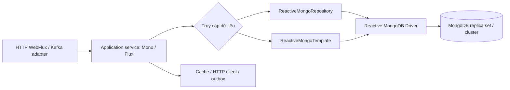
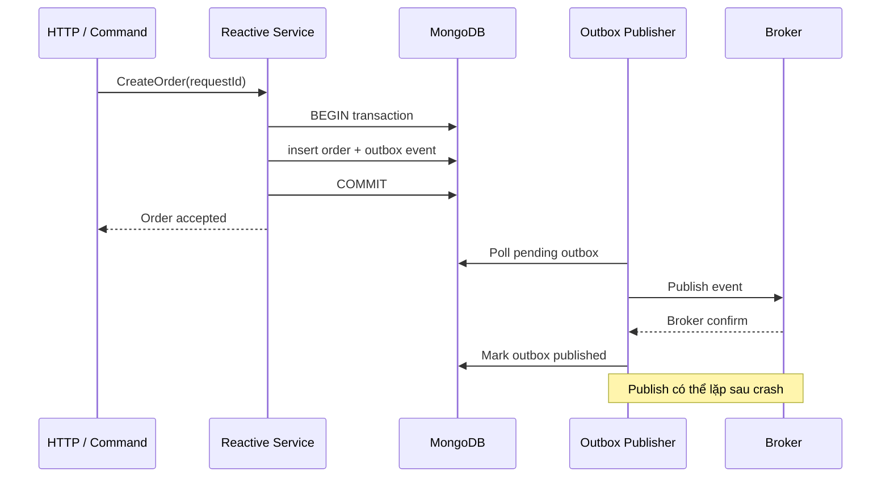

# ReactiveMongoTemplate và reactive repository

Trong **SPRING_BOOT_INTEGRATION**, một yêu cầu có thể bắt đầu từ HTTP, truy vấn MongoDB, đối chiếu trạng thái trong cache, phát sự kiện sang broker hoặc đi qua một adapter Spring Integration. Nếu đường đi đó được xây dựng theo mô hình **reactive**, tầng truy cập MongoDB cũng cần duy trì tính bất đồng bộ thay vì đưa thao tác blocking vào event loop. Spring Data MongoDB cung cấp hai công cụ chủ chốt: **`ReactiveMongoRepository`** cho các truy vấn theo repository abstraction và **`ReactiveMongoTemplate`** khi ứng dụng cần kiểm soát trực tiếp `Query`, `Criteria`, `Update`, phép ghi nguyên tử hay aggregation.

Bài thuộc chương **MongoDB**, tập trung vào cách chọn và sử dụng hai API này trong Spring Boot, từ dependency và auto-configuration đến schema tài liệu, indexing, transaction, lỗi, chống xử lý trùng, kiểm thử và quan sát. Đích đến là một luồng tích hợp **không chặn event loop, có hợp đồng dữ liệu rõ ràng và biết chính xác mình được bảo đảm điều gì**.

> Ví dụ hướng tới **Java 17+, Spring Boot 3.x, Spring Data MongoDB 4.x và Reactor 3.x**. Sử dụng BOM của Spring Boot để đồng bộ phiên bản Spring Data, MongoDB Java driver và Reactor. Spring Boot/Spring Data đời khác có thể dùng API hoặc package khác; không trộn hướng dẫn Jackson/MongoDB của các thế hệ thiếu tương thích.

## 1. Mục tiêu học tập

Sau bài này, bạn có thể:

1. Phân biệt `MongoRepository`/`MongoTemplate` kiểu blocking với `ReactiveMongoRepository`/`ReactiveMongoTemplate`.
2. Cấu hình `spring-boot-starter-data-mongodb-reactive` và hiểu Boot tự tạo những bean nào khi đủ điều kiện.
3. Thiết kế Mongo document và DTO riêng, lựa chọn `@Id`, `@Version`, `@Indexed` và kiểu BSON phù hợp.
4. Viết truy vấn bằng reactive repository, `Mono`, `Flux`, method-name query và `Pageable`.
5. Dùng `ReactiveMongoTemplate` cho truy vấn động, cập nhật có điều kiện, `findAndModify`, aggregation và quản lý index.
6. Dùng unique index, optimistic locking, transaction MongoDB và outbox đúng phạm vi để bảo vệ tác động nghiệp vụ.
7. Quản lý backpressure, timeout, retry, connection pool, change streams và vòng đời subscription.
8. Kiểm thử với StepVerifier/Testcontainers và theo dõi các giới hạn thực tế của một luồng reactive MongoDB.

## 2. MongoDB reactive hoạt động như thế nào?

**Reactive MongoDB** dùng **Reactive Streams MongoDB Java Driver** và tích hợp qua Reactor. Thay vì gọi database rồi chặn thread cho đến khi có kết quả, ứng dụng mô tả một pipeline có thể được thực thi bất đồng bộ theo nhu cầu của subscriber.

| API | Kiểu trả về thường gặp | Đặc điểm |
| --- | --- | --- |
| `MongoRepository<OrderDocument, String>` | `OrderDocument`, `List<OrderDocument>`, `Optional`, v.v. | Blocking; phù hợp luồng Spring MVC/JDBC đồng bộ nếu đã chọn kiến trúc đó. |
| `MongoTemplate` | Kết quả trực tiếp hoặc collection | Blocking; cung cấp API query/update linh hoạt. |
| `ReactiveMongoRepository<OrderDocument, String>` | `Mono<OrderDocument>`, `Flux<OrderDocument>`, `Mono<Boolean>` | Reactive repository; Spring Data hiện thực thao tác CRUD và derived query. |
| `ReactiveMongoTemplate` | `Mono<T>`, `Flux<T>`, `Mono<UpdateResult>` | Reactive operations cấp thấp hơn cho query động, update, aggregation. |
| `MongoClient` của synchronous driver | API driver đồng bộ | Không tự biến thành non-blocking chỉ vì được gọi từ một `Mono`. |
| `com.mongodb.reactivestreams.client.MongoClient` | Reactive Streams publishers | Transport reactive được `ReactiveMongoTemplate`/repository sử dụng. |



**Reactive không có nghĩa database xử lý nhanh hơn:** MongoDB vẫn phải đọc index, quét document, thực hiện write concern và có thể chờ tài nguyên. Reactive chủ yếu giúp caller **không giữ một thread blocking cho mỗi lần chờ I/O**, đồng thời cung cấp mô hình phối hợp dữ liệu và lỗi bằng publisher.

### 2.1. Tính *lazy* và hành vi subscription

Trong hầu hết trường hợp, publisher tạo từ reactive repository/template chỉ bắt đầu thao tác MongoDB khi được **subscribe**. Ví dụ:

```java
Mono<OrderDocument> operation = repository.findById("order-123");
// Chưa có subscriber; chỉ mới tạo mô tả thao tác.
```

Trong Spring WebFlux, framework subscribe publisher do controller trả về. Trong các tác vụ nền (ví dụ consumer Kafka, scheduler), **ứng dụng phải sở hữu vòng đời xử lý**, bảo đảm lỗi và hoàn tất được theo dõi. Không tùy tiện `subscribe()` rồi trả “đã xử lý thành công” trước khi database commit.

Một publisher **cold** cũng có thể thực thi lại khi được subscribe lần thứ hai. Nếu publisher ghi MongoDB:

```java
Mono<OrderDocument> write = repository.insert(order);
```

hai subscriber độc lập có thể kích hoạt **hai lần thử ghi**. Vì thế không biến publisher chứa side effect thành biến cache rồi phát cho nhiều subscriber mà không hiểu semantics; dùng khóa nghiệp vụ/unique constraint và chính sách chia sẻ kết quả khi thật sự cần.

## 3. Dependency và auto-configuration trong Spring Boot

Để dùng MongoDB reactive trong một Spring Boot 3.x project, dependency chính xác:

```xml
<dependency>
    <groupId>org.springframework.boot</groupId>
    <artifactId>spring-boot-starter-data-mongodb-reactive</artifactId>
</dependency>
```

Nếu ứng dụng **phục vụ HTTP reactive**, bổ sung:

```xml
<dependency>
    <groupId>org.springframework.boot</groupId>
    <artifactId>spring-boot-starter-webflux</artifactId>
</dependency>
```

Với Gradle Groovy DSL:

```groovy
dependencies {
    implementation 'org.springframework.boot:spring-boot-starter-data-mongodb-reactive'
    implementation 'org.springframework.boot:spring-boot-starter-webflux'
    testImplementation 'org.springframework.boot:spring-boot-starter-test'
    testImplementation 'io.projectreactor:reactor-test'
}
```

**`spring-boot-starter-webflux` không bắt buộc chỉ để dùng reactive repository** trong một Kafka consumer hoặc batch service. Ngược lại, chỉ thêm `spring-boot-starter-webflux` không có nghĩa các repository blocking/JDBC cũ trở thành reactive. Nếu một ứng dụng có cả MVC và WebFlux trên classpath, cách Boot chọn loại web application còn phụ thuộc tập dependency và cấu hình; không kết luận server đã chạy reactive chỉ từ một dòng dependency.

### 3.1. Cấu hình kết nối theo môi trường

```yaml
spring:
  data:
    mongodb:
      uri: ${MONGODB_URI:mongodb://localhost:27017/order_integration}
```

Tham số URI có thể chỉ định replica set, read preference, write concern, authentication source và TLS tùy triển khai, ví dụ:

```text
mongodb://mongo-a:27017,mongo-b:27017/order_integration?replicaSet=rs0&retryWrites=true&w=majority
```

Đây là **URI minh họa**, không phải cluster production hay mật khẩu thật. Credentials/TLS keys phải lấy từ secret manager hoặc cấu hình môi trường phù hợp; không đưa mật khẩu trực tiếp vào repository. Nếu dùng MongoDB Atlas/SRV, cần URI `mongodb+srv://...` và DNS/TLS đúng deployment.

Khi reactive MongoDB driver và cấu hình kết nối phù hợp hiện diện, Spring Boot có thể auto-configure:

| Hạ tầng | Boot/Spring Data có thể cung cấp | Ứng dụng vẫn phải quyết định |
| --- | --- | --- |
| Reactive `MongoClient` | Client/driver và Mongo connection settings theo điều kiện | URI, TLS, pool, phân vùng tenant và quyền truy cập. |
| `ReactiveMongoDatabaseFactory` | Chọn database và session infrastructure | Database nào theo môi trường/tenant, chính sách auth. |
| `ReactiveMongoTemplate` | Reactive operations với mapping converter | Query, update, index, transaction boundary, timeout. |
| Reactive repositories | Proxy cho interface repository được component scan tìm thấy | Model, query method, domain rules và unique constraints. |
| Mongo mapping converter | Ánh xạ Java ↔ BSON theo Spring Data | Kiểu decimal/time/ID, DTO tách domain, schema migration. |
| Health/metrics khi thêm Actuator | Một số chỉ báo hạ tầng/driver theo điều kiện | Business metrics, phân loại lỗi, correlation ID. |

**Auto-configuration là có điều kiện.** Nếu tự khai báo `MongoClient`, `ReactiveMongoTemplate`, converter hoặc nhiều database factory, Boot có thể lùi lại hoặc chọn một bean khác. Khi ứng dụng không kết nối, dùng condition report và đọc cấu hình của context hiện tại thay vì cho rằng mọi bean sẽ luôn tồn tại.

### 3.2. Khi nào cần tránh trộn blocking và reactive?

Một service có thể có cả reactive MongoDB và JDBC blocking, nhưng phải biết **ranh giới thread**. Trong WebFlux/Reactor Netty, không gọi `MongoTemplate.findOne(...)` hoặc JDBC query blocking trực tiếp trên event-loop; chúng có thể làm đình trệ những request không liên quan. Nếu phải dùng thư viện blocking trong pipeline, cô lập trên `Schedulers.boundedElastic()` theo thiết kế, đồng thời cân nhắc liệu hệ thống nên duy trì kiến trúc blocking rõ ràng thay vì pha trộn phức tạp.

Không wrap client blocking bằng `Mono.just(blockingCall())` vì lời gọi blocking **xảy ra ngay** trước khi tạo publisher. Cũng không dùng `block()` trong handler WebFlux để chờ reactive repository: điều đó làm mất khả năng non-blocking và có thể gây lỗi khi chạy trên thread không cho phép block.

## 4. Model MongoDB, DTO và BSON không phải cùng một hợp đồng

Spring Data MongoDB dùng annotation như `@Document`, `@Id`, `@Field`, `@Indexed` và `@Version` để ánh xạ Java object vào BSON document. Đây là **mô hình lưu trữ**, không phải hợp đồng JSON mà HTTP client hay broker được phép phụ thuộc trực tiếp.

Ví dụ một document bất biến bằng Java record:

```java
import java.math.BigDecimal;
import java.time.Instant;
import org.springframework.data.annotation.Id;
import org.springframework.data.annotation.Version;
import org.springframework.data.mongodb.core.index.Indexed;
import org.springframework.data.mongodb.core.mapping.Document;
import org.springframework.data.mongodb.core.mapping.Field;
import org.springframework.data.mongodb.core.mapping.FieldType;

@Document(collection = "orders")
public record OrderDocument(
        @Id String id,
        @Indexed(unique = true) String businessKey,
        String customerId,
        @Field(targetType = FieldType.DECIMAL128) BigDecimal totalAmount,
        String status,
        Instant createdAt,
        @Version Long version
) {}
```

Ý nghĩa những thành phần quan trọng:

| Thuộc tính | Mục đích | Cảnh báo |
| --- | --- | --- |
| `@Document(collection = "orders")` | Ánh xạ vào Mongo collection `orders` | Không tự định nghĩa mọi schema validation hay index. |
| `@Id String id` | Ánh xạ trường `_id` của MongoDB | Có thể dùng ObjectId hoặc ID khác; cần hiểu quy tắc convert `String`/`ObjectId`. |
| `@Indexed(unique = true)` | Khai báo **ý định** tạo unique index trên business key | Không chứng minh index đã tồn tại trong production. |
| `@Field(targetType = DECIMAL128)` | Lưu `BigDecimal` thành BSON Decimal128 theo mapping | Vẫn phải định nghĩa currency, precision, scale và rounding. |
| `Instant createdAt` | Thời điểm tạo theo UTC trong domain | BSON Date lưu millisecond; kiểm tra độ chính xác nếu hợp đồng yêu cầu nano giây. |
| `@Version Long version` | Phục vụ optimistic locking cho các operation được Spring Data hỗ trợ | Không tự bảo đảm mọi `updateMulti`/native driver query đều kiểm tra version. |

Với record, mỗi component được khởi tạo qua constructor và Spring Data có thể dựng một bản sao bất biến khi cần cập nhật thuộc tính được quản lý như ID/version. Hãy dùng **API/version Spring Data phù hợp và test mapping thực tế**; không sửa trực tiếp những trường final như đối tượng mutable.

**Quan trọng về unique index:** `@Indexed(unique = true)` **không đủ để cam kết dữ liệu không trùng nếu MongoDB chưa có index tương ứng**. Spring Data MongoDB không mặc định tự tạo index từ annotation ở mọi cấu hình/phiên bản (trong Spring Data thế hệ mới, auto-index creation thường tắt theo mặc định). Production nên tạo index bằng migration/Infrastructure as Code hoặc quy trình schema được kiểm soát, xác minh danh sách index và xử lý dữ liệu trùng tồn tại trước khi tạo.

Ví dụ Mongo shell:

```javascript
db.orders.createIndex(
  { businessKey: 1 },
  { unique: true, name: "uq_orders_business_key" }
);
```

Một cách kiểm tra:

```javascript
db.orders.getIndexes();
```

Đừng để nhiều replica ứng dụng tự đồng loạt tạo hoặc thay index phức tạp khi startup ở production mà không có kế hoạch migration. Mongo index ảnh hưởng thời gian ghi, bộ nhớ, dung lượng đĩa và query planner; cần đo trước/sau thay đổi.

### 4.1. DTO phục vụ HTTP và event

```java
import jakarta.validation.constraints.NotBlank;
import jakarta.validation.constraints.NotNull;
import jakarta.validation.constraints.Positive;
import java.math.BigDecimal;
import java.time.Instant;

public record CreateOrderRequest(
        @NotBlank String requestId,
        @NotBlank String customerId,
        @NotNull @Positive BigDecimal totalAmount
) {}

public record OrderResponse(
        String id,
        String businessKey,
        String status,
        BigDecimal totalAmount,
        Instant createdAt
) {}
```

`OrderDocument` chỉ thuộc persistence adapter, còn `CreateOrderRequest`/`OrderResponse` thuộc hợp đồng HTTP. Nếu phát event Kafka, hãy định nghĩa thêm `OrderAcceptedEventV1` với `eventId` và `schemaVersion` rõ ràng; không gửi nguyên `OrderDocument` (nhất là `_id`, `version` hoặc field nhạy cảm) chỉ vì serializer có thể đọc record.

Trong những ví dụ Java tiếp theo, mỗi top-level `public` type được đặt vào file riêng như thông lệ Java.

## 5. Reactive repository: CRUD và derived queries

Với phần lớn trường hợp CRUD, `ReactiveMongoRepository` giúp giảm code truy cập MongoDB. Spring Data tạo implementation theo interface, ánh xạ result về entity và trả publisher phù hợp:

```java
import org.springframework.data.domain.Pageable;
import org.springframework.data.mongodb.repository.Query;
import org.springframework.data.mongodb.repository.ReactiveMongoRepository;
import reactor.core.publisher.Flux;
import reactor.core.publisher.Mono;

public interface OrderRepository
        extends ReactiveMongoRepository<OrderDocument, String> {

    Mono<OrderDocument> findByBusinessKey(String businessKey);

    Flux<OrderDocument> findByCustomerIdOrderByCreatedAtDesc(
            String customerId);

    Flux<OrderDocument> findByCustomerId(
            String customerId, Pageable pageable);

    Mono<Long> countByCustomerId(String customerId);

    @Query("{ 'customerId': ?0, 'status': ?1 }")
    Flux<OrderDocument> findByCustomerAndStatus(
            String customerId, String status);
}
```

| Method | Reactive return | Chú ý |
| --- | --- | --- |
| `findById(id)` | `Mono<OrderDocument>` | Mono **rỗng** khi không tìm thấy, không đồng nghĩa lỗi database. |
| `findByBusinessKey(key)` | `Mono<OrderDocument>` | Chỉ kỳ vọng tối đa một kết quả nếu có unique constraint đúng. |
| `findByCustomerIdOrderByCreatedAtDesc(id)` | `Flux<OrderDocument>` | Có thể trả nhiều document; index/order và số lượng cần cân nhắc. |
| `countByCustomerId(id)` | `Mono<Long>` | Đếm riêng có chi phí query riêng, không tự gộp với danh sách. |
| `insert(entity)` | `Mono<OrderDocument>` | Dùng khi mục tiêu là **tạo mới**, không upsert âm thầm. |
| `save(entity)` | `Mono<OrderDocument>` | Có thể tạo hoặc cập nhật tùy trạng thái entity/ID; chú ý `@Version`. |
| `deleteById(id)` | `Mono<Void>` | Hoàn thành không có nghĩa document tồn tại trước đó. |

### 5.1. `Mono.empty()` là một kết quả hợp lệ

Với repository:

```java
public Mono<OrderDocument> requireOrder(String id) {
    return repository.findById(id)
            .switchIfEmpty(Mono.error(
                    new OrderNotFoundException(id)));
}
```

`switchIfEmpty` biến “không có document” thành lỗi domain nếu API cần phân biệt 404 với kết quả rỗng hợp lệ. Khi tìm kiếm danh sách, `Flux.empty()` có thể là “không có đơn hàng”, không cần trả lỗi.

`Mono<Void>` hoàn thành chỉ báo luồng hoàn tất; đừng dùng `Mono.just(null)`. Trong Reactor, `null` không phải giá trị onNext hợp lệ. Với `zip`, nếu một nguồn là `Mono.empty()`, kết quả kết hợp có thể rỗng; cần hiểu điều này khi ghép truy vấn DB với HTTP/Redis.

### 5.2. Phân trang trong repository reactive

Ví dụ:

```java
import org.springframework.data.domain.PageRequest;
import org.springframework.data.domain.Sort;
import reactor.core.publisher.Flux;

public Flux<OrderDocument> recentOrders(
        String customerId, int page, int size) {

    if (page < 0 || size < 1 || size > 100) {
        return Flux.error(new IllegalArgumentException(
                "Invalid pagination arguments"));
    }

    var pageable = PageRequest.of(
            page, size, Sort.by(Sort.Direction.DESC, "createdAt"));
    return repository.findByCustomerId(customerId, pageable);
}
```

Reactive repository thường trả **`Flux<T>`**, không mặc nhiên trả `Page<T>` như blocking repository, vì một `Page` đầy đủ cần tổng số phần tử và metadata. Nếu API cần `totalElements`, hãy thực hiện `countByCustomerId(...)` riêng, biết rằng giữa hai query dữ liệu có thể thay đổi. Với dữ liệu rất lớn hoặc cập nhật liên tục, **keyset/cursor pagination** thường phù hợp hơn `skip/limit` trang sâu.

Thêm index đúng cho truy vấn danh sách, ví dụ:

```javascript
db.orders.createIndex(
  { customerId: 1, createdAt: -1 },
  { name: "idx_orders_customer_created" }
);
```

Không đoán index từ tên method repository: **Spring Data diễn giải tên để tạo query, MongoDB vẫn cần index phù hợp** để tránh collection scan và blocking tài nguyên server.

## 6. Ví dụ application service với reactive repository

Giả sử HTTP client gửi một `requestId` ổn định. Ở ví dụ, nó được dùng làm `businessKey` để tạo đúng **một order cho một request logic**. Không dùng ID được sinh ngẫu nhiên mới làm khóa chống xử lý trùng mỗi khi client retry.

```java
import java.time.Instant;
import java.util.Objects;
import org.springframework.dao.DuplicateKeyException;
import org.springframework.stereotype.Service;
import reactor.core.publisher.Mono;

@Service
public class ReactiveOrderService {
    private final OrderRepository repository;

    public ReactiveOrderService(OrderRepository repository) {
        this.repository = repository;
    }

    public Mono<OrderResponse> create(CreateOrderRequest request) {
        return Mono.defer(() -> {
            validate(request);

            var newOrder = new OrderDocument(
                    null,
                    request.requestId(),
                    request.customerId(),
                    request.totalAmount(),
                    "PENDING",
                    Instant.now(),
                    null);

            return repository.insert(newOrder)
                    .onErrorResume(
                            DuplicateKeyException.class,
                            ignored -> repository
                                    .findByBusinessKey(request.requestId())
                                    .switchIfEmpty(Mono.error(ignored))
                                    .flatMap(existing -> {
                                        if (sameCommand(existing, request)) {
                                            return Mono.just(existing);
                                        }
                                        return Mono.error(
                                                new OrderIdentityConflictException());
                                    }))
                    .map(this::toResponse);
        });
    }

    public Mono<OrderResponse> findById(String id) {
        return repository.findById(id).map(this::toResponse);
    }

    private void validate(CreateOrderRequest request) {
        if (request == null
                || request.requestId() == null
                || request.requestId().isBlank()
                || request.customerId() == null
                || request.customerId().isBlank()
                || request.totalAmount() == null
                || request.totalAmount().signum() <= 0) {
            throw new IllegalArgumentException("Invalid order request");
        }
    }

    private boolean sameCommand(
            OrderDocument existing, CreateOrderRequest request) {
        return Objects.equals(existing.customerId(), request.customerId())
                && existing.totalAmount()
                        .compareTo(request.totalAmount()) == 0;
    }

    private OrderResponse toResponse(OrderDocument order) {
        return new OrderResponse(
                order.id(), order.businessKey(),
                order.status(), order.totalAmount(),
                order.createdAt());
    }
}

class OrderIdentityConflictException extends RuntimeException {
    OrderIdentityConflictException() {
        super("Same requestId with different order data");
    }
}

class OrderNotFoundException extends RuntimeException {
    OrderNotFoundException(String id) {
        super("Order not found: " + id);
    }
}
```

**Tại sao dùng `Mono.defer`?** Phần kiểm tra input, `Instant.now()` và tạo entity xảy ra khi subscriber bắt đầu thực thi. Nếu tạo publisher ở một thời điểm rồi subscribe sau đó, việc lấy timestamp ngay khi tạo pipeline có thể không đúng thời điểm nghiệp vụ. `defer` cũng giúp exception đồng bộ từ `validate` đi qua error signal của Reactor.

**Tại sao `insert` thay vì `save`?** Khi tạo order mới, ý định là **không overwrite document có cùng ID**. `save` có semantics insert/update tùy entity và version; `insert` thể hiện ý định tạo mới rõ hơn. Nhưng chỉ `insert` cũng chưa đủ: chính unique index ở `businessKey` bảo vệ khỏi hai request đồng thời có ID Mongo khác nhau.

**Tại sao kiểm tra payload khi trùng?** Nếu hai request cùng `requestId` nhưng `customerId` hoặc `totalAmount` khác nhau, đó là **xung đột hợp đồng**, không phải retry hợp lệ. Mã ví dụ chỉ so sánh hai field mang nghĩa nghiệp vụ; production cần xác định tất cả field cần so sánh, normalize dữ liệu và ràng buộc tenant khi có multi-tenancy.

**Giới hạn ví dụ:** `DuplicateKeyException` cũng có thể do một unique index **khác**. Đoạn code thử tìm theo `requestId`; nếu không thấy thì phát lại exception ban đầu, không ngộ nhận mọi duplicate-key đều là sự kiện đã xử lý. Với collection có nhiều index/invariant, nên phân loại nguyên nhân rõ ràng và ghi metric.

### 6.1. Vì sao `existsByBusinessKey` trước `insert` không đủ?

Hai request có thể cùng thực hiện:

```text
Client A: existsByBusinessKey("req-10") = false
Client B: existsByBusinessKey("req-10") = false
Client A: insert(...)  -> thành công
Client B: insert(...)  -> cũng thử insert
```

Nếu không có **unique index ở MongoDB**, cả hai document có thể được lưu. Đặt một mutex trong một instance Java không bảo vệ nhiều pod. Hãy dùng thao tác ghi nguyên tử và unique constraint tại database, sau đó chuyển lỗi xung đột thành kết quả nghiệp vụ có nghĩa.

## 7. ReactiveMongoTemplate: truy vấn linh hoạt và update có điều kiện

`ReactiveMongoTemplate` phù hợp khi cần xây `Query` động, truy vấn projection/aggregation, cập nhật với nhiều tiêu chí hoặc sử dụng một MongoDB operation không tiện biểu đạt bằng tên method repository.

```java
import org.springframework.data.domain.Sort;
import org.springframework.data.mongodb.core.ReactiveMongoTemplate;
import org.springframework.data.mongodb.core.query.Criteria;
import org.springframework.data.mongodb.core.query.Query;
import org.springframework.stereotype.Component;
import reactor.core.publisher.Flux;

@Component
public class OrderQueryAdapter {
    private final ReactiveMongoTemplate mongo;

    public OrderQueryAdapter(ReactiveMongoTemplate mongo) {
        this.mongo = mongo;
    }

    public Flux<OrderDocument> pendingByCustomer(
            String customerId, int limit) {
        if (limit < 1 || limit > 100) {
            return Flux.error(
                    new IllegalArgumentException("Invalid limit"));
        }

        Query query = Query.query(
                Criteria.where("customerId").is(customerId)
                        .and("status").is("PENDING"))
                .with(Sort.by(Sort.Direction.DESC, "createdAt"))
                .limit(limit);

        return mongo.find(query, OrderDocument.class);
    }
}
```

**Giải thích:**

- `Criteria` chọn điều kiện; `Query` mang filter, sort, limit, projection hoặc tùy chọn truy vấn tương ứng.
- `mongo.find(...)` trả `Flux<OrderDocument>`; ứng dụng quyết định tiêu thụ, streaming, giới hạn kích thước response.
- Khi cho client gửi filter/sort field động, phải **allowlist tên field và kiểu toán tử**. Không xây BSON query bằng cách nối thẳng chuỗi JSON do người dùng nhập; việc đó dễ tạo operator injection và query ngoài ý định.
- Một query có limit không bảo đảm response nhanh nếu thiếu index phù hợp. Dùng `explain`/execution stats để đo, không chỉ nhìn Java method.

### 7.1. Cập nhật trạng thái nguyên tử với `findAndModify`

Giả sử order chỉ được chuyển từ `PENDING` sang `ACCEPTED` một lần. Thay vì `findById` → sửa object → `save` không có điều kiện trạng thái, có thể đặt **điều kiện trước và thao tác cập nhật trong một Mongo operation**:

```java
import org.springframework.data.mongodb.core.FindAndModifyOptions;
import org.springframework.data.mongodb.core.ReactiveMongoTemplate;
import org.springframework.data.mongodb.core.query.Criteria;
import org.springframework.data.mongodb.core.query.Query;
import org.springframework.data.mongodb.core.query.Update;
import org.springframework.stereotype.Component;
import reactor.core.publisher.Mono;

@Component
public class OrderTransitionAdapter {
    private final ReactiveMongoTemplate mongo;

    public OrderTransitionAdapter(ReactiveMongoTemplate mongo) {
        this.mongo = mongo;
    }

    public Mono<OrderDocument> acceptPending(String businessKey) {
        Query query = Query.query(
                Criteria.where("businessKey").is(businessKey)
                        .and("status").is("PENDING"));
        Update update = new Update().set("status", "ACCEPTED");

        return mongo.findAndModify(
                query, update,
                FindAndModifyOptions.options().returnNew(true),
                OrderDocument.class);
    }
}
```

Trong MongoDB, **thay đổi trên một document là atomic** đối với thao tác cập nhật đơn lẻ. Nếu hai request cạnh tranh với điều kiện `status=PENDING`, chỉ một request có thể thành công trong việc chuyển status từ PENDING sang ACCEPTED; request sau có thể nhận `Mono.empty()` khi điều kiện không còn đúng.

**Điều phải phân biệt:**

- `Mono.empty()` ở đây không cho biết document **không tồn tại** hay **đã được xử lý trước**. Nếu API cần phân biệt, hãy đọc lại trạng thái và ánh xạ thành kết quả/409 phù hợp.
- `@Version` có thể được Spring Data tăng ở một số update operations; **đừng giả định mọi `updateFirst` hay native update đều tự kiểm tra version cũ**. Muốn optimistic check rõ ràng, đưa expected version vào filter hoặc dùng thao tác `save` có hỗ trợ `@Version`.
- Khi dùng `updateMulti`, tính nguyên tử áp dụng **trên từng document**, không phải toàn bộ tập như một transaction chung.
- Một operation hoàn tất tại MongoDB không có nghĩa message Kafka đã được publish hoặc Redis đã được cập nhật.

### 7.2. `upsert` và tránh tạo bản ghi trùng

`upsert` cho phép update document khớp query hoặc insert một document mới nếu không có bản ghi phù hợp. Nó hữu ích cho cấu hình/cache materialized views, nhưng phải biết chính xác **định danh duy nhất** và fields dùng trong query.

Ví dụ `upsert` theo một `businessKey` mà **chưa có unique index**: hai request đồng thời có thể cùng không thấy document và tạo hai bản ghi. Unique index và xử lý `DuplicateKeyException` vẫn cần thiết. Đừng dùng `upsert` với một filter quá rộng hoặc bao gồm field thay đổi theo thời gian, vì có thể vô tình tạo thêm document mới thay vì cập nhật thực thể cũ.

### 7.3. Aggregation và project dữ liệu

`ReactiveMongoTemplate` hỗ trợ MongoDB aggregation pipeline. Ví dụ đếm số order đã được chấp nhận theo customer:

```java
import static org.springframework.data.mongodb.core.aggregation.Aggregation.*;

import org.bson.Document;
import org.springframework.data.domain.Sort;
import org.springframework.data.mongodb.core.ReactiveMongoTemplate;
import org.springframework.data.mongodb.core.query.Criteria;
import reactor.core.publisher.Flux;

public Flux<Document> acceptedOrdersByCustomer(
        ReactiveMongoTemplate mongo) {
    var pipeline = newAggregation(
            match(Criteria.where("status").is("ACCEPTED")),
            group("customerId").count().as("orderCount"),
            sort(Sort.Direction.DESC, "orderCount"));

    return mongo.aggregate(pipeline, "orders", Document.class);
}
```

Kết quả là các BSON `Document` chứa group key và `orderCount`, **không phải HTTP DTO công khai**. Nếu trả API, nên map sang response riêng, giới hạn nhóm/trang phù hợp và kiểm tra quyền truy cập. Aggregation có thể dùng nhiều tài nguyên MongoDB; nên đo execution plan/index và giới hạn phạm vi với filter thích hợp, tránh stream toàn bộ kết quả lớn rồi `collectList()`.

## 8. Unique index, optimistic locking và các mức nhất quán khác nhau

Trong MongoDB, ba nhu cầu thường bị lẫn:

| Bài toán | Cơ chế phù hợp | Không được kỳ vọng |
| --- | --- | --- |
| Không có hai order cùng `businessKey` | Unique index trên `businessKey` | `existsBy...` trong application không thay thế unique index. |
| Hai người cùng sửa một order không ghi đè âm thầm | `@Version`/optimistic locking hoặc conditional update | Unique `businessKey` không giải quyết mất cập nhật (lost update). |
| Một thay đổi phải áp lên nhiều documents cùng nhau | MongoDB transaction khi topology hỗ trợ | Atomicity của một document không bao trùm nhiều documents. |
| Mongo ghi dữ liệu rồi broker phải nhận event | Transactional outbox hoặc cơ chế phối hợp được thiết kế | Mongo transaction không bao gồm Kafka/RabbitMQ mặc định. |
| Read-after-write hoặc giảm mất ghi | Read/write concern và session/replica semantics phù hợp | Đọc từ secondary theo eventual consistency không luôn thấy ngay ghi mới. |

### 8.1. Optimistic locking bằng `@Version`

Khi model có `@Version Long version`, các thao tác repository `save` phù hợp sẽ kiểm tra phiên bản đã đọc. Nếu người khác thay đổi document trước, cập nhật dựa trên version cũ có thể ném `OptimisticLockingFailureException`:

```java
import org.springframework.dao.OptimisticLockingFailureException;
import org.springframework.stereotype.Service;
import reactor.core.publisher.Mono;

@Service
public class OrderVersionedService {
    private final OrderRepository repository;

    public OrderVersionedService(OrderRepository repository) {
        this.repository = repository;
    }

    public Mono<OrderDocument> markAccepted(String id) {
        return repository.findById(id)
                .switchIfEmpty(Mono.error(
                        new OrderNotFoundException(id)))
                .flatMap(existing -> {
                    if (!"PENDING".equals(existing.status())) {
                        return Mono.error(
                                new IllegalStateException(
                                        "Invalid state transition"));
                    }

                    var changed = new OrderDocument(
                            existing.id(),
                            existing.businessKey(),
                            existing.customerId(),
                            existing.totalAmount(),
                            "ACCEPTED",
                            existing.createdAt(),
                            existing.version());
                    return repository.save(changed);
                });
    }
}
```

Với hai client cùng đọc version `3`, chỉ một cập nhật hợp lệ lên version mới có thể thành công theo cơ chế optimistic locking; client còn lại phải **đọc lại trạng thái và quyết định**. Không retry vô hạn bằng cách ghi đè trạng thái mới nhất. Đảm bảo write concern/acknowledged writes phù hợp; lỗi optimistic locking không thể xác định đáng tin cậy nếu write không được acknowledged theo semantics liên quan.

**`@Version` không thay thế trạng thái nghiệp vụ.** Nếu order đã ACCEPTED, một command CANCEL cần áp quy tắc chuyển trạng thái, quyền và thứ tự sự kiện; không chỉ tăng version rồi cho phép bất kỳ trạng thái nào ghi đè.

### 8.2. Read concern, write concern và replica consistency

- **Write concern** quy định mức broker/database server MongoDB xác nhận ghi, ví dụ `w: "majority"` để tăng tính bền vững theo topology.
- **Read concern** quy định loại dữ liệu được phép đọc; `majority`, `local`, `snapshot` có bảo đảm khác nhau.
- **Read preference** chọn node để đọc (primary/secondary); đọc từ secondary có thể trễ replication.
- **Causal consistency** có thể quan trọng khi một session cần nhìn thấy quan hệ nhân quả giữa các hoạt động.

Đây là **quyết định của hợp đồng nhất quán**, không phải property có thể bật tùy ý để làm toàn bộ distributed workflow “strongly consistent”. Ví dụ một consumer vừa cập nhật MongoDB primary và một API khác đọc secondary ngay sau đó có thể thấy dữ liệu cũ tùy topology/settings. Với các thao tác tài chính hoặc đọc lại sau ghi, phải xác định semantics mong muốn, test deployment thực và chấp nhận latency/throughput trade-off.

## 9. Reactive transaction: nhiều document trong cùng MongoDB

MongoDB hỗ trợ **multi-document transactions** trên topology phù hợp, như **replica set hoặc sharded cluster** có tính năng transaction tương ứng. Một MongoDB standalone không hỗ trợ loại transaction này theo cách replica set; nếu thử transaction trên standalone, bạn có thể gặp lỗi yêu cầu replica set. Testcontainers và môi trường triển khai cần được cấu hình tương ứng.

Trong Spring Data MongoDB reactive, có thể đăng ký `ReactiveMongoTransactionManager` và dùng `TransactionalOperator`:

```java
import org.springframework.context.annotation.Bean;
import org.springframework.context.annotation.Configuration;
import org.springframework.data.mongodb.ReactiveMongoDatabaseFactory;
import org.springframework.data.mongodb.ReactiveMongoTransactionManager;
import org.springframework.transaction.ReactiveTransactionManager;
import org.springframework.transaction.reactive.TransactionalOperator;

@Configuration(proxyBeanMethods = false)
public class ReactiveMongoTxConfiguration {

    @Bean
    ReactiveMongoTransactionManager reactiveMongoTransactionManager(
            ReactiveMongoDatabaseFactory factory) {
        return new ReactiveMongoTransactionManager(factory);
    }

    @Bean
    TransactionalOperator mongoTransactionalOperator(
            ReactiveTransactionManager manager) {
        return TransactionalOperator.create(manager);
    }
}
```

**Reactive transaction context đi theo Reactor context**, không phải chỉ dựa trên `ThreadLocal` như cách nghĩ thường gặp với transaction blocking. Khi các thao tác Mongo đều nằm trong cùng reactive pipeline/transaction operator, Spring Data sử dụng session tương ứng. Nếu tách thành `subscribe()` riêng, chuyển qua callback không kế thừa context hoặc chạy các thao tác ở ngoài pipeline, không được giả định chúng còn thuộc cùng transaction.

### 9.1. Ví dụ MongoDB transactional outbox

Giả sử một order phải được ghi cùng **ý định phát sự kiện**, để khi process chết trước khi gửi Kafka/RabbitMQ, hệ thống vẫn có outbox record cho publisher khôi phục.

```java
import java.time.Instant;
import org.springframework.data.annotation.Id;
import org.springframework.data.mongodb.core.mapping.Document;

@Document(collection = "order_outbox")
public record OrderOutboxDocument(
        @Id String id,
        String eventType,
        int schemaVersion,
        String payloadJson,
        String publishStatus,
        Instant createdAt
) {}
```

`id` ở đây có thể được chọn là **event ID logic ổn định**, để đợt retry không tạo thêm event outbox tương đương khi ứng dụng kiểm tra idempotency theo business key.

```java
import org.springframework.data.mongodb.core.ReactiveMongoTemplate;
import org.springframework.stereotype.Service;
import org.springframework.transaction.reactive.TransactionalOperator;
import reactor.core.publisher.Mono;

@Service
public class MongoOrderOutboxWriter {
    private final ReactiveMongoTemplate mongo;
    private final TransactionalOperator tx;

    public MongoOrderOutboxWriter(
            ReactiveMongoTemplate mongo,
            TransactionalOperator tx) {
        this.mongo = mongo;
        this.tx = tx;
    }

    public Mono<OrderDocument> insertOrderAndOutbox(
            OrderDocument order, OrderOutboxDocument outbox) {

        return mongo.insert(order)
                .flatMap(saved ->
                        mongo.insert(outbox).thenReturn(saved))
                .as(tx::transactional);
    }
}
```

Hai `insert` cùng thuộc transaction MongoDB nếu factory/session/topology và transaction manager hoạt động đúng. Khi ghi outbox thất bại, việc ghi order phải rollback. Không giữ transaction mở để **chờ Kafka ACK, HTTP response hoặc Redis update**; các hệ thống ngoài MongoDB **không** tự tham gia MongoDB transaction.



**Outbox không ngăn broker nhận cùng event hai lần.** Publisher có thể gửi event rồi chết trước khi đánh dấu `PUBLISHED`; sau restart sẽ gửi lại. Consumer phải dùng **inbox/unique key/idempotency** theo `eventId` để tránh thực hiện side effect trùng. Trong MongoDB, một unique index trên `eventId` trong collection inbox có thể hỗ trợ nếu việc ghi inbox và tác động nghiệp vụ cùng thuộc transaction phù hợp; với tác động tới PostgreSQL/HTTP khác hệ thống, cần phương án đối soát riêng.

### 9.2. `@Transactional` với method reactive

Có thể dùng `@Transactional` trên method trả `Mono`/`Flux` nếu ứng dụng có reactive transaction manager phù hợp, method được gọi qua Spring proxy và **publisher chứa các thao tác cần bao transaction**:

```java
import org.springframework.stereotype.Service;
import org.springframework.transaction.annotation.Transactional;
import reactor.core.publisher.Mono;

@Service
public class OrderTxFacade {
    private final ReactiveMongoTemplate mongo;

    public OrderTxFacade(ReactiveMongoTemplate mongo) {
        this.mongo = mongo;
    }

    @Transactional
    public Mono<OrderDocument> insertBoth(
            OrderDocument order, OrderOutboxDocument outbox) {
        return mongo.insert(order)
                .flatMap(saved ->
                        mongo.insert(outbox).thenReturn(saved));
    }
}
```

Không đặt `@Transactional` trên method rồi **gọi `subscribe()` thủ công và return `Mono.empty()`**: điều đó tách công việc ra khỏi transaction boundary mong đợi. Không dùng transaction cho một stream dài vô hạn, vì transaction phải hoàn tất/commit và chịu giới hạn phiên/tài nguyên. Các transaction phức tạp cần chiến lược retry **toàn transaction** khi gặp transient error, phù hợp cơ chế driver/session; retry từng write bất kỳ có thể phá tính đúng đắn.

### 9.3. Khi không cần transaction

MongoDB đã hỗ trợ thao tác đơn document nguyên tử. Với một lệnh chỉ cập nhật status của **một order** qua `findAndModify` có điều kiện, transaction nhiều document thường không cần thiết. Dùng transaction có thể tăng latency/chi phí và giữ tài nguyên lâu hơn; hãy chọn nó khi một **invariant thực sự trải qua nhiều document**.

## 10. WebFlux controller tiêu thụ Mono/Flux đúng cách

Reactive MongoDB thường kết hợp với Spring WebFlux khi toàn đường HTTP được thiết kế non-blocking:

```java
import jakarta.validation.Valid;
import org.springframework.http.HttpStatus;
import org.springframework.http.ResponseEntity;
import org.springframework.web.bind.annotation.GetMapping;
import org.springframework.web.bind.annotation.PathVariable;
import org.springframework.web.bind.annotation.PostMapping;
import org.springframework.web.bind.annotation.RequestBody;
import org.springframework.web.bind.annotation.RequestMapping;
import org.springframework.web.bind.annotation.RestController;
import reactor.core.publisher.Mono;

@RestController
@RequestMapping("/api/orders")
public class ReactiveOrderController {
    private final ReactiveOrderService service;

    public ReactiveOrderController(ReactiveOrderService service) {
        this.service = service;
    }

    @PostMapping
    public Mono<ResponseEntity<OrderResponse>> create(
            @Valid @RequestBody Mono<CreateOrderRequest> request) {
        return request.flatMap(service::create)
                .map(saved -> ResponseEntity
                        .status(HttpStatus.CREATED)
                        .body(saved));
    }

    @GetMapping("/{id}")
    public Mono<ResponseEntity<OrderResponse>> get(
            @PathVariable String id) {
        return service.findById(id)
                .map(ResponseEntity::ok)
                .defaultIfEmpty(ResponseEntity.notFound().build());
    }
}
```

Spring WebFlux subscribe publisher trả về. `@Valid` trên request body cần module validation, và những lỗi binder/validation của WebFlux được ánh xạ qua exception handling phù hợp; `ReactiveOrderService.validate` vẫn bảo vệ **lời gọi từ Kafka/scheduler/adapter khác** mà không đi qua HTTP.

**Không gọi `service.create(request).subscribe()` trong controller rồi trả `200 OK` ngay**: thao tác ghi có thể chưa hoàn tất, lỗi có thể mất khỏi đường phản hồi và request có thể bị retry gây ghi trùng. Không gọi `block()` trên event loop để biến `Mono` thành kết quả đồng bộ.

Khi trả nhiều document cho client:

```java
import org.springframework.web.bind.annotation.GetMapping;
import org.springframework.web.bind.annotation.RequestParam;
import org.springframework.web.bind.annotation.RestController;
import reactor.core.publisher.Flux;

@RestController
public class CustomerOrdersController {
    private final OrderRepository repository;

    public CustomerOrdersController(OrderRepository repository) {
        this.repository = repository;
    }

    @GetMapping("/api/customer-orders")
    public Flux<OrderResponse> list(
            @RequestParam String customerId) {
        return repository
                .findByCustomerIdOrderByCreatedAtDesc(customerId)
                .take(100)
                .map(order -> new OrderResponse(
                        order.id(),
                        order.businessKey(),
                        order.status(),
                        order.totalAmount(),
                        order.createdAt()));
    }
}
```

Ví dụ đặt `take(100)` như hàng rào trả dữ liệu tại Reactor; **nên đẩy `limit(100)` xuống MongoDB query/repository ngay từ đầu** nếu đã biết giới hạn, tránh đọc nhiều document rồi mới cắt. Với API thực, thêm phân trang, lọc theo quyền tenant, index và hợp đồng về thứ tự để không để người gọi truy xuất toàn collection.

### 10.1. Reactive MongoDB không bắt buộc HTTP reactive

Một Kafka consumer hoặc Spring Integration adapter có thể dùng `ReactiveMongoTemplate` trong service không có WebFlux server. Điều quan trọng là **caller phải chờ/kết nối publisher với lifecycle của message**. Với consumer nhận một record và cần ack sau ghi DB:

```text
Receive broker message
  -> map/validate JSON event
  -> subscribe/await Mongo reactive operation under managed processing
  -> observe successful DB commit
  -> ack/commit offset under broker policy
```

Nếu listener không hỗ trợ tự quản lý publisher, cần một adapter có chủ đích để bridge reactive completion với ack; không tùy tiện fire-and-forget. Khi dùng Kafka/RabbitMQ listener blocking, gọi `block()` ở thread listener được quản lý **có thể là một điểm bridge** nếu kiến trúc chủ đích blocking tại biên đó, có timeout và không chạy trên Netty event-loop; nhưng nó không biến consumer thành non-blocking và cần đo số thread, timeout, batch và load.

## 11. Kết nối, connection pool, timeout và backpressure

**Reactive không đồng nghĩa “không có pool”.** Reactive MongoDB driver vẫn quản lý sockets/connections tới MongoDB server và các connection pool, selection timeout, server monitoring cùng yêu cầu về concurrency. Dù không block event-loop, quá nhiều query đồng thời vẫn có thể làm MongoDB hoặc pool bị bão hòa.

| Tài nguyên / giới hạn | Chức năng | Hậu quả nếu sai |
| --- | --- | --- |
| MongoDB connection pool max size | Trần connections dành cho server/cluster theo driver settings | Quá nhỏ gây queueing, quá lớn làm server chịu nhiều connection. |
| Pool wait timeout | Thời gian đợi lấy connection | Chờ lâu có thể vượt deadline toàn luồng. |
| Server selection timeout | Giới hạn đợi chọn một MongoDB server phù hợp topology/read preference | Có thể lỗi khi primary không có hoặc cluster failover. |
| Socket/connect timeout | Giới hạn một số pha mạng của driver | Không tương đương timeout của toàn operation. |
| Query `maxTimeMS` khi phù hợp | Giới hạn thực thi operation phía MongoDB server | Không tự bao gồm queue/acquire, mapping và downstream khác. |
| Reactor operator `timeout` | Giới hạn thời gian subscriber chờ signal | Cancellation không chắc chắn hoàn tác side effect MongoDB đã commit. |
| Request/Flux concurrency | Số operation đồng thời do application tạo | Không giới hạn sẽ làm tăng queue, latency và memory. |

Ví dụ điều chỉnh reactive driver thông qua customizer Spring Boot 3.x:

```java
import java.util.concurrent.TimeUnit;
import org.springframework.boot.autoconfigure.mongo.MongoClientSettingsBuilderCustomizer;
import org.springframework.context.annotation.Bean;
import org.springframework.context.annotation.Configuration;

@Configuration(proxyBeanMethods = false)
public class MongoPoolConfiguration {

    @Bean
    MongoClientSettingsBuilderCustomizer mongoPoolCustomizer() {
        return settings -> {
            settings.applyToConnectionPoolSettings(pool -> pool
                    .maxSize(60)
                    .minSize(0)
                    .maxWaitTime(500, TimeUnit.MILLISECONDS));

            settings.applyToClusterSettings(cluster -> cluster
                    .serverSelectionTimeout(2, TimeUnit.SECONDS));
        };
    }
}
```

Tùy driver version, một số API pool/timeouts có thể thay đổi tên hoặc deprecate; dùng BOM của Boot và kiểm tra settings thực tế. Spring Boot có thể dùng `MongoClientSettingsBuilderCustomizer` để điều chỉnh client tự cấu hình, nhưng **nếu đã tạo `MongoClient` custom bỏ qua Boot**, cần áp settings cho chính client đó.

**Đừng đặt max connections chỉ theo số thread event-loop.** Một luồng reactive có thể có nhiều I/O in-flight hơn số thread đang chạy. Với nhiều instance, tổng connections và throughput tới MongoDB là tổng tải của **tất cả instances**. Cần phối hợp giới hạn truy vấn, HTTP concurrency, Kafka/AMQP listener và MongoDB server capacity.

### 11.1. Backpressure trong Flux không sửa query đắt tiền

`Flux` hỗ trợ demand qua Reactive Streams: downstream có thể yêu cầu dữ liệu từng phần. Tuy nhiên:

- `limitRate(n)` điều chỉnh lượng demand trong Reactor, không tự thêm index hoặc `limit n` vào Mongo query.
- `take(n)` dừng sau n phần tử, nhưng server có thể đã đọc/prepare dữ liệu hoặc cursor; tốt hơn dùng `Query.limit(n)` khi hợp đồng cho phép.
- `collectList()` gom mọi kết quả vào bộ nhớ; không dùng với query trả hàng triệu document hoặc change stream vô hạn.
- MongoDB cursor/batch, driver prefetch, sorting/aggregation ở server vẫn tiêu tốn tài nguyên.
- `flatMap` với concurrency không giới hạn có thể phát quá nhiều writes/requests cùng lúc.

Ví dụ giới hạn đồng thời khi enrich 200 order từ dịch vụ HTTP:

```java
import reactor.core.publisher.Flux;

public Flux<OrderResponse> enrichOrders(
        Flux<OrderDocument> orders,
        PartnerEnrichmentService enrichment) {
    return orders.flatMap(
            order -> enrichment.enrich(order),
            8 /* tối đa 8 operation enrich đồng thời */);
}
```

`PartnerEnrichmentService.enrich` là hợp đồng ứng dụng trả `Mono<OrderResponse>` và cần tự đặt timeout/bulkhead cho HTTP đối tác. `flatMap` có thể làm kết quả hoàn tất khác thứ tự đầu vào; nếu hợp đồng cần giữ thứ tự, dùng `concatMap` hoặc `flatMapSequential` có giới hạn và hiểu sự đánh đổi throughput.

### 11.2. Connection pool không phải cache

MongoDB pool giữ **kết nối mạng**, không giữ kết quả query. Redis/Spring Cache có TTL, invalidation và consistency riêng. Dù MongoDB phản hồi nhanh vì có index hoặc cache nội bộ của server, ứng dụng vẫn cần thiết kế cache key và nguồn dữ liệu chuẩn; không suy ra “pool lớn thì dữ liệu luôn mới”.

## 12. Timeout, retry, lỗi dữ liệu và phản hồi nghiệp vụ

Một pipeline reactive có ba dạng tín hiệu: **giá trị**, **hoàn tất không có giá trị**, hoặc **error**. Không dùng `onErrorResume(e -> Mono.empty())` cho mọi lỗi; điều đó có thể biến một lỗi database nghiêm trọng thành “không tìm thấy bản ghi”, khiến controller trả 404 hoặc consumer ack như thể xử lý xong.

| Tình huống | Phản ứng gợi ý | Không nên làm |
| --- | --- | --- |
| `findById` trả `Mono.empty()` | 404 hoặc kết quả vắng mặt theo hợp đồng | Coi là MongoDB outage. |
| `DuplicateKeyException` do `businessKey` | Đọc lại và xác minh payload/idempotency, hoặc trả 409 | Retry insert vô hạn với ID khác. |
| `OptimisticLockingFailureException` | Đọc lại, kiểm tra transition/version, có thể retry có giới hạn nếu hợp lệ | Ghi đè dữ liệu hiện tại mà không kiểm tra trạng thái. |
| Mongo server selection/connection timeout | Phân loại lỗi transient, giám sát pool/cluster, retry khi an toàn | Tăng tất cả timeout rồi giữ request chờ vô tận. |
| Query vượt thời hạn hoặc aggregation quá nặng | Xác định query/index và concurrency | Chỉ thêm `timeout` ở client mà không sửa collection scan. |
| JSON/BSON không đúng hợp đồng | Trả lỗi contract hoặc đưa poison message vào quarantine | Retry giống mất kết nối. |
| Ghi Mongo thành công nhưng caller timeout | Tra cứu lại bằng business key; giữ idempotency key | Kết luận chắc chắn “chưa ghi”. |
| Mongo commit xong nhưng broker publish thất bại | Outbox publisher phục hồi, consumer idempotent | Tin rằng Mongo transaction rollback được Kafka. |

### 12.1. Timeout của publisher và Mongo driver

Ví dụ:

```java
import java.time.Duration;
import reactor.core.publisher.Mono;

public Mono<OrderDocument> findWithDeadline(
        OrderRepository orders, String id, Duration budget) {
    return orders.findById(id).timeout(budget);
}
```

`timeout(Duration)` giới hạn thời gian **subscriber chờ** tín hiệu. Khi hết hạn, Reactor phát `TimeoutException` và cancel upstream theo cơ chế hỗ trợ, nhưng **không bảo đảm MongoDB đã hủy mọi thao tác phía server hoặc rollback một write đã commit**. Đặt giới hạn phù hợp ở cả driver/server, ví dụ server selection, pool wait và `maxTimeMS` cho những operation hỗ trợ, cùng với **overall deadline** của toàn luồng.

Trong hệ thống nhiều bước:

```text
HTTP inbound -> Mongo query -> HTTP partner -> Redis -> outbox/broker
```

nếu chỉ đặt mỗi bước timeout 2 giây, tổng thời gian có thể vượt SLA. Dùng một time budget theo yêu cầu, tính lại thời gian còn lại trước Mongo/HTTP và mỗi lần retry; không cấp lại đầy đủ deadline từ đầu ở mỗi adapter.

### 12.2. Retry có giới hạn và chỉ cho lỗi thích hợp

`retryWhen` có thể phù hợp với những **lỗi hạ tầng tạm thời** hoặc operation đọc an toàn. Ví dụ minh họa retry có điều kiện:

```java
import java.time.Duration;
import org.springframework.dao.DataAccessResourceFailureException;
import reactor.core.publisher.Mono;
import reactor.util.retry.Retry;

public Mono<OrderDocument> loadWithRetry(
        OrderRepository repository, String id) {

    return repository.findById(id)
            .retryWhen(
                    Retry.backoff(2, Duration.ofMillis(100))
                            .maxBackoff(Duration.ofMillis(500))
                            .filter(error ->
                                    error instanceof
                                            DataAccessResourceFailureException))
            .timeout(Duration.ofSeconds(2));
}
```

Đoạn này chỉ minh họa cú pháp: các lỗi MongoDB driver có thể được chuyển đổi thành nhiều exception Spring Data khác nhau, và filter cần được định nghĩa theo **chính sách thực của ứng dụng**. Retry không bao giờ thay thế observability, circuit breaker, pool/concurrency limit và kiểm tra overall deadline.

**Không áp cùng retry này lên mọi write.** Nếu insert/upsert đã commit nhưng response bị mất, retry có thể thực hiện write lần hai. Với lệnh có side effect, phải có business key, unique index, transactional outbox hoặc tra cứu trạng thái để đảm bảo retry an toàn. Với transaction nhiều document, xác định loại lỗi MongoDB transaction retryable và lặp lại **toàn transaction** theo tài liệu driver, không retry ngẫu nhiên từng bước rồi giữ session ở trạng thái lỗi.

### 12.3. HTTP lỗi và broker lỗi cần ánh xạ riêng

Khi repository được gọi từ WebFlux controller, lỗi dữ liệu đầu vào có thể thành `400`, vi phạm business key có thể thành `409`, not-found thành `404`, còn MongoDB unavailable thường dẫn đến `503` hoặc lỗi server theo hợp đồng. Không để exception database chứa URI, credentials, query nhạy cảm hoặc stack trace đi thẳng ra HTTP response.

Khi gọi từ Kafka/AMQP, lỗi JSON/schema **không** nên retry vô hạn; đưa vào DLT/DLQ hoặc quarantine với metadata an toàn. Với lỗi transient MongoDB, thiết kế retry/backoff/ack, nhưng chỉ ack một command sau khi tác động nghiệp vụ hoặc **durable job** đã được commit theo đúng nghĩa xử lý. Không nuốt lỗi bằng `onErrorComplete()` rồi báo broker xử lý thành công.

## 13. Change streams: theo dõi thay đổi chứ không thay broker tự động

MongoDB **change streams** cho phép ứng dụng theo dõi những thay đổi đã xảy ra trong collection/database khi deployment hỗ trợ (thường là replica set hoặc sharded cluster). Spring Data cung cấp API reactive để nhận luồng sự kiện thay đổi:

```java
import org.springframework.data.mongodb.core.ChangeStreamEvent;
import org.springframework.data.mongodb.core.ReactiveMongoTemplate;
import org.springframework.data.mongodb.core.ChangeStreamOptions;
import reactor.core.publisher.Flux;

public final class OrderChangeReader {
    private final ReactiveMongoTemplate mongo;

    public OrderChangeReader(ReactiveMongoTemplate mongo) {
        this.mongo = mongo;
    }

    public Flux<ChangeStreamEvent<OrderDocument>> listen() {
        return mongo.changeStream(
                "orders",
                ChangeStreamOptions.builder().build(),
                OrderDocument.class);
    }
}
```

Một change event có thể chứa operation type, resume token và thông tin document tùy cấu hình/change type. **Đừng giả định mọi event có full document**: với delete/update, full document behavior phụ thuộc option và tính chất event. Khi xử lý cần kiểm tra loại thao tác và dữ liệu hiện có trước khi map sang event nghiệp vụ.

### 13.1. Vòng đời consumer và resume token

Một `Flux` từ change stream có thể **chạy dài hạn**. Cần:

1. Một component quản lý subscription theo lifecycle ứng dụng, không tạo một listener mới cho mỗi HTTP request.
2. Xử lý reconnect/backoff khi cluster failover hoặc mạng bị mất.
3. **Persist resume token** sau khi downstream xử lý thành công nếu yêu cầu khôi phục tiến độ.
4. Có kế hoạch khi oplog/change-stream history không còn cho phép resume token cũ: reconcile/backfill hoặc bắt đầu một vị trí mới theo chính sách.
5. Chống xử lý trùng: crash sau side effect nhưng trước khi lưu resume token khiến cùng thay đổi có thể được đọc lại.
6. Giới hạn concurrency/memory khi chuyển event sang HTTP client, broker hoặc Spring Integration flow.

**Change stream không phải một Kafka topic với consumer group/retention giống hệt.** Resume token giúp khôi phục điểm đọc trong phạm vi lịch sử MongoDB còn sẵn; nó không tạo sẵn broker ack, DLT hoặc khả năng replay mọi event mãi mãi. Nếu cần gửi sự kiện nghiệp vụ cho nhiều consumer độc lập, hãy cân nhắc outbox + broker và thiết kế contract/consumer ID rõ.

### 13.2. Change stream và outbox

Có thể dùng change stream để phát hiện document outbox mới và kích hoạt publisher thay vì polling thường xuyên. Nhưng vẫn phải giải quyết:

- Thông điệp đã gửi tới broker nhưng MongoDB chưa được đánh dấu `PUBLISHED` khi process crash.
- Trùng change event/resume sau reconnect.
- Bảo đảm lưu tiến độ nhận event và tương quan với kết quả publisher.
- Quá tải broker và backpressure giữa stream và downstream.
- Trạng thái lỗi để điều tra khi một outbox event không gửi được.

Outbox + change stream có thể giảm latency phát hiện công việc mới, nhưng **không tự bảo đảm exactly-once business effect** khi đi qua MongoDB và broker.

## 14. Bảo mật, schema validation và multi-tenant

MongoDB lưu document linh hoạt; tính linh hoạt này không có nghĩa mọi field đầu vào nên được ghi thẳng vào database.

| Nguy cơ | Kiểm soát |
| --- | --- |
| HTTP client gửi field như `approved`/`internalRole` không được phép sửa | Dùng DTO nhận dữ liệu với allowlist field, map sang document chủ động. |
| Query/operator injection | Không biến chuỗi JSON do client cung cấp thành `Query`/BSON tùy ý; allowlist filter/sort/operator. |
| Tenant A đọc document tenant B | Gắn tenant scope vào query và unique index, xác minh quyền từ authentication context đã xác thực. |
| Schema khác giữa các phiên bản ứng dụng | Versioned document, migration/backfill, JSON schema validator phía MongoDB nếu phù hợp. |
| ID/trường nhạy cảm xuất ra HTTP/broker | DTO response/event riêng, serializer policy và kiểm tra phân quyền. |
| Tài khoản MongoDB có quyền quá rộng | Dùng least-privilege, TLS/mTLS/secret manager và rotation phù hợp. |
| Truy vấn không có giới hạn hoặc aggregation quá nặng | Index, limit/timeout, authorization, rate limit và max payload size. |

### 14.1. Unique key trong multi-tenant

Nếu cùng `businessKey` có thể xuất hiện hợp lệ ở hai tenant khác nhau, một unique index chỉ trên `businessKey` sẽ **chặn nhầm**. Khi đó có thể dùng compound unique index:

```javascript
db.orders.createIndex(
  { tenantId: 1, businessKey: 1 },
  { unique: true, name: "uq_orders_tenant_business" }
);
```

Schema/model ở phần 4 cố ý chỉ mô tả ứng dụng **một tenant**; để chuyển thành multi-tenant, cần thêm `tenantId` vào document/DTO internal, mọi query và mọi idempotency comparison; đồng thời **không giữ unique index đơn `businessKey`** nếu nó mâu thuẫn với uniqueness theo tenant. Không suy ra cách ly tenant chỉ từ một field trong JSON request: danh tính tenant phải lấy từ nguồn authentication/authorization đáng tin cậy.

### 14.2. Index và document migrations

MongoDB không ép tất cả document trong collection có cùng field/kiểu nếu chưa cấu hình validation phù hợp. Sau khi thêm một field mới, document cũ vẫn có thể thiếu nó. Vì vậy:

- Chọn default/binding behavior khi field chưa tồn tại, không biến dữ liệu cũ thành lỗi khó khôi phục.
- Với trường mới bắt buộc, có thể backfill rồi bật validator/logic strict theo từng giai đoạn.
- Triển khai index mới có kiểm soát; unique index có thể thất bại nếu dữ liệu cũ trùng.
- Với rolling deployment, app version cũ/mới phải đồng thời đọc được dữ liệu trong giai đoạn chuyển tiếp.
- Kiểm tra BSON Decimal128/`Instant`/ObjectId và naming policy trước khi thay schema/driver.

Không coi `@Document`/`@Indexed` là công cụ migration production toàn diện. Dữ liệu hiện hữu, index và validator của MongoDB là một phần hợp đồng lưu trữ cần được quản lý rõ.

## 15. Kiểm thử ReactiveMongoRepository và ReactiveMongoTemplate

Kiểm thử reactive MongoDB cần chứng minh cả **điều kiện nghiệp vụ** lẫn **semantics của database thật**. Mock repository phù hợp với unit test mapper/service, nhưng không chứng minh được unique index, BSON Decimal128, optimistic locking, transaction hay race condition.

| Cấp test | Công cụ | Điều cần xác minh |
| --- | --- | --- |
| Unit test logic | JUnit, Mockito hoặc fake publisher | Validation, mapping DTO, chính sách retry/idempotency, lỗi domain. |
| Reactor operator test | `reactor-test` và `StepVerifier` | Thứ tự signal, empty/error, timeout, retry, cancellation. |
| MongoDB integration test | MongoDB Testcontainers, `ReactiveMongoTemplate`/repository thật | Mapping, index, atomic update, duplicate key, optimistic locking. |
| Transaction integration test | MongoDB replica set test + reactive transaction manager | Order và outbox commit hoặc rollback cùng nhau. |
| WebFlux slice/API test | `WebTestClient` với Spring context phù hợp | JSON, validation, status/error mapping, backpressure/streaming. |
| Integration/E2E | MongoDB + HTTP + broker/cache theo phạm vi công bố | Kết quả nghiệp vụ sau crash/retry, dữ liệu outbox, consumer inbox. |

### 15.1. Dependency phục vụ Testcontainers và StepVerifier

Ví dụ Maven (sử dụng version từ Boot BOM/Testcontainers BOM tương ứng):

```xml
<dependencies>
    <dependency>
        <groupId>org.springframework.boot</groupId>
        <artifactId>spring-boot-starter-test</artifactId>
        <scope>test</scope>
    </dependency>
    <dependency>
        <groupId>io.projectreactor</groupId>
        <artifactId>reactor-test</artifactId>
        <scope>test</scope>
    </dependency>
    <dependency>
        <groupId>org.springframework.boot</groupId>
        <artifactId>spring-boot-testcontainers</artifactId>
        <scope>test</scope>
    </dependency>
    <dependency>
        <groupId>org.testcontainers</groupId>
        <artifactId>mongodb</artifactId>
        <scope>test</scope>
    </dependency>
    <dependency>
        <groupId>org.testcontainers</groupId>
        <artifactId>junit-jupiter</artifactId>
        <scope>test</scope>
    </dependency>
</dependencies>
```

Trong Spring Boot 3.1+, `@ServiceConnection` có thể kết nối thông tin container MongoDB vào auto-configuration nếu các module hỗ trợ hiện diện. Điều đó khác với hardcode `localhost:27017` hoặc chia chung database MongoDB local cho nhiều test.

### 15.2. Kiểm tra unique index, BSON mapping và idempotency

Ví dụ integration test dùng MongoDB thật:

```java
import static org.junit.jupiter.api.Assertions.assertEquals;

import java.math.BigDecimal;
import java.time.Instant;
import java.util.UUID;
import org.junit.jupiter.api.BeforeEach;
import org.junit.jupiter.api.Test;
import org.springframework.beans.factory.annotation.Autowired;
import org.springframework.boot.test.context.SpringBootTest;
import org.springframework.boot.testcontainers.service.connection.ServiceConnection;
import org.springframework.dao.DuplicateKeyException;
import org.springframework.data.domain.Sort;
import org.springframework.data.mongodb.core.ReactiveMongoTemplate;
import org.springframework.data.mongodb.core.index.Index;
import org.testcontainers.containers.MongoDBContainer;
import org.testcontainers.junit.jupiter.Container;
import org.testcontainers.junit.jupiter.Testcontainers;
import reactor.test.StepVerifier;

@SpringBootTest
@Testcontainers
class ReactiveOrderMongoIT {

    @Container
    @ServiceConnection
    static final MongoDBContainer mongo =
            new MongoDBContainer("mongo:7.0");

    @Autowired ReactiveMongoTemplate template;
    @Autowired ReactiveOrderService service;

    @BeforeEach
    void createBusinessKeyIndex() {
        StepVerifier.create(
                template.indexOps(OrderDocument.class)
                        .ensureIndex(new Index()
                                .on("businessKey", Sort.Direction.ASC)
                                .unique()))
                .expectNextCount(1)
                .verifyComplete();
    }

    @Test
    void rejectsDuplicateBusinessKeyAtDatabaseBoundary() {
        String key = "req-" + UUID.randomUUID();
        var first = new OrderDocument(
                null, key, "customer-A",
                new BigDecimal("125.50"), "PENDING", Instant.now(), null);
        var second = new OrderDocument(
                null, key, "customer-B",
                new BigDecimal("999.00"), "PENDING", Instant.now(), null);

        StepVerifier.create(
                template.insert(first)
                        .then(template.insert(second)))
                .expectError(DuplicateKeyException.class)
                .verify();
    }

    @Test
    void repeatedRequestReturnsSameLogicalOrder() {
        String key = "req-" + UUID.randomUUID();
        var request = new CreateOrderRequest(
                key, "customer-A", new BigDecimal("125.50"));

        StepVerifier.create(
                service.create(request)
                        .flatMap(first ->
                                service.create(request)
                                        .map(second ->
                                                first.id().equals(second.id()))))
                .expectNext(true)
                .verifyComplete();
    }

    @Test
    void differentPayloadWithSameRequestIdIsAConflict() {
        String key = "req-" + UUID.randomUUID();
        var first = new CreateOrderRequest(
                key, "customer-A", new BigDecimal("125.50"));
        var conflicting = new CreateOrderRequest(
                key, "customer-B", new BigDecimal("125.50"));

        StepVerifier.create(
                service.create(first)
                        .then(service.create(conflicting)))
                .expectError(OrderIdentityConflictException.class)
                .verify();
    }
}
```

**Ý nghĩa của test:** bài kiểm tra thực sự tạo unique index thay vì dựa vào annotation `@Indexed` được auto-create. Hai inserts độc lập với cùng business key gây duplicate key; service giữ idempotency result cho cùng request và từ chối cùng ID nhưng payload khác.

**Giới hạn:** đây là một bộ test minh họa; cần MongoDB container engine và project đầy đủ các component/bean có liên quan. Test này chưa tự chứng minh MongoDB transaction, optimistic locking hoặc broker redelivery. Với môi trường nhiều test song song, dùng key ngẫu nhiên và database/collection cô lập; không phụ thuộc dữ liệu của bài test khác. Khi schema thay đổi, bảo đảm index production và migration dùng cùng chính sách.

### 15.3. Unit test Reactor timeout không cần MongoDB

Với operator thuần Reactor, có thể dùng virtual time để không chờ đồng hồ thật:

```java
import static java.time.Duration.ofSeconds;
import java.util.concurrent.TimeoutException;
import org.junit.jupiter.api.Test;
import reactor.core.publisher.Mono;
import reactor.test.StepVerifier;

class ReactiveTimeoutTest {
    @Test
    void stopsWaitingWhenPublisherNeverSignals() {
        StepVerifier.withVirtualTime(
                () -> Mono.<String>never().timeout(ofSeconds(2)))
                .thenAwait(ofSeconds(2))
                .expectError(TimeoutException.class)
                .verify();
    }
}
```

Virtual time kiểm tra **Reactor operator**, không phải latency/TCP/MongoDB server selection thật. Các test timeout thật cần dùng MongoDB/container/fault injection có kiểm soát; không assert chính xác đến từng millisecond trên CI có tải biến động.

### 15.4. Ma trận lỗi và cạnh tranh cần bổ sung

| Kịch bản | Hành động kiểm thử | Kết quả nghiệp vụ phải đúng |
| --- | --- | --- |
| Hai request đồng thời cùng `businessKey` | Gửi đồng thời qua WebFlux/service, Mongo có unique index | Chỉ một order được tạo; request còn lại nhận kết quả duplicate hợp lệ hoặc conflict theo payload. |
| Hai người cùng cập nhật version cũ | Đọc cùng version, cùng `save` hai bản khác nhau | Một update thành công, update stale nhận optimistic locking failure. |
| `findAndModify` cạnh tranh trạng thái | Hai chuyển đổi `PENDING → ACCEPTED` đồng thời | Chỉ một lần chuyển trạng thái thành công. |
| Ghi order thành công, ghi outbox thất bại | Inject lỗi ở thao tác outbox trong reactive transaction | Không được còn order commit đơn lẻ nếu hợp đồng đòi atomic. |
| Mongo standalone vs replica set | Bật transaction trong môi trường không hỗ trợ | Test thấy lỗi topology rõ, không silently bỏ transaction. |
| Outbox phát trùng sau crash | Publish event rồi mất ACK/đánh dấu `PUBLISHED` | Consumer áp side effect đúng một lần theo event ID. |
| Secondary read trễ | Ghi primary, đọc secondary theo cấu hình | Hành vi đúng read preference/consistency đã hứa. |
| Event loop blocking | Tiêm blocking call có kiểm soát hoặc dùng detector trong test | Phát hiện việc gọi blocking API trên thread không cho phép. |
| Kết nối Mongo bị mất | Đóng/failover container trong phạm vi thử nghiệm | Retry có giới hạn, không nuốt lỗi, kết quả sau timeout được đối soát. |
| Stream vô hạn / subscriber chết | Mở rồi cancel change stream | Cleanup/cancel và resume theo lifecycle đúng. |

Khi test transaction, phải kiểm tra **trạng thái đã commit sau khi publisher hoàn tất**; không chỉ xác minh method repository được gọi. Không gọi `block()` trong production pipeline để đạt test “xanh”; trong unit/integration test, `StepVerifier` là công cụ phù hợp hơn để chờ/khẳng định kết quả reactive.

## 16. Observability, monitoring và chẩn đoán query

Một ứng dụng có thể trả HTTP 200 cho các request nhanh, nhưng các request khác đang chờ connection pool, bị MongoDB server selection timeout hoặc nằm trong aggregation lâu. Chỉ nhìn HTTP status chưa đủ.

| Tín hiệu | Dùng để trả lời câu hỏi gì? |
| --- | --- |
| Mongo driver active/available/checked-out connections | Pool có gần trần hay bị giữ connection lâu không? |
| Pool wait / checkout latency, failures | Nguy cơ saturation xảy ra trước hay sau khi query bắt đầu? |
| MongoDB server selection/connect errors | Cluster failover, DNS/TLS, primary/secondary có vấn đề? |
| Query latency p50/p95/p99 theo operation | `find`, `update`, `aggregate` nào chậm và vì sao? |
| MongoDB query plan / `COLLSCAN` / index stats | Truy vấn chậm vì thiếu index hay vì dữ liệu lớn? |
| Optimistic locking conflict, duplicate key count | Có contention hoặc client retry cùng business key nhiều không? |
| Transaction commit/abort, retries | Có lỗi transaction hoặc session topology không? |
| Reactive in-flight ops, retry/backoff, timeout | Pipeline có quá nhiều request đồng thời? |
| Outbox pending age, Kafka/RabbitMQ lag | Mongo đã commit nhưng downstream chưa tiếp nhận? |
| Change stream resume failure/age | Consumer theo dõi thay đổi có bị rơi khỏi cửa sổ resume không? |

MongoDB driver cung cấp monitoring hooks như `ConnectionPoolListener` và `CommandListener`; Spring Boot Actuator/Micrometer có thể tích hợp một phần metric/health tùy dependency và cấu hình. **Không giả định** tất cả metric tự tồn tại chỉ vì đã thêm `spring-boot-starter-data-mongodb-reactive`. Hãy xác minh metrics bằng một query thử và kiểm tra registry/endpoint thực của ứng dụng.

### 16.1. `explain` và thiết kế index

Ví dụ query:

```javascript
db.orders.find(
  { customerId: "CUS-100", status: "PENDING" }
).sort({ createdAt: -1 }).limit(20).explain("executionStats");
```

Nếu filter thường xuyên chứa cả `customerId` và `status` rồi sort theo `createdAt`, hãy đánh giá một compound index:

```javascript
db.orders.createIndex(
  { customerId: 1, status: 1, createdAt: -1 },
  { name: "idx_orders_customer_status_created" }
);
```

Index ở đây là **gợi ý để đo**, không phải bảo đảm tối ưu cho mọi workload. Chọn thứ tự field theo filter/sort/selectivity và query planner thực tế; mỗi index tăng write cost và dung lượng. Đặc biệt với dữ liệu lớn, `skip` trang sâu có thể tốn kém; keyset pagination và index phù hợp thường hiệu quả hơn.

### 16.2. Tracing và log an toàn

Log/trace có thể mang `operation`, `collection`, `queryName`, `durationMs`, `resultCount`, `retryAttempt` và `correlationId`. Không dùng raw Mongo query chứa dữ liệu cá nhân, access token hoặc `customerId` làm metric tag có cardinality cao. Nếu cần điều tra cùng event qua HTTP → Mongo → Kafka, duy trì correlation ID trong tracing/log và event ID theo hợp đồng nhưng **không trộn chúng thành khóa idempotency** nếu semantics khác nhau.

Đối với reactive pipelines chuyển scheduler/thread, MDC truyền thống có thể không tự giữ nguyên; dùng cơ chế Reactor context/observability được hỗ trợ bởi version Boot phù hợp, không tự sao chép thread-local theo giả định blocking.

## 17. Lỗi thường gặp và cách phân biệt

| Hiện tượng | Nguyên nhân có thể | Cách khắc phục |
| --- | --- | --- |
| Context không có `ReactiveMongoTemplate` | Sai starter, thiếu connection config hoặc auto-config bị custom bean thay thế | Xem dependency, condition report và `ReactiveMongoDatabaseFactory`. |
| Gọi repository mà không thấy query chạy | Publisher chưa được subscribe | Trả pipeline về WebFlux/framework hoặc subscribe trong một lifecycle worker được quản lý. |
| Lỗi “blocking not supported” trên event loop | `block()` hoặc `MongoTemplate` blocking trong reactive handler | Dùng reactive API end-to-end hoặc cô lập thư viện blocking có chủ đích. |
| Hai bản ghi cùng business key dù có `@Indexed(unique=true)` | Unique index chưa được tạo hoặc field/index khác schema | Kiểm tra `getIndexes()`, migration và dữ liệu cũ. |
| Response bị mất sau insert khiến client tạo thêm order | Retry dùng request ID mới hoặc không có unique business key | Giữ idempotency key, unique index và so sánh payload khi duplicate. |
| Stale update ghi đè trạng thái mới | Không dùng expected version/status trong filter | `@Version` với repository `save` hoặc conditional update nguyên tử. |
| Transaction báo replica set required | MongoDB standalone không hỗ trợ multi-document transaction | Chạy topology replica set/sharded phù hợp và test đúng. |
| Transaction không bao được hai write | Một thao tác nằm ngoài reactive pipeline/context/session | Giữ cùng transaction operator/proxy, không `subscribe()` riêng. |
| Thấy MongoDB ghi thành công nhưng event không có trên broker | DB commit và broker publish không cùng transaction | Transactional outbox + publisher retry + consumer inbox. |
| Flux trả vô số document, memory tăng | Query không limit, `collectList()` hoặc stream không có điểm dừng | Giới hạn ngay trong query, phân trang/cursor, backpressure. |
| Pool/connection timeout tăng khi peak traffic | In-flight query quá nhiều, index yếu, cluster bão hòa | Giới hạn concurrency, tune pool hợp lý, xem explain/latency. |
| Read-after-write đọc dữ liệu cũ | Read preference secondary / replication lag | Chọn consistency/read preference và session phù hợp hợp đồng. |
| Change stream chạy lại xử lý trùng | Resume token/checkpoint sau side effect hoặc reconnect | Bền vững hóa tiến độ và idempotency, có phương án backfill. |
| Lỗi BSON Decimal128 hoặc precision | Mapping `BigDecimal`/Decimal128 khác hợp đồng | Khai báo target BSON, test precision/scale và migration dữ liệu cũ. |

## 18. Checklist khi triển khai MongoDB reactive trong Spring Boot

Trước khi dùng `ReactiveMongoTemplate` hoặc reactive repository trên production, xác minh:

1. **Lý do dùng reactive:** caller có thật sự có pipeline không chặn, hay đang phải gọi blocking JDBC/HTTP trong event loop?
2. **Dependency đúng:** `spring-boot-starter-data-mongodb-reactive`, Spring WebFlux chỉ khi cần HTTP reactive, BOM/driver tương thích?
3. **Auto-config rõ ràng:** bean `MongoClient` reactive, factory, template, repository nào được Boot tạo và bean nào bị custom thay thế?
4. **Schema/DTO:** `@Document` và BSON mapping đúng, DTO HTTP/event tách persistence, thông tin nhạy cảm không bị serialize ra ngoài?
5. **Index đã tồn tại thật:** unique business key, compound query index, index migration/rollback và dữ liệu trùng cũ đã được xử lý?
6. **Query/stream có giới hạn:** filter, sort, projection, limit, cursor pagination, tránh `collectList()` và query unbounded?
7. **Reactive lifecycle:** không `block()` trên event loop, không fire-and-forget `subscribe()`, cancellation và error signals được quản lý?
8. **Consistency:** unique index, conditional update, `@Version`, read/write concern và replica set transaction được chọn đúng cho invariant nghiệp vụ?
9. **Outbox/inbox:** MongoDB commit và phát broker có được phối hợp, có event ID/idempotency key ổn định và consumer chịu được redelivery?
10. **Transaction scope:** mọi Mongo writes nằm trong cùng reactive session khi cần; không giữ transaction chờ HTTP/Kafka/Redis?
11. **Pool/timeout:** Mongo pool wait, server selection, query timeout, concurrency, backpressure và deadline toàn luồng có được đo/tune theo tải?
12. **Change streams:** nếu sử dụng, đã có resume token/checkpoint, reconnect policy, backfill và duplicate handling?
13. **Bảo mật:** quyền least-privilege, TLS/secrets, tenant scope, query allowlist, dữ liệu cá nhân trong log và result authorization?
14. **Kiểm thử thật:** có `StepVerifier`, MongoDB Testcontainers, duplicate key, optimistic locking, transaction rollback, failover, retry/replay và E2E trong phạm vi công bố?
15. **Quan sát:** có pool/driver metrics, slow query/index stats, errors, transaction abort, outbox backlog và outcome nghiệp vụ?

**Ghi nhớ:** `ReactiveMongoRepository` giúp biểu đạt CRUD/query thường gặp bằng `Mono` và `Flux`; `ReactiveMongoTemplate` cung cấp thao tác MongoDB linh hoạt hơn khi cần `Criteria`, `Update`, aggregation và cập nhật nguyên tử. Cả hai dùng **reactive MongoDB driver**, nhưng không tự tạo unique index, không làm mọi request idempotent, không thay thế transaction/outbox, và không khiến HTTP/broker/Redis có chung một commit. Trong Spring Boot Integration, sự đúng đắn đến từ **hợp đồng DTO, index thật, ranh giới transaction, xử lý lỗi có kiểm soát, subscriber lifecycle và kiểm thử dựa trên MongoDB thật**.
