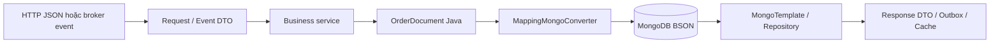
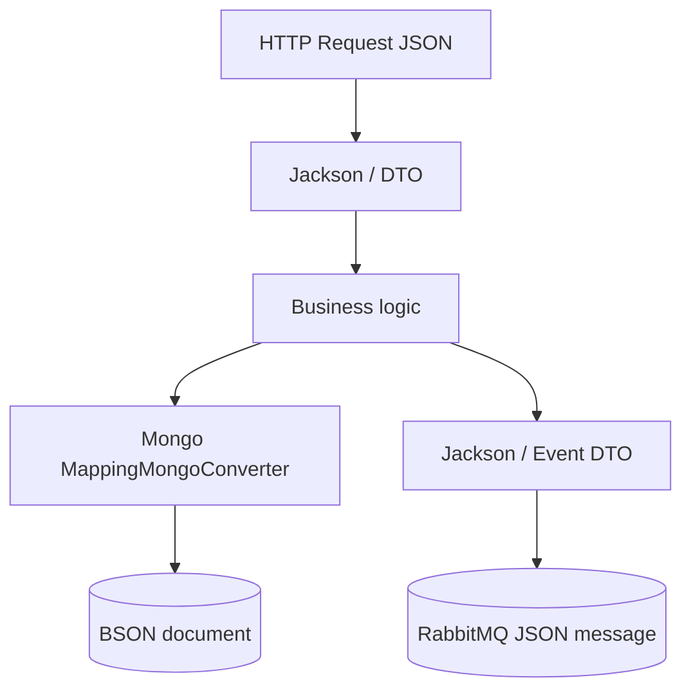
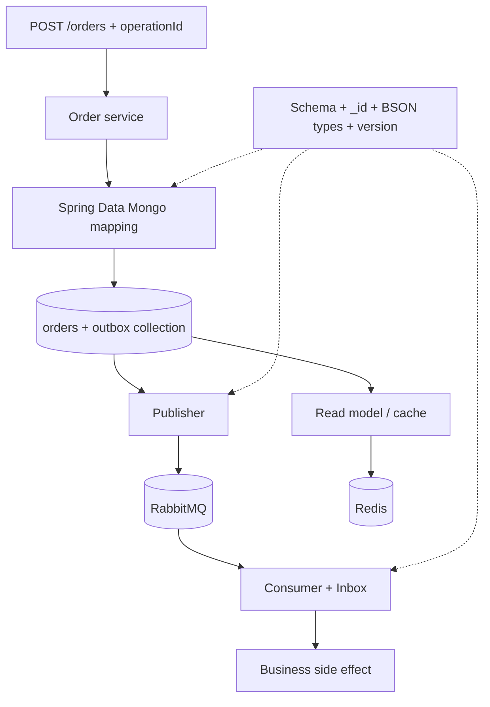

# Mapping document, định danh và chuyển đổi kiểu dữ liệu

## 1. MongoDB mapping là một hợp đồng dữ liệu

Trong mô-đun **SPRING_BOOT_INTEGRATION**, ứng dụng Spring Boot kết nối HTTP API, database, Redis cache, message broker và những adapter của Spring Integration. MongoDB có thể giữ đơn hàng dạng document, snapshot từ đối tác, thông tin đồng bộ hoặc dữ liệu phục vụ một consumer bất đồng bộ.

Lưu một Java object vào MongoDB không đơn giản là đưa object đó xuống database. Spring Data MongoDB chuyển đổi giữa **Java object** và **BSON document**. Khi ứng dụng đồng thời trao đổi JSON qua HTTP/broker, có ít nhất ba hợp đồng riêng:

- **Java mapping**: class, constructor, property types và các annotation Spring Data.
- **BSON storage**: collection, `_id`, tên field vật lý, ObjectId, Decimal128, Date, Binary và cấu trúc lồng nhau.
- **Wire contract**: HTTP JSON/event schema, version, idempotency key và định dạng số/thời gian phía consumer.



Các lỗi mapping quan trọng thường xuất hiện muộn: một writer lưu `_id` thành BSON String nhưng reader dùng ObjectId; giá tiền lưu String và query range cho kết quả không mong muốn; ngày giờ bị lệch timezone; entity mới không đọc được tài liệu cũ. Do đó bài học **“Mapping document, định danh và chuyển đổi kiểu dữ liệu”** xem mapping như một phần của quản lý giao dịch, hợp đồng và kiểm thử tích hợp, không chỉ là cách viết annotation.

Ví dụ sử dụng **Java 17+, Spring Boot 3.x, Spring Data MongoDB 4.x** và MongoDB tương thích. API và mặc định của một số conversion có thể khác giữa các phiên bản; những lựa chọn ảnh hưởng BSON type phải được xác minh trên database thật.

## 2. Java object, BSON và JSON không đồng nhất

| Lớp | Ví dụ | Bộ chuyển đổi chính |
| --- | --- | --- |
| DTO HTTP | `{"orderId":"ord-1024","total":"49.90"}` | Jackson HTTP codec/converter |
| Persistence object | `OrderDocument.id: String`, `totalAmount: BigDecimal` | Spring Data mapping metadata |
| BSON document | `_id: "ord-1024"`, `total_amount: Decimal128("49.90")` | `MappingMongoConverter` + MongoDB driver |
| Event JSON | `{"eventId":"evt-10","schemaVersion":1,...}` | Broker serializer/Jackson |

Một Java `String` dùng cho ID có thể trở thành BSON `ObjectId` hoặc BSON `String` tùy annotation. `BigDecimal` có thể được lưu thành `Decimal128` khi chọn `FieldType.DECIMAL128`; một JSON response có thể cố tình trả số tiền dạng chuỗi để tương thích consumer JavaScript.

**`@Field("total_amount")` không tự đổi tên field của HTTP JSON**. Muốn đổi tên JSON, dùng DTO và quy tắc Jackson riêng. Tương tự, việc đổi Java class không có nghĩa BSON documents đã được tự migrate.

Một document dạng Extended JSON để quan sát BSON:

```json
{
  "_id": "ord-1024",
  "total_amount": { "$numberDecimal": "49.90" },
  "created_at": { "$date": "2026-11-21T04:00:00Z" }
}
```

Các wrapper `$numberDecimal` và `$date` giúp diễn đạt BSON type khi hiển thị JSON; không có nghĩa API REST phải trả chúng.

## 3. Thiết lập Spring Data MongoDB trong Spring Boot

Dependency Maven cơ bản cho repository/`MongoTemplate` kiểu imperative:

```xml
<dependency>
  <groupId>org.springframework.boot</groupId>
  <artifactId>spring-boot-starter-data-mongodb</artifactId>
</dependency>
```

Cấu hình local:

```yaml
spring:
  data:
    mongodb:
      uri: ${MONGODB_URI:mongodb://localhost:27017/orders_db}
```

Ở production, cấp URI/credentials bằng secret/config provider và dùng TLS, replica set, read/write concerns, timeout và connection pool phù hợp. Không commit credentials hoặc log nguyên connection string. Nếu dùng `spring-boot-starter-data-mongodb-reactive`, sẽ có APIs reactive như `ReactiveMongoTemplate`/`ReactiveMongoRepository`; không dùng chữ “reactive” để gọi một repository imperative blocking.

Những thành phần chính:

| Thành phần | Vai trò |
| --- | --- |
| `@Document` | Liên kết Java class với collection |
| `@Id` | Chỉ định ID, có quy tắc chuyển ngầm sang ObjectId |
| `@MongoId` | Kiểm soát rõ hơn cách lưu `_id` |
| `@Field` | Đặt alias/target BSON type cho field |
| `@Transient` | Không persist property |
| `@Version` | Optimistic locking khi dùng Spring Data operations phù hợp |
| `@TypeAlias` | Quản lý alias của type hint |
| `@PersistenceCreator` | Chọn constructor/factory khi đọc |
| `MongoTemplate` | API truy vấn và thao tác document có mapping |
| `MongoRepository` | Abstraction repository từ entity metadata |
| `MongoCustomConversions` | Đăng ký converters cho kiểu tùy chỉnh |

Các annotations chỉ tác động tới những code path có **Spring Data mapping context**. Raw MongoDB Java driver thao tác `org.bson.Document` và raw BSON không tự hiểu các annotation của POJO nếu bạn không sử dụng cơ chế POJO codec tương ứng.

## 4. Một document mapping có chủ đích cho Order Service

Giả sử Order Service cần lưu business order ID dưới BSON String, giữ precision của tổng tiền và cho phép đọc order cùng line items.

```java
package example.integration.orders;

import java.math.BigDecimal;
import java.time.Instant;
import java.util.List;

import org.springframework.data.annotation.Version;
import org.springframework.data.mongodb.core.mapping.Document;
import org.springframework.data.mongodb.core.mapping.Field;
import org.springframework.data.mongodb.core.mapping.FieldType;
import org.springframework.data.mongodb.core.mapping.MongoId;

@Document(collection = "orders")
public class OrderDocument {

    @MongoId(FieldType.STRING)
    private String id;

    @Field("tenant_id")
    private String tenantId;

    @Field("external_order_id")
    private String externalOrderId;

    @Field(value = "total_amount", targetType = FieldType.DECIMAL128)
    private BigDecimal totalAmount;

    @Field("created_at")
    private Instant createdAt;

    private List<OrderLineDocument> lines;

    @Version
    private Long version;

    protected OrderDocument() {}

    public OrderDocument(
            String id,
            String tenantId,
            String externalOrderId,
            BigDecimal totalAmount,
            Instant createdAt,
            List<OrderLineDocument> lines) {
        this.id = id;
        this.tenantId = tenantId;
        this.externalOrderId = externalOrderId;
        this.totalAmount = totalAmount;
        this.createdAt = createdAt;
        this.lines = List.copyOf(lines);
    }

    public String getId() { return id; }
    public String getTenantId() { return tenantId; }
    public String getExternalOrderId() { return externalOrderId; }
    public BigDecimal getTotalAmount() { return totalAmount; }
    public Instant getCreatedAt() { return createdAt; }
    public List<OrderLineDocument> getLines() { return lines; }
    public Long getVersion() { return version; }
}
```

Nested value object:

```java
package example.integration.orders;

public record OrderLineDocument(
    String sku,
    int quantity
) {}
```

Ví dụ BSON tương đương, biểu diễn theo Extended JSON:

```json
{
  "_id": "ord-1024",
  "tenant_id": "tenant-17",
  "external_order_id": "erp-881",
  "total_amount": { "$numberDecimal": "49.90" },
  "created_at": { "$date": "2026-11-21T04:00:00Z" },
  "lines": [
    { "sku": "sku-123", "quantity": 2 }
  ],
  "version": 0
}
```

Đây là biểu diễn minh họa; version khởi tạo và dữ liệu thực sau save cần được kiểm tra trên MongoDB. `List.copyOf` từ chối list null và chỉ tạo shallow copy; vì vậy cần validate DTO trước khi đưa vào mapping layer.

**Hai lựa chọn quan trọng:** `@MongoId(FieldType.STRING)` bảo đảm định danh business ở dạng String, còn `@Field(targetType = FieldType.DECIMAL128)` chỉ định BSON decimal cho số tiền. `@Version` dùng để phát hiện concurrent updates, không thay thế business unique key.

## 5. _id, @Id, @MongoId và ObjectId

Mỗi document trong MongoDB có `_id` duy nhất ở cấp collection. Spring Data MongoDB có quy tắc chuyển ID rất dễ gây sai lệch giữa client Java và script/raw driver.

### 5.1. @Id String có implicit ObjectId conversion

```java
import org.springframework.data.annotation.Id;
import org.springframework.data.mongodb.core.mapping.Document;

@Document("products")
class ProductDocument {
    @Id
    private String id;
}
```

Với `@Id String`, Spring Data có thể chuyển giá trị String hợp lệ sang BSON ObjectId:

```text
Java id = "507f1f77bcf86cd799439011"
  -> BSON ObjectId("507f1f77bcf86cd799439011")

Java id = "ord-1024"
  -> BSON String "ord-1024" (không đổi sang ObjectId)
```

Điều đó không có nghĩa raw driver query bằng String sẽ tìm thấy BSON ObjectId có cùng chữ số. MongoDB phân biệt kiểu BSON.

### 5.2. @MongoId cho kiểu lưu tường minh

```java
import org.springframework.data.mongodb.core.mapping.MongoId;
import org.springframework.data.mongodb.core.mapping.FieldType;

// Một chiến lược: _id luôn là BSON String.
@MongoId(FieldType.STRING)
private String id;

// Chiến lược khác: muốn _id BSON ObjectId.
@MongoId(FieldType.OBJECT_ID)
private String idAsObjectId;
```

Đây là **hai lựa chọn thay thế**, không nên khai báo thành hai ID trong cùng document. Với `FieldType.OBJECT_ID`, giá trị phải có thể chuyển sang ObjectId. `@MongoId` không chỉ định target type thường hướng tới giữ nguyên kiểu dữ liệu hơn `@Id` có implicit conversion.

Với Java `ObjectId`:

```java
@org.springframework.data.annotation.Id
private org.bson.types.ObjectId id;
```

Đây là biểu diễn tự nhiên của khóa kỹ thuật MongoDB. Nếu trả nó qua HTTP, dùng DTO/String conversion có hợp đồng thay vì phát raw driver object.

### 5.3. Quy tắc chọn ID

| Use case | Lựa chọn | Kiểm thử cần có |
| --- | --- | --- |
| MongoDB sinh ID kỹ thuật | `@Id ObjectId` hoặc `@Id String` theo chủ đích | ID được cấp và round-trip |
| Business ID `ord-1024` | `@MongoId(FieldType.STRING)` | Raw BSON luôn là String |
| String 24 ký tự hex | Tránh chuyển ngầm nếu business ID | Test BSON type với raw driver |
| UUID nghiệp vụ | String canonical hoặc BSON Binary theo chuẩn đã chốt | Cross-language representation |
| Composite identity theo tenant | ID business hoặc compound unique index | Concurrent duplicate insert |

**Đừng chỉ dựa vào tên field Java là `id`**. Spring Data có convention nhận diện `id`, nhưng annotation tường minh tránh refactor và thay đổi kiểu bất ngờ.

### 5.4. ID generation không phải idempotency

Nếu một POST tạo Order bị timeout sau khi DB commit và caller thử lại, mỗi lần tự sinh ID mới có thể tạo hai order. Cần một **logical operation ID** cố định và idempotency policy trên database/API, không chỉ ObjectId tự sinh.

## 6. insert, save, unique index và xử lý trùng

Các API có ý nghĩa khác:

- `MongoTemplate.insert(...)`: thêm document mới, duplicate `_id` hoặc unique index sẽ thất bại.
- `MongoTemplate.save(...)`: thêm hoặc cập nhật theo mapping, còn phụ thuộc `@Version` và trạng thái entity.
- `MongoRepository.save(...)`: abstraction repository; không tự tạo hợp đồng deduplication cho business operation.
- Upsert/update operations: có thể có semantics khác với entity save và không mặc định giữ optimistic locking giống nhau.

Ví dụ index cho khóa nghiệp vụ theo tenant:

```javascript
db.orders.createIndex(
  { tenant_id: 1, external_order_id: 1 },
  { unique: true, name: "uq_orders_tenant_external" }
);
```

Nếu hai requests cùng kiểm tra “không có bản ghi” rồi insert, cả hai có thể vượt qua bước check; **unique index tại database** mới xử lý race condition đó. Khi đang có dữ liệu cũ trùng, index creation có thể bị từ chối; cần migration và báo cáo dữ liệu trùng.

Với sharded collection, uniqueness còn phải thỏa những giới hạn shard key/index của topology. Không mặc định cùng index trên unsharded DB sẽ có bảo đảm giống hệt mọi cluster.

### 6.1. Retry không được tạo business ID mới

```text
Logical operation: create-order:tenant-17:req-45
  attempt 1 -> DB commit, HTTP response mất
  attempt 2 -> cùng operation ID
  server    -> trả kết quả đã lưu hoặc đối soát
```

Không tạo một `new ObjectId()` cho mỗi retry rồi coi thao tác insert thành công là idempotent. Nếu dùng `save`, vẫn cần kiểm tra fingerprint/payload và optimistic locking; cập nhật document khác nội dung không đồng nghĩa “trả lại kết quả của request trước”.

## 7. @Field, alias và naming strategy

`@Field` tách tên property Java khỏi field trong BSON:

```java
@Field("external_order_id")
private String externalOrderId;

@Field("created_at")
private java.time.Instant createdAt;
```

Khi query qua Spring Data repository/`MongoTemplate` với class mapped, field property được ánh xạ theo metadata. Nhưng raw driver và Mongo shell phải dùng tên BSON thật.

```javascript
// Đúng khi collection dùng @Field("external_order_id"):
db.orders.find({
  tenant_id: "tenant-17",
  external_order_id: "erp-881"
});

// Không đúng với schema này:
db.orders.find({ externalOrderId: "erp-881" });
```

Nếu dự án dùng field naming strategy toàn cục (snake_case hoặc khác), hãy review annotation ưu tiên, cách map nested fields và hiệu lực đối với raw queries/aggregations. **Một thay đổi tên Java không phải là migration field BSON**.

### 7.1. Rename field là migration có nhiều giai đoạn

Giả sử document cũ lưu `customer_name`, entity mới muốn lưu `display_name`:

1. Expand: reader mới hiểu cả hai tên, writer có chiến lược tương thích.
2. Backfill: cập nhật old documents theo chunks và kiểm đếm kết quả.
3. Validate: xác minh document thiếu field mới, null/invalid data.
4. Switch: ngừng writer cũ, reader chuyển sang field mới.
5. Contract: loại field cũ sau rolling window và sau khi các batch jobs/raw queries đã đổi.

Chỉ sửa `@Field("display_name")` rồi deploy không làm database tự chuyển dữ liệu cũ.

### 7.2. @Transient

```java
@org.springframework.data.annotation.Transient
private String displayLabel;
```

Property transient không được persist. Sau reload nó cần được tính lại. Không dùng `@Transient` cho trạng thái business phải giữ qua restart. Property chỉ đọc có thể dùng `@ReadOnlyProperty` với semantics Spring Data, nhưng phải test tương tác version/converter và không coi annotation là cơ chế bảo mật.

## 8. Embedded documents, arrays và references

Một `List<OrderLineDocument>` thường được lưu như **BSON array chứa nested documents**:

```json
{
  "_id": "ord-1024",
  "lines": [
    {"sku":"sku-123","quantity":2},
    {"sku":"sku-456","quantity":1}
  ]
}
```

Ưu điểm: đọc order và lines trong một truy vấn, cập nhật phạm vi một document có atomicity theo MongoDB. Rủi ro: array tăng không giới hạn, update lớn, index/memory overhead và giới hạn BSON document size thường **16 MiB**.

Khi một entity độc lập có lifecycle riêng, có thể lưu ID reference:

```java
@Field("customer_id")
private String customerId;
```

Spring Data còn hỗ trợ `@DBRef` và `@DocumentReference`; nhưng chúng không biến MongoDB thành JPA lazy SQL join và không tự mang atomic transaction xuyên collection. Việc resolve reference có thể thực hiện thêm queries/N+1, cần xét missing references, performance và permission.

| Mô hình | Dùng khi | Trade-off |
| --- | --- | --- |
| Embedded line items | Cùng vòng đời/đọc cùng order | Kích thước document |
| Plain business ID | Owner nằm ở service/collection khác | Application resolve/reference integrity |
| `@DocumentReference` | Muốn mapping hỗ trợ dereference | Additional queries/lookup semantics |
| `@DBRef` | Tương thích legacy DBRef | Format và overhead |
| Snapshot từ service khác | Đọc nhanh, eventual consistency | Có thể stale, cần refresh/version |

Không nhúng nguyên HTTP request, token, attachment hay Java entity graph vào document chỉ vì NoSQL linh hoạt.

## 9. Kiểu BSON và hệ quả với Java

| Java type | BSON thông dụng | Điều cần xác nhận |
| --- | --- | --- |
| `String` | String; riêng ID có thể thành ObjectId | Raw `_id` type |
| `ObjectId` | ObjectId | JSON representation |
| `Integer` | Int32 | Overflow/range |
| `Long` | Int64 | JSON consumers có integer limit |
| `Double` | Double | Sai số nhị phân |
| `BigDecimal` | String hoặc Decimal128 tùy mapping | Numeric query/precision |
| `Instant` | BSON Date | Millisecond resolution |
| `LocalDateTime` | Date qua conversion rules | Timezone ambiguity |
| `Date` | BSON Date | UI timezone |
| `byte[]` | Binary | Size/security |
| `List<T>` | Array | Element mapping |
| POJO/record | Embedded document | Constructors, missing fields |
| Enum | Thường String | Rename/unknown values |
| `Map<String, ?>` | Document | Dynamic keys và escape |

Một collection có thể chứa cùng một field với nhiều BSON types, nhưng query/index không mặc định đưa chúng về cùng ngữ nghĩa. Ví dụ:

```javascript
{ total_amount: "100.00" }
{ total_amount: NumberDecimal("100.00") }
```

Hai document trên có field tên giống nhau nhưng một bên là String, một bên là Decimal128. Query range, aggregation, sort hoặc index có thể cho kết quả sai mục tiêu kinh doanh nếu trộn kiểu. **Chuẩn hóa representation là trách nhiệm schema migration**.

## 10. BigDecimal → Decimal128 và dữ liệu tiền

Với tiền, `double` thường không đủ vì sai số biểu diễn số nhị phân. Dùng `BigDecimal` ở Java và BSON `Decimal128` khi cần numeric range/aggregation.

```java
import java.math.BigDecimal;
import org.springframework.data.mongodb.core.mapping.Field;
import org.springframework.data.mongodb.core.mapping.FieldType;

@Field(value = "total_amount", targetType = FieldType.DECIMAL128)
private BigDecimal totalAmount;
```

Query Mongo shell:

```javascript
db.orders.find({
  total_amount: { $gte: NumberDecimal("20.00") }
});
```

Tùy phiên bản, BigDecimal có thể mặc định lưu String nếu không chỉ định target type. Vì thế test cần assert raw BSON type, không chỉ assert repository trả cùng giá trị Java.

**Decimal128 có giới hạn**: khoảng 34 chữ số có nghĩa và exponent range theo IEEE 754 decimal128. `BigDecimal` với độ chính xác/scale quá lớn có thể không chuyển được. Nên validate business precision, scale và currency, không âm thầm làm tròn.

```java
import java.math.BigDecimal;
import java.math.RoundingMode;

public final class MoneyRules {
    private MoneyRules() {}

    public static BigDecimal exactCents(BigDecimal amount) {
        if (amount == null || amount.signum() < 0) {
            throw new IllegalArgumentException("Invalid amount");
        }
        return amount.setScale(2, RoundingMode.UNNECESSARY);
    }
}
```

`RoundingMode.UNNECESSARY` từ chối giá trị không biểu diễn chính xác ở scale 2; thực tế phải áp quy tắc theo từng currency, vì không phải mọi đồng tiền đều có hai chữ số thập phân. **Decimal128 chỉ lưu amount, không tự chứa currency**. Nếu cần, lưu amount và currency trong một value object hoặc hai fields rõ ràng.

---

## 11. Instant, LocalDateTime và BSON Date

MongoDB BSON Date lưu thời điểm theo **milliseconds kể từ Unix epoch**, không lưu tên múi giờ. Với luồng tích hợp xuyên nhiều service, lựa chọn kiểu thời gian có thể làm thay đổi ý nghĩa nghiệp vụ.

| Java type | Ý nghĩa | Quy tắc đề xuất |
| --- | --- | --- |
| `Instant` | Thời điểm toàn cầu | Dùng cho event/outbox timestamps |
| `java.util.Date` | Thời điểm epoch | Có thể map BSON Date |
| `LocalDate` | Ngày lịch | Định nghĩa timezone/format theo business date |
| `LocalDateTime` | Ngày–giờ không có offset | Tránh làm timestamp xuyên hệ thống |
| `OffsetDateTime`/`ZonedDateTime` | Có offset/zone | Chuẩn hóa instant, lưu zone riêng khi cần |
| `Duration` | Khoảng thời gian | Lưu milliseconds/seconds có đơn vị rõ |

Ví dụ field event time:

```java
@Field("occurred_at")
private java.time.Instant occurredAt;
```

Với mapping thông dụng, MongoDB lưu BSON Date theo milliseconds. Nếu Java `Instant` chứa nanoseconds, phần độ chính xác nhỏ hơn một millisecond có thể không còn sau round-trip. Không assert equality tuyệt đối của nanoseconds nếu storage contract chỉ có milliseconds.

### 11.1. LocalDateTime thiếu timezone

```java
java.time.LocalDateTime.of(2026, 11, 21, 9, 0);
```

Giá trị này là 09:00 **ở đâu**? Khi chuyển sang một instant, cần timezone/offset. Nếu hai instances chạy các JVM default timezones khác nhau và conversion không có chính sách rõ, một local timestamp có thể bị diễn giải khác nhau.

Với audit, event, retry deadline và TTL, ưu tiên `Instant`/UTC. Với ngày đối soát nghiệp vụ, dùng `LocalDate` kết hợp timezone được ghi rõ trong business contract, chẳng hạn ngày D theo `Asia/Ho_Chi_Minh`, không biến business date thành một instant ngẫu nhiên.

### 11.2. TTL index không phải scheduler chính xác

MongoDB có TTL indexes dựa trên BSON Date để tự làm sạch documents đến hạn theo background process. Nhưng việc xóa có thể diễn ra **sau** thời điểm hết hạn. Không dùng TTL như cơ chế duy nhất để xác nhận một token đã bị vô hiệu hoặc một job phải thực thi chính xác lúc 02:00; business logic vẫn phải kiểm tra expiry/deadline.

## 12. UUID, enum, null, missing và dynamic maps

### 12.1. UUID representation cần chốt trên mọi client

UUID có thể lưu dưới BSON String canonical hoặc BSON Binary. BSON Binary cho UUID có các subtype/representation khác nhau trong hệ thống lịch sử, kéo theo khác biệt byte order và codec.

| Lựa chọn | Ưu điểm | Hạn chế |
| --- | --- | --- |
| UUID canonical String | Dễ debug, dễ giao tiếp đa ngôn ngữ | Tốn bytes hơn binary |
| BSON Binary UUID | Gọn, kiểu dữ liệu rõ | Phải thống nhất UUID representation giữa drivers |
| Business ID dạng có prefix | Thể hiện domain, tránh nhập nhầm | Không phải UUID chuẩn; cần validation |

Không sửa annotation rồi hy vọng MongoDB tự chuyển tất cả document UUID cũ. Khi thay representation cần dual-read/dual-write hoặc migration, kèm test raw BSON và test với consumer khác ngôn ngữ.

### 12.2. Enum lưu trong document cũng là schema

```java
public enum OrderStatus {
    PENDING,
    CONFIRMED,
    CANCELLED
}
```

Mapping thông dụng lưu tên enum. Đổi constant `CONFIRMED` thành `APPROVED` có thể khiến tài liệu cũ chứa `"CONFIRMED"` không còn đọc được. Với dữ liệu tồn tại lâu, nên dùng mã trạng thái ổn định, converter có version hoặc migration rõ, không coi refactor enum là thay đổi thuần Java.

### 12.3. Field vắng mặt khác field có null

```javascript
{ _id: "ord-1" }
{ _id: "ord-2", status: null }
{ _id: "ord-3", status: "PENDING" }
```

Ở Java, một nullable property có thể nhận `null` cho cả trường hợp **absent** và **explicit null**. Điều này ảnh hưởng PATCH semantics, backfill và validation. Nếu business phải phân biệt, thiết kế patch DTO/value object hoặc đọc raw document theo chủ đích.

Trong những phiên bản Spring Data hỗ trợ, `@Field(write = Field.Write.ALWAYS)` có thể yêu cầu ghi null thay vì bỏ field theo quy tắc mặc định. Dù dùng API nào, **hãy test BSON thật** vì null/missing phụ thuộc mapping và phiên bản.

### 12.4. Keys của dynamic maps

Khi lưu `Map<String, Object>` từ client vào BSON subdocument, keys có dấu chấm hoặc bắt đầu bằng `$` có thể cần escape/preservation rules và tạo ambiguity trong dot-path queries. Không để user tự do điều khiển field names của update/query. Dùng allowlist, schema-aware mapping hoặc lưu key dưới dạng value trong một mảng nếu cần giữ nguyên ký tự.

## 13. Constructor binding, records và immutable value objects

Để đọc BSON, Spring Data phải dựng Java object. Java record là lựa chọn hợp lý cho embedded value objects:

```java
public record ShippingAddress(
    String city,
    String countryCode,
    String postalCode
) {}
```

Document:

```json
{
  "shippingAddress": {
    "city": "Ho Chi Minh City",
    "countryCode": "VN",
    "postalCode": "700000"
  }
}
```

Spring Data có thể dùng canonical constructor để dựng record. Tuy vậy record chỉ **shallow immutable**: nếu một component là `List` mutable, record không tự deep-copy.

Khi class có nhiều constructors hoặc factory methods, có thể dùng `@PersistenceCreator`:

```java
import org.springframework.data.annotation.PersistenceCreator;

public final class PartnerReference {
    private final String system;
    private final String reference;

    @PersistenceCreator
    public PartnerReference(
            String system, String reference) {
        this.system = system;
        this.reference = reference;
    }

    public String getSystem() { return system; }
    public String getReference() { return reference; }
}
```

Một document cũ thiếu `system` có thể khiến constructor gặp null hoặc business validation lỗi. Không mặc định gán một tenant hay system tùy ý chỉ để mapping thành công; cần version decoder/backfill. Khi không dùng record, constructor parameter names, annotations, getters/setters và compiler metadata ảnh hưởng đến entity materialization. Test bằng chính class và Spring Data mapping thật.

## 14. MongoCustomConversions: chuyển value object sang BSON tùy chỉnh

Không phải value object nào cũng nên lưu bằng default POJO mapping. Ví dụ ứng dụng muốn lưu `Money` thành embedded document với amount BSON Decimal128 và currency String:

```json
{
  "total": {
    "amount": {"$numberDecimal": "49.90"},
    "currency": "USD"
  }
}
```

### 14.1. Value object Money

```java
package example.integration.money;

import java.math.BigDecimal;
import java.util.Currency;

public record Money(
    BigDecimal amount,
    Currency currency
) {
    public Money {
        if (amount == null || currency == null) {
            throw new IllegalArgumentException(
                "amount and currency are required"
            );
        }
    }
}
```

### 14.2. Writing converter

```java
package example.integration.money;

import org.bson.Document;
import org.bson.types.Decimal128;
import org.springframework.core.convert.converter.Converter;
import org.springframework.data.convert.WritingConverter;

@WritingConverter
public final class MoneyWriteConverter
        implements Converter<Money, Document> {

    @Override
    public Document convert(Money source) {
        return new Document(
            "amount", new Decimal128(source.amount())
        ).append(
            "currency", source.currency().getCurrencyCode()
        );
    }
}
```

### 14.3. Reading converter

```java
package example.integration.money;

import java.util.Currency;

import org.bson.Document;
import org.bson.types.Decimal128;
import org.springframework.core.convert.converter.Converter;
import org.springframework.data.convert.ReadingConverter;

@ReadingConverter
public final class MoneyReadConverter
        implements Converter<Document, Money> {

    @Override
    public Money convert(Document source) {
        Object rawAmount = source.get("amount");

        if (!(rawAmount instanceof Decimal128 amount)) {
            throw new IllegalArgumentException(
                "Money amount must be BSON Decimal128"
            );
        }

        String currency = source.getString("currency");
        if (currency == null || currency.isBlank()) {
            throw new IllegalArgumentException(
                "Money currency missing"
            );
        }

        return new Money(
            amount.bigDecimalValue(),
            Currency.getInstance(currency)
        );
    }
}
```

`Document` trong converter là `org.bson.Document`. Annotation `@WritingConverter`/`@ReadingConverter` giúp định hướng chuyển đổi theo chiều lưu/đọc, đặc biệt khi nguồn/đích đều có thể được converter coi là kiểu native.

### 14.4. Đăng ký vào Spring Data

```java
package example.integration.money;

import java.util.List;
import org.springframework.context.annotation.Bean;
import org.springframework.context.annotation.Configuration;
import org.springframework.data.mongodb.core.convert.MongoCustomConversions;

@Configuration
public class MongoMoneyConfiguration {

    @Bean
    MongoCustomConversions mongoCustomConversions() {
        return new MongoCustomConversions(
            List.of(
                new MoneyWriteConverter(),
                new MoneyReadConverter()
            )
        );
    }
}
```

Trong cấu hình Boot thông dụng, bean này được dùng khi xây `MappingMongoConverter`. Nhưng nếu có nhiều custom converters, custom MongoTemplate hoặc multiple MongoDB clients, phải chắc chắn các converter đều được đăng ký vào template đúng. Đừng định nghĩa một bean mới làm mất converters sẵn có của ứng dụng mà không kiểm tra composition.

**Lợi ích:** money amount có representation thống nhất và đọc lại đúng currency. **Giới hạn:** converter không thay thế domain validation về tiền âm, currency của thị trường, authorization hay transaction business.

### 14.5. Legacy representation phải được xử lý có chủ đích

Nếu tài liệu cũ lưu:

```javascript
{ total: { amount: "49.90", currency: "USD" } }
```

thì reading converter strict ở trên sẽ từ chối vì amount không phải Decimal128. Đó là **fail-fast có chủ đích**. Nếu cần rolling migration, thêm decoder đọc cả legacy String và Decimal128 theo version, sau đó backfill và loại đường cũ khi hoàn tất. Không âm thầm coerce giá trị malformed thành 0.

## 15. MappingMongoConverter không phải Jackson ObjectMapper

Một Order Service có thể dùng ba loại serialization/conversion:



`@Field("total_amount")` ảnh hưởng field BSON, không quyết định JSON key của DTO. Muốn HTTP trả `total` thay cho `totalAmount`, dùng response DTO và Jackson annotation/naming strategy:

```java
import com.fasterxml.jackson.annotation.JsonProperty;

public record OrderResponse(
    @JsonProperty("orderId") String id,
    @JsonProperty("total") String amount
) {}
```

API có thể chủ động trả decimal **string** để tránh mất precision ở JavaScript consumers, trong khi Mongo lưu `Decimal128`. Hai quyết định này độc lập.

`org.bson.Document.toString()` hữu ích để debug, nhưng không phải một JSON contract ổn định cho HTTP/broker. Nếu cần Extended JSON, dùng writer/format đã được chọn và kiểm thử. Không trả raw BSON `$oid`/`$numberDecimal` từ REST nếu hợp đồng của consumer chỉ mong chuỗi/số thường.

### 15.1. Không publish JPA/Mongo entity trực tiếp

Một persistence object có thể chứa internal fields, type hints, version, lazy references hoặc dữ liệu không dành cho downstream. Khi publish lên broker, tạo **event DTO có schemaVersion/eventId** rõ và giữ event payload ổn định cho retry/replay, không tái serialize document hiện tại mỗi lần reprocess một outbox event cũ.

## 16. _class, @TypeAlias và polymorphism

Spring Data MongoDB có type hints (thường thấy dưới field `_class`) để hỗ trợ những tình huống mapping polymorphic:

```json
{
  "_id": "ord-1024",
  "_class": "example.integration.orders.OrderDocument",
  "status": "PENDING"
}
```

Tên class Java trong stored data tạo phụ thuộc vào package/version ứng dụng. Nếu refactor class hoặc nhiều phiên bản app cùng đọc một collection, cần kiểm tra khả năng đọc những document cũ.

Ví dụ dùng alias:

```java
import org.springframework.data.annotation.TypeAlias;
import org.springframework.data.mongodb.core.mapping.Document;

@TypeAlias("order_record")
@Document("orders")
public class OrderDocument {
    // các trường mapping
}
```

Alias giúp tránh lưu tên package dài trong một số type hints. Tuy nhiên type alias cần được mapping context biết khi đọc; với type chưa scan/register, đừng giả định mọi MongoTemplate ở service khác sẽ tự hiểu alias.

Có thể tùy chỉnh `MongoTypeMapper`/`MappingMongoConverter` để thay đổi cách ghi type hints, nhưng phải đánh giá nested inheritance, existing documents, read compatibility và các custom converters. **Không tắt `_class` chỉ vì muốn document trông gọn hơn** khi dữ liệu polymorphic vẫn cần phân biệt subtype.

Type metadata không phải cơ chế authorization: không tự tin class name trong document không tin cậy và không thiết kế deserialization tùy ý theo giá trị do user kiểm soát.

## 17. Repository và MongoTemplate query mapping

Entity metadata cũng ảnh hưởng **đọc/query**, không chỉ ghi.

```java
package example.integration.orders;

import java.util.Optional;
import org.springframework.data.mongodb.repository.MongoRepository;

public interface OrderRepository
        extends MongoRepository<OrderDocument, String> {

    Optional<OrderDocument>
        findByTenantIdAndExternalOrderId(
            String tenantId, String externalOrderId
        );
}
```

Derived query property `externalOrderId` được ánh xạ sang field BSON `external_order_id` khi repository dùng mapped entity.

`MongoTemplate`:

```java
import org.springframework.data.mongodb.core.MongoTemplate;
import org.springframework.data.mongodb.core.query.Criteria;
import org.springframework.data.mongodb.core.query.Query;

public OrderDocument lookup(
        MongoTemplate template,
        String tenantId,
        String externalOrderId) {

    Query query = new Query(
        Criteria.where("tenantId").is(tenantId)
            .and("externalOrderId").is(externalOrderId)
    );

    return template.findOne(query, OrderDocument.class);
}
```

Mapping context có thể dịch property names và convert query values. Trái lại, raw driver:

```javascript
db.orders.findOne({
  tenant_id: "tenant-17",
  external_order_id: "erp-881"
});
```

đòi chính xác tên BSON. Với `_id` cũng vậy: String `"507f..."` không bằng BSON ObjectId của cùng dãy hex.

Query aggregation/`Document` pipeline tự viết có thể có mức hỗ trợ mapping khác API `Criteria` dựa trên entity. Luôn kiểm tra generated query và `explain` khi performance/correctness quan trọng.

### 17.1. Mapping không tạo index miễn phí

Một repository method có thể tạo query đúng nhưng full scan nếu thiếu index. Dùng query plan, workload và migration policy để chọn compound indexes; không tự index tất cả fields. Filter `tenantId` trong query là yêu cầu bảo vệ dữ liệu nhưng **không thay authorization** tại service boundary.

## 18. @Version, transactions và idempotency

### 18.1. Optimistic locking

`@Version` cho phép Spring Data MongoDB kiểm soát một số save/update operations dựa trên version. Khi hai requests cùng đọc version cũ và cùng ghi, một update có thể bị từ chối bằng optimistic locking exception, thay vì last-write-wins âm thầm.

```java
@org.springframework.data.annotation.Version
private Long version;
```

Điều đó không áp tự động cho mọi raw driver update hoặc bulk operation. Ví dụ:

```javascript
db.orders.updateOne(
  { _id: "ord-1024" },
  { $set: { status: "CONFIRMED" } }
);
```

không tự đọc Java `@Version`. Nếu có nhiều writers, phải có compare-and-set, version check hoặc một owner duy nhất cho update policy. Write concern/acknowledgment cũng cần đủ để ứng dụng thấy matched/modified count, không dùng unacknowledged writes rồi mong phát hiện mọi conflict.

### 18.2. Transaction có giới hạn theo MongoDB topology

Multi-document MongoDB transactions đòi cluster/topology và configuration phù hợp, chẳng hạn replica set/sharded cluster hỗ trợ. Một local MongoDB standalone **không tự bảo đảm** multi-document transaction.

Cấu hình imperative transaction manager khi cần:

```java
import org.springframework.context.annotation.Bean;
import org.springframework.context.annotation.Configuration;
import org.springframework.data.mongodb.MongoDatabaseFactory;
import org.springframework.data.mongodb.MongoTransactionManager;

@Configuration
class MongoTransactionsConfig {

    @Bean
    MongoTransactionManager mongoTransactionManager(
            MongoDatabaseFactory factory) {
        return new MongoTransactionManager(factory);
    }
}
```

`@Transactional` với manager đúng có thể điều phối MongoDB operations tham gia transaction, nhưng **không tự bao trùm Redis, REST API hoặc RabbitMQ/Kafka publish**. Hãy cân nhắc transactional outbox/CDC và reconciliation cho các ranh giới này.

### 18.3. Idempotency/inbox cho broker redelivery

Nếu consumer commit MongoDB nhưng chết trước broker ACK, message có thể được giao lại. Dùng business `eventId` và unique key theo consumer:

```javascript
db.integration_inbox.createIndex(
  { consumer_name: 1, event_id: 1 },
  { unique: true, name: "uq_inbox_consumer_event" }
);
```

Inbox insert và business change cần được thiết kế với atomicity phù hợp. Chỉ gọi `repository.save(...)` hai lần không bảo đảm side effect bên ngoài (email/payment) chạy đúng một lần.

## 19. Schema evolution và BSON type migrations

MongoDB cho phép documents trong cùng collection có schema khác nhau:

```javascript
{ _id: "ord-1", total_amount: "49.90" }
{ _id: "ord-2", total_amount: NumberDecimal("49.90") }
{ _id: "ord-3",
  total: {
    amount: NumberDecimal("49.90"),
    currency: "USD"
  }
}
```

Một annotation mới `@Field(targetType=FieldType.DECIMAL128)` không tự convert các tài liệu đã lưu từ String sang Decimal128, càng không tự biến `total_amount` thành `total.amount`. Một migration hợp lý:

1. Khảo sát BSON types/schema versions đang có; xem dữ liệu bẩn.
2. Thiết kế đọc tương thích với old + new trong rolling window.
3. Chuyển writer sang representation mới theo giai đoạn.
4. Backfill theo chunks/keyset, tránh update cả triệu documents trong một request.
5. Checkpoint và kiểm đếm số còn thiếu/sai, tạo báo cáo lỗi.
6. Validate queries, index, DTO JSON và events từ broker.
7. Bỏ converter legacy sau khi dữ liệu lịch sử và consumers đã được xử lý.

MongoDB có collection validators, gồm JSON Schema phù hợp BSON types như `objectId`, `decimal`, `date` và `string`. Validator giúp chặn dữ liệu mới sai type, nhưng triển khai quá sớm có thể làm ứng dụng cũ trong rolling deploy không ghi được. Validation không thay unique index và authorization.

`@Indexed`/`@CompoundIndex` là metadata mapping. Việc auto-index creation có thể tắt theo mặc định ở nhiều phiên bản Spring Data MongoDB; production nên quản lý indexes bằng migration/review, tránh bất ngờ nhiều replicas cùng xây index lớn.

## 20. Kiểm thử mapping bằng MongoDB Testcontainers và raw BSON

Mock `MongoRepository` không bắt được lỗi `_id` ObjectId/String, BigDecimal lưu String hay field alias sai. Dùng MongoDB container thật và đọc **raw BSON** trong integration test.

Dependencies Maven cho test, theo Boot BOM:

```xml
<dependency>
  <groupId>org.springframework.boot</groupId>
  <artifactId>spring-boot-starter-test</artifactId>
  <scope>test</scope>
</dependency>
<dependency>
  <groupId>org.testcontainers</groupId>
  <artifactId>mongodb</artifactId>
  <scope>test</scope>
</dependency>
<dependency>
  <groupId>org.testcontainers</groupId>
  <artifactId>junit-jupiter</artifactId>
  <scope>test</scope>
</dependency>
<dependency>
  <groupId>org.springframework.boot</groupId>
  <artifactId>spring-boot-testcontainers</artifactId>
  <scope>test</scope>
</dependency>
```

Ví dụ cho Spring Boot 3.2+ và Testcontainers tương thích:

```java
package example.integration.orders;

import static org.assertj.core.api.Assertions.assertThat;

import java.math.BigDecimal;
import java.time.Instant;
import java.util.List;

import org.bson.Document;
import org.junit.jupiter.api.Test;
import org.springframework.beans.factory.annotation.Autowired;
import org.springframework.boot.test.autoconfigure.data.mongo.DataMongoTest;
import org.springframework.boot.testcontainers.service.connection.ServiceConnection;
import org.springframework.data.mongodb.core.MongoTemplate;
import org.testcontainers.containers.MongoDBContainer;
import org.testcontainers.junit.jupiter.Container;
import org.testcontainers.junit.jupiter.Testcontainers;

@Testcontainers
@DataMongoTest
class OrderDocumentMappingTest {

    @Container
    @ServiceConnection
    static MongoDBContainer mongodb =
        new MongoDBContainer("mongo:7.0");

    @Autowired
    MongoTemplate template;

    @Test
    void storesStringIdDecimal128AndDate() {
        OrderDocument order = new OrderDocument(
            "ord-1024",
            "tenant-17",
            "erp-881",
            new BigDecimal("49.90"),
            Instant.parse("2026-11-21T04:00:00Z"),
            List.of(new OrderLineDocument("sku-123", 2))
        );

        template.insert(order);

        Document raw = template.getCollection("orders")
            .find(new Document("_id", "ord-1024"))
            .first();

        assertThat(raw).isNotNull();
        assertThat(raw.get("_id")).isInstanceOf(String.class);
        assertThat(raw.get("tenant_id")).isEqualTo("tenant-17");
        assertThat(raw.get("total_amount"))
            .isInstanceOf(org.bson.types.Decimal128.class);
        assertThat(raw.get("created_at"))
            .isInstanceOf(java.util.Date.class);

        OrderDocument loaded =
            template.findById("ord-1024", OrderDocument.class);

        assertThat(loaded).isNotNull();
        assertThat(loaded.getTotalAmount())
            .isEqualByComparingTo("49.90");
    }
}
```

Test giả định `OrderDocument` được scan trong test slice, Mongo container/Docker sẵn sàng và Spring Boot test connection support được kích hoạt. Nó kiểm tra BSON type thực trước khi kiểm tra converter round-trip. `@DataMongoTest` có thể không tự import user configuration chứa `MongoCustomConversions`; thêm `@Import` khi test converter custom.

### 20.1. Ma trận test quan trọng

| Case | Kỳ vọng |
| --- | --- |
| Business ID thông thường | `_id` lưu BSON String |
| Business ID đúng 24 ký tự hex | Vẫn BSON String nếu chọn `@MongoId(FieldType.STRING)` |
| `@Id String` với 24 hex | Hiểu implicit ObjectId conversion |
| Unique external order + tenant | Concurrent duplicate bị DB từ chối |
| BigDecimal 49.90 | Decimal128 và round-trip đúng |
| Amount quá precision | Fail có kiểm soát, không làm tròn âm thầm |
| Instant nanos | Lưu ý precision milliseconds |
| Enum cũ/unknown | Legacy decoder hoặc migration |
| Field rename | Old document vẫn đọc trong rolling window |
| Null vs absent | Contract phù hợp |
| Embedded lines | Array và nested mapping đúng |
| Money converter | BSON Decimal128 + currency |
| Raw driver query | Dùng đúng BSON keys/types |
| `@Version` conflicts | Concurrent write được phát hiện |
| Broker redelivery | Không lặp business side effect |

Với test migration, không chỉ tạo database rỗng. Hãy nhập snapshot documents v1, chạy decoder/migration v2, assert dữ liệu business còn nguyên và các API/events vẫn tương thích.

## 21. Quan sát và xử lý lỗi mapping trong hệ thống tích hợp

| Triệu chứng | Nguyên nhân khả dĩ | Điều cần làm |
| --- | --- | --- |
| Repository không tìm thấy document | `_id` BSON type không khớp | Kiểm tra raw BSON và annotation |
| Conversion exception khi đọc | Missing field, constructor hoặc converter sai | Schema version/backfill |
| Range query tiền thiếu kết quả | String và Decimal128 trộn | Chuẩn hóa BSON types |
| Sai giờ event | LocalDateTime/timezone ambiguity | Dùng Instant/UTC |
| Enum read fail sau deploy | Rename constant | Stable codes/versioned decoder |
| Redis cache deserialize lỗi | Cache JSON khác document mapping | Cache DTO/version/TTL |
| Broker consumer lỗi với event cũ | Event JSON không tương thích | Event schema evolution |
| Duplicate order sau HTTP timeout | Tạo ID mới trên mỗi retry | Stable business operation ID |
| Conflict bị ghi đè | Raw update không kiểm soát version | Compare-and-set/optimistic policy |
| Query chậm sau migration | Index sai/tăng kích thước | Explain và query plan |
| Mongo transaction fail trên local standalone | Không có topology phù hợp | Replica set/Testcontainers config |

Quan sát hữu ích: Mongo operation latency/error rate, connection pool wait, duplicate-key rate, optimistic lock conflicts, conversion failures theo exception category, migration backlog và broker outbox/inbox lag. Không dùng `orderId`, `userId` hoặc `eventId` làm metric tags; dùng trong logs/traces được bảo vệ, có redaction và retention.

Đừng dump raw BSON documents, access tokens hoặc MongoDB URI đầy đủ vào log khi converter lỗi. Với multi-tenant queries, một điều kiện `tenantId` không thay authentication/authorization. Raw user-provided query maps cũng cần allowlist để tránh operator/field injection.

## 22. Bài toán tổng hợp: Order MongoDB → RabbitMQ → Redis

Giả sử một Order Service:

1. Nhận `POST /orders` với operation ID ổn định.
2. Kiểm tra input và tạo `OrderDocument`.
3. Lưu `_id` dưới BSON String, `total_amount` Decimal128, `created_at` BSON Date.
4. Ghi outbox event `OrderCreated` theo transaction/bảo đảm phù hợp MongoDB topology.
5. Publisher gửi JSON qua RabbitMQ, giữ nguyên event ID khi retry.
6. Notification consumer dùng inbox dedupe; Redis lưu read model/cache có version.
7. Reconciliation job phát hiện outbox/notification chưa hoàn thành.



| Dữ liệu | Quy tắc lưu | Tại sao |
| --- | --- | --- |
| `_id` | String `"ord-1024"` | Business ID ổn định |
| `total_amount` | Decimal128 | Query số/precision rõ |
| `created_at` | BSON Date từ Instant | Timestamp toàn cầu |
| `tenant_id` | String, index/authorization | Scope dữ liệu |
| `external_order_id` | Unique compound với tenant | Dedupe upstream |
| `version` | Spring Data `@Version` | Optimistic concurrency |
| `lines` | Embedded array có giới hạn | Đọc cùng order |
| Outbox | Stable `eventId` + payload version | Publish retry không đổi event |
| Redis | Cache DTO/version riêng | Không lệ thuộc Mongo entity |

### 22.1. Năm lỗi cần mô phỏng

**A — Business ID trông giống ObjectId.** Dùng `@Id String` có thể tạo BSON ObjectId làm raw driver tìm sai. `@MongoId(FieldType.STRING)` và test bảo vệ representation.

**B — Tiền lưu ở hai BSON types.** Aggregation/query không còn nhất quán; cần converter/migration và test trên documents cũ.

**C — HTTP timeout sau DB commit.** Retry dùng cùng operation ID, database unique key và response reconciliation thay vì tạo order mới.

**D — Đổi field schema giữa rolling deployment.** Old consumer/JDBC job/raw query/Redis cache vẫn đọc tên cũ; cần expand–migrate–contract.

**E — Consumer commit rồi broker ACK mất.** Message có thể redeliver; inbox và business idempotency bảo vệ side effect, không dựa vào `save()` như exactly-once.

### 22.2. Checklist triển khai

- [ ] Phân biệt persistence document, BSON storage và HTTP/event DTO?
- [ ] `@Document`/`@Field` định nghĩa collection/field names rõ?
- [ ] Chọn `@Id` hoặc `@MongoId` có chủ đích; test ObjectId/String?
- [ ] Business ID và event ID ổn định qua retries?
- [ ] Có unique index chống trùng thay cho find-then-insert?
- [ ] BigDecimal dùng Decimal128 khi cần numeric semantics?
- [ ] Instant/timezone/business date và UUID representation được chuẩn hóa?
- [ ] Có giải pháp cho enum rename, absent/null, dynamic map keys?
- [ ] Embedded/references được chọn theo access pattern và document size?
- [ ] Custom conversions được đăng ký và test raw BSON/round-trip?
- [ ] Mapping của repository, MongoTemplate và raw driver đã được so sánh?
- [ ] Có kế hoạch dữ liệu cũ, schema migration, rollback và versioned events?
- [ ] `@Version`, MongoDB transactions và broker ACK không bị nhầm là một transaction?
- [ ] Testcontainers kiểm tra BSON type, idempotency, conversion và failure windows?
- [ ] Logs/metrics bảo vệ secrets/PII và không dùng high-cardinality tags?

**Kết luận:** Mapping MongoDB là hợp đồng giữa **Java object, Spring Data converter và BSON document**. `@Document`/`@Field` mô tả cấu trúc lưu trữ; `@Id` và `@MongoId` quyết định cách biểu diễn `_id`; `FieldType.DECIMAL128`, kiểu thời gian và `MongoCustomConversions` giữ chính xác ngữ nghĩa dữ liệu. Trong Spring Boot Integration, một thiết kế tin cậy cần ID nghiệp vụ ổn định, migration tương thích, kiểm thử BSON thật, unique constraints, idempotency và observability xuyên HTTP, MongoDB, Redis và broker.
