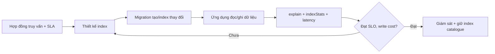
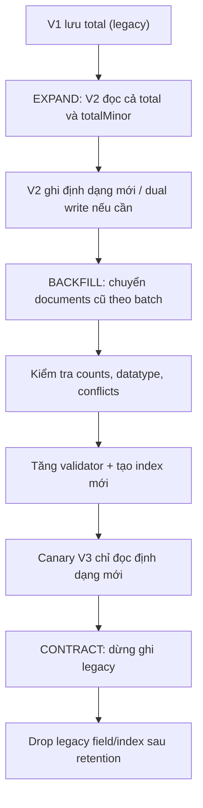
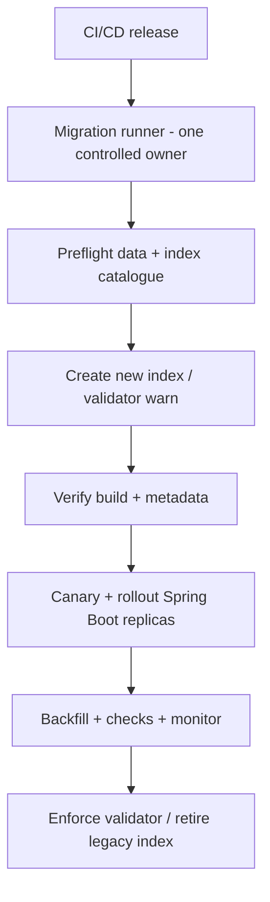

# Chỉ mục, điều kiện tạo chỉ mục và quy trình quản lý schema

> **Chương:** MongoDB  
> **Phạm vi:** Module **SPRING_BOOT_INTEGRATION** tổ chức tích hợp hệ thống qua HTTP client, cơ sở dữ liệu, cache, broker thông điệp và các adapter Spring Integration. Bài này tập trung vào **thiết kế chỉ mục MongoDB theo truy vấn thực tế**, kiểm soát **điều kiện và thời điểm tạo chỉ mục**, cùng **quy trình thay đổi cấu trúc document và collection validation** an toàn qua nhiều phiên bản Spring Boot. Các ví dụ liên hệ trực tiếp đến transaction, idempotency, lỗi tích hợp, kiểm thử và khả năng quan sát.

## 1. Bài toán: dữ liệu lớn dần nhưng một API tra cứu ngày càng chậm

Giả sử dịch vụ `order-query-service` lưu hàng triệu document trong collection `orders`. API hay dùng:

```text
GET /tenants/tenant-a/orders?status=READY&from=2026-11-01
  |
  v
Spring Boot Controller
  |
  v
OrderQueryService / MongoTemplate
  |
  v
MongoDB orders collection (hàng triệu documents)
  |
  v
Danh sách đơn theo createdAt giảm dần
```

Khi chỉ có 200 documents, truy vấn có thể chạy nhanh dù không có index phù hợp. Khi collection có 20 triệu documents, một truy vấn quét toàn bộ dữ liệu (**COLLSCAN**) sẽ tiêu thụ CPU/I/O, tăng response latency và làm nghẽn những luồng tích hợp khác cũng dùng cluster.

Lựa chọn không chỉ là “đặt `@Indexed` lên vài trường”. Người thiết kế phải hỏi:

1. Query nào xuất hiện thường xuyên, có lọc theo **tenant** và **business state** không?
2. Truy vấn phải **sort**, **paginate**, lọc **range** như thế nào?
3. Trường nào có thể thiếu, là array hoặc thay đổi datatype giữa các phiên bản?
4. Có cần **unique constraint** bảo vệ idempotency của webhook/broker consumer?
5. Index có thể được xây lúc startup hay phải chạy bằng một **migration được điều phối**?
6. Khi app phiên bản cũ và mới cùng chạy, **schema/index** có tương thích không?
7. Index vừa tạo có thật sự được query planner sử dụng và có đáng chi phí ghi/memory không?



**Mục tiêu học tập:** hiểu index là cấu trúc giúp tìm kiếm nhưng cũng làm tăng chi phí ghi; chọn đúng loại index; kiểm soát Spring Data MongoDB auto-index creation; quản lý migration/index builds/validators an toàn; thử nghiệm và quan sát trước khi công bố thay đổi.

## 2. MongoDB linh hoạt document, nhưng không có nghĩa không cần schema

MongoDB lưu BSON documents; cùng một collection có thể tồn tại documents với các field khác nhau:

```javascript
// Document phiên bản cũ:
{
  _id: ObjectId("650000000000000000000001"),
  tenantId: "tenant-a",
  orderId: "ORD-101",
  status: "READY",
  total: 125000
}

// Document phiên bản mới:
{
  _id: ObjectId("650000000000000000000002"),
  tenantId: "tenant-a",
  orderId: "ORD-102",
  status: "READY",
  totalMinor: NumberLong("125000"),
  currency: "VND",
  schemaVersion: 2,
  createdAt: ISODate("2026-11-21T00:00:00Z")
}
```

Hai documents đều có thể tồn tại, nhưng **ứng dụng có thể đọc sai** nếu code mới mặc định `totalMinor` và `currency` luôn hiện diện. Query/filter/index cũng có thể khác theo sự tồn tại, datatype hoặc cách mã hóa một trường.

**Schema contract** trong một hệ thống MongoDB gồm nhiều lớp:

| Lớp | Trách nhiệm |
| --- | --- |
| **BSON document shape** | Field, datatype, null/missing, array, nested object, version |
| **Spring Data mapping** | `@Document`, `@Id`, `@Field`, custom converters, repository/`MongoTemplate` |
| **Collection validator** | Ràng buộc dạng `$jsonSchema`/validationAction trên MongoDB nếu có |
| **Index catalogue** | Index keys, order, unique, partial filter, TTL, collation |
| **Business constraints** | Identity, idempotency, conflict handling, state transitions |
| **API/message contracts** | JSON/Avro/Protobuf/DTO cho HTTP, Kafka, RabbitMQ, Spring Integration |
| **Migration history** | Khi nào tạo/sửa index, backfill, đổi validator, drop legacy fields |

**Index không thay schema validator; validator không thay unique index; cả hai không thay transaction và business rule.** Mỗi lớp có việc riêng.

## 3. Index hoạt động thế nào và có chi phí gì?

Một index thông thường giúp database tìm những document theo **key đã tổ chức**, thay vì kiểm tra từng document trong collection. Khi index phù hợp, query planner có thể chọn một plan dùng index (**IXSCAN**), đôi khi kèm bước **FETCH** để đọc document.

```text
Không có index phù hợp:
  filter tenantId=tenant-a AND status=READY
       -> COLLSCAN -> lọc nhiều documents -> sort -> limit

Có index {tenantId:1, status:1, createdAt:-1, _id:-1}:
  filter tenantId=tenant-a AND status=READY
       -> IXSCAN trong phạm vi hẹp -> giữ sort -> FETCH khi cần -> limit
```

### 3.1. Lợi và hại

| Lợi ích | Chi phí / rủi ro |
| --- | --- |
| Tăng tốc lọc/sort/pagination phù hợp | Mỗi insert/update/delete có thể phải cập nhật thêm index |
| Hỗ trợ `unique` bảo vệ dữ liệu | Tạo unique index lỗi nếu đã có duplicate; thêm write conflicts |
| Có thể tạo covered query trong một số trường hợp | Index lớn ngốn disk, cache RAM và chi phí rebuild |
| Có thể dùng TTL để dọn một số documents | TTL không xóa đúng thời điểm tuyệt đối, không thay retention workflow |
| Partial index chỉ chứa tập document cần thiết | Query phải phù hợp predicate để planner dùng index an toàn |
| Hidden index giúp thử giả lập không có index | Hidden vẫn tốn storage/write maintenance và vẫn áp constraint |

**Đừng tạo index trên mọi field.** Mỗi index là một loại “bản sao có cấu trúc” của các keys; nhiều index có thể làm write-heavy integrations như inbox/outbox, event ingestion hay CDC sink chậm đi.

### 3.2. Chỉ mục mặc định `_id`

MongoDB tạo unique index trên `_id` cho collection thông thường. Khi bạn sử dụng một `_id` có ý nghĩa nghiệp vụ, uniqueness của nó có thể hữu ích, nhưng:

- `_id` mặc định không tự chứa tenant/business scope.
- Nếu dùng `@Id String id`, mapping BSON `ObjectId` hoặc string có thể tùy converter/kiểu dữ liệu.
- Dùng một chuỗi kết hợp tùy ý làm `_id` mà không chuẩn hóa có thể tạo collision hoặc lộ PII.
- Với sharded collections, unique index và shard key có những ràng buộc riêng.

Vì vậy vẫn cần thiết kế **unique key theo nghiệp vụ**, nhất là khi xử lý message đến lại.

## 4. Bắt đầu từ query patterns, không bắt đầu từ annotations

Giả sử application thực hiện:

```javascript
db.orders.find({
  tenantId: "tenant-a",
  status: "READY",
  createdAt: { $gte: ISODate("2026-11-01T00:00:00Z") }
}).sort({
  createdAt: -1,
  _id: -1
}).limit(50);
```

Một index phù hợp để **đánh giá** là:

```javascript
db.orders.createIndex(
  { tenantId: 1, status: 1, createdAt: -1, _id: -1 },
  { name: "ix_orders_tenant_status_created_id_v1" }
);
```

Thứ tự keys này đến từ kiểu truy vấn: lọc bằng, sort theo thời gian và tie-break bằng `_id`. Không có quy tắc “tất cả field đều sắp tăng dần” hay “field có cardinality cao nhất phải đứng đầu” đúng cho mọi workload.

### 4.1. Quy tắc ESR: Equality → Sort → Range

**ESR** là một guideline hữu ích cho compound indexes:

- **Equality:** những trường thường được so sánh bằng (`tenantId`, `status`).
- **Sort:** các trường để trả kết quả theo thứ tự (`createdAt`, `_id`).
- **Range:** khoảng giá trị như `createdAt >= ...`, `amountMinor > ...`.

Khi field **sort cũng là field range**, việc sắp key cần xem query shape và cách planner tạo index bounds; không áp máy móc một công thức một dòng. Một số query được lợi khi Range đứng trước Sort (**ERS**) nếu range rất chọn lọc, nhưng có thể phải sort thêm. Quyết định cuối phải dựa vào `explain`, thống kê dữ liệu và benchmark.

### 4.2. Compound index hỗ trợ tiền tố (*prefix*)

Index:

```javascript
{ tenantId: 1, status: 1, createdAt: -1, _id: -1 }
```

thường có ích cho các query với **leading prefix**:

```text
tenantId
tenantId + status
tenantId + status + createdAt
tenantId + status + createdAt + _id
```

Nhưng query chỉ lọc `status` mà không có `tenantId` dẫn đầu thường **không tận dụng được leading prefix hiệu quả theo cùng cách**. Cần xác định workload thật thay vì tạo một index lớn rồi kỳ vọng mọi truy vấn trên bất kỳ field nào cũng nhanh.

### 4.3. Sort order và tie-break

`sort({createdAt:-1})` không đảm bảo thứ tự ổn định khi nhiều documents có cùng timestamp. Thêm `_id:-1` giúp tạo thứ tự xác định hơn và phù hợp với **keyset pagination**. Với query xuyên tenant, keys/authorization phải bao gồm tenant phù hợp; không dùng một cursor của tenant A cho tenant B.

Độ hướng tăng/giảm trong compound index quan trọng khi sort nhiều keys; với một chiều sort bị đảo toàn bộ, MongoDB có thể scan index theo hướng ngược. Cần đối chiếu đúng sort pattern thay vì luôn tạo hai indexes tăng và giảm.

## 5. Những loại index nên biết

| Loại | Dùng khi | Cảnh báo |
| --- | --- | --- |
| **Single-field** | Query thường lọc/sort một field | Có thể chưa đủ cho multi-tenant query |
| **Compound** | Equality, sort, range lặp lại thành pattern | Order keys quyết định khả năng dùng prefix/sort |
| **Multikey** | Index trường array | Index sinh nhiều keys; có giới hạn khi compound chứa array |
| **Unique** | Bảo vệ không trùng business identity | Dữ liệu cũ trùng/null/missing có thể làm build thất bại |
| **Partial** | Chỉ index documents thỏa predicate | Query planner phải biết query nằm trong phạm vi filter |
| **Sparse** | Bỏ qua documents không có field ở một số trường hợp | Không đồng nghĩa partial, cần hiểu null/missing |
| **TTL** | Tự xóa documents hết hạn theo date field | Async cleanup, không phải deadline chính xác |
| **Text** | Tìm kiếm text cơ bản | Không đồng nhất với MongoDB Search/Atlas Search |
| **Wildcard** | Truy vấn nhiều field động, không dự đoán trước | Có trade-off disk/query và không thay schema discipline |
| **Hashed** | Một số truy vấn equality/sharding pattern | Không phục vụ range/sort như B-tree thông thường |
| **Geospatial** | Tọa độ, truy vấn không gian (`2dsphere`) | GeoJSON, CRS và query semantics phải đúng |
| **Hidden** | Đánh giá tác động bỏ một index khỏi query planner | Vẫn được duy trì, unique constraint vẫn có hiệu lực |

### 5.1. Ví dụ single-field và compound

```javascript
db.orders.createIndex(
  { updatedAt: -1 },
  { name: "ix_orders_updated_at_v1" }
);

db.orders.createIndex(
  { tenantId: 1, orderId: 1 },
  { name: "ux_orders_tenant_order_v1", unique: true }
);
```

Index đầu có thể phục vụ một job quét những bản ghi mới đổi, nhưng nếu job luôn giới hạn theo tenant hoặc trạng thái, một compound index khác có thể hiệu quả hơn. Index thứ hai bảo vệ một business key theo tenant, thích hợp cho **idempotent upsert**.

### 5.2. Multikey cho array

```javascript
// Document:
{
  orderId: "ORD-501",
  tenantId: "tenant-a",
  tags: ["priority", "fragile"]
}

db.orders.createIndex(
  { tenantId: 1, tags: 1 },
  { name: "ix_orders_tenant_tags_v1" }
);
```

Khi field array được index, MongoDB có thể tạo nhiều index entries cho một document. Không ngây thơ kỳ vọng một compound multikey index hỗ trợ mọi sort/array query hay cho phép nhiều trường array độc lập trong cùng document: có các ràng buộc về **parallel arrays** và covered queries.

### 5.3. Collation và tìm kiếm không phân biệt hoa/thường

Nếu business key là email hoặc mã không phân biệt chữ hoa/thường, nên cân nhắc:

1. **Chuẩn hóa khi ghi** thành field `emailNormalized` bằng quy tắc ứng dụng ổn định.
2. Hoặc dùng **collation** MongoDB có locale/strength đã chọn, tạo index với collation tương ứng và gửi query có collation phù hợp.

```javascript
db.customer_contacts.createIndex(
  { tenantId: 1, email: 1 },
  {
    name: "ux_contact_tenant_email_ci_v1",
    unique: true,
    collation: { locale: "en", strength: 2 }
  }
);
```

**Chú ý:** index unique có collation không làm mọi truy vấn tự đổi case sensitivity: nếu query có collation khác hoặc không tương thích, planner không nhất thiết dùng index như mong muốn. Với email quốc tế, Unicode normalization, IDN và identity semantics cần hợp đồng riêng; không dùng một thao tác `toLowerCase()` đơn giản rồi coi toàn bộ vấn đề đã được giải quyết.

## 6. Unique index: nền tảng cho idempotency

Một Kafka consumer xử lý event `OrderConfirmed` có thể nhận cùng một event nhiều lần sau rebalance, mất ACK hoặc retry. Một unique index trên `(tenantId, eventId)` giúp phát hiện lần xử lý trùng:

```javascript
db.integration_inbox.createIndex(
  { tenantId: 1, eventId: 1 },
  { name: "ux_inbox_tenant_event_v1", unique: true }
);
```

### 6.1. Unique index không tự hoàn tất business transaction

Mẫu xử lý phù hợp:

```text
Receive event E-42
  -> Validate/authenticate tenant/event schema
  -> DB transaction:
       INSERT inbox {tenantId, eventId, fingerprint}
       UPDATE business document/state
       (nếu cần: INSERT outbox event)
     COMMIT
  -> ACK broker

Crash sau COMMIT trước ACK:
  -> Broker redeliver E-42
  -> Unique conflict/inbox lookup
  -> Kiểm tra fingerprint + business outcome
  -> ACK lại nếu đã xử lý thành công
```

Unique index **ngăn hai documents trùng key**, nhưng không bảo đảm hai collections được ghi atomically nếu bạn chỉ dùng nhiều lệnh ghi rời rạc. Nếu cần atomic write trên nhiều documents/collections, dùng **MongoDB transaction** với topology/session/transaction manager phù hợp; hoặc thiết kế một-document atomic state và outbox/reconciliation. Transaction MongoDB cũng **không** bao trùm một HTTP POST, Redis cache update hoặc broker ACK.

### 6.2. Duplicate key không luôn là replay hợp lệ

```text
tenantId=tenant-a, eventId=E-42, payloadSha256=abc  -> đã xử lý
tenantId=tenant-a, eventId=E-42, payloadSha256=xyz  -> conflict dữ liệu
```

Nếu code chỉ bắt `DuplicateKeyException` rồi bỏ qua mọi lần trùng, một producer gửi **cùng eventId nhưng payload khác** sẽ bị che mất. Phải lưu fingerprint/schema version và đối chiếu business result để phân biệt:

- Replay cùng payload: idempotent success/no-op.
- Cùng business key, nội dung khác: conflict cần điều tra.
- Lỗi MongoDB transient: retry có giới hạn theo outcome; không chuyển thành “duplicate”.

### 6.3. Null và missing fields khi tạo unique index

Trên index unique đơn trường, nhiều documents thiếu trường hoặc có `null` có thể va chạm vì index xử lý missing/null theo quy tắc riêng. Unique compound cũng có semantics đối với tổ hợp giá trị null/missing.

**Trước khi tạo unique index** cần kiểm tra duplicate, kiểu dữ liệu và documents thiếu field. Không giả định MongoDB sẽ bỏ qua null như một SQL unique constraint tùy database. Với field tùy chọn, cân nhắc **partial unique index** phù hợp.

## 7. Partial index: điều kiện tạo chỉ mục trên một tập con

**Partial index** chỉ lưu entries của những documents thỏa `partialFilterExpression`. Nó có thể giảm kích thước/chi phí ghi nếu hệ thống chỉ thường query nhóm records được chọn.

Ví dụ chỉ các contact **đang hoạt động** mới bị giới hạn trùng email trong cùng tenant:

```javascript
db.customer_contacts.createIndex(
  { tenantId: 1, emailNormalized: 1 },
  {
    name: "ux_contacts_active_tenant_email_v1",
    unique: true,
    partialFilterExpression: { active: true }
  }
);
```

Điều này nghĩa là:

- Contact `active:true` phải có cặp `(tenantId,emailNormalized)` duy nhất trong các documents active được index.
- Contact `active:false` hoặc không thỏa filter **không chịu unique constraint từ index này**.
- **Không** có nghĩa mọi contact có email đều được bảo vệ uniqueness nếu `active` thiếu/không được normalize.
- Nếu nhiều contact active thiếu `emailNormalized`, unique constraint vẫn có thể xung đột trên cặp missing/null.

### 7.1. Query phải tương thích điều kiện partial

```javascript
// Query có predicate phù hợp với phạm vi partial index:
db.customer_contacts.find({
  tenantId: "tenant-a",
  active: true,
  emailNormalized: "a@example.test"
});
```

Nếu query không lọc `active:true`, dùng partial index có thể bỏ sót documents inactive nên planner không thể mặc định chọn nó để trả **toàn bộ** kết quả. Cần kiểm chứng với `explain`.

### 7.2. Sparse không phải partial

`sparse:true` là lựa chọn khác cho một số indexes có field tùy chọn, nhưng semantics của missing/null và compound keys khác với một partial predicate. Khi muốn chỉ index documents có `active:true` hoặc field có datatype hợp lệ, **partialFilterExpression nói rõ ý định hơn**. Không đặt `sparse` và `partialFilterExpression` vào cùng một index definition nếu API/version không cho phép.

### 7.3. Trước khi đổi trạng thái active

Một update `active:false -> true` có thể thất bại bởi duplicate key nếu đã có contact active khác cùng normalized email. Đây là **hành vi đúng** của constraint. Service phải chuyển lỗi thành business conflict, không retry vô hạn hay tự xóa document cạnh tranh.

## 8. TTL index: dọn dữ liệu hết hạn, không phải đồng hồ tuyệt đối

TTL index dùng một trường ngày để MongoDB **xóa tự động** documents sau thời hạn. Một pattern phù hợp cho session/token tạm hoặc **inbox records có retention theo quy định**:

```javascript
db.integration_ephemeral_tokens.createIndex(
  { expiresAt: 1 },
  {
    name: "ttl_ephemeral_expires_at_v1",
    expireAfterSeconds: 0
  }
);

// Một document:
{
  tenantId: "tenant-a",
  tokenHash: "not-a-plaintext-token",
  expiresAt: ISODate("2026-11-22T00:00:00Z")
}
```

Với `expireAfterSeconds:0`, ngày trong `expiresAt` thể hiện thời điểm document đủ điều kiện bị xóa. Với `expireAfterSeconds:N`, thời điểm hết hạn được tính từ giá trị ngày cộng N giây.

**Quan trọng:**

1. TTL monitor chạy nền: document hết hạn **có thể vẫn tồn tại sau mốc thời gian**. Với authentication, luôn kiểm tra `expiresAt` khi đọc/validate, không coi việc document chưa bị xóa là token còn hợp lệ.
2. TTL index thông thường yêu cầu **single date field** theo semantics MongoDB; không kỳ vọng một compound index tùy ý có TTL như các index B-tree khác (time-series có quy tắc riêng).
3. Field sai datatype/missing có thể khiến document không bị xóa như dự kiến; validator/backfill cần chuẩn hóa.
4. TTL deletion tạo write load; bật TTL trên dữ liệu cũ rất lớn có thể gây **đợt xóa mạnh**, cần rollout/cleanup theo lô và theo dõi replication lag.
5. TTL không phù hợp khi bắt buộc giữ event/inbox theo retry horizon dài hơn thời hạn; xóa sớm có thể khiến duplicate đến lại được xử lý như mới.
6. TTL không thay thế **audit retention, legal hold, backup policy** hoặc kiểm soát PII.

### 8.1. Dọn dữ liệu business nên theo trạng thái

Đối với `integration_outbox`, đừng đặt TTL trên `createdAt` rồi xóa mọi document sau 7 ngày nếu còn bản ghi `PENDING` hoặc `UNKNOWN` chưa được đối tác xác nhận. Một quy trình cleanup an toàn nên chọn những bản ghi **đã hoàn tất**, đủ tuổi, không bị giữ theo luật, rồi archive/purge bằng worker có rate limit và audit.

## 9. Hidden index và chiến lược thay thế index

MongoDB có thể **ẩn** một index để query planner không dùng nó, giúp đánh giá liệu ứng dụng có còn cần index đó không trước khi drop:

```javascript
// Sau khi xác nhận server version hỗ trợ hidden index:
db.orders.hideIndex("ix_orders_legacy_status_v1");

// Chạy canary/giám sát, kiểm tra execution plans.

// Nếu latency xấu, khôi phục:
db.orders.unhideIndex("ix_orders_legacy_status_v1");
```

Hidden index vẫn được cập nhật khi ghi và **unique constraint vẫn được thực thi**. Ẩn index không tương đương drop hoặc “tắt uniqueness”.

Trình tự an toàn:

1. Đo workloads trước đổi, ghi lại query shapes sử dụng index cũ.
2. Tạo index mới và xác nhận hoàn thành build.
3. Cập nhật query và rollout canary.
4. Ẩn index cũ (nếu version/topology cho phép), quan sát plan và p95/p99.
5. Nếu tất cả dùng index mới hợp lý, cân nhắc drop index cũ qua migration riêng.
6. Có rollback plan nếu nhận được traffic hiếm cần index cũ.

**Không drop index cũ trong cùng deployment vừa tạo index mới mà chưa đo**. Một query ít dùng (đối soát cuối tháng) có thể phụ thuộc index cũ và chỉ phát lộ sau nhiều ngày.

## 10. Explain: index có thực sự giúp truy vấn không?

MongoDB `explain` hiển thị query plan và, khi chạy với `executionStats`, thông tin số lượng keys/documents đã xét cùng thời gian thực thi tương ứng.

```javascript
db.orders.find({
  tenantId: "tenant-a",
  status: "READY",
  createdAt: { $gte: ISODate("2026-11-01T00:00:00Z") }
})
  .sort({ createdAt: -1, _id: -1 })
  .limit(50)
  .explain("executionStats");
```

Các trường cần đọc (tên/vị trí có thể thay đổi theo MongoDB version và execution engine):

| Dấu hiệu | Diễn giải |
| --- | --- |
| `COLLSCAN` | Planner đang quét collection; nguy hiểm khi filter có selectivity thấp |
| `IXSCAN` | Dùng index để lấy index keys phù hợp |
| `FETCH` | Đọc documents sau khi tìm candidate keys trong index |
| `SORT` | Có bước sắp xếp riêng; kiểm tra xem index có hỗ trợ sort không |
| `nReturned` | Số documents trả ra |
| `totalKeysExamined` | Số index keys được xét |
| `totalDocsExamined` | Số documents được đọc/kiểm tra |
| `executionTimeMillis` | Thời gian trong ngữ cảnh chạy explain, không thay benchmark production |
| `indexName` | Tên index được dùng ở plan tương ứng |

### 10.1. Ví dụ chẩn đoán

```text
Query trả nReturned = 50
totalKeysExamined = 68
totalDocsExamined = 50
  → Có dấu hiệu lọc tương đối hiệu quả, cần đo latency thực

Query trả nReturned = 50
totalKeysExamined = 900000
totalDocsExamined = 900000
  → Có thể đang quét quá nhiều candidate documents
```

Đây chỉ là **con số minh họa**. Một query rất chọn lọc, dữ liệu trong RAM, disk read pattern và concurrency sẽ quyết định hiệu năng thật. Không đặt quy tắc “keysExamined/returned phải luôn dưới 2” cho mọi query, đặc biệt với aggregation và low-selectivity workloads.

### 10.2. Covered queries và projection

Một query có thể không cần FETCH nếu index đã chứa các trường cần lọc, sắp xếp và trả về, theo quy tắc covered query. Muốn tận dụng, thường phải:

- Chọn projection chỉ gồm fields có trong index.
- Loại `_id` khỏi projection nếu không có trong index hoặc thêm nó vào index theo thiết kế.
- Tránh projections cần toàn bộ document hoặc expression không covered.

**Đừng thêm hàng chục field vào index chỉ để “cover” một API ít được dùng**: index có thể phình to và tăng write latency nghiêm trọng.

### 10.3. Đo nhiều hơn một explain

Khi kết luận, phối hợp:

- Production-like dataset: kích thước và phân phối tenant/status/createdAt.
- Query latency P50/P95/P99 và throughput under concurrency.
- CPU, disk I/O, cache pressure, replica lag, write latency.
- `$indexStats`/index usage với giới hạn quan sát và quyền phù hợp.
- Tác động đến inserts/updates của inbox/outbox và bulk ingestion.

`explain` có thể thực thi truy vấn và tốn tài nguyên; dùng có kiểm soát trên production. Kết quả đo một lần không bảo đảm planner sẽ luôn chọn cùng plan khi data distribution và workload thay đổi.

## 11. Spring Data MongoDB: từ @Document đến @Indexed

Trong Spring Boot, Spring Data MongoDB cung cấp mapping, repositories, `MongoTemplate` và abstraction định nghĩa index. Ví dụ (API Spring Data MongoDB 4.x trên Spring Boot 3.x; xác nhận lại với BOM/version của dự án).

### 11.1. Dependencies

```xml
<dependencies>
    <dependency>
        <groupId>org.springframework.boot</groupId>
        <artifactId>spring-boot-starter-data-mongodb</artifactId>
    </dependency>
    <dependency>
        <groupId>org.springframework.boot</groupId>
        <artifactId>spring-boot-starter-validation</artifactId>
    </dependency>
    <dependency>
        <groupId>org.springframework.boot</groupId>
        <artifactId>spring-boot-starter-test</artifactId>
        <scope>test</scope>
    </dependency>
</dependencies>
```

Nếu dùng reactive MongoDB driver, cân nhắc `spring-boot-starter-data-mongodb-reactive` và `ReactiveMongoTemplate`, không mặc định các lời gọi `MongoTemplate` blocking phù hợp chạy trên Netty event-loop. Trong ví dụ bên dưới dùng **synchronous driver** cho dễ thấy cấu trúc.

### 11.2. Entity và compound index annotations

```java
package com.example.integration.mongo;

import java.time.Instant;
import org.springframework.data.annotation.Id;
import org.springframework.data.mongodb.core.index.CompoundIndex;
import org.springframework.data.mongodb.core.mapping.Document;

@Document(collection = "orders")
@CompoundIndex(
    name = "ix_orders_tenant_status_created_id_v1",
    def = "{ 'tenantId': 1, 'status': 1, 'createdAt': -1, '_id': -1 }")
@CompoundIndex(
    name = "ux_orders_tenant_order_v1",
    def = "{ 'tenantId': 1, 'orderId': 1 }",
    unique = true)
public class OrderDocument {
    @Id
    private String id;

    private String tenantId;
    private String orderId;
    private String status;
    private Instant createdAt;
    private long amountMinor;
    private String currency;
    private int schemaVersion;

    protected OrderDocument() {}

    // Constructor/getters/setters hoặc mapping strategy theo chuẩn dự án.
}
```

**Annotations mô tả index mong muốn; chúng không bảo đảm index đã được tạo trên production.** `@CompoundIndex` có thể được lặp lại trên class nếu version hỗ trợ repeatable annotation. Khi dùng `@Field("field_alias")`, cần đối chiếu cách Spring Data map field names trong index definition; sai tên field có thể tạo index không phục vụ query thực.

### 11.3. Định nghĩa partial unique index ở annotation

```java
package com.example.integration.mongo;

import org.springframework.data.annotation.Id;
import org.springframework.data.mongodb.core.index.CompoundIndex;
import org.springframework.data.mongodb.core.mapping.Document;

@Document(collection = "customer_contacts")
@CompoundIndex(
    name = "ux_contacts_active_tenant_email_v1",
    def = "{ 'tenantId': 1, 'emailNormalized': 1 }",
    unique = true,
    partialFilter = "{ 'active': true }")
public class CustomerContactDocument {
    @Id
    private String id;
    private String tenantId;
    private String emailNormalized;
    private boolean active;

    protected CustomerContactDocument() {}
    // Constructor/getters/setters cần định nghĩa ở code thực tế.
}
```

Đây là **declaration trong mapping layer**, không phải permission để mỗi pod tự tạo index production. Index có filter chỉ áp uniqueness trong tập `active:true`; application cần validate email và state. Nếu dùng custom converters hoặc một phiên bản annotation thiếu `partialFilter`, hãy sử dụng migration mongosh hoặc `MongoTemplate.indexOps(...)` tương ứng.

### 11.4. @Indexed single field

```java
@Indexed(name = "ix_orders_updated_at_v1", direction = IndexDirection.DESCENDING)
private Instant updatedAt;
```

Đây là **snippet field** dùng trong một `@Document` có imports `org.springframework.data.mongodb.core.index.Indexed` và `IndexDirection`. Không nhầm `@Indexed` trên một field với một compound index dùng để tối ưu lọc tenant/status/sort.

## 12. Điều kiện tự tạo index: auto-index-creation không phải migration tool

Spring Data MongoDB đã chuyển sang **không tự động tạo index theo annotations mặc định** từ những phiên bản hiện đại (từ 3.x). Spring Boot có property tương ứng để điều khiển:

```yaml
spring:
  data:
    mongodb:
      uri: ${MONGODB_URI}
      auto-index-creation: false
```

**Tại sao để `false` trên production?**

1. Nhiều replica startup đồng thời có thể cùng cố tạo index, gây contention/thông báo lỗi hoặc làm khó kiểm soát rollout.
2. Build index trên collection lớn tiêu tốn tài nguyên; không nên gắn vào **thời điểm app cần sẵn sàng phục vụ**.
3. Unique index có thể thất bại vì dữ liệu cũ trùng hoặc missing field.
4. Thay đổi index options có thể không thể thực hiện “in place” bằng cùng tên.
5. User tài khoản ứng dụng nên chỉ có quyền đọc/ghi cần thiết, không mặc định có quyền sửa schema/index.
6. Không có lịch sử migration/version/checkpoint/rollback rõ nếu annotation tự tạo index ngoài quy trình release.

**Trong local/test**, bật `auto-index-creation: true` có thể thuận tiện nếu database cô lập và collection ít dữ liệu. Nhưng **test tự tạo index qua annotation không thay integration test migration production**, nơi auto-index có thể bị tắt.

### 12.1. Điều kiện tạo index ngoài annotation

Một index phải được tạo hoặc giữ khi thỏa những điều kiện:

| Điều kiện | Câu hỏi phải trả lời |
| --- | --- |
| **Query benefit** | Query shapes có thực sự cần index này? |
| **Dữ liệu hợp lệ** | Có duplicate, null/missing, datatype lệch, collation conflict không? |
| **Compatibility** | Tất cả app versions đang chạy có dùng được index và schema mới? |
| **Operational window** | Cluster đủ disk/IO/CPU, có kế hoạch quan sát index build không? |
| **Quyền & điều phối** | Ai được phép `createIndex`, có bảo đảm chạy một lần đúng order không? |
| **Rollback** | Nếu index mới lỗi/chậm, có cách giữ/khôi phục index cũ? |
| **Write cost** | Inbox/outbox/ingestion có bị chậm đáng kể không? |
| **Shard constraints** | Nếu collection sharded, unique/shard key và routing có hợp lệ không? |

**Một index annotation chỉ là thiết kế mong muốn, không phải câu trả lời cho toàn bộ các điều kiện này.**

## 13. Quản lý index bằng MongoTemplate một cách tường minh

Spring Data MongoDB cho phép quản lý indexes bằng `IndexOperations`. Cách này hữu ích trong **migration runner hoặc công cụ quản trị được kiểm soát**, thay vì phụ thuộc vào tự tạo annotation lúc mọi replica startup.

### 13.1. Ví dụ định nghĩa compound và partial unique index

```java
package com.example.integration.mongo.migration;

import org.springframework.data.domain.Sort;
import org.springframework.data.mongodb.core.MongoTemplate;
import org.springframework.data.mongodb.core.index.Index;
import org.springframework.data.mongodb.core.index.PartialIndexFilter;
import org.springframework.data.mongodb.core.query.Criteria;

public final class MongoIndexDefinitions {
    private final MongoTemplate mongo;

    public MongoIndexDefinitions(MongoTemplate mongo) {
        this.mongo = mongo;
    }

    public void createOrderLookupIndex() {
        Index index = new Index()
                .on("tenantId", Sort.Direction.ASC)
                .on("status", Sort.Direction.ASC)
                .on("createdAt", Sort.Direction.DESC)
                .on("_id", Sort.Direction.DESC)
                .named("ix_orders_tenant_status_created_id_v1");

        mongo.indexOps("orders").ensureIndex(index);
    }

    public void createActiveContactUniqueIndex() {
        Index index = new Index()
                .on("tenantId", Sort.Direction.ASC)
                .on("emailNormalized", Sort.Direction.ASC)
                .unique()
                .partial(PartialIndexFilter.of(
                        Criteria.where("active").is(true)))
                .named("ux_contacts_active_tenant_email_v1");

        mongo.indexOps("customer_contacts").ensureIndex(index);
    }
}
```

**Quan trọng:** đây là class định nghĩa index, **không tự được gọi** trong application context. Muốn thực thi trong production phải có migration coordinator với quyền `createIndex` và thứ tự đã được phê duyệt. Dùng `ensureIndex` không có nghĩa nó sẽ tự sửa mọi index có cùng tên nhưng options khác; thay đổi key/options thường phải có kế hoạch tạo index mới, đánh giá khả năng trùng và drop index cũ sau khi an toàn.

### 13.2. Index operations cho TTL

Một API Spring Data tương ứng:

```java
Index ttlIndex = new Index()
        .on("expiresAt", Sort.Direction.ASC)
        .expire(0)
        .named("ttl_ephemeral_expires_at_v1");

mongo.indexOps("integration_ephemeral_tokens")
        .ensureIndex(ttlIndex);
```

`expire(0)` thể hiện số giây sau giá trị ngày tại `expiresAt`. **Không nhầm** với “xóa ngay mọi document vừa ghi”; nếu field là thời điểm tương lai, nó đến hạn ở tương lai. TTL monitor thực thi bất đồng bộ.

### 13.3. Verify thay vì luôn create

Một startup check **chỉ đọc** có thể dùng:

```java
var existingIndexes =
        mongo.indexOps("orders").getIndexInfo();

boolean found = existingIndexes.stream()
        .anyMatch(info ->
                "ix_orders_tenant_status_created_id_v1"
                        .equals(info.getName()));

if (!found) {
    throw new IllegalStateException(
            "Required MongoDB index migration is missing");
}
```

Đoạn này kiểm tra tên index để minh họa; **production check cần so cả keys, thứ tự, unique/partial/collation/TTL options** và có thể ghi lại version migration. Một index **trùng tên nhưng sai định nghĩa** vẫn có thể khiến hiệu năng hoặc uniqueness sai.

Nếu phiên bản mới có thể chạy chậm nhưng vẫn đúng khi thiếu index, có thể đặt **readiness gate/canary** thay vì làm cả service fail-start đột ngột; chính sách phụ thuộc SLO và kế hoạch rollout. Nếu index là ràng buộc ngăn lỗi dữ liệu, app không nên nhận writes trước khi index được bảo đảm.

## 14. Collection validation bằng $jsonSchema

MongoDB có collection-level validators để kiểm soát cấu trúc document khi insert/update. Nó đặc biệt hữu ích trong hệ tích hợp có nhiều writers từ Spring Boot, script import, Spark/ETL hoặc một service khác không dùng Spring Data annotations.

### 14.1. Ví dụ validator trên collection orders

```javascript
db.runCommand({
  collMod: "orders",
  validator: {
    $jsonSchema: {
      bsonType: "object",
      required: ["tenantId", "orderId", "status", "createdAt"],
      properties: {
        tenantId: { bsonType: "string" },
        orderId: { bsonType: "string" },
        status: {
          enum: ["NEW", "READY", "COMPLETED", "CANCELLED"]
        },
        createdAt: { bsonType: "date" },
        amountMinor: {
          bsonType: ["int", "long"],
          minimum: 0
        },
        currency: { bsonType: "string" },
        schemaVersion: { bsonType: ["int", "long"] }
      }
    }
  },
  validationLevel: "moderate",
  validationAction: "warn"
});
```

Lệnh `collMod` yêu cầu collection tồn tại và tài khoản có quyền tương ứng. Đây là **giai đoạn quan sát mềm**: `validationAction:"warn"` cho phép ghi tài liệu không đạt validator trong khi phát cảnh báo/vi phạm; sau khi dữ liệu/writers sẵn sàng có thể cân nhắc chuyển sang `"error"` để từ chối thao tác không hợp lệ.

### 14.2. strict và moderate, warn và error

| Tùy chọn | Ý nghĩa cần hiểu |
| --- | --- |
| `validationLevel:"strict"` | Áp dụng validation cho inserts và updates theo quy định thông thường, kể cả documents cũ khi được cập nhật |
| `validationLevel:"moderate"` | Không áp validation cho một số updates trên documents hiện đang không hợp lệ, hữu ích khi chuyển đổi dữ liệu cũ |
| `validationAction:"warn"` | Cho phép thao tác nhưng tạo cảnh báo nếu vi phạm |
| `validationAction:"error"` | Từ chối thao tác vi phạm validator |

**Không dùng `"moderate"` như một bảo đảm dữ liệu sạch.** Nó có thể để documents cũ không hợp lệ tiếp tục tồn tại. **Không chuyển thẳng sang strict/error** nếu còn service phiên bản cũ ghi dạng cũ: một rolling deploy có thể trở thành hàng loạt write failures.

### 14.3. Validator không thay Bean Validation

`@NotBlank`, `@Valid` và các kiểm tra trong Spring Boot xác thực dữ liệu tại **API boundary**. MongoDB `$jsonSchema` xác thực tài liệu **trên collection**. Hai lớp bổ trợ nhau:

- API validation bảo vệ contract HTTP/message trước khi ghi.
- Domain service kiểm tra **quy tắc trạng thái** như “COMPLETED không trở lại NEW” và quyền tenant.
- MongoDB validator bảo vệ field/type ngay cả khi writer không dùng Java application.
- Unique index bảo vệ key trùng dưới concurrency.

Không cố mô tả mọi business rule phức tạp bằng một JSON Schema; một số rule cần transaction, compare-and-set hoặc aggregate/domain service.

## 15. Quy trình schema evolution: expand → backfill → contract

MongoDB không bắt buộc mọi document có cùng field, nhưng ứng dụng nhiều phiên bản phải tương thích trong **thời gian rolling deploy**. Một quy trình thường an toàn hơn “đổi field một lần”:



### 15.1. Expand: ứng dụng đọc được cả hai phiên bản

Giả sử schema cũ:

```javascript
{ tenantId: "tenant-a", orderId: "ORD-101", total: 125000 }
```

Schema mới:

```javascript
{
  tenantId: "tenant-a",
  orderId: "ORD-101",
  totalMinor: NumberLong("125000"),
  currency: "VND",
  schemaVersion: 2
}
```

Một **read adapter** ở tầng domain có thể ánh xạ cả hai:

```java
public record Money(long amountMinor, String currency) {}

public Money readMoney(BsonDocument raw) {
    if (raw.containsKey("totalMinor")
            && raw.containsKey("currency")) {
        return new Money(
                raw.getNumber("totalMinor").longValue(),
                raw.getString("currency").getValue());
    }

    if (raw.containsKey("total")) {
        // Chỉ hợp lệ khi contract legacy định nghĩa total
        // ĐÃ là đơn vị nhỏ nhất, và currency cố định theo nguồn.
        return new Money(
                raw.getNumber("total").longValue(),
                "VND");
    }
    throw new IllegalArgumentException(
            "Missing money fields");
}
```

Đây là **snippet sử dụng `org.bson.BsonDocument`**, chưa phải method trong một class hoàn chỉnh. Việc mặc định `"VND"` chỉ đúng khi **đã kiểm chứng schema cũ cố định VND và total dùng minor units**; nếu schema cũ chứa nhiều currencies, phải lấy currency từ nguồn tin cậy hoặc quarantine records thay vì tự bịa giá trị.

### 15.2. Backfill theo batch có checkpoint

Không sửa vài triệu documents bằng một script không có giới hạn rồi giả định “chạy lại nếu lỗi” luôn an toàn. Một backfill production nên:

1. Chọn khóa quét ổn định (thường `_id` hoặc batch ID) và snapshot/watermark.
2. Đọc theo page hữu hạn, ví dụ 500–2.000 records tùy kích thước.
3. Validate legacy datatype/currency/business identity.
4. Dùng update **có predicate xác nhận schema cũ** và version mong đợi.
5. Ghi `lastProcessedId`, counts, errors, hash/checksum ở migration ledger.
6. Khi app mới vẫn ghi, cần dual-read/dual-write hoặc **catch-up** theo `updatedAt`/change streams/outbox.
7. Có cách pause/resume/rollback và quarantine records không chuyển đổi được.

Một lệnh minh họa tính **idempotent ở mức đánh dấu version**:

```javascript
db.orders.updateMany(
  {
    schemaVersion: { $exists: false },
    totalMinor: { $exists: true },
    currency: { $exists: true }
  },
  { $set: { schemaVersion: 2 } }
);
```

Nó chỉ đánh dấu version trên documents **đã có dữ liệu mới**, không tự chuyển `total` sang `totalMinor`; ứng dụng/migration phải làm conversion thực và kiểm chứng trước đó. Với collection lớn, ưu tiên chia batch thay vì dùng `updateMany` không giới hạn như ví dụ.

### 15.3. Catch-up dữ liệu được ghi trong thời gian backfill

Một quét `_id` đến cuối có thể bỏ lỡ bản ghi cũ bị update sau khi đã quét. Nếu service vẫn ghi, cần chiến lược:

- Tạm dừng writers có kiểm soát trong một khoảng rất ngắn, hoặc
- Dual-write schema cũ/mới trong giai đoạn chuyển đổi, hoặc
- Chạy backfill và **catch-up** bằng `updatedAt`/change stream/outbox với watermark và retention đủ.

**Change stream không tự đảm bảo replay vô hạn**: resume token và oplog retention, privilege và failover phải được kiểm chứng. Nếu mất khoảng thời gian thay đổi do oplog đã hết, cần full reconciliation hoặc rescan.

### 15.4. Contract chỉ sau khi mọi producer đã chuyển

Trước khi xóa `total` hoặc nâng validator sang strict/error:

1. Xác minh mọi app version đang phục vụ đều đọc schema mới.
2. Không còn job batch, Spring Integration adapter hoặc consumer cũ ghi legacy form.
3. Backfill và catch-up đạt counts/checksum đặt ra.
4. Query/index mới đã triển khai và đo hiệu năng.
5. Rollback của app mới **không cần schema legacy** nữa hoặc có rollback plan tương thích.
6. Đã xác định thời điểm drop legacy field/index riêng biệt.

Không ép “một deploy vừa đổi code, vừa đổi validator, vừa drop field, vừa drop index” khi có nhiều bên cùng đọc/ghi collection.

## 16. Unique index migration: sạch dữ liệu trước, mới siết constraint

Giả sử collection `orders` có 10 triệu documents. Hệ thống quyết định `(tenantId, orderId)` phải unique nhưng dữ liệu cũ có các lỗi:

```javascript
{ tenantId: "tenant-a", orderId: "ORD-101", schemaVersion: 1 }
{ tenantId: "tenant-a", orderId: "ORD-101", schemaVersion: 1 }
{ tenantId: "tenant-b", orderId: null,       schemaVersion: 1 }
{ tenantId: "tenant-b",                      schemaVersion: 1 }
```

Nếu tạo ngay:

```javascript
db.orders.createIndex(
  { tenantId: 1, orderId: 1 },
  { unique: true, name: "ux_orders_tenant_order_v1" }
);
```

index build có thể thất bại vì duplicate keys hoặc các trường missing/null theo semantics của unique index. Không phải lỗi “thêm retry” là xong.

### 16.1. Preflight duplicate detection

```javascript
db.orders.aggregate([
  {
    $group: {
      _id: { tenantId: "$tenantId", orderId: "$orderId" },
      count: { $sum: 1 },
      ids: { $push: "$_id" }
    }
  },
  { $match: { count: { $gt: 1 } } },
  { $limit: 100 }
]);
```

**Cảnh báo:** `$push:"$_id"` có thể tích lũy mảng rất lớn cho một key trùng phổ biến. Trong production, ưu tiên thống kê counts với pipeline không gom toàn bộ IDs rồi truy vấn từng nhóm mẫu, chia partition và hạn chế memory/IO. Mã trên chỉ là minh họa điều tra trên tập dữ liệu có kiểm soát.

Kiểm tra riêng:

- Missing `tenantId`/`orderId`.
- Null hoặc string rỗng.
- Case/Unicode normalization và collation.
- Tenant ID có được xác thực hay không.
- Duplicate cùng payload hay conflict khác payload.
- Quan hệ với shard key nếu collection đã sharded.

### 16.2. Kế hoạch tạo unique index

1. **Ngừng sinh duplicate mới**: sửa writers/consumer và triển khai ứng dụng dùng idempotency/atomic update theo key trước.
2. Quét dữ liệu hiện có; tạo báo cáo duplicate và phân loại theo nghiệp vụ.
3. Resolve duplicate bằng merge/quarantine/ledger, không tự xóa dữ liệu tài chính.
4. Backfill các field bắt buộc và chuẩn hóa datatype.
5. Xác minh **không có duplicate mới trong quá trình build**; nếu cần phối hợp write gate/bảo đảm atomic writes.
6. Tạo index qua migration có quyền, thời gian và giám sát riêng.
7. Sau index build, kiểm chứng cấu trúc index và thử hai concurrent inserts cùng key: một bên phải nhận conflict.
8. Bổ sung handling `DuplicateKeyException` và so fingerprint thay vì retry mù.

### 16.3. Partial unique cho dữ liệu đang chuyển đổi

Khi chỉ muốn siết uniqueness trên documents `schemaVersion:2`, có thể cân nhắc partial unique index **trong một giai đoạn tạm thời**:

```javascript
db.orders.createIndex(
  { tenantId: 1, orderId: 1 },
  {
    name: "ux_orders_v2_tenant_order_partial",
    unique: true,
    partialFilterExpression: { schemaVersion: 2 }
  }
);
```

**Không được hiểu đây là uniqueness toàn collection**: documents version cũ vẫn nằm ngoài constraint. Lộ trình cuối phải có migration sạch và unique index đầy đủ (hoặc một contract partial cố định được phê duyệt). Đồng thời cần kiểm chứng version semantics của `schemaVersion` và có quy tắc không hạ version để né constraint.

## 17. Tạo index mới trước khi đổi query và bỏ index cũ

Một trường hợp phổ biến: query v1 lọc `{tenantId, status}`; query v2 còn sort `createdAt` và phân trang bằng `_id`.

```text
Đang chạy:
  ix_orders_tenant_status_v1

Muốn có:
  ix_orders_tenant_status_created_id_v2

Không nên:
  DROP v1 -> đổi code -> tạo v2 khi pods đã nhận traffic

Nên:
  CREATE v2 -> verify -> canary query v2 -> rollout
  -> hide v1 -> observe -> drop v1 trong migration khác
```

### 17.1. Tên index có version

Đặt tên:

```text
ix_orders_tenant_status_created_id_v2
ux_inbox_tenant_event_v1
ttl_ephemeral_expires_at_v1
```

Tên cho biết collection/use case/keys/ý định và version migration. Không nhất thiết phải nhét toàn bộ options vào tên, nhưng nên có **index catalogue** ghi schema, options, query owners và thời điểm tạo. Đặt tên ổn định giúp đối chiếu migration và rollback.

### 17.2. Không nhầm createIndex với rollback-safe

MongoDB có thể xây index mà không block mọi thao tác lâu như cơ chế cũ, nhưng **index build vẫn tiêu tốn tài nguyên** và có khả năng thất bại. Khi tạo unique index, writes trùng diễn ra trong lúc build có thể làm build thất bại. Trong replica set/sharded cluster còn phải quan sát build coordination, topology, primary/secondaries và disk.

Không thêm tùy chọn `background:true` theo tutorial cũ mà chưa kiểm tra MongoDB version: cách build index đã thay đổi đáng kể qua các bản MongoDB. Dùng behavior/tooling tương thích server version thực tế.

### 17.3. Query hint không phải cách giải quyết lâu dài

`hint()` có thể hữu ích để thí nghiệm một index hoặc phân tích planner, nhưng hard-code hint vào mọi production query có thể khiến migration/drop index khó hơn và thay đổi phân phối dữ liệu không được planner thích nghi. Chỉ dùng khi có benchmark và quy trình vận hành rõ; đừng dùng hint để “ép IXSCAN” trên một index không phù hợp.

## 18. Index trên sharded MongoDB: thêm ràng buộc thiết kế

Trong MongoDB sharded cluster, shard key ảnh hưởng định tuyến dữ liệu và một số quy định của unique indexes. Một thiết kế unique index **không thể được đánh giá như trên một collection unsharded** mà bỏ qua shard key.

Ví dụ workload chủ yếu query theo tenant:

```text
tenantId + orderId -> business identity
tenantId + status + createdAt -> query list
tenantId + eventId -> inbox dedup
```

Khi chọn shard key:

- Query nào có thể route tới một/ít shard thay vì scatter–gather?
- Tenant lớn có gây hotspot nếu partition theo tenant không?
- Index unique có yêu cầu **shard key làm tiền tố** theo quy tắc phiên bản/topology không?
- Có thể đổi shard key trong tương lai với chi phí nào?
- TTL, resharding, chunk migration và balancing ảnh hưởng latency thế nào?

**Không suy từ ví dụ unsharded rằng `unique(tenantId, orderId)` sẽ luôn hợp lệ trên mọi sharded collection.** Đối chiếu chính xác MongoDB server version, shard-key uniqueness và các ngoại lệ; thiết kế schema/index có thể cần thay đổi trước khi bật sharding.

### 18.1. Key phân vùng và index theo query

Một shard key tốt không mặc nhiên thay thế các compound indexes cho query nghiệp vụ. Ngược lại, một index tối ưu sort cục bộ không giúp query router nếu request thiếu shard key. Cần kiểm chứng end-to-end từ `mongos`/cluster, không chỉ benchmark một node.

### 18.2. Multi-tenant và bảo mật

Một compound index bắt đầu bằng `tenantId` có thể giúp query tenant-scoped nhanh, **nhưng không thực hiện authorization**. Repository vẫn phải filter theo tenant đã xác thực, domain service phải kiểm tra quyền, và migration scripts phải tránh update toàn collection khi chỉ định xử lý một tenant.

## 19. Spring Data mapping evolution và optimistic concurrency

Spring Data MongoDB map BSON documents sang Java objects. Khi đổi schema, phải kiểm tra:

- `@Field` đổi tên field Java ↔ BSON.
- `@Id` và cách map `ObjectId`/string.
- Custom converters, numeric types (`int`, `long`, `Decimal128`).
- Date/time encoding và timezone.
- Constructors, Java records, required fields, default values.
- Collection name, nested path và array structure.
- Fields cũ còn tồn tại khi save toàn document.

### 19.1. Rủi ro khi save một document cũ bằng mapper mới

Nếu bản Java mới không còn khai báo `legacyField` mà service đọc document cũ rồi dùng **replace/save toàn document**, những field không có trong mapping có thể bị bỏ hoặc thay đổi. Điều này nguy hiểm khi một service khác vẫn cần legacy field trong rolling rollout.

Các lựa chọn:

1. **Dual-read/dual-write** trong giai đoạn compatibility khi thật sự cần.
2. Dùng `MongoTemplate.updateFirst(...)` với `$set` cho fields thay đổi, không replace toàn document.
3. Version-aware update, kiểm soát trạng thái bằng optimistic locking.
4. Có test fixture BSON cũ/new khi ứng dụng rollback và rolling deploy.

### 19.2. @Version và optimistic locking

```java
package com.example.integration.mongo;

import org.springframework.data.annotation.Id;
import org.springframework.data.annotation.Version;
import org.springframework.data.mongodb.core.mapping.Document;

@Document("inventory_projection")
public class InventoryProjectionDocument {
    @Id
    private String id;
    private String tenantId;
    private String sku;
    private long quantity;

    @Version
    private Long version;

    protected InventoryProjectionDocument() {}
    // Constructor/getters/setters cho code thực tế.
}
```

Khi dùng repository/template update hỗ trợ optimistic locking, version giúp phát hiện một số cập nhật đồng thời trên **cùng document**. Nhưng:

- Dùng raw driver/bulk updates không tuân `@Version` có thể bypass cơ chế mapping.
- `@Version` không ngăn duplicate documents cùng business key; cần unique index.
- Optimistic locking không thay transaction khi phải ghi nhiều documents atomically.
- Không nên catch mọi optimistic-lock failure rồi retry bất tận, nhất là khi side effect HTTP đã xảy ra.

**Lưu ý:** trong một số operation, write concern và error handling ảnh hưởng khả năng phát hiện lỗi optimistic locking; cần cấu hình và kiểm thử chính xác đường ghi production.

## 20. Migration runner, quyền truy cập và lịch sử triển khai

MongoDB schema/index management không có một cơ chế Flyway/JPA DDL được Spring Boot tự bật mặc định cho mọi collection. Có thể chọn:

- **Mongosh scripts** do deployment pipeline điều phối.
- **Migration application/command** chỉ chạy một lần với account quyền cao.
- Công cụ migration MongoDB phù hợp (ví dụ Mongock hoặc extension Liquibase MongoDB, khi version/enterprise policy hỗ trợ).
- Một **migration framework nội bộ** có bảng/collection ledger và execution lock được thiết kế đúng.

### 20.1. Vì sao không chạy migration ở mọi pod startup?



Khi 10 pods cùng chạy `ensureIndex` và `collMod` lúc startup:

- Khó xác định owner/phiên bản nào đang thực hiện thay đổi.
- Có thể tranh chấp index build, migration lock hoặc uniqueness data.
- Pod health bị ảnh hưởng nếu index build lâu.
- App cần quyền schema/index rộng vượt nhu cầu runtime.
- Không có lịch sử và checkpoint dễ kiểm toán.

Một runner tách biệt dễ kiểm soát privilege, timeout, rollback, metrics và blast radius. **Migration ledger** nên ghi migration ID, checksum script, start/end, trạng thái, người/phiên bản thực hiện; đừng chỉ ghi “latestVersion=42” không có bằng chứng.

### 20.2. Quyền và bí mật

| Actor | Quyền nên cân nhắc |
| --- | --- |
| Spring Boot runtime | Chỉ read/write các collection cần thiết; không mặc định `createIndex`/`collMod` |
| Migration runner | Privileges tạo/drop indexes, chỉnh validator theo phạm vi được cấp |
| Read-only diagnostics | `listIndexes`, query explain/indexStats theo quyền/monitoring |
| Ops/DBA | Quyền quản trị/backup/restore theo quy trình có audit |

Không hard-code MongoDB admin URI trong `application.yml` để một replica có thể tự sửa schema nếu bị compromise. Dùng secrets riêng cho runtime/migration và log redact URI/token.

### 20.3. Migration có tính lặp nhưng không có nghĩa mọi bước đều idempotent

Một lệnh `createIndex` cùng key/options có thể không gây thay đổi trong nhiều tình huống, nhưng:

- Cùng tên, khác keys/options có thể báo lỗi.
- `collMod` thay validator có thể ảnh hưởng ngay đến những writers đang chạy.
- Backfill không có predicate/version check có thể ghi đè dữ liệu mới.
- `dropIndex` không thể rollback tức thì khi index lớn.
- Các bước có thể hoàn tất một phần trước khi script crash.

Viết migration theo **preconditions → action → postconditions**, có idempotency/restart checkpoint, và tách destructive steps thành release sau.

## 21. Release plan mẫu cho một hệ thống nhiều replica

Giả sử có bốn Spring Boot replicas, một MongoDB replica set và hai nhóm jobs ingest.

### Pha A: khảo sát và thêm index

1. Ghi query shapes, sort, p95/p99, index usage và write throughput.
2. Kiểm tra dữ liệu cũ, missing fields, duplicates.
3. Chạy migration tạo index mới qua một runner.
4. Xác minh `getIndexes` và `explain` trên dataset/traffic canary.
5. **Không** drop index cũ hoặc siết validator ngay.

### Pha B: chuyển readers/writers

1. Deploy code đọc được schema cũ và mới.
2. Writers ghi schema mới, hoặc dual-write có kiểm soát.
3. Theo dõi duplicate key, validation warn, query latency, write errors.
4. Backfill theo batch, ghi checkpoint và quarantine records lỗi.
5. Chạy catch-up để không mất những updates trong lúc backfill.

### Pha C: siết hợp đồng

1. Xác minh mọi replicas/jobs/adapters đã chuyển.
2. Chuyển validator từ warn sang error khi dữ liệu và writers đã đạt chuẩn.
3. Tạo final unique index nếu preflight sạch; xác minh concurrent writes.
4. Chuyển query hoàn toàn sang index mới; ẩn index cũ.
5. Sau một cửa sổ quan sát đủ dài, drop legacy index/field qua migration riêng.

### Pha D: rollback và post-deploy checks

1. Nếu query chậm: rollback app/canary, unhide index cũ nếu cần.
2. Nếu validator chặn writers: dùng plan tạm nới validation có kiểm soát, sửa producer hoặc rollback code.
3. Nếu unique build fail: dừng migration, điều tra duplicate, không tự drop dữ liệu.
4. Nếu backfill fail: resume từ checkpoint; không chạy script update rộng không có predicate.
5. Verify p95/p99, keys/docs examined, bulk write latency, index build status, replica lag và number of invalid documents.

**Với deployment có side effect nghiệp vụ**, rollback ứng dụng không tự rollback migration/index/data đã commit. Cần xác định rõ thao tác nào reversible, thao tác nào cần forward-fix hoặc restore data có điều kiện.

## 22. Query latency, writes và index metrics cần quan sát

| Tín hiệu | Mục đích |
| --- | --- |
| API/Repository p50/p95/p99 latency | Truy vấn người dùng có nhanh hơn sau index không? |
| `COLLSCAN` / `IXSCAN` / `SORT` trong explain | Query plan có đúng mong muốn không? |
| Keys examined / docs examined / returned | Có quét quá nhiều dữ liệu không? |
| Index usage từ `$indexStats` | Index có được dùng trong khoảng quan sát không? |
| MongoDB slow query profiler/log | Phát hiện query shapes bất ngờ |
| Index storage size và collection stats | Chi phí index tăng theo dữ liệu |
| Insert/update/bulk throughput | Index mới có làm chậm ingestion/inbox/outbox không? |
| CPU, memory, cache pressure, disk I/O | Query/index có làm cluster quá tải không? |
| Replica lag/index build progress | Build/migration có ảnh hưởng khả năng chịu lỗi không? |
| Duplicate-key và validation failures | Phát hiện contract/drift trong writers |
| Backfill throughput, pending count, conflicts | Kiểm soát migration SLA và độ sạch dữ liệu |
| Cache invalidation/lag và broker retry | Thấy tác động của thay đổi schema lên integration flows |

Ví dụ `$indexStats`:

```javascript
db.orders.aggregate([
  { $indexStats: {} }
]);
```

Chỉ số index usage có phạm vi **node/thời điểm quan sát** và có thể reset khi restart hoặc thay đổi index. Index ít dùng trong một ngày chưa chắc có thể drop: query đối soát có thể chỉ chạy vào cuối tháng.

### 22.1. Đừng biến dữ liệu nhạy cảm thành metric labels

Không dùng `tenantId` tự do, `orderId`, `eventId`, email, raw MongoDB URI, access token hoặc toàn bộ query BSON làm label có cardinality cao. Có thể dùng collection, operation, route template, error category hoặc migration ID hữu hạn. Correlation IDs có thể xuất hiện trong trace/log đã phân quyền.

### 22.2. Quan sát index phục vụ integration, không chỉ HTTP

Một index tốt cho API đọc nhưng tệ cho consumer ghi 100 nghìn events/giây là lựa chọn cần cân đối. Đo:

- Write latency của Kafka/Rabbit consumers.
- `DuplicateKeyException` từ unique inbox.
- Độ trễ update `status` của outbox.
- Backfill throughput và số transaction chờ locks.
- Retry/broker lag khi MongoDB ghi chậm.
- Memory/heap của ứng dụng khi query không được index và trả quá nhiều documents.

**Chỉ mục phải được đánh giá với toàn bộ luồng tích hợp**, không riêng một `GET /orders`.

## 23. Troubleshooting các lỗi hay gặp

| Triệu chứng | Nguyên nhân có thể | Cách xác minh / khắc phục |
| --- | --- | --- |
| Query chậm dù có index | Sai compound key order, query không match prefix, thiếu sort support | `explain("executionStats")`, query shape và data distribution |
| Query dùng `COLLSCAN` | Index thiếu hoặc planner thấy scan khác tốt hơn | Kiểm tra cardinality/predicate, benchmark |
| `SORT` tốn memory | Index không hỗ trợ sort hoặc filter/range cản sort | Thiết kế compound index và sort/tie-break |
| Index không tạo khi chạy app | `auto-index-creation=false` hoặc thiếu migration | Kiểm tra config, `getIndexes` và release logs |
| Startup fail vì index | Nhiều pods auto-create, thiếu privileges, index conflict | Tách migration runner, giữ runtime quyền tối thiểu |
| Unique index build fail | Đã có duplicate/null/missing hoặc collation conflict | Preflight duplicate/normalization và dọn theo nghiệp vụ |
| `DuplicateKeyException` sau deploy | Constraint mới có hiệu lực, producer gửi lại hoặc update vi phạm | Phân biệt replay vs conflict payload |
| Partial index không dùng | Query không suy ra partial predicate | Thêm predicate hợp lệ hoặc đổi index design |
| TTL không xóa đúng giờ | TTL monitor async, wrong BSON date, DB load | Kiểm tra field types và TTL configuration |
| TTL xóa quá nhiều | Field ngày sai, retention quá ngắn, dữ liệu cũ tích tụ | Dừng rollout, audit/backfill/backup/recovery |
| App phiên bản cũ không ghi được | Validator strict/error hoặc field mới bắt buộc | Expand trước, rollout readers/writers, contract sau |
| Document bị mất legacy field | Replace/save toàn document khi mapping mới không giữ field | Update `$set` có chọn lọc, dual-read/write |
| Query đọc sai dữ liệu tenant | Thiếu tenant predicate, key/cursor không scope | Authorization + tenant-scoped repository tests |
| Lỗi BSON datatype | Legacy số `double`, mới `long`, Date string | Converters/version-aware read + backfill |
| Index rất lớn, writes chậm | Quá nhiều indexes hoặc keys có cardinality cao | Index catalogue, đo write cost, hide/drop có kế hoạch |
| Rolling deploy gây race migration | Mỗi pod chạy `ensureIndex`/`collMod` | Một migration owner/lock, thứ tự release |
| Sharded unique index không hợp lệ | Shard key/unique index restriction | Kiểm tra topology/server version |
| Job backfill bị stuck | Paging không ổn định, thiếu index, lock/IO, data đổi | Cursor/snapshot/checkpoint và giới hạn batch |
| Sau rollback vẫn lỗi | Schema/validator đã được thay vĩnh viễn | Forward-fix hoặc rollback migration có chủ đích |

**Không giải quyết bằng cách tắt validation và drop toàn bộ indexes** khi gặp lỗi đầu tiên: điều đó có thể phá uniqueness, làm query chậm hàng trăm lần và khiến retry storms lan tới broker/HTTP.

## 24. Kiểm thử index và schema migration với MongoDB thật

### 24.1. Unit test chưa đủ

Mock `MongoRepository` hoặc `MongoTemplate` có thể kiểm tra service có gọi query đúng method, nhưng **không chứng minh**:

- MongoDB thực sự có compound/partial/unique/TTL index.
- Query planner sử dụng index.
- Duplicate inserts trong concurrency bị từ chối.
- `collMod` validator warn/error hoạt động đúng.
- Document version cũ có thể deserialize bằng app version mới.
- Migration chạy lại không lỗi và không ghi đè document mới.
- Khi có sharding/replica set, uniqueness và transaction hợp lệ.

Với những yêu cầu đó, dùng một MongoDB test backend thực, phiên bản gần production, với dữ liệu đại diện.

### 24.2. Test cấu trúc index bằng MongoTemplate

```java
package com.example.integration.mongo;

import static org.assertj.core.api.Assertions.assertThat;

import org.junit.jupiter.api.Test;
import org.springframework.beans.factory.annotation.Autowired;
import org.springframework.boot.test.autoconfigure.data.mongo.DataMongoTest;
import org.springframework.data.mongodb.core.MongoTemplate;

@DataMongoTest
class OrderIndexContractTest {

    @Autowired
    MongoTemplate mongo;

    @Test
    void expectedIndexIsPresent() {
        // Test setup phải chạy migration/index creation trước.
        var indexes = mongo.indexOps("orders").getIndexInfo();

        assertThat(indexes)
                .anyMatch(info ->
                        "ix_orders_tenant_status_created_id_v1"
                                .equals(info.getName()));
    }
}
```

**Giới hạn:** test này chỉ check tên và giả định **migration đã chạy trong test setup**; để bảo vệ contract cần assert đúng keys/order/unique/partial filter/collation/TTL options. `@DataMongoTest` cũng không tự tạo test MongoDB instance phù hợp trong mọi môi trường; cấu hình Testcontainers hoặc server test có kiểm soát, không trỏ sang production bằng URI mặc định.

### 24.3. Test partial unique trên database thật

```java
// Test skeleton: migration đã tạo unique partial index.
mongo.getCollection("customer_contacts")
        .insertOne(new Document("tenantId", "tenant-a")
                .append("emailNormalized", "a@example.test")
                .append("active", true));

assertThatThrownBy(() ->
        mongo.getCollection("customer_contacts")
                .insertOne(new Document("tenantId", "tenant-a")
                        .append("emailNormalized", "a@example.test")
                        .append("active", true)))
        .isInstanceOf(MongoWriteException.class);

// Inactive document cùng email có thể được thêm nếu
// partialFilterExpression chỉ gồm active:true.
mongo.getCollection("customer_contacts")
        .insertOne(new Document("tenantId", "tenant-a")
                .append("emailNormalized", "a@example.test")
                .append("active", false));
```

Đây là đoạn **trong method test** có MongoDB Java driver `org.bson.Document`, `com.mongodb.MongoWriteException` và AssertJ `assertThatThrownBy`; test phải cô lập collection/fixtures. Không chỉ assert exception type mà còn nên kiểm tra **error code duplicate key** trong test nghiêm ngặt vì `MongoWriteException` có thể do nguyên nhân khác.

### 24.4. Test validator và migration tương thích

Các case nên có:

| Case | Kết quả mong muốn |
| --- | --- |
| Insert document đúng schema v2 | Thành công |
| Insert thiếu field bắt buộc với validator error | Bị từ chối |
| Insert v1 khi validator đang warn | Không bị chặn, có tín hiệu cảnh báo đúng policy |
| Update document v1 cũ trong giai đoạn moderate | Đúng semantics của validator và app compatibility |
| Mở app v2 đọc document v1 | Mapper/adapter trả business DTO đúng |
| Mở app v1 đọc document v2 trong rolling deployment | Không crash theo compatibility policy |
| Backfill chạy hai lần | Không ghi đè schema mới, counts ổn định |
| Backfill gián đoạn giữa page | Resume không bỏ sót/không lặp sai |
| Unique index build với duplicate data | Fail có báo cáo rõ; không sửa data âm thầm |
| Two concurrent writers cùng business key | Unique constraint bảo vệ, một conflict được xử lý đúng |
| TTL đã quá hạn | Không yêu cầu xóa chính xác tại mili-giây; app tự kiểm tra expiry |
| Một query trên tập dữ liệu lớn | Explain/query latency đạt ngưỡng đã định |
| Migration mới rồi rollback app | Còn tương thích cho đến khi contract phase kết thúc |

### 24.5. Test explain và performance

Có thể dùng test tự động để kiểm tra rằng index mới tồn tại, đồng thời dùng performance regression test trên dataset đại diện để so sánh query plan, `docsExamined`, latency và write throughput. **Đừng chốt test cứng vào một hình dạng explain duy nhất** nếu MongoDB server/version hoặc query planner thay đổi; mục tiêu là hiệu năng và chi phí truy vấn chấp nhận được.

### 24.6. Test transaction và retry trong integration flow

Một ca test đáng giá:

1. Tạo inbox unique index `(tenantId,eventId)`.
2. Nhận một event broker; transaction ghi inbox + business projection.
3. Tiêm lỗi sau transaction commit nhưng trước ACK/offset commit.
4. Gửi lại event cùng ID/payload; không tạo duplicate side effect.
5. Gửi lại cùng ID nhưng payload khác; nhận conflict và quarantine.
6. Thử MongoDB outage và timeout; không ACK như thể đã commit.
7. Kiểm tra after-commit outbox event và external HTTP retry qua idempotency key.

**MongoDB transaction** chỉ hoạt động khi database topology, session, write concern và transaction manager được cấu hình phù hợp; không giả định một standalone container mặc định hỗ trợ đúng như replica set production.

## 25. Bài thực hành: migration cho đơn hàng và inbox nhiều tenant

### Đề bài

Một service Spring Boot nhận Kafka `OrderConfirmed` và expose API:

```text
GET /tenants/{tenantId}/orders?status=READY&from=...
POST /tenants/{tenantId}/orders/{orderId}/confirm
```

Dữ liệu hiện có:

- 15 triệu `orders`, trong đó 8% thiếu `createdAt`.
- Một số documents dùng `total` thay `totalMinor`.
- Có nhiều duplicate `orderId` trong **cùng tenant**.
- Inbox chưa có unique index nên broker replay đôi lúc tạo business side effect trùng.
- Ba replicas Spring Boot, MongoDB replica set; deploy rolling update.
- Yêu cầu không dừng service quá lâu và không tự xóa order lỗi.

### Thiết kế đề xuất

| Hạng mục | Thiết kế |
| --- | --- |
| Query API | Compound index `tenantId,status,createdAt,_id` với sort phù hợp |
| Business identity | Unique `tenantId,orderId` **sau khi giải quyết duplicate** |
| Inbox identity | Unique `tenantId,eventId` + fingerprint để dedup |
| Schema document | V2 có `totalMinor`, `currency`, `createdAt`, `schemaVersion` |
| Backward compatibility | V2 đọc V1/V2 trong giai đoạn expand |
| Backfill | Page theo `_id` hoặc batch ID, checkpoint và quarantine |
| Validator | Warn/moderate trước, error/strict khi writers và dữ liệu sẵn sàng |
| Rollout | Migration runner tạo index trước, canary code mới, sau đó rollout toàn bộ |
| Operational safety | Track index builds, p95/p99, duplicate errors, replica lag |
| Cleanup | Hide legacy indexes, quan sát rồi drop ở release khác |

### Một kế hoạch triển khai 7 bước

1. **Khảo sát:** `getIndexes`, `explain`, thống kê documents thiếu fields, duplicate groups và sự phân bố tenant.
2. **Expand code:** mọi service/consumer đọc cả `total` và `totalMinor`; chuẩn hóa business key ở ingress.
3. **Migration index không phá vỡ:** tạo compound read index và inbox unique index sau khi clean inbox dữ liệu cũ.
4. **Backfill:** chuyển tiền tệ và timestamp bằng nguồn tin cậy, không đoán dữ liệu thiếu; ghi migration ledger.
5. **Uniqueness orders:** xử lý duplicate theo business decision, build unique index khi đã sạch.
6. **Validator & rollout:** từ warn đến error, test concurrent writes, rolling deploy và rollback.
7. **Contract:** sau khoảng quan sát/retention, loại legacy fields và indexes trong migration riêng.

### Tiêu chí nghiệm thu

- Query chính không còn quét gần toàn collection; p95/p99 đạt SLO trên dataset đại diện.
- Không tạo duplicate business result khi Kafka event replay, bao gồm crash sau Mongo commit trước broker ACK.
- Không có cross-tenant leakage từ query/index/migration.
- Data phiên bản cũ vẫn được app đang rollout đọc đúng.
- Migration chạy lại không tạo dữ liệu sai hoặc drop index quan trọng.
- Validator chặn document mới vi phạm sau giai đoạn chuyển đổi.
- Không gây write latency hoặc replication lag vượt ngưỡng đã định.
- Có tài liệu index catalogue, migration history, rollback và thao tác operator.

## 26. Các anti-pattern cần tránh

1. **“MongoDB là schemaless nên khỏi cần migration.”** Sai: app mapping, validators, indexes và dữ liệu cũ vẫn là contract.
2. **“Cứ thêm `@Indexed` là production tự có index.”** Sai: auto-index creation có thể tắt và migration chưa chạy.
3. **“Bật auto-index trên mọi replica cho tiện.”** Dễ tạo rủi ro vận hành, privilege và startup.
4. **“Index tất cả fields sẽ luôn nhanh hơn.”** Sai: write cost, disk/cache, build time tăng.
5. **“Compound index dùng được như nhau với mọi thứ tự field.”** Sai: leading prefix và sort order rất quan trọng.
6. **“Một index có IXSCAN thì query chắc chắn tối ưu.”** Sai: có thể xét hàng triệu keys rồi FETCH/SORT.
7. **“Unique index chỉ là tối ưu tốc độ.”** Sai: nó là data constraint và có thể chặn writes.
8. **“Bắt DuplicateKeyException rồi bỏ qua là đã có idempotency.”** Sai: phải đối chiếu fingerprint/outcome.
9. **“Partial unique áp uniqueness lên mọi documents.”** Sai: chỉ tập khớp filter.
10. **“Sparse và partial luôn tương đương.”** Sai: missing/null/compound semantics khác nhau.
11. **“TTL xóa đúng mili-giây expiry.”** Sai: TTL monitor asynchronous.
12. **“TTL trên outbox tự động dọn an toàn.”** Sai: có thể xóa job chưa hoàn tất.
13. **“Hidden index không còn tốn tài nguyên và không enforce uniqueness.”** Sai: vẫn có chi phí và constraints.
14. **“Có thể đổi một index unique cùng tên sang option mới mà không cần migration.”** Không nên giả định.
15. **“Collection validator strict/error có thể bật trước rollout writers mới.”** Dễ làm writers cũ thất bại.
16. **“Backfill một lần bằng updateMany không giới hạn là đủ.”** Không có kiểm soát checkpoint/IO/catch-up.
17. **“Đọc lại document rồi `save()` không thể mất field legacy.”** Sai khi mapping/replacement không giữ field.
18. **“Rollback app sẽ rollback schema/index/data.”** Sai: thay đổi dữ liệu đã commit tồn tại riêng.
19. **“Compound unique unsharded chắc chạy trên mọi sharded collection.”** Sai: shard-key restrictions.
20. **“Index tốt cho API đọc không ảnh hưởng consumer ghi.”** Sai: update index là một phần write path.
21. **“Test mock repository đủ chứng minh uniqueness và migration.”** Sai: cần MongoDB thật.
22. **“Một lần `explain` có nghĩa kết quả sẽ đúng mãi.”** Sai: query plans và dữ liệu thay đổi.

## 27. Checklist production

1. **Query inventory:** liệt kê top query patterns, equality/range/sort/projection, tenant scope.
2. **Index design:** chọn single/compound/unique/partial/TTL/multikey đúng nhu cầu, tránh trùng lặp.
3. **Data preflight:** kiểm tra null/missing/type, duplicate, collation, dữ liệu bị lỗi và old schema.
4. **Idempotency:** bảo vệ business key bằng unique index + fingerprint + durable outcome.
5. **Spring mapping:** kiểm tra `@Document`, `@Id`, `@Field`, `@Version` và converters.
6. **Schema contract:** định nghĩa validator, error/warn level và thời điểm siết rule.
7. **Release ordering:** expand code, index mới, backfill/catch-up, validate, contract/drop cũ.
8. **Migration owner:** runner chỉ chạy một lần, quyền riêng, ledger/checkpoint, rollback.
9. **Replica/sharding:** đánh giá index builds, cluster resources, shard-key/unique restrictions.
10. **No startup surprises:** không phụ thuộc auto-index trong production khi cần kiểm soát.
11. **Performance proof:** `explain`, latency, keys/docs examined, write throughput và replica lag.
12. **Memory/disk budget:** index storage, sort memory, BSON size, DB cache pressure và cleanup.
13. **Security:** tenant authorization, secret rotation, schema privileges, logging/redaction.
14. **Integration contracts:** HTTP/Kafka/Rabbit/JMS DTO version, ack/transaction boundaries, replay.
15. **Test:** MongoDB thật, uniqueness concurrency, migration restart, old/new docs, validation, rollback.
16. **Runbook:** cách phát hiện index build fail, duplicate, validator reject, rollback/hide index và phục hồi backfill.

### Câu hỏi tự kiểm tra

1. Vì sao MongoDB có BSON linh hoạt nhưng dự án vẫn cần quản lý schema và migrations?
2. Điều gì khác nhau giữa `COLLSCAN`, `IXSCAN`, `FETCH` và `SORT`?
3. Một compound index `tenantId,status,createdAt` có tự tối ưu query chỉ lọc `createdAt` không?
4. ESR là gì và tại sao không nên dùng nó như một quy luật tuyệt đối?
5. Vì sao `createdAt,-1` thường cần `_id,-1` để phân trang ổn định?
6. Một index unique trên `tenantId,eventId` giúp Kafka consumer dedup đến mức nào?
7. Tại sao duplicate cùng eventId nhưng khác payload phải báo conflict thay vì bỏ qua?
8. Partial unique index với `active:true` có ràng buộc `active:false` không?
9. TTL index có bảo đảm document bị xóa ngay đúng thời điểm `expiresAt` không?
10. Vì sao hidden index vẫn tốn tài nguyên và vẫn enforce unique constraint?
11. Điều kiện nào khiến query planner không thể dùng một partial index để trả đầy đủ kết quả?
12. `spring.data.mongodb.auto-index-creation=false` thay đổi điều gì khi deploy app?
13. Vì sao `@CompoundIndex` không thay migration runner?
14. `validationLevel:"moderate"` khác `strict` và `validationAction:"warn"` khác `error` ra sao?
15. Ba pha expand, backfill, contract cần chạy theo thứ tự nào trong rolling deployment?
16. Nếu legacy document thiếu currency, tại sao không được mặc định một loại tiền tùy ý?
17. Vì sao source vẫn đang ghi dữ liệu khi backfill cần catch-up?
18. Điều gì có thể xảy ra nếu app mới `save()` toàn document mà không map legacy field?
19. MongoDB transaction có bao trùm một HTTP POST và Kafka ACK không?
20. Vì sao unique index trên sharded collection cần kiểm tra shard key?
21. Những metrics nào cho thấy index mới làm API nhanh hơn nhưng consumer ingestion chậm đi?
22. Những test nào cần MongoDB thật thay vì mock?

## 28. Tài liệu tham khảo

- [MongoDB Manual — Indexes](https://www.mongodb.com/docs/manual/indexes/): các loại index, index builds và best practices.
- [MongoDB Manual — Compound Indexes](https://www.mongodb.com/docs/manual/core/indexes/index-types/index-compound/): thứ tự keys, prefix, sort và ESR.
- [MongoDB Manual — Unique Indexes](https://www.mongodb.com/docs/manual/core/index-unique/): uniqueness và null/missing semantics.
- [MongoDB Manual — Partial Indexes](https://www.mongodb.com/docs/manual/core/index-partial/): `partialFilterExpression` và query planner conditions.
- [MongoDB Manual — TTL Indexes](https://www.mongodb.com/docs/manual/core/index-ttl/): expiration và background deletion.
- [MongoDB Manual — Schema Validation](https://www.mongodb.com/docs/manual/core/schema-validation/): `$jsonSchema`, `collMod`, validation level/action.
- [MongoDB Manual — Explain Results](https://www.mongodb.com/docs/manual/reference/explain-results/): query plan và execution stats.
- [Spring Data MongoDB — Index Creation](https://docs.spring.io/spring-data/mongodb/reference/mongodb/mapping/mapping-index-management.html): annotations, `IndexOperations` và auto-index behavior.
- [Spring Boot — Data MongoDB](https://docs.spring.io/spring-boot/reference/data/nosql.html): MongoDB integration và properties.
- [MongoDB Manual — Transactions](https://www.mongodb.com/docs/manual/core/transactions/): transaction semantics và topology.

**Ghi nhớ:** **Chỉ mục MongoDB phải xuất phát từ truy vấn và hợp đồng dữ liệu thật**, không từ mong muốn gắn annotation lên mọi field. Compound index cần đúng key order; unique/partial/TTL indexes có semantics nghiệp vụ, không chỉ là tối ưu tốc độ. Trong Spring Boot, đừng mặc định `@Indexed` hoặc `@CompoundIndex` đã triển khai index trên production khi auto-index creation tắt. Hãy quản lý **index builds, collection validators và schema evolution** như những migration có owner, preflight, backfill, đo hiệu năng và rollback rõ. Với hệ tích hợp HTTP, SQL, broker và Spring Integration, kết hợp **unique business keys, version-aware mapping, transaction/idempotency, monitoring và kiểm thử MongoDB thật** để ứng dụng có thể nâng cấp qua nhiều replica mà không mất tính đúng đắn.
