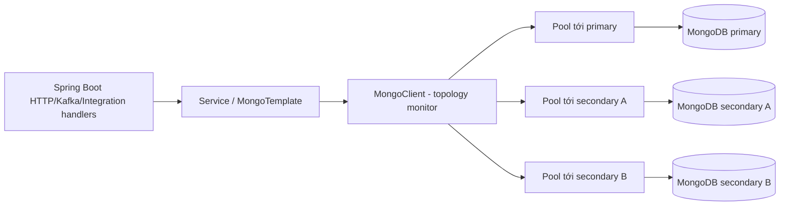
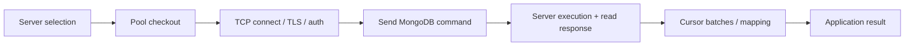
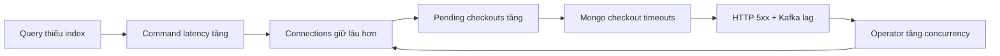
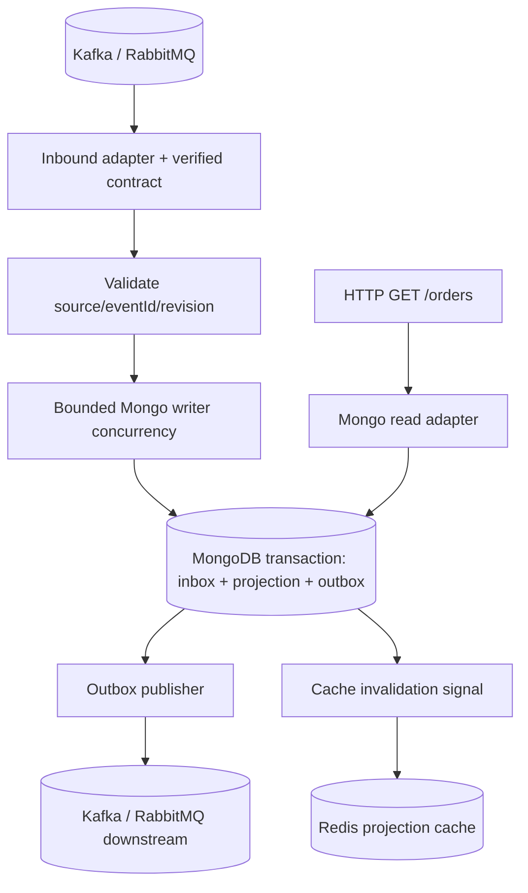

# Connection pool, timeout và tùy chỉnh MongoClientSettings

Trong **SPRING_BOOT_INTEGRATION**, MongoDB thường đứng sau một HTTP endpoint nhận dữ liệu từ đối tác, một luồng Spring Integration đồng bộ catalog, một Kafka/RabbitMQ consumer ghi projection hoặc một tác vụ định kỳ cần lưu checkpoint. Khi kết nối MongoDB chậm, ứng dụng có thể gặp `MongoTimeoutException` dù server vẫn hoạt động; khi pool quá nhỏ, requests xếp hàng và kéo dài cả HTTP deadline; khi pool quá lớn trên nhiều pods, MongoDB có thể bị dồn quá nhiều sockets. Tăng `maxPoolSize` hoặc `socketTimeoutMS` theo cảm tính thường chỉ chuyển nút thắt từ ứng dụng sang database.

Bài thuộc chương **MongoDB**, tập trung vào **connection pool, timeout và tùy chỉnh `MongoClientSettings`** trong Spring Boot. Ta sẽ theo dõi vòng đời một thao tác từ chọn server, mượn connection, kết nối TCP/TLS, chạy lệnh đến đọc kết quả; giải thích các tham số pool và timeout, dùng `MongoClientSettingsBuilderCustomizer` cùng Spring Boot auto-configuration, phân biệt driver synchronous với reactive, rồi áp dụng các giới hạn đó vào transaction, idempotency, kiểm thử và observability cho hệ tích hợp thực tế.

> Các ví dụ hướng tới **Java 17+, Spring Boot 3.x, Spring Data MongoDB 4.x và MongoDB Java Driver 4.x/5.x theo BOM tương ứng**. Một số overload hoặc chế độ client-side operation timeout có khác biệt giữa driver versions; luôn đối chiếu API của thư viện được quản lý bởi BOM. Tên database `integration`, collection `order_projection`, endpoint, số pool và timeout chỉ là **giá trị minh họa**, không phải mặc định tối ưu cho mọi môi trường.

## 1. Mục tiêu học tập

Sau bài này, bạn có thể:

1. Mô tả vòng đời truy cập MongoDB qua **server selection → connection checkout → connect/TLS → execute → consume result → return to pool**.
2. Phân biệt `maxSize`, `minSize`, `maxConnecting`, `maxWaitTime`, `maxConnectionIdleTime` và `maxConnectionLifeTime`; hiểu giới hạn **theo từng server/pool, từng MongoClient và từng pod**.
3. Chẩn đoán **server selection timeout**, **pool checkout timeout**, **connect timeout**, **socket read timeout**, `maxTimeMS` phía server, write concern timeout và overall deadline.
4. Dùng `spring.data.mongodb.uri`/connection-string options hoặc `MongoClientSettingsBuilderCustomizer` đúng phạm vi, tránh tạo nhiều `MongoClient` không cần thiết.
5. Cấu hình connection pool đồng bộ với HTTP/broker concurrency, replica set, TLS, read/write concern và transaction/session.
6. Phân loại lỗi transient, permanent và **UNKNOWN_COMMIT_OUTCOME** để quyết định retry/idempotency đúng nghiệp vụ.
7. Thiết kế metrics, logging và runbook cho pool saturation, DNS/TLS, failover, MongoDB primary chậm và consumer backlog.
8. Viết test trên MongoDB Testcontainers, test cấu hình/serialization và fault-injection thay vì chỉ assert bean khởi tạo được.

## 2. MongoClient, topology và connection pool là ba khái niệm khác nhau

Ứng dụng Spring Boot thường có một `com.mongodb.client.MongoClient` (đồng bộ) và có thể có `com.mongodb.reactivestreams.client.MongoClient` (reactive) nếu dùng Spring WebFlux/Reactive MongoDB. **`MongoClient` không phải một socket**: nó là đối tượng có cấu hình, theo dõi topology và **quản lý các pools/connections nền**. Các operations của `MongoTemplate`, `MongoRepository` hoặc driver API mượn connections qua client tương ứng.



Với MongoDB replica set, driver khám phá các server, chọn server theo **operation + read preference** rồi checkout connection từ pool tương ứng. Monitoring/heartbeat có thể duy trì những sockets riêng ngoài các application checkout connections. Vì vậy thống kê sockets của MongoDB không nhất thiết đúng bằng một tham số `maxPoolSize`.

### 2.1. Vòng đời của một lệnh đọc

```text
HTTP request / Kafka event
  -> application service kiểm tra input/deadline
  -> MongoTemplate.find(...)
      -> driver chọn server thỏa readPreference/topology
      -> chờ connection rảnh trong pool server đó
      -> nếu cần: tạo TCP socket, bắt tay TLS, authenticate
      -> gửi command find/aggregate và chờ response
      -> đọc batch/cursor theo yêu cầu
      -> trả connection về pool khi operation/cursor xong
  -> map Document thành DTO/projection
  -> HTTP response / business commit / broker ack
```

Một thao tác có thể dùng **nhiều lệnh**: truy vấn có cursor và `getMore`, transaction có nhiều reads/writes/commit, hoặc application service thực hiện nhiều calls. Không đo “thời gian MongoDB” chỉ từ một socket read. Nếu cursor chưa đóng, session/transaction còn active hoặc code giữ tài nguyên quá lâu, lượng connection khả dụng có thể giảm.

### 2.2. Pool là **theo server**, không phải hạn mức toàn cluster

Giả sử có 6 pods, mỗi pod dùng một `MongoClient` với `maxPoolSize=80`. Nếu mọi pod chủ yếu ghi vào cùng primary, **số application connections có thể tới primary là 6 × 80 = 480**, chưa tính sockets monitoring và những clients khác. Nếu mỗi pod tạo hai `MongoClient` khác nhau thì số pool có thể tăng thêm. `maxPoolSize=80` **không** có nghĩa toàn bộ deployment chỉ mở tối đa 80 connections.

| Khái niệm | Phạm vi | Điều cần tránh |
| --- | --- | --- |
| Một `MongoClient` | Một driver client instance | Tạo mới theo từng HTTP request/event. |
| Pool cho server A | Một MongoClient tới một MongoDB server address | Hiểu `maxSize` như giới hạn trên toàn cluster. |
| `maxSize` | Giới hạn application connections của từng pool | Nhân nhầm với số lượng pods/nodes. |
| Monitoring connection | Driver theo dõi server/topology/heartbeat | Quên khi đối chiếu server connection count. |
| Read preference | Xác định server nào đủ điều kiện cho read | Cho rằng mọi reads luôn chỉ đi primary. |
| Pool đồng bộ vs reactive | Gắn với loại MongoClient tương ứng | Tin rằng hai clients luôn chia sẻ cùng pool. |

### 2.3. Vì sao không tạo MongoClient cho mỗi thao tác?

```java
// Anti-pattern: mỗi request tạo client và pool riêng.
public void saveOrderBadly(OrderSnapshot value) {
    try (var client = com.mongodb.client.MongoClients.create(
            "mongodb://localhost:27017")) {
        client.getDatabase("integration")
                .getCollection("order_projection");
        // ... mỗi call có startup/monitor/auth/pool cost riêng
    }
}
```

Trong Spring Boot, nên để **một bean MongoClient có vòng đời ứng dụng** được quản lý; inject `MongoTemplate`/repository vào service. Tạo client riêng chỉ khi thật sự cần cấu hình/credentials/cluster khác nhau và đã tính tổng connections. Không chia sẻ một `MongoClient` của ứng dụng cho những tenants có trust boundary/credentials trái với policy bảo mật.

## 3. Các tham số connection pool cần hiểu

Driver MongoDB Java cung cấp `ConnectionPoolSettings`; tên trong Java builder và URI có thể khác nhau:

| Java builder | MongoDB connection string option | Tác dụng |
| --- | --- | --- |
| `maxSize(n)` | `maxPoolSize=n` | Số application connections tối đa **mỗi pool/server**. |
| `minSize(n)` | `minPoolSize=n` | Số connections tối thiểu pool cố duy trì theo cơ chế maintenance. |
| `maxConnecting(n)` | `maxConnecting=n` | Giới hạn số connections được **tạo đồng thời** cho mỗi pool. |
| `maxWaitTime(t, unit)` | `waitQueueTimeoutMS=...` | Thời gian tối đa chờ checkout connection rảnh; khác connect timeout. |
| `maxConnectionIdleTime(t, unit)` | `maxIdleTimeMS=...` | Thời gian một connection **nhàn rỗi** tối đa trước khi được loại khi thích hợp. |
| `maxConnectionLifeTime(t, unit)` | `maxLifeTimeMS=...` | Tuổi tối đa của connection kể từ lúc tạo, theo cơ chế pool cleanup. |
| Maintenance-related settings | Tùy driver/config | Tần suất kiểm tra/duy trì pool, không thay logic query. |

Các tham số có thể có **giá trị 0 mang nghĩa “không giới hạn thời gian” hoặc “không áp timeout”** tùy từng setting/driver version. Không suy cùng một ý nghĩa cho mọi zero value; xác minh documentation của bản driver đang dùng và tránh cấu hình vô hạn chỉ để che sự cố.

### 3.1. `maxSize` không làm query chạy nhanh hơn

Giả sử server chỉ xử lý có hiệu quả 40 operations đồng thời; nâng một pool từ 100 lên 1000 có thể làm tăng số operations tranh CPU/locks/I/O, khiến cả p95 latency và error rate xấu hơn. Pool lớn không sửa được:

- Query thiếu index hoặc không có tenant filter.
- Aggregation trả lượng dữ liệu quá lớn.
- Transaction giữ nhiều locks.
- Server replication lag/primary election.
- Mạng/TLS có latency cao.
- Consumer Kafka không giới hạn concurrency/backpressure.

Pool lớn là **khả năng đồng thời truy cập**, không phải số connections luôn có sẵn hoặc số queries DB xử lý tối ưu.

### 3.2. `minSize` và chi phí duy trì kết nối

`minSize=5` có thể giảm độ trễ tạo socket cho workloads có lưu lượng đều, nhưng khi có 30 pods × 3 servers, tổng connections nhàn rỗi có thể đáng kể. Khi scale-to-zero hoặc traffic hiếm, `minSize` cao làm tăng footprint. Driver có thể tạo connections dần và duy trì qua maintenance; **không giả định lúc ApplicationReady đã mở đủ minSize**, và đừng coi một kết nối vật lý luôn sống mãi qua network/NAT/primary failover.

### 3.3. `maxConnecting` và cold-start burst

Khi 20 pods cùng rollout và cold pool phải xây connection TLS/auth, `maxConnecting` giúp giới hạn **số cuộc tạo socket đồng thời trên từng pool**. Tham số thấp có thể khiến cold start / scale-up trông chậm; tham số quá cao có thể tạo connection storm gây tải MongoDB và authentication infrastructure. Đo **time to first successful operation**, checkout wait và server connection churn khi chọn.

### 3.4. Idle time và lifetime không chủ động ngắt một transaction đang chạy

`maxIdleTime` và `maxLifeTime` được áp theo việc pool xét connections để loại bỏ/thay thế; chúng **không được thiết kế như deadline cắt ngang một command đang thực thi**. Nếu application giữ một session/cursor/transaction quá lâu, hãy dùng transaction/query deadlines và đóng resources đúng, không mong idle eviction tự cứu.

Trong môi trường load balancer, NAT hoặc firewall có idle timeout, chọn `maxIdleTime` hợp lý để giảm tái sử dụng sockets stale, nhưng không có một công thức duy nhất: heartbeat, TCP keep-alive, server timeout và network path cũng ảnh hưởng. Cần test với hạ tầng thật.

## 4. Thời gian của một MongoDB operation gồm nhiều giai đoạn

Một request có thể vượt SLA ngay cả khi *mỗi* timeout riêng lẻ chưa bị chạm:



| Giới hạn | Phạm vi | Không được hiểu nhầm |
| --- | --- | --- |
| `serverSelectionTimeoutMS` | Thời gian tìm server phù hợp topology/read preference | Không phải timeout thực thi query trên server. |
| `waitQueueTimeoutMS` | Chờ checkout connection từ pool | Không phải socket connect timeout. |
| `connectTimeoutMS` | Mở TCP connection tới server | Không bảo đảm cả TLS/auth/operation hoàn thành trong ngần ấy thời gian. |
| `socketTimeoutMS` | Đợi dữ liệu socket I/O trong synchronous driver theo semantics version | Không phải tổng SLA end-to-end; stream nhiều batches có thể lâu hơn. |
| `maxTimeMS` | Giới hạn xử lý phía server trên một số commands/queries được hỗ trợ | Không phải transport deadline; không áp tự động cho mọi operation. |
| `wTimeoutMS` / write concern | Giới hạn chờ đáp ứng write concern acknowledgement | Không bảo đảm write không xảy ra khi timeout. |
| Client-side operation timeout / `timeoutMS` nếu driver hỗ trợ | Deadline rộng hơn theo driver API/config phiên bản mới | Không giả định có trong mọi driver 4.x/5.x hoặc thay idempotency. |
| HTTP/broker overall deadline | Thời gian dành cho **business workflow** | Phải được truyền/kiểm soát trên nhiều bước, không chỉ Mongo driver. |

### 4.1. Server selection timeout

Trước một read/write, driver cần tìm server phù hợp, ví dụ **primary** cho write. Khi mất majority/primary chưa được bầu, topology monitor chưa cập nhật hoặc read preference yêu cầu secondary không khả dụng, operation có thể chờ đến `serverSelectionTimeoutMS` và ném `MongoTimeoutException`.

**Đừng kết luận pool quá nhỏ chỉ từ exception class**. Lỗi server selection thường có message cho biết topology/servers chưa phù hợp; checkout timeout lại có dấu hiệu chờ connection trong pool. Thu thập exact error category, topology state và pool telemetry trước khi tăng tham số.

### 4.2. Checkout timeout

Sau khi có server mục tiêu, một operation phải checkout socket. Nếu pool đạt `maxSize` và các sockets đang bận, requests xếp hàng. `waitQueueTimeoutMS` giúp giới hạn thời gian xếp hàng; để chờ vô hạn có thể làm HTTP worker threads/kafka consumer threads bị giữ, lan sự cố sang các dịch vụ khác.

```text
Mongo primary pool: maxSize=40
In-use = 40
Available = 0
Pending checkouts = 70
New request waits...
  -> a connection may be returned in time
  -> otherwise checkout timeout occurs
```

Nếu thêm 100 workers Kafka nhưng pool vẫn 40, có thể tăng **pending checkout**, không tăng throughput. Phải cân đối consumer concurrency và MongoDB DB capacity, không chỉ nâng pool để “chữa” backlog.

### 4.3. Connect timeout khác read timeout

`connectTimeoutMS` áp vào việc thiết lập TCP connection. `socketTimeoutMS`/driver socket read timeout áp vào I/O sau đó; mức độ bao phủ TLS handshake và các phase cụ thể phải được xác minh theo runtime/provider. Một server đã accept connection nhưng treo khi xử lý command có thể không chạm connect timeout mà chạm read timeout.

Đặt `socketTimeoutMS=0` hoặc vô hạn có thể khiến một HTTP request bị giữ quá lâu. Ngược lại, đặt 100ms cho một aggregation phải quét dữ liệu lớn có thể tạo timeout storm. **Tối ưu index/query trước**, rồi chọn timeout theo SLO thực tế và biết phase nào cần giới hạn.

## 5. Spring Boot auto-configuration: cấu hình connection không đồng nghĩa cấu hình business data

Với Spring Boot 3.x, dependency thường dùng:

```groovy
dependencies {
    implementation 'org.springframework.boot:spring-boot-starter-data-mongodb'
    implementation 'org.springframework.boot:spring-boot-starter-validation'
    testImplementation 'org.springframework.boot:spring-boot-starter-test'
}
```

Ví dụ Maven:

```xml
<dependency>
    <groupId>org.springframework.boot</groupId>
    <artifactId>spring-boot-starter-data-mongodb</artifactId>
</dependency>
```

Khi các điều kiện auto-configuration được đáp ứng, Boot cấu hình `MongoClient` đồng bộ, `MongoDatabaseFactory` và `MongoTemplate`, đồng thời các repository nếu được bật/phát hiện. Với `spring-boot-starter-data-mongodb-reactive`, auto-configuration cho **reactive client/template** là một con đường riêng; phải kiểm tra trường hợp cả hai starters cùng có mặt.

### 5.1. Cấu hình `spring.data.mongodb.uri`

```yaml
spring:
  data:
    mongodb:
      uri: ${MONGODB_URI:mongodb://localhost:27017/integration}
```

Ví dụ URI local thể hiện rõ connection options:

```text
mongodb://localhost:27017/integration
  ?appName=integration-api
  &maxPoolSize=60
  &minPoolSize=4
  &maxConnecting=4
  &waitQueueTimeoutMS=300
  &maxIdleTimeMS=120000
  &maxLifeTimeMS=1800000
  &serverSelectionTimeoutMS=3000
  &connectTimeoutMS=2000
  &socketTimeoutMS=5000
```

Các dòng trên được xuống dòng **để dễ đọc**: một MongoDB connection string dùng trong environment là **một chuỗi liền**, không có khoảng trắng/newline:

```text
mongodb://localhost:27017/integration?appName=integration-api&maxPoolSize=60&minPoolSize=4&maxConnecting=4&waitQueueTimeoutMS=300&maxIdleTimeMS=120000&maxLifeTimeMS=1800000&serverSelectionTimeoutMS=3000&connectTimeoutMS=2000&socketTimeoutMS=5000
```

Không cần copy nguyên ví dụ 60/4/4 vào production; chúng minh họa ý nghĩa tham số. Trong URI, các khoảng thời gian có hậu tố `MS` là **milliseconds**. Nếu credentials nằm trong URI, **không ghi URI ra logs**; kí tự đặc biệt trong username/password phải được percent-encode đúng, và secrets nên được quản lý qua secret manager/environment thay vì commit vào Git.

### 5.2. Mỗi config path cần một chủ sở hữu

| Cấu hình | Owner thường gặp | Cần lưu ý |
| --- | --- | --- |
| `spring.data.mongodb.uri` | Spring Boot properties / MongoDB URI | Định nghĩa topology, auth, TLS và nhiều timeout/pool options. |
| `MongoClientSettingsBuilderCustomizer` | Bean application configuration | Tùy chỉnh Java driver settings cho client được Boot auto-configure. |
| `MongoClientSettings` + `MongoClients.create(...)` | Code tự tạo client | Có thể bỏ qua phần tự động cấu hình của Boot, tạo pool độc lập. |
| `MongoTemplate` | Spring Data operation API | Chọn collection, query, mapping, read/write behavior; không phải pool riêng. |
| `ReactiveMongoTemplate` | Reactive MongoClient | Có backpressure/reactive deadlines riêng, không tự dùng pool đồng bộ. |
| `MongoTransactionManager` | Spring transaction infrastructure | Quản lý session/transaction; không phải MongoClientSettings. |

**Đừng khai báo cùng một timeout ở cả URI và customizer rồi dựa vào thứ tự ngẫu nhiên.** Spring Boot có các customizers nội bộ/ứng dụng được áp theo quá trình tạo builder; precedence cụ thể còn tùy BOM, bean order và có tự tạo `MongoClient` hay không. Tốt nhất chỉ để **một nguồn quyết định cho mỗi option** và xác minh hành vi cuối bằng integration test/driver diagnostics.

### 5.3. Điều gì xảy ra nếu tự khai báo bean `MongoClient`?

```java
@Bean
com.mongodb.client.MongoClient mongoClient() {
    return com.mongodb.client.MongoClients.create(
            "mongodb://localhost:27017/integration");
}
```

Bean tự tạo như vậy có thể làm Boot **lùi khỏi việc tạo MongoClient đồng bộ mặc định**, và các `MongoClientSettingsBuilderCustomizer` dành cho auto-configured client có thể không được áp vào bean tự tạo. Nếu cần tự quản lý, phải tự áp **đủ** URI, pool, TLS, credentials, command listeners và lifecycle; kiểm tra khi shutdown client được close đúng. Không tạo một bean `MongoClient` mỗi lần repository được gọi.

Khi dùng **hai clusters MongoDB**, tạo hai clients có ý thức: đặt qualifiers, database factories/templates/repositories riêng và tính tổng số pool/sockets. Không cho một repository chỉ định “MongoDB nào cũng được” bằng bean name tình cờ.

## 6. Tùy chỉnh `MongoClientSettings` qua Boot customizer

Với ứng dụng cần biến cấu hình pool/timeouts thành **application properties có kiểu**, `MongoClientSettingsBuilderCustomizer` là điểm mở rộng thuận tiện. Không cần tự tạo `MongoClient`, nhờ đó Boot tiếp tục sở hữu client lifecycle/topology auto-config.

### 6.1. Properties riêng của ứng dụng

```yaml
spring:
  data:
    mongodb:
      uri: ${MONGODB_URI:mongodb://localhost:27017/integration}

app:
  mongo:
    max-pool-size: 80
    min-pool-size: 5
    max-connecting: 4
    max-wait: 300ms
    max-idle: 2m
    max-life: 30m
    connect-timeout: 2s
    read-timeout: 5s
    server-selection-timeout: 3s
```

`app.mongo.*` là **property namespace do ứng dụng tự định nghĩa**, không phải properties MongoDB mà Boot tự hiểu. Cần Java binding + customizer dưới đây. Nếu dùng cách này, đừng đặt lại cùng options `maxPoolSize`/`socketTimeoutMS` trong `MONGODB_URI` mà không có quy tắc precedence rõ.

### 6.2. Dùng `@ConfigurationProperties` record

```java
import java.time.Duration;
import java.util.Objects;
import org.springframework.boot.context.properties.ConfigurationProperties;

@ConfigurationProperties(prefix = "app.mongo")
public record MongoTuningProperties(
        int maxPoolSize,
        int minPoolSize,
        int maxConnecting,
        Duration maxWait,
        Duration maxIdle,
        Duration maxLife,
        Duration connectTimeout,
        Duration readTimeout,
        Duration serverSelectionTimeout) {

    public MongoTuningProperties {
        if (maxPoolSize < 1 || minPoolSize < 0
                || minPoolSize > maxPoolSize
                || maxConnecting < 1) {
            throw new IllegalArgumentException(
                    "Invalid MongoDB pool capacity");
        }
        for (Duration d : new Duration[]{
                maxWait, maxIdle, maxLife,
                connectTimeout, readTimeout,
                serverSelectionTimeout}) {
            Objects.requireNonNull(
                    d, "All MongoDB timeout properties are required");
            if (d.isZero() || d.isNegative()) {
                throw new IllegalArgumentException(
                        "MongoDB durations must be positive");
            }
        }
    }
}
```

Đây là mẫu **chủ động từ chối cấu hình thiếu/sai**, nên các properties thời gian đều phải được cung cấp. Trong use case thực tế có thể cho phép tắt `maxIdle`/`maxLife` với một sentinel được định nghĩa rõ, nhưng không nên dùng một giá trị 0 không giải thích rồi nhầm nó là “0 milliseconds timeout”.

### 6.3. Định nghĩa `MongoClientSettingsBuilderCustomizer`

```java
import java.util.concurrent.TimeUnit;
import org.springframework.boot.autoconfigure.mongo.MongoClientSettingsBuilderCustomizer;
import org.springframework.boot.context.properties.EnableConfigurationProperties;
import org.springframework.context.annotation.Bean;
import org.springframework.context.annotation.Configuration;

@Configuration(proxyBeanMethods = false)
@EnableConfigurationProperties(MongoTuningProperties.class)
public class MongoClientTuningConfiguration {

    @Bean
    MongoClientSettingsBuilderCustomizer tuningMongoClient(
            MongoTuningProperties p) {

        return settings -> {
            settings.applyToConnectionPoolSettings(pool -> pool
                    .maxSize(p.maxPoolSize())
                    .minSize(p.minPoolSize())
                    .maxConnecting(p.maxConnecting())
                    .maxWaitTime(
                            p.maxWait().toMillis(),
                            TimeUnit.MILLISECONDS)
                    .maxConnectionIdleTime(
                            p.maxIdle().toMillis(),
                            TimeUnit.MILLISECONDS)
                    .maxConnectionLifeTime(
                            p.maxLife().toMillis(),
                            TimeUnit.MILLISECONDS));

            settings.applyToSocketSettings(socket -> socket
                    .connectTimeout(
                            p.connectTimeout().toMillis(),
                            TimeUnit.MILLISECONDS)
                    .readTimeout(
                            p.readTimeout().toMillis(),
                            TimeUnit.MILLISECONDS));

            settings.applyToClusterSettings(cluster -> cluster
                    .serverSelectionTimeout(
                            p.serverSelectionTimeout().toMillis(),
                            TimeUnit.MILLISECONDS));
        };
    }
}
```

Các API trên tương ứng MongoDB sync driver settings phổ biến trong dải được nêu đầu bài; khi một bản driver mới đổi deprecation/overload, áp chính BOM và test trước khi nâng. `maxConnecting` không đồng nghĩa tổng `maxSize`; `connectTimeout` ở `SocketSettings` không đồng nghĩa `serverSelectionTimeout` của `ClusterSettings`.

**Lưu ý về Spring Boot auto-configuration:** customizer này tác động tới **client do auto-configuration dùng danh sách customizers**, không bảo đảm áp vào một `MongoClient` được ứng dụng tạo thủ công ở nơi khác. Với app vừa có synchronous vừa có reactive auto-configuration, cần kiểm tra những bean/settings thực sự nhận customizer và đo tách pool, không suy từ việc bean customizer tồn tại trong context.

### 6.4. Tránh hardcode bí mật và xung đột URI

Không đặt password hoặc TLS client certificate nội dung vào `MongoTuningProperties` dành cho tuning chung. Credentials và CA/truststore/keystore thuộc hệ secret/connection management; một customizer có thể thay cấu hình URI nếu set authentication/SSL trực tiếp theo thứ tự khác. Tách rõ:

```text
MONGODB_URI                 -> topology, database, auth, TLS, retry mode
app.mongo.* tuning          -> pool/timeouts mà ứng dụng sở hữu
MongoTemplate / query       -> query projection, maxTime, writeConcern khi cần
Application service         -> overall deadline, idempotency, retry budget
```

Đây là một **thiết kế ownership gợi ý**, không phải bắt buộc. Điều cần kiểm chứng là **effective settings**: nếu URI vẫn có `maxPoolSize=500` nhưng Java customizer đặt `maxSize(80)`, phải biết cấu hình nào thắng thay vì tin file YAML đầu tiên bạn đọc.

## 7. Cấu hình bằng URI hay Java builder: chọn theo nhu cầu

| Tiêu chí | Chỉ URI/connection string | `MongoClientSettingsBuilderCustomizer` |
| --- | --- | --- |
| Pool/timeouts tiêu chuẩn | Thường đủ, dễ cấu hình môi trường | Có typed Duration/validation, config chia nhóm |
| Hạ tầng đặt MongoDB URI sẵn | Thuận tiện cho managed MongoDB/SRV | Cần kiểm tra không ghi đè options quan trọng |
| ConnectionPool/Command listeners | Không định nghĩa Java listeners bằng URI | Dùng builder để đăng ký listeners |
| Thay đổi theo profile/environment | Tốt qua env/secrets | Tốt qua `@ConfigurationProperties` và Spring profiles |
| Theo dõi/custom metrics | Driver/Actuator auto metrics tùy classpath | Có thể thêm listeners có policy rõ |
| MongoClient tự tạo và nhiều clusters | Cần config per-client | Phải áp đúng customizer ở **từng** client; không tự động |
| Kiểm chứng giá trị đầu vào | URI parser kiểm tra nhiều options | Code có thể áp constraints theo business SLO |

Không nhất thiết viết Java chỉ để đặt `maxPoolSize=80` nếu URI đã là cấu hình được kiểm soát. Nhưng khi ứng dụng cần **maxConnecting, metrics listeners, TLS custom behavior, server selection/tuning theo module**, Java builder giúp gom quyết định thành một nơi có test và validation.

### 7.1. Không override MongoDB connection string theo thứ tự ngẫu nhiên

Ví dụ nguy hiểm:

```yaml
spring:
  data:
    mongodb:
      uri: mongodb://localhost:27017/integration?maxPoolSize=100
app:
  mongo:
    max-pool-size: 20
```

Ngay cả khi app chạy, “effective pool” có thể khác người vận hành nghĩ. Chọn **một nơi duy nhất** cho `maxPoolSize`. Nếu có nhiều customizers dùng `@Order`, viết integration test xác minh thứ tự/hành vi và ghi rõ chính sách. Không tự tạo bean `MongoClientSettings` thủ công chỉ để “đè” properties nếu điều đó vô hiệu hóa việc Boot quản lý client.

### 7.2. Kiểm tra bean lifecycle và đóng kết nối

`MongoClient` cần được close khi ứng dụng dừng để giải phóng pools, monitoring threads và sockets. Boot-managed client có lifecycle do context quản lý. Nếu bạn tạo client ngoài Spring context, phải quản lý `close()`; nếu bạn tạo một client cho mỗi tenant/request, đừng mong GC hoặc shutdown hook sửa connection storm.

Với graceful shutdown của HTTP server và Kafka listener, nên **dừng nhận work mới, để các operations quan trọng hoàn thành có deadline, rồi đóng MongoClient**. Không tắt client ngay giữa một business transaction đã commit DB nhưng chưa cập nhật outbox/inbox; điểm ack phải được thiết kế bền vững ở application layer.

## 8. Timeout phía server, query và write concern

MongoDB Java driver timeouts **không** thay cho giới hạn thời gian mà database server dành cho một query. Một read có thể checkout connection nhanh nhưng chạy aggregation lâu vì thiếu index hoặc dữ liệu quá lớn.

### 8.1. Dùng `maxTimeMS` cho operation hỗ trợ

Ví dụ Spring Data MongoDB:

```java
import java.time.Duration;
import org.springframework.data.mongodb.core.MongoTemplate;
import org.springframework.data.mongodb.core.query.Criteria;
import org.springframework.data.mongodb.core.query.Query;
import org.springframework.stereotype.Repository;

@Repository
public class OrderMongoReadAdapter {
    private final MongoTemplate mongo;

    public OrderMongoReadAdapter(MongoTemplate mongo) {
        this.mongo = mongo;
    }

    public OrderProjection findOrder(
            String tenantId, String orderId) {

        Query query = Query.query(
                Criteria.where("tenantId").is(tenantId)
                        .and("orderId").is(orderId));
        query.maxTime(Duration.ofSeconds(2));

        return mongo.findOne(query, OrderProjection.class);
    }
}
```

`OrderProjection` là Java Mongo document mapping sẽ được định nghĩa trong phần ví dụ nghiệp vụ. `Query.maxTime(...)` hướng đến giới hạn thời gian **MongoDB server xử lý query** theo khả năng command/driver; nó **không** bao gồm tất cả thời gian DNS/server selection, pool queue, TCP connection, network I/O, data mapping và application orchestration. Không dùng maxTime chỉ để thay thế index hoặc query projection.

Trong MongoDB driver API thuần có các operations hỗ trợ:

```java
import java.util.concurrent.TimeUnit;
import com.mongodb.client.MongoCollection;
import org.bson.Document;

Document found = collection
        .find(new Document("tenantId", "tenant-7")
                .append("orderId", "ORD-42"))
        .maxTime(2, TimeUnit.SECONDS)
        .first();
```

Đoạn trên giả định `collection` là `MongoCollection<Document>` được inject/lấy từ một `MongoClient` đang được quản lý, không tự tạo client mới ở mỗi lần query. Đối với `aggregate`/`countDocuments` hoặc những lệnh khác, cách đặt `maxTime` và phạm vi áp dụng có thể khác theo API. Với bulk writes/transactions, kiểm tra riêng write concern/commit time và overall deadline.

### 8.2. Write concern timeout không phải “write đã rollback”

MongoDB write concern như `w: "majority"` yêu cầu mức acknowledgement nhất định. `wTimeoutMS` giới hạn thời gian chờ điều kiện write concern; nếu timeout, **không thể luôn kết luận write đã không xảy ra**.

```text
Client -> primary: insert document with stable _id
Primary applies write
Replicas lag; majority acknowledgment quá chậm
Client sees write concern timeout
             |
             v
        Outcome may be uncertain
```

Phân biệt:

- **Command validation error**: MongoDB từ chối một operation cụ thể, ví dụ invalid update, unauthorized hoặc vi phạm unique index. Thường deterministic khi input/schema không đổi.
- **Write concern timeout**: acknowledge level chưa đạt trong thời hạn, có thể đã có write trên primary. Cần kiểm tra state/operation key thay vì tự khởi tạo business ID mới.
- **Network error sau gửi**: có thể mất response dù server đã commit; kết quả **UNKNOWN**.
- **Transaction commit error**: phải xử lý retry/unknown outcome theo **transaction labels/driver contract**, không xem mọi `MongoException` là retryable.

### 8.3. Read preference, read concern và freshness

Nếu application đọc projection của đơn hàng vừa ghi:

- Read từ **primary** thường tránh một số lag của secondaries nhưng không tự thay business transaction invariants.
- `secondaryPreferred`/`nearest` có thể trả dữ liệu chậm hơn write mới vì replication lag; cần read-your-writes/session semantics nếu hợp đồng yêu cầu.
- `readConcern("majority")` giúp định nghĩa visibility theo replica set semantics; **không tự bảo đảm freshness tuyệt đối** ở mọi secondary.
- `writeConcern("majority")` tăng mức durability/acknowledgement nhưng ảnh hưởng latency và failure behavior.
- Transactions có constraints riêng về read concern, write concern, sessions và topology.

**Consistency và connection pool liên quan nhưng không đồng nhất.** Khi primary election xảy ra, reads/writes bị server-selection delay và retry có thể tăng, nhưng không thể khắc phục lag bằng cách tăng `maxSize`. Hãy xác định business read consistency requirements trước khi bật secondary reads để giảm tải.

## 9. Giới hạn thời gian toàn workflow, không cộng vô thức các timeout

Giả sử HTTP API có SLO 2 giây nhưng:

```text
serverSelectionTimeout = 3s
maxWaitTime             = 1s
connectTimeout          = 2s
socketTimeout           = 5s
partner HTTP timeout    = 4s
```

Chỉ riêng các timeout cấu hình đã **lớn hơn** SLO, và chúng không nhất thiết chạy theo một chuỗi cố định/sum đơn giản. Một operation có thể thử server selection nhiều lần, đọc nhiều cursor batches hoặc retry. Cần một **business deadline** được tính từ lúc nhận request/event và chia ngân sách cho từng bước.

### 9.1. Ví dụ time budget

```text
SLO / operation budget: 2 000 ms
  request parsing + authentication:   100 ms
  Mongo query + pool checkout:         600 ms
  partner HTTP dependency:             800 ms
  DB/outbox commit:                    300 ms
  safety/serialization margin:         200 ms
Total:                              2 000 ms
```

Các con số chỉ để minh họa cách lập budget, **không phải thông số production**. Không cấp mỗi dependency một timeout 5 giây khi toàn request có deadline 2 giây. Khi thời gian còn lại không đủ, fail sớm/đưa work sang durable async path theo SLA thay vì mở thêm một Mongo transaction chắc chắn vượt hạn.

### 9.2. Vì sao một `socketTimeoutMS` không phải overall deadline?

Một Mongo operation có thể:

1. Chờ server selection một khoảng.
2. Chờ pool checkout một khoảng khác.
3. Chạy query có `maxTimeMS`.
4. Nhận nhiều batches theo cursor/stream, mỗi bước có I/O.
5. Mapping data và gọi partner HTTP sau đó.

`socketTimeoutMS` không bắt tất cả các giai đoạn trên. Ở các MongoDB Java driver phiên bản mới hỗ trợ **client-side operation timeout (CSOT)**, cần xét `timeoutMS`/per-operation timeout theo tài liệu version và biết rằng timeout/cancellation **không tự rollback side effects ở server**. Trong driver cũ, phải thiết kế deadline/bulkhead ở application layer và quản lý thời gian của từng command.

### 9.3. Deadline với HTTP ingress và broker consumer

| Source | Deadline đến từ đâu? | Khi Mongo chậm |
| --- | --- | --- |
| HTTP endpoint | Reverse proxy, server timeout, client SLA, application budget | Trả lỗi thích hợp hoặc durable acceptance theo API contract; không tiếp tục side effect không thể kiểm soát sau client disconnect. |
| Kafka consumer | Poll loop constraints, rebalance, task budget, lag | Dừng nhận quá nhiều concurrent records; ack/commit offset chỉ sau durable processing phù hợp. |
| RabbitMQ listener | Consumer concurrency, broker redelivery, ack policy | Giới hạn in-flight messages, retry/backoff; tránh requeue tight loop. |
| Spring Integration poller | Trigger frequency, maxMessagesPerPoll, worker pool | Durable message store/checkpoint và bounded throughput. |
| Quartz scheduled job | Job-specific budget và scheduler worker capacity | Chia chunk/checkpoint; không nhốt thread hàng giờ rồi tin Quartz retry tự bù. |

Với ứng dụng dùng MongoDB làm **cache/projection**, Mongo unavailable có thể fallback sang nguồn sự thật có giới hạn. Nhưng với operation mà MongoDB là **authoritative business store**, không được âm thầm trả “không có đơn hàng” khi thật ra không thể truy vấn.

## 10. Sizing pool theo concurrency, latency và số bản sao ứng dụng

Một cách ước lượng ban đầu là định luật Little:

\[
L \approx \lambda W
\]

Trong đó `L` là **số requests đang được phục vụ trung bình** trong một hệ ổn định, `λ` là throughput trung bình và `W` là thời gian phục vụ trung bình. Với MongoDB, ta ước lượng **số operations đồng thời cần connection** bằng throughput operations/s × thời gian sử dụng connection s/operation, **không** nhân với toàn HTTP response time nếu MongoDB chỉ chiếm một phần.

### 10.1. Ví dụ tính có giả định

Một deployment có **6 pods** nhận tổng **900 Mongo operations/s**, phân bố tương đối đều. Giả sử mỗi operation chiếm Mongo connection trung bình **40 ms**:

```text
Per pod throughput    = 900 / 6           = 150 ops/s
Mean connection usage = 40 ms             = 0.040 s
Average in use        = 150 * 0.040       = 6 connections/pod
```

Số 6 chỉ là **trung bình trong điều kiện ổn định**, không phải recommendation `maxSize=6`. Khi p95/p99 latency tăng, bursts, nhiều operations/transaction hoặc primary election, concurrent demand có thể lớn hơn đáng kể. Phải dựa vào load tests/metrics của từng pod và MongoDB server, rồi chọn headroom phù hợp.

Một ví dụ capacity planning có điều kiện:

| Thông số | Kịch bản giả định | Ý nghĩa |
| --- | --- | --- |
| Pods | 6 | Số MongoClients nếu mỗi pod một sync client. |
| `maxPoolSize` | 40 | Tối đa khoảng 240 application connections tới **mỗi** server khi tất cả pods hướng tới cùng server. |
| `minPoolSize` | 4 | Có thể giữ ít nhất ~24 pooled connections tới một server trong điều kiện phù hợp. |
| `maxConnecting` | 3 | Mỗi pool giới hạn đồng thời tạo sockets, giảm cold-start storm. |
| `maxWaitTime` | 300ms | Bounded queue thay vì giữ HTTP/broker threads lâu vô hạn. |
| `serverSelectionTimeout` | 2s | Đợi topology khi failover, phải so với overall deadline. |

Đây **không** phải bộ tham số dành cho một MongoDB cluster cụ thể. Mongo server `connections.current` có thể bao gồm background, monitoring, administrative và clients từ dịch vụ khác. Với sharded cluster/mongos, pools được tạo đến router/server addresses theo topology; giới hạn theo từng pool có thể khiến tổng connection count lớn hơn trực giác.

### 10.2. Đồng thời phải nhìn MongoDB và HTTP/broker

Một chuỗi tải có thể là:

```text
Kafka listener concurrency = 24 per pod
  -> each record calls Mongo twice
  -> Mongo waitQueueTimeout grows
  -> listener processing slows
  -> Kafka consumer lag increases
  -> operator increases concurrency to 48
  -> queue and timeout get worse
```

Nếu Mongo đang bão hòa, tăng Kafka concurrency không tự tăng throughput. Nên:

1. Đo `inUse/available/pendingCheckouts` theo pool/server và command p95.
2. Xác định query/index/DB CPU/I/O/replication có là bottleneck không.
3. Giới hạn in-flight database operations bằng bulkhead/concurrency cap trước hoặc cùng với tăng pool.
4. Giảm số round trips/optimize projection/batch khi phù hợp, không gom một batch quá lớn gây cursor/transaction giữ connection lâu.
5. Tăng pool có kiểm soát, đo p95/p99 và Mongo server resources trước/sau.

### 10.3. Pool exhaustion thường là hệ quả

Một queue checkout đầy có thể do:

- Query thiếu index kéo dài thời gian giữ connection.
- Cursor/stream không được đóng hoặc duyệt quá chậm.
- Transaction dài giữ session/connection.
- Mongo server failover/read preference đang chờ server.
- Số pods/clients tăng bất ngờ sau autoscaling.
- TLS/auth handshake chậm làm `maxConnecting` tạo connections không kịp.
- Thread pool HTTP/Kafka tạo nhiều concurrent DB calls hơn hệ có thể phục vụ.

Tăng `maxSize` chỉ có ý nghĩa sau khi biết **nguyên nhân khiến connections bị chiếm** và **server còn headroom**. Cần phân biệt *high in-use với query latency thấp* (có thể cần capacity) và *high in-use với query latency tăng mạnh* (MongoDB đang bị quá tải).

## 11. Transactions, ClientSession và connection pinning

MongoDB transactions trên replica set hoặc sharded cluster có các yêu cầu deployment/session, không hoạt động giống một transaction thuần trên MongoDB standalone không hỗ trợ transactions. Spring Data MongoDB có `MongoTransactionManager` cho synchronous operations; cần chủ động cấu hình và test khi workflow thực sự dùng Mongo transaction.

### 11.1. Cấu hình transaction manager có chủ đích

```java
import org.springframework.context.annotation.Bean;
import org.springframework.context.annotation.Configuration;
import org.springframework.data.mongodb.MongoDatabaseFactory;
import org.springframework.data.mongodb.MongoTransactionManager;

@Configuration(proxyBeanMethods = false)
public class MongoTransactionConfiguration {
    @Bean("mongoTransactionManager")
    MongoTransactionManager mongoTransactionManager(
            MongoDatabaseFactory factory) {
        return new MongoTransactionManager(factory);
    }
}
```

Với ứng dụng cũng dùng PostgreSQL/JPA, đừng nhầm transaction manager cho Mongo với `JpaTransactionManager`. Gắn rõ:

```java
import org.springframework.stereotype.Service;
import org.springframework.transaction.annotation.Transactional;

@Service
public class ProjectionBatchService {
    private final OrderProjectionWriter writer;

    public ProjectionBatchService(OrderProjectionWriter writer) {
        this.writer = writer;
    }

    @Transactional(transactionManager = "mongoTransactionManager")
    public void applyBatch(VerifiedOrderBatch batch) {
        writer.upsertProjection(batch);
        writer.insertCheckpoint(batch);
    }
}
```

`OrderProjectionWriter` và `VerifiedOrderBatch` là **interfaces/DTO của ứng dụng minh họa**, cần được định nghĩa ở tầng riêng; service này chỉ diễn giải transaction boundary, không phải ví dụ có thể biên dịch độc lập nếu chưa thêm các types. `@Transactional` hoạt động khi method đi **qua Spring proxy**, không qua self-invocation trong cùng class.

### 11.2. Transaction có thể giữ connection lâu hơn một query

Trong transaction, driver dùng `ClientSession` và có thể **pin** connection/server theo semantics của transaction/topology (đặc biệt trong sharded/đường đi qua mongos). Vì vậy pool sizing phải tính **số transactions đồng thời × thời gian giữ tài nguyên**, không chỉ một query đơn lẻ. Không mở Mongo transaction rồi:

```text
BEGIN Mongo transaction
  -> đọc collection A
  -> đợi HTTP partner 10 giây
  -> gọi Redis/cache
  -> ghi collection B
COMMIT
```

HTTP/Redis không nằm trong MongoDB transaction, còn việc chờ network kéo dài lifetime/locks/session của transaction và có thể gây contention. Nên gọi partner **trước** transaction khi idempotency/state-machine cho phép, rồi transaction ngắn để claim/check/update/outbox. Nếu cần saga/outbox để bảo đảm consistency với broker, thiết kế chúng rõ thay vì hứa một transaction liên hệ mọi hệ.

### 11.3. Session, cursor và resource management

Driver sync cursor dùng `MongoCursor<T>` cần được đóng khi duyệt thủ công:

```java
import com.mongodb.client.MongoCursor;
import org.bson.Document;

try (MongoCursor<Document> cursor =
        collection.find(new Document("tenantId", "tenant-7"))
                .iterator()) {
    while (cursor.hasNext()) {
        Document item = cursor.next();
        // Xử lý có giới hạn, không gọi partner HTTP chậm bên trong loop.
    }
}
```

`collection` giả định là `MongoCollection<Document>` do client ứng dụng cung cấp. Một cursor có thể có server resources và cần getMore; để quên close hoặc giữ nó trong một pipeline blocking kéo dài làm tăng tài nguyên/latency. Với `MongoTemplate.stream(...)` của Spring Data, dùng `try-with-resources` cho `Stream<T>`. Không dùng `findAll()`/`collectList()` cho hàng triệu documents rồi kỳ vọng pool lớn sẽ giải quyết memory pressure.

### 11.4. MongoDB transaction không bao gồm Kafka offset hay Redis

```text
MongoDB transaction commit
     != Redis SET commit
     != Kafka producer transaction commit
     != RabbitMQ ACK
     != HTTP partner POST commit
```

Nếu consumer nhận event Kafka, ghi MongoDB rồi crash trước offset commit, event có thể được giao lại. Cần **unique event key/inbox hoặc conditional update** trong MongoDB để chịu duplicate. Transaction giúp atomicity trong phạm vi các operation MongoDB được hỗ trợ, **không biến Kafka + MongoDB thành distributed exactly-once**.

## 12. Reactive MongoClient không phải synchronous MongoClient “đổi tên”

Với `spring-boot-starter-data-mongodb-reactive`, `ReactiveMongoTemplate` và reactive driver sử dụng publishers, resource scheduling và connection management theo client tương ứng. Khi một Spring WebFlux endpoint gọi sync `MongoTemplate` trực tiếp trên event-loop, thread bị block và có thể kéo theo độ trễ của nhiều requests khác.

### 12.1. Ví dụ non-blocking read

```java
import java.time.Duration;
import org.springframework.data.mongodb.core.ReactiveMongoTemplate;
import org.springframework.data.mongodb.core.query.Criteria;
import org.springframework.data.mongodb.core.query.Query;
import reactor.core.publisher.Mono;

public final class ReactiveOrderMongoAdapter {
    private final ReactiveMongoTemplate mongo;

    public ReactiveOrderMongoAdapter(ReactiveMongoTemplate mongo) {
        this.mongo = mongo;
    }

    public Mono<OrderProjection> find(
            String tenantId, String orderId) {
        Query query = Query.query(
                Criteria.where("tenantId").is(tenantId)
                        .and("orderId").is(orderId));
        query.maxTime(Duration.ofSeconds(1));

        return mongo.findOne(query, OrderProjection.class)
                .timeout(Duration.ofSeconds(2));
    }
}
```

`Mono.timeout(2s)` là timeout ở tầng reactive **subscription**, không phải tuyên bố chắc chắn Mongo server đã dừng operation hay đã rollback một write ở phía xa. Cần timeout của driver và cancellation semantics phù hợp; khi dùng `retryWhen` cho writes, áp idempotency và retry budget.

### 12.2. Blocking calls trong reactive chain

Không làm:

```java
return reactiveMongoTemplate.findOne(query, OrderProjection.class)
        .map(result -> synchronousMongoTemplate.findAll(
                OtherProjection.class))   // blocking DB call on event loop
        .block();                           // blocks reactive caller
```

Nếu không thể chuyển tất cả đường đi sang reactive, offload blocking calls sang scheduler phù hợp với **bounded concurrency** (ví dụ Reactor `Schedulers.boundedElastic()`) nhưng phải hiểu thread scheduling/backpressure và pool riêng; không xem việc thêm `publishOn(...)` là một chiến lược scaling vô hạn.

### 12.3. Lưu ý cấu hình và metrics sync/reactive

| Câu hỏi | Ý nghĩa |
| --- | --- |
| App đang inject `MongoTemplate` hay `ReactiveMongoTemplate`? | Xác định driver/client/pool thực đang dùng. |
| Có cả sync và reactive starters? | Có thể có **hai MongoClients và pools độc lập**. |
| `MongoClientSettingsBuilderCustomizer` nào áp vào client nào? | Xác minh auto-configuration/beans theo Boot BOM, không suy đoán. |
| `readTimeout` socket đồng bộ có semantics giống reactive cancellation không? | Không; cần đọc driver-specific timeout behavior. |
| Kafka listener có gọi reactive `subscribe()` rồi ack sớm không? | Nếu có, processing có thể chưa commit khi offset/ack được xác nhận. |
| Mongo operation bị cancel sau client disconnect? | Không đồng nghĩa remote operation đã dừng; bảo vệ idempotency. |

Trong một module tích hợp, chọn **một programming model chủ đạo cho từng workflow**, rồi test end-to-end deadlines, thread pools, transaction/session và broker ack. Không trộn sync/async một cách tùy tiện trong một handler thanh toán.

## 13. Retryable errors, unknown outcome và idempotency với MongoDB

MongoDB driver hỗ trợ retryable reads/writes cho **những lệnh và topology phù hợp**, khi được bật và server hỗ trợ. Nhưng driver retry **không đồng nghĩa** một HTTP → MongoDB → Kafka workflow là exactly-once.

### 13.1. Phân loại trước khi retry

| Lỗi/tình huống | Khả năng xử lý | Không nên làm |
| --- | --- | --- |
| `MongoTimeoutException` lúc **server selection** | Có thể transient primary election/DNS; retry bounded theo deadline | Tăng `maxPoolSize` mà không xem topology. |
| `MongoTimeoutException` lúc **connection checkout** | Pool saturated; giảm concurrency, tối ưu query, quan sát in-use/pending | Tăng số Kafka consumers liên tục. |
| TCP reset/read timeout giữa write | Outcome có thể UNKNOWN; đọc lại theo stable business key | Ghi lại bằng random ID hoặc payment ID mới. |
| MongoDB server maxTimeMS exceeded | Query chậm/index sai hoặc máy DB bão hòa; cần giải quyết query | Retry y nguyên 100 lần khi DB đang nghẽn. |
| `DuplicateKeyException` với stable event ID | Có thể duplicate hợp lệ hoặc conflict payload | Bỏ qua mọi duplicate không đối chiếu hash. |
| BSON/JSON mapping/schema error | Permanent cho payload hiện tại | Đưa vào transient backoff vô hạn. |
| Authorization failure hoặc TLS trust fail | Sai secret/certificate/role | Reconnect storm với credential không đổi. |
| Transaction transient error label | Driver/server có thể cho phép retry transaction unit theo hợp đồng | Lặp external HTTP side effect bên trong callback transaction. |
| Unknown transaction commit result | Kiểm tra/retry commit theo transaction API và trạng thái thực | Chạy lại nguyên workflow với operation ID mới. |

**Đừng retry tất cả subclasses của `MongoException`**. Một transaction bị lỗi có thể rollback; một timeout sau write có thể để lại bản ghi; một unique-index violation có thể là dấu hiệu nghiệp vụ đã xử lý hoặc dữ liệu bị xung đột. Mỗi loại cần chính sách khác nhau.

### 13.2. Định nghĩa projection và identity

Ví dụ model lưu MongoDB, tách khỏi HTTP response/Kafka event DTO:

```java
import java.math.BigDecimal;
import java.time.Instant;
import org.springframework.data.annotation.Id;
import org.springframework.data.mongodb.core.mapping.Document;
import org.springframework.data.mongodb.core.mapping.Field;
import org.springframework.data.mongodb.core.mapping.FieldType;
import org.springframework.data.mongodb.core.index.CompoundIndex;

@Document(collection = "order_projection")
@CompoundIndex(
        name = "tenant_order_unique",
        def = "{'tenantId': 1, 'orderId': 1}",
        unique = true)
public record OrderProjection(
        @Id String id,
        String tenantId,
        String orderId,
        String status,
        @Field(targetType = FieldType.DECIMAL128)
        BigDecimal amount,
        String currency,
        Instant updatedAt,
        long sourceRevision
) {}
```

MongoDB BSON `Decimal128` hỗ trợ một tập precision/range nhất định, **không phải mọi giá trị `BigDecimal` tùy ý**. Cần validate precision/scale/currency trước khi lưu, test JSON/Decimal128 roundtrip và không convert qua `double`. `@CompoundIndex` là **khai báo index**, chưa chứng minh index được tạo trên production: Spring Data MongoDB có chính sách `auto-index-creation`/lifecycle phụ thuộc cấu hình, nên dùng migration hoặc bước khởi tạo index được kiểm soát và xác nhận qua database metadata.

### 13.3. Tạo unique index để bảo vệ business key

Trong bộ migration/chạy khởi tạo được quản lý (không phải mỗi HTTP request):

```javascript
db.order_projection.createIndex(
  { tenantId: 1, orderId: 1 },
  { unique: true, name: "tenant_order_unique" }
);

db.processed_event.createIndex(
  { sourceSystem: 1, eventId: 1 },
  { unique: true, name: "source_event_unique" }
);
```

Trước khi tạo unique index trên collection có lịch sử, cần đối soát duplicates, collation/case sensitivity, null/missing fields và dữ liệu sharded collection. Với sharded collection, **unique index có ràng buộc liên quan shard key/topology**, phải kiểm tra MongoDB version/deployment; không assume một unique compound index luôn được phép ở mọi sharding scheme. Không tự xóa duplicates để “cho index tạo thành công” khi chưa xác minh nghiệp vụ.

### 13.4. Claim trùng trong MongoDB bằng transaction ngắn

Giả sử consumer nhận event:

```java
import java.math.BigDecimal;
import java.time.Instant;

public record VerifiedOrderEvent(
        String sourceSystem,
        String eventId,
        String tenantId,
        String orderId,
        String status,
        BigDecimal amount,
        String currency,
        Instant occurredAt,
        long sourceRevision,
        String canonicalPayloadHash
) {}
```

Một handler ghi **inbox key + projection** trong cùng transaction MongoDB:

```java
import java.time.Instant;
import org.springframework.data.mongodb.core.MongoTemplate;
import org.springframework.stereotype.Service;
import org.springframework.transaction.annotation.Transactional;
import org.springframework.data.mongodb.core.query.Criteria;
import org.springframework.data.mongodb.core.query.Query;
import org.springframework.data.mongodb.core.query.Update;

@Service
public class OrderMongoEventWriter {
    private final MongoTemplate mongo;

    public OrderMongoEventWriter(MongoTemplate mongo) {
        this.mongo = mongo;
    }

    @Transactional(transactionManager = "mongoTransactionManager")
    public void apply(VerifiedOrderEvent e) {
        // A unique index on (sourceSystem,eventId) is required.
        mongo.insert(new ProcessedEvent(
                null, e.sourceSystem(), e.eventId(),
                e.canonicalPayloadHash(), Instant.now()));

        Query query = Query.query(
                Criteria.where("tenantId").is(e.tenantId())
                        .and("orderId").is(e.orderId()));
        Update update = new Update()
                .set("status", e.status())
                .set("amount", e.amount())
                .set("currency", e.currency())
                .set("updatedAt", e.occurredAt())
                .set("sourceRevision", e.sourceRevision());

        mongo.upsert(query, update, OrderProjection.class);
        // Với event downstream, thêm durable outbox trong CÙNG
        // transaction MongoDB hoặc dùng thiết kế khác có kiểm chứng.
    }
}
```

```java
import java.time.Instant;
import org.springframework.data.annotation.Id;
import org.springframework.data.mongodb.core.mapping.Document;
import org.springframework.data.mongodb.core.index.CompoundIndex;

@Document(collection = "processed_event")
@CompoundIndex(
        name = "source_event_unique",
        def = "{'sourceSystem': 1, 'eventId': 1}",
        unique = true)
public record ProcessedEvent(
        @Id String id,
        String sourceSystem,
        String eventId,
        String payloadHash,
        Instant processedAt
) {}
```

Đây là **mẫu cơ bản về atomic claim**, chưa phải giải pháp ordering production đầy đủ: `mongo.upsert(...)` trên projection ở ví dụ có thể bị một event **cũ** ghi đè event mới khi delivery out-of-order. Cần thêm điều kiện revision/watermark/optimistic concurrency theo aggregate nguồn sự thật. Với `@Id String id=null`, MongoDB sẽ tạo định danh ở mức mapping/driver theo cấu hình; unique business identity vẫn là compound index.

### 13.5. Duplicate khác identity conflict

Khi `mongo.insert(ProcessedEvent)` gặp duplicate key, **không bắt và coi thành công bên trong transaction đang lỗi**. Ở ngoài transaction boundary, đọc record đã tồn tại bằng `(sourceSystem,eventId)` và so **canonical payload hash + contract version**:

```text
Same key + same canonical hash -> confirmed replay
    -> return idempotent success / acknowledge

Same key + different canonical hash -> identity conflict
    -> quarantine / alert; do NOT overwrite previous projection

Duplicate key on a different index -> investigate:
    may be data conflict or a broken identity rule
```

**Trường hợp UNKNOWN commit:** nếu process/mạng lỗi sau khi gửi commit transaction, đọc lại inbox/projection bằng stable key trước khi chạy lại. MongoDB driver có transaction retry/commit retry labels theo server/driver semantics; đừng coi một lần `try/catch` Java là quy trình xử lý đầy đủ cho mọi failover.

### 13.6. Bảo vệ order/event sequencing

Với event A revision 10 và event B revision 11, có thể A đến **sau** B (Kafka partitions, RabbitMQ redelivery, HTTP polling). Điều kiện update phải là “chỉ áp revision mới hơn”:

```text
UPDATE projection
  WHERE (tenantId, orderId) = business key
    AND sourceRevision < incomingRevision
  SET state/amount/revision = incoming version
```

Nếu dùng `upsert` khi filter chứa `sourceRevision < incomingRevision`, có thể tạo insert trùng identity khi document tồn tại nhưng revision hiện tại đã mới hơn; unique index sẽ ngăn ghi trùng nhưng **đó không phải happy-path**. Cần thiết kế conditional update và insert-on-absence có xử lý duplicate race rõ, hoặc optimistic locking trên một document theo semantics. Test A/B out-of-order và duplicate concurrent trên MongoDB thật.

## 14. Replica set, SRV DNS, TLS và failover ảnh hưởng timeout như thế nào?

Một URI kiểu:

```text
mongodb+srv://service.example.invalid/integration?retryWrites=true&w=majority
```

chỉ minh họa **hình dạng**; hostname `example.invalid` không phải endpoint kết nối thật. Scheme `mongodb+srv` dùng DNS SRV/TXT lookup để khám phá hosts/options theo quy tắc driver. Nó không cho phép ứng dụng bỏ qua DNS policy, TLS certificate verification hoặc server selection; khi DNS/SRV bị lỗi hoặc sai network policy, các lỗi có thể xuất hiện **trước cả checkout connection**.

### 14.1. Những lớp lỗi thường bị nhầm

| Triệu chứng | Thành phần thường liên quan | Hành động ưu tiên |
| --- | --- | --- |
| Hostname/SRV không resolve | DNS, search domain, SRV/TXT, proxy/firewall | Kiểm tra DNS records từ runtime node/container; không chỉ từ laptop. |
| TLS handshake fail | CA/truststore, hostname verification, cert expiry/rotation, mTLS | Sửa chain/hostname/credentials; không tắt TLS/hostname verification. |
| `MongoSecurityException` | Authentication source/user/secret/roles | Xác minh credential rotation/permissions, tránh log secret. |
| Driver không tìm thấy primary | Election, topology monitor, wrong replicaSet name, network reachability | Xem server selection error/topology và replica set health. |
| Read latency khác nhau giữa pods | DNS route, region/network path, read preference | So server selected/RTT, không chỉ p95 aggregate. |
| Connections tăng sau deploy | Số pods/MongoClients/minSize/maxSize/monitor sockets | Kiểm inventory bean/pods/DB connection count. |
| Queries stale khi đọc secondary | Replication lag, readConcern/readPreference | Chỉnh consistency policy và đối soát source revisions. |

### 14.2. Replica set election không phải lỗi pool size

Trong primary election, có thể tạm thời không có server đủ điều kiện cho writes. Driver chờ server selection và/hoặc retry operation theo policy. Nếu event handler ngay lập tức tăng `maxPoolSize` mỗi lần gặp `MongoTimeoutException`, nó không tạo ra primary mới — chỉ làm tăng pressure khi cluster phục hồi.

Một runbook nên kiểm tra:

1. Cluster có đủ nodes/quorum và replica set members ở trạng thái đúng?
2. MongoDB URI có chỉ định nhầm `replicaSet`, `directConnection` hoặc topology không?
3. App/DB nằm ở những vùng network nào, có partition/NAT/LB/proxy không?
4. Các client có đang chọn primary/secondary phù hợp read preference và read/write concern?
5. `serverSelectionTimeout`, command latency và retry budget có cân bằng với client SLA?
6. Có app version mới tạo nhiều MongoClients làm pool cold-start tăng đột ngột không?

### 14.3. TLS và auth: không dùng timeout để chữa sai chứng chỉ

Nếu CA/certificate hostname sai, tăng `connectTimeoutMS` từ 2 lên 30 giây thường chỉ làm request thất bại **muộn hơn**. Bật TLS, xác minh hostname, truststore và mTLS theo deployment. Không đưa `tlsAllowInvalidCertificates=true` hoặc `tlsAllowInvalidHostnames=true` vào production như bản sửa “tạm”; các tùy chọn bỏ kiểm tra TLS làm yếu bảo mật và có thể che misrouting.

Nếu MongoDB credentials được rotate trong secret manager, connections cũ và connections mới có thể có hành vi khác trong giai đoạn chuyển tiếp. Cần kiểm thử **secret rotation + pool reconnect**, và thay đổi có chủ đích thay vì đợi server kill toàn bộ sockets.

### 14.4. Container và localhost

`mongodb://localhost:27017` chỉ trỏ tới **chính network namespace của process**. Trong Kubernetes pod hoặc Docker container, `localhost` thường không phải MongoDB server bên ngoài container. Khi một cấu hình local chạy tốt nhưng staging thất bại, kiểm tra hostname DNS/service, ports, NetworkPolicy, firewall, proxy và TLS trước khi nâng các pool settings.

## 15. Observability: phải đo pool checkout và command latency tách biệt

Spring Boot Actuator/Micrometer có thể instrument MongoDB command/pool theo khả năng của driver và cấu hình auto-configuration phiên bản. Nếu cần listener riêng, Java driver hỗ trợ `ConnectionPoolListener`, `CommandListener` và server monitoring events.

**Cảnh báo metric chồng nhau:** khi Boot/Actuator đã đăng ký MongoDB metrics listener, đừng thêm listener tự tạo đo cùng một event và cùng tên metric mà không kiểm soát; có thể dẫn đến double count hoặc trùng meters. Đọc actual bean configuration và đối chiếu với số Mongo commands thực.

### 15.1. Những chỉ số nên có

| Tín hiệu | Vì sao quan trọng |
| --- | --- |
| Pool in-use/checked-out connections | Số connections đang phục vụ operations. |
| Pool available/idle | Khả năng đáp ứng ngay mà không checkout queue. |
| Pool pending checkouts/wait duration | Nhìn thấy pool saturation trước khi timeout. |
| Connection creation/close count | Cold start, churn, stale sockets, lifetime/idle policy. |
| Checkout failure count/reason | Pool timeout vs pool cleared/closed. |
| Command success/failure latency p95/p99 | Query/aggregation/server processing chậm. |
| Server selection timeout count | Không có server phù hợp, thường topology/DNS/failover. |
| Server RTT/heartbeat/topology changes | Primary election/network instability. |
| MongoDB server current connections, CPU, memory, queues, locks | Database capacity thực, không chỉ client pool. |
| Query scanned docs/returned docs/index usage | Chẩn đoán thiếu index/aggregation lớn. |
| Active transactions, cursor counts | Transactions/cursors giữ tài nguyên và khả năng pool contention. |
| HTTP latency, Kafka/Rabbit lag, outbox age | Xem Mongo bottleneck có lan sang luồng tích hợp không. |

### 15.2. Đăng ký `ConnectionPoolListener`

Ví dụ listener quan sát checkout thất bại và số lần checkout; chỉ gắn **một** nơi thống nhất:

```java
import java.util.concurrent.atomic.LongAdder;
import com.mongodb.event.ConnectionPoolListener;
import com.mongodb.event.ConnectionCheckedOutEvent;
import com.mongodb.event.ConnectionCheckOutFailedEvent;
import org.springframework.stereotype.Component;

@Component
public final class MongoPoolEvents implements ConnectionPoolListener {
    private final LongAdder checkedOut = new LongAdder();
    private final LongAdder checkoutFailures = new LongAdder();

    @Override
    public void connectionCheckedOut(ConnectionCheckedOutEvent event) {
        checkedOut.increment();
    }

    @Override
    public void connectionCheckOutFailed(
            ConnectionCheckOutFailedEvent event) {
        checkoutFailures.increment();
        // event.getReason() giúp phân loại checkout failure.
        // Không log credential hay raw BSON command ở đây.
    }

    public long totalCheckouts() {
        return checkedOut.sum();
    }

    public long totalCheckoutFailures() {
        return checkoutFailures.sum();
    }
}
```

Kết nối listener vào `MongoClientSettings`:

```java
import org.springframework.boot.autoconfigure.mongo.MongoClientSettingsBuilderCustomizer;
import org.springframework.context.annotation.Bean;
import org.springframework.context.annotation.Configuration;

@Configuration(proxyBeanMethods = false)
public class MongoPoolMetricsConfiguration {
    @Bean
    MongoClientSettingsBuilderCustomizer poolMetricsCustomizer(
            MongoPoolEvents listener) {
        return settings -> settings.applyToConnectionPoolSettings(
                pool -> pool.addConnectionPoolListener(listener));
    }
}
```

Đây là **counters tổng số events**, không phải gauge của số currently checked-out; số checked-out hiện tại đòi cộng khi checkout và trừ khi checked-in (và xử lý pool clear/lifecycle đúng). Trong production dùng `MeterRegistry` có labels hữu hạn và **tránh double instrumentation**. `event.getServerId()`/server address có thể dùng trong diagnostics có kiểm soát, nhưng không dùng raw server hostname nếu tạo cardinality cao từ topology rất động.

### 15.3. Command listener và bảo mật dữ liệu

`CommandListener` có thể biết command name (ví dụ `find`, `aggregate`, `update`), thời gian/failed event và server, hỗ trợ tìm query category chậm. **Không log full `getCommand()` hoặc `getReply()`** cho mỗi operation; chúng có thể chứa document, email, token, tenant ID, customer data và filter nhạy cảm.

Với tracing:

```text
traceId=trace-123
component=mongo_projection
operation=find_order
command=find
pool_checkout_outcome=success
mongo_error_category=none
duration_ms=34
tenant_ref=redacted
```

Không đưa `orderId`/`eventId`/raw Mongo query hay customer email vào metric tags. Nên dùng names như `operation=find_order`, `command=find`, `errorCategory=POOL_TIMEOUT`, `result=hit/miss` và schema version từ allowlist.

### 15.4. Chỉ số pool không thay server-side query profiling

Pool pending checkouts tăng có thể do command chậm. Khi cần phân tích nguyên nhân, kết hợp:

- MongoDB query profiler / slow query logs theo quyền và retention.
- `explain`/execution plans trên môi trường an toàn và indexes được quản lý.
- App-level operation/concurrency, pool checkout wait, time to first byte.
- Server CPU/I/O/memory, cache pressure, replication lag, server selection.

Đừng bật full query logging cho tất cả requests trên production khi chưa đánh giá chi phí, PII và khối lượng dữ liệu. Sampling + redaction + query shape fingerprint thường phù hợp hơn.

## 16. Bảng chẩn đoán sự cố MongoDB pool và timeout

Một lỗi timeout thường là **triệu chứng của ranh giới hệ thống**, không phải root cause duy nhất. Trước khi thay settings, xác định **lỗi xảy ra ở giai đoạn nào** và **thứ gì đang giữ các connections**.

| Triệu chứng | Nguyên nhân thường gặp | Bằng chứng nên lấy | Hướng xử lý |
| --- | --- | --- | --- |
| `MongoTimeoutException` báo không chọn được server | Primary election, DNS, wrong replica set/topology, network partition | Driver topology state, server selection logs, MongoDB replica set health | Khôi phục topology/network, điều chỉnh server-selection budget đúng SLO. |
| `MongoTimeoutException` báo checkout chờ quá lâu | Tất cả connections bận, queue quá lớn | Checked-out/available/pending, checkout wait histograms | Giảm concurrency, sửa slow query/cursor/transaction; tăng pool có đo lường khi còn DB headroom. |
| `MongoSocketOpenException` / connect failure | Firewall, hostname, cổng, network/SRV | Connection attempt errors, DNS, NetworkPolicy, port | Sửa endpoint/network, không tăng read timeout. |
| TLS handshake/certificate error | CA/truststore, SNI, hostname mismatch, cert rotate | TLS exception chain, cert expiry, endpoint host | Sửa TLS chain/rotation; giữ hostname verification. |
| Authentication/authorization error | Wrong authSource/secret/role | Safe error category, auth config inventory | Rotate/sửa credentials và grant, không log password. |
| `MongoSocketReadTimeoutException` | Server/query chậm hoặc network I/O đứng | Command latency, server profiling, socket timeout | Tối ưu query/index/network; tăng budget nếu SLO thật cho phép. |
| `maxTimeMS` expired / server command code | Server vượt giới hạn xử lý query | Explain/query shape, slow query, scanned documents | Tối ưu index/query, batch/pagination; không retry y nguyên vô hạn. |
| Checkout latency tăng khi scale pods | Cold pool + `maxConnecting` thấp hoặc auth/TLS chậm | Connection creation rate, app startup/ready timeline | Warm-up hợp lý, tune `maxConnecting`/`minSize`, rollout rate limit. |
| MongoDB server connection count quá cao | Nhiều pods/clients, minSize lớn, monitoring sockets | Inventory MongoClients × pods, server connections | Dùng singleton client, giảm duplicate pools, chọn min/max theo server capacity. |
| Query p99 cao nhưng pool còn available | Query plan, DB I/O/CPU, replication/locks | Explain/profiler/DB metrics | Tối ưu database, không tăng pool trước. |
| Checkout pool full khi transaction ít | Transactions giữ resources quá lâu, cursor không đóng | Active sessions/cursors, transaction duration | Rút ngắn transaction, đóng cursor/stream, bỏ network calls khỏi transaction. |
| Pool bị clear sau failover | Topology change/network error khiến connections stale | Driver pool-cleared events, primary election timeline | Retry bounded, cho pool rebuild có kiểm soát, check idempotency. |
| Consumer lag tăng sau nâng maxPoolSize | DB quá tải, server command latency tăng | Kafka lag, command p95, Mongo CPU/I/O/lock | Giảm concurrency, optimize writes/batches, tuning cân bằng. |
| Data stale khi đọc secondary | Replication lag, readPreference không phù hợp | Read host, revision/watermark, replica lag | Chọn consistency/readConcern đúng business contract. |
| Duplicate Mongo docs sau retry | Unstable IDs hoặc thiếu unique business index | Same eventId/operationId, collection indexes | Stable business key, unique index, inbox/conditional writes. |
| DB write đã xảy ra nhưng HTTP trả timeout | Commit/ack response bị mất | Read back by stable ID, write concern/network logs | Reconcile outcome UNKNOWN, không phát lại với ID mới. |
| Tăng throughput nhưng memory app tăng mạnh | Cursor result size, `findAll()`, unbounded buffering | Heap/GC, cursor batches, response sizes | Projection/bounded pagination/stream/close, không chỉnh pool để sửa heap. |

### 16.1. Phân biệt server selection timeout với pool checkout timeout

Đôi khi cả hai cùng xuất hiện dưới một **`MongoTimeoutException`**. Dựa vào message/cause, driver telemetry và elapsed times:

```text
SERVER_SELECTION
  No suitable server for write
  Topology = replica set without a reachable primary
  Pool could be healthy for another server

POOL_CHECKOUT
  Suitable server selected
  All checked-out connections busy, pending checkout > 0
  Wait limit reached before a connection became available
```

Không log full MongoDB connection string nếu có credentials. Không suy từ “MongoTimeoutException” rằng database không hoạt động: một app có pool=5 và 100 concurrent commands có thể timeout checkout dù replica set hoàn toàn khỏe.

### 16.2. Chẩn đoán connection leak có đúng nghĩa

Khác JDBC, MongoDB driver thường quản lý checkout/return trong các operation thông thường. “Leak” có thể thật khi code giữ `MongoCursor` hoặc session quá lâu, nhưng cũng có thể chỉ là **queries cực chậm**. Quy trình:

1. So command p95/p99 với checkout wait; nếu command time tăng trước checkout time, nghi Mongo workload.
2. Đo active transactions/cursor counts và handlers đang bị block.
3. Tìm operations không đóng stream/cursor hoặc giữ session quanh HTTP calls.
4. Kiểm tra pool-cleared/churn do network failures, không coi tất cả closed sockets là leak.
5. Test một kịch bản tải dài có ổn định hay số in-use cứ tăng mãi.

Đừng dùng `System.gc()`/tăng RAM để “release Mongo connections” nếu root cause là không đóng cursor hoặc transaction dài.

### 16.3. Mô hình nguyên nhân → tác động



Đây là feedback loop rất thường gặp. Hành động sửa có thể bắt đầu ở **query/index**, rồi giảm in-flight concurrency, chứ không phải tăng Mongo pool để có thêm requests cùng làm chậm database.

## 17. Kiểm thử settings và MongoDB thật bằng Testcontainers

Một unit test chỉ tạo được bean `MongoClientSettingsBuilderCustomizer` không chứng minh URI, Boot auto-configuration, topology hoặc socket timeouts đã có hiệu lực. Nên tách test thành:

1. **Pure settings test:** customizer thực sự đặt đúng `ConnectionPoolSettings`/`SocketSettings`/`ClusterSettings` trên builder.
2. **Spring Boot context test:** bean `MongoClient`/`MongoTemplate` được tạo một lần, đúng datasource URI/env và record properties được bind.
3. **MongoDB Testcontainers test:** read/write thực, index/serialization, deadline behavior và duplicate index behavior.
4. **Fault-injection test:** pool saturation, network delay/disconnect, primary election, retryable writes/transactions và UNKNOWN outcome.

### 17.1. Test settings bằng builder, không cần kết nối MongoDB

```java
import static org.junit.jupiter.api.Assertions.*;
import com.mongodb.MongoClientSettings;
import java.time.Duration;
import java.util.concurrent.TimeUnit;
import org.junit.jupiter.api.Test;

class MongoClientTuningTest {
    @Test
    void customizerSetsExpectedSettings() {
        var props = new MongoTuningProperties(
                40, 4, 3,
                Duration.ofMillis(300),
                Duration.ofMinutes(2),
                Duration.ofMinutes(30),
                Duration.ofSeconds(2),
                Duration.ofSeconds(5),
                Duration.ofSeconds(3));

        var customizer =
                new MongoClientTuningConfiguration()
                        .tuningMongoClient(props);
        var builder = MongoClientSettings.builder();
        customizer.customize(builder);
        MongoClientSettings settings = builder.build();

        assertEquals(40,
                settings.getConnectionPoolSettings().getMaxSize());
        assertEquals(4,
                settings.getConnectionPoolSettings().getMinSize());
        assertEquals(3,
                settings.getConnectionPoolSettings().getMaxConnecting());
        assertEquals(300,
                settings.getConnectionPoolSettings()
                        .getMaxWaitTime(TimeUnit.MILLISECONDS));
        assertEquals(2_000,
                settings.getSocketSettings()
                        .getConnectTimeout(TimeUnit.MILLISECONDS));
        assertEquals(5_000,
                settings.getSocketSettings()
                        .getReadTimeout(TimeUnit.MILLISECONDS));
        assertEquals(3_000,
                settings.getClusterSettings()
                        .getServerSelectionTimeout(
                                TimeUnit.MILLISECONDS));
    }

    @Test
    void rejectsInvalidPoolRanges() {
        assertThrows(IllegalArgumentException.class, () ->
                new MongoTuningProperties(
                        4, 10, 1,
                        Duration.ofMillis(100),
                        Duration.ofSeconds(10),
                        Duration.ofMinutes(5),
                        Duration.ofSeconds(1),
                        Duration.ofSeconds(1),
                        Duration.ofSeconds(1)));
    }
}
```

**Phạm vi test:** nó xác nhận logic customizer, **chưa** xác minh builder customizer được Boot áp vào MongoClient mà app thực sự inject. Nếu dự án tự tạo `MongoClient` hoặc URI chứa cùng options, test này có thể PASS trong khi production effective settings khác. Thêm Spring context test với actual beans và command/connection listener quan sát.

### 17.2. PostgreSQL Testcontainers không thay MongoDB Testcontainers

Nếu module có cả JDBC/PostgreSQL và MongoDB, **kiểm thử pool Mongo phải dùng một MongoDB server thật**; một embedded/mocked `MongoTemplate` không mô phỏng driver checkout/server selection/failover. Ví dụ Gradle:

```groovy
dependencies {
    testImplementation 'org.springframework.boot:spring-boot-starter-test'
    testImplementation 'org.testcontainers:junit-jupiter'
    testImplementation 'org.testcontainers:mongodb'
}
```

Với MongoDB Testcontainers, có thể dùng `MongoDBContainer` để cung cấp connection string runtime cho Spring context:

```java
import static org.junit.jupiter.api.Assertions.*;

import java.math.BigDecimal;
import java.time.Instant;
import java.time.Duration;
import org.junit.jupiter.api.BeforeEach;
import org.junit.jupiter.api.Test;
import org.springframework.beans.factory.annotation.Autowired;
import org.springframework.boot.test.context.SpringBootTest;
import org.springframework.data.domain.Sort;
import org.springframework.data.mongodb.core.MongoTemplate;
import org.springframework.data.mongodb.core.index.Index;
import org.springframework.data.mongodb.core.query.Criteria;
import org.springframework.data.mongodb.core.query.Query;
import org.springframework.test.context.DynamicPropertyRegistry;
import org.springframework.test.context.DynamicPropertySource;
import org.testcontainers.containers.MongoDBContainer;
import org.testcontainers.junit.jupiter.Container;
import org.testcontainers.junit.jupiter.Testcontainers;
import org.testcontainers.utility.DockerImageName;
import org.springframework.dao.DuplicateKeyException;

@SpringBootTest(properties = {
    "app.mongo.max-pool-size=20",
    "app.mongo.min-pool-size=1",
    "app.mongo.max-connecting=2",
    "app.mongo.max-wait=250ms",
    "app.mongo.max-idle=30s",
    "app.mongo.max-life=10m",
    "app.mongo.connect-timeout=2s",
    "app.mongo.read-timeout=5s",
    "app.mongo.server-selection-timeout=3s"
})
@Testcontainers
class MongoPoolAndProjectionIT {

    @Container
    static final MongoDBContainer mongodb =
            new MongoDBContainer(
                    DockerImageName.parse("mongo:7.0"));

    @DynamicPropertySource
    static void mongoProperties(DynamicPropertyRegistry registry) {
        registry.add(
                "spring.data.mongodb.uri",
                mongodb::getReplicaSetUrl);
    }

    @Autowired
    MongoTemplate mongo;

    @BeforeEach
    void prepareIndex() {
        // CHỈ trong database test ephemeral, không drop production data.
        mongo.dropCollection(OrderProjection.class);
        mongo.indexOps(OrderProjection.class).ensureIndex(
                new Index()
                        .on("tenantId", Sort.Direction.ASC)
                        .on("orderId", Sort.Direction.ASC)
                        .unique()
                        .named("tenant_order_unique"));
    }

    @Test
    void roundTripWithDecimal128AndBoundedQuery() {
        var item = new OrderProjection(
                "tenant-7:ORD-42",
                "tenant-7", "ORD-42", "PAID",
                new BigDecimal("125.00"),
                "USD",
                Instant.parse("2026-11-20T10:30:00Z"),
                11L);

        mongo.insert(item);
        Query query = Query.query(
                Criteria.where("tenantId").is("tenant-7")
                        .and("orderId").is("ORD-42"));
        query.maxTime(Duration.ofSeconds(2));
        OrderProjection result =
                mongo.findOne(query, OrderProjection.class);

        assertNotNull(result);
        assertEquals("PAID", result.status());
        assertEquals(0, new BigDecimal("125.00")
                .compareTo(result.amount()));
        assertEquals(11L, result.sourceRevision());
    }

    @Test
    void uniqueBusinessKeyRejectsConflictingDocument() {
        mongo.insert(new OrderProjection(
                "one", "tenant-7", "ORD-42", "PAID",
                new BigDecimal("125.00"), "USD",
                Instant.parse("2026-11-20T10:30:00Z"), 1L));

        assertThrows(DuplicateKeyException.class, () ->
                mongo.insert(new OrderProjection(
                        "different-id",
                        "tenant-7", "ORD-42", "PAID",
                        new BigDecimal("125.00"), "USD",
                        Instant.parse("2026-11-20T10:30:00Z"), 1L)));
    }
}
```

**Điều kiện chạy:** test cần Docker/Testcontainers, MongoDB driver, Spring Boot application context có `MongoClientTuningConfiguration` và `OrderProjection`. `MongoDBContainer` cung cấp replica-set URL trong những Testcontainers versions hỗ trợ `getReplicaSetUrl()`; kiểm tra image/driver compatibility. Test tạo/destroy collection và unique index **chỉ trên database tạm của container**; tuyệt đối không copy `dropCollection` vào application startup code.

Test ở đây xác minh MongoDB read/write và unique index, **chưa chứng minh pool=20 thật được sử dụng dưới load**, vì không đo pool checkout trực tiếp. Thêm listener/metric assertion hoặc test effective settings qua Boot context, còn fault-injection tests ở phần sau.

### 17.3. Test được gì, chưa được gì?

| Test | Chứng minh | Chưa chứng minh |
| --- | --- | --- |
| Builder settings test | Java customizer đặt các builder values mong muốn | Boot có áp customizer vào actual client không. |
| Testcontainers Mongo insert/find | MongoTemplate mapping/connection/Decimal128 và index hoạt động | Pool saturation/failover/production TLS. |
| Unique index duplicate test | Database từ chối cùng `(tenantId, orderId)` | Cả workflow Kafka/outbox exactly-once. |
| Replica-set transaction test | Mongo cross-document transaction hoạt động trong topology test | Transaction cross Kafka/HTTP/Redis. |
| Pool pressure test | Bounded checkout behavior dưới tải có kiểm soát | MongoDB primary election/managed DB environment. |
| Network fault test | Lỗi DNS/socket/timeout và retry classification | Mọi hoàn cảnh load balancer/real HA. |

**Không chạy hàng nghìn parallel threads chỉ để xác minh `maxPoolSize` bằng cách làm sập MongoDB Testcontainers.** Dùng kịch bản điều khiển concurrency/latency, có timeout ngắn và thu thập checkout telemetry để test có tính quyết định.

## 18. Fault injection: phân biệt timeout, pool saturation và write outcome

MongoDB Testcontainers cho phép test database thật, nhưng nhiều bài test failure **cần điều khiển network hoặc server behavior**. Một MongoDB container không tự mô phỏng chính xác primary election, replica set failover, TLS CA rotation hay load balancer của production.

### 18.1. Kịch bản test pool saturation có kiểm soát

Thay vì tạo một lượng kết nối khổng lồ, cấu hình **test-only MongoClient** nhỏ (ví dụ `maxSize=1`, `maxWaitTime=150ms`) và điều khiển một operation thật giữ connection đủ lâu:

```text
Given: one MongoDB server/container, test MongoClient maxPoolSize=1
And: a controlled long-running server operation / cursor / session
When: operation A holds the only connection
And: operation B requests another connection
Then: B either waits and succeeds if A releases in time
      or fails with a bounded checkout timeout
And: ConnectionPoolListener sees checkout wait/failure
And: HTTP/Kafka handler applies configured backpressure/fallback
```

**Quan trọng:** cần bảo đảm A **thật sự đang giữ một pooled connection**; chỉ gọi `findOne` nhanh rồi `Thread.sleep` ở Java **sau khi query đã xong** không phải test pool exhaustion vì connection có thể đã được trả lại. Có thể dùng query/failpoint được kiểm soát trên test-only MongoDB, cursor/getMore hoặc một transaction giữ tài nguyên theo semantics của driver; kết hợp listener events để xác nhận điều kiện đầu. Không dùng một server-side sleep vô hạn khiến test suite treo.

### 18.2. Kịch bản network delay/disconnect

Với Toxiproxy hoặc fault-injection network proxy ở test environment:

```text
Case A: connection refused
  -> connect failure, no successful request

Case B: successful TCP, delayed MongoDB response
  -> socket read timeout / operation deadline
  -> application must not label this as schema-invalid

Case C: network disconnect during/after write
  -> UNKNOWN commit outcome possible
  -> read back by stable event/business key

Case D: recover network, cold pool rebuild
  -> connection creation spikes but bounded by maxConnecting
  -> no endless retry storm
```

Tách test **connect** và **read** timeout; nhiều network proxies có khả năng delay cả handshake/packets, cần biết chính xác thời điểm fault được áp. Không suy rằng client timeout thì DB không commit. Nếu retry write dùng driver retryable writes, assert cùng stable identifier và unique index ngăn duplicate.

### 18.3. Kịch bản replica set failover

Test HA đúng nghĩa cần **nhiều replica set members** và fault injection vào primary. Kịch bản:

1. Đo server selection/command latency bình thường và primary được chọn.
2. Dừng hoặc cô lập primary trong môi trường test có majority, chờ election.
3. Gửi bounded read/write operation và kiểm tra timeout/retry behavior.
4. Xem command timeout có phân biệt **không có server phù hợp** với checkout starvation không.
5. Khôi phục topology, đo pool clear/rebuild, connection churn, read/write concerns.
6. Xác minh không có duplicate business documents/outbox events sau retry.

Một `MongoDBContainer` đơn chạy replica-set một node không thể tái hiện **election với các nodes khác**. Nếu môi trường test chưa có multi-node, chỉ khẳng định đã test connect/restart behavior, không gắn nhãn “HA failover PASS”.

### 18.4. Kịch bản transaction + Kafka redelivery

```text
Kafka record evt-42 received
  -> write Mongo inbox + projection in Mongo transaction
  -> Mongo COMMIT succeeds
  -> process crashes before Kafka offset commit
  -> broker redelivers evt-42
  -> second attempt sees unique inbox record
  -> hash matches: treat as idempotent replay
  -> do not issue duplicate downstream side effect
```

Kiểm tra cả cùng event ID nhưng **payload hash khác**: đó là conflict chứ không phải replay hợp lệ. Kiểm tra event đến muộn/out-of-order không ghi đè `sourceRevision` mới. Với Kafka publisher/outbox, ghi outbox trong cùng Mongo transaction hoặc sử dụng workflow bền vững đã thiết kế; đừng publish một event trước Mongo commit rồi hy vọng broker sẽ rollback khi database lỗi.

### 18.5. Kịch bản graceful shutdown và pool close

Khi pod nhận SIGTERM:

- Dừng HTTP admission / consumer poll hoặc đưa node ra khỏi load balancing.
- Cho operations đang chạy hoàn thành trong **grace period có budget**; không để unbounded cursor/transaction.
- Commit business state/ack theo durable policy.
- Flush/record pending work phù hợp; không log credentials.
- Đóng MongoClient sau khi application contexts/dependencies không còn cần nó.

Test một workflow bị SIGTERM khi đang chờ checkout: nếu request chưa bắt đầu write, có thể retry bởi hệ khác; nếu write vừa hoàn thành, cần stable business key/reconciliation. Graceful shutdown **giảm** lỗi giữa chừng, không chứng minh exactly-once.

## 19. Case study: MongoDB projection cho HTTP và broker integration

Một hệ nhận `OrderChanged` từ Kafka/RabbitMQ, chuẩn hóa thành canonical event, lưu projection vào MongoDB phục vụ HTTP GET, đồng thời phát event outbox downstream và invalidates Redis cache.



### 19.1. Các hợp đồng phải ghi rõ

| Boundary | Hợp đồng/decision | Không được bỏ qua |
| --- | --- | --- |
| Kafka/Rabbit inbound | Event schemaVersion, sourceSystem, eventId, aggregate revision | Headers/type metadata phải được xác thực/allowlist. |
| Canonical mapping | Amount/enum/timezone, null/missing, DTO version | Parser thành công không nghĩa business value hợp lệ. |
| Mongo projection | Unique tenant/order index, revision, decimal type, TTL nếu là cache | Projection có phải source-of-truth hay tái tạo được? |
| Mongo connection | Pool per server, checkout budget, server selection, query maxTime | Không mở MongoClient per message. |
| Mongo transaction | Inbox + projection + outbox atomic trong phạm vi Mongo | Không atomic với Kafka offset/Redis SET. |
| Redis | Key/version/serializer/TTL, invalidation | Cache không thay business idempotency record. |
| HTTP | Read consistency/freshness, response timeout/SLA | Không trả `404` khi Mongo unavailable chưa query được. |
| Operations | Lag, pool wait, server topology, invalid events/quarantine | Có phản ứng theo root cause, không retry poison data. |

### 19.2. Phân bổ concurrency và pool

Giả định mỗi pod:

```text
HTTP DB read concurrency cap:  20
Broker writer concurrency cap: 10
Mongo pool maxSize:           40
Mongo pool minSize:            4
Mongo checkout maxWait:      300ms
Command query maxTime:         1s
HTTP overall deadline:         2s
```

Đây là **giả định để minh họa** cách bảo đảm tổng nguồn work (20 + 10) không vượt xa mức in-flight mong đợi; thực tế mỗi workflow có thể mở nhiều commands, cursor/transaction hoặc chọn server khác nhau, nên không có phép so chính xác “30 workers cần pool 30”. Test peak load với **business SLO và MongoDB server capacity**, đo pending checkouts/command p95, thay vì copy bảng này làm cấu hình chuẩn.

### 19.3. Những tình huống mất đồng bộ cần xử lý

**Tình huống A — Mongo query chậm, HTTP client timeout:** không trả `404 Not Found` nếu `findOne` chưa có kết quả vì Mongo unavailable. Có thể trả lỗi upstream phù hợp, stale-cache theo policy nếu hợp lệ hoặc async fallback; phân biệt “không tồn tại” với “không thể xác minh”.

**Tình huống B — Mongo transaction commit, Kafka offset chưa commit:** retry nhận lại evt-42, unique inbox/hash bảo vệ projection/outbox không ghi hai lần. Transaction thất bại giữa chừng không để lại inbox claim đơn lẻ nếu đã bao trọn.

**Tình huống C — Mongo primary election:** server selection delay làm consumer lag; giảm in-flight/retry budget, không bật thêm workers cho nhanh; khi cluster phục hồi, xem pending checkout và pool warm-up.

**Tình huống D — Redis invalidation thất bại:** Mongo DB source vẫn đúng nhưng cache có thể stale. Thiết kế outbox/cache-refresh retries, TTL và versioned cache projection; không coi Redis SET là commit marker của Mongo transaction.

**Tình huống E — event revision 10 đến sau revision 11:** chống ghi đè bằng conditional update/revision contract; unique event ID chỉ ngăn duplicate **cùng ID**, không tự bảo vệ out-of-order.

### 19.4. Từ lỗi đến hành động của operator

```text
HTTP 5xx tăng?
  -> xem Mongo server selection vs pool checkout vs command latency
  -> primary election?   xử lý topology/network, bounded retries
  -> checkout full?      đo in-use/query latency/transaction/cursor
  -> command slow?       xem query plan/index/DB CPU
  -> data contract?      schema validation/quarantine, không retry y nguyên

Kafka lag tăng?
  -> xem consumer concurrency và Mongo command p95
  -> không tăng workers nếu pool/server đã saturated
  -> giữ durable inbox/outbox/offset policy
  -> kiểm tra stuck/poison events riêng
```

## 20. Checklist đưa MongoDB pool và timeout vào production

Trước khi deploy hoặc thay đổi `MongoClientSettings`:

1. **Client ownership:** mỗi Spring Boot app thực sự có bao nhiêu sync/reactive MongoClients? Có client được tạo theo request/tenant làm pool nhân lên không?
2. **Topology:** URI là standalone, replica set hay `mongodb+srv`/sharded deployment? ReadPreference, replicaSet name và network routes đã xác minh?
3. **Pool scope:** `maxPoolSize` được hiểu **per server/per MongoClient**, đã nhân với pods/clients/server addresses và cả monitoring sockets?
4. **Pool capacity:** `maxSize`/`minSize`/`maxConnecting` dựa trên throughput/latency/burst/load tests, không dùng giá trị mẫu làm mặc định production?
5. **Checkout deadline:** `maxWaitTime` có giới hạn phù hợp HTTP/broker SLA, có telemetry pending/checkout failures?
6. **Connection lifecycle:** `maxIdleTime`/`maxLifeTime` hợp NAT/LB/firewall; đã test stale sockets và pool rebuild?
7. **Timeout taxonomy:** server selection, connect, socket read, query maxTime, write concern timeout và overall operation deadline được phân biệt và test?
8. **Configuration ownership:** không đặt cùng option mâu thuẫn ở URI và customizer; biết Boot auto-configuration nào thật sự tạo MongoClient?
9. **Properties:** `app.mongo.*` được bind/validate đúng; môi trường không có secrets trong Git/logs hoặc URI debug output?
10. **Client shutdown:** singleton `MongoClient` lifecycle do Spring quản lý; resources/cursors/sessions được đóng, graceful shutdown có thứ tự?
11. **Sync vs reactive:** không dùng sync MongoTemplate trên Reactor event loop; reactive cancellation không bị hiểu là server rollback?
12. **Query/index:** đã có compound indexes và projection/pagination hợp lý; không dùng pool tuning để che slow query?
13. **Consistency:** readPreference/readConcern/writeConcern theo yêu cầu freshness, primary election/secondary lag đã được chấp nhận về mặt nghiệp vụ?
14. **Transactions:** replica set/sharded transactions được hỗ trợ; `MongoTransactionManager` được chọn đúng; không giữ HTTP network trong transaction dài?
15. **Idempotency:** unique event/order keys/indexes có thật; replay cùng hash, conflict khác hash và out-of-order revisions được kiểm thử?
16. **Retry safety:** lỗi permanent/transient/UNKNOWN outcome có taxonomy, backoff/deadline và stable business ID, không retry vô hạn?
17. **Broker integrations:** Kafka/RabbitMQ ack/offset sau durable processing; Mongo transaction không được coi là Kafka transaction?
18. **Cache interactions:** Redis TTL/serializer/invalidation được quản lý tách; Mongo authoritative data không bị thay bằng cache key không bền?
19. **Security:** TLS/mTLS, hostname verification, authSource/roles, secret rotation, allowlist Mongo query fields và PII/log redaction có kiểm soát?
20. **Tests:** pure builder test, Spring context effective settings, MongoDB Testcontainers, index/Decimal128, pool saturation, network/TLS/failover và retry-after-commit có kế hoạch?
21. **Observability:** đo pool checked-out/pending/creation/failure, command latency, server election, DB CPU/I/O, HTTP error rate, broker lag và outbox age; không gắn raw IDs làm metric tags?
22. **Runbook/rollback:** có chủ sở hữu MongoDB, điểm dừng consumer, config rollback, backpressure controls, restore path và hướng xác minh business data sau sự cố?

**Ghi nhớ:** `MongoClient` quản lý **topology và connection pools theo từng server**, vì thế `maxPoolSize` không phải hạn mức cho toàn bộ deployment; tổng sockets phụ thuộc số pods, clients và servers. Cần tách rõ **server selection, pool checkout, TCP/TLS connect, socket I/O, query `maxTimeMS` và overall business deadline** để không chữa nhầm lỗi. Trong Spring Boot, hãy ưu tiên `MongoClient` được auto-configure, dùng URI hoặc `MongoClientSettingsBuilderCustomizer` theo ownership rõ, đo pool bằng metrics/listeners và giới hạn concurrency của HTTP/Kafka/RabbitMQ/Spring Integration. Dù MongoDB connection và transaction được cấu hình tốt, **idempotency, unique business keys, ordering, outbox/inbox và reconciliation** mới bảo vệ tính đúng đắn khi retry, failover hoặc mạng đứt sau khi thao tác đã commit.
