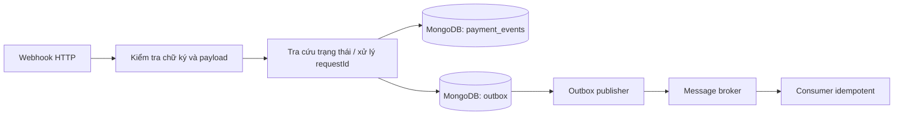

# Kiểm thử bằng MongoDB thực tế và giới hạn của giải pháp nhúng

Khi tích hợp MongoDB vào ứng dụng Spring Boot, việc một repository chạy đúng với dữ liệu giả chưa chứng minh rằng ứng dụng sẽ chạy đúng với MongoDB được triển khai thực tế. Sự khác biệt thường nằm ở truy vấn, kiểu dữ liệu BSON, chỉ mục, giao dịch, mức nhất quán, lỗi mạng và các tính năng phụ thuộc vào replica set. Vì vậy, một bộ kiểm thử đáng tin cậy cần có những ca chạy trên **MongoDB thật**, với cấu hình càng gần môi trường triển khai càng tốt.

Bài học này tập trung vào cách tổ chức kiểm thử tích hợp Spring Boot với MongoDB bằng Testcontainers hoặc một MongoDB thử nghiệm độc lập, đồng thời làm rõ khả năng và giới hạn của các giải pháp MongoDB nhúng (*embedded MongoDB*).

## 1. Mục tiêu và phạm vi kiểm thử

Trong một ứng dụng tích hợp hệ thống, MongoDB có thể là nơi lưu trạng thái yêu cầu HTTP, lưu khóa chống xử lý trùng, quản lý outbox hoặc phục vụ truy vấn dữ liệu. Khi đó, lỗi MongoDB có thể ảnh hưởng đến toàn bộ luồng nghiệp vụ, kể cả khi endpoint HTTP vẫn trả về mã trạng thái hợp lệ.

Sau bài học, người học có thể:

- Phân biệt kiểm thử đơn vị, kiểm thử lớp truy cập dữ liệu và kiểm thử tích hợp với MongoDB thật.
- Dựng MongoDB tạm thời cho kiểm thử Spring Boot bằng Testcontainers và cấu hình URI an toàn.
- Kiểm tra ánh xạ document, truy vấn, chỉ mục duy nhất và xử lý ghi trùng bằng hành vi thực tế của máy chủ.
- Xác định những trường hợp phải dùng replica set, đặc biệt là giao dịch đa tài liệu và change streams.
- Thiết kế kiểm thử các luồng HTTP → MongoDB → hệ thống ngoài mà không nhầm giao dịch MongoDB với giao dịch phân tán.
- Xây dựng bộ kiểm thử chạy được trên máy phát triển và CI, có dữ liệu độc lập, thời gian chạy hợp lý và lỗi dễ chẩn đoán.

**Phạm vi:** các thành phần Spring Boot như Spring Data MongoDB (repository, `MongoTemplate`, cấu hình kết nối, transaction manager) và các adapter tương tác với MongoDB trong một luồng tích hợp. Phần kiểm thử API, broker thông điệp và cache chỉ được nhắc đến khi chúng ảnh hưởng trực tiếp tới hợp đồng dữ liệu và tính đúng đắn của MongoDB.

## 2. Chọn đúng mức kiểm thử

Các mức kiểm thử giải quyết những câu hỏi khác nhau; không nên yêu cầu một mức thay thế hoàn toàn mức khác.

| Mức kiểm thử | Đối tượng phù hợp | Điều chứng minh được | Giới hạn |
|---|---|---|---|
| Unit test với mock | Luật nghiệp vụ, phân nhánh xử lý lỗi, tạo khóa idempotency | Logic của lớp gọi repository | Không chạy MongoDB, không xác minh truy vấn, index hoặc BSON |
| Embedded MongoDB | Ánh xạ và truy vấn cơ bản trong môi trường gọn nhẹ | Một phần hành vi với bản MongoDB nhúng được khởi động | Có thể khác phiên bản, kiến trúc triển khai và topology thật |
| Testcontainers + MongoDB | Repository, `MongoTemplate`, unique index, aggregation, transaction và các tương tác thật | Hành vi của một tiến trình MongoDB thật theo phiên bản đã chọn | Container đơn lẻ không mô phỏng đầy đủ cluster và sự cố hạ tầng |
| MongoDB thử nghiệm chuyên dụng | Xác thực, TLS, replica set nhiều nút, failover, phân quyền, tải | Những đặc tính triển khai gần production hơn | Thiết lập, cách ly dữ liệu và chi phí vận hành cao hơn |
| End-to-end | HTTP, ứng dụng, MongoDB và các hệ thống phụ thuộc | Tính đúng đắn của một luồng nghiệp vụ hoàn chỉnh | Chậm hơn và khó khoanh vùng lỗi hơn |

Một chiến lược thực tế là giữ unit test nhanh và nhiều, bổ sung integration test MongoDB cho các hợp đồng dữ liệu quan trọng, rồi dành một số ít bài kiểm thử toàn luồng cho tình huống nhiều hệ thống phối hợp.

Ví dụ: logic quyết định “nếu `requestId` đã tồn tại thì không tạo đơn hàng mới” có thể được unit test. Tuy nhiên, việc **hai yêu cầu đồng thời không tạo được hai bản ghi có cùng `requestId`** phải được kiểm tra với chỉ mục duy nhất trên MongoDB thật; một mock repository không bảo đảm tính nguyên tử đó.

## 3. Embedded MongoDB là gì và vì sao có giới hạn?

Một giải pháp thường gặp là thư viện Flapdoodle Embedded MongoDB. Cần hiểu đúng: đây thường là cơ chế tải và khởi chạy một **tiến trình `mongod`** được quản lý trong vòng đời kiểm thử, không phải một bản MongoDB Java thuần chạy trong RAM. Ngoài ra còn có những thư viện giả lập MongoDB trong bộ nhớ; chúng có phạm vi hỗ trợ và độ trung thực khác nữa.

Những rủi ro cần đánh giá:

1. **Không cùng phiên bản với môi trường thật.** Khác biệt về wire protocol, toán tử aggregation, index, driver, collation hay hành vi chuyển đổi dữ liệu có thể khiến thử nghiệm xanh nhưng môi trường triển khai lỗi.
2. **Topology đơn lẻ.** Một `mongod` standalone thông thường không đáp ứng các yêu cầu của transaction đa tài liệu và change streams. Có thể cấu hình một replica set nhúng ở một số công cụ, nhưng phải làm rõ công cụ và tính năng thực sự được hỗ trợ.
3. **Khởi động phụ thuộc máy chạy.** Binary thích hợp cho hệ điều hành và kiến trúc CPU phải có sẵn hoặc tải được; quyền thực thi, proxy và giới hạn môi trường CI có thể gây lỗi ngoài ý muốn.
4. **Thiếu những đặc tính production.** TLS, xác thực, quyền hạn, cấu hình replica set, failover, tài nguyên và mạng thường khác đáng kể môi trường triển khai.
5. **Tích hợp phiên bản Spring Boot không mặc nhiên có sẵn.** Không nên giả định chỉ thêm thư viện embedded là Spring Boot mới sẽ tự cấu hình nó. Cần kiểm tra cơ chế khởi động và cấu hình thực tế của phiên bản dự án.

Embedded MongoDB vẫn hữu ích khi cần thử nghiệm nhẹ, có kiểm soát, chỉ dùng các thao tác CRUD/truy vấn cơ bản và đã xác nhận phiên bản tương thích. Điểm quan trọng là **ghi rõ bài kiểm thử đang chứng minh điều gì**. Nếu yêu cầu nghiệp vụ phụ thuộc vào unique index, transaction, change streams hoặc hành vi lỗi của driver, hãy chạy ít nhất một bộ kiểm thử tương ứng với MongoDB thật.

## 4. Dựng MongoDB thật bằng Testcontainers

Testcontainers tạo container tạm thời cho kiểm thử, cấp cổng động, chờ dịch vụ sẵn sàng và dọn vòng đời container sau phiên chạy. Ứng dụng Spring Boot vẫn giao tiếp với MongoDB bằng driver thật.

Với dự án Spring Boot 3.x sử dụng Gradle và phiên bản Testcontainers tương thích do BOM quản lý, các dependency thường có dạng:

```groovy
dependencies {
    implementation 'org.springframework.boot:spring-boot-starter-data-mongodb'

    testImplementation 'org.springframework.boot:spring-boot-starter-test'
    testImplementation 'org.testcontainers:junit-jupiter'
    testImplementation 'org.testcontainers:mongodb'
}
```

Tên module và API có thể thay đổi theo major version của Testcontainers. Cần dùng bộ dependency tương thích với BOM đã chọn trong dự án, thay vì sao chép một phiên bản thư viện riêng lẻ không đồng bộ.

Một bài kiểm thử repository có thể tự cấp URI MongoDB thông qua `@DynamicPropertySource`:

```java
package example.integration.mongo;

import java.time.Instant;
import java.util.Optional;

import org.junit.jupiter.api.BeforeEach;
import org.junit.jupiter.api.Test;
import org.springframework.beans.factory.annotation.Autowired;
import org.springframework.boot.test.autoconfigure.data.mongo.DataMongoTest;
import org.springframework.dao.DuplicateKeyException;
import org.springframework.data.annotation.Id;
import org.springframework.data.domain.Sort;
import org.springframework.data.mongodb.core.MongoTemplate;
import org.springframework.data.mongodb.core.index.Index;
import org.springframework.data.mongodb.core.mapping.Document;
import org.springframework.data.mongodb.repository.MongoRepository;
import org.springframework.test.context.DynamicPropertyRegistry;
import org.springframework.test.context.DynamicPropertySource;
import org.testcontainers.containers.MongoDBContainer;
import org.testcontainers.junit.jupiter.Container;
import org.testcontainers.junit.jupiter.Testcontainers;
import org.testcontainers.utility.DockerImageName;

import static org.assertj.core.api.Assertions.assertThat;
import static org.assertj.core.api.Assertions.assertThatThrownBy;

@Document("purchase_orders")
record PurchaseOrder(
        @Id String id,
        String requestId,
        Instant createdAt
) {}

interface PurchaseOrderRepository
        extends MongoRepository<PurchaseOrder, String> {
    Optional<PurchaseOrder> findByRequestId(String requestId);
}

@DataMongoTest
@Testcontainers
class PurchaseOrderRepositoryIT {

    @Container
    static final MongoDBContainer mongo = new MongoDBContainer(
            DockerImageName.parse("mongo:7.0")
    );

    @DynamicPropertySource
    static void mongodbProperties(DynamicPropertyRegistry registry) {
        registry.add(
                "spring.data.mongodb.uri",
                mongo::getReplicaSetUrl
        );
    }

    @Autowired
    PurchaseOrderRepository repository;

    @Autowired
    MongoTemplate template;

    @BeforeEach
    void resetCollectionAndIndex() {
        template.dropCollection(PurchaseOrder.class);
        template.indexOps(PurchaseOrder.class)
                .ensureIndex(new Index()
                        .on("requestId", Sort.Direction.ASC)
                        .unique());
    }

    @Test
    void storesDocumentAndRejectsDuplicateRequestId() {
        PurchaseOrder first = repository.save(new PurchaseOrder(
                null,
                "payment:evt-123",
                Instant.parse("2026-01-01T00:00:00Z")
        ));

        assertThat(repository.findByRequestId("payment:evt-123"))
                .contains(first);

        assertThatThrownBy(() -> repository.save(new PurchaseOrder(
                null,
                "payment:evt-123",
                Instant.parse("2026-01-01T00:00:01Z")
        ))).isInstanceOf(DuplicateKeyException.class);
    }
}
```

Đặt ví dụ trong package thuộc vùng quét của ứng dụng Spring Boot để `@DataMongoTest` tìm được document và repository. Bài test minh họa dành cho API Testcontainers có `MongoDBContainer` và `getReplicaSetUrl()`; khi nâng major version, cần điều chỉnh import/API tương ứng.

Các quyết định quan trọng trong ví dụ:

- `mongo:7.0` là **phiên bản mẫu được cố định**. Dự án thực tế nên chọn tag phù hợp với major version đang vận hành và chủ động nâng cấp có kiểm thử; không dùng `latest` cho bài kiểm thử cần tái lập.
- `getReplicaSetUrl()` cung cấp URI của MongoDB container do Testcontainers khởi tạo trong chế độ phù hợp cho replica set. Cách cấu hình kết nối cần khớp loại container đang dùng.
- `@DynamicPropertySource` chuyển URI động cho Spring Boot. Không cần giả định container luôn sử dụng cổng `27017` trên máy host.
- `@DataMongoTest` tạo *test slice* cho lớp truy cập MongoDB, không tải toàn bộ HTTP controller hay adapter của ứng dụng.
- Việc tạo index **được thực hiện tường minh**; không giả định Spring Data MongoDB tự động tạo mọi `@Indexed` trong mọi cấu hình.
- `DuplicateKeyException` xác nhận lỗi từ MongoDB đã được chuyển sang loại ngoại lệ dữ liệu của Spring. Điều này quan trọng khi service muốn chuyển lỗi ghi trùng thành hành vi idempotent.

Đây là kiểm thử tích hợp thật: nếu bỏ index duy nhất, kỳ vọng lỗi duplicate sẽ thất bại; nếu dùng mock repository, bài test không chứng minh được ràng buộc dữ liệu.

### Lựa chọn cấu hình: `@ServiceConnection`

Ở các phiên bản Spring Boot hỗ trợ Testcontainers service connections, có thể đăng ký container bằng `@ServiceConnection` thay cho `@DynamicPropertySource`:

```java
@SpringBootTest
@Testcontainers
class OrderFlowIT {

    @Container
    @ServiceConnection
    static final MongoDBContainer mongo =
            new MongoDBContainer(DockerImageName.parse("mongo:7.0"));

    // Các bài test của service, controller, adapter...
}
```

Cấu hình này cần dependency `org.springframework.boot:spring-boot-testcontainers` trong phạm vi test và import `org.springframework.boot.testcontainers.service.connection.ServiceConnection`. Khi Spring Boot nhận diện loại container, nó tạo connection details phù hợp. Hai ví dụ là **hai cách thay thế** để cung cấp kết nối; không cần khai báo cả hai cho cùng một container.

Nếu muốn chạy kiểm thử toàn ứng dụng, sử dụng `@SpringBootTest` và bật đúng những bean cần thiết. Nếu chỉ kiểm tra mapping/repository, ưu tiên `@DataMongoTest` để giảm thời gian khởi động và tránh biến lỗi của hệ thống ngoài thành lỗi của kiểm thử MongoDB.

## 5. Thiết kế ca kiểm thử dựa trên hợp đồng dữ liệu

Không nên chỉ kiểm thử `save()` rồi `findById()`. Một tài liệu tích hợp hệ thống cần có hợp đồng rõ ràng giữa payload đầu vào, document lưu trữ và kết quả đầu ra.

### 5.1. Ánh xạ dữ liệu và BSON

MongoDB lưu BSON, nên hãy xác minh những vùng dễ sai:

- `_id`: kiểu `ObjectId` so với `String`, cách Spring Data chuyển đổi và việc serialize ra API.
- Thời gian: kiểu `Instant`/`Date`, thời điểm UTC, độ chính xác mili giây. Không so sánh bằng giả định nanosecond được bảo toàn.
- Tiền và số thập phân: quy ước dùng `Decimal128`, `String` hoặc minor units; tránh âm thầm chuyển thành `double` khi nghiệp vụ yêu cầu tính chính xác.
- Trường không tồn tại so với giá trị `null`, document lồng nhau, enum mới, thay đổi tên trường.
- Giá trị mặc định của schema cũ và bản ghi do phiên bản ứng dụng trước đó tạo ra.

Ví dụ, nếu dữ liệu API có `requestId` nhưng MongoDB được đánh index trên `request_id`, bài test insert/read đơn giản vẫn có thể xanh trong khi index nghiệp vụ không bảo vệ đúng trường. Hãy kiểm tra cả tên trường BSON và định nghĩa index.

### 5.2. Truy vấn, aggregation và sắp xếp

Tạo dữ liệu phân biệt rõ từng nhánh của bộ lọc: các trạng thái khác nhau, khoảng thời gian ở hai biên, tài liệu thiếu field và hai bản ghi có cùng thời gian. Kiểm tra:

- Toán tử `$in`, `$elemMatch`, `$exists`, `$group` và các pipeline thực sự dùng.
- Trật tự sort có khóa phụ ổn định khi nhiều document cùng giá trị khóa chính.
- Phân trang và thứ tự sắp xếp được định nghĩa tường minh.
- Collation/case sensitivity khi tên, mã hoặc địa chỉ email có quy tắc so khớp.
- Update một phần (`$set`, `$inc`, `$addToSet`) có đúng tính nguyên tử theo **một document** mà nghiệp vụ cần hay không.

Đối với truy vấn quan trọng, có thể đánh giá `explain()` trong môi trường thử nghiệm để biết index có được dùng hay không. Không nên lấy thời gian chạy vài mili giây trên container rỗng làm bằng chứng hiệu năng production.

### 5.3. Chỉ mục duy nhất và xử lý trùng lặp

Trong luồng nhận webhook hoặc message, xử lý trùng thường là yêu cầu cốt lõi. Nên kiểm thử theo thứ tự:

1. Tạo unique index cho khóa nghiệp vụ, ví dụ `(source, externalEventId)` hoặc `requestId`.
2. Ghi một event hợp lệ; xác minh document và trạng thái được lưu.
3. Gửi lại cùng event; xác minh chỉ có một bản ghi tác động nghiệp vụ.
4. Gửi cùng khóa nhưng payload mâu thuẫn; xác minh chính sách xử lý đã thống nhất, ví dụ trả lỗi xung đột hoặc ghi cảnh báo.
5. Nếu có xử lý song song, bắn hai yêu cầu cùng khóa gần đồng thời và kiểm tra kết quả cuối cùng dưới unique index thật.

Chỉ kiểm tra `findByRequestId()` trước `insert()` là không đủ: hai luồng có thể cùng nhìn thấy “chưa tồn tại” rồi cùng ghi. **Unique index của MongoDB là hàng rào nguyên tử cuối cùng**; tầng service vẫn phải diễn giải lỗi duplicate cho đúng hợp đồng API hoặc message. Việc “chỉ lưu một bản ghi” cũng chưa chứng minh side effect ngoài MongoDB chỉ diễn ra một lần.

## 6. Giao dịch: phải kiểm tra đúng topology và ranh giới

MongoDB hỗ trợ giao dịch đa tài liệu khi chạy trên topology phù hợp (replica set hoặc sharded cluster đáp ứng điều kiện tính năng). Một `mongod` standalone thông thường không phải môi trường kiểm thử transaction phù hợp.

Trong Spring Boot, logic transaction thường dựa trên `MongoTransactionManager` và `@Transactional`. Một cấu hình bean có dạng:

```java
@Configuration
class MongoTransactionConfig {

    @Bean
    MongoTransactionManager mongoTransactionManager(
            MongoDatabaseFactory databaseFactory) {
        return new MongoTransactionManager(databaseFactory);
    }
}
```

Các import tương ứng là `org.springframework.context.annotation.Configuration`, `org.springframework.context.annotation.Bean`, `org.springframework.data.mongodb.MongoDatabaseFactory` và `org.springframework.data.mongodb.MongoTransactionManager`.

Hãy tạo một service ghi hai document trong cùng transaction rồi chủ động ném ngoại lệ trước khi commit. Một bài kiểm thử có giá trị phải xác minh **cả hai phép ghi đều bị rollback**. Sau đó kiểm tra nhánh thành công, nơi cả hai được commit. Các điểm cần chú ý:

- `@Transactional` hoạt động qua Spring proxy; gọi nội bộ từ một phương thức sang phương thức khác của chính cùng bean có thể không đi qua proxy.
- Không mặc định mọi thao tác DDL như tạo collection/index là hợp lệ bên trong transaction. Chuẩn bị collection và index trước ca kiểm thử.
- Driver, transaction manager và MongoDB phải cùng tham gia đúng session. Một thao tác tạo kết nối độc lập có thể nằm ngoài transaction mong muốn.
- Transaction MongoDB chỉ bao trùm các thao tác MongoDB tham gia session đó. Gửi HTTP hoặc publish Kafka/RabbitMQ không tự trở thành một phần của transaction MongoDB.

Ví dụ, luồng “lưu đơn hàng vào MongoDB → publish sự kiện sang broker” có khoảng hở nếu MongoDB commit thành công nhưng broker timeout. Kiểm thử cần làm rõ chiến lược phục hồi, thường là **transactional outbox** (lưu bản ghi outbox trong cùng transaction MongoDB và phát đi sau) kèm idempotency ở consumer. Outbox giảm nguy cơ thất lạc sự kiện nhưng vẫn có thể phát lại; hãy kiểm thử cả tình huống publish thành công rồi tiến trình chết trước khi đánh dấu đã gửi.

Testcontainers với một replica set đơn nút là lựa chọn tốt để xác minh transaction và rollback cơ bản. Nó **không chứng minh** hành vi khi primary đổi nút, mạng bị chia cắt hoặc write concern của cụm nhiều nút. Các điều kiện này cần một môi trường thử nghiệm phù hợp hơn.

## 7. Change streams, TTL và hành vi phụ thuộc thời gian

### Change streams

Nếu ứng dụng dùng change streams để phản ứng khi collection thay đổi, kiểm thử cần một MongoDB deployment hỗ trợ tính năng này, thường là replica set. Những tình huống đáng kiểm tra:

- Insert/update/delete có phát ra sự kiện với thông tin service cần hay không.
- Client có lọc đúng collection và đúng kiểu operation không.
- Khi kết nối bị gián đoạn, service khởi động lại từ resume token đã lưu như thế nào.
- Khi event bị phát lại, bên nhận có chịu được duplicate không.
- Khi resume token không còn hợp lệ hoặc lịch sử oplog không đủ, ứng dụng xử lý và cảnh báo ra sao.

Không nên kiểm thử bằng giả định “mỗi thay đổi luôn được nhận chính xác một lần”. Kiến trúc tích hợp thường phải thiết kế **at-least-once + idempotency**, đồng thời giám sát độ trễ từ thời điểm ghi tới lúc xử lý.

### TTL index

TTL index dùng cho dữ liệu như session tạm, khóa chống trùng có thời hạn hoặc bản ghi trung gian. MongoDB loại bỏ bản ghi bằng một tiến trình nền, vì vậy việc hết hạn **không đồng nghĩa document biến mất đúng tại thời điểm đồng hồ chạm mốc**.

Một bài test TTL tốt nên:

- Xác minh TTL index được tạo với field và `expireAfterSeconds` đúng.
- Ghi document có mốc thời gian đủ ngắn cho kiểm thử.
- Chờ theo điều kiện với timeout hợp lý (polling), sau đó kiểm tra document thực sự đã bị xóa.
- Tránh `Thread.sleep` với một khoảng cố định ngắn rồi kết luận TTL bị lỗi.

Khi cần xác minh logic “request đã quá hạn thì từ chối”, nên kiểm thử trực tiếp điều kiện thời gian của ứng dụng bằng `Clock` có thể điều khiển; không cần chờ MongoDB dọn TTL cho mọi nhánh nghiệp vụ.

## 8. Thử các lỗi tích hợp có ý nghĩa

Một bộ kiểm thử tích hợp cần có các tình huống bất thường, nhưng nên chọn đúng tầng để tạo lỗi.

| Tình huống | Kiểm chứng mong muốn | Môi trường phù hợp |
|---|---|---|
| Vi phạm unique index | Spring chuyển ngoại lệ; service phản hồi idempotent hoặc conflict đúng hợp đồng | MongoDB Testcontainers |
| Trường BSON thiếu/khác kiểu | Mapping hoặc validation có phản ứng đã định nghĩa | MongoDB Testcontainers |
| Lỗi tạm thời hoặc mất kết nối | Timeout được giới hạn; retry có backoff; không ghi trùng | Container + công cụ kiểm soát mạng, hoặc môi trường tích hợp |
| Transaction rollback | Không còn ghi dở trong những collection tham gia transaction | Replica set thử nghiệm |
| Primary failover | Client phát hiện topology mới, thao tác được retry theo chính sách | Replica set nhiều nút |
| Publish broker lỗi sau khi MongoDB commit | Outbox còn bản ghi chưa phát; hệ thống phục hồi không mất event | MongoDB + broker thật hoặc adapter được kiểm soát |
| Query thiếu index | Query plan/metrics cho thấy rủi ro quét collection | Cơ sở dữ liệu với dữ liệu và index gần thực tế |

Khi kiểm thử retry, phân biệt **lỗi có thể thử lại** (mất kết nối tạm thời, một số lỗi giao dịch có nhãn phù hợp) với **lỗi không nên retry mù quáng** (unique constraint, payload sai, không có quyền). Chính sách retry cần có giới hạn, độ trễ tăng dần và phép ghi idempotent để tránh khuếch đại sự cố.

Không sử dụng cách vô hiệu hóa toàn bộ kiểm soát timeout hoặc biến `DuplicateKeyException` thành “retry vô hạn”. Bài test phải chứng minh được giới hạn số lần thử và trạng thái cuối cùng quan sát được.

## 9. Cấu trúc bộ kiểm thử trong Spring Boot

Một cấu trúc dễ bảo trì là tách kiểm thử theo câu hỏi cần trả lời:

```text
src/test/java/...
  order/
    OrderServiceTest.java             # Unit test: chính sách nghiệp vụ
    OrderRepositoryIT.java            # @DataMongoTest + MongoDB thật
    OrderTransactionIT.java           # Replica set + transaction manager
    OrderHttpFlowIT.java              # @SpringBootTest + HTTP + MongoDB
    OrderOutboxFlowIT.java            # MongoDB + publisher/broker
```

Các nguyên tắc triển khai:

**Dữ liệu độc lập.** Mỗi bài test cần kiểm soát dữ liệu của mình. Có thể xóa collection rồi tạo index lại như ví dụ, dùng tên database riêng hoặc tạo ID có tiền tố riêng. Nếu chạy song song trên cùng database, tránh việc bài test này `dropCollection()` trong khi bài khác đang đọc.

**Môi trường tái lập.** Cố định image MongoDB và cấu hình liên quan; để Testcontainers chọn host port. Tránh phụ thuộc MongoDB đang vô tình chạy trên máy cá nhân.

**Tạo schema/index rõ ràng.** Nếu ứng dụng tạo index khi startup hoặc qua migration, kiểm thử đường đi đó riêng; nếu test chủ động tạo index, cần nêu rõ phần ứng dụng chịu trách nhiệm tạo index trong production. Một test tạo index thủ công không tự xác minh migration của ứng dụng.

**Tách các phụ thuộc không cần thiết.** Test repository không cần broker. Test luồng outbox thì broker trở thành thành phần thật sự của hợp đồng và nên được kiểm chứng phù hợp. Spring Integration adapter có thể được kiểm thử với input channel và output channel được kiểm soát, đồng thời nối MongoDB thật khi hành vi persistence là trọng tâm.

**Tránh phụ thuộc thứ tự.** Không để một test tạo dữ liệu và test khác ngầm dùng lại. Các assertion phải dựa trên dữ liệu fixture do chính test thiết lập.

**Không dùng `@DirtiesContext` vô điều kiện.** Chỉ làm bẩn Spring context khi test thực sự sửa cấu hình/bean theo cách cần tạo context mới; lạm dụng annotation này làm bài kiểm thử chậm đáng kể.

## 10. Chạy trên CI và vận hành môi trường thử nghiệm

Testcontainers thông thường cần một container runtime tương thích, ví dụ Docker hoặc một môi trường có API tương thích. Pipeline CI phải cấp quyền và tài nguyên đủ cho MongoDB khởi động.

Một quy trình CI thực tế có thể gồm:

1. Chạy unit test và kiểm tra tĩnh trước để phản hồi nhanh.
2. Chạy repository/integration test MongoDB trên container image được cố định.
3. Chạy các bài tích hợp toàn luồng với broker/HTTP phụ thuộc nếu dự án có.
4. Chạy nhóm failover, bảo mật, hiệu năng trên môi trường thử nghiệm chuyên dụng ở một pipeline phù hợp.

Nếu môi trường CI không thể khởi động container, có thể dùng một MongoDB thử nghiệm do pipeline cấp phát, với database/credentials riêng, dữ liệu được làm sạch và chính sách hủy tài nguyên. Không trỏ test tự động vào database production hoặc database dùng chung thiếu cách ly.

Các lỗi CI thường gặp và hướng kiểm tra:

| Hiện tượng | Khả năng cần kiểm tra |
|---|---|
| Không tạo được MongoDB container | Container runtime chưa sẵn sàng, thiếu quyền, thiếu tài nguyên hoặc không tải được image |
| Kết nối vào `localhost:27017` bị từ chối | Test đang dùng URI cố định thay vì URI host/port do Testcontainers cấp |
| Transaction báo không hỗ trợ | MongoDB đang chạy standalone, URI/topology không đúng hoặc transaction manager chưa được cấu hình |
| Unique index test thất bại vì không có duplicate error | Index chưa được tạo, tạo sai tên field hoặc dữ liệu test không trùng theo khóa thực |
| Test lúc xanh lúc đỏ | Fixture chia sẻ, test song song tác động cùng collection, giả định thời gian TTL/change stream hoặc retry chưa được giới hạn |
| Khác biệt giữa CI và production | MongoDB major version, index, collation, read/write concern, auth, topology hoặc cấu hình driver chưa đồng bộ |

## 11. Quan sát và chẩn đoán lỗi từ bài kiểm thử

Trong luồng tích hợp, cần có bằng chứng để lần theo một yêu cầu từ HTTP/message tới thao tác MongoDB và kết quả sau đó.

Nên quan sát:

- `requestId`/`correlationId` và tên collection được phép ghi log, không ghi payload nhạy cảm hoặc URI chứa mật khẩu.
- Loại thao tác, thời gian truy vấn và số lần retry; dùng metric để phân biệt latency MongoDB với thời gian xử lý ứng dụng.
- Lỗi driver đã được phân loại: timeout, network, authentication, duplicate key, transaction abort.
- Mức tồn đọng outbox, tuổi bản ghi outbox cũ nhất, độ trễ xử lý change stream, số sự kiện bị phát lại và tỉ lệ thất bại.
- Với truy vấn quan trọng: thông tin index/`explain()` trong môi trường chẩn đoán phù hợp.

Bản thân kiểm thử phải có assertion về **kết quả cuối** và **hệ quả quan sát được**: document nào tồn tại, trạng thái nào được lưu, bao nhiêu side effect xuất hiện, retry dừng ở đâu. Chỉ kiểm tra log “save success” không chứng minh dữ liệu đã được commit hoặc consumer xử lý đúng.

## 12. Ví dụ tình huống tổng hợp: webhook thanh toán

Giả sử một API Spring Boot nhận webhook từ đối tác, lưu MongoDB để chống xử lý trùng rồi tạo bản ghi outbox cho broker:



Các hợp đồng cần được chứng minh bằng kiểm thử:

| Ca | Kỳ vọng |
|---|---|
| Webhook hợp lệ lần đầu | Có một `payment_event` và một outbox event nhất quán |
| Gửi lại cùng `requestId` và payload | Không phát sinh giao dịch thanh toán mới; phản hồi theo chính sách idempotency |
| Hai webhook cùng khóa đến đồng thời | Unique index giữ được một kết quả nghiệp vụ |
| Lỗi sau khi ghi event nhưng trước khi ghi outbox | Transaction rollback cả hai, hoặc cơ chế phục hồi được xác định rõ |
| MongoDB commit thành công nhưng broker lỗi | Outbox còn pending và được publisher thử lại |
| Publisher phát đi rồi chết trước khi đánh dấu sent | Broker/consumer có thể nhận lại; consumer xử lý idempotent |
| Trường schema cũ thiếu dữ liệu mới | Mapping và nghiệp vụ xử lý theo quy tắc tương thích đã định nghĩa |

Bài test repository xác minh index và mapping; bài test transaction xác minh ghi event/outbox; bài test toàn luồng xác minh HTTP status và hệ quả của publisher. Phân chia như vậy giúp khi một ca thất bại biết nên điều tra hợp đồng nào.

## 13. Checklist áp dụng cho dự án

Trước khi coi phần kiểm thử MongoDB là đủ tin cậy, tự trả lời:

- [ ] Có test chạy với MongoDB thật và major version phù hợp môi trường triển khai.
- [ ] URI test được cấp động, cấu hình riêng, không chứa thông tin production.
- [ ] Fixture độc lập; collection và index được tạo đúng trách nhiệm của ứng dụng hoặc của test.
- [ ] Có ca kiểm thử ánh xạ BSON, truy vấn/aggregation quan trọng và chỉ mục duy nhất.
- [ ] Khóa idempotency được bảo vệ bởi ràng buộc ở database; có ca xử lý đồng thời.
- [ ] Transaction/change streams chỉ được kiểm thử trên topology hỗ trợ, có kiểm tra rollback/resume phù hợp.
- [ ] Timeout, retry, duplicate và lỗi giao tiếp được phân loại theo hợp đồng nghiệp vụ.
- [ ] Khi có broker/HTTP ngoài MongoDB, có chiến lược outbox hoặc phục hồi đã được kiểm chứng.
- [ ] TTL hoặc hành vi bất đồng bộ dùng assertion chờ điều kiện với giới hạn thời gian hợp lý.
- [ ] Pipeline CI tái lập được môi trường, giữ log chẩn đoán cần thiết và không dùng database production.

**Ghi nhớ:** embedded MongoDB có thể phù hợp cho một số bài kiểm thử nhẹ; MongoDB thật là lựa chọn cần thiết khi muốn xác minh hành vi thực của driver, BSON, index, transaction và các luồng tích hợp có rủi ro xử lý trùng. Dù dùng Testcontainers, bài kiểm thử chỉ có giá trị trong phạm vi **phiên bản, topology, dữ liệu và lỗi** mà nó thực sự mô phỏng.
