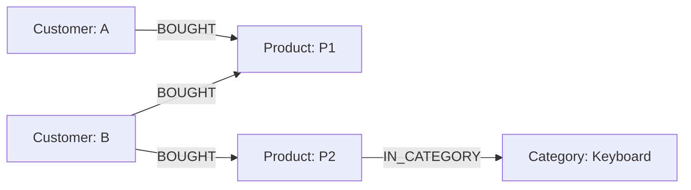
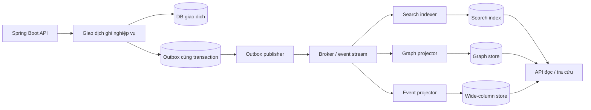

# Lựa chọn kho dữ liệu theo nhu cầu tìm kiếm, đồ thị và phân tán

## 1. Bài toán: một hệ thống, nhiều kiểu truy vấn

Giả sử một ứng dụng thương mại điện tử dùng Spring Boot cần đáp ứng đồng thời ba yêu cầu:

1. Người dùng tìm sản phẩm bằng từ khóa gần đúng, có bộ lọc, sắp xếp theo mức độ liên quan và gợi ý khi gõ.
2. Hệ thống đề xuất sản phẩm theo quan hệ giữa khách hàng, sản phẩm, nhãn hàng và hành vi mua sắm.
3. Dịch vụ tiếp nhận hàng triệu sự kiện truy cập, cần ghi với thông lượng cao và tra cứu nhanh theo khách hàng, khoảng thời gian.

Ba yêu cầu có mẫu truy vấn và đặc tính tải rất khác nhau. **Không có một kho NoSQL nào mặc nhiên tối ưu cho tất cả.** Việc lựa chọn cần bắt đầu từ truy vấn, hợp đồng dữ liệu, mức nhất quán, cách phân vùng và khả năng vận hành; tên sản phẩm chỉ nên xuất hiện sau khi các điều kiện đó đã rõ.

Trong module **SPRING_BOOT_INTEGRATION**, bài học tập trung vào cách Spring Boot kết nối và tổ chức các adapter dữ liệu, đồng thời xem xét lỗi, giao dịch, đồng bộ dữ liệu, xử lý trùng lặp, kiểm thử và quan sát. Một kho tìm kiếm hoặc đồ thị rất có thể chỉ là **mô hình đọc bổ sung** cho hệ thống đang có cơ sở dữ liệu giao dịch.

Sau bài này, bạn có thể:

- Phân biệt bài toán **tìm kiếm nội dung**, **duyệt quan hệ đồ thị** và **ghi/đọc dữ liệu phân tán theo khóa truy vấn**.
- Chọn mô hình lưu trữ theo access pattern, độ trễ, quy mô, tính nhất quán và chi phí vận hành.
- Nhận diện vai trò của Elasticsearch/OpenSearch, Neo4j và Cassandra/ScyllaDB cùng những lựa chọn thay thế.
- Tích hợp một kho phù hợp vào Spring Boot bằng cấu hình, Spring Data hoặc client/adapter riêng.
- Thiết kế đồng bộ dữ liệu qua outbox và broker khi dùng nhiều kho, đồng thời kiểm soát sự kiện trùng, sai thứ tự, lag và khả năng phục hồi.

> **Phạm vi ví dụ:** Java 17+, Spring Boot 3.x và các phiên bản Spring Data tương thích với bản Spring Boot đang dùng. API, driver, thuộc tính cấu hình, cơ chế xác thực và phiên bản server cần được đối chiếu với ma trận tương thích của dự án thực tế. Các hệ thống trong ví dụ là độc lập: không cần đưa tất cả starter vào cùng một ứng dụng chỉ để học cách chọn kho.

## 2. Bắt đầu từ access pattern

Trước khi đánh giá công nghệ, hãy viết các truy vấn chủ đạo dưới dạng cụ thể:

| Câu hỏi về workload | Ví dụ cần làm rõ | Hệ quả đối với thiết kế |
| --- | --- | --- |
| Người dùng truy vấn bằng gì? | Từ khóa tự do; ID; tổ hợp khóa; đường đi qua nhiều quan hệ | Quyết định loại chỉ mục và mô hình dữ liệu |
| Trả về bao nhiêu bản ghi? | Top 20 sản phẩm; một nút lân cận; 100 sự kiện gần nhất | Ảnh hưởng phân trang và chi phí đọc |
| Độ trễ yêu cầu? | p95 dưới 150 ms ở tải định trước | Cần đo trên dữ liệu và hạ tầng đại diện |
| Ghi/đọc bao nhiêu? | 5.000 sự kiện/giây, 50 truy vấn/giây | Quyết định khả năng scale và chi phí |
| Có chấp nhận dữ liệu trễ? | Kết quả tìm kiếm trễ vài giây; số dư cần cập nhật ngay | Phân biệt read model eventual consistency và dữ liệu nghiệp vụ quan trọng |
| Phải duyệt quan hệ sâu đến đâu? | Một cấp bạn bè hay 4–6 cạnh có điều kiện | Quyết định giữa JOIN/index truyền thống và graph query |
| Khóa phân vùng có phân bố đều? | Một tenant rất lớn, các tenant khác nhỏ | Nguy cơ hot partition và tải lệch |
| Truy vấn có đổi liên tục? | Liên tục thêm bộ lọc, tìm kiếm tương tự | Nhu cầu linh hoạt khác nhau giữa các kho |
| Hệ thống phải khôi phục thế nào? | RPO, RTO, sao lưu, phục hồi chỉ mục | Quyết định liệu kho có thể là source of truth |

Việc một hệ thống có nhiều máy chủ hoặc nhiều bản sao **chưa đủ** để kết luận cần một cơ sở dữ liệu NoSQL phân tán. PostgreSQL/MySQL với index, replication và partitioning có thể đáp ứng rất nhiều nhu cầu ở quy mô vừa. Một kho chuyên dụng chỉ có ý nghĩa khi lợi ích của nó vượt chi phí phát triển, vận hành và giữ nhất quán giữa các bản sao dữ liệu.

## 3. Ba nhóm lưu trữ cần phân biệt

| Nhóm | Mô hình và cấu trúc nổi bật | Truy vấn thuận lợi | Hạn chế điển hình | Ví dụ |
| --- | --- | --- | --- | --- |
| **Search engine** | Tài liệu và inverted index; có scoring và aggregation | Full-text, relevance, typo tolerance tùy cấu hình, filter, facet | Chỉ mục có độ trễ cập nhật; ghi/phân tích nhiều có thể tốn tài nguyên; cần thiết kế mapping | Elasticsearch, OpenSearch, Apache Solr |
| **Graph database** | Nút, cạnh, thuộc tính và traversal | Quan hệ nhiều bước, đường đi, gợi ý theo kết nối, phát hiện cụm | Traversal khó khống chế khi nút có bậc rất cao; phân tán quan hệ phức tạp; cần giới hạn truy vấn | Neo4j, JanusGraph, Amazon Neptune |
| **Distributed wide-column / key-value** | Phân vùng theo khóa; bản sao trên nhiều nút; bảng thường được thiết kế theo truy vấn | Ghi lớn, đọc theo partition key, dữ liệu time-series hoặc sự kiện theo khóa | JOIN và truy vấn ad hoc hạn chế; sai partition key gây hotspot hoặc quét đắt đỏ | Apache Cassandra, ScyllaDB, DynamoDB với mô hình key-value riêng |

Đây là **nhóm theo thế mạnh truy vấn**, không phải phân loại tuyệt đối. Nhiều sản phẩm kết hợp nhiều khả năng: hệ quản trị quan hệ có full-text search, document database có search hoặc graph lookup, search engine có vector search. Tính năng trùng tên không bảo đảm khả năng truy vấn, chất lượng relevance hay mức nhất quán là tương đương.

### Quy tắc phân loại nhanh

<pre>
Cần tìm theo văn bản tự nhiên, xếp hạng mức liên quan?
    → Khảo sát search engine hoặc full-text search sẵn có.
Cần hỏi về đường đi và mối liên hệ nhiều bước?
    → Khảo sát graph database hoặc giải pháp quan hệ nếu đồ thị nhỏ.
Cần ghi rất nhiều và đọc theo khóa/phân vùng xác định trước?
    → Khảo sát wide-column/key-value phân tán.
Cần transaction chặt, truy vấn linh hoạt, JOIN nghiệp vụ?
    → Bắt đầu bằng cơ sở dữ liệu quan hệ trước.
</pre>

## 4. Khi nào chọn kho tìm kiếm?

Một bảng sản phẩm có thể được tìm bằng SQL:

```sql
SELECT id, name
FROM products
WHERE name LIKE '%ban phim%';
```

Nhưng khi người dùng cần tìm kiếm tự do, không dấu/có dấu, sai chính tả, từ đồng nghĩa, gợi ý, nhiều bộ lọc và sắp xếp theo độ liên quan, `LIKE` không còn thể hiện được đầy đủ yêu cầu sản phẩm. Hệ thống tìm kiếm thường sử dụng **inverted index**: ánh xạ token sang tập tài liệu chứa token ấy, sau đó kết hợp với thuật toán chấm điểm và bộ lọc.

Ví dụ từ câu hỏi “bàn phím cơ không dây”, một search engine có thể:

- Phân tích văn bản thành token theo analyzer đã cấu hình.
- Tìm những tài liệu chứa token phù hợp, kể cả khi thứ tự từ khác.
- Lọc kết quả theo tenant, trạng thái còn bán, khoảng giá.
- Xếp hạng bằng mức phù hợp của từ khóa cùng tín hiệu kinh doanh.
- Trả về tổng số kết quả và thống kê facet theo thương hiệu, danh mục.

### 4.1. Phân biệt `text` và `keyword`

Với Elasticsearch/OpenSearch, hai loại trường phổ biến có ý nghĩa khác nhau:

| Trường | Kiểu thường dùng | Mục đích |
| --- | --- | --- |
| `name`, `description` | `text` | Phân tích nội dung, tìm theo token và chấm điểm |
| `tenantId`, `productId`, `categoryCode` | `keyword` | So khớp chính xác, lọc, group/aggregation, join bằng ID tại tầng ứng dụng |
| `price` | Số thích hợp | Range filter và sort |
| `available` | Boolean | Lọc theo trạng thái |
| `updatedAt` | Date | Đồng bộ, sort và lọc thời gian |

Nếu ánh xạ một `productId` thành `text` rồi kỳ vọng truy vấn `term` hoạt động như so sánh ID chính xác, kết quả có thể sai vì trường đã bị phân tích thành token. Ngược lại, chỉ có `keyword` cho tên sản phẩm thì khó hỗ trợ full-text relevance.

Ví dụ truy vấn trong Elasticsearch Query DSL:

```json
{
  "size": 20,
  "query": {
    "bool": {
      "must": [
        {
          "match": {
            "name": {
              "query": "bàn phím không dây",
              "operator": "and"
            }
          }
        }
      ],
      "filter": [
        { "term": { "tenantId": "tenant-a" } },
        { "term": { "available": true } }
      ]
    }
  }
}
```

`match` phục vụ tìm kiếm nội dung; `term` trên `keyword` hoặc boolean phục vụ điều kiện chính xác. `must` ảnh hưởng điều kiện khớp và có thể ảnh hưởng scoring, trong khi `filter` thường được sử dụng cho điều kiện không cần chấm điểm. Đây là truy vấn minh họa; triển khai thực tế phải định nghĩa mapping, analyzer và chỉ mục trước.

**Đối với tiếng Việt**, tokenizer mặc định có thể chưa đáp ứng tốt tách từ đa âm tiết, dấu hoặc cách gõ của người dùng. Hãy lấy tập truy vấn thực tế để thử analyzer, cơ chế chuẩn hóa, synonyms và chính sách không dấu; đừng giả định cài search engine là có chất lượng tìm kiếm tiếng Việt tốt ngay.

### 4.2. Những điều cần đánh đổi

- **Độ trễ lập chỉ mục:** thay đổi dữ liệu không nhất thiết xuất hiện trong tìm kiếm ngay cùng thời điểm transaction nghiệp vụ đã commit; cần quy định mức trễ chấp nhận được.
- **Đồng bộ và xây dựng lại index:** bản ghi có thể bị bỏ sót, ghi trùng hoặc đến sai thứ tự; phải hỗ trợ reindex và đối chiếu dữ liệu.
- **Schema/mapping:** thay đổi analyzer hoặc một số kiểu trường thường phải tạo index mới, chuyển dữ liệu và đổi alias theo kế hoạch.
- **Chi phí:** shard, replica, dung lượng index, heap, refresh, aggregation, vector và lưu lượng ingest đều làm tăng tài nguyên.
- **Tính đúng đắn:** kết quả xếp hạng theo `_score` có thể thay đổi; không dùng search index làm nguồn xác định duy nhất cho số dư, tồn kho hoặc trạng thái thanh toán nếu mô hình không đáp ứng tính nhất quán cần thiết.

Elasticsearch và OpenSearch có các API/mô hình tương đồng về lịch sử, nhưng **không nên mặc định client, plugin và phiên bản Spring Data Elasticsearch tương thích hoàn toàn với OpenSearch**. Chọn driver và starter theo ma trận tương thích của từng sản phẩm. Nếu bài toán chỉ cần ít truy vấn full-text và dữ liệu nhỏ, hãy đánh giá PostgreSQL full-text search và các extension liên quan trước khi vận hành thêm một cluster.

## 5. Khi nào chọn graph database?

Mô hình quan hệ là trọng tâm khi truy vấn thường có dạng:

> “Người dùng A đã mua sản phẩm nào mà những người có hành vi giống A cũng mua, nhưng A chưa mua?”

Hoặc:

- Tìm con đường ngắn giữa hai tài khoản thông qua giao dịch hoặc thiết bị.
- Phát hiện vòng kết nối có dấu hiệu gian lận giữa tài khoản, số điện thoại, địa chỉ và thẻ.
- Phân tích phụ thuộc giữa dịch vụ, API, queue và hệ thống để đánh giá tác động của một thay đổi.
- Duyệt cây/đồ thị tri thức với nhiều loại quan hệ.

Trong graph database, **nút (node)** mô tả thực thể, **cạnh (relationship/edge)** mô tả mối liên kết; nút và cạnh có thể có thuộc tính. Truy vấn được diễn đạt dưới dạng các mẫu đường đi. Với Neo4j, ngôn ngữ phổ biến là Cypher.

Ví dụ mô hình:



Nếu A đã mua P1, B cũng mua P1 và P2, P2 có thể là ứng viên đề xuất cho A. Một truy vấn Cypher minh họa:

```cypher
MATCH (customer:Customer {id: $customerId})-[:BOUGHT]->(:Product)
      <-[:BOUGHT]-(similar:Customer)-[:BOUGHT]->(candidate:Product)
WHERE candidate.active = true
  AND NOT EXISTS {
    MATCH (customer)-[:BOUGHT]->(candidate)
  }
RETURN candidate.id AS productId,
       count(DISTINCT similar) AS commonBuyers
ORDER BY commonBuyers DESC
LIMIT 10
```

Đầu vào `$customerId` là **parameter** được bind từ client, tránh ghép giá trị người dùng trực tiếp vào chuỗi Cypher. Trên dữ liệu lớn, cần index/constraint phù hợp cho `Customer.id`, giới hạn số bước duyệt và đánh giá execution plan.

### Đặc tính cần đánh giá trước khi chọn graph

| Điều kiện | Câu hỏi kiểm chứng |
| --- | --- |
| Độ sâu quan hệ | Truy vấn thường đi qua 2, 3 hay 8 cạnh? |
| Hình dạng đồ thị | Có nút “siêu kết nối” có hàng triệu cạnh làm traversal bùng nổ không? |
| Ràng buộc và tính nhất quán | Tạo cạnh và cập nhật nút có cần một transaction? |
| Quy mô phân tán | Có cần shard đồ thị và truy vấn xuyên shard thường xuyên không? |
| Mục đích sử dụng | Chỉ lấy “sản phẩm cùng danh mục” hay cần tìm đường đi, vòng và mẫu quan hệ phức tạp? |
| Nguồn dữ liệu | Đồ thị là dữ liệu chính hay là projection từ giao dịch và event? |

Graph database **không bảo đảm mọi traversal đều nhanh**. Độ phức tạp tăng mạnh khi có nút bậc lớn, truy vấn không giới hạn chiều sâu hoặc lọc quá muộn. Nếu bài toán chỉ cần một hoặc hai JOIN rõ ràng trên bảng đã đánh index, dùng SQL có thể đơn giản hơn.

Không nên đánh đồng “graph” với một loại cam kết giao dịch duy nhất. Ví dụ Neo4j hỗ trợ transaction cho dữ liệu đồ thị của nó; các hệ graph khác có kiến trúc và mức nhất quán riêng. Transaction trong graph store cũng **không tự mở rộng** thành transaction nguyên tử giữa graph, database giao dịch và broker.

## 6. Khi nào chọn kho dữ liệu phân tán theo partition key?

Một bài toán điển hình là ghi nhật ký hành động:

```text
tenant-a, 2026-11-21, 10:00:01, view-product, event-001
tenant-a, 2026-11-21, 10:00:02, add-to-cart, event-002
tenant-b, 2026-11-21, 10:00:03, view-product, event-003
```

Nhu cầu chính là ghi liên tục, phân bố dữ liệu trên nhiều nút, truy xuất **100 sự kiện mới nhất của một tenant trong ngày**, và có thể giữ dữ liệu theo thời hạn. Đây là kiểu truy vấn thuận lợi cho mô hình wide-column như Cassandra/ScyllaDB, miễn là khóa phân vùng được chọn đúng.

### 6.1. Thiết kế bảng từ truy vấn

Ví dụ CQL:

```sql
CREATE TABLE events_by_tenant_day (
    tenant_id text,
    event_day date,
    occurred_at timestamp,
    event_id uuid,
    event_type text,
    payload text,
    PRIMARY KEY ((tenant_id, event_day), occurred_at, event_id)
) WITH CLUSTERING ORDER BY (occurred_at DESC, event_id DESC);
```

Truy vấn phù hợp với partition key:

```sql
SELECT event_id, event_type, occurred_at
FROM events_by_tenant_day
WHERE tenant_id = 'tenant-a'
  AND event_day = '2026-11-21'
LIMIT 100;
```

Phân tích khóa:

- `(tenant_id, event_day)` là **partition key kết hợp**; quyết định dữ liệu thuộc phân vùng logic nào.
- `occurred_at`, `event_id` là **clustering columns**; sắp xếp bản ghi trong phân vùng và phân biệt các sự kiện có cùng thời điểm.
- `LIMIT 100` giới hạn số dòng trả về, nhưng không tự bảo đảm mọi khía cạnh tài nguyên đều nhỏ nếu phân vùng quá lớn hoặc có nhiều tombstone.

Để lấy dữ liệu qua nhiều ngày hoặc nhiều tenant, ứng dụng có thể phải thực hiện các truy vấn phân vùng riêng rồi hợp nhất kết quả. Cassandra không phù hợp cho việc tùy tiện viết `WHERE` trên bất kỳ trường nào như đang thao tác bảng SQL có nhiều index. Nếu cần một access pattern khác với tần suất lớn, có thể phải tạo **bảng khác được mô hình hóa riêng cho truy vấn đó**.

### 6.2. Partitioning, replication và consistency

- **Partition key phân bố tải:** nếu một tenant tạo hàng chục triệu sự kiện mỗi ngày, partition `tenant_id + event_day` có thể quá lớn và gây hotspot. Cân nhắc thêm time bucket nhỏ hơn hoặc bucket có kiểm soát, dựa trên phép đo thực tế.
- **Replication factor:** số bản sao trên cụm/địa điểm cần dựa vào yêu cầu chịu lỗi và kiến trúc cluster.
- **Consistency level:** Cassandra cho phép lựa chọn mức nhất quán theo thao tác, ví dụ `LOCAL_ONE` và `LOCAL_QUORUM` trong cấu hình thích hợp. Không nên kết luận toàn bộ Cassandra chỉ có một mức nhất quán cố định.
- **Retry và idempotency:** ghi lại cùng primary key có thể mang tính upsert, nhưng điều này không tự giải quyết đúng thứ tự sự kiện, cập nhật có điều kiện hay side effect ngoài cơ sở dữ liệu.
- **TTL và tombstone:** tự động hết hạn dữ liệu có ích cho retention, nhưng nhiều tombstone có thể làm truy vấn và compaction nặng hơn.
- **Conditional write:** lightweight transaction (LWT) có thể hỗ trợ điều kiện nhất định với chi phí cao hơn thao tác thường; không dùng mặc định cho mọi bản ghi.

Cassandra có khả năng mở rộng ngang khi mô hình dữ liệu, replication và cụm được vận hành đúng. **Từ “phân tán” không đồng nghĩa “scale vô hạn”**: giới hạn có thể đến từ hot partition, network, disk, compaction, số kết nối hoặc cách sử dụng consistency level.

Ngoài Cassandra/ScyllaDB, DynamoDB là ví dụ dịch vụ managed key-value/document quy mô lớn với cơ chế partition và mô hình truy vấn khác; không thể thay cú pháp CQL hoặc driver Cassandra bằng DynamoDB mà không điều chỉnh thiết kế. Khi chọn managed service, cần đánh giá lock-in, phí đọc/ghi, giới hạn truy vấn và multi-region.

## 7. Bảng quyết định theo yêu cầu thực tế

| Yêu cầu ưu tiên | Nên khảo sát trước | Cần chứng minh bằng thử nghiệm |
| --- | --- | --- |
| Tìm sản phẩm theo nội dung, ranking, autocomplete, facet | Search engine; hoặc full-text trong DB hiện có khi nhu cầu đơn giản | Chất lượng kết quả trên tiếng Việt, p95, chi phí index và cập nhật |
| Truy vấn quan hệ nhiều bước, phát hiện đường đi và mẫu liên kết | Graph DB; đối chứng với SQL JOIN/recursive CTE | Độ sâu traversal, dữ liệu nút bậc lớn, tính đúng đắn |
| Ghi lượng lớn sự kiện, đọc theo tenant và ngày | Cassandra/ScyllaDB hoặc distributed key-value thích hợp | Phân phối partition, thông lượng ghi, p99, chi phí compaction |
| Cần transaction nhiều bảng, ràng buộc quan hệ và báo cáo linh hoạt | RDBMS trước; bổ sung read model khi thực sự cần | Khả năng đáp ứng với index/partition và chi phí vận hành |
| Cần tra cứu nóng theo khóa với TTL và thao tác rất ngắn | Cache/key-value như Redis, hoặc store hiện hữu | Chính sách cache invalidation, dữ liệu cũ, memory cost |
| Cần lưu dữ liệu JSON linh hoạt với truy vấn tài liệu | Document DB hoặc JSON trong RDBMS | Index cho mẫu truy vấn, schema evolution, transaction |

Một **thủ tục lựa chọn** có thể áp dụng cho đội phát triển:

1. Viết 5–10 truy vấn quan trọng nhất, đầu vào/đầu ra và ngưỡng p95/p99 thực tế.
2. Xác định system of record, mức nhất quán và độ trễ đồng bộ dữ liệu chấp nhận được.
3. Kiểm tra liệu hệ quản trị dữ liệu hiện tại có đủ khả năng với index, materialized view hoặc một cấu trúc phù hợp.
4. Chọn tối đa vài ứng viên đáp ứng truy vấn; tạo dữ liệu thử có phân phối tương tự thực tế, kể cả tenant lớn và trường hợp xấu.
5. So sánh vận hành: backup/restore, nâng cấp, giám sát, bảo mật, chi phí và năng lực đội ngũ.
6. Chỉ bổ sung kho chuyên dụng khi lợi ích đo được xứng đáng với độ phức tạp đồng bộ và quản trị.

## 8. Tích hợp với Spring Boot: dependency và cấu hình

Spring Boot giúp quản lý datasource/client, cấu hình theo môi trường, dependency injection và các tiện ích quan sát/kiểm thử. Tuy nhiên, chọn sai mô hình dữ liệu hoặc mô hình nhất quán thì framework không thể bù được.

Ba starter Spring Data thường gặp (chỉ chọn cái ứng dụng thực sự sử dụng):

```xml
<!-- Elasticsearch: Spring Data Elasticsearch, dùng client tương thích server -->
<dependency>
    <groupId>org.springframework.boot</groupId>
    <artifactId>spring-boot-starter-data-elasticsearch</artifactId>
</dependency>

<!-- Neo4j: Spring Data Neo4j -->
<dependency>
    <groupId>org.springframework.boot</groupId>
    <artifactId>spring-boot-starter-data-neo4j</artifactId>
</dependency>

<!-- Cassandra: Spring Data Cassandra -->
<dependency>
    <groupId>org.springframework.boot</groupId>
    <artifactId>spring-boot-starter-data-cassandra</artifactId>
</dependency>
```

Các ví dụ cấu hình ở dưới mang tính minh họa **cho từng ứng dụng độc lập**. Không gộp toàn bộ vào production config nếu ứng dụng không sử dụng các kho tương ứng.

```yaml
# Ví dụ ứng dụng chỉ dùng Elasticsearch, Spring Boot 3.x
spring:
  elasticsearch:
    uris: https://search.example.internal:9200
    username: ${SEARCH_USERNAME}
    password: ${SEARCH_PASSWORD}
```

```yaml
# Ví dụ ứng dụng chỉ dùng Neo4j
spring:
  neo4j:
    uri: bolt://neo4j.example.internal:7687
    authentication:
      username: ${NEO4J_USERNAME}
      password: ${NEO4J_PASSWORD}
```

```yaml
# Ví dụ ứng dụng chỉ dùng Cassandra
spring:
  cassandra:
    contact-points: cassandra-1.example.internal:9042
    local-datacenter: dc1
    keyspace-name: integration_app
```

Trong môi trường thật, dùng secret manager/biến môi trường cho thông tin nhạy cảm, bật TLS và xác thực theo chính sách của kho. Cassandra có nhiều cấu hình driver như auth, TLS, timeouts và consistency: cần đối chiếu phiên bản Spring Boot/driver, không sao chép thông số từ hệ khác.

Chỉ kết nối được đến một kho chưa có nghĩa là schema đã sẵn sàng. Tạo index, constraint, keyspace và bảng nên thuộc quy trình migration/provisioning rõ ràng, có quản lý phiên bản và kiểm thử tương thích.

## 9. Ví dụ adapter Spring Boot cho từng loại kho

Các đoạn dưới đây độc lập với nhau và minh họa cách **giấu chi tiết truy vấn sau adapter**, để nghiệp vụ không cần trực tiếp sử dụng API client của từng hãng. Tên package và domain chỉ là ví dụ.

### 9.1. Search: Spring Data Elasticsearch

Định nghĩa một tài liệu trong chỉ mục tìm kiếm:

```java
package example.integration.search;

import org.springframework.data.annotation.Id;
import org.springframework.data.elasticsearch.annotations.Document;
import org.springframework.data.elasticsearch.annotations.Field;
import org.springframework.data.elasticsearch.annotations.FieldType;

@Document(indexName = "products-v1")
public record ProductSearchDocument(
        @Id String id,
        @Field(type = FieldType.Text) String name,
        @Field(type = FieldType.Keyword) String tenantId,
        @Field(type = FieldType.Boolean) boolean available) {
}
```

Adapter nhận `ElasticsearchOperations` do Spring Boot/Spring Data cấu hình:

```java
package example.integration.search;

import java.util.List;
import org.springframework.data.domain.PageRequest;
import org.springframework.data.elasticsearch.core.ElasticsearchOperations;
import org.springframework.data.elasticsearch.core.SearchHit;
import org.springframework.data.elasticsearch.core.query.Criteria;
import org.springframework.data.elasticsearch.core.query.CriteriaQuery;
import org.springframework.stereotype.Component;

@Component
public class ProductSearchAdapter {

    private final ElasticsearchOperations operations;

    public ProductSearchAdapter(ElasticsearchOperations operations) {
        this.operations = operations;
    }

    public List<ProductSearchDocument> search(
            String tenantId, String keyword) {

        Criteria criteria = new Criteria("tenantId").is(tenantId)
                .and("available").is(true)
                .and("name").matches(keyword);

        CriteriaQuery query = new CriteriaQuery(criteria);
        query.setPageable(PageRequest.of(0, 20));

        return operations.search(query, ProductSearchDocument.class)
                .getSearchHits()
                .stream()
                .map(SearchHit::getContent)
                .toList();
    }
}
```

Ở đây:

- `tenantId` là điều kiện bắt buộc để giới hạn dữ liệu tenant trong ví dụ.
- `matches(keyword)` minh họa full-text matching; cần kiểm tra query DSL thực tế và relevance trong phiên bản Spring Data đang dùng.
- `PageRequest` giới hạn số kết quả; tìm kiếm sâu hoặc phân trang lớn cần cân nhắc `search_after`/PIT theo khả năng của search engine và use case.
- Adapter chỉ trả dữ liệu cần thiết; ở hệ thống lớn nên có DTO kết quả, quy tắc ẩn trường nhạy cảm và phân biệt kết quả tìm kiếm với bản ghi giao dịch chính.

**Lưu ý bảo mật:** lọc `tenantId` trong query chỉ là một phần của kiểm soát quyền truy cập. Ứng dụng phải xác thực tenant từ ngữ cảnh đáng tin cậy; không lấy `tenantId` từ input tùy ý rồi mặc định cho phép truy cập.

### 9.2. Graph: `Neo4jClient` và truy vấn có parameter

```java
package example.integration.graph;

import java.util.List;
import org.springframework.data.neo4j.core.Neo4jClient;
import org.springframework.stereotype.Component;

@Component
public class RecommendationGraphAdapter {

    private final Neo4jClient neo4jClient;

    public RecommendationGraphAdapter(Neo4jClient neo4jClient) {
        this.neo4jClient = neo4jClient;
    }

    public List<String> recommendProductIds(String customerId) {
        return neo4jClient.query("""
                MATCH (c:Customer {id: $customerId})-[:BOUGHT]->(:Product)
                      <-[:BOUGHT]-(other:Customer)-[:BOUGHT]->(candidate:Product)
                WHERE candidate.active = true
                  AND NOT EXISTS {
                    MATCH (c)-[:BOUGHT]->(candidate)
                  }
                RETURN candidate.id AS productId,
                       count(DISTINCT other) AS score
                ORDER BY score DESC
                LIMIT 10
                """)
                .bind(customerId).to("customerId")
                .fetchAs(String.class)
                .mappedBy((typeSystem, record) ->
                        record.get("productId").asString())
                .all()
                .stream()
                .toList();
    }
}
```

Adapter che giấu Cypher và trả về các ID ứng viên. Lớp nghiệp vụ có thể kết hợp thêm tồn kho, quyền xem và điều kiện kinh doanh từ nguồn dữ liệu có tính đúng đắn cần thiết. Với truy vấn đồ thị, **giới hạn bước duyệt, giới hạn kết quả và chuẩn hóa index/constraint** quan trọng hơn việc chỉ đặt timeout.

### 9.3. Wide-column: `CqlSession` và prepared statement

Với bảng Cassandra đã tạo trong mục 6:

```java
package example.integration.events;

import com.datastax.oss.driver.api.core.CqlSession;
import com.datastax.oss.driver.api.core.cql.PreparedStatement;
import java.time.LocalDate;
import java.util.List;
import org.springframework.stereotype.Component;

@Component
public class EventHistoryAdapter {

    private final CqlSession session;
    private final PreparedStatement recentEvents;

    public EventHistoryAdapter(CqlSession session) {
        this.session = session;
        this.recentEvents = session.prepare("""
                SELECT event_type
                FROM events_by_tenant_day
                WHERE tenant_id = ? AND event_day = ?
                LIMIT 100
                """);
    }

    public List<String> recentEventTypes(
            String tenantId, LocalDate eventDay) {
        return session.execute(
                        recentEvents.bind(tenantId, eventDay))
                .all()
                .stream()
                .map(row -> row.getString("event_type"))
                .toList();
    }
}
```

Prepared statement được tạo khi bean khởi tạo và dùng lại, thay vì chuẩn bị lại mỗi lần gọi. Truy vấn bám theo đúng partition key và có giới hạn. `ResultSet.all()` phù hợp với ví dụ giới hạn 100 dòng; truy vấn thực tế có thể cần xử lý phân trang bằng paging state để tránh tải khối lượng lớn vào bộ nhớ.

Tại production, cần cân nhắc timeout, retry policy, consistency level, tính tương thích của session driver và tình huống cụm chưa sẵn sàng lúc ứng dụng khởi động. Cơ chế lỗi và tái kết nối là hành vi của driver, cần kiểm chứng trong môi trường tích hợp.

## 10. Dùng nhiều kho: mô hình nguồn dữ liệu chính và read model

Một kiến trúc thường gặp:

- Database giao dịch là **system of record** cho sản phẩm và đơn hàng.
- Search index là **read model** cho tìm kiếm.
- Graph store là **read model** cho quan hệ mua sắm/đề xuất.
- Cassandra lưu sự kiện theo khóa truy vấn và retention riêng.
- Broker vận chuyển sự kiện thay đổi để các projection cập nhật độc lập.



Hình trên minh họa **transactional outbox**: thay đổi dữ liệu nghiệp vụ và bản ghi outbox được commit trong **cùng một transaction của database giao dịch**. Publisher sau đó phát sự kiện tới broker; các consumer cập nhật read model. Không có một transaction tự động bao trùm cả DB, broker, index, graph và Cassandra.

### 10.1. Tại sao không cập nhật đồng bộ tất cả kho?

Đoạn mã giả sau có rủi ro:

```text
updateOrderInDatabase()
updateSearchIndex()
updateGraph()
publishEvent()
```

Nếu cập nhật database thành công nhưng ghi index hoặc publish thất bại, dữ liệu ở các kho sẽ lệch. Retry toàn bộ hàm có thể tạo cập nhật hoặc thông điệp trùng. Đặt `@Transactional` trên phương thức Spring **không làm các thao tác này tự nhiên trở thành một giao dịch nguyên tử xuyên mọi công nghệ**.

Với outbox, cam kết cần giữ là **dữ liệu nghiệp vụ và sự kiện outbox cùng commit**; các projection bên ngoài tiến tới nhất quán sau đó. Điều này vẫn đòi hỏi giám sát trễ và khả năng sửa sai.

### 10.2. Idempotency, ordering và schema evolution

Mỗi sự kiện nên có tối thiểu:

```json
{
  "eventId": "evt-701",
  "aggregateType": "Product",
  "aggregateId": "P-100",
  "version": 12,
  "occurredAt": "2026-11-21T03:00:00Z",
  "eventType": "ProductUpdated",
  "schemaVersion": 1,
  "data": {
    "name": "Bàn phím cơ",
    "available": true
  }
}
```

Chiến lược consumer:

1. Xác định khóa idempotency, ví dụ `eventId` hoặc cặp `aggregateId + version`.
2. Nếu bản cập nhật version 12 đã được áp dụng, nhận lại chính sự kiện đó không được tạo kết quả sai.
3. Nếu version 11 tới sau version 12, tránh ghi lùi dữ liệu mới; có thể dùng so sánh version, kiểm tra trạng thái hiện tại hoặc rebuild từ nguồn đúng.
4. Ghi projection thành công rồi mới xác nhận message, theo semantics broker đang sử dụng. Nếu crash trước ack, message có thể được phát lại; consumer phải idempotent.
5. Đưa sự kiện không xử lý được vào luồng retry/DLQ có giám sát; định nghĩa cách replay và sửa projection.

Với search engine có thể cần versioning/external version hoặc điều kiện cập nhật phù hợp với client và nghiệp vụ; với graph, dùng `MERGE` có constraint khi thích hợp; với Cassandra, thiết kế khóa và cập nhật có điều kiện tùy độ quan trọng của ordering. **Chỉ sử dụng upsert không đủ để xử lý mọi trường hợp sự kiện đến sai thứ tự**.

Tách `schemaVersion` của event khỏi `version` của thực thể giúp thay đổi cấu trúc hợp đồng mà vẫn kiểm soát thứ tự cập nhật dữ liệu. Khi đổi schema/index, nên có kế hoạch backfill và kiểm tra dữ liệu hai phía trước khi chuyển luồng đọc.

### 10.3. Liên hệ với Spring Integration

Spring Boot có thể dùng Spring Data repository, `*Operations` hoặc driver client để truy cập kho dữ liệu. **Spring Integration** giải quyết một lớp trách nhiệm khác: tổ chức luồng thông điệp qua channel, transformer, router, filter, service activator, polling và adapter/gateway tương ứng.

Ví dụ luồng tích hợp có thể là:

```text
Broker inbound adapter
   → MessageChannel
   → validate / transform event
   → service activator gọi SearchProjectionAdapter
   → ack / retry / error channel theo chính sách
```

Không suy ra rằng mọi hệ NoSQL đều có adapter Spring Integration chính thức hoặc hành vi ack giống nhau. Khi không có adapter phù hợp, một service activator có thể gọi adapter Spring Data/driver của ứng dụng. Điểm quyết định vẫn là hợp đồng sự kiện, xử lý trùng lặp và cơ chế khôi phục khi consumer lỗi.

## 11. Giao dịch, nhất quán và những bẫy thường gặp

| Vấn đề | Ví dụ | Hướng xử lý |
| --- | --- | --- |
| Dữ liệu đọc trễ | Vừa đổi tên sản phẩm, tìm kiếm vẫn ra tên cũ | Công bố SLA về độ trễ index; đọc từ nguồn chính ở nghiệp vụ bắt buộc nhất quán |
| Dual-write | DB commit thành công, index bị lỗi | Transactional outbox, retry và reconciliation |
| Sự kiện trùng | Broker phát lại sau mất kết nối | Idempotency theo ID/version, không tạo tác động phụ trùng |
| Sự kiện sai thứ tự | Update phiên bản cũ đến sau phiên bản mới | Theo dõi version và quy tắc xử lý phiên bản |
| Khóa phân vùng xấu | Một tenant tập trung phần lớn lưu lượng | Thay mô hình partition, thêm bucket có kiểm soát và benchmark hot key |
| Graph query bùng nổ | Nút có rất nhiều cạnh, traversal không giới hạn | Giới hạn độ sâu/fan-out, index và kiểm tra execution plan |
| Search query đắt | Aggregation trên field cardinality rất cao | Giới hạn query, profiling, index mapping và caching phù hợp |
| Nhiều hệ thống cùng cần rollback | DB đổi trạng thái nhưng thông điệp ngoài đã xử lý | Thiết kế saga/compensation nếu cần, định nghĩa trạng thái trung gian |
| Multi-region | Các site có độ trễ, failover và xung đột cập nhật | Đánh giá consistency/quorum/failover theo từng sản phẩm, không áp một giả định chung |

Lưu ý: một search index không nhất thiết là source of truth; tuy nhiên một graph database hoặc một kho phân tán **có thể** đóng vai trò dữ liệu chính nếu workload, transaction và chiến lược phục hồi phù hợp. Vai trò đó phải được xác định rõ trong kiến trúc, không quyết định chỉ dựa vào tên công nghệ.

## 12. Kiểm thử và đánh giá tải trước khi quyết định

### 12.1. Kiểm thử chức năng và hợp đồng

- **Search:** xác minh analyzer, trường `text`/`keyword`, filter tenant, số lượng và thứ tự kết quả, pagination, dữ liệu tiếng Việt và thay đổi index mapping.
- **Graph:** kiểm thử tạo nút/cạnh, constraint uniqueness, kết quả traversal, trường hợp chu trình/cạnh trùng và quyền truy cập theo người dùng.
- **Cassandra:** kiểm thử với schema thật, partition key, ordering, prepared statement, paging, TTL và lỗi khi mất kết nối.
- **Luồng projection:** phát cùng event hai lần, đảo thứ tự version, mô phỏng lỗi sau khi đã ghi nhưng trước ack, replay DLQ và rebuild dữ liệu.

Các unit test có thể mock adapter nghiệp vụ để kiểm tra quyết định của service. Đối với mapping, query DSL, transaction và driver, dùng **integration test với chính loại server cần dùng**, ví dụ container thử nghiệm cho Elasticsearch/Neo4j/Cassandra khi hạ tầng CI đáp ứng được. Mock không thể khẳng định tính đúng đắn của analyzer, Cypher planner hoặc consistency level.

Ví dụ kịch bản kiểm thử projection:

```gherkin
Given sản phẩm P-100 có version 8 trong read model
When consumer nhận ProductUpdated(version=9)
And consumer nhận lại chính event version 9
And consumer nhận ProductUpdated(version=8) tới muộn
Then dữ liệu cuối cùng vẫn ở version 9
And không có tác động phụ phát sinh hai lần
```

Nếu read model cập nhật bất đồng bộ, bài test nên **chờ điều kiện có giới hạn thời gian** thay vì giả định kết quả có ngay sau khi publish event hoặc dùng sleep cố định.

### 12.2. Benchmark có ý nghĩa

Đo trên tập dữ liệu đại diện, không chỉ kiểm tra “query chạy được”:

| Tiêu chí | Cách đánh giá |
| --- | --- |
| Latency | p50, p95, p99 theo truy vấn thường gặp và truy vấn nặng |
| Throughput | Requests/s, inserts/s tại mức tải dự kiến và tải cao điểm |
| Độ đúng | Chất lượng relevance; kết quả traversal; thứ tự sự kiện |
| Tính nhất quán | Thời gian từ commit ở nguồn đến khi đọc được projection |
| Kích thước dữ liệu | Index/storage, replica overhead, tăng trưởng theo thời gian |
| Khả năng hồi phục | Hỏng nút, mất mạng, restart, failover, rebuild/reindex |
| Chi phí vận hành | CPU, RAM, disk I/O, network, backup, nhân sự và license/dịch vụ |

Riêng search, tính đúng không chỉ là trả tài liệu có chứa từ khóa mà còn là **kết quả có ích cho người dùng**: cần tập truy vấn mẫu và dữ liệu đánh giá relevance. Riêng Cassandra, cần đo phân phối partition và sự xuất hiện của hot key. Riêng graph, benchmark phải có cả những nút bậc lớn và traversal nhiều bước.

## 13. Quan sát, bảo mật và vận hành

Đưa một datastore mới vào hệ thống tức là bổ sung thêm kết nối, credential, hạ tầng sao lưu, cơ chế nâng cấp và điểm có thể lỗi. Một số nhóm tín hiệu tối thiểu:

| Hệ thống | Tín hiệu quan trọng |
| --- | --- |
| Search | Query p95/p99, indexing lag, queue ingest, reject, shard allocation, dung lượng index |
| Graph | Query latency, số bản ghi/cạnh được duyệt, độ sâu traversal, lock/transaction contention |
| Wide-column | Read/write latency, timeout, unavailable, hot partitions, compaction, tombstone, disk |
| Broker và projector | Consumer lag, retry, DLQ, tuổi sự kiện chưa xử lý, số event dedupe |
| Spring Boot adapter | Tỷ lệ lỗi theo loại, số request đang thực hiện, timeout, trace ID và trạng thái dependency |

Lưu ý việc tích hợp Micrometer/Actuator và instrumentation tùy thuộc starter, driver, phiên bản và cấu hình quan sát. Có client hoạt động không đồng nghĩa mặc nhiên đã có metric đầy đủ. Các kết nối ngoài cần timeout, giới hạn tài nguyên, chính sách retry hữu hạn phù hợp và cơ chế phát hiện dependency không sẵn sàng.

Về dữ liệu nhạy cảm:

- Không ghi mật khẩu, token, thông tin cá nhân đầy đủ trong log/tracing hoặc nội dung sự kiện gửi ra broker.
- Thực thi phân quyền cả ở API nghiệp vụ lẫn tầng truy vấn; filter tenant trong search/graph phải dựa trên danh tính đã xác thực.
- Cấu hình TLS, phân tách role chỉ đọc/ghi và lưu secret bằng cơ chế môi trường hoặc secret manager.
- Định nghĩa thời hạn lưu dữ liệu, cách xóa/cập nhật dữ liệu nhạy cảm trong **tất cả các projection**, không chỉ ở database chính.
- Sao lưu và thử phục hồi; reindex hoặc replay event không thay thế hoàn toàn cho chiến lược backup nếu event không có đủ lịch sử.

## 14. Tình huống ra quyết định

### Tình huống A — Tìm kiếm trên 30.000 sản phẩm

Ứng dụng hiện có PostgreSQL, yêu cầu tìm theo tên và lọc danh mục. Người dùng chưa cần autocomplete phức tạp hay scoring tùy biến.

**Hướng bắt đầu:** đánh giá index, full-text search và truy vấn ngay trên PostgreSQL với dữ liệu tiếng Việt thật. Chỉ bổ sung search cluster khi bài kiểm thử cho thấy yêu cầu relevance, facet, tính năng hoặc throughput vượt năng lực giải pháp hiện tại.

### Tình huống B — Phát hiện mạng lưới gian lận

Mỗi giao dịch liên quan tài khoản, thiết bị, số điện thoại, địa chỉ và nhiều loại cạnh. Điều tra viên thường truy vấn đường đi 3–5 bước và tìm các cụm tài khoản dùng chung nhiều tín hiệu.

**Hướng khảo sát:** graph database, với dữ liệu mô phỏng đủ nút bậc cao, ràng buộc uniqueness và truy vấn có giới hạn. Kiểm tra quyền truy cập và độ trễ đồng bộ nếu đồ thị là read model từ luồng giao dịch.

### Tình huống C — Hàng trăm triệu log sự kiện mỗi ngày

Hệ thống chủ yếu ghi sự kiện theo tenant và thời gian, đọc 100 sự kiện gần nhất trong một bucket thời gian; không cần JOIN ad hoc phức tạp.

**Hướng khảo sát:** distributed wide-column hoặc managed key-value có thiết kế partition tương ứng. Benchmark với tenant có tải cao nhất, retention/TTL, compaction, số bản sao và yêu cầu khôi phục. Đừng chọn partition key chỉ vì nó xuất hiện trong câu lệnh `WHERE`; phải tính phân phối dữ liệu và kích thước phân vùng.

### Tình huống D — Vừa search, vừa graph, vừa sự kiện

Không nhất thiết mua ba hệ thống ngay lập tức. Xác định đúng bottleneck và tách theo giai đoạn. Khi có nhiều projection, chuẩn hóa event schema, outbox, idempotency, đo lag, replay và reconciliation trước khi coi kết quả từ các kho là đáng tin cậy.

## 15. Checklist thiết kế tích hợp

1. **Truy vấn trước công nghệ:** đặc tả đầu vào/đầu ra, phân trang, độ sâu duyệt, tần suất và p95/p99 mục tiêu.
2. **Nguồn sự thật:** xác định kho nào sở hữu dữ liệu nghiệp vụ và kho nào chỉ là projection có thể tái tạo.
3. **Hợp đồng dữ liệu:** version schema, định danh entity, sự kiện thay đổi và chính sách xóa dữ liệu.
4. **Mô hình truy vấn:** mapping và analyzer cho search; node/relationship/constraint cho graph; partition/clustering key cho wide-column.
5. **Tính nhất quán:** quy định độ trễ có thể chấp nhận, transaction boundary, event ordering và xử lý trùng.
6. **Spring Boot adapter:** cấu hình ngoài code, starter/driver đúng phiên bản, abstraction rõ, timeout và xử lý lỗi.
7. **Kiểm thử:** test hợp đồng/query với server thật; mô phỏng replay, trùng, mất kết nối và data drift.
8. **Quan sát:** metrics, logs, tracing, index lag/consumer lag, cảnh báo và khả năng rebuild.
9. **Vận hành:** backup/restore, HA, capacity, bảo mật, cost và quy trình nâng cấp.

### Câu hỏi tự kiểm tra

**1.** Tại sao Elasticsearch thường phù hợp để tìm kiếm sản phẩm theo mức độ liên quan nhưng không nên mặc định dùng làm nguồn xác định tồn kho cuối cùng?

**2.** Truy vấn quan hệ ba bước trong PostgreSQL đang đạt p95 20 ms ở tải sản xuất. Có đủ cơ sở để chuyển sang graph database chỉ vì dữ liệu có quan hệ không? Bạn sẽ đo thêm những gì?

**3.** Với bảng Cassandra `events_by_tenant_day`, điều gì xảy ra nếu một tenant chiếm 90% lưu lượng và tạo hàng triệu bản ghi mỗi ngày? Bạn sẽ thay partition key thế nào?

**4.** Khi consumer graph nhận `ProductUpdated(version=10)` rồi mới nhận `ProductUpdated(version=9)`, upsert bình thường đã đủ bảo đảm kết quả đúng chưa?

**5.** Vì sao `@Transactional` trên Spring service không làm cho một ghi database, một cập nhật search và một publish broker trở thành một thao tác nguyên tử?

## Kết luận

Lựa chọn kho dữ liệu cần phản ánh **cách hệ thống đọc, ghi và bảo đảm tính đúng đắn**. Search engine phù hợp khi truy vấn cần phân tích văn bản và ranking; graph database có lợi khi quan hệ nhiều bước là trung tâm; wide-column/key-value phân tán phát huy tác dụng với khối lượng lớn và access pattern theo khóa được thiết kế trước. Với Spring Boot, hãy bao từng hệ trong adapter rõ ràng, quản lý cấu hình và hợp đồng dữ liệu, dùng outbox/broker khi cần đồng bộ nhiều projection, rồi kiểm chứng bằng test tích hợp, benchmark và khả năng phục hồi. Một kiến trúc ít kho nhưng đáp ứng đúng SLA thường dễ vận hành và đáng tin cậy hơn việc bổ sung nhiều công nghệ chỉ vì chúng có khả năng chuyên dụng.
