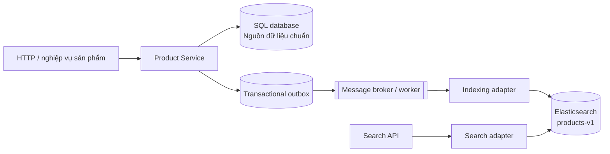
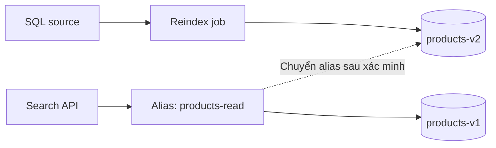
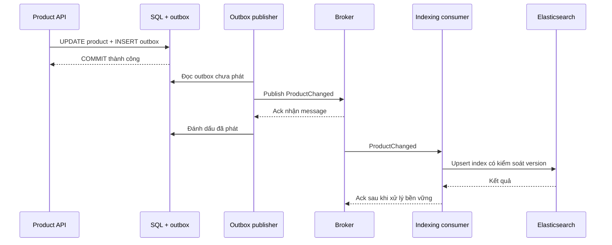

# Tích hợp Elasticsearch client và Spring Data Elasticsearch

Trong một ứng dụng Spring Boot, PostgreSQL có thể lưu thông tin sản phẩm và đơn hàng làm **nguồn dữ liệu chuẩn**, nhưng nhu cầu tìm kiếm thường phức tạp hơn một truy vấn SQL thông thường: tìm theo nhiều từ khóa, ưu tiên tên sản phẩm, lọc theo danh mục, sắp xếp, phân trang và thống kê. **Elasticsearch** là một công cụ tìm kiếm và phân tích dữ liệu dựa trên chỉ mục, thường được dùng để phục vụ những truy vấn đó.

Bài học thuộc chương **Các kho NoSQL khác** của module **SPRING_BOOT_INTEGRATION**. Module này tổ chức tích hợp hệ thống Spring Boot thông qua HTTP client, cơ sở dữ liệu, cache, message broker và các adapter của Spring Integration. Vì thế, tích hợp Elasticsearch không chỉ là thêm dependency rồi gọi API tìm kiếm: cần kiểm soát **cấu hình, hợp đồng dữ liệu, chỉ mục, đồng bộ thay đổi, giao dịch, xử lý trùng lặp, retry, kiểm thử và khả năng quan sát**.

Hai cách truy cập Elasticsearch thường gặp trong Spring Boot là **Elasticsearch Java API Client** (làm việc trực tiếp với API Elasticsearch) và **Spring Data Elasticsearch** (repository, mapping và `ElasticsearchOperations`). Chúng có thể cùng tồn tại nhưng cần phân công trách nhiệm rõ ràng.

> **Phạm vi phiên bản:** Ví dụ sử dụng Spring Boot 3.x, Spring Data Elasticsearch 5.x, Elasticsearch 8.x và Java 17+. Trong các phiên bản khác, tên artifact, lớp cấu hình client, repository, JSON mapper và API truy vấn có thể thay đổi. Kiểm tra **bảng tương thích Spring Data Elasticsearch ↔ Elasticsearch** của phiên bản dự án trước khi triển khai. Các ví dụ dùng Elasticsearch, không mặc định tương thích với OpenSearch.

## 1. Mục tiêu học tập

Sau bài này, bạn có thể:

1. Giải thích `index`, `document`, `_id`, `mapping`, `analyzer`, `shard` và cơ chế *near real-time search*.
2. Phân biệt **Elasticsearch Java API Client**, **Spring Data repository** và **ElasticsearchOperations**.
3. Cấu hình kết nối Elasticsearch trong Spring Boot và khai báo mapping an toàn.
4. Viết code lưu, lấy và tìm kiếm tài liệu theo tenant với Spring Data Elasticsearch và native Elasticsearch query.
5. Tổ chức pipeline đồng bộ dữ liệu từ SQL qua outbox/broker tới Elasticsearch, xử lý retry, duplicate và sự kiện đến sai thứ tự.
6. Phân loại lỗi Elasticsearch, thiết kế kiểm thử tích hợp và chọn metric quan sát phù hợp.
7. Biết các giới hạn quan trọng về nhất quán dữ liệu, độ trễ lập chỉ mục và phân quyền tìm kiếm.

## 2. Elasticsearch là gì trong kiến trúc tích hợp?

### 2.1. Elasticsearch dùng để làm gì?

Elasticsearch lưu **document dạng JSON** trong các **index** để truy vấn tìm kiếm, lọc, tính điểm liên quan (relevance), tổng hợp (aggregation) và phân tích. Document có `_id` và tập trường. Mỗi trường được ánh xạ sang kiểu tìm kiếm riêng, ví dụ:

| Khái niệm | Ví dụ | Tác dụng |
| --- | --- | --- |
| Index | `products-v1` | Tập document cùng mapping/thiết lập |
| Document | Một sản phẩm có tên, giá, tenant và ngày cập nhật | Đơn vị dữ liệu được lập chỉ mục |
| `_id` | `tenant-a:product-101` | Định danh document để ghi đè/tìm theo ID |
| Mapping | `name` kiểu `text`, `tenantId` kiểu `keyword` | Quy định cách các trường được lập chỉ mục và tìm |
| Analyzer | Phân tích tên sản phẩm thành token | Phục vụ full-text search |
| Query DSL | `match`, `term`, `bool`, `range` | Diễn đạt tìm kiếm/lọc |
| Shard | Phần của một index | Phân phối dữ liệu và công việc tìm kiếm |
| Replica | Bản sao shard | Tăng khả năng sẵn sàng và năng lực đọc tùy cấu hình |

Elasticsearch phù hợp khi cần tìm kiếm linh hoạt, nhưng **không phải lựa chọn thay thế mặc định cho một SQL database đang nắm giao dịch nghiệp vụ**. Ví dụ: tạo đơn, giữ tồn kho, thanh toán, thay đổi số dư cần các bất biến và transaction ở hệ lưu trữ nghiệp vụ. Chỉ mục Elasticsearch có thể là **read model** phục vụ tìm kiếm được xây từ nguồn dữ liệu đó.

### 2.2. Chỉ mục là bản sao đọc, không nhất thiết là nguồn sự thật

Một kiến trúc phổ biến:



Lợi ích là mỗi hệ thống làm công việc phù hợp: SQL đảm nhiệm tính đúng đắn của cập nhật, Elasticsearch phục vụ tìm kiếm. Đánh đổi là **kết quả tìm kiếm có thể chậm hơn dữ liệu SQL một khoảng thời gian**. Hệ thống cần xác định độ trễ có thể chấp nhận, cơ chế khôi phục chỉ mục và cách đối soát khi có lỗi.

Nếu một ứng dụng chỉ cần tìm theo ID và vài điều kiện đơn giản, SQL với chỉ mục phù hợp có thể là giải pháp đủ tốt. Thêm Elasticsearch sẽ kéo theo chi phí đồng bộ, migration, vận hành cluster và kiểm soát dữ liệu cũ.

### 2.3. Near real-time khác giao dịch tức thời

Sau khi ghi một document thành công, Elasticsearch có thể chưa hiển thị thay đổi đó trong kết quả **search** cho tới khi index được **refresh**. Đây là hành vi *near real-time*. Tìm theo document ID và truy vấn search có thể có cơ chế nhìn thấy cập nhật khác nhau.

Vì vậy:

- Không coi response ghi thành công là bảo đảm query `match` ngay tiếp theo sẽ thấy document.
- Không dựa vào `Thread.sleep(...)` cố định để “đợi index cập nhật” trong test.
- Với kiểm thử, có thể chủ động refresh index hoặc dùng refresh policy phù hợp; với production, phải cân nhắc chi phí của refresh quá thường xuyên.
- Với nghiệp vụ cần “vừa ghi xong phải đọc ngay”, xác định rõ nguồn đọc và mức nhất quán trước khi dùng Elasticsearch thay SQL.

## 3. Hai cách tích hợp: Java API Client và Spring Data Elasticsearch

### 3.1. Elasticsearch Java API Client

Client chính thức của Elasticsearch cho Java cung cấp API kiểu mạnh để gửi request như `index`, `get`, `search`, `bulk`, quản lý chỉ mục và xử lý response. Lớp thường dùng là:

```java
co.elastic.clients.elasticsearch.ElasticsearchClient
```

Khi ứng dụng cần trực tiếp dùng Query DSL, bulk indexing hoặc một tính năng Elasticsearch mới mà abstraction chưa hỗ trợ đầy đủ, Java API Client là lựa chọn hữu ích.

### 3.2. Spring Data Elasticsearch

Spring Data Elasticsearch cung cấp:

- Annotation mapping giữa Java object và document Elasticsearch: `@Document`, `@Id`, `@Field`.
- `ElasticsearchRepository<T, ID>` cho thao tác CRUD và một số truy vấn theo tên method.
- `ElasticsearchOperations` để thao tác tìm kiếm/chỉ mục với API Spring Data.
- Tích hợp chuyển đổi kiểu dữ liệu, phân trang, kết quả tìm kiếm và cấu hình theo hệ sinh thái Spring.

Spring Data Elasticsearch sử dụng client tương thích trong tầng thực thi của nó, nhưng **không phải mọi API Elasticsearch đều xuất hiện dưới cùng một abstraction**.

| Tiêu chí | Elasticsearch Java API Client | Spring Data Elasticsearch |
| --- | --- | --- |
| Mức API | Gần Elasticsearch REST/Query DSL | Mapping entity, repository, operations |
| CRUD cơ bản | Tạo request trực tiếp | `save`, `findById`, `deleteById` |
| Search nâng cao | Query DSL typed client | `NativeQuery`/`ElasticsearchOperations`, hoặc client trực tiếp |
| Mapping Java | Tự quản lý JSON/serializer theo client | Annotation và mapping converter của Spring Data |
| Tính năng mới của Elasticsearch | Thường tiếp cận trực tiếp theo phiên bản client | Phụ thuộc khả năng hỗ trợ của Spring Data |
| Tính nhất quán / transaction xuyên SQL | Không tự bảo đảm | Cũng không tự bảo đảm |
| Trường hợp phù hợp | Bulk, admin API, yêu cầu native chuyên biệt | Repository và truy vấn ứng dụng thường gặp |

Không cần áp dụng đồng thời hai API cho mọi thao tác. Một thiết kế tốt có thể dùng repository/operations cho search nghiệp vụ và Java API Client ở lớp chuyên biệt cần bulk hoặc query phức tạp. Nếu cùng ghi vào một index, phải dùng chung quy tắc ID, mapping, serializer, version và xử lý lỗi.

## 4. Chuẩn bị môi trường phát triển và dependency

### 4.1. Chạy Elasticsearch cục bộ

Ví dụ `compose.yaml` dành **riêng local development**, dùng một node và tắt security để đơn giản hóa thao tác:

```yaml
services:
  elasticsearch:
    image: docker.elastic.co/elasticsearch/elasticsearch:8.13.4
    environment:
      discovery.type: single-node
      xpack.security.enabled: "false"
      ES_JAVA_OPTS: "-Xms512m -Xmx512m"
    ports:
      - "127.0.0.1:9200:9200"
    volumes:
      - elasticsearch_data:/usr/share/elasticsearch/data

volumes:
  elasticsearch_data:
```

Khởi chạy và kiểm tra:

```bash
docker compose up -d
curl http://localhost:9200/
curl http://localhost:9200/_cluster/health
```

- Cần Docker runtime hoạt động và bộ nhớ đủ cho Elasticsearch.
- Published port gắn với `127.0.0.1` để giới hạn truy cập từ host ở môi trường local.
- Named volume lưu dữ liệu/index giữa các lần chạy; nếu muốn môi trường sạch phải chủ động reset.
- **Không dùng cấu hình `xpack.security.enabled=false` trên production.** Môi trường triển khai cần TLS, xác thực, quyền tối thiểu và chính sách mạng theo yêu cầu tổ chức.
- Image version chỉ là ví dụ. Dự án cần chọn phiên bản phù hợp với Spring Data/Elasticsearch client đang dùng, rồi pin phiên bản trong CI.

Nếu ứng dụng Spring Boot chạy **trực tiếp trên máy host**, kết nối `http://localhost:9200`. Nếu chạy **trong cùng Docker Compose network**, dùng service DNS như `http://elasticsearch:9200`. `localhost` bên trong app container là chính container đó, không phải container Elasticsearch.

### 4.2. Dependency Spring Boot

Ví dụ Gradle (Groovy DSL):

```groovy
dependencies {
    implementation 'org.springframework.boot:spring-boot-starter-data-elasticsearch'

    testImplementation 'org.springframework.boot:spring-boot-starter-test'
    testImplementation 'org.springframework.boot:spring-boot-testcontainers'
    testImplementation 'org.testcontainers:junit-jupiter'
    testImplementation 'org.testcontainers:elasticsearch'
}
```

Starter Spring Data Elasticsearch thường đưa các thành phần tích hợp và client phù hợp theo dependency management của Spring Boot. **Không tự ghép phiên bản Spring Data và Elasticsearch client tùy ý** nếu chưa xác minh tương thích.

Khi cần khai báo Elasticsearch Java API Client riêng do dự án có cấu trúc dependency đặc biệt:

```groovy
// Chỉ bổ sung khi dependency graph hiện có chưa cung cấp client:
implementation 'co.elastic.clients:elasticsearch-java'
```

Không nên khai báo trùng hay ép version khác với BOM chỉ vì một ví dụ trên Internet dùng phiên bản mới hơn. Kiểm tra dependency resolution và ma trận tương thích khi nâng cấp.

### 4.3. Cấu hình kết nối Spring Boot

Ví dụ `application-local.yml` cho local không bật security:

```yaml
spring:
  elasticsearch:
    uris: ${ELASTICSEARCH_URIS:http://localhost:9200}
    connection-timeout: 2s
    socket-timeout: 5s
```

Ở môi trường có xác thực:

```yaml
spring:
  elasticsearch:
    uris: ${ELASTICSEARCH_URIS}
    username: ${ELASTICSEARCH_USERNAME}
    password: ${ELASTICSEARCH_PASSWORD}
```

Các property ở đây minh họa cấu hình cho Spring Boot 3.x. Với HTTPS, cần cấu hình **trust material/CA certificate** đúng chính sách qua SSL bundle hoặc cơ chế cấu hình client được phiên bản hỗ trợ; không tắt kiểm tra chứng chỉ để chữa lỗi môi trường. Đưa credentials vào biến môi trường hoặc secret manager thay vì commit vào mã nguồn.

**Timeout kết nối khác timeout truy vấn hoàn chỉnh**: connect timeout điều khiển việc thiết lập kết nối, socket/response timeout điều khiển chờ phản hồi ở một lớp client nhất định. Một operation có retry hoặc nhiều bước vẫn cần giới hạn tổng thời gian theo nghiệp vụ.

## 5. Thiết kế index và hợp đồng dữ liệu tìm kiếm

### 5.1. Mô hình sản phẩm mẫu

Giả sử SQL giữ bảng `products` và Elasticsearch cung cấp tìm kiếm theo từ khóa cho từng tenant. Document tìm kiếm cần:

| Trường | Kiểu Elasticsearch | Mục đích |
| --- | --- | --- |
| `tenantId` | `keyword` | Lọc chính xác theo tenant |
| `productId` | `keyword` | Mã sản phẩm chính xác |
| `name` | `text` | Tìm kiếm toàn văn tên |
| `description` | `text` | Tìm kiếm toàn văn mô tả |
| `priceMinor` | `long` | Giá theo đơn vị nhỏ nhất của tiền tệ |
| `currency` | `keyword` | Mã tiền tệ ISO hoặc hợp đồng riêng |
| `sourceVersion` | `long` | Version monotonic của dữ liệu gốc |
| `updatedAt` | `date` | Thời điểm cập nhật đã quy chuẩn |

**Tại sao không dùng `double` cho tiền?** Phép tính tiền cần giữ độ chính xác/đơn vị. Lưu giá nguyên theo đơn vị nhỏ nhất (`priceMinor`) có thể phù hợp nếu domain quy định rõ đơn vị và giới hạn; các trường hợp cần độ chính xác khác có thể dùng `scaled_float` hoặc kiểu phù hợp theo hợp đồng.

### 5.2. Keyword và text là hai loại khác nhau

Một trường `keyword` thường dùng cho **exact filter, sorting và aggregations**; `text` được analyzer xử lý thành token để phục vụ full-text search.

Ví dụ:

- `tenantId: "tenant-a"` → dùng `term` filter vào `keyword`.
- `name: "Giày chạy bộ nhẹ"` → dùng `match`/`multi_match` trên `text`.
- Muốn vừa tìm kiếm tên vừa sort/aggregate đúng tên gốc, có thể thiết kế multi-field như `name` kiểu `text` và `name.keyword` kiểu `keyword` với quy tắc phù hợp.

Không áp `term` vào field `text` rồi mong nó tự hiểu cách tokenizer/analyzer hoạt động. Ngược lại, không dùng `match` full-text cho tenant ID hoặc khóa phân quyền chính xác.

### 5.3. Khởi tạo mapping

Một index được quản lý rõ ràng có thể tạo trước bằng HTTP API hoặc công cụ deployment:

```http
PUT /products-v1
Content-Type: application/json

{
  "mappings": {
    "properties": {
      "tenantId": { "type": "keyword" },
      "productId": { "type": "keyword" },
      "name": { "type": "text" },
      "description": { "type": "text" },
      "priceMinor": { "type": "long" },
      "currency": { "type": "keyword" },
      "sourceVersion": { "type": "long" },
      "updatedAt": { "type": "date" }
    }
  }
}
```

Câu lệnh trên là **minh họa cú pháp HTTP REST** cho Elasticsearch, không phải code chạy bên trong Java. Tùy ngôn ngữ/miền dữ liệu, analyzer cho tiếng Việt cần được đánh giá bằng từ khóa thực tế, hành vi tách từ và plugin đang có. Không nên mặc định analyzer `standard` đạt chất lượng tìm kiếm tiếng Việt theo kỳ vọng nghiệp vụ.

Tránh để dynamic mapping tự suy đoán mọi field trong payload ngoài, vì dữ liệu có thể sinh rất nhiều tên trường, mapping conflict hoặc kiểu không ổn định. Trong production, cân nhắc index template, explicit mappings, hạn chế dynamic fields và quy trình cập nhật schema. Nếu bật `dynamic: strict`, phải xét cả các trường metadata/type hint có thể do serializer hoặc Spring Data ghi ra.

### 5.4. Index version và alias

Với thay đổi mapping không tương thích, không nên phụ thuộc vào việc sửa trực tiếp kiểu một field đã tồn tại trong index. Mẫu triển khai an toàn hơn:



Quy trình điển hình: tạo `products-v2` với mapping mới, nạp dữ liệu có kiểm soát, xử lý thay đổi phát sinh trong lúc nạp, so sánh số liệu/tính đúng đắn, rồi chuyển **read alias** sang chỉ mục mới bằng cập nhật alias thích hợp. Nếu ứng dụng vừa ghi vừa đọc qua alias, thiết kế thêm write alias và quy trình chuyển đồng bộ để tránh ghi nhầm vào index cũ. Chuyển alias không tự đảm bảo việc bắt kịp toàn bộ thay đổi dữ liệu.

## 6. Khai báo document bằng Spring Data Elasticsearch

### 6.1. Entity tìm kiếm

Ví dụ `ProductSearchDocument.java`:

```java
package com.example.integration.search;

import java.time.Instant;

import org.springframework.data.annotation.Id;
import org.springframework.data.elasticsearch.annotations.Document;
import org.springframework.data.elasticsearch.annotations.Field;
import org.springframework.data.elasticsearch.annotations.FieldType;

@Document(indexName = "products-v1", createIndex = false)
public record ProductSearchDocument(
        @Id String id,
        @Field(type = FieldType.Keyword) String tenantId,
        @Field(type = FieldType.Keyword) String productId,
        @Field(type = FieldType.Text) String name,
        @Field(type = FieldType.Text) String description,
        @Field(type = FieldType.Long) long priceMinor,
        @Field(type = FieldType.Keyword) String currency,
        @Field(type = FieldType.Long) long sourceVersion,
        @Field(type = FieldType.Date) Instant updatedAt
) {}
```

Giải thích:

- `@Document(indexName = "products-v1")` ánh xạ kiểu Java sang index tương ứng.
- `createIndex = false` chọn chiến lược **quản lý schema trước bằng công cụ triển khai**, không yêu cầu repository tự tạo index. Khi chạy ví dụ, phải tạo index/mapping trước, nếu không thao tác tìm kiếm có thể lỗi.
- `@Id` định danh document; ví dụ dùng giá trị ổn định kết hợp tenant và product để tránh đè dữ liệu giữa tenant.
- `@Field` định nghĩa ý định mapping. Cần giữ annotations tương thích với mapping thực tế; annotation trên Java **không sửa** mapping đã tồn tại một cách thần kỳ.
- `sourceVersion` là version nghiệp vụ từ hệ nguồn. **Chỉ thêm trường này vào document chưa ngăn được một sự kiện cũ ghi đè sự kiện mới**; việc so version phải được thực thi ở thao tác ghi hoặc pipeline xử lý.

Record immutable thuận tiện cho read model. Nếu dùng class mutable hoặc constructor đặc biệt, cần đảm bảo Spring Data mapping converter có thể tạo object đúng và deserialize trường cần thiết.

### 6.2. Repository CRUD

`ProductSearchRepository.java`:

```java
package com.example.integration.search;

import org.springframework.data.elasticsearch.repository.ElasticsearchRepository;

public interface ProductSearchRepository
        extends ElasticsearchRepository<ProductSearchDocument, String> {
}
```

Một service index đơn giản:

```java
package com.example.integration.search;

import java.util.Optional;

import org.springframework.stereotype.Service;

@Service
public class ProductSearchStore {
    private final ProductSearchRepository repository;

    public ProductSearchStore(ProductSearchRepository repository) {
        this.repository = repository;
    }

    public ProductSearchDocument save(ProductSearchDocument document) {
        return repository.save(document);
    }

    public Optional<ProductSearchDocument> findById(String id) {
        return repository.findById(id);
    }

    public void deleteById(String id) {
        repository.deleteById(id);
    }
}
```

Đây là ví dụ về **API CRUD**, không phải pipeline đồng bộ production. Một sự kiện bị retry có thể gọi `save` lặp lại; nếu dùng cùng ID, nó thường cập nhật cùng document thay vì tạo một ID mới. Nhưng khi **version cũ đến sau version mới**, `save` đơn thuần vẫn có thể làm lùi dữ liệu. Phần 10 trình bày cách thiết kế xử lý vấn đề đó.

### 6.3. Chọn ID ổn định và bảo vệ tenant

Một công thức đơn giản:

```text
documentId = tenantId + ":" + productId
```

Phải bảo đảm hai thành phần đã được xác minh và chuẩn hóa, đồng thời quy định cách escape nếu ký tự phân tách có thể xuất hiện bên trong ID. Không dùng ID được tạo ngẫu nhiên khi **cập nhật lại cùng sản phẩm**, vì mỗi lần retry sẽ tạo document mới.

Một trường `tenantId` trong document **không tự tạo bảo mật multi-tenant**. Search API phải lấy tenant từ danh tính đã được xác thực, bắt buộc filter theo tenant và kiểm tra phân quyền trước các thao tác `get`, `update`, `delete` hoặc truy vấn quản trị. Không tin `tenantId` đến từ query parameter tự do của người dùng.

## 7. Tìm kiếm bằng ElasticsearchOperations và NativeQuery

### 7.1. Vấn đề: vừa tìm toàn văn vừa lọc chính xác

Yêu cầu: tìm sản phẩm có tên/mô tả chứa nội dung liên quan tới `"giày chạy"` nhưng **chỉ thuộc tenant đã xác thực**, trả tối đa 20 document.

Với Elasticsearch Query DSL, thường kết hợp:

- `bool.filter` + `term(tenantId)`: lọc chính xác, không ảnh hưởng điểm relevance.
- `bool.must` + `multi_match(name, description)`: tìm full-text, có thể boost tên.
- `size` hoặc pageable: chặn một response quá lớn.
- Một chiến lược sort phù hợp khi cần kết quả ổn định; nếu không khai báo, search thường sắp theo relevance.

### 7.2. Code Spring Data Elasticsearch

`ProductSearchService.java`:

```java
package com.example.integration.search;

import java.util.List;

import org.springframework.data.domain.PageRequest;
import org.springframework.data.elasticsearch.client.elc.NativeQuery;
import org.springframework.data.elasticsearch.core.ElasticsearchOperations;
import org.springframework.data.elasticsearch.core.SearchHit;
import org.springframework.data.elasticsearch.core.SearchHits;
import org.springframework.stereotype.Service;

@Service
public class ProductSearchService {
    private final ElasticsearchOperations operations;

    public ProductSearchService(ElasticsearchOperations operations) {
        this.operations = operations;
    }

    public List<ProductSearchDocument> search(
            String authenticatedTenantId, String userText, int limit) {

        if (authenticatedTenantId == null
                || authenticatedTenantId.isBlank()) {
            throw new IllegalArgumentException("Thiếu tenant đã xác thực");
        }
        if (userText == null || userText.isBlank()) {
            throw new IllegalArgumentException("Từ khóa tìm kiếm rỗng");
        }

        int pageSize = Math.min(Math.max(limit, 1), 50);

        NativeQuery query = NativeQuery.builder()
                .withQuery(q -> q.bool(b -> b
                        .filter(f -> f.term(t -> t
                                .field("tenantId")
                                .value(authenticatedTenantId)))
                        .must(m -> m.multiMatch(mm -> mm
                                .query(userText)
                                .fields("name^2", "description")))))
                .withPageable(PageRequest.of(0, pageSize))
                .build();

        SearchHits<ProductSearchDocument> hits =
                operations.search(query, ProductSearchDocument.class);

        return hits.getSearchHits().stream()
                .map(SearchHit::getContent)
                .toList();
    }
}
```

Các điểm cần hiểu:

1. `NativeQuery` cho phép mô tả Elasticsearch Query DSL trong Spring Data Elasticsearch. `ElasticsearchOperations` thực thi và ánh xạ kết quả về `ProductSearchDocument`.
2. `filter` giới hạn **tenant đúng**; giá trị tenant đến từ context xác thực, không lấy trực tiếp từ body yêu cầu.
3. `multiMatch` sử dụng analyzer của index. Boost `name^2` chỉ là ví dụ; relevance nên được đánh giá bằng tập truy vấn thực tế.
4. Giới hạn tối đa 50 kết quả giảm tải, nhưng ứng dụng còn cần kiểm soát độ dài `userText`, query timeout, rate limit và chính sách phân trang.
5. `SearchHits` chứa metadata về hits, score và tổng kết quả. Ví dụ chỉ trả content cho ngắn gọn; API thực tế có thể trả thêm total hits/cursor nhưng không nên vô tình phơi bày metadata nội bộ.

**Cẩn thận:** Spring Data Elasticsearch và Elasticsearch Java API Client có các API thay đổi theo phiên bản. Nếu code cần dùng phiên bản ngoài phạm vi Boot 3.x/Data Elasticsearch 5.x, điều chỉnh import và builder theo phiên bản thực tế.

### 7.3. Tránh phân trang sâu bằng offset lớn

`PageRequest.of(page, size)` tiện cho trang đầu nhưng có thể không phù hợp với **deep pagination** trên index lớn. Với hành trình phân trang dài, cân nhắc `search_after` kết hợp sort ổn định và **point in time (PIT)** theo tính năng Elasticsearch, cùng giới hạn thời gian/số lần truy vấn.

Không dùng `from + size` tùy ý tăng đến hàng trăm nghìn và mong hiệu năng ổn định. Quy tắc phân trang là một phần của API contract, nhất là khi dữ liệu có thể thay đổi trong quá trình người dùng duyệt các trang.

## 8. Gọi trực tiếp Elasticsearch Java API Client

Trong Spring Boot 3.x được cấu hình phù hợp, có thể inject `ElasticsearchClient` để dùng API gốc.

### 8.1. Index theo document ID

`NativeProductIndexClient.java`:

```java
package com.example.integration.search;

import java.io.IOException;

import co.elastic.clients.elasticsearch.ElasticsearchClient;
import co.elastic.clients.elasticsearch.core.IndexResponse;

import org.springframework.stereotype.Component;

@Component
public class NativeProductIndexClient {
    private final ElasticsearchClient client;

    public NativeProductIndexClient(ElasticsearchClient client) {
        this.client = client;
    }

    public IndexResponse index(ProductSearchDocument document)
            throws IOException {
        return client.index(request -> request
                .index("products-v1")
                .id(document.id())
                .document(document));
    }
}
```

Ở đây, `ElasticsearchClient` serialize document và gửi API index trực tiếp. Cần xác định Java JSON mapper mà client dùng và mapping của index, đặc biệt nếu kết hợp client trực tiếp với Spring Data converter. Hai cơ chế serialize có thể khác nhau ở **tên trường, xử lý null, type hints hoặc kiểu ngày giờ**; không nên giả định luôn tạo cùng JSON chỉ vì cùng một Java record.

**Quan trọng:** `index()` là thao tác ghi tài liệu; không có transaction SQL liên kết với nó. Việc index bằng cùng `_id` giúp không tạo thêm document với ID khác, nhưng không ngăn **stale write**. Nếu yêu cầu event ordering, phải có version/điều kiện ghi thực sự được Elasticsearch hoặc pipeline áp dụng.

### 8.2. Search qua native client

Ví dụ dùng typed Query DSL:

```java
package com.example.integration.search;

import java.io.IOException;
import java.util.List;
import java.util.Objects;

import co.elastic.clients.elasticsearch.ElasticsearchClient;
import co.elastic.clients.elasticsearch.core.SearchResponse;
import co.elastic.clients.elasticsearch.core.search.Hit;

import org.springframework.stereotype.Component;

@Component
public class NativeProductSearchClient {
    private final ElasticsearchClient client;

    public NativeProductSearchClient(ElasticsearchClient client) {
        this.client = client;
    }

    public List<ProductSearchDocument> search(
            String authenticatedTenantId, String userText) throws IOException {
        SearchResponse<ProductSearchDocument> response =
                client.search(s -> s
                        .index("products-v1")
                        .size(20)
                        .query(q -> q.bool(b -> b
                                .filter(f -> f.term(t -> t
                                        .field("tenantId")
                                        .value(authenticatedTenantId)))
                                .must(m -> m.match(mt -> mt
                                        .field("name")
                                        .query(userText))))),
                        ProductSearchDocument.class);

        return response.hits().hits().stream()
                .map(Hit::source)
                .filter(Objects::nonNull)
                .toList();
    }
}
```

Mã ví dụ cố tình dùng cùng điều kiện tenant và full-text cơ bản để đối chiếu với `NativeQuery`. Trước khi đưa vào production, vẫn cần validation input, limit, timeout, xử lý response lỗi và phân quyền như ở service dùng Spring Data.

### 8.3. Khi nào nên dùng client trực tiếp?

- Có truy vấn aggregation/knn/bulk/admin chuyên biệt mà Spring Data abstraction chưa biểu diễn như mong muốn.
- Cần kiểm soát những tham số request cụ thể theo phiên bản API Elasticsearch.
- Tích hợp vận hành index/alias hoặc công việc reindex có workflow riêng.

Đừng đưa `ElasticsearchClient` vào domain service chỉ vì API “mạnh” hơn. Giữ nó phía sau một port/adapter có contract rõ, giúp thay đổi triển khai hoặc mock test mà không ảnh hưởng nghiệp vụ.

## 9. Mapping và hợp đồng giữa SQL với Elasticsearch

Giả sử SQL có sản phẩm:

```json
{
  "tenantId": "tenant-a",
  "productId": "product-101",
  "name": "Giày chạy bộ",
  "description": "Giày nhẹ, dùng tập luyện",
  "priceMinor": 129900,
  "currency": "VND",
  "version": 17,
  "updatedAt": "2026-11-21T03:10:00Z"
}
```

Một **indexing transformer** có thể tạo `ProductSearchDocument` từ bản ghi SQL hoặc sự kiện đã xác thực. Quy tắc:

1. Không lấy tenant từ field do client tùy ý khai; nhận từ dữ liệu nghiệp vụ đã được kiểm tra.
2. Lấy `documentId` ổn định theo `(tenantId, productId)`.
3. Giữ `version` từ hệ nguồn làm `sourceVersion` để hỗ trợ kiểm soát thứ tự.
4. Chuẩn hóa `updatedAt` về thời điểm UTC; không thay bằng thời điểm consumer nhận message.
5. Dùng cùng đơn vị `priceMinor` và `currency`; không chuyển tiền qua `double`.
6. Chỉ index những trường thực sự cần cho tìm kiếm; không sao chép secret, token hoặc PII không cần thiết vào document.

### 9.1. Search model khác transaction model

Không thiết kế `ProductSearchDocument` như một ảnh chụp nguyên trạng của SQL entity. Read model phục vụ nhu cầu tìm kiếm, nên có thể:

- Denormalize một số trường từ bảng danh mục hoặc thương hiệu để giảm join khi search.
- Chứa từ khóa hoặc trường gợi ý đã chuẩn hóa.
- Dùng mapping `text`/`keyword` khác kiểu dữ liệu SQL.
- Có `sourceVersion` hoặc `indexedAt` để chẩn đoán độ trễ, nhưng không dùng chúng thay cho ràng buộc transaction của SQL.

Khi denormalize, một thay đổi thuộc danh mục có thể ảnh hưởng nhiều document sản phẩm. Phải xác định chính sách cập nhật lại các document liên quan và kiểm soát backlog.

## 10. Đồng bộ dữ liệu: outbox, idempotency và sự kiện sai thứ tự

Đây là phần đặc biệt quan trọng của tích hợp Elasticsearch: dữ liệu trong SQL và search index thuộc **hai hệ lưu trữ** khác nhau.

### 10.1. Vì sao không ghi SQL rồi gọi Elasticsearch trực tiếp?

Nếu code thực hiện:

```text
1. UPDATE SQL product.
2. COMMIT SQL thành công.
3. Gọi Elasticsearch index.
4. Ứng dụng bị dừng trước bước 3 hoặc khi response chưa tới.
```

SQL đã có dữ liệu mới nhưng Elasticsearch có thể còn bản cũ. Ngược lại, nếu gọi Elasticsearch trước rồi SQL rollback, search index có thể hiển thị dữ liệu chưa từng được commit.

`@Transactional` với `DataSource` chỉ bao phủ transaction SQL được cấu hình, **không tự tạo transaction phân tán với Elasticsearch**.

### 10.2. Transactional outbox

Một thiết kế thường dùng:



- Transaction SQL ghi **dữ liệu nghiệp vụ và outbox** cùng nhau. Nếu transaction rollback, cả hai đều không được commit.
- Publisher gửi outbox với retry có giới hạn; nếu lỗi sau khi broker nhận nhưng trước khi ghi nhận trạng thái đã phát, một sự kiện có thể được publish lại.
- Consumer phải **idempotent** và có cách chống ghi lùi version. Chỉ xóa message sau khi bước cần bảo đảm đã thành công hoặc có cơ chế khôi phục tương ứng.
- Elasticsearch có thể tạm thời lag so với SQL. Hệ thống theo dõi tuổi outbox/queue lag và chênh lệch version để phát hiện.

Không nhất thiết mọi hệ thống cần broker. Có thể dùng job polling outbox và lập chỉ mục trực tiếp nếu yêu cầu throughput, phục hồi và vận hành cho phép. Điểm cốt lõi là **ghi bền vững ý định cập nhật search index cùng dữ liệu SQL**.

### 10.3. Xử lý duplicate khác xử lý stale event

Giả sử cùng sản phẩm nhận các sự kiện theo thứ tự thực tế:

```text
Event A: sourceVersion = 17, name = "Giày chạy bộ"
Event B: sourceVersion = 18, name = "Giày chạy bộ Pro"

Consumer có thể nhận:
B → A → B
```

Nếu cứ gọi `repository.save(...)`, sự kiện A đến sau có thể ghi đè dữ liệu version 18 bằng version 17. Vì vậy:

- **Duplicate**: cùng event ID/version xuất hiện nhiều lần, cần tránh side effect lặp lại.
- **Stale / out-of-order**: event có version thấp hơn trạng thái đã áp dụng, cần từ chối hoặc bỏ qua.
- **Missing event**: nếu pipeline cần trạng thái tuần tự, có thể phải phát hiện gap giữa các version.
- **Delete event**: nếu document bị xóa rồi một event update cũ đến sau, document có thể bị tạo lại; cần thiết kế tombstone/versioning hoặc rehydrate từ SQL theo chính sách.

Cách xử lý có thể sử dụng **optimistic concurrency control** bằng `if_seq_no`/`if_primary_term`, **external versioning** với version tăng đơn điệu từ nguồn hoặc thực thi compare-and-set ở tầng persistence/indexing phù hợp. Những cơ chế này có điều kiện riêng, chẳng hạn version phải tăng phù hợp và cần xử lý `409 conflict`. Không chọn bằng cách chỉ so trường `sourceVersion` trong RAM vì nhiều consumer cùng chạy có thể race.

**Lưu ý quan trọng:** Trường `sourceVersion` bên trong `_source` chỉ là dữ liệu, không khiến Elasticsearch tự động từ chối update cũ. Phải dùng cơ chế version/điều kiện ghi thực sự.

### 10.4. Reindex và đối soát

Một pipeline đáng tin cần có cách dựng lại chỉ mục:

1. Tạo index mới với mapping/version mong muốn.
2. Đọc dữ liệu đã commit từ nguồn chuẩn (SQL) theo batch/checkpoint.
3. Lập chỉ mục theo ID ổn định, ghi nhận version.
4. Bắt kịp các thay đổi phát sinh trong thời gian nạp.
5. So sánh số lượng, lấy mẫu tính đúng đắn và đo lag.
6. Chuyển read alias sau khi xác minh.
7. Giữ rollback plan để trở lại index cũ trong khoảng thời gian chuyển đổi.

Đếm document giống số dòng SQL chưa đủ nếu dữ liệu denormalized hoặc có filter. Cần so sánh theo contract read model và phạm vi tenant thực tế.

## 11. Lỗi Elasticsearch và chính sách retry

Elasticsearch có thể báo lỗi ở cấp kết nối, HTTP request, shard hoặc từng item trong bulk operation. Không nên xử lý mọi exception bằng cách retry liên tục.

| Nhóm lỗi | Ví dụ | Hành vi |
| --- | --- | --- |
| Không thể kết nối | DNS, TLS, socket timeout | Kiểm tra hạ tầng, retry có giới hạn nếu tạm thời |
| Hết quyền | 401, 403 | Kiểm tra credential/quyền; không retry vô hạn |
| Mapping/contract | Ghi text vào field long, analyzer/mapping sai | Quarantine payload, sửa mapping/transformer |
| Index không tồn tại | Alias sai, migration chưa chạy | Dừng/điều chỉnh triển khai; không tự tạo index bừa bãi |
| Tài nguyên quá tải | 429, thread pool bị từ chối, shard không sẵn sàng | Backoff, giới hạn concurrency, quan sát cluster |
| Phản hồi 5xx | Node/cluster gặp sự cố | Retry phù hợp với thao tác idempotent và deadline |
| Conflict | Optimistic concurrency/version conflict | Bỏ qua stale event hoặc đọc lại trạng thái, tránh ghi đè |
| Bulk item failure | Một phần item trong batch lỗi | Kiểm tra **từng item**, chỉ retry item thích hợp |
| Search timeout | Query đắt, node chậm | Giới hạn truy vấn, phân trang, tối ưu mapping và tài nguyên |

### 11.1. Retry có thể tạo dữ liệu trùng không?

Nếu dùng một `_id` ổn định, gửi lại cùng document thường không tạo thêm một document với ID khác. Nhưng vẫn có rủi ro:

- Một event cũ đến sau event mới gây lùi trạng thái.
- Document bị xóa rồi được lập chỉ mục lại từ stale event.
- Side effect trước/sau index (gọi HTTP, gửi broker, cập nhật SQL) có thể bị thực thi hai lần.
- Bulk request thành công một phần rồi retry cả batch có thể che lỗi mapping hoặc tạo thêm tải lớn.

Vì vậy **idempotency của toàn luồng** cần bao gồm cả định danh, version, side effect, acknowledgment và cơ chế phục hồi.

### 11.2. Bulk indexing

Bulk API hữu ích khi cần xử lý nhiều document hoặc reindex toàn bộ dữ liệu. Mỗi batch cần:

- Kích thước và số request đồng thời phù hợp cluster.
- Theo dõi response **từng item**, vì response HTTP có thể nhận được trong khi một số item lỗi.
- Chỉ retry lỗi tạm thời, tránh lặp vô hạn một item mapping sai.
- Không coi thứ tự hoàn tất giữa các batch là thứ tự version theo từng sản phẩm.
- Tính đến memory/backpressure và thời gian refresh/search visibility.

Batch lớn chưa chắc tối ưu: request dài và retry cả batch có thể gây thêm nghẽn. Cần đo throughput, latency và tỷ lệ lỗi theo kích thước thực tế.

## 12. Kiểm thử với Elasticsearch thật và Testcontainers

Unit test có thể mock repository/operations, nhưng không xác nhận mapping `text`/`keyword`, analyzer, Query DSL, JSON converter, conflict, refresh hay cấu hình kết nối hoạt động đúng trên Elasticsearch.

### 12.1. Chiến lược kiểm thử

| Cấp độ | Cần xác nhận |
| --- | --- |
| Unit test mapper | ID, tenant, version, giá, thời gian được chuẩn hóa đúng |
| Unit test service | Chặn tenant thiếu, giới hạn kết quả, phân loại lỗi |
| Elasticsearch integration test | Index mapping, repository CRUD, full-text query, tenant filter |
| Pipeline integration test | SQL outbox → consumer → Elasticsearch; retry và duplicate |
| Fault test | Elasticsearch chưa ready, 429/503, timeout, conflict, bulk partial failure |
| End-to-end test | Search API không trả dữ liệu tenant khác, chính sách độ trễ đúng yêu cầu |

### 12.2. Testcontainers tạo cluster tạm thời

Với Spring Boot 3.x hỗ trợ `@ServiceConnection`, ví dụ integration test sau tập trung vào repository và mapping:

```java
package com.example.integration.search;

import static org.junit.jupiter.api.Assertions.*;

import java.time.Instant;

import org.junit.jupiter.api.BeforeEach;
import org.junit.jupiter.api.Test;
import org.springframework.beans.factory.annotation.Autowired;
import org.springframework.boot.test.context.SpringBootTest;
import org.springframework.boot.testcontainers.service.connection.ServiceConnection;
import org.springframework.data.elasticsearch.core.ElasticsearchOperations;
import org.springframework.data.elasticsearch.core.IndexOperations;

import org.testcontainers.elasticsearch.ElasticsearchContainer;
import org.testcontainers.junit.jupiter.Container;
import org.testcontainers.junit.jupiter.Testcontainers;

@SpringBootTest
@Testcontainers
class ProductSearchRepositoryIT {

    @Container
    @ServiceConnection
    static ElasticsearchContainer elasticsearch =
            new ElasticsearchContainer(
                    "docker.elastic.co/elasticsearch/elasticsearch:8.13.4")
                    .withEnv("xpack.security.enabled", "false");

    @Autowired
    ProductSearchRepository repository;

    @Autowired
    ElasticsearchOperations operations;

    @BeforeEach
    void ensureIndex() {
        IndexOperations indexOps =
                operations.indexOps(ProductSearchDocument.class);

        if (!indexOps.exists()) {
            indexOps.create();
            indexOps.putMapping(indexOps.createMapping());
        }
    }

    @Test
    void savesAndReadsProductDocument() {
        var document = new ProductSearchDocument(
                "tenant-a:product-101",
                "tenant-a",
                "product-101",
                "Giày chạy bộ",
                "Giày nhẹ dùng tập luyện",
                129900L,
                "VND",
                17L,
                Instant.parse("2026-11-21T03:10:00Z")
        );

        repository.save(document);

        var fromIndex = repository.findById(document.id());

        assertTrue(fromIndex.isPresent());
        assertEquals("tenant-a", fromIndex.orElseThrow().tenantId());
        assertEquals(17L, fromIndex.orElseThrow().sourceVersion());

        // Với assertion bằng search/query, cần tính đến refresh.
        operations.indexOps(ProductSearchDocument.class).refresh();
    }
}
```

- `@Container` và `@Testcontainers` điều khiển vòng đời container thông qua JUnit extension.
- `@ServiceConnection` giúp Spring Boot nhận connection details từ container phù hợp khi phiên bản hỗ trợ, thay vì hardcode `localhost:9200`.
- Test chủ động tạo index và mapping vì entity đã đặt `createIndex = false`.
- Test ở trên chủ yếu kiểm tra **lưu và lấy theo ID**. Muốn xác minh full-text và tenant filter, cần chạy `ProductSearchService.search(...)` sau refresh rồi assert kết quả, kể cả trường hợp tenant khác không được trả về.
- Container cần Docker-compatible runtime trong local/CI. Không để cấu hình tắt security của test lọt vào production.

**Lưu ý phiên bản:** Testcontainers thay đổi cấu trúc module/artifact ở các thế hệ phát hành; ví dụ dùng `org.testcontainers:elasticsearch` với Testcontainers 1.x. Chọn dependency cùng version phù hợp BOM, image Elasticsearch và Spring Boot thực tế. Kiểm thử này minh họa cách tổ chức, không thay thế cho xác minh chạy trên phiên bản dự án.

### 12.3. Test full-text phải đánh giá chất lượng tìm kiếm

Một test `repository.findById` thành công chưa chứng minh search thật có relevance tốt. Nên xây bộ fixture:

- Tên tiếng Việt có dấu và không dấu nếu nghiệp vụ yêu cầu.
- Các từ đồng nghĩa, từ viết tắt, lỗi chính tả thường gặp.
- Đơn vị hàng, mã SKU có ký tự đặc biệt và số 0 đầu.
- Một số sản phẩm của tenant khác có cùng tên để phát hiện thiếu filter.
- Từ khóa dài, trống, wildcard/special characters và query độc hại hoặc quá đắt.
- Sản phẩm bị xóa hoặc cập nhật version mới.
- Search ngay sau index để kiểm tra kỳ vọng về refresh/visibility.

Độ chính xác tìm kiếm và ranking là yêu cầu sản phẩm: cần đánh giá bằng tập truy vấn/đáp án thực tế, ngoài unit test và integration test kỹ thuật.

### 12.4. Kiểm thử pipeline SQL → Elasticsearch

Một kịch bản tiêu biểu:

```text
Given:
  SQL product có sourceVersion = 18.
  Outbox có ProductChanged(version 18).
  Elasticsearch đang có version 17.

When:
  Consumer nhận event version 18, ghi index.
  Consumer nhận lại event version 18.
  Consumer tiếp tục nhận event version 16 bị trễ.

Then:
  Elasticsearch vẫn hiển thị version 18.
  Không phát sinh document trùng ID.
  Event version 16 không ghi lùi dữ liệu.
  Các retry/conflict được ghi nhận để quan sát.
```

Test phải kiểm tra **cơ chế versioning thực** chứ không chỉ đọc trường `sourceVersion` sau hai lệnh lưu tuần tự. Có thể dùng hai consumer chạy song song hoặc fault injection ở điểm acknowledgment để kiểm tra race condition và redelivery.

## 13. Bảo mật Elasticsearch và phân tách tenant

Elasticsearch thường chứa dữ liệu tìm kiếm được tổng hợp từ nhiều nguồn. Một cấu hình sai có thể làm lộ dữ liệu giữa tenant hoặc qua endpoint quản trị.

- **Mã hóa và xác thực:** dùng TLS/HTTPS, tài khoản hoặc API key có quyền tối thiểu theo index/operation, quản lý secret an toàn.
- **Kiểm soát quyền tại ứng dụng:** search query luôn thêm filter tenant lấy từ security context đã xác thực; đọc theo `_id` cũng phải kiểm tra quyền.
- **Giới hạn API:** chặn request tùy ý tới Elasticsearch Query DSL nếu người dùng cuối không có quyền; không expose trực tiếp endpoint Elasticsearch ra Internet.
- **Dữ liệu nhạy cảm:** chỉ index trường có mục đích tìm kiếm; xem xét chính sách retention/xóa dữ liệu, đặc biệt khi reindex hoặc snapshot.
- **Quyền quản trị:** tách tài khoản tạo index/template/alias khỏi tài khoản chỉ được query hoặc index document.
- **Audit:** ghi nhận thao tác thay đổi index/alias, migration, reindex và thay đổi quyền có tác động diện rộng.

Bộ lọc tenant ở application service là điều kiện cần cho multi-tenancy theo thiết kế này, nhưng bảo mật còn cần thiết ở nguồn dữ liệu và lớp Elasticsearch khi yêu cầu độ cách ly cao. Không giả định thêm một field `tenantId` tự bảo đảm cách ly.

## 14. Quan sát, vận hành và xử lý sự cố

### 14.1. Những tín hiệu nên theo dõi

| Tín hiệu | Câu hỏi được trả lời |
| --- | --- |
| Search latency (p95/p99), error rate | Tìm kiếm có chậm hoặc thất bại với người dùng không? |
| Indexing latency, bulk failures | Consumer có cập nhật được chỉ mục không? |
| Outbox/queue lag, oldest event age | Dữ liệu search đang chậm hơn SQL bao lâu? |
| Retry count, version conflict, DLQ | Dữ liệu lỗi, trùng hoặc tới sai thứ tự có tăng không? |
| Index size, shard count, document count | Cụm có tăng trưởng phù hợp thiết kế không? |
| Heap, CPU, disk watermark, thread pool rejection | Elasticsearch có nghẽn tài nguyên không? |
| Refresh/merge pressure | Tần suất ghi/refresh có gây áp lực lên index không? |
| Correlation ID, event ID, sourceVersion | Có lần theo một thay đổi SQL tới document search không? |

Spring Boot Actuator/Micrometer có thể quan sát outbound client và pipeline nếu các thư viện instrumentation, metric/trace exporter được cấu hình phù hợp. **Metric tag** nên giới hạn tập giá trị (operation, index alias, loại lỗi); không dùng `productId`, `eventId` hoặc văn bản tìm kiếm tự do làm label vì cardinality rất lớn.

Traces/log có thể giữ correlation ID để điều tra nhưng phải loại bỏ token, thông tin đăng nhập, payload nhạy cảm và từ khóa có dữ liệu cá nhân.

### 14.2. Bảng chẩn đoán nhanh

| Triệu chứng | Nguyên nhân có thể | Kiểm tra đầu tiên |
| --- | --- | --- |
| `Connection refused` | Elasticsearch chưa chạy, sai host/port hoặc network | Container/cluster health, URI, DNS |
| `401`/`403` | Sai credentials/quyền hoặc TLS config | Principal, role, secret, CA certificate |
| `index_not_found_exception` | Sai index/alias hoặc chưa chạy migration | Index/alias list, thứ tự deploy |
| `mapper_parsing_exception` | Document khác mapping | Field type, payload, migration |
| Search không thấy dữ liệu vừa ghi | Chưa refresh, ghi sai index/alias, event lag | `_id`, index đích, refresh, backlog |
| Query không lọc đúng tenant | Sai tên field hoặc filter thiếu | Mapping `tenantId`, query DSL và security context |
| Search chậm với trang sâu | Offset lớn, query đắt, nhiều shard | Profiling, phân trang, mapping |
| `429` hoặc bulk rejection | Cluster quá tải, concurrency/batch lớn | Thread pool, bulk size, heap, disk |
| Event cũ ghi đè mới | Không kiểm soát version ở thao tác ghi | Ordering, conflict policy, sourceVersion |
| Có dữ liệu sai sau reindex | Bỏ sót thay đổi đang phát sinh | Checkpoint, replay lag, alias switch |

Không chữa mọi vấn đề bằng cách tăng số shard, replica hoặc heap. Quyết định này ảnh hưởng chi phí, số lượng segment, phân phối shard và throughput; cần đo và tính theo workload.

## 15. Những sai lầm thường gặp

1. **Dùng Elasticsearch như SQL chính** cho nghiệp vụ cần transaction nhiều bảng mà không thiết kế nhất quán.
2. **Chỉ sync bằng “ghi SQL rồi index”** mà không có outbox hoặc cơ chế khôi phục khi app chết giữa chừng.
3. **Dùng `repository.save` như bảo đảm chống stale event**; trường `sourceVersion` không tự áp dụng CAS.
4. **Dùng `text` cho mọi trường**, dẫn đến exact filter trên tenant/SKU hoặc sort/aggregation không đúng kỳ vọng.
5. **Không quản lý mapping/index version**, để dữ liệu động tạo các field/kiểu không tương thích.
6. **Đòi search thấy ngay sau write** mà không hiểu refresh và near real-time.
7. **Dùng một `_id` mới cho mỗi lần retry**, dẫn đến nhiều bản ghi của cùng sản phẩm.
8. **Không xử lý delete/tombstone**, khiến event cũ tái tạo document đã xóa.
9. **Không kiểm tra từng item bulk**, dẫn tới mất dữ liệu âm thầm.
10. **Để ứng dụng query index mọi tenant**, hoặc nhận tenant ID trực tiếp từ dữ liệu chưa xác thực.
11. **Mock toàn bộ Elasticsearch trong test**, bỏ sót mapping, tokenizer, converter và response semantics.
12. **Trộn Spring Data và native client mà không thống nhất serializer/mapping**.

## 16. Câu hỏi tự kiểm tra và bài tập

### 16.1. Câu hỏi

1. Vì sao Elasticsearch thường phù hợp làm read model tìm kiếm hơn là nơi duy nhất lưu giao dịch đặt hàng?
2. `text` và `keyword` khác nhau thế nào khi filter theo `tenantId` và tìm tên sản phẩm?
3. Spring Data `ElasticsearchRepository` khác gì `ElasticsearchOperations` và `ElasticsearchClient`?
4. Tại sao `@Document(createIndex = false)` đòi hỏi một bước chuẩn bị index/mapping trước?
5. Vì sao document đã được index thành công nhưng truy vấn search ngay sau có thể chưa thấy?
6. Nếu consumer nhận version 18 rồi version 16, trường `sourceVersion` có tự ngăn bản cũ ghi đè không?
7. Tại sao transactional outbox giảm rủi ro mất sự kiện giữa SQL và broker, nhưng consumer vẫn phải xử lý duplicate?
8. Vì sao một bulk response phải được kiểm tra theo từng item?
9. Khi nào cần index version/alias thay vì cố đổi mapping trực tiếp?
10. Cần những metric nào để biết Elasticsearch bị chậm do search, indexing hay queue backlog?
11. Kịch bản test nào chứng minh tenant A không nhìn thấy sản phẩm của tenant B?
12. Vì sao Testcontainers chạy Elasticsearch thật có giá trị hơn mock repository khi kiểm tra mapping và analyzer?

### 16.2. Bài tập triển khai

Xây một Spring Boot service có endpoint tìm kiếm sản phẩm dựa trên SQL source:

- Thiết kế `ProductSearchDocument` với tenant ID, product ID, name, description, price, currency, version và updated time.
- Tạo mapping/index versioned và cấu hình Spring Data Elasticsearch.
- Viết `ElasticsearchRepository` cho CRUD; viết `ElasticsearchOperations + NativeQuery` cho search theo tenant và tên.
- Thêm một thao tác sử dụng `ElasticsearchClient` trực tiếp để hiểu khác biệt với Spring Data.
- Tạo outbox event trong transaction SQL khi sản phẩm đổi tên; consumer áp dụng phiên bản tăng đơn điệu để chống ghi lùi.
- Viết integration test bằng Testcontainers với ít nhất hai tenant, cùng từ khóa tìm kiếm, assertion tenant isolation và tình huống index chưa refresh.
- Test duplicate/stale event và delete/recreate theo version; đo số lần retry và tuổi backlog.

**Tiêu chí hoàn thành:** Search API không lộ sản phẩm tenant khác, kết quả đúng contract, thay đổi SQL được đưa lên index có cơ chế retry/khôi phục, dữ liệu version cũ không ghi đè mới và có metric đủ để biết khi read model bị chậm.

## 17. Ghi nhớ

- **Elasticsearch** tối ưu cho tìm kiếm và phân tích; thiết kế nó như read model khi nghiệp vụ cần transaction và nguồn dữ liệu chuẩn khác.
- **Spring Data Elasticsearch** cung cấp mapping, repository và operations; **Elasticsearch Java API Client** cho phép gọi API/Query DSL Elasticsearch trực tiếp. Chọn cách truy cập theo nhu cầu và phiên bản tương thích.
- **Mapping quyết định ngữ nghĩa tìm kiếm**: keyword cho định danh/exact filter; text cho full-text; cần quản lý analyzer, index version và alias.
- **Search gần thời gian thực**: response ghi thành công không đồng nghĩa mọi search ngay lập tức nhìn thấy bản ghi mới.
- **Đồng bộ SQL → Elasticsearch là một bài toán tích hợp phân tán**: cần outbox/retry, ID ổn định, versioning thực sự, xử lý duplicate/out-of-order/delete và quy trình reindex.
- **Kiểm thử với Elasticsearch thật**, bảo vệ multi-tenant và theo dõi latency/indexing lag là điều kiện để hệ thống tìm kiếm chạy đáng tin cậy.

Trong module **SPRING_BOOT_INTEGRATION**, tích hợp Elasticsearch hiệu quả khi nó gắn với kiến trúc toàn luồng: dữ liệu đi qua HTTP, SQL, broker, adapter và search index theo hợp đồng rõ ràng, có cơ chế phục hồi khi lỗi và có thể kiểm chứng bằng test cũng như quan sát trong vận hành.
