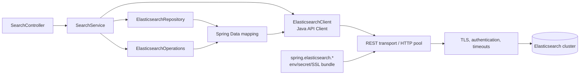
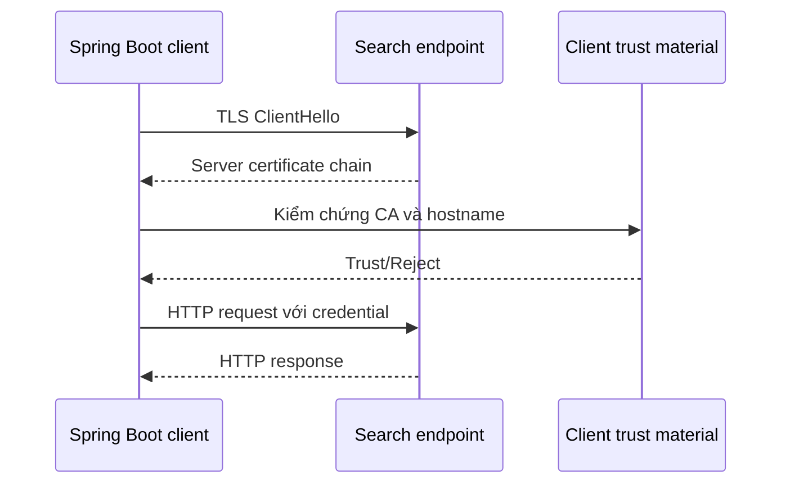
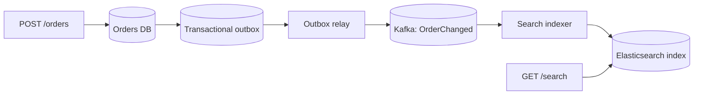

# Địa chỉ cụm, xác thực, TLS và tùy chỉnh client Elasticsearch

## 1. Elasticsearch trong luồng tích hợp Spring Boot

Elasticsearch thường được dùng để **tìm kiếm, phân tích và truy vấn dữ liệu được lập chỉ mục**. Trong hệ thống bán hàng, `order-service` có thể ghi đơn hàng vào PostgreSQL/MongoDB, phát sự kiện `OrderCreated` sang Kafka và để `search-indexer` đồng bộ dữ liệu sang Elasticsearch. API tìm kiếm đọc từ chỉ mục Elasticsearch thay vì chạy các truy vấn tìm kiếm phức tạp trên database giao dịch.

Trước khi viết repository hay query, ứng dụng phải giải quyết bốn câu hỏi vận hành:

1. **Địa chỉ cụm nào?** Một node, nhiều endpoint hay một URL gateway/load balancer? HTTP hay HTTPS?
2. **Xác thực bằng gì?** Username/password, API key hay cơ chế bảo mật của môi trường?
3. **TLS có được xác minh đúng không?** Chứng chỉ CA, hostname, truststore/SSL bundle và có cần mTLS?
4. **Client được tùy chỉnh thế nào?** Timeout, connection pool, header, retries, quan sát và lifecycle.

Bài này thuộc nhóm **Các kho NoSQL khác** của module **SPRING_BOOT_INTEGRATION**. Theo phạm vi module, chúng ta kết nối cấu hình Elasticsearch với hợp đồng dữ liệu, luồng HTTP, broker, database, cache, transaction, retry, xử lý trùng lặp, kiểm thử và quan sát. Một client kết nối thành công chỉ mới giải quyết **giao tiếp với cluster**, chưa chứng minh toàn bộ dữ liệu tìm kiếm đã nhất quán với hệ thống nguồn.

**Mục tiêu học tập**

1. Đọc đúng các endpoint `spring.elasticsearch.uris`, phân biệt node trực tiếp với gateway.
2. Cấu hình Elasticsearch trong Spring Boot 3.x bằng thuộc tính và biến môi trường.
3. Thiết lập Basic authentication hoặc API key mà không lộ secret.
4. Xác minh TLS theo CA và hostname; hiểu rủi ro khi tắt xác thực chứng chỉ.
5. Tùy chỉnh client đồng bộ dựa trên Elasticsearch Java API Client, low-level REST client và Spring Data Elasticsearch.
6. Chọn timeout/pool thích hợp, phân loại lỗi 401/403/429/5xx và lỗi kết nối.
7. Kiểm thử kết nối thật, bảo đảm index mapping và thiết kế retry/idempotency an toàn.

> **Phiên bản:** Ví dụ chính sử dụng **Java 17+, Spring Boot 3.x, Spring Data Elasticsearch 5.x** và Elasticsearch Java API Client do Spring Boot BOM chọn. Spring Boot 4.x/Spring Data Elasticsearch phiên bản mới có thể thay đổi cấu trúc thuộc tính, dependency hoặc REST transport. Luôn đối chiếu configuration metadata/BOM của đúng phiên bản trước khi áp dụng nguyên mã. Bài minh họa Elasticsearch 8.x; cluster và client phải ở tổ hợp phiên bản được nhà cung cấp hỗ trợ.

## 2. Mô hình thành phần



| Thành phần | Trách nhiệm | Lưu ý |
| --- | --- | --- |
| `ElasticsearchClient` | Java API Client typed cho search, index, delete, bulk, cluster APIs. | Không phải HTTP client chung cho mọi dịch vụ. |
| Low-level `RestClient` | Kết nối HTTP nền cho Elasticsearch transport kiểu REST của stack này. | Quản lý node, request, connection pool, TLS. |
| `ElasticsearchOperations` | API trừu tượng của Spring Data cho query/index/mapping. | Phù hợp khi muốn dùng mapping Spring Data. |
| `ElasticsearchRepository` | Repository CRUD/query dựa trên entity `@Document`. | Không biến Elasticsearch thành nguồn giao dịch ACID tương đương RDBMS. |
| `RestClientBuilderCustomizer` | Điểm tùy chỉnh low-level REST client trong Spring Boot 3.x. | Chỉ thêm những thiết lập chưa được properties quản lý. |
| `spring.elasticsearch.*` | Cấu hình địa chỉ, credential, timeout và REST client. | Khác namespace `spring.data.elasticsearch.*` trong một số phiên bản/công nghệ cũ. |

**Không nhầm hai class cùng tên gần giống:** `org.elasticsearch.client.RestClient` là low-level Elasticsearch REST client; `org.springframework.web.client.RestClient` là HTTP client đồng bộ đa dụng của Spring Framework. Tùy chỉnh class thứ hai **không tự động** thay đổi connection pool của Elasticsearch.

## 3. Phân tích địa chỉ cụm Elasticsearch

### 3.1. Một node ở môi trường local

Ví dụ Elasticsearch local chạy không bật security (chỉ dùng môi trường phát triển cô lập):

```yaml
spring:
  elasticsearch:
    uris: http://localhost:9200
```

URI gồm:

- `http://`: scheme giao thức. Trong production ưu tiên HTTPS với kiểm tra chứng chỉ.
- `localhost`: host **theo góc nhìn của process ứng dụng**.
- `9200`: cổng HTTP REST mặc định thường gặp, không phải cổng transport cluster-to-cluster (thường 9300).

Trong Docker, `localhost` từ container ứng dụng **không** trỏ sang container Elasticsearch khác. Dùng DNS service/hostname phù hợp, chẳng hạn `http://elasticsearch:9200` trong network nội bộ hoặc endpoint do nhà cung cấp cluster cấp.

### 3.2. Nhiều endpoint

Spring Boot 3.x cho phép cấu hình danh sách URI ở thuộc tính `spring.elasticsearch.uris`:

```yaml
spring:
  elasticsearch:
    uris:
      - https://search-a.example.internal:9200
      - https://search-b.example.internal:9200
      - https://search-c.example.internal:9200
```

Driver có thể dùng các địa chỉ đã cung cấp để gửi request và xử lý node khả dụng theo transport. Điều này **không thay thế** việc hiểu cluster topology và bảo đảm endpoint:

- Các endpoint phải tương ứng với cụm mà ứng dụng có quyền và khả năng truy cập.
- Tên DNS và chứng chỉ TLS phải khớp hostname của từng địa chỉ.
- Không trộn node thuộc hai cụm dữ liệu khác nhau trong cùng một danh sách URI.
- Không dùng port dành cho giao tiếp nội bộ node khi client chỉ gọi REST HTTP API.
- Nếu deployment có dedicated coordinating nodes hoặc reverse proxy, địa chỉ client nên theo kiến trúc của cluster; đừng tự giả định mọi node data đều thích hợp cho traffic từ ứng dụng.

**Lưu ý:** Không phải client hoặc topology nào cũng cần “sniffing” để khám phá node động. Khi đi qua cloud proxy/load balancer/Kubernetes ingress, sniffing có thể khám phá địa chỉ nội bộ mà pod ứng dụng không tới được. Chỉ bật cơ chế khám phá node khi hiểu route, firewall, TLS và lifecycle của cluster.

### 3.3. Một URL gateway hoặc managed service

```yaml
spring:
  elasticsearch:
    uris: https://search-gateway.example.com:443
```

Một URL gateway thường đơn giản hơn nhiều endpoint khi nhà cung cấp vận hành load balancing, failover, firewall và chứng chỉ tập trung. Nhưng cần làm rõ:

1. Gateway có hỗ trợ mọi endpoint API mà ứng dụng sử dụng không?
2. Có `path prefix` như `/search` hay không? Nếu có, cấu hình đúng tiền tố mà stack hỗ trợ.
3. TLS kết thúc tại gateway hay được xác thực end-to-end?
4. Proxy có timeout, header/body size limit, rate limit hoặc quy tắc retry riêng?
5. Client được phép kiểm tra cluster info, ping hay chỉ search/index trên những index được cấp quyền?

Trong Boot 3.x có thuộc tính `spring.elasticsearch.path-prefix` để dùng với proxy có URL path prefix, khi phiên bản client/transport hỗ trợ. Cần kiểm tra thực tế với gateway; không đơn giản thêm `/search` vào base URI rồi cho rằng mọi request được chuyển đúng.

### 3.4. Elasticsearch không dùng URI kiểu MongoDB

Các URI ở đây là **HTTP(S) endpoints**, ví dụ `https://search.example.com:9200`, không phải `mongodb://`/`mongodb+srv://`. Một số nhà cung cấp Elasticsearch hỗ trợ Cloud ID hoặc token/credential đặc biệt, nhưng không được mặc định rằng `spring.elasticsearch.uris` nhận trực tiếp Cloud ID. Với cluster managed, đọc tài liệu endpoint và cơ chế authentication do nhà cung cấp cấp.

## 4. Dependency và auto-configuration trong Spring Boot

Ứng dụng imperative dùng Spring Data Elasticsearch thông thường:

```xml
<!-- pom.xml: version lấy từ Spring Boot parent/BOM -->
<dependency>
    <groupId>org.springframework.boot</groupId>
    <artifactId>spring-boot-starter-data-elasticsearch</artifactId>
</dependency>

<dependency>
    <groupId>org.springframework.boot</groupId>
    <artifactId>spring-boot-starter-test</artifactId>
    <scope>test</scope>
</dependency>
```

Với dependency thích hợp và không có bean tùy chỉnh xung đột, Spring Boot 3.x cấu hình các thành phần client và Spring Data dựa trên `spring.elasticsearch.*`. Ứng dụng thường chỉ cần inject `ElasticsearchClient`, `ElasticsearchOperations` hoặc một `ElasticsearchRepository`.

Khi chỉ cần Java API Client, có thể dùng dependency thích hợp mà không cần repository. Khi tự tạo `ElasticsearchClient` hoặc `RestClient` bean, hãy hiểu điều kiện `@ConditionalOnMissingBean` của Boot: một bean bạn tự khai báo có thể khiến một phần auto-configuration rút lui. Tránh vừa giữ client Boot tạo vừa âm thầm dựng thêm client khác dẫn đến pool trùng, cấu hình bảo mật khác nhau và khó quản lý tài nguyên.

### 4.1. HTTP, driver và index là ba ranh giới khác nhau

```text
Business command → Spring Data / ElasticsearchClient
                 → REST transport (connect + TLS + auth + pool)
                 → Elasticsearch HTTP API
                 → Index, mapping, shards, refresh
```

Kết nối tới endpoint thành công chưa chứng minh:

- User có quyền đọc index mà ứng dụng cần.
- Mapping/analyzer của index tương thích với DTO.
- Document mới ghi đã hiển thị ngay cho search.
- Dữ liệu trong index đã đồng bộ với database nguồn.

Hợp đồng tìm kiếm cần nêu rõ index/alias, schema, refresh/latency mong đợi và cơ chế cập nhật.

## 5. Thuộc tính `spring.elasticsearch.*` trong Boot 3.x

### 5.1. Cấu hình bằng biến môi trường

```yaml
# application.yml
spring:
  elasticsearch:
    uris: ${ELASTICSEARCH_URIS:https://search.example.internal:9200}
    username: ${ELASTICSEARCH_USERNAME}
    password: ${ELASTICSEARCH_PASSWORD}
    connection-timeout: 2s
    socket-timeout: 10s
```

Trong cấu hình này, endpoint dùng HTTPS và username/password dùng HTTP Basic authentication do client/transport hỗ trợ. Các placeholder tên `ELASTICSEARCH_*` là ví dụ cách cấp biến môi trường; không commit tài khoản/mật khẩu thật vào repository.

**Cảnh báo production:** default URI ở ví dụ chỉ có tác dụng mô tả. Triển khai thật nên yêu cầu endpoint/credential của môi trường được cung cấp bắt buộc; nếu thiếu, ứng dụng cần fail fast hoặc readiness fail thay vì vô tình kết nối vào cụm khác.

### 5.2. Bảng thuộc tính quan trọng

| Thuộc tính Boot 3.x | Vai trò | Cần cân nhắc |
| --- | --- | --- |
| `spring.elasticsearch.uris` | Danh sách endpoint REST HTTP(S). | Scheme, DNS, port, cluster identity, gateway. |
| `spring.elasticsearch.username` | Username Basic authentication. | Chỉ dùng nếu cluster/realm yêu cầu. |
| `spring.elasticsearch.password` | Password Basic authentication. | Secret; không log hoặc lưu trong VCS. |
| `spring.elasticsearch.connection-timeout` | Timeout thiết lập kết nối. | Không phải deadline của toàn bộ tác vụ search. |
| `spring.elasticsearch.socket-timeout` | Timeout chờ I/O/response theo transport. | Cần phù hợp query và SLO. |
| `spring.elasticsearch.path-prefix` | Tiền tố path khi REST API ở sau proxy. | Xác minh routing với endpoint thật. |
| `spring.elasticsearch.restclient.ssl.bundle` | Tên SSL bundle khi phiên bản Boot hỗ trợ. | Cấu hình CA/trust, không tắt hostname verification. |

Không tự suy ra các thuộc tính như `spring.elasticsearch.max-pool-size` hoặc `spring.elasticsearch.retry-count` tồn tại chỉ vì chúng nghe hợp lý. Những thiết lập không có trong configuration metadata cần thực hiện bằng API của client/HTTP transport hoặc công cụ resilience của ứng dụng.

Một điểm dễ nhầm: các bản Spring Data/Boot cũ có namespace cấu hình khác, ví dụ các thuộc tính dưới `spring.data.elasticsearch.*`. Bài này dùng **Boot 3.x**; tránh copy cấu hình từ blog dành cho RestHighLevelClient đời cũ.

## 6. Xác thực: Basic, API key và phạm vi quyền

### 6.1. Basic authentication qua properties

Nếu Elasticsearch yêu cầu username/password:

```yaml
spring:
  elasticsearch:
    uris: https://search.example.internal:9200
    username: ${SEARCH_APP_USER}
    password: ${SEARCH_APP_PASSWORD}
```

Ứng dụng dùng một **technical principal** có quyền tối thiểu, ví dụ chỉ được `read` trên alias tìm kiếm hoặc `write/create_index` có kiểm soát cho dịch vụ indexer. Không dùng superuser `elastic` cho mọi ứng dụng.

| Loại ứng dụng | Quyền cần cân nhắc | Tránh |
| --- | --- | --- |
| Search API chỉ đọc | Đọc index/alias liên quan. | `manage_security`, wildcard quyền trên tất cả index. |
| Indexer từ Kafka | Create/index/update vào index đích; quyền đọc tùy workflow. | Quyền xóa mọi index không liên quan. |
| Index migration job | Tạo mapping/template/alias/rollover theo quy trình. | Dùng credential migration thường trực trong runtime API. |
| Monitoring/health | Phạm vi endpoint tối thiểu để health/metrics. | Coi `403` từ một API quản trị là toàn bộ cluster đang chết. |

**401 Unauthorized** thường là credential thiếu/sai/hết hiệu lực; **403 Forbidden** thường là đã xác thực nhưng thiếu privilege hoặc bị policy từ chối. Không gộp cả hai thành lỗi mạng retry vô hạn.

### 6.2. API key

Elasticsearch có hỗ trợ authentication qua HTTP header dạng:

```http
Authorization: ApiKey <base64-encoded-api-key>
```

Nhiều nhà cung cấp/phiên bản Elastic có cách cấp API key riêng. Nên dùng key được cấp scope hẹp, thời hạn và quy trình rotation phù hợp; đưa giá trị qua secret manager, không ghi trực tiếp vào source hoặc `application.yml`.

Khi dùng API key với Spring Boot 3.x, thường cần tùy chỉnh phần HTTP transport để thêm header. **Không đồng thời cấu hình Basic username/password và API key cho cùng một client** nếu không có thiết kế rõ ràng về cơ chế ưu tiên; hai cách sẽ cạnh tranh cho header `Authorization`. Cũng không đưa API key vào URL query parameter.

Một cách xây client thủ công để minh họa **tầng low-level** khi ứng dụng không dùng client Boot tạo:

```java
// Ví dụ độc lập: tạo client thủ công, cần cấu hình TLS trust đúng
// và quản lý đóng REST transport theo vòng đời ứng dụng.
import co.elastic.clients.elasticsearch.ElasticsearchClient;
import co.elastic.clients.json.jackson.JacksonJsonpMapper;
import co.elastic.clients.transport.rest_client.RestClientTransport;
import org.apache.http.Header;
import org.apache.http.HttpHost;
import org.apache.http.message.BasicHeader;
import org.elasticsearch.client.RestClient;

String encodedKey = secretProvider.elasticsearchApiKey();
RestClient lowLevel = RestClient.builder(
        HttpHost.create("https://search.example.internal:9200"))
    .setDefaultHeaders(new Header[] {
        new BasicHeader("Authorization", "ApiKey " + encodedKey)
    })
    .build();

RestClientTransport transport =
    new RestClientTransport(lowLevel, new JacksonJsonpMapper());
ElasticsearchClient searchClient = new ElasticsearchClient(transport);

// Khi ứng dụng dừng: đóng transport/client HTTP do mình sở hữu,
// không tạo một transport mới cho từng request.
```

Đây là **minh họa cách nối các lớp**, không phải Spring `@Configuration` hoàn chỉnh: `secretProvider` là thành phần do ứng dụng cung cấp, chưa có bean/lifecycle. Ở production phải đưa low-level client vào container quản lý tài nguyên, kiểm soát timeout/pool/truststore, tích hợp observation và tránh tạo bean chồng lên auto-configuration. Khi không có yêu cầu đặc biệt, **ưu tiên client Boot tự cấu hình**.

### 6.3. Mô hình chia quyền theo dịch vụ

Việc dùng chung tài khoản search cho nhiều service khiến khó xác định ai đã xóa index, ai vượt quota hoặc ai ghi sai schema. Nên tách credential theo workload và áp dụng index/alias privileges. Không giả định rằng API key mặc định có quyền bằng tài khoản cấp nó; kiểm tra chính sách cấp và role descriptors thực tế.

## 7. TLS: xác minh server, CA và hostname

Elasticsearch 8.x thường được triển khai với security/TLS được cấu hình từ đầu. Trong production, URI HTTPS là cần thiết nhưng **chưa đủ**: client còn phải xác minh rằng certificate thực sự thuộc server tin cậy.



Nếu CA hoặc hostname không khớp, kết nối TLS phải thất bại. **Không dùng** cơ chế “trust all certificates”, tắt hostname verification hoặc hạ HTTPS xuống HTTP để giải quyết nhanh lỗi certificate ở production.

### 7.1. Dùng CA riêng qua SSL bundle

Khi Spring Boot 3.x đang dùng phiên bản có hỗ trợ **SSL bundles cho Elasticsearch REST client** (ví dụ các bản Boot 3.2+/3.5 phù hợp), có thể cấu hình PEM trust certificate:

```yaml
spring:
  ssl:
    bundle:
      pem:
        elasticsearch-ca:
          truststore:
            certificate: file:/etc/app/certs/elasticsearch-ca.crt
  elasticsearch:
    uris: https://search.example.internal:9200
    username: ${SEARCH_APP_USER}
    password: ${SEARCH_APP_PASSWORD}
    restclient:
      ssl:
        bundle: elasticsearch-ca
```

Ý tưởng:

- `spring.ssl.bundle.pem.elasticsearch-ca` khai báo trust material mà ứng dụng có thể nạp từ filesystem mount hoặc secret.
- `spring.elasticsearch.restclient.ssl.bundle` trỏ client tới SSL bundle được cấu hình.
- Certificate CA có thể khác giữa local/test/staging/production.
- Chỉ khai báo chứng chỉ tin cậy, không cần đưa private key vào bundle nếu chỉ xác thực **server**.

Tên thuộc tính SSL bundle phải được xác nhận trong configuration metadata của **đúng phiên bản Boot**. Nếu môi trường hoặc phiên bản không hỗ trợ, cấu hình truststore JVM hoặc custom SSL context của HTTP client theo tài liệu driver thay vì thêm thuộc tính YAML không được nhận diện.

### 7.2. Truststore JVM hoặc custom SSL context

Một giải pháp truyền thống là đưa CA của tổ chức vào truststore được JVM sử dụng, với cơ chế bảo mật/rotation tương ứng. Khi cần mTLS, có thêm certificate và private key của **client**; triển khai cần bảo vệ private key, kiểm tra expiry và phân quyền file.

**Lưu ý khi debug TLS:**

| Triệu chứng | Nguyên nhân có thể | Cách xử lý |
| --- | --- | --- |
| `SSLHandshakeException`: PKIX path building failed | CA không được tin cậy, chain thiếu. | Cài CA/SSL bundle đúng, kiểm tra chain. |
| Hostname verification failed | SAN/CN certificate không khớp host trong URI. | Dùng đúng hostname/certificate, không tắt verification. |
| Handshake timeout | Mạng/proxy/firewall, TLS negotiation. | Kiểm tra route, network policy và proxy settings. |
| HTTP 401 sau TLS thành công | TLS hoạt động nhưng credential sai. | Kiểm tra Basic/API key/realm. |
| HTTP 403 | TLS+auth có thể đã xong, nhưng thiếu quyền. | Kiểm tra index/cluster privileges. |
| URI HTTP tới cổng HTTPS | Giao thức sai, có thể gặp connection reset/garbled response. | Sửa scheme, không giảm bảo mật. |

Đừng in nguyên giá trị `Authorization` hoặc toàn bộ client configuration trong log khi debug TLS.

## 8. Tùy chỉnh REST client trong Spring Boot

### 8.1. Ưu tiên properties cho thứ đã được hỗ trợ

Với timeout thông thường:

```yaml
spring:
  elasticsearch:
    uris:
      - https://search-a.example.internal:9200
      - https://search-b.example.internal:9200
    connection-timeout: 2s
    socket-timeout: 15s
```

Chọn timeout dựa trên SLO và truy vấn. Một search đơn giản có thể có ngân sách vài trăm mili-giây, còn bulk index vài giây; **không nên đặt một socket timeout cực lớn** cho mọi request chỉ để bulk không timeout. Với nghiệp vụ đặc thù, cân nhắc tách workload/client hoặc thiết kế async bulk pipeline.

### 8.2. `RestClientBuilderCustomizer` cho giới hạn kết nối

Với Spring Boot 3.x và low-level Elasticsearch REST client sử dụng Apache HttpAsyncClient tương ứng, có thể tùy chỉnh kích thước pool:

```java
// ElasticsearchHttpPoolConfiguration.java
import org.apache.http.impl.nio.client.HttpAsyncClientBuilder;
import org.elasticsearch.client.RestClientBuilder;
import org.springframework.boot.autoconfigure.elasticsearch.RestClientBuilderCustomizer;
import org.springframework.context.annotation.Bean;
import org.springframework.context.annotation.Configuration;

@Configuration(proxyBeanMethods = false)
public class ElasticsearchHttpPoolConfiguration {

    @Bean
    RestClientBuilderCustomizer elasticsearchPoolCustomizer() {
        return new RestClientBuilderCustomizer() {
            @Override
            public void customize(RestClientBuilder builder) {
                // Không thay callback timeout/TLS Boot đã cấu hình
                // nếu chưa cần một chính sách custom.
            }

            @Override
            public void customize(HttpAsyncClientBuilder httpClientBuilder) {
                httpClientBuilder.setMaxConnTotal(100);
                httpClientBuilder.setMaxConnPerRoute(40);
            }
        };
    }
}
```

Ví dụ minh họa điểm mở rộng được Spring Boot 3.x cung cấp cho transport REST dựa trên Apache HttpComponents. Các giá trị 100/40 **không phải cấu hình mặc định khuyến nghị**; phải đo lưu lượng và số instance/pod:

- Pool giới hạn **kết nối đồng thời**, không phải số Elasticsearch shard hay số request được queue ở business layer.
- Nếu một pod có pool 100 và deploy 50 pod, tổng kết nối có thể lớn, chưa kể nhiều endpoint/node.
- Tăng pool không sửa được query thiếu index, shard quá lớn, thread pool Elasticsearch quá tải.
- Khi thay HTTP client stack ở major version khác, tên lớp và signature customizer có thể thay đổi; không ép class này chạy trên một transport khác.

Nếu cần timeout custom hoặc interceptor, không nên ghi đè `setHttpClientConfigCallback`/`setRequestConfigCallback` thiếu kiểm soát vì có thể làm mất TLS/credential/timeout do Boot hoặc các customizer khác thiết lập. Hãy kiểm tra thứ tự customizer và cấu hình hiệu lực trong integration tests.

### 8.3. Tạo `ElasticsearchClient` thủ công khi nào?

Chỉ nên tự dựng client/transport khi có lý do rõ:

- Một ứng dụng cần hai Elasticsearch clusters khác nhau, mỗi cụm có URL/credential/truststore riêng.
- Có cơ chế authentication/token đặc biệt không phù hợp với cấu hình mặc định.
- Cần custom endpoint transport, proxy hoặc request signing theo nhà cung cấp.
- Cần phân tách pool cho search latency-sensitive và bulk indexing workload.

Khi đó, phải đặt tên bean/qualifier rõ, quản lý đóng transport/pool khi shutdown và xác định bean nào được Spring Data sử dụng. Không tạo một `ElasticsearchClient` mới trong mỗi `@KafkaListener` hoặc mỗi lời gọi controller.

### 8.4. Credential rotation và headers động

Nếu API key/OAuth token có thời hạn, một default header tĩnh đọc **một lần lúc khởi động** sẽ không tự cập nhật. Cần chiến lược refresh an toàn, thay transport/client có kiểm soát hoặc interceptor/request option sử dụng credential provider tùy loại client. Cần kiểm thử lúc rotation để tránh hàng loạt lỗi 401 và retry storm.

Với header truy vết như `X-Opaque-Id` của Elasticsearch, chỉ gắn giá trị correlation ngắn, đã chuẩn hóa; không đưa thông tin cá nhân/token vào header. Nếu sử dụng thread-local để truyền trace IDs, phải xem xét context propagation khi executor/bulk operations chạy bất đồng bộ.

## 9. Spring Data và Java API Client dùng chung cấu hình

### 9.1. Một document tìm kiếm

Giả sử ứng dụng cần index đơn hàng theo mã và tenant. Dùng document độc lập với JPA entity:

```java
// OrderSearchDocument.java
package com.example.search;

import java.time.Instant;
import org.springframework.data.annotation.Id;
import org.springframework.data.elasticsearch.annotations.Document;
import org.springframework.data.elasticsearch.annotations.Field;
import org.springframework.data.elasticsearch.annotations.FieldType;

@Document(indexName = "orders-search-v1")
public record OrderSearchDocument(
    @Id String id,
    @Field(type = FieldType.Keyword) String tenantId,
    @Field(type = FieldType.Keyword) String status,
    @Field(type = FieldType.Date) Instant createdAt,
    @Field(type = FieldType.Text) String customerNote
) {}
```

Mapping `Keyword` thích hợp cho lọc/aggregation theo giá trị chính xác, còn `Text` phục vụ full-text search qua analyzer. Thiết kế analyzer, locale, date format, normalizer và mapping của index phải được kiểm thử với dữ liệu thực. Không dùng trực tiếp tên index hard-coded trong nhiều service khi chiến lược deploy cần alias/rollover.

### 9.2. Repository hoặc `ElasticsearchOperations`

```java
// OrderSearchRepository.java
package com.example.search;

import java.util.List;
import org.springframework.data.elasticsearch.repository.ElasticsearchRepository;

public interface OrderSearchRepository
    extends ElasticsearchRepository<OrderSearchDocument, String> {

    List<OrderSearchDocument> findByTenantIdAndStatus(
        String tenantId, String status
    );
}
```

Ví dụ sử dụng `ElasticsearchOperations`:

```java
// SearchIndexWriter.java
package com.example.search;

import org.springframework.data.elasticsearch.core.ElasticsearchOperations;
import org.springframework.stereotype.Service;

@Service
public class SearchIndexWriter {
    private final ElasticsearchOperations operations;

    public SearchIndexWriter(ElasticsearchOperations operations) {
        this.operations = operations;
    }

    public void upsert(OrderSearchDocument document) {
        operations.save(document);
    }
}
```

Khi cùng document ID được save lại, ứng dụng thường hướng tới một trạng thái index theo khóa, nhưng việc ghi lại document không tự bảo đảm **thứ tự sự kiện**. Nếu event version 3 đã được index và version 2 tới muộn, phép save có thể ghi lùi. Cần versioning hoặc điều kiện cập nhật, không nhầm “cùng ID” với xử lý đúng toàn bộ replay.

### 9.3. Gọi typed Java API Client

Một thao tác kết nối nhẹ để xác minh cluster:

```java
// SearchClusterProbe.java
import co.elastic.clients.elasticsearch.ElasticsearchClient;
import java.io.IOException;
import org.springframework.stereotype.Component;

@Component
public class SearchClusterProbe {
    private final ElasticsearchClient client;

    public SearchClusterProbe(ElasticsearchClient client) {
        this.client = client;
    }

    public String clusterName() throws IOException {
        return client.info().clusterName();
    }
}
```

`info()` cần endpoint trả lời và quyền phù hợp. Nó không xác minh user có quyền ghi index. Với health/readiness ở production, cân nhắc quyền health API, latency, tác động khi kiểm tra quá thường xuyên và khả năng phân biệt cluster unavailable với user thiếu quyền.

## 10. Hợp đồng dữ liệu và tính nhất quán với database nguồn

Elasticsearch thường là **read/search model** thay vì nguồn chân lý giao dịch. Ví dụ:



Từ đây phát sinh các trường hợp cần thiết kế:

| Tình huống | Rủi ro | Cách bảo vệ |
| --- | --- | --- |
| DB commit rồi process crash trước gửi event | Elasticsearch thiếu document mới. | Transactional outbox / CDC relay. |
| Kafka giao lại cùng event | Indexer thực hiện lại write. | Event ID/version và idempotent update. |
| Event đến sai thứ tự | Trạng thái index bị ghi lùi. | Aggregate version/sequence, conditional update. |
| Search ngay sau khi ghi | Document có thể chưa hiển thị do refresh. | Công bố eventual consistency hoặc refresh policy có kiểm soát. |
| Reindex/mapping thay đổi | Query lỗi hoặc kết quả sai. | Index version + alias swap/migration, contract test. |
| Elasticsearch tạm unavailable | Outbox/consumer backlog tăng. | Retry có backoff, giới hạn lag và cảnh báo. |

**Write acknowledgment không đồng nghĩa search visibility ngay lập tức.** Elasticsearch cập nhật index và refresh theo cơ chế riêng; API trả thành công cho index operation có thể xảy ra trước khi document xuất hiện trong query search thông thường. Với các tác vụ cần read-after-write tức thì, cần cân nhắc refresh policy/`refresh=wait_for` hoặc đọc trực tiếp theo ID, nhưng không bật refresh ép buộc trên toàn bộ lượng ghi mà không đo tác động hiệu năng.

### 10.1. Tính lũy đẳng và versioning

Để indexer an toàn:

1. Mỗi event có `eventId` ổn định và `aggregateId`.
2. Document có ID ổn định, thường là kết hợp namespace/tenant + aggregate ID.
3. Lưu `aggregateVersion` và chỉ áp dụng khi version mới hơn; có thể dùng cơ chế optimistic concurrency/versioning/update script phù hợp với Elasticsearch.
4. Khi retry sau timeout, không phát sinh document ID mới.
5. Nếu cần chống xử lý trùng trên nhiều hệ thống, lưu inbox marker trong database transaction của consumer hoặc dựa trên version/idempotent update được thiết kế chặt chẽ.

Không dùng document ID do client tự sinh mới cho mỗi retry của cùng event, nếu mục tiêu là một document duy nhất theo aggregate.

### 10.2. Giao dịch xuyên DB và Elasticsearch

Một `@Transactional` trên PostgreSQL không rollback được thao tác đã commit ở Elasticsearch. Tương tự, Spring Data Elasticsearch không tạo một distributed ACID transaction với Kafka/HTTP. Nếu thất bại giữa chừng, cần cơ chế phục hồi/replay và đo số document sai lệch; với search index có thể reindex từ nguồn chân lý.

## 11. Phân loại lỗi kết nối, xác thực và dữ liệu

Các lỗi thường xảy ra:

| Lỗi/triệu chứng | Nguyên nhân có thể | Hướng xác minh |
| --- | --- | --- |
| DNS/connection refused | Host/port sai, firewall, service chưa chạy. | Kiểm tra endpoint từ chính pod/container. |
| TLS handshake/PKIX/hostname mismatch | CA thiếu, certificate không khớp URI. | Kiểm tra CA, SAN và truststore. |
| `401 Unauthorized` | Credential/API key sai hoặc hết hạn. | Secret rotation, realm, header auth. |
| `403 Forbidden` | Thiếu quyền index/cluster/alias. | Role/privilege và API được gọi. |
| `404 index_not_found_exception` | Index/alias chưa tồn tại hoặc route sai. | Index name, alias, migrations, quyền xem index. |
| `400 mapper_parsing_exception` | JSON/mapping không tương thích. | Mapping, DTO, dữ liệu field, schema evolution. |
| `409 version_conflict_engine_exception` | Ghi/update dùng version/concurrency không phù hợp. | Kiểm tra sequence/version và lịch sử event. |
| `413 Payload Too Large` ở proxy | Bulk request quá lớn. | Giảm batch size, kiểm tra proxy limits. |
| `429 Too Many Requests` | Thread pool/queue quá tải hoặc rate limit. | Backoff/jitter, giới hạn concurrency và bulk size. |
| `502/503/504` | Gateway/server unavailable, overload/failover. | Topology, logs, retry policy, timeout. |
| Socket timeout | Query/bulk chậm, network, server quá tải. | Query profile, shards, pool, socket timeout/SLO. |
| Deserialize/API compatibility error | Response format hoặc client/server version không phù hợp. | BOM, client compatibility matrix, response mapping. |

Với typed Java client, có thể gặp `co.elastic.clients.elasticsearch._types.ElasticsearchException` cho lỗi API do Elasticsearch trả có cấu trúc, hoặc `IOException`/các lỗi transport cho network/I/O. Spring Data có thể chuyển một số lỗi sang nhóm exception của Spring. Đừng catch tất cả thành “không tìm thấy” rồi trả kết quả trống: việc đó có thể gây quyết định nghiệp vụ sai và che sự cố cluster.

### 11.1. Retry an toàn không đồng nghĩa retry mọi request

- Search/read query có thể retry khi gặp lỗi tạm thời theo ngân sách thời gian, không tạo vòng lặp vô hạn.
- Bulk index cần kiểm tra **lỗi ở từng item**, không chỉ HTTP status của toàn bulk. Một bulk response cấp HTTP thành công có thể chứa một số item thất bại.
- Lỗi mapping 400 không tự hết khi retry; phải sửa dữ liệu/schema.
- 429/503 có thể retry với exponential backoff và jitter, giới hạn attempts.
- Nếu index operation timeout, không chắc server đã ghi hay chưa; dùng document ID ổn định và versioning để replay an toàn.
- Nếu một tầng Kafka consumer đã retry, tầng search adapter không nên tiếp tục nhân số attempt không kiểm soát.

### 11.2. Tránh retry storm khi cluster chậm

Nếu `order-service`, `search-indexer` và HTTP gateway đều retry ba lần độc lập, một lỗi ban đầu có thể tạo nhiều yêu cầu hơn dự kiến. Dùng rate limiting, bounded queues, circuit breaker, retry budgets và backpressure. Với background indexer, có thể giữ event trong queue với trạng thái retry thay vì chặn servlet thread lâu.

## 12. Timeout, pool, TLS và bảo mật dưới tải

Một cấu hình “kết nối được” chưa chắc chịu được lưu lượng. Ví dụ nếu mỗi pod có 100 connection và hệ thống autoscale 50 pod, giới hạn tổng kết nối tiềm năng rất khác local development.

### 12.1. Chiến lược thực tế

1. Đo throughput và p95/p99 search/bulk latency trước khi tăng pool.
2. Dùng query timeout, giới hạn số kết quả, pagination/search_after phù hợp; tránh deep pagination tùy ý.
3. Tách workload bulk index khỏi API search latency-sensitive khi cần.
4. Chọn `connection-timeout` nhỏ hơn ngân sách request, `socket-timeout` đủ cho truy vấn hợp lệ nhưng không kéo dài vô hạn.
5. Cấu hình server-side index/thread-pool/refresh ở phía quản trị cluster; client không sửa được mọi nguyên nhân quá tải.
6. Quản lý secret/certificate rotation không gây outage đồng loạt.
7. Khi dùng reverse proxy hoặc firewall, bảo đảm keep-alive/idle timeout phù hợp ở cả hai phía.

### 12.2. Bảo vệ dữ liệu nhạy cảm

- Không gửi tên index, tenant ID hoặc nội dung nhạy cảm tùy ý từ request user vào raw API nếu chưa validate/authorize.
- Không ghi toàn bộ query body, Authorization header hoặc response chứa dữ liệu cá nhân vào log.
- Hạn chế `_source` fields được trả về cho từng use case; đừng vô tình expose internal attributes.
- Dùng HTTPS/TLS verification, least-privilege credentials, network policy và audit logs.
- Nếu multi-tenant cùng index, mọi search/update phải áp dụng tenant scope từ identity **đã xác thực**; chỉ thêm một filter ở controller không đủ nếu các đường truy cập khác có thể bỏ qua.

## 13. Kiểm thử tích hợp với Elasticsearch thật

Unit test mock `ElasticsearchClient` có ích cho business logic nhưng **không** chứng minh:

- URI có đúng scheme/host/port.
- TLS/CA và Basic/API key authentication hợp lệ.
- Server và client version tương thích.
- Mapping/analysis/index alias thực sự nhận document.
- Pool/timeouts/failover hoạt động như mong đợi.

Để kiểm tra ở tầng kết nối, có thể dùng Elasticsearch trong Testcontainers hoặc cluster dành riêng cho test.

### 13.1. Testcontainers với Spring Boot

Dependency test khi dùng Testcontainers cho Elasticsearch (chọn version phù hợp BOM):

```xml
<dependency>
    <groupId>org.testcontainers</groupId>
    <artifactId>elasticsearch</artifactId>
    <scope>test</scope>
</dependency>
<dependency>
    <groupId>org.testcontainers</groupId>
    <artifactId>junit-jupiter</artifactId>
    <scope>test</scope>
</dependency>
```

Ví dụ Spring Boot 3.x / Testcontainers 1.x tương thích:

```java
// ElasticsearchConnectionTest.java
import static org.assertj.core.api.Assertions.assertThat;

import co.elastic.clients.elasticsearch.ElasticsearchClient;
import org.junit.jupiter.api.Test;
import org.springframework.beans.factory.annotation.Autowired;
import org.springframework.boot.test.context.SpringBootTest;
import org.springframework.test.context.DynamicPropertyRegistry;
import org.springframework.test.context.DynamicPropertySource;
import org.testcontainers.elasticsearch.ElasticsearchContainer;
import org.testcontainers.junit.jupiter.Container;
import org.testcontainers.junit.jupiter.Testcontainers;

@SpringBootTest
@Testcontainers
class ElasticsearchConnectionTest {

    @Container
    static final ElasticsearchContainer es = new ElasticsearchContainer(
        "docker.elastic.co/elasticsearch/elasticsearch:8.15.5"
    );

    @DynamicPropertySource
    static void elasticsearchProperties(DynamicPropertyRegistry registry) {
        registry.add("spring.elasticsearch.uris",
            () -> "http://" + es.getHttpHostAddress());
        // Container test thường được cấu hình HTTP không auth;
        // đừng tái sử dụng giả định đó ở production HTTPS.
    }

    @Autowired
    ElasticsearchClient client;

    @Test
    void clientCanReachClusterAndReadVersion() throws Exception {
        var info = client.info();
        assertThat(info.clusterName()).isNotBlank();
        assertThat(info.version().number()).isNotBlank();
    }
}
```

**Điều kiện:** Docker phải hoạt động, image đủ tài nguyên và cấu hình security của image/container phải tương ứng URI HTTP trong test. Với Spring Boot BOM và Testcontainers major version mới, package/API cấu hình container có thể khác; kiểm tra dependency trước khi áp dụng. Test trên chỉ đọc `cluster info`, **không** xác minh quyền trên index hoặc mapping business.

### 13.2. Kiểm thử các bất biến quan trọng

| Test | Kịch bản | Kết quả mong đợi |
| --- | --- | --- |
| URI đúng | Trỏ tới cluster test, ping/info thành công. | Client dùng endpoint đã cấu hình. |
| URI sai host/port | Kết nối bị từ chối/timeout. | Không âm thầm trả “không tìm thấy”. |
| TLS đúng CA | Client tin CA hợp lệ. | Handshake thành công, hostname xác minh. |
| TLS sai CA | Certificate không được trust. | Kết nối thất bại; không tắt xác minh. |
| Auth lỗi | Username/password/API key không hợp lệ. | 401/403 được phân loại đúng. |
| Phân quyền index | Search API chỉ đọc, indexer có quyền ghi riêng. | Least privilege. |
| Mapping | Save rồi đọc/index query với Keyword/Text/Date. | Không lỗi parse, type đúng. |
| Refresh | Index mới chưa hiển thị ngay cho search. | Ứng dụng theo hợp đồng consistency đã công bố. |
| Bulk partial failure | Một item lỗi mapping, item khác thành công. | Không bỏ mất các item lỗi. |
| Duplicate replay | Cùng eventId/document ID đến lại. | Không nhân đôi document/side effect. |
| Out-of-order | Version 3 rồi 2. | Không ghi lùi trạng thái. |
| Cluster overload | 429/503, socket timeout, pool saturation. | Retry giới hạn, metrics và recovery. |
| Proxy/path prefix | Gateway có đường dẫn chuyển tiếp. | Health, search/index endpoints routing đúng. |

Với ứng dụng có lỗi phân quyền/TLS, test container chạy HTTP không auth không đủ; cần một môi trường test HTTPS/certificate/roles gần production. Không dùng test “bỏ qua chứng chỉ” làm điều kiện pass cho môi trường thật.

## 14. Quan sát và vận hành

Khi dùng Spring Boot Actuator/Micrometer và telemetry theo stack đang triển khai, nên quan sát:

- **HTTP transport:** request count theo endpoint class/status, connection pool wait/saturation, timeout, TLS handshake failures.
- **Cluster/index:** health, heap/disk pressure, node availability, shard allocation, indexing/search latency, indexing failures, rejected requests.
- **Data pipeline:** event-to-index latency, Kafka consumer lag, outbox backlog, retry/DLT, số document sai lệch.
- **Schema:** mapping rejection, ingest pipeline failures, index/alias version distribution.
- **Security:** 401/403 theo client/principal đã tổng hợp, certificate expiry, credential rotation events.
- **Business:** số order tìm thấy/không thấy theo tiêu chí đã xác thực, SLO freshness của search index.

Không dùng giá trị `documentId`, `userId`, query text hoặc full URI chứa thông tin nhạy cảm làm metric tag; cardinality rất cao và có thể lộ dữ liệu. Dùng route/index alias/status đã chuẩn hóa, structured logs có redaction và correlation ID an toàn.

### 14.1. Readiness có nghĩa gì?

Ứng dụng chỉ cung cấp search có thể coi Elasticsearch unavailable là readiness failure; ứng dụng order-write có search phụ có thể vẫn nhận đơn nếu search indexer tạm ngừng và queue còn khả năng chứa sự kiện. Không để một health check mặc định làm toàn bộ service mất khả năng nhận request khi một dependency không thiết yếu tạm lỗi.

Lệnh `info()` hoặc `ping()` chỉ chứng minh một mức truy cập cluster; nó không thể thay thế query kiểm tra quyền/mapping/index alias mà use case cần. Hãy cân bằng độ sâu của health check với chi phí, bảo mật và tần suất probe.

## 15. Những sai lầm phổ biến

| Sai lầm | Hệ quả | Cách khắc phục |
| --- | --- | --- |
| Dùng `http://localhost:9200` trong container ứng dụng | Kết nối sai host. | Dùng endpoint DNS/service đúng môi trường. |
| Trộn node của hai clusters trong `uris` | Request đi tới dữ liệu không nhất quán hoặc lỗi cluster. | Cấu hình endpoint theo một cluster logic. |
| Chỉ đổi sang HTTPS nhưng không tin CA/không khớp hostname | TLS handshake fail. | Cấu hình CA/truststore/SSL bundle đúng. |
| Tắt hostname verification để hết lỗi | Dễ bị MITM, mất bảo đảm xác thực server. | Sửa certificate/SAN/endpoint. |
| Đặt password/API key trực tiếp trong Git | Lộ credential và khó rotation. | Secret manager/env + RBAC. |
| Dùng user quản trị cho search API | Phạm vi bị xâm nhập quá lớn. | Least privilege index/cluster roles. |
| Dùng Basic auth và API key đồng thời không có chính sách | Header conflict, 401 khó chẩn đoán. | Chọn một auth mechanism cho từng client. |
| Tùy chỉnh Spring Framework `RestClient` rồi chờ Elasticsearch bị ảnh hưởng | Hai HTTP client khác nhau. | Dùng Elasticsearch REST client customizer đúng loại. |
| Tự tạo client mỗi request | Pool bùng nổ, resource leak. | Reuse singleton và close theo lifecycle. |
| Chỉ tăng pool khi query chậm | Tăng tải cluster, chưa sửa mapping/query. | Profile query, index/shard và đo concurrency. |
| Coi `client.info()` thành công là quyền index/search đầy đủ | 403 ở business API vẫn xảy ra. | Kiểm tra privilege và index/alias operation thực tế. |
| Retry mọi 400/401/403 | Tải tăng, lỗi không tự hết. | Phân loại status, retry chỉ transient. |
| Bỏ qua `BulkResponse.errors()` | Mất một phần dữ liệu index dù HTTP thành công. | Kiểm tra từng item failure và replay có ID ổn định. |
| Coi index write ack là search thấy ngay | Kết quả tìm kiếm thiếu sau write. | Giải thích refresh/eventual consistency. |
| Tin `@Transactional` DB bảo đảm Elasticsearch nhất quán ngay | Search index sai khi publish/index lỗi. | Transactional outbox, idempotency, replay/reindex. |
| Test HTTP no-auth rồi suy ra production TLS/auth đúng | Lỗi certificate/credential chỉ xuất hiện khi deploy. | Test HTTPS/auth/proxy gần production. |

## 16. Quy trình triển khai an toàn

1. **Xác định workload:** chỉ search, chỉ index hay cả hai; freshness/SLO cần gì.
2. **Lấy endpoint cluster:** HTTP(S) URIs, node/gateway, proxy/path prefix, danh sách host và network policy.
3. **Chọn authentication:** Basic hoặc API key với quyền tối thiểu; quản lý credential và rotation.
4. **Kiểm tra TLS:** chứng chỉ CA, hostname, truststore/SSL bundle và mTLS khi yêu cầu.
5. **Cấu hình Boot:** `spring.elasticsearch.uris`, auth, timeout; chọn đúng namespace theo version.
6. **Tùy chỉnh có kiểm soát:** connection pool/interceptor/transport chỉ khi properties chưa đủ; reuse client.
7. **Thiết kế mapping/index alias:** version schema, Keyword/Text/Date, analyzer và quyền thay đổi index.
8. **Thiết kế consistency:** DB là nguồn chân lý hay không, outbox/Kafka/indexer, replay/duplicate/order/refresh.
9. **Test:** URI, TLS/auth, index permission, mapping, bulk partial failures, overload, timeout, idempotent replay.
10. **Quan sát:** pool, 401/403/429/5xx, latency, shard health, event-to-index lag và freshness.

**Tự kiểm tra kiến thức**

1. Khác nhau giữa `org.elasticsearch.client.RestClient` và `org.springframework.web.client.RestClient` là gì?
2. Khi ứng dụng chạy trong Docker, `localhost:9200` trỏ tới đâu?
3. Vì sao đi qua managed gateway có thể không nên bật sniffing?
4. `spring.elasticsearch.connection-timeout` khác gì `socket-timeout`?
5. Vì sao TLS có HTTPS nhưng certificate sai CA/hostname phải bị từ chối?
6. Khi chuyển từ Basic sang API key, cần thay đổi những gì ngoài giá trị secret?
7. Vì sao `BulkResponse` cần kiểm tra lỗi từng item dù HTTP call không ném exception?
8. Nếu một Kafka event được gửi lại sau crash, cần làm gì để Elasticsearch không nhân đôi hoặc ghi lùi document?
9. Tại sao search có thể chưa thấy document ngay sau khi index response thành công?
10. Một `@Transactional` trên PostgreSQL có rollback được index operation đã gửi đến Elasticsearch không?

## 17. Tài liệu tham khảo

- [Spring Boot 3.5 — Working with Elasticsearch](https://docs.spring.io/spring-boot/3.5/reference/data/nosql.html#data.nosql.elasticsearch): Elasticsearch auto-configuration và Spring Data.
- [Spring Boot 3.5 — Common Application Properties](https://docs.spring.io/spring-boot/3.5/appendix/application-properties/index.html): tra `spring.elasticsearch.*` của đúng phiên bản.
- [Spring Data Elasticsearch — Reference](https://docs.spring.io/spring-data/elasticsearch/reference/): mapping, repository, `ElasticsearchOperations` và client configuration.
- [Elasticsearch Java API Client — Connecting](https://www.elastic.co/docs/reference/elasticsearch/clients/java/connecting): REST transport, authentication và client lifecycle.
- [Elasticsearch Java API Client — Documentation](https://www.elastic.co/guide/en/elasticsearch/client/java-api-client/current/index.html): typed requests/responses và API errors.
- [Elasticsearch — Security settings](https://www.elastic.co/guide/en/elasticsearch/reference/current/security-settings.html): TLS, authentication và authorization.
- [Elasticsearch — Near real-time search](https://www.elastic.co/guide/en/elasticsearch/reference/current/near-real-time.html): refresh và search visibility.
- [Testcontainers — Elasticsearch Module](https://java.testcontainers.org/modules/elasticsearch/): integration tests với Elasticsearch container.
