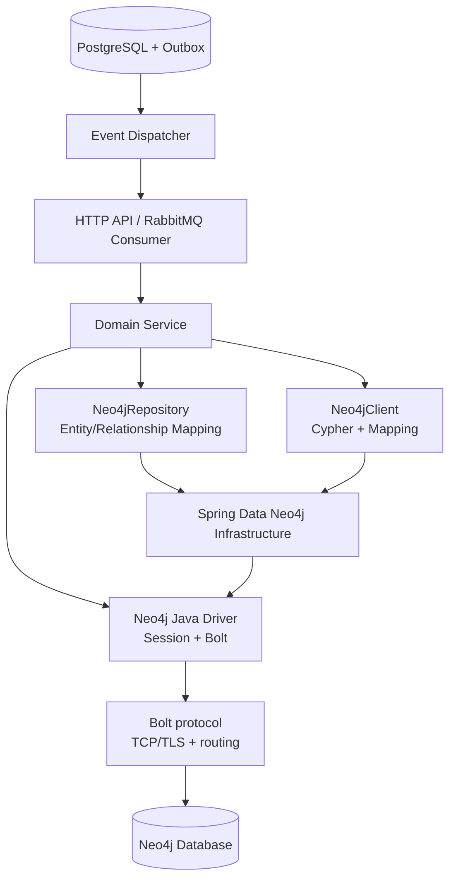
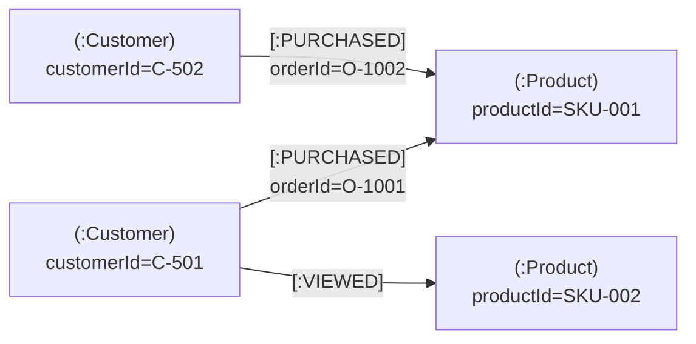
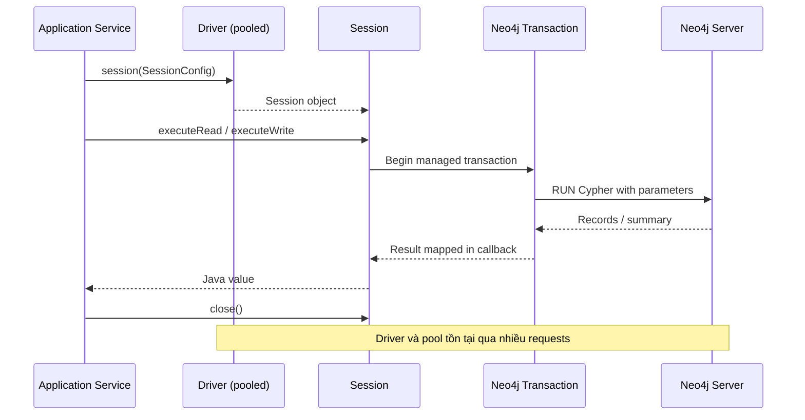
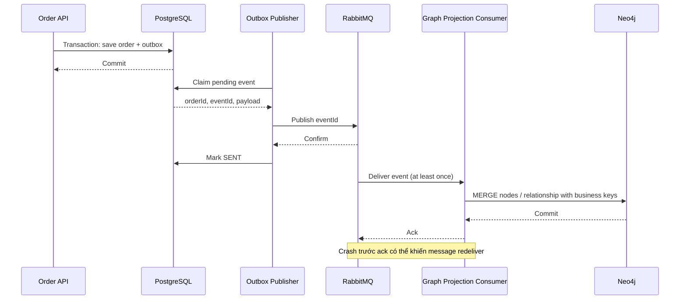
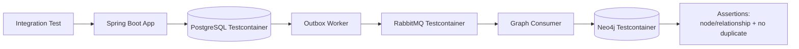
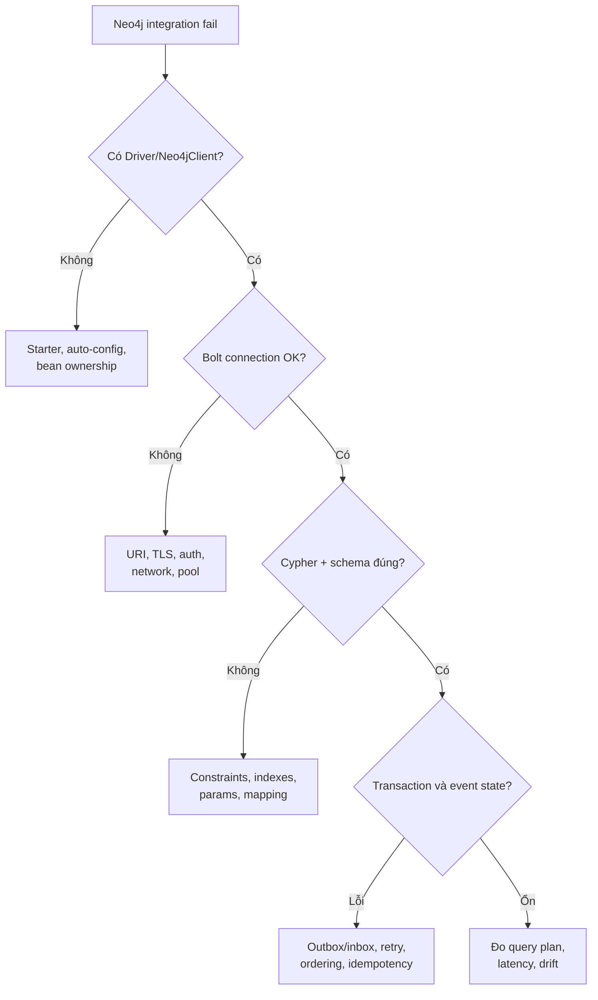

# Neo4j Driver, Neo4jClient và Spring Data Neo4j

## 1. Bối cảnh: một cơ sở dữ liệu đồ thị trong hệ thống Spring Boot Integration

Trong module **SPRING_BOOT_INTEGRATION**, ứng dụng Spring Boot có thể nhận lệnh HTTP, lưu trạng thái trong PostgreSQL, sử dụng Redis để cache, phát sự kiện qua RabbitMQ/Kafka và đồng bộ dữ liệu đến những hệ thống chuyên biệt. **Neo4j** là một lựa chọn khi bài toán cần lưu, tra cứu và duyệt **mối quan hệ** giữa các thực thể: khách hàng, sản phẩm, tổ chức, tài khoản, giao dịch, thiết bị hoặc các nút trong mạng phụ thuộc.

Ví dụ hệ thống thương mại có thể cần biết:

- Khách hàng A đã mua những sản phẩm nào, qua những đơn hàng nào?
- Sản phẩm nào thường được mua cùng nhau trong phạm vi ba bước quan hệ?
- Hai tài khoản có chia sẻ thiết bị, địa chỉ hoặc các thực thể trung gian không?
- Một nguồn dữ liệu gửi lại cùng sự kiện mua hàng thì graph có tạo quan hệ trùng không?
- Khi PostgreSQL đã commit nhưng Neo4j chưa cập nhật, luồng đồng bộ có khả năng phục hồi không?

Trong Java/Spring Boot hiện đại, có **ba tầng API khác nhau** để làm việc với Neo4j:

1. **Neo4j Java Driver** (`org.neo4j.driver.Driver`): client cấp thấp nói chuyện với Neo4j qua giao thức Bolt, quản lý sessions, transactions và kết quả Cypher.
2. **`Neo4jClient`** (`org.springframework.data.neo4j.core.Neo4jClient`): abstraction của **Spring Data Neo4j**, giúp thực thi Cypher và bind tham số, ánh xạ kết quả theo nhu cầu, tích hợp môi trường Spring.
3. **Spring Data Neo4j (SDN)**: tầng ánh xạ node/relationship thành domain model và repository abstraction như `Neo4jRepository`, `@Node`, `@Relationship`, `@Query`.

Ba tầng có thể cùng tồn tại trong một ứng dụng, nhưng **không hoán đổi cho nhau** và không tự bảo đảm tính nhất quán xuyên PostgreSQL, broker hoặc HTTP.

### Mục tiêu bài học

Sau bài này, bạn có thể:

- Chọn Driver, Neo4jClient hoặc SDN repository phù hợp với thao tác đọc/ghi.
- Cấu hình kết nối Bolt, xác thực, database và connection pool qua Spring Boot.
- Viết truy vấn Cypher có tham số, không ghép chuỗi chứa dữ liệu từ HTTP.
- Ánh xạ node và relationship; hiểu những rủi ro khi `save()` một object graph.
- Đặt transaction boundary và thiết kế event-driven synchronization/outbox/idempotency.
- Kiểm thử với Neo4j thật qua Testcontainers, quan sát query và xử lý lỗi transport/schema.

> Ví dụ hướng đến **Spring Boot 3.x, Spring Data Neo4j 7.x, Neo4j Java Driver 5.x và Neo4j 5**, với Java 17+. Những thế hệ mới hơn có thể đổi package, starter, Cypher hoặc option của driver. Hãy đối chiếu BOM và tài liệu đúng phiên bản dự án; không cố định dependency version trái với Spring Boot.

## 2. Nhìn nhanh: Driver, Neo4jClient và Spring Data Neo4j

| Tiêu chí | Neo4j Java Driver | Neo4jClient | Spring Data Neo4j |
| --- | --- | --- | --- |
| Mức trừu tượng | Thấp: Bolt, session, transaction, record | Trung bình: Cypher + bind + map result | Cao: entity/node/relationship + repository |
| API trọng tâm | `Driver`, `Session`, `Result` | `query()`, `bind()`, `fetch()/fetchAs()` | `@Node`, `@Relationship`, `Neo4jRepository` |
| Ai viết Cypher? | Ứng dụng | Ứng dụng | Có thể framework tạo query hoặc developer dùng `@Query` |
| Ánh xạ kết quả | Thủ công từ `Record/Value` | Map thủ công hoặc mapper | Ánh xạ entity graph |
| Vòng đời session | Bạn quản lý khi dùng trực tiếp | Spring Data Neo4j quản lý qua hạ tầng | Spring Data Neo4j quản lý |
| Transaction Spring | Session trực tiếp **không tự** tham gia Spring-managed transaction | Hỗ trợ transaction context của SDN | Hỗ trợ `@Transactional` của SDN |
| Phù hợp nhất | Tác vụ đặc thù, driver API, query tối ưu | Custom Cypher, read model, graph mutation chính xác | CRUD/domain graph và repositories |
| Cần chú ý | Close session, retry callback, pooling | Mapping record, query boundaries, type | Fetch depth/graph persistence, relationship ownership |

**Lựa chọn theo tác vụ, không theo “API nào hiện đại nhất”.** Một ứng dụng có thể dùng repository cho entity `Product`, Neo4jClient cho truy vấn gợi ý sản phẩm và Driver trực tiếp cho một lệnh quản trị/diagnostic đặc biệt.

### Sơ đồ các tầng



Hình mô tả các đường tương tác có thể có. Việc ứng dụng **inject trực tiếp Driver** là đường độc lập với Spring Data Neo4j repository; SDN và Neo4jClient thường dùng hạ tầng driver được Boot cấu hình.

## 3. Neo4j là graph database, không phải một bảng quan hệ đổi tên

Neo4j lưu dữ liệu dưới dạng **nodes**, **relationships** và **properties**. Node có thể gắn labels; relationship có type và hướng; cả node và relationship có properties.

Một mô hình nhỏ:



Một câu Cypher có thể đi theo cạnh:

```cypher
MATCH (c:Customer {customerId: $customerId})
      -[:PURCHASED]->(p:Product)
RETURN p.productId AS productId, p.name AS productName
ORDER BY productId
LIMIT $limit
```

`$customerId` và `$limit` là **parameters** do client bind. Không thay chúng bằng string concatenation từ request.

Từ đây thấy rõ hai kiểu công việc:

- **Aggregate CRUD** đơn giản: tạo `Product`, đổi tên, tìm theo business ID → SDN repository có thể rất thuận tiện.
- **Graph traversal/projection** phức tạp: duyệt quan hệ nhiều bước, ranking, tìm các cặp node có kết nối, kiểm soát cardinality → Neo4jClient hoặc Driver với Cypher tường minh thường dễ kiểm tra query plan hơn.

Không coi Neo4j là một cache không có transaction. Neo4j có transaction và constraints riêng; nó là một hệ quản trị dữ liệu cần backup, migration, authorization, replication/routing và vận hành.

## 4. Dependency và những gì Spring Boot tự cấu hình

Dùng Spring Boot parent/BOM để quản lý version:

```xml
<dependencies>
    <dependency>
        <groupId>org.springframework.boot</groupId>
        <artifactId>spring-boot-starter-data-neo4j</artifactId>
    </dependency>
</dependencies>
```

Tương ứng trong Gradle:

```groovy
dependencies {
    implementation 'org.springframework.boot:spring-boot-starter-data-neo4j'
}
```

Starter thường kéo **Neo4j Java Driver** và các thư viện **Spring Data Neo4j** cần thiết cho entity mapping/repository. Nếu một ứng dụng chỉ cần Driver thuần, có thể phụ thuộc trực tiếp driver và tự xây cấu hình tương ứng; không bắt buộc kéo toàn bộ Spring Data repository.

Spring Boot có các auto-configuration theo điều kiện để tạo hoặc tích hợp:

- `org.neo4j.driver.Driver` từ `spring.neo4j.*` nếu có driver class và đủ điều kiện.
- `Neo4jClient` cùng Neo4j mapping/repository infrastructure khi SDN có mặt.
- `Neo4jTransactionManager` và các repository phù hợp khi transaction/database conditions được thỏa mãn.
- Reactive variants khi dependencies/stack và điều kiện tương ứng được hỗ trợ.

**Không phải cứ thêm starter là broker/database Neo4j sẽ được khởi chạy.** Cần Neo4j server hoặc service bên ngoài, ví dụ container riêng trong môi trường local/test. Nếu ứng dụng tự khai báo `Driver`, `Neo4jClient` hoặc transaction manager, một số bean auto-configured có thể không được tạo theo `@ConditionalOnMissingBean`.

Để chẩn đoán lỗi bean, xem runtime classpath, Conditions Evaluation Report và tên transaction manager thay vì thêm lớp cấu hình trùng lặp.

## 5. Cấu hình spring.neo4j.* và spring.data.neo4j.*

Ví dụ `application.yml`:

```yaml
spring:
  neo4j:
    uri: ${NEO4J_URI:bolt://localhost:7687}
    authentication:
      username: ${NEO4J_USERNAME:neo4j}
      password: ${NEO4J_PASSWORD}
    pool:
      max-connection-pool-size: 40
      connection-acquisition-timeout: 5s

  data:
    neo4j:
      database: ${NEO4J_DATABASE:neo4j}
```

| Thuộc tính | Vai trò | Lưu ý |
| --- | --- | --- |
| `spring.neo4j.uri` | Endpoint Bolt/Neo4j routing | Kiểu scheme ảnh hưởng direct/routing và mã hóa |
| `spring.neo4j.authentication.username` | Identity đăng nhập | Không nhất thiết bằng tên database |
| `spring.neo4j.authentication.password` | Secret Neo4j | Externalize qua secret manager/env |
| `spring.neo4j.pool.max-connection-pool-size` | Giới hạn pool của Driver | Tuning theo concurrency/latency, không tăng vô hạn |
| `spring.neo4j.pool.connection-acquisition-timeout` | Thời hạn chờ lấy connection từ pool | Khác query timeout và business deadline |
| `spring.data.neo4j.database` | Database mà SDN chọn cho truy vấn | Phải được cấp quyền; khác hostname của server |

Cách đặt property `spring.neo4j.*` là do Spring Boot hỗ trợ, còn `spring.data.neo4j.database` phục vụ phần Spring Data. Hãy kiểm tra metadata chính xác theo bản Boot đang sử dụng, nhất là khi định nghĩa nhiều database hoặc driver bean custom.

### Bolt, neo4j:// và TLS

Những scheme thường gặp:

| Scheme | Cách dùng phổ biến |
| --- | --- |
| `bolt://` | Kết nối trực tiếp tới một endpoint Bolt |
| `neo4j://` | URI sử dụng routing của Neo4j driver, thường cho deployment cluster |
| `bolt+s://` | Direct Bolt với TLS và chứng chỉ được xác thực |
| `neo4j+s://` | Neo4j routing với TLS được xác thực |
| `bolt+ssc://` / `neo4j+ssc://` | Scheme dành cho self-signed certificate trong một số tình huống; cần cân nhắc trust/security |

Chọn URI theo topology thật của server, DNS, proxy/LB và certificate. Với production, ưu tiên TLS và trust chain/hostname verification phù hợp; không chọn self-signed/nonverified configuration chỉ để bỏ qua lỗi security.

**Cổng 7687 thường là Bolt**; HTTP/browser của Neo4j có thể dùng cổng 7474, nhưng **Java Driver không gọi Cypher qua URL browser**. Container có thể expose host port động khác 7687; đừng hardcode nó trong integration tests.

## 6. Neo4j Java Driver: tầng truy cập thấp nhất

Neo4j Java Driver là client dùng giao thức Bolt và cung cấp:

- `Driver`: entrypoint thread-safe, quản lý connection pool; tái sử dụng cho cả ứng dụng.
- `Session`: phạm vi nhẹ cho một chuỗi thao tác; **không chia sẻ cùng một Session giữa nhiều thread**.
- `TransactionContext`/transaction callback: thực thi các câu Cypher có điều khiển transaction và khả năng retry theo driver.
- `Result`: kết quả truy vấn dạng records và values.
- `SessionConfig`: chọn database, access mode, bookmarks và một số session options.
- `Value`: ánh xạ các giá trị Neo4j về Java type.

Với ứng dụng Spring Boot đã auto-configured `Driver`, chỉ cần inject:

```java
import org.neo4j.driver.Driver;
import org.springframework.stereotype.Component;

@Component
public class Neo4jDriverGateway {
    private final Driver driver;

    public Neo4jDriverGateway(Driver driver) {
        this.driver = driver;
    }
}
```

**Không gọi `driver.close()` sau mỗi request** nếu Driver do Spring quản lý là singleton bean. Application context quản lý vòng đời Driver; trong các đoạn code nghiệp vụ, chỉ mở/đóng `Session` theo phạm vi thao tác.

### Vòng đời resource



Session là đơn vị **cần đóng** (thường `try-with-resources`); Driver dùng chung là resource lâu dài.

## 7. Driver example: executeRead và query có tham số

Một adapter chỉ cần truy vấn tên sản phẩm:

```java
import java.util.Optional;

import org.neo4j.driver.Driver;
import org.neo4j.driver.Result;
import org.neo4j.driver.Session;
import org.neo4j.driver.SessionConfig;
import org.neo4j.driver.Values;
import org.springframework.stereotype.Repository;

@Repository
public class ProductDriverReader {

    private final Driver driver;

    public ProductDriverReader(Driver driver) {
        this.driver = driver;
    }

    public Optional<String> findName(String productId) {
        try (Session session = driver.session(
                SessionConfig.forDatabase("neo4j"))) {

            return session.executeRead(tx -> {
                Result result = tx.run(
                    """
                    MATCH (p:Product {productId: $productId})
                    RETURN p.name AS name
                    """,
                    Values.parameters("productId", productId)
                );

                if (!result.hasNext()) {
                    return Optional.<String>empty();
                }

                String name = result.single()
                    .get("name").asString();
                return Optional.of(name);
            });
        }
    }
}
```

Giải thích:

1. `Driver` đến từ Spring Boot, dùng chung connection pool.
2. `SessionConfig.forDatabase("neo4j")` chỉ rõ database **trong ví dụ**; production không nên hardcode khi app cấu hình chọn database khác.
3. `executeRead` tạo managed read transaction; callback cần **không thực hiện side effect ngoài Neo4j**.
4. `Values.parameters` bind dữ liệu, tránh Cypher injection vào biểu thức.
5. `Result` được tiêu thụ **bên trong transaction callback** rồi chuyển thành Java object trước khi session đóng.
6. `single()` yêu cầu đúng một record; unique constraint cho `productId` làm kết quả có thể dự đoán.

Không trả `Result` hoặc lazy iterator ra ngoài `try-with-resources` rồi mới đọc: session/transaction có thể đã đóng, dẫn tới lỗi hoặc rò tài nguyên.

### Driver retry callback và side effect ngoài database

Driver có thể retry một managed transaction callback khi gặp lỗi tạm thời mà driver phân loại là retryable. Vì vậy **không gửi email, gọi HTTP thu tiền hoặc publish broker bên trong callback và giả định nó chỉ chạy đúng một lần**. Với transaction đọc, callback nên thuần; với ghi, thiết kế idempotent theo business key.

## 8. Driver example: executeWrite và MERGE

Giả sử một sự kiện từ RabbitMQ yêu cầu bảo đảm node sản phẩm tồn tại:

```java
import org.neo4j.driver.Driver;
import org.neo4j.driver.Session;
import org.neo4j.driver.SessionConfig;
import org.neo4j.driver.Values;
import org.springframework.stereotype.Component;

@Component
public class ProductDriverWriter {

    private final Driver driver;

    public ProductDriverWriter(Driver driver) {
        this.driver = driver;
    }

    public void upsertProduct(String id, String name) {
        try (Session session = driver.session(
                SessionConfig.forDatabase("neo4j"))) {

            session.executeWrite(tx -> {
                tx.run(
                    """
                    MERGE (p:Product {productId: $id})
                    SET p.name = $name
                    """,
                    Values.parameters("id", id, "name", name)
                ).consume();

                return null;
            });
        }
    }
}
```

`MERGE` tìm hoặc tạo theo pattern đã chỉ định. Tuy nhiên **MERGE không thay thế uniqueness constraint** trong trường hợp nhiều worker đồng thời hoặc dữ liệu đã có bản trùng. Cần tạo constraint `Product.productId` ở database và xử lý lỗi conflict thực tế.

`SET p.name = $name` có thể ghi đè tên mới bằng event cũ đến muộn. Nếu hệ thống tích hợp nhận event không theo thứ tự, thêm `sourceVersion`, `updatedAt` có quy tắc rõ hoặc cơ chế kiểm tra version trước khi cập nhật, không chỉ tin rằng upsert luôn đúng.

### Phân biệt managed transaction với auto-commit

Driver có cả API chạy query trong auto-commit transaction và API managed transaction. Với nhóm mutation cần atomicity/retry có kiểm soát, ưu tiên `executeWrite` và đảm bảo **đọc/ghi kết quả trước khi callback trả về**. Không trộn các lệnh viết trực tiếp qua nhiều sessions nếu cần cùng một transaction.

## 9. Neo4jClient: Cypher tường minh với tích hợp Spring Data

`Neo4jClient` có thể được inject khi Spring Data Neo4j đã được cấu hình:

```java
import org.springframework.data.neo4j.core.Neo4jClient;
import org.springframework.stereotype.Repository;

@Repository
public class ProductGraphQueries {
    private final Neo4jClient neo4jClient;

    public ProductGraphQueries(Neo4jClient neo4jClient) {
        this.neo4jClient = neo4jClient;
    }
}
```

Nó giúp:

- Truy vấn Cypher có tham số theo fluent API.
- Trả giá trị đơn giản, `Map` hoặc ánh xạ records sang DTO tùy mapper.
- Hạn chế code phải mở/đóng `Session` cho các query thông thường.
- Tham gia transaction của Spring Data Neo4j khi cấu hình transaction manager phù hợp.
- Giữ các graph queries rõ ràng mà không cần ánh xạ toàn bộ kết quả vào một `@Node` entity graph.

Đây vẫn là **Neo4j/Cypher client**, không phải SQL JDBC abstraction. Nó không tự kiểm tra hợp đồng HTTP/RabbitMQ hoặc chuyển event từ PostgreSQL sang Neo4j.

### Khi nào dùng Neo4jClient thay repository?

- Query trả projection `ProductRecommendation` không trùng một aggregate node.
- Cypher `MATCH` nhiều loại relationship, `UNWIND`, `OPTIONAL MATCH`, aggregation.
- Mutation chính xác một relationship, không muốn `save()` lại toàn graph.
- Cần truy vấn theo cấu trúc đặc thù, nhiều labels/types hoặc dynamic filtering **có allowlist**.
- Tránh load nhiều entity/relationships vào bộ nhớ chỉ để lấy vài thuộc tính.

## 10. Neo4jClient example: bind tham số và fetchAs projection

Một truy vấn tìm các sản phẩm khách đã mua:

```java
public record PurchasedProduct(
    String productId,
    String name
) {}
```

```java
import java.util.Collection;
import org.springframework.data.neo4j.core.Neo4jClient;
import org.springframework.stereotype.Repository;

@Repository
public class PurchaseReadModel {

    private final Neo4jClient client;

    public PurchaseReadModel(Neo4jClient client) {
        this.client = client;
    }

    public Collection<PurchasedProduct> findPurchased(
            String customerId, int maxItems) {

        int limit = Math.max(1, Math.min(maxItems, 100));

        return client.query("""
            MATCH (c:Customer {customerId: $customerId})
                  -[:PURCHASED]->(p:Product)
            RETURN DISTINCT p.productId AS productId,
                            p.name AS name
            ORDER BY productId
            LIMIT $limit
            """)
            .bind(customerId).to("customerId")
            .bind(limit).to("limit")
            .fetchAs(PurchasedProduct.class)
            .mappedBy((typeSystem, record) ->
                new PurchasedProduct(
                    record.get("productId").asString(),
                    record.get("name").asString()
                )
            )
            .all();
    }
}
```

Ở đây:

- Giá trị `customerId` và `limit` được bind qua fluent API, không ghép vào Cypher.
- `DISTINCT` có thể cần thiết nếu một khách có nhiều `PURCHASED` relationships tới cùng sản phẩm và use case chỉ muốn danh sách sản phẩm duy nhất.
- `fetchAs(...).mappedBy(...)` chuyển `Record` của Neo4j Driver thành DTO, bỏ qua persistence context của entity graph.
- `all()` materialize toàn bộ kết quả query; `LIMIT` giúp kiểm soát bộ nhớ.
- `maxItems` được chặn từ 1 đến 100 trước khi bind; cần kiểm soát deadline, tính chọn lọc query và index ở production.

Nếu chỉ cần một node hoặc scalar:

```java
import java.util.Optional;

Optional<Long> total = client.query("""
        MATCH (c:Customer {customerId: $customerId})
              -[:PURCHASED]->(p:Product)
        RETURN count(DISTINCT p) AS total
        """)
    .bind("C-501").to("customerId")
    .fetchAs(Long.class)
    .mappedBy((typeSystem, record) ->
        record.get("total").asLong()
    )
    .one();
```

`one()` trả `Optional` theo API, khác với trả về danh sách. Không đồng nhất `Optional.empty()` với count = 0: trường hợp `count(...)` thường có một record bằng 0, trong khi query `MATCH ... RETURN p` có thể không có record.

## 11. Neo4jClient example: cập nhật relationship chính xác

Một sự kiện đơn hàng đã thanh toán cần thêm quan hệ “đã mua” giữa khách và sản phẩm. Dùng Cypher tường minh:

```java
import org.springframework.data.neo4j.core.Neo4jClient;
import org.springframework.stereotype.Service;
import org.springframework.transaction.annotation.Transactional;

@Service
public class PurchaseGraphWriter {

    private final Neo4jClient client;

    public PurchaseGraphWriter(Neo4jClient client) {
        this.client = client;
    }

    @Transactional
    public void registerPurchase(
            String customerId,
            String productId,
            String orderId,
            String occurredAt) {

        client.query("""
            MERGE (c:Customer {customerId: $customerId})
            MERGE (p:Product {productId: $productId})
            MERGE (c)-[r:PURCHASED {orderId: $orderId}]->(p)
            ON CREATE SET r.occurredAt = datetime($occurredAt)
            """)
            .bind(customerId).to("customerId")
            .bind(productId).to("productId")
            .bind(orderId).to("orderId")
            .bind(occurredAt).to("occurredAt")
            .run();
    }
}
```

Giải thích:

1. `MERGE` cho các nodes dựa trên **business keys**, không dựa trên internal element ID.
2. Relationship được xác định theo hai đầu và `orderId`. Nếu hợp đồng cho phép một order chứa cùng product nhiều lần thì cần thêm `lineId` hoặc khóa khác.
3. `ON CREATE SET` giúp retry cùng event không thay lại `occurredAt` nếu pattern đã tồn tại.
4. `@Transactional` ở đây phải được giải quyết bằng **Neo4jTransactionManager** phù hợp. Nếu ứng dụng đồng thời có JDBC/JPA transaction manager, cần chỉ rõ transaction manager, không phụ thuộc lựa chọn ngầm.
5. Cần uniqueness constraints cho `Customer.customerId` và `Product.productId`, cùng quy tắc idempotency/concurrency cho relationship; `MERGE` không phải bảo đảm exactly-once trên toàn hệ thống.
6. Nếu event đến sai thứ tự, có thể tạo node thiếu name hoặc business attributes; cần có chiến lược enrichment/event version và repair.

Không đặt remote HTTP call hoặc publish broker trong một Neo4j transaction callback và giả định mọi thứ được commit nguyên tử.

## 12. Spring Data Neo4j: ánh xạ node thành entity

Spring Data Neo4j cung cấp annotations, mapping context và repository abstraction, phù hợp CRUD và một số truy vấn dựa trên graph domain.

Ví dụ node sản phẩm có business ID do ứng dụng cấp:

```java
import org.springframework.data.neo4j.core.schema.Id;
import org.springframework.data.neo4j.core.schema.Node;

@Node("Product")
public class ProductNode {

    @Id
    private String productId;

    private String name;

    protected ProductNode() {
    }

    public ProductNode(String productId, String name) {
        this.productId = productId;
        this.name = name;
    }

    public String getProductId() {
        return productId;
    }

    public String getName() {
        return name;
    }

    public void rename(String newName) {
        this.name = newName;
    }
}
```

Các annotations này thuộc package `org.springframework.data.neo4j.core.schema`, **khác với** `jakarta.persistence.Entity`, `@Table` và `@Id` của JPA.

Đối với node:

- `@Node("Product")` ánh xạ class tới node mang label `Product`.
- `@Id` đánh dấu property dùng làm business identifier. Khi tự cấp `productId`, không cần `@GeneratedValue`.
- Properties thường được ánh xạ sang node properties theo mapping configuration.
- Entity mapping không thay thế unique constraint của database. **`@Id` không tự bảo đảm một graph có unique index phù hợp với traffic đồng thời**.
- Hạn chế dùng ID nội bộ của Neo4j làm ID nghiệp vụ lâu dài. Với tích hợp xuyên hệ thống, business ID ổn định giúp replay, deduplication và migration.

Các class immutable/records có thể cần cấu hình construction/mapping phù hợp theo Spring Data version. Ví dụ dùng Java class có no-arg constructor để tránh làm mờ trọng tâm mapping.

## 13. Neo4jRepository và truy vấn tự sinh

Repository cơ bản:

```java
import java.util.List;
import java.util.Optional;

import org.springframework.data.neo4j.repository.Neo4jRepository;
import org.springframework.data.neo4j.repository.query.Query;
import org.springframework.data.repository.query.Param;

public interface ProductRepository
        extends Neo4jRepository<ProductNode, String> {

    Optional<ProductNode> findByProductId(String productId);

    @Query("""
        MATCH (p:Product)
        WHERE toLower(p.name) CONTAINS toLower($fragment)
        RETURN p
        ORDER BY p.name, p.productId
        LIMIT $limit
        """)
    List<ProductNode> searchByName(
        @Param("fragment") String fragment,
        @Param("limit") long limit
    );
}
```

Một service CRUD:

```java
import org.springframework.stereotype.Service;
import org.springframework.transaction.annotation.Transactional;

@Service
public class ProductCatalogService {

    private final ProductRepository repository;

    public ProductCatalogService(ProductRepository repository) {
        this.repository = repository;
    }

    @Transactional
    public ProductNode rename(String id, String newName) {
        ProductNode product = repository.findById(id)
            .orElseThrow(() ->
                new IllegalArgumentException("Product not found")
            );
        product.rename(newName);
        return repository.save(product);
    }
}
```

Điều kiện quan trọng: service dùng **Neo4j transaction manager** thích hợp. Nếu project có PostgreSQL và Neo4j, giải quyết tên transaction manager tường minh, chẳng hạn `@Transactional("neo4jTransactionManager")` khi bạn đã đăng ký bean mang tên đó.

`findById`, `findByProductId` và `@Query` khác nhau về trách nhiệm:

- **Derived query** tiện cho điều kiện đơn giản; đọc đúng tên property Java.
- **`@Query`** cho phép Cypher tùy chỉnh; phải return shape mà Spring Data Neo4j map đúng.
- **`save`** xử lý persistence entity graph theo mapping; không phải `INSERT`/`UPDATE` SQL kiểu JPA, và behavior khác biệt khi relationships được load hoặc thay đổi.

### Khi nào không nên dùng repository cho mọi thứ?

Một truy vấn nhiều hops, aggregate trả scalar/projection hoặc mutation chỉ một relationship có thể dễ quản lý bằng `Neo4jClient`. Ép mọi truy vấn thành `List<ProductNode>` có thể load quá nhiều graph data, tăng query cost hoặc làm domain model chứa quan hệ không cần thiết.

## 14. Mapping relationship bằng @Relationship

Neo4j relationship có **type** và **direction**. Trong SDN, có thể mô tả quan hệ trên entity:

```java
import java.util.HashSet;
import java.util.Set;

import org.springframework.data.neo4j.core.schema.Id;
import org.springframework.data.neo4j.core.schema.Node;
import org.springframework.data.neo4j.core.schema.Relationship;

@Node("Customer")
public class CustomerNode {

    @Id
    private String customerId;

    private String displayName;

    @Relationship(
        type = "FOLLOWS",
        direction = Relationship.Direction.OUTGOING
    )
    private Set<CustomerNode> follows = new HashSet<>();

    protected CustomerNode() {
    }

    public CustomerNode(String customerId, String displayName) {
        this.customerId = customerId;
        this.displayName = displayName;
    }

    public void follow(CustomerNode other) {
        follows.add(other);
    }
}
```

Ví dụ nhằm cho thấy SDN biểu diễn quan hệ. Một graph thực còn phải quyết định:

- Ai là **aggregate root/owner** của relationship?
- Có cho phép relationship hai chiều hay không?
- Một `Customer` có thể follow bao nhiêu người, có giới hạn độ sâu khi load?
- Nếu consumer chỉ biết customer ID, có cần load toàn bộ `follows` để thêm một cạnh?
- `equals/hashCode` của entity có ổn định khi dùng trong `Set` hay không?
- Khi một node bị xóa, các relationships và node lân cận có được xử lý đúng domain policy?

Cần tránh recursive graph mapping vô hạn hoặc eager load toàn bộ mạng quan hệ. Với một hệ thống nhiều khách hàng, thường nên tải **projection cần thiết** thay vì serialize entity graph trực tiếp thành JSON API response.

## 15. Relationship có properties: @RelationshipProperties và @TargetNode

Một cạnh “đã mua” không chỉ có type; nó có thể mang `orderId`, `quantity`, `occurredAt`. SDN hỗ trợ mapping relationship properties:

```java
import java.time.Instant;

import org.springframework.data.neo4j.core.schema.GeneratedValue;
import org.springframework.data.neo4j.core.schema.Id;
import org.springframework.data.neo4j.core.schema.RelationshipProperties;
import org.springframework.data.neo4j.core.schema.TargetNode;

@RelationshipProperties
public class PurchasedRelationship {

    @Id
    @GeneratedValue
    private Long id;

    @TargetNode
    private ProductNode product;

    private String orderId;

    private Instant occurredAt;

    protected PurchasedRelationship() {
    }

    public PurchasedRelationship(
            ProductNode product,
            String orderId,
            Instant occurredAt) {
        this.product = product;
        this.orderId = orderId;
        this.occurredAt = occurredAt;
    }
}
```

Trên `CustomerNode` có thể định nghĩa:

```java
@Relationship(
    type = "PURCHASED",
    direction = Relationship.Direction.OUTGOING
)
private Set<PurchasedRelationship> purchases = new HashSet<>();
```

Đoạn sau là **phần thêm vào class CustomerNode**, không phải một file/class độc lập để biên dịch. Khi áp dụng, quyết định xem quan hệ `FOLLOWS` trước đó có cần giữ hay không; ví dụ các lớp là những minh họa riêng.

**Phân biệt ID relationship do SDN quản lý với business key:** ID nội bộ phục vụ mapping, còn `orderId` hoặc `eventId` phải được kiểm soát theo hợp đồng nghiệp vụ để chống replay. Nếu cần tính duy nhất của relationship theo nghiệp vụ, cần chiến lược schema/logic Cypher phù hợp, không coi `@GeneratedValue` là idempotency key.

## 16. Cẩn thận với save() trên object graph chưa đầy đủ

Đây là phần quan trọng khi dùng Spring Data Neo4j trong hệ thống tích hợp có nhiều worker cập nhật cùng graph.

Một entity có `@Relationship` biểu diễn tập relationships. Khi gọi `repository.save(entity)`, SDN có thể đồng bộ graph theo trạng thái được mapping/loaded, **bao gồm xử lý relationships**. Nếu bạn chỉ dựng một entity “rút gọn” với một subset edges rồi save như thể đó là toàn bộ graph, bạn có thể gây thay đổi relationship ngoài ý muốn tùy cách mapping và phiên bản.

Ví dụ cần suy nghĩ:

```text
Trong Neo4j:
Customer C-501 --FOLLOWS--> C-502
Customer C-501 --FOLLOWS--> C-503

Message đến chỉ chứa "thêm C-504".
Ứng dụng dựng CustomerNode(C-501) với follows={C-504}
và gọi repository.save(...).
```

Mục tiêu là **thêm một quan hệ**, không phải thay toàn bộ collection relationships. Với mutation có phạm vi hẹp, Cypher:

```cypher
MATCH (a:Customer {customerId: $fromId})
MATCH (b:Customer {customerId: $toId})
MERGE (a)-[:FOLLOWS]->(b)
```

thường rõ ràng hơn việc lưu lại một aggregate bị thiếu thông tin. Cần test hành vi thực của SDN phiên bản đang dùng trước khi quyết định cách `save()` xử lý relationships đã tồn tại.

**Không đồng nhất SDN với Hibernate JPA dirty checking.** Hai mô hình persistence khác nhau, đặc biệt với graph relationships, fetch và các thao tác `save`.

## 17. Query Cypher an toàn: parameters và allowlist

Khi người dùng nhập `productId` hoặc `customerId`, bind tham số:

```cypher
MATCH (p:Product {productId: $productId})
RETURN p.productId AS id, p.name AS name
```

**Không làm:**

```java
String unsafe = "MATCH (p:Product {productId: '"
    + userInput + "'}) RETURN p";
```

Vì user input có thể phá cú pháp hoặc thay đổi ý nghĩa query. `Neo4jClient.bind(...)` và Driver `Values.parameters(...)` gửi các giá trị qua parameters, an toàn hơn với input values.

### Labels và relationship types động

Không phải mọi vị trí cú pháp Cypher đều thay bằng tham số kiểu scalar như property value trong mọi phiên bản Neo4j. Nếu ứng dụng cho phép chọn label/relationship type động, cần:

1. Xác định **allowlist** các labels/types được cho phép.
2. Chọn đoạn Cypher **do code kiểm soát**, không nối trực tiếp input không tin cậy.
3. Kiểm tra hỗ trợ cú pháp dynamic labels/types theo **đúng Neo4j version** trước khi áp dụng.
4. Không để HTTP caller tự chọn tên label của tenant khác.
5. Tránh dùng string interpolation cho identifier tùy ý nếu không có bộ escape/validation đúng chuẩn.

Trong hệ thống đa tenant, nên phân quyền và lọc dữ liệu ở tầng application/database; không cho người dùng quyết định relationship type như một đường tắt thay cho authorization.

## 18. Schema constraints và indexes phải được quản lý riêng

Annotation `@Id` không thay cho database constraint. Với các event được replay và nhiều worker cập nhật graph đồng thời, cần uniqueness constraint cho **business identifiers**.

Ví dụ Cypher dành cho Neo4j 5:

```cypher
CREATE CONSTRAINT product_id_unique IF NOT EXISTS
FOR (p:Product)
REQUIRE p.productId IS UNIQUE;

CREATE CONSTRAINT customer_id_unique IF NOT EXISTS
FOR (c:Customer)
REQUIRE c.customerId IS UNIQUE;

CREATE INDEX product_name_idx IF NOT EXISTS
FOR (p:Product)
ON (p.name);
```

Các câu lệnh phải được chạy bởi quy trình **schema migration/provisioning** có kiểm soát. Không cho mọi application replica tự tạo/sửa constraints trong startup nếu chưa xác định permissions, deployment order và migration ownership.

Một unique constraint giúp tránh hai nodes có cùng product ID. Nó **không** tự bảo đảm:

- Sự kiện cũ không ghi đè graph mới.
- Một quan hệ PURCHASED không được thêm hai lần nếu business key khác nhau.
- Transaction Neo4j và transaction PostgreSQL commit cùng nhau.
- Một HTTP call/broker publish chỉ được thực hiện một lần.

### Điều kiện performance

Đo các query quan trọng bằng `EXPLAIN` và `PROFILE` trên môi trường an toàn. `EXPLAIN` kiểm tra kế hoạch dự kiến; `PROFILE` **thực thi truy vấn** để thu số liệu, vì thế tránh PROFILE một lệnh ghi trên dữ liệu production nếu chưa hiểu tác động. Cần xem cardinality, index seek/scan, số relationship traversals và kích thước intermediate results.

## 19. Transaction: Neo4j độc lập với PostgreSQL, RabbitMQ và HTTP

Một transaction Neo4j bảo vệ thao tác trong Neo4j. Nó không tự bao trùm dữ liệu ở PostgreSQL, Redis, một HTTP API đối tác hoặc RabbitMQ publisher.

Ví dụ không an toàn về mặt atomicity:

```java
@Transactional
public void processOrder(OrderCreatedEvent event) {
    postgresOrderRepository.save(event.toJpaEntity());
    productGraphQueries.updateFromEvent(event);
    rabbitTemplate.convertAndSend(
        "integration.orders.events",
        "order.created",
        event
    );
}
```

Đoạn trên chỉ minh họa ý tưởng; các kiểu `OrderCreatedEvent`, `postgresOrderRepository`, `productGraphQueries` và `rabbitTemplate` do ứng dụng định nghĩa. Khi có nhiều transaction managers, `@Transactional` có thể chọn **một** manager nhưng không mặc nhiên tạo distributed transaction trên cả ba tài nguyên.

Những failure windows:

1. PostgreSQL commit nhưng Neo4j chưa ghi → graph bị trễ.
2. Neo4j ghi xong nhưng PostgreSQL rollback → graph có dữ liệu chưa tương ứng với nguồn chính.
3. Neo4j commit rồi app crash trước khi ack RabbitMQ → message sẽ bị redeliver.
4. HTTP timeout sau remote side effect → hệ thống không biết đã tạo quan hệ bên ngoài hay chưa.
5. Một callback managed transaction bị retry → side effect ngoài Neo4j bên trong callback có thể chạy lặp.

**Định nghĩa system of record trước:** ví dụ PostgreSQL sở hữu order, Neo4j là graph read model được xây lại từ sự kiện. Nếu coi cả hai là nguồn ghi chính, consistency/saga protocol sẽ phức tạp hơn nhiều.

## 20. Đồng bộ PostgreSQL → Neo4j bằng outbox và idempotent graph updates

Một kiến trúc thực tế:



Một sự kiện ví dụ:

```json
{
  "eventId": "evt-1001",
  "eventType": "order.paid",
  "schemaVersion": 1,
  "orderId": "ORD-501",
  "customerId": "C-501",
  "productId": "SKU-001",
  "occurredAt": "2026-11-21T03:00:00Z"
}
```

Quy tắc thiết kế:

- **PostgreSQL transaction** ghi business state và outbox event cùng lúc.
- Publisher phát với `eventId` ổn định; RabbitMQ confirm giúp biết kết quả publish nhưng không phải business completion.
- Consumer graph dùng `MERGE` hoặc idempotency marker phù hợp để lặp lại event không nhân đôi graph side effect.
- Dùng unique constraints trên business IDs và định nghĩa khóa relationship rõ, ví dụ `orderId`/`lineId`.
- Chỉ **ack RabbitMQ sau khi** Neo4j transaction thành công và trạng thái cần thiết được ghi.
- Nếu consumer chết sau Neo4j commit nhưng trước ack, lần redelivery phải an toàn.
- Có backfill/reconciliation để so graph read model với system of record khi drift hoặc schema đổi.
- Ghi `sourceVersion`/`occurredAt` để quản lý update cũ đến muộn.

Outbox/inbox không tự tạo exactly-once delivery. Mục tiêu thực tế là **at-least-once delivery + idempotent business effect** trong giới hạn hợp đồng và transaction đã chọn.

## 21. Event ordering và graph read-model consistency

Giả sử producer phát:

```text
evt-101: Product SKU-001 name = "A", version = 5
evt-102: Product SKU-001 name = "B", version = 6
```

Nếu consumer nhận evt-102 trước evt-101, một câu `SET p.name = $name` vô điều kiện sẽ khiến tên quay lại “A”. Không sửa bằng cách tăng retry; cần **version-aware update**.

Một ý tưởng Cypher:

```cypher
MERGE (p:Product {productId: $productId})
ON CREATE SET p.sourceVersion = -1
WITH p
WHERE coalesce(p.sourceVersion, -1) < $sourceVersion
SET p.name = $name,
    p.sourceVersion = $sourceVersion
RETURN p.productId AS updatedId
```

Đây là minh họa cập nhật có điều kiện; kiểm thử concurrency/locking và version semantics trong Neo4j thật trước khi dùng cho nhiều writers. `WHERE` không được hiểu là cơ chế khóa cross-resource. Thiết kế sequence/version phải do system of record cung cấp, không chỉ dựa vào timestamp từ những máy có clock lệch.

**Read-your-writes/causal consistency:** Neo4j Driver hỗ trợ bookmarks/cơ chế causal chaining trong deployment phù hợp. Một ứng dụng cần đọc ngay sau khi ghi ở một session/cluster phải hiểu transaction boundaries, database routing và bookmarks. Nhưng bookmarks Neo4j **không** giải quyết propagation delay từ PostgreSQL tới RabbitMQ rồi tới Neo4j.

Với UI đọc graph sau khi vừa thanh toán, cần quyết định có hiển thị trạng thái `PENDING_GRAPH_UPDATE` hoặc fallback từ primary database hay không.

## 22. Độ sâu truy vấn, cardinality và pagination

Graph traversal có thể tăng số hàng rất nhanh:

```cypher
MATCH (c:Customer {customerId: $customerId})
      -[:FOLLOWS*1..3]->(other:Customer)
RETURN DISTINCT other.customerId AS id
LIMIT $limit
```

Dù `*1..3` giới hạn độ dài đường đi, số relationship combinations có thể tăng rất lớn ở graph mật độ cao. Các vấn đề:

- Kết quả trùng nodes nếu có nhiều paths dẫn tới cùng đích.
- `DISTINCT` và `ORDER BY` có thể tốn memory/CPU.
- `LIMIT` giới hạn output nhưng **không luôn giới hạn chi phí mở rộng traversal** trước đó.
- Query một trang không có stable ordering có thể đổi thứ tự khi graph thay đổi.
- Unbounded graph load qua repository có thể tốn memory hơn trả DTO projection.

Đối với API phục vụ bên ngoài:

1. Giới hạn `maxDepth` và `pageSize` từ trước.
2. Thiết kế index/constraint cho entry-point node.
3. Dùng projection trả đúng fields cần thiết.
4. Đo latency và query plans trên data tương tự production.
5. Cân nhắc cursor/keyset pagination khi đồ thị thay đổi thường xuyên.
6. Giới hạn total database work bằng timeout/resource policy phù hợp.

**Không chỉ tăng connection pool** để chữa query đã duyệt hàng triệu relationships: đó có thể làm database quá tải nhanh hơn.

## 23. Kết nối, pooling, timeout và resource limits

`Driver` quản lý pool; `Session`/transaction sử dụng connections trong khoảng thời gian cần thiết. Một service gọi API graph với concurrency cao có thể gặp pool wait hoặc bottleneck query.

Các thông số cần quan sát:

| Nhóm | Tín hiệu | Hướng xử lý |
| --- | --- | --- |
| Kết nối | Open connections, acquisition latency, timeout | Đo pool và workload; tránh tạo Driver mỗi request |
| Transaction | Transaction duration, lock wait, retry | Giữ transaction ngắn, không gọi HTTP bên trong |
| Query | Latency, rows, db hits, plan | `EXPLAIN`, indexes, giảm traversal/cardinality |
| Cụm Neo4j | Routing/leader availability, session expiry | Chọn scheme phù hợp, hiểu retryable failures |
| Bộ nhớ | Large result materialization | Bounded queries, projection, streaming khi có nhu cầu |
| Downstream | RabbitMQ backlog, HTTP latency | Backpressure, concurrency và timeout chính sách |

`spring.neo4j.pool.max-connection-pool-size` không phải “số node được truy vấn đồng thời” theo cách một-một; session có thể sử dụng connections theo transaction và routing. Không nâng pool lên hàng nghìn mà không cân nhắc giới hạn server, tải CPU, memory, network và connection lifetimes.

### Driver verifyConnectivity

Để kiểm tra kết nối ở môi trường chẩn đoán:

```java
import org.neo4j.driver.Driver;

public void verifyNeo4j(Driver driver) {
    driver.verifyConnectivity();
}
```

`verifyConnectivity()` thử kết nối, có thể ném exception khi thiếu quyền/mạng/broker; **không chứng minh** query nghiệp vụ, schema constraints hoặc event consistency đúng. Startup/health policy phải phân biệt Neo4j là dependency bắt buộc hay chỉ là read-model phụ có thể tạm trễ.

## 24. Lỗi Driver/Neo4jClient và chính sách retry

Các lỗi thường gặp:

| Lớp lỗi | Ví dụ | Điều cần làm |
| --- | --- | --- |
| Network/cluster | `ServiceUnavailableException`, mất kết nối | Retry bounded khi lỗi tạm thời, đo downtime |
| Session/routing | `SessionExpiredException`, leader chuyển đổi | Driver managed transaction có thể retry; kiểm tra topology |
| Transient DB failure | `TransientException`, deadlock/lock contention | Retry giao dịch **idempotent**, backoff/jitter |
| Query/constraint failure | `ClientException`, invalid Cypher, unique conflict | Sửa query/schema hoặc phân loại duplicate; không retry mù |
| Auth/permission | Auth error hoặc database access denied | Sửa credential/role, không retry nóng |
| Mapping failure | Không đọc được `Value`, field null/đổi kiểu | Kiểm tra query projection và hợp đồng dữ liệu |
| Pool timeout | Hết slot kết nối, session chờ quá lâu | Đo concurrency, transaction time, pool/server load |
| Không thấy node | Query không có record | Xử lý `Optional.empty()` theo business contract |

**Đừng gộp tất cả thành HTTP 500 hoặc retry vô hạn.** Ví dụ syntax error và permission denied không tự biến mất sau 10 lần chạy lại. Với một write transaction, cần xem driver đã tự retry managed callback hay chưa trước khi thêm retry ngoài để tránh nhân số lần thực thi.

Khi một transaction bị lỗi sau khi request đã gửi, outcome có thể chưa chắc chắn ở góc nhìn caller. Dùng business key/constraint và trạng thái đồng bộ để đánh giá replay thay vì dựa hoàn toàn vào exception name.

### Cách thiết kế exception miền

Bạn có thể map lỗi driver sang exception của adapter:

```java
public class GraphUnavailableException extends RuntimeException {
    public GraphUnavailableException(Throwable cause) {
        super("Graph database temporarily unavailable", cause);
    }
}
```

Ở tầng service/HTTP, quyết định trả `503`, dùng fallback read model cũ hay xếp việc vào queue dựa trên yêu cầu nghiệp vụ. Không log raw Cypher có token/dữ liệu nhạy cảm hoặc exception message chứa parameters không được kiểm soát.

## 25. Graph schema evolution và quản trị dữ liệu

Neo4j không “không có schema” theo nghĩa không cần quản lý contract. Labels, relationship types, property names, indexes và constraints là một phần hợp đồng lưu trữ.

Các thay đổi cần kế hoạch:

- Đổi `Customer.customerId` sang khóa mới có thể ảnh hưởng hàng triệu relationships.
- Đổi `PURCHASED` thành `BOUGHT` cần migration hoặc giai đoạn cùng đọc hai relationship types.
- Một field đang nullable trở thành bắt buộc: phải backfill dữ liệu cũ trước khi siết ràng buộc.
- Thay cấu trúc relationship properties ảnh hưởng truy vấn Cypher, SDN mapping và consumer event.
- Thêm Neo4j node label cho tenant/project mới cần phân quyền và indexing phù hợp.
- Khác biệt Neo4j 4/5 hoặc các bản lớn có thể thay cú pháp constraints, functions và query planner.

**Không để mỗi replica tự chạy câu `CREATE CONSTRAINT` tùy ý ở startup.** Dùng migration job, script có version hoặc công cụ quản trị đã được tổ chức phê duyệt; kiểm thử chạy lặp idempotently khi thích hợp và có kế hoạch rolling compatibility.

Để phát triển database graph bền vững, cần cả **backup/restore, retention, access control và quy trình sửa graph drift**. SDN repository không tự thay thế những công việc vận hành này.

## 26. ReactiveNeo4jClient và reactive repositories

Spring Data Neo4j còn hỗ trợ mô hình reactive trong những stack/phiên bản phù hợp, ví dụ:

- `ReactiveNeo4jClient` cho Cypher reactive.
- `ReactiveNeo4jRepository<T, ID>` cho repository trả `Mono<T>`/`Flux<T>`.
- Transaction management reactive khi đã cấu hình ReactiveNeo4jTransactionManager thích hợp.

Các abstraction này không đồng nghĩa với `Neo4jClient` imperative chỉ vì tên tương tự. Một ứng dụng WebFlux cần tránh gọi các thao tác **blocking** của Driver imperative, Neo4jClient imperative hoặc repository sync trên event-loop thread.

Một kiến trúc có thể chọn:

| Phạm vi | Lựa chọn hợp lý |
| --- | --- |
| Spring MVC/JPA + một số truy vấn graph | Imperative SDN/Neo4jClient, quản lý thread bình thường |
| WebFlux end-to-end và driver reactive phù hợp | ReactiveNeo4jClient/repositories/reactive transactions |
| WebFlux nhưng buộc gọi legacy blocking adapter | Scheduler/worker pool có giới hạn; tránh `block()` trên event loop |
| Workflows cần durability sau crash | Outbox/broker + idempotent consumers; reactive không tự tạo durability |

Không tự `subscribe()` vào một `Mono` ghi graph từ service rồi bỏ qua kết quả: exception có thể mất dấu, transaction/cancellation khó kiểm soát. Trả publisher cho caller chịu trách nhiệm hoặc enqueue công việc bền vững nếu workflow yêu cầu.

## 27. Nhiều database hoặc nhiều nguồn Neo4j

Một Neo4j deployment có thể có nhiều databases; một Spring Boot app có thể truy cập graph nội bộ và graph đối tác hoặc cần read model riêng.

Điều quan trọng:

1. `spring.data.neo4j.database` thường chọn database mặc định cho SDN infrastructure khi dùng một cấu hình đơn giản.
2. Driver có thể chọn database mỗi session bằng `SessionConfig.forDatabase(...)`.
3. Một `Neo4jClient` mặc định không tự biết mỗi repository thuộc database nào khi app có nhiều persistence units.
4. Nếu có nhiều `Driver` hoặc transaction managers, cần bean names/`@Qualifier` và ownership rõ ràng.
5. Không dùng một `@Transactional` rồi giả định hai Neo4j databases và một PostgreSQL database cùng commit atomic.
6. Test phải chứng minh source graph không bị ghi vào database/vhost khác.

Nếu ứng dụng chỉ cần một database, **ưu tiên auto-configuration** thay vì dựng nhiều client factories tùy biến. Nếu nhiều databases/tenants, cấu hình chi tiết dựa trên khả năng của Spring Data Neo4j phiên bản đang dùng; đôi khi quản lý bằng Driver sessions tường minh là rõ hơn.

Đừng cho client HTTP được nhập database name tùy ý rồi đưa thẳng vào `SessionConfig`. Authorization/tenant isolation phải xác định database đích từ identity đã xác thực và allowlist.

## 28. Testcontainers: kiểm thử với Neo4j thật

Mock `ProductRepository` chỉ chứng minh service gọi đúng method; nó không xác nhận Cypher, relationship mapping, unique constraint hoặc transaction trong Neo4j. Với truy vấn graph và concurrency, cần Neo4j instance thật được cô lập.

Một integration test Spring Boot + Testcontainers:

```java
import static org.assertj.core.api.Assertions.assertThat;

import java.util.UUID;

import org.junit.jupiter.api.Test;
import org.springframework.beans.factory.annotation.Autowired;
import org.springframework.boot.test.context.SpringBootTest;
import org.springframework.boot.testcontainers.service.connection.ServiceConnection;
import org.springframework.data.neo4j.core.Neo4jClient;
import org.testcontainers.containers.Neo4jContainer;
import org.testcontainers.junit.jupiter.Container;
import org.testcontainers.junit.jupiter.Testcontainers;

@SpringBootTest
@Testcontainers
class ProductGraphIT {

    @Container
    @ServiceConnection
    static Neo4jContainer<?> neo4j =
        new Neo4jContainer<>("neo4j:5.26")
            .withAdminPassword("local-test-only");

    @Autowired
    ProductRepository repository;

    @Autowired
    Neo4jClient neo4jClient;

    @Test
    void repositoryAndCypherSeeSameProduct() {
        String id = "SKU-" + UUID.randomUUID();
        repository.save(new ProductNode(id, "Bàn làm việc"));

        var row = neo4jClient.query("""
                MATCH (p:Product {productId: $id})
                RETURN p.name AS name
                """)
            .bind(id).to("id")
            .fetch().one();

        assertThat(row).isPresent();
        assertThat(row.orElseThrow().get("name"))
            .isEqualTo("Bàn làm việc");
    }
}
```

Ví dụ giả định Spring Boot/SDN 3.x, `spring-boot-testcontainers`, Testcontainers Neo4j module, JUnit Jupiter, `spring-boot-starter-test` và Docker runtime khả dụng. Với Neo4j/Testcontainers phiên bản lớn khác, kiểm tra image/artifact/API cho đúng.

**Test này chứng minh** repository và Neo4jClient nhìn thấy cùng một node qua một Neo4j container. **Chưa chứng minh** migration constraints, RabbitMQ delivery, sự cố cluster, authentication/TLS production hay hiệu năng graph nhiều triệu relationships.

### Những test cần bổ sung

| Kịch bản | Điều phải xác minh |
| --- | --- |
| Tạo cùng product ID từ hai worker | Unique constraint chặn duplicate nodes |
| Event PURCHASED redelivery | Relationship không nhân đôi theo business key |
| Bản cập nhật version cũ đến muộn | Node không bị ghi đè dữ liệu mới |
| Save một aggregate relationships thiếu một phần | Không vô tình mất edges ngoài ý định |
| Query với customer không tồn tại | Trả empty/404 theo hợp đồng |
| Cypher không đúng syntax | Lỗi được phân loại, không retry vô hạn |
| Neo4j tạm unavailable | Outbox/inbox và retry giữ công việc |
| Custom query trả field null hoặc sai type | Mapper xử lý/throw theo contract |
| Graph 1 → 10.000 relationships | Query plan, memory và giới hạn độ sâu |
| Hai transaction cùng ghi relationship | Kết quả concurrency được kiểm chứng thực tế |

## 29. Kiểm thử end-to-end PostgreSQL → broker → Neo4j

Đối với bài toán đồng bộ graph từ database chính, chỉ dùng Neo4jContainer chưa đủ. Một bài test kiến trúc nên chạy **PostgreSQL, RabbitMQ và Neo4j** trong môi trường độc lập:



Các điểm kiểm chứng:

1. Gửi một HTTP request tạo order với `Idempotency-Key`.
2. PostgreSQL commit order/outbox trong cùng transaction.
3. Worker publish event; broker chuyển tới graph projection consumer.
4. Consumer thực thi Cypher hoặc repository trong Neo4j transaction.
5. Test **eventually asserts** nodes/relationships và graph properties chính xác.
6. Publish cùng event lần nữa: không có relationship duplicate hoặc side effect thừa.
7. Dừng Neo4j trong lúc có event: hệ thống giữ backlog/retry, không báo success giả.
8. Khôi phục Neo4j: graph bắt kịp, message được ack đúng chính sách.
9. Nếu message đến ngược thứ tự, version-aware update hoạt động.
10. Log/metrics có correlation ID để tìm event từ PostgreSQL sang Neo4j.

Không dùng `Thread.sleep(5000)` để suy consumer chắc chắn xong. Dùng polling assertions có timeout và hiển thị diagnostics khi thất bại.

## 30. Quan sát, metrics và troubleshooting

Một luồng Neo4j tích hợp cần quan sát cả **client** lẫn **business projection**:

| Tín hiệu | Ý nghĩa |
| --- | --- |
| Driver connection pool active/wait | Có thiếu connection do concurrency hoặc query chậm? |
| Connection/auth/TLS errors | Cấu hình host/credential/certificate có đúng? |
| Query latency và db hits | Cypher có dùng index và traversal phù hợp không? |
| Transaction retry/conflict | Có hot nodes/relationships bị ghi đồng thời không? |
| Graph projection lag | Bao lâu sau khi PostgreSQL commit thì Neo4j phản ánh dữ liệu? |
| Outbox/broker backlog | Event chờ trong queue/worker bao lâu? |
| Idempotency duplicate count | Bao nhiêu event replay được bỏ tác động thừa? |
| Data drift/reconciliation | Bao nhiêu nodes/relationships không khớp system of record? |
| Schema/version mismatch | Consumer có nhận event/property không còn tương thích không? |

Spring Boot Actuator, Micrometer và driver logging/metrics có mức hỗ trợ khác nhau theo phiên bản/dependencies. Không giả định có sẵn mọi metric chỉ từ việc inject `Driver` hoặc `Neo4jRepository`.

### Lỗi phổ biến

| Triệu chứng | Nguyên nhân thường gặp | Kiểm tra ưu tiên |
| --- | --- | --- |
| `No qualifying bean of type Driver` | Thiếu starter/driver, auto-config bị loại, custom beans | Dependency tree, Conditions Evaluation Report |
| `No qualifying bean of type Neo4jClient` | Chưa có Spring Data Neo4j infrastructure hoặc điều kiện không thỏa | Starter/SDN version, context config |
| `ServiceUnavailableException` | Host/port sai, Neo4j chưa ready, network issue | Bolt URI, DNS, port 7687, container mapped port |
| Authentication failed | Sai credential hoặc account policy | Secrets, user/roles, logs an toàn |
| TLS handshake fails | URI/scheme không khớp endpoint, certificate không tin cậy | Scheme, trust chain, hostname |
| `ClientException` | Cypher syntax/schema/constraints/permission | Error code, query params đã ẩn dữ liệu |
| Query trả nhiều node cùng business ID | Chưa có uniqueness constraint/data cũ trùng | Schema constraints, data cleanup |
| Mapping `@Node` không đúng | Label/property/constructor/repository scan | Annotations, query return shape, package scan |
| Graph edge biến mất sau `save` | Persistence của partial relationship graph | Mapping ownership, test save behavior |
| Query không có record sau event | Projection delay, sai routing/transaction, read replica lag | Broker backlog, consumer status, selected database |
| Pool timeout | Hot query, transaction dài, concurrency cao | Pool metrics, query plan, lock waits |
| Hai event tạo hai edges | Khóa relationship không ổn định hoặc MERGE pattern chưa đúng | orderId/lineId, constraints, replay test |

### Quy trình chẩn đoán



## 31. Bảng quyết định chọn API trong một dự án

| Nhu cầu | Ưu tiên | Lý do |
| --- | --- | --- |
| CRUD một node/aggregate ít relationships | Spring Data Neo4j repository | Ít boilerplate, mapping và derived methods |
| Read projection sau nhiều `MATCH`/`OPTIONAL MATCH` | Neo4jClient | Cypher + mapping DTO linh hoạt |
| Thêm/xóa một relationship cụ thể | Neo4jClient với Cypher | Không ghi lại aggregate relationships vô ý |
| Driver feature/session/bookmark chuyên biệt | Neo4j Java Driver | Quyền điều khiển Bolt/session/transaction rõ |
| Ứng dụng WebFlux end-to-end | ReactiveNeo4jClient hoặc reactive repository phù hợp | Tránh blocking event loop |
| Nhiều nguồn graph/databases | Driver/custom clients có ownership rõ | Cần tách config, auth, transactions |
| Graph đồng bộ từ PostgreSQL | Outbox + broker + idempotent Neo4j consumer | Cross-resource consistency |
| Test Cypher/relationship/constraint | Neo4j Testcontainers | Chứng minh hành vi database thật |
| Test business routing thuần | Unit/component test với repository fake | Nhanh, không cần container |
| Query đọc nhiều hops/graph analytics | Neo4jClient/Driver projection và query tuning | Kiểm soát Cypher, cardinality và plans |

**Không viết mọi truy vấn bằng Driver chỉ vì nó “thấp hơn”; cũng không cố nhét mọi truy vấn graph vào repository vì nó “Spring hơn”.** Chọn API thể hiện rõ hợp đồng và tối thiểu hóa side effect ngoài ý định.

## 32. Những anti-pattern cần tránh

1. **Tạo một `Driver` mới trong từng HTTP request:** tăng chi phí TCP/pool và rò resource.
2. **Giữ `Session` mở lâu hoặc chia sẻ giữa threads:** sai vòng đời, dễ pool exhaustion.
3. **Trả `Result` ra ngoài transaction đã đóng:** kết quả chưa được tiêu thụ, dễ lỗi và leak.
4. **Nối chuỗi Cypher từ user input:** injection và sai escaping.
5. **Tin `@Id` tự tạo constraint duy nhất:** race condition có thể tạo duplicate.
6. **Dùng internal node ID làm business ID lâu dài:** khó replay/migration.
7. **Gọi `save()` trên partial graph không kiểm tra relationships:** có thể làm mất hoặc thay edges.
8. **Load toàn graph vào JSON response:** query tốn kém, vòng lặp tham chiếu, rò data.
9. **Đưa HTTP call/broker publish vào driver transaction callback:** callback có thể retry, side effect lặp.
10. **Dùng một `@Transactional` để suy Neo4j/PostgreSQL/RabbitMQ atomic:** không có transaction phân tán mặc định.
11. **Retry mọi `ClientException`:** syntax/permission/constraint không tự sửa bằng retry.
12. **Cập nhật graph không kiểm tra source version:** event cũ có thể ghi đè dữ liệu mới.
13. **Bỏ qua broker redelivery/idempotency:** graph có duplicated relationships.
14. **Không quản lý schema constraints/indexes bằng migration:** dữ liệu và hiệu năng suy giảm.
15. **Tăng pool vô hạn để chữa Cypher query chậm:** có thể làm database quá tải hơn.
16. **Hardcode Bolt URL trong CI với mapped port động:** test flaky/connection refused.
17. **Dùng imperative Driver trên WebFlux event loop:** blocking ảnh hưởng throughput.
18. **Log toàn bộ properties/query parameters:** có thể lộ PII hoặc secret.
19. **Không phân biệt graph projection lag với lỗi consistency:** UI trả “không tồn tại” dù event chưa xử lý.
20. **Chỉ test mock repository:** không chứng minh Cypher/mapping/schema/concurrency thật.

## 33. Tình huống thực tế: graph gợi ý sản phẩm sau khi thanh toán

Một hệ thống bán hàng dùng PostgreSQL làm **system of record** cho đơn hàng. Sau thanh toán, RabbitMQ phát sự kiện `order.paid`. Dịch vụ recommendation cần cập nhật Neo4j để lưu mối quan hệ mua hàng. Có hai loại API:

- `GET /customers/{id}/purchased-products`: trả danh sách sản phẩm đã mua để hiển thị.
- `POST /internal/products/{id}/rename`: đổi tên sản phẩm đã xác thực nội bộ.

Sau triển khai xuất hiện vấn đề:

- Một số events redeliver khiến quan hệ PURCHASED bị nhân đôi.
- Consumer dùng `save()` với một `CustomerNode` chứa tập relationships chưa đầy đủ, làm các cạnh cũ biến mất trong một số ca.
- Event đổi tên version 7 chạy trước version 6; tên bị lùi về dữ liệu cũ.
- Một lần PostgreSQL commit thành công nhưng RabbitMQ offline, graph không cập nhật.
- Khi tăng pool từ 40 lên 200, API vẫn chậm vì traversal thiếu index và trả quá nhiều kết quả.

### Phân tích

**1. Chọn API:** SDN repository hợp lý cho CRUD sản phẩm có aggregate nhỏ. Với thao tác **chỉ thêm một PURCHASED relationship**, dùng `Neo4jClient` với Cypher `MERGE` có khóa `orderId/lineId` là cách kiểm soát mutation rõ hơn.

**2. Chống trùng:** Giữ `eventId`, `orderId` ổn định khi retry. Tạo uniqueness constraints cho customer/product IDs; kiểm thử concurrent/replayed relationship events.

**3. Thứ tự:** Lưu `sourceVersion` và chỉ áp dụng update mới hơn; test v7 rồi v6. Không tin arrival order của broker là business order tuyệt đối trong mọi cấu hình.

**4. Consistency:** PostgreSQL ghi order + outbox cùng transaction. Publisher gửi event khi broker hồi phục; consumer commit Neo4j trước ack. Có đối soát graph projection lag.

**5. Hiệu năng:** `EXPLAIN/PROFILE` query, index entry points, bounded traversal, `LIMIT`, projection. Tăng pool không thay query plan.

**6. Transactions:** Không dùng Driver `executeWrite` để gọi HTTP/SMTP trong callback; không để Neo4j transaction giữ lâu vì downstream request.

**7. Kiểm thử:** Neo4jContainer cho Cypher/constraints, PostgreSQL + RabbitMQ + Neo4j containers cho end-to-end; kiểm tra idempotency, ordering, retry, crash và missing nodes.

**8. Quan sát:** Theo dõi `eventId`, graph projection backlog/lag, lỗi constraint, pool wait, query latency, số relationships và reconciliation mismatches.

Kết quả mong đợi: một event có thể được **giao nhiều lần**, nhưng graph chỉ phản ánh **một tác động nghiệp vụ được định nghĩa** và có cơ chế tự sửa khi các hệ thống tạm thời mất kết nối.

## 34. Checklist triển khai

- [ ] Xác định Neo4j là system of record hay graph projection/read model; ai sở hữu dữ liệu nguồn.
- [ ] Chọn rõ Driver, Neo4jClient hoặc SDN repository cho từng use case.
- [ ] Driver singleton/pool được Boot quản lý; Session có vòng đời ngắn và không chia sẻ giữa threads.
- [ ] Cấu hình URI Bolt/routing, database, TLS, credentials và pool theo môi trường.
- [ ] Cypher dùng parameters; dynamic labels/types có allowlist và authorization rõ.
- [ ] Tạo uniqueness constraints/indexes với migration; không chỉ dựa vào annotations.
- [ ] Entity `@Node`, `@Id` và `@Relationship` map đúng; test `save()` với partial graph.
- [ ] Custom Cypher/projection có bounded results, stable ordering, giới hạn traversal và query plan được đo.
- [ ] Neo4j transaction boundary rõ, nhất là khi có JPA/PostgreSQL transaction manager trong cùng ứng dụng.
- [ ] Không coi Neo4j + PostgreSQL + RabbitMQ có atomic commit chung; dùng outbox/inbox/saga theo yêu cầu.
- [ ] Event ID, business keys, source versions và relationship keys ổn định qua retry/redelivery.
- [ ] Retry có backoff/giới hạn; phân biệt transient/network lỗi với schema, query, permission failures.
- [ ] WebFlux không block event loop bằng imperative driver; reactive API dùng đúng transaction model.
- [ ] Test Neo4j thật cho Cypher, mapping, constraints, duplicate relationships và concurrency.
- [ ] Test end-to-end đồng bộ graph với broker và primary DB; đo lag/reconciliation khi sự cố.
- [ ] Theo dõi query latency, pool waits, retry, projection backlog, drift; không log secret/PII.
- [ ] Khi nâng version Spring Boot/SDN/Driver/Neo4j, đối chiếu compatibility matrix, Cypher syntax, indexes và migration.

**Ghi nhớ:** **Neo4j Java Driver** cung cấp kết nối Bolt, sessions và transaction cấp thấp; **Neo4jClient** giúp viết Cypher có tham số và ánh xạ kết quả trong hạ tầng Spring; **Spring Data Neo4j** nâng lên entity mapping và repositories. Không API nào tự giải quyết transaction xuyên PostgreSQL/broker, event ordering hoặc chống xử lý trùng. Chất lượng tích hợp phụ thuộc **hợp đồng dữ liệu, khóa nghiệp vụ, schema constraints, idempotency, test thực tế và khả năng quan sát**.

## Tài liệu tham khảo

- [Spring Boot Reference – Neo4j](https://docs.spring.io/spring-boot/reference/data/nosql.html#data.nosql.neo4j): driver/SDN auto-configuration và kết nối.
- [Spring Data Neo4j Reference](https://docs.spring.io/spring-data/neo4j/reference/): `Neo4jClient`, mapping, repositories, transactions và reactive access.
- [Neo4j Java Driver Manual](https://neo4j.com/docs/java-manual/current/): Driver, Session, managed transactions, Cypher parameters, errors và routing.
- [Neo4j Cypher Manual](https://neo4j.com/docs/cypher-manual/current/): MATCH, MERGE, constraints, indexes và query plans.
- [Spring Boot Reference – Testcontainers](https://docs.spring.io/spring-boot/reference/testing/testcontainers.html): service connections cho integration tests.
- [Testcontainers for Java – Neo4j Module](https://java.testcontainers.org/modules/databases/neo4j/): Neo4j container trong JUnit/CI.

Các tài liệu liên kết có thể là bản hiện hành; hãy đối chiếu major/minor của Spring Boot, Spring Data Neo4j, Java Driver và Neo4j server mà dự án thật đang dùng trước khi áp dụng trực tiếp ví dụ về properties, annotations hoặc Cypher.
