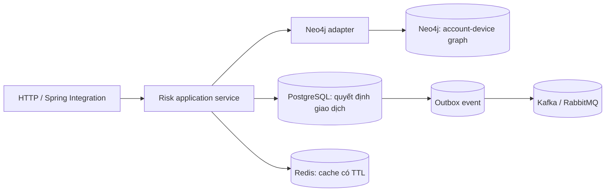
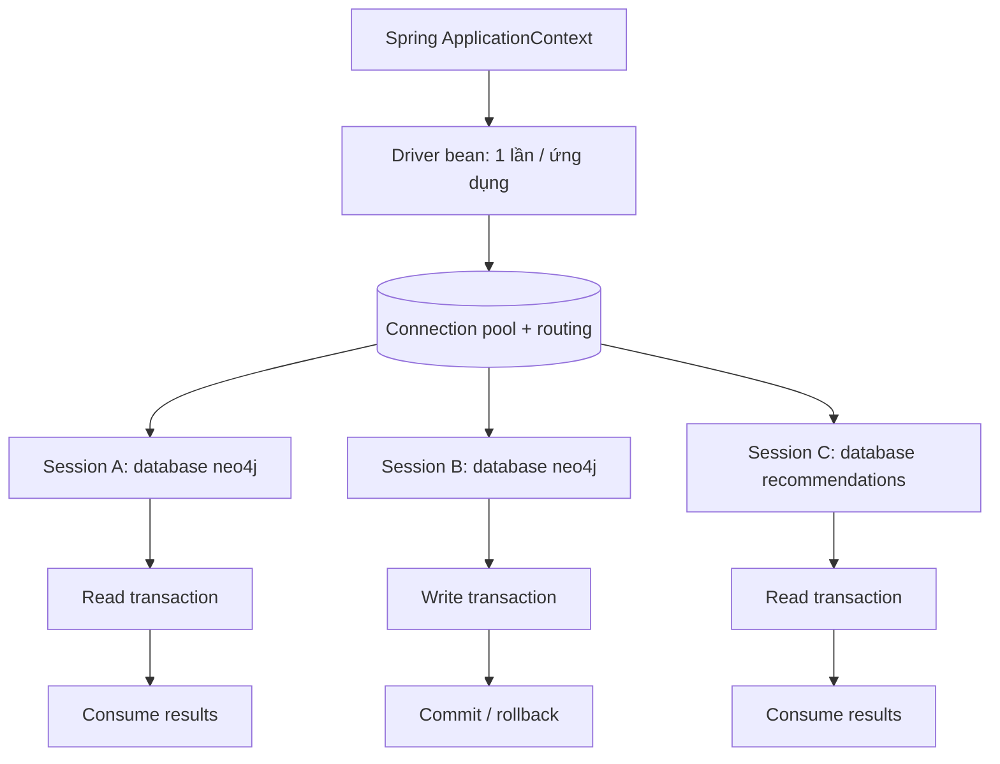
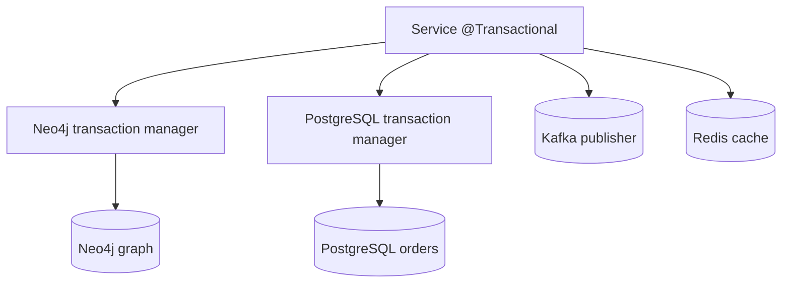
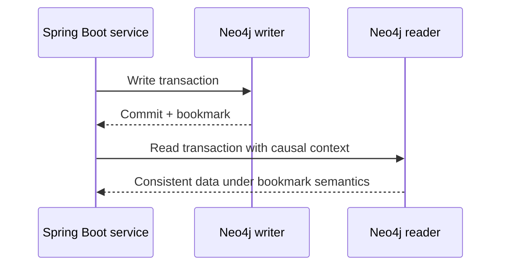
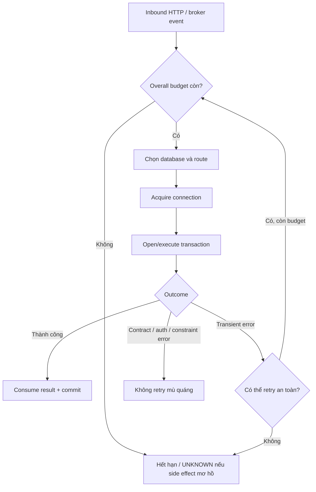
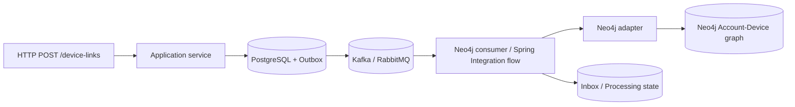

# Cấu hình database, xác thực và quản lý phiên Neo4j

Trong **SPRING_BOOT_INTEGRATION**, hệ thống có thể nhận đơn hàng qua HTTP, lưu giao dịch trong PostgreSQL, đối chiếu Redis, phát sự kiện Kafka/RabbitMQ và gọi một kho đồ thị để tra quan hệ tài khoản, thiết bị, sản phẩm hoặc tổ chức. **Neo4j** là một lựa chọn khi dữ liệu có những mối quan hệ cần duyệt theo graph thay vì chỉ truy vấn từng bản ghi độc lập. Nhưng trước khi viết Cypher, ứng dụng phải kết nối **đúng database**, dùng **đúng danh tính và quyền**, kiểm soát **vòng đời Driver/Session/Transaction**, đồng thời biết mình sẽ phục hồi thế nào khi đường mạng hoặc cluster lỗi.

Bài thuộc chương **Các kho NoSQL khác**, tập trung vào **cấu hình database, xác thực và quản lý phiên Neo4j** trong Spring Boot. Trọng tâm là đường ranh giới giữa cấu hình Boot, Neo4j Java Driver, Spring Data Neo4j, transaction của graph database và các bước tích hợp HTTP/SQL/cache/broker xung quanh nó. Mục tiêu không phải giới thiệu mọi truy vấn đồ thị, mà là tạo một adapter Neo4j **an toàn, kiểm thử được, không rò connection và không ngộ nhận một transaction Neo4j sẽ bao trùm cả hệ thống ngoài**.

> Ví dụ dùng **Java 17+, Spring Boot 3.x, Spring Data Neo4j 7.x, Neo4j Java Driver 5.x/6.x tương thích với BOM**. Một số API và property có thể thay đổi theo bản Boot/driver. Chỉ thêm dependency và cấu hình tương ứng với phiên bản thực tế; không nâng version Neo4j driver độc lập gây lệch Spring Data.

## 1. Mục tiêu học tập

Sau bài này, bạn có thể:

1. Phân biệt **Neo4j DBMS**, **database**, **graph**, **node/relationship** và **database name** được chọn cho một session.
2. Cấu hình `spring.neo4j.uri`, `spring.neo4j.authentication.*` và `spring.data.neo4j.database`; hiểu `bolt://` so với `neo4j://` và các biến thể TLS.
3. Phân biệt **`Driver` thread-safe, dùng lại lâu dài** với **`Session` ngắn hạn, không chia sẻ giữa threads** và **transaction gắn với một unit of work**.
4. Dùng `SessionConfig` chọn database/access mode, chạy `executeRead`/`executeWrite` và đóng tài nguyên đúng cách.
5. Hiểu authentication, authorization, quyền truy cập database, TLS, secrets và rotation; không nhầm một kết nối được xác thực với quyền đọc/ghi mọi graph.
6. Phân biệt auto-configuration Boot với việc ứng dụng tự tạo `Driver`, `Neo4jClient`, repository và transaction boundary.
7. Xử lý retry, bookmark/read-after-write, connection pool, timeout, lỗi phiên và các thao tác có side effect qua nhiều hệ thống.
8. Kiểm thử kết nối, chọn database, unique constraint, session lifecycle, rollback và observability bằng Neo4j test container.

## 2. Mô hình Neo4j: DBMS, database và graph

Neo4j lưu các thực thể dưới dạng **nodes**, quan hệ có hướng dưới dạng **relationships**, và cả hai có thể mang **properties**. Cypher diễn đạt mẫu graph muốn tìm hoặc thay đổi:

```cypher
CREATE (:Customer {customerId: "CUS-100"})
CREATE (:Product {productId: "PRD-200"})
```

Trong ứng dụng thực, thao tác tạo node cần dùng khóa nghiệp vụ/constraint để tránh dữ liệu trùng; hai câu lệnh trên chỉ minh họa cú pháp. Một câu truy vấn có thể duyệt quan hệ:

```cypher
MATCH (c:Customer {customerId: $customerId})-[:ORDERED]->(o:Order)
RETURN o.orderId AS orderId, o.status AS status
```

| Khái niệm | Ý nghĩa | Ví dụ |
| --- | --- | --- |
| **DBMS/server** | Tiến trình hoặc cluster Neo4j phục vụ giao thức Bolt | `graph-db.internal:7687` |
| **Database** | Không gian dữ liệu riêng có graph và schema/index tương ứng | `neo4j`, `recommendations`, `fraud` |
| **Graph data** | Nodes, relationships, properties trong một database | `(:Customer)-[:ORDERED]->(:Order)` |
| **Database name** | Tên database được một session/query lựa chọn | `fraud` |
| **Driver** | Client cấp ứng dụng quản lý kết nối/routing/pool | Bean `org.neo4j.driver.Driver` |
| **Session** | Ngữ cảnh thực thi ngắn hạn, chọn database/access mode/bookmarks | Một thao tác đọc hồ sơ hoặc ghi quan hệ |
| **Transaction** | Phạm vi commit/rollback thao tác Neo4j | `executeWrite` với một hoặc nhiều Cypher statements |

**Một Neo4j server không có nghĩa chỉ có đúng một database** trong mọi edition/topology. Khả năng quản lý nhiều database phụ thuộc edition và cấu hình đang chạy; database mục tiêu phải thực sự tồn tại và principal phải có quyền thích hợp. Trong Neo4j Community với cấu hình phổ biến, ứng dụng thường dùng database mặc định; đừng tự khai báo `fraud` rồi mặc định nó tồn tại.

### 2.1. Neo4j khác PostgreSQL và Redis ở chỗ nào trong luồng?

Ví dụ dịch vụ cần kiểm tra thiết bị nào đang liên hệ nhiều tài khoản:



Neo4j có thể trả các quan hệ để hỗ trợ ra quyết định; **PostgreSQL** vẫn có thể là nguồn sự thật của transaction tài chính, **Redis** giữ cache có thời hạn, còn **broker** vận chuyển event. Mỗi hệ có transaction/consistency riêng. **`@Transactional` dành cho Neo4j không tự commit nguyên tử với PostgreSQL, Redis và Kafka.**

## 3. Dependency và Boot auto-configuration

Để dùng Spring Data Neo4j trong Spring Boot:

```xml
<dependency>
    <groupId>org.springframework.boot</groupId>
    <artifactId>spring-boot-starter-data-neo4j</artifactId>
</dependency>
```

Ví dụ Gradle Groovy DSL:

```groovy
dependencies {
    implementation 'org.springframework.boot:spring-boot-starter-data-neo4j'
    testImplementation 'org.springframework.boot:spring-boot-starter-test'
}
```

Khi driver, mapping và properties hợp lệ, Boot có thể cấu hình **Neo4j `Driver`**, Spring Data infrastructure, `Neo4jClient`/`Neo4jTemplate` và transaction/repository support theo điều kiện. Auto-configuration còn tùy thuộc user-defined beans, repository scanning và các thư viện trên classpath.

| Thành phần | Hạ tầng có thể được Boot/Spring Data cung cấp | Ứng dụng vẫn phải tự quyết định |
| --- | --- | --- |
| `Driver` | Kết nối Neo4j, routing, pool theo driver settings | URI/TLS, credential, pool, lifetime và quyền |
| Database selection | Database name mặc định theo properties và infrastructure | Database nào chứa dữ liệu ứng dụng, policy đa tenant |
| `Neo4jClient`/`Neo4jTemplate` | API Cypher/mapping tích hợp Spring | Query, parameters, projection và validation |
| `Neo4jRepository` | Proxy repository cho `@Node` entities | Schema, query methods, constraint và rules |
| Neo4j transaction manager | Quản lý transaction cho dữ liệu Neo4j theo điều kiện | Ranh giới commit, retry, phối hợp với SQL/broker |
| Actuator/metrics | Một số health/observation khi cấu hình tương ứng | Metric cho lỗi routing/session/transaction và business effect |

**`spring-boot-starter-data-neo4j` không tự tạo nodes, relationships hay constraints nghiệp vụ.** Các Cypher migrations, unique constraints, permissions và dữ liệu seed phải được quản lý riêng. Đừng suy từ `@Id` trong Java rằng Neo4j đã có unique constraint trên property tương ứng.

### 3.1. Java Driver trực tiếp hay Spring Data Neo4j?

| Cách truy cập | Khi phù hợp | Trách nhiệm chính |
| --- | --- | --- |
| **Neo4j Java Driver** (`Driver`/`Session`/`TransactionContext`) | Cần chủ động session, database, bookmark và Cypher chi tiết | Tự quản lý close, transaction callback, result mapping |
| **`Neo4jClient`** | Dùng Cypher tùy chỉnh nhưng muốn tham gia Spring Data mapping/transaction | Bind parameters, map kết quả, để framework quản lý session |
| **`Neo4jRepository`** | CRUD/domain entities, derived methods, custom `@Query` | Chọn mapping rõ, tránh fetch graph vô giới hạn |
| **Reactive Neo4j** | Toàn pipeline WebFlux/Reactor và Spring Data reactive phù hợp | Không block event loop, quản lý publisher lifecycle/transaction |

**Không dùng song song raw driver transaction với Spring Data repository transaction rồi mặc định chúng cùng một session.** Khi phối hợp cả hai trong một business operation, hãy chọn rõ ai sở hữu transaction và cách tham gia của mỗi operation; tránh tạo transaction ngoài framework mà repository không biết.

## 4. Cấu hình URI và database trong `application.yml`

Cấu hình nền tảng:

```yaml
spring:
  neo4j:
    uri: ${NEO4J_URI:bolt://localhost:7687}
    authentication:
      username: ${NEO4J_USERNAME:neo4j}
      password: ${NEO4J_PASSWORD}
  data:
    neo4j:
      database: ${NEO4J_DATABASE:neo4j}
```

**`spring.neo4j.uri` và `spring.data.neo4j.database` là hai ý khác nhau**: URI chọn điểm kết nối/routing, còn database chọn vùng graph khi tạo session/query. Database name không phải phần path URL kiểu HTTP. Không dùng `bolt://host:7687/fraud` rồi nghĩ path đó chọn database.

### 4.1. Những URI scheme cần phân biệt

| URI scheme | Mục đích thường gặp | Lưu ý |
| --- | --- | --- |
| `bolt://host:7687` | Kết nối Bolt **trực tiếp** tới host/port | Không có hành vi routing như `neo4j://`; thích hợp một endpoint direct theo topology |
| `neo4j://host:7687` | Neo4j routing driver dùng seed address/routing information | Cần topology/server support phù hợp, hỗ trợ cluster routing |
| `neo4j+s://host:7687` | Routing với TLS và kiểm chứng chứng chỉ theo trust policy được driver hỗ trợ | Thường dùng khi endpoint có chứng chỉ hợp lệ |
| `bolt+s://host:7687` | Direct Bolt với TLS/kiểm chứng chứng chỉ | Dùng khi direct connection qua TLS |
| `neo4j+ssc://...`, `bolt+ssc://...` | Cho phép self-signed certificate theo driver scheme | Chỉ chọn khi đã hiểu trust policy; tránh trong production nếu có thể dùng CA tin cậy |

**Không đánh đồng `neo4j://` với HTTPS.** Neo4j Java Driver dùng **Bolt protocol** ở cổng được cấu hình, không gửi Cypher tới REST URL HTTP bằng cách thay scheme. Nếu chạy sau cloud load balancer hoặc proxy, cần kiểm tra Bolt/TLS/routing thực sự được hỗ trợ và hostname trả về từ routing table có thể truy cập.

### 4.2. Database mặc định và quyền truy cập

Ví dụ server có hai databases `neo4j` và `recommendations`. URI có thể giữ nguyên, chỉ database selection khác nhau:

```text
URI: bolt://graph.example.org:7687
Session database A: neo4j
Session database B: recommendations
```

Nếu cấu hình sai database name, ứng dụng có thể nhận lỗi không tìm thấy database hoặc không đủ quyền, **không nhất thiết là lỗi kết nối TCP**. Khi một user có quyền trên database A nhưng không có quyền database B, xác thực driver có thể thành công nhưng Cypher ở B vẫn thất bại.

Đừng cho HTTP caller truyền tên database tùy ý. Với multi-tenant, chọn từ danh sách được kiểm soát và thực thi authorization riêng; **database per tenant** là một quyết định topology/quyền/chi phí, không chỉ một tham số string.

### 4.3. Tách môi trường local, staging và production

```text
Local:       bolt://localhost:7687       / database neo4j
Staging:     neo4j+s://graph-stg.example.org:7687 / configured database
Production:  neo4j+s://graph.example.org:7687     / configured database
```

Đây là ví dụ cấu hình chứ không phải địa chỉ đang tồn tại. **Không để `NEO4J_PASSWORD` có giá trị mặc định “password” trong production**, không commit credential vào repository và không cho phép TLS trust bypass chỉ để chữa lỗi staging.

## 5. Xác thực, phân quyền database và kết nối an toàn

Neo4j phân biệt hai câu hỏi:

1. **Authentication:** client là ai, credential/token có được chấp nhận không?
2. **Authorization:** danh tính đó được phép truy cập **database nào**, chạy các thao tác đọc/ghi hoặc thủ tục gì?

Kết nối TCP/TLS có thể hoạt động nhưng login sai; login có thể thành công nhưng principal không có quyền ghi vào database `recommendations`. Do đó không gom tất cả lỗi vào “Neo4j unavailable”.

### 5.1. Basic authentication từ Spring Boot

```yaml
spring:
  neo4j:
    uri: ${NEO4J_URI:neo4j+s://graph.example.org:7687}
    authentication:
      username: ${NEO4J_USERNAME}
      password: ${NEO4J_PASSWORD}
  data:
    neo4j:
      database: ${NEO4J_DATABASE:neo4j}
```

Spring Boot sẽ dùng các properties tương ứng khi tạo driver **nếu không có một custom Driver bean thay thế**. Cấu hình này dùng **một danh tính ứng dụng** cho các repository/operations dựa trên driver đó, không tự lấy username/password của người gọi HTTP để “bind” mỗi query.

**Không truyền mật khẩu Neo4j qua URL query hoặc path**. Dùng secret manager, environment variables hay cơ chế cấp secret do tổ chức quản lý. Nếu cần rotation không restart, phải xác định driver/auth token manager được phiên bản đang dùng hỗ trợ và các connection cũ được xoay như thế nào; chỉ đổi environment variable khi process đang chạy thường **không tự cập nhật** credential đã cấp cho bean.

### 5.2. Quyền tối thiểu và ranh giới database

| Use case | Quyền nên có | Rủi ro khi cấp quá rộng |
| --- | --- | --- |
| API tra graph quan hệ tài khoản | Quyền truy cập/đọc ở database và nhãn/dữ liệu cần thiết | Có thể đọc dữ liệu tenant/graph không liên quan |
| Worker đồng bộ thiết bị | Quyền ghi phù hợp ở database được giao | Có thể xóa/sửa các quan hệ không thuộc nhiệm vụ |
| Job migration/index | Quyền quản trị schema cần thiết qua quy trình kiểm soát | Có thể thay constraint và làm gián đoạn dịch vụ |
| Công cụ điều tra nội bộ | Read-only identity, giới hạn mục đích và audit | Dễ lộ dữ liệu nhạy cảm khi query tự do |

Tên và mức độ chi tiết của privileges thay đổi theo Neo4j edition/version. Hãy kiểm tra chúng trên deployment thực, không dựa vào một danh sách role được đoán từ tên ứng dụng. Khi dùng multi-database/multi-tenant, **chọn đúng database không thay thế kiểm tra authorization đối với từng tenant hoặc nhãn dữ liệu**.

### 5.3. TLS, trust và hostname

`neo4j+s://` hoặc `bolt+s://` có mục đích dùng TLS với certificate validation theo scheme của driver. Các biến thể `+ssc` có trust behavior khác, thường dành cho môi trường self-signed được kiểm soát. Không đổi sang `+ssc` hoặc `bolt://` trong production chỉ để bỏ qua lỗi certificate:

- Kiểm tra certificate chain, trust store, hostname/SAN và routing addresses.
- Kiểm tra secret/TLS proxy, SNI và các host mà cluster có thể trả về trong routing table.
- Khi rotate certificate, xác định cơ chế tạo mới connections và thời gian đóng connections cũ.
- Không log credential, database token hoặc raw Cypher parameters có thông tin cá nhân.

Với nhiều server/routing, client có thể kết nối tới **những host khác seed URI**. Một chứng chỉ chỉ đúng với seed host nhưng không khớp routing server khác có thể gây lỗi khi tải/routing thay đổi. Test phải phản ánh topology thực thay vì chỉ gửi một query local.

### 5.4. Phân loại lỗi ngay tại biên adapter

| Lỗi nhìn thấy | Điều cần điều tra | Không nên diễn giải |
| --- | --- | --- |
| Authentication thất bại | Password/token/identity, rotation, account status | “Không có order này” |
| Authorization/database access thất bại | Quyền và database name/role được cấp | “Neo4j đang chết” |
| Database không tồn tại | Tên DB, edition, migration/creation và config | “URI Bolt sai” khi TCP vẫn kết nối tốt |
| TLS handshake/certificate | Trust chain, hostname, SNI, proxy | Tự hạ xuống plaintext |
| Routing/service unavailable | Cluster availability, seed, routing addresses, DNS/firewall | Retry vô hạn mọi câu Cypher |
| Query syntax/constraint violation | Parameter binding, schema, business invariant | Retry như một lỗi transient |

Đối với API public, không đưa tên database nội bộ, Cypher text, credential hoặc stack trace Neo4j ra response. Dùng error mapping nghiệp vụ có mã lỗi ổn định và correlation ID.

## 6. `Driver`, `Session`, `Transaction`: ba vòng đời khác nhau

Neo4j Java Driver cung cấp **`Driver` thread-safe** dùng lâu dài. Driver quản lý connection pool/routing và có thể được nhiều service/repository sử dụng. **`Session` không được thiết kế để chia sẻ đồng thời giữa threads**, là một ngữ cảnh thực thi nhẹ và ngắn hạn. Transaction nằm bên trong session hoặc được Spring quản lý.



| Object | Nên tồn tại bao lâu? | Có chia sẻ giữa threads không? | Cách kết thúc |
| --- | --- | --- | --- |
| **`Driver`** | Gần bằng vòng đời process/application context | **Có**, theo API driver | Spring đóng bean `Driver` khi context shutdown; custom driver phải có owner |
| **`Session`** | Một unit of work ngắn, theo request/job hợp lý | **Không chia sẻ đồng thời** | `try-with-resources` hoặc framework quản lý |
| **`Transaction`** | Một nhóm Cypher cần commit/rollback nguyên tử | Không dùng xuyên nhiều thread tùy tiện | Commit/rollback theo managed tx hoặc framework |
| **Result/Record stream** | Trong lúc session/transaction còn hợp lệ | Không để trôi ra ngoài rồi truy cập sau khi close | Consume/map dữ liệu trước khi đóng resource |

### 6.1. Anti-pattern: tạo Driver cho mỗi HTTP request

```java
// SAI khi gọi lặp cho từng request và không quản lý resource.
Driver driver = GraphDatabase.driver(uri, AuthTokens.basic(user, password));
Session session = driver.session();
// ... quên close ...
```

Cách này tạo nhiều pool/routing resources, tăng handshake và rủi ro rò socket. Driver **không** phải “một transaction” và không cần được dựng lại mỗi lần truy vấn.

### 6.2. Anti-pattern: singleton Session

```java
// SAI: một Session bị nhiều request threads dùng đồng thời.
@Component
class SharedSessionHolder {
    private final Session session;
    SharedSessionHolder(Driver driver) {
        this.session = driver.session();
    }
}
```

Session giữ database/routing/bookmark và trạng thái transaction; chia sẻ session làm tăng rủi ro concurrency, state leakage và shutdown không rõ. **Giữ Driver singleton, mở Session khi cần rồi đóng**, không đảo ngược.

### 6.3. Khi dùng Spring Data repository, ai sở hữu Session?

Nếu truy cập qua `Neo4jRepository`, `Neo4jClient` hoặc `Neo4jTemplate` trong Spring Data Neo4j, framework có cơ chế quản lý session/transaction theo operation. **Không** tự mở `Driver.session()` bên cạnh một repository call và giả định chúng chung transaction.

Một lựa chọn nhất quán:

- **Repository/Neo4jClient + Spring transaction manager** cho phần lớn ứng dụng Boot.
- **Raw Driver + try-with-resources/managed transaction** khi cần điều khiển session/database/bookmark hoặc query tùy chỉnh đặc biệt.

Nếu một workflow cần cả hai kiểu, thiết kế ranh giới rõ ràng hoặc sử dụng API do Spring Data quản lý để tham gia cùng transaction; tránh mở hai transaction riêng rồi gọi chúng như một transaction duy nhất.

## 7. Dùng Driver và Session đúng cách trong một adapter Java

Ví dụ sau dùng raw Neo4j Java Driver đã được Spring Boot tạo:

```java
import java.util.List;
import org.neo4j.driver.AccessMode;
import org.neo4j.driver.Driver;
import org.neo4j.driver.Session;
import org.neo4j.driver.SessionConfig;
import org.neo4j.driver.Values;
import org.springframework.stereotype.Component;

@Component
public class AccountGraphAdapter {
    private final Driver driver;

    public AccountGraphAdapter(Driver driver) {
        this.driver = driver;
    }

    public List<String> devicesForAccount(String accountId) {
        if (accountId == null || accountId.isBlank()) {
            throw new IllegalArgumentException("Missing accountId");
        }

        SessionConfig config = SessionConfig.builder()
                .withDatabase("neo4j")
                .withDefaultAccessMode(AccessMode.READ)
                .build();

        try (Session session = driver.session(config)) {
            return session.executeRead(tx ->
                    tx.run("""
                        MATCH (a:Account {accountId: $accountId})
                              -[:USED_DEVICE]->(d:Device)
                        RETURN d.deviceId AS deviceId
                        ORDER BY deviceId
                        LIMIT 100
                        """,
                        Values.parameters("accountId", accountId))
                      .list(record ->
                              record.get("deviceId").asString()));
        }
    }
}
```

Trong raw driver, `SessionConfig` chọn database cho **session mới**, `AccessMode.READ` giúp driver định tuyến đọc khi topology hỗ trợ. **Access mode không thay thế quyền database**, và ở single-server/direct routing hiệu quả điều phối có thể khác cluster. Với truy vấn có dữ liệu tenant nhạy cảm, điều kiện `accountId` không thay thế authorization; tenant scope và quyền phải được xác thực.

**Quan trọng:** `list(record -> ...)` tiêu thụ kết quả **khi transaction/session còn mở**, trả về danh sách giá trị đã map. Nếu trả raw `Result` ra ngoài khối `try` để controller đọc sau, session đã đóng hoặc result có thể không còn hợp lệ. Với lượng kết quả rất lớn, không gom tất cả vào `List`: dùng giới hạn/pagination hoặc streaming theo vòng đời được quản lý.

### 7.1. Database name không nên hardcode trong adapter

`withDatabase("neo4j")` chỉ để ví dụ cơ chế. Production cần tôn trọng cấu hình database; có thể khai báo app property riêng cho raw-driver adapter:

```yaml
app:
  graph:
    database: ${NEO4J_DATABASE:neo4j}
```

Inject cấu hình qua constructor và dùng `SessionConfig.forDatabase(database)` hoặc builder tương ứng. Khi phần repository dùng `spring.data.neo4j.database` còn raw adapter dùng `app.graph.database`, phải đảm bảo **hai property cùng trỏ đúng DB** nếu workflow cần cùng tập dữ liệu. Tốt hơn là gom chúng về một source config và test cả hai entrypoints. Không dùng `@Value` trên một static field.

### 7.2. Session và thread trong server HTTP

Giả sử có 100 concurrent requests:

```text
Application singleton Driver
    -> request A: Session A -> executeRead -> close
    -> request B: Session B -> executeRead -> close
    -> request C: Session C -> executeWrite -> close
    -> ...
```

Session object có thể được tạo theo request; **không có nghĩa pool mở 100 TCP sockets ngay lập tức**. Connections được driver cấp theo nhu cầu/transaction/routing. Việc pool chật gây chờ acquire hoặc timeout, không phải lý do giữ session lâu hơn.

Nếu adapter được gọi từ WebFlux trên Reactor Netty event-loop, raw **synchronous** `Session`/`executeRead` là blocking. Không gọi nó trực tiếp trên event-loop. Chọn reactive driver/Spring Data Neo4j reactive, hoặc bridge blocking có giới hạn trên scheduler thích hợp theo kiến trúc; không `block()` trên event-loop.

## 8. Managed transactions và retry trong Neo4j Java Driver

Neo4j Java Driver hỗ trợ managed transaction functions `session.executeRead(...)` và `session.executeWrite(...)`. Driver có thể **thử lại transaction function khi gặp lỗi transient thuộc diện retry** theo chính sách/config; do đó callback phải an toàn khi chạy **nhiều hơn một lần**.

Ví dụ một yêu cầu tạo node đơn hàng theo `orderId` và fingerprint ổn định:

```cypher
CREATE CONSTRAINT order_business_id IF NOT EXISTS
FOR (o:Order) REQUIRE o.orderId IS UNIQUE;
```

Constraint phải được thực thi bởi migration/schema management trước khi ứng dụng xử lý traffic. Nó giúp chống hai pods tạo hai node cùng `orderId` trong cuộc đua đồng thời.

```java
import java.util.Objects;
import org.neo4j.driver.Driver;
import org.neo4j.driver.Session;
import org.neo4j.driver.SessionConfig;
import org.neo4j.driver.Values;
import org.springframework.stereotype.Component;

public record GraphOrderState(String orderId, String status) {}

@Component
public class OrderGraphWriter {
    private final Driver driver;

    public OrderGraphWriter(Driver driver) {
        this.driver = driver;
    }

    public GraphOrderState createIfAbsent(
            String database, String orderId, String fingerprint) {

        if (orderId == null || orderId.isBlank()
                || fingerprint == null || fingerprint.isBlank()) {
            throw new IllegalArgumentException("Invalid order command");
        }

        try (Session session = driver.session(
                SessionConfig.forDatabase(database))) {
            return session.executeWrite(tx -> {
                var record = tx.run("""
                    MERGE (o:Order {orderId: $orderId})
                    ON CREATE SET o.status = 'PENDING',
                                  o.requestFingerprint = $fingerprint
                    RETURN o.orderId AS id, o.status AS status,
                           o.requestFingerprint AS fingerprint
                    """, Values.parameters(
                            "orderId", orderId,
                            "fingerprint", fingerprint)).single();

                String actual = record
                        .get("fingerprint").asString();
                if (!Objects.equals(actual, fingerprint)) {
                    throw new IllegalStateException(
                            "Same orderId with different payload");
                }
                return new GraphOrderState(
                        record.get("id").asString(),
                        record.get("status").asString());
            });
        }
    }
}
```

Trong ví dụ Java trên, `GraphOrderState` và `OrderGraphWriter` là hai top-level `public` types và cần nằm trong **hai file `.java` riêng** khi đưa vào project. Các method nhận database name cũng phải validate theo allowlist cấu hình phía server, không chuyển trực tiếp chuỗi do HTTP caller cung cấp vào `SessionConfig`.

**Giải thích:**

1. `MERGE` tìm node theo `orderId`, nếu chưa có thì tạo và đặt các properties ban đầu. **Unique constraint** mới bảo vệ invariant khi hai requests đồng thời; `MERGE` một mình không đủ để tuyên bố không bao giờ có duplicate.
2. Nếu cùng `orderId` xuất hiện lại với fingerprint khác, callback phát hiện xung đột thay vì coi là retry hợp lệ. Production cần định nghĩa cách tạo fingerprint trên các trường nghiệp vụ đã canonicalize.
3. Khi `executeWrite` tự retry do transient failure, callback chỉ thao tác **trong Neo4j transaction**; không gửi email, gọi payment API hoặc publish Kafka trực tiếp trong callback.
4. `try-with-resources` đóng `Session`, **không đóng Driver** singleton do Spring quản lý.
5. Với nhiều nodes/relationships cần cùng commit, đặt tất cả câu lệnh Cypher tham gia transaction **trong cùng callback**, consume kết quả cần thiết trước khi callback hoàn thành.

### 8.1. Vì sao không gọi HTTP/Kafka bên trong transaction callback?

```text
executeWrite callback #1:
  CREATE/UPDATE Neo4j
  POST external-payment  -> thành công
  COMMIT Neo4j           -> transient error

Driver retry callback #2:
  CREATE/UPDATE Neo4j
  POST external-payment  -> có thể bị gọi lần hai
```

Ngay cả khi transaction Neo4j được rollback, hệ thanh toán đã có thể commit. Dùng transactional outbox/job bền vững và idempotency key ở đích; với hệ không hỗ trợ idempotency, cần đối soát, compensation hoặc trạng thái UNKNOWN. **Một callback có thể bị retry không được chứa side effects không thể rollback ngoài DB.**

### 8.2. `executeRead` khác `executeWrite`

| API | Dùng cho | Không được hiểu nhầm |
| --- | --- | --- |
| `session.executeRead(work)` | Cypher đọc có thể được route tới reader trong cluster | Không tự cấp quyền, không bảo đảm consistency mạnh ở mọi read preference |
| `session.executeWrite(work)` | Cypher ghi có transaction/commit theo writer | Callback có thể được retry; không gọi HTTP/broker ngoài transaction |
| `session.run(query, params)` | Auto-commit transaction/single Cypher tùy API | Muốn bảo vệ nhiều statements, cần explicit/managed tx |
| `session.beginTransaction()` | Explicit transaction, kiểm soát commit/rollback thủ công | Cần đảm bảo close/rollback và xử lý retry phù hợp; không tự có retry của managed tx |

Các API trên thuộc raw Neo4j Java Driver. Với `Neo4jRepository`/`Neo4jClient`, framework Spring Data quản lý transaction theo cơ chế Spring riêng; đừng trộn hai khái niệm một cách vô thức.

## 9. Spring Data Neo4j: repository và `Neo4jClient`

Trong ứng dụng Boot thông thường, bạn không nhất thiết phải viết `try (Session ...)` ở mọi method. Spring Data Neo4j có **`@Node` mapping**, repository và `Neo4jClient` để thực thi Cypher thông qua hạ tầng Spring.

### 9.1. Entity và repository

```java
import org.springframework.data.annotation.Id;
import org.springframework.data.neo4j.core.schema.Node;

@Node("Order")
public class OrderGraph {
    @Id
    private String orderId;
    private String status;

    protected OrderGraph() {}

    public OrderGraph(String orderId, String status) {
        this.orderId = orderId;
        this.status = status;
    }

    public String getOrderId() { return orderId; }
    public String getStatus() { return status; }
    public void setStatus(String status) { this.status = status; }
}
```

```java
import org.springframework.data.neo4j.repository.Neo4jRepository;

public interface OrderGraphRepository
        extends Neo4jRepository<OrderGraph, String> {
}
```

`@Id` mô tả ID trong object mapping. Nó **không tự tạo** unique constraint trong Neo4j. Với ID nghiệp vụ `orderId`, đảm bảo Cypher migration:

```cypher
CREATE CONSTRAINT order_business_id IF NOT EXISTS
FOR (o:Order) REQUIRE o.orderId IS UNIQUE;
```

Nếu hệ thống từng có hai nodes trùng `orderId`, tạo constraint có thể thất bại; cần dọn/migrate dữ liệu cũ trước khi enable. Nếu có multi-tenant, xem xét key kết hợp tenant + order ID theo tính năng/edition và schema của Neo4j; đừng áp một unique `orderId` toàn database khi ID chỉ duy nhất trong từng tenant.

### 9.2. `Neo4jClient` với Cypher và parameter binding

`Neo4jClient` hữu ích khi cần projection/query đặc thù mà không muốn tự mở raw session:

```java
import java.util.Optional;
import org.springframework.data.neo4j.core.Neo4jClient;
import org.springframework.stereotype.Component;
import org.springframework.transaction.annotation.Transactional;

@Component
public class OrderStatusQuery {
    private final Neo4jClient client;

    public OrderStatusQuery(Neo4jClient client) {
        this.client = client;
    }

    @Transactional(readOnly = true)
    public Optional<String> findStatus(String orderId) {
        return client.query("""
                    MATCH (o:Order {orderId: $id})
                    RETURN o.status AS status
                    """)
                .bind(orderId).to("id")
                .fetchAs(String.class)
                .mappedBy((typeSystem, record) ->
                        record.get("status").asString())
                .one();
    }
}
```

Ví dụ dùng Cypher parameter `$id`, **không nối** `orderId` vào câu Cypher. `Neo4jClient` và repository chạy qua Spring-managed infrastructure, có thể tham gia transaction hiện tại **nếu transaction manager phù hợp**. Khi dự án có cả Neo4j và JDBC transaction managers, cần chọn rõ transaction manager ở mỗi service; `@Transactional` không định danh manager có thể bị chọn sai/ambiguous theo cấu hình.

### 9.3. Không dùng Cypher string concatenation cho dữ liệu người dùng

```java
// SAI: giá trị do người dùng cung cấp trở thành cú pháp Cypher.
String query = "MATCH (a:Account {accountId: '" + accountId + "'}) RETURN a";

// ĐÚNG: giữ cú pháp tĩnh, bind giá trị.
String querySafe = """
    MATCH (a:Account {accountId: $accountId})
    RETURN a
    """;
```

Parameters bảo vệ **giá trị**, không phải mọi phần cấu trúc query. Với labels, relationship types, property names hoặc sort field động, dùng **allowlist** phía server; không ghép input thành Cypher keyword/pattern tùy ý. Những chức năng dynamic Cypher của các phiên bản mới phải được áp dụng theo đúng version, không coi input chưa tin cậy là cấu trúc query.

## 10. Spring transaction boundary và raw-driver boundary

Một service dùng Spring Data Neo4j có thể đánh dấu nhiều operations cần cùng transaction:

```java
import org.springframework.stereotype.Service;
import org.springframework.transaction.annotation.Transactional;

@Service
public class OrderGraphApplicationService {
    private final OrderGraphRepository orders;

    public OrderGraphApplicationService(OrderGraphRepository orders) {
        this.orders = orders;
    }

    @Transactional
    public OrderGraph markAccepted(String orderId) {
        OrderGraph order = orders.findById(orderId)
                .orElseThrow(() ->
                        new IllegalArgumentException("Order not found"));

        if (!"PENDING".equals(order.getStatus())) {
            throw new IllegalStateException("Invalid transition");
        }

        order.setStatus("ACCEPTED");
        return orders.save(order);
    }
}
```

**Đây là ví dụ về transaction ở tầng Spring**, không phải một thiết kế concurrency hoàn chỉnh. Hai requests có thể cùng đọc `PENDING` rồi cùng ghi `ACCEPTED` nếu không có optimistic locking/condition update phù hợp; nếu trạng thái đích khác nhau, một update có thể ghi đè update kia. Hãy thêm invariant nghiệp vụ qua **conditional Cypher update**, version check hoặc cơ chế locking được Spring Data/Neo4j version hỗ trợ.

### 10.1. Chuyển trạng thái với điều kiện trong một query

Đối với chuyển trạng thái đơn giản, truy vấn có điều kiện có thể làm rõ kỳ vọng:

```cypher
MATCH (o:Order {orderId: $id})
WHERE o.status = 'PENDING'
SET o.status = 'ACCEPTED'
RETURN o.orderId AS id, o.status AS newStatus
```

Nếu không có row, có thể là **không tồn tại** hoặc **đã không còn ở PENDING**; ứng dụng phải đọc lại nếu cần phân biệt 404 với xung đột trạng thái 409. Lúc có đồng thời cao, cần kiểm tra cơ chế transaction và ràng buộc uniqueness trên `orderId`. Không dùng kết quả `0 rows` để kết luận hệ database lỗi.

### 10.2. Một `@Transactional` không bao trùm hai database



Neo4j và PostgreSQL thường có **transaction managers riêng**. Không có bảo đảm commit nguyên tử giữa chúng chỉ bằng một annotation ở service, và Kafka/Redis cũng không tự tham gia transaction. Một mô hình ứng dụng có thể:

1. Chọn **một nguồn sự thật** và commit thay đổi nghiệp vụ/outbox ở đó.
2. Phát event với ID ổn định, worker cập nhật graph Neo4j **idempotent**.
3. Theo dõi trạng thái đồng bộ, retry có giới hạn và đối soát khi Neo4j tạm ngừng.
4. Dùng unique constraints và trạng thái bản ghi để bảo vệ mỗi side effect.

Nếu cần thao tác Neo4j và PostgreSQL đồng thời, hãy mô tả rõ **sự nhất quán cuối cùng** hoặc quy trình bù trừ. Đừng báo HTTP “đã ghi xong toàn hệ thống” chỉ vì transaction Neo4j commit thành công khi outbox phía SQL vẫn chưa có event.

### 10.3. Chọn đúng transaction manager

Với chỉ một Neo4j transaction manager, `@Transactional` có thể được resolve phù hợp theo auto-configuration. Khi có `DataSourceTransactionManager`/`JpaTransactionManager` và Neo4j manager cùng trong context:

- Cấu hình bean/default manager và `@Transactional(transactionManager="...")` theo **tên bean thật** của project.
- Viết integration test xác minh rollback Neo4j đúng khi service throw exception.
- Không đặt một manager ở mức default rồi giả định repository của database khác sẽ tự gia nhập.
- Không tạo raw `Driver.session()` trong cùng service rồi nghĩ nó kế thừa Spring transaction đang mở.

**Lỗi thường gặp:** Neo4j repository lưu node rồi SQL service thất bại; hai thao tác dùng hai managers khác nhau nên có thể chỉ một bên rollback. Điều đó là vấn đề **thiết kế nhất quán hệ thống**, không giải quyết bằng tăng session timeout.

## 11. Bookmark, routing và đọc sau khi ghi

Trong Neo4j cluster, một câu ghi có thể đi tới writer còn câu đọc kế tiếp được định tuyến tới reader. **Bookmark** giúp biểu diễn quan hệ nhân quả giữa các transactions: một đọc sau có thể yêu cầu hệ thống quan sát tối thiểu những thay đổi đã xác nhận trước đó, theo semantics của driver/topology.



### 11.1. Một session và nhiều sessions khác nhau thế nào?

| Trường hợp | Cần cân nhắc |
| --- | --- |
| Ghi rồi đọc **trong cùng session**, managed transactions tuần tự | Driver/session có thể duy trì bookmarks phục vụ causal consistency cho hoạt động tiếp theo. |
| Ghi trong Session A, đọc ở **Session B** mới | Nếu cần quan hệ nhân quả, chia sẻ bookmark/bookmark manager theo API driver/version. |
| Hai HTTP requests độc lập đọc/ghi khác thời điểm | Không tự có quan hệ nhân quả chỉ vì dùng chung singleton Driver. |
| Dùng Spring Data repository và raw driver xen kẽ | Không mặc định chung bookmark/transaction context; cần thiết kế bridge/transaction hoặc đọc từ nguồn phù hợp. |
| Đọc từ reader trong cluster sau cập nhật rất mới | Kiểm tra routing, bookmark và latency/failover; có thể đợi replication phù hợp. |

**Bookmark không phải business ID, HTTP correlation ID hoặc khóa idempotency.** Nó là metadata về tiến độ transaction/routing và không nên được đặt làm public contract dài hạn hay log indiscriminately.

### 11.2. Routing URI và access mode

`neo4j://` cho phép driver dùng routing thông qua Neo4j protocol; `SessionConfig` có thể chọn `AccessMode.READ`/`WRITE`. Nhưng:

- Khi dùng `bolt://` direct tới một endpoint, access mode không biến endpoint đó thành reader/writer role khác.
- Access mode không thay thế authorization; read credentials không tự có quyền ghi vì đặt WRITE.
- Routing table có thể chứa addresses mà client không truy cập được qua DNS/VPC/firewall; seed kết nối thành công chưa chứng minh queries trên cluster luôn thành công.
- Sau failover, driver có thể refresh routing/retry các lỗi thuộc diện transient; tổng thời gian có thể lớn hơn một network call đơn.

Để tối ưu latency, chọn database name rõ ràng thay vì bỏ trống và phụ thuộc vào home database lookup khi không cần. Đây không phải lời hứa về tốc độ cho mọi version/topology, nhưng giúp giảm mơ hồ trong multi-database deployments.

## 12. Connection pool, timeout và lifecycle của Driver

Driver sở hữu pool/routing resources. Khi ứng dụng dùng `spring-boot-starter-data-neo4j` và để Boot quản lý `Driver`, thông thường Driver tồn tại trong suốt vòng đời application context và được đóng khi context shutdown.

| Cấu hình | Tác dụng | Lỗi khi đặt sai |
| --- | --- | --- |
| **Max pool size** | Giới hạn connection được mở/giữ theo cơ chế driver/remote address | Quá thấp gây chờ, quá cao làm server hoặc OS quá tải. |
| **Connection acquisition timeout** | Giới hạn thời gian chờ có connection rảnh | Chờ quá lâu vượt deadline toàn luồng HTTP/broker. |
| **Connection timeout** | Giới hạn giai đoạn thiết lập kết nối mạng theo driver | Không bao hết pool wait, query processing và retry. |
| **Max connection lifetime** | Giới hạn tuổi connection để thay mới khi cần | Quá thấp tăng churn/TLS; quá cao có thể giữ connection cũ lâu. |
| **Idle/health checking** | Kiểm tra connection nhàn rỗi/broken theo driver policy | Stale socket có thể gây lỗi reuse/failover. |
| **Max transaction retry time** | Ngân sách thử lại managed transactions | Không thay overall deadline và idempotency. |
| **Query/transaction timeout** | Giới hạn Cypher hoặc transaction theo API/server | Không tự giới hạn HTTP request, serialization, broker ack. |

### 12.1. Cấu hình pool bằng properties của Spring Boot

Một mẫu cấu hình có thể dùng với các bản Boot hỗ trợ nhóm `spring.neo4j.pool.*` tương ứng:

```yaml
spring:
  neo4j:
    uri: ${NEO4J_URI:bolt://localhost:7687}
    authentication:
      username: ${NEO4J_USERNAME:neo4j}
      password: ${NEO4J_PASSWORD}
    pool:
      max-connection-pool-size: 50
      connection-acquisition-timeout: 2s
      max-connection-lifetime: 30m
```

Tên chính xác và khả năng binding của các Neo4j pool properties **phụ thuộc phiên bản Spring Boot**. Trước khi dùng production, đối chiếu metadata/configuration properties của version đang chạy và xác minh driver settings. Không giả định một key sai chính tả sẽ tự gây lỗi startup; cấu hình không được bind có thể khiến pool vẫn dùng default.

### 12.2. Raw driver configuration để hiểu owner của pool

Ở chương trình độc lập hoặc khi một ứng dụng chủ động tự sở hữu Driver (thay thế auto-config), Java Driver có builder:

```java
import java.util.concurrent.TimeUnit;
import org.neo4j.driver.AuthTokens;
import org.neo4j.driver.Config;
import org.neo4j.driver.Driver;
import org.neo4j.driver.GraphDatabase;

Config config = Config.builder()
        .withMaxConnectionPoolSize(50)
        .withConnectionAcquisitionTimeout(2, TimeUnit.SECONDS)
        .withMaxConnectionLifetime(30, TimeUnit.MINUTES)
        .withMaxTransactionRetryTime(10, TimeUnit.SECONDS)
        .build();

try (Driver driver = GraphDatabase.driver(
        "bolt://localhost:7687",
        AuthTokens.basic("neo4j", password),
        config)) {

    driver.verifyConnectivity();
    // Tạo và đóng session cho từng unit of work.
}
```

Ở ví dụ này, `password` là biến do chương trình lấy từ nguồn secret an toàn. Mã dùng **try-with-resources chỉ vì đây là chương trình độc lập**. Nếu ứng dụng Spring Boot có yêu cầu chủ động thay thế Driver auto-config, có thể khai báo bean có vòng đời cụ thể:

```java
import org.neo4j.driver.AuthTokens;
import org.neo4j.driver.Config;
import org.neo4j.driver.Driver;
import org.neo4j.driver.GraphDatabase;
import org.springframework.beans.factory.annotation.Value;
import org.springframework.context.annotation.Bean;
import org.springframework.context.annotation.Configuration;

@Configuration(proxyBeanMethods = false)
public class Neo4jDriverConfiguration {

    @Bean(destroyMethod = "close")
    Driver applicationNeo4jDriver(
            @Value("${spring.neo4j.uri}") String uri,
            @Value("${spring.neo4j.authentication.username}") String user,
            @Value("${spring.neo4j.authentication.password}") String password) {

        Config config = Config.builder()
                .withMaxConnectionPoolSize(50)
                .build();
        return GraphDatabase.driver(
                uri, AuthTokens.basic(user, password), config);
    }
}
```

Đoạn bean này **thay thế có chủ đích** trường hợp Boot tạo Driver khi điều kiện auto-config phù hợp, không phải một bean cần thêm mặc định cho mọi ứng dụng. Nếu Boot đã tạo Driver, không tạo thêm Driver thứ hai chỉ để “tune pool” mà không biết repository đang dùng Driver nào. Ưu tiên properties/customizer theo version hoặc thay thế bean một cách tường minh, có test chứng minh mọi adapter trỏ tới đúng Driver.

### 12.3. Khi pool bão hòa

Ví dụ một instance xử lý 100 HTTP requests đồng thời, mỗi request cần query Neo4j. Nếu pool/cluster chỉ cấp một số connections phù hợp ở thời điểm đó, các request còn lại có thể chờ acquisition. **Không** lấy số CPU threads làm connection pool size mặc định. Neo4j query có thể giữ connection lâu khi thực thi traversal lớn, chưa consume result hoặc chờ lock.

Cân đối:

- Giới hạn concurrency theo loại graph operation/bộ lọc.
- Có query limit/pagination, index và Cypher query plan phù hợp.
- Giới hạn acquisition timeout và overall request/job deadline.
- Theo dõi pool wait, in-flight queries, CPU/RAM server, cluster routing và transaction retry.
- Nếu dùng WebFlux, tránh chạy synchronous Driver trên event-loop.
- Không tăng pool của **mọi instance** vượt capacity Neo4j cluster chỉ vì latency p99 tăng.

### 12.4. Đóng Session không phải đóng Driver

```text
HTTP request A -> open Session -> query -> consume -> close Session
HTTP request B -> open Session -> query -> consume -> close Session
Application shutdown -> close Driver -> dispose pool/routing resources
```

Nếu đóng `Driver` sau request A, request B sẽ nhận lỗi pool/driver đã đóng. Nếu không đóng `Session`, tài nguyên transaction/result hoặc connections có thể bị giữ lâu hơn, gây timeout dưới tải. Khi dùng Spring Data, để framework quản lý lifecycle; khi dùng raw driver, mở và đóng session nhất quán ở một adapter layer.

## 13. Deadline, transient errors và cách retry không phá nghiệp vụ

Một thao tác Neo4j có thể gồm nhiều giai đoạn: chọn server từ routing table, chờ pool connection, mở connection mới/TLS, bắt đầu transaction, chạy Cypher, đọc record và commit. **Timeout ở một pha không phải deadline toàn workflow.**



### 13.1. Các timeout không thay thế nhau

| Giới hạn | Bảo vệ | Không bao trùm |
| --- | --- | --- |
| Connection acquisition timeout | Chờ resource từ pool Neo4j | Thời gian Cypher thực thi sau khi có connection |
| TCP connection timeout | Thiết lập kết nối network | Routing retries, authentication, query và mapping |
| Managed transaction retry budget | Tổng thời gian driver tiếp tục thử lại những lỗi phù hợp | Deadline HTTP toàn hành trình hoặc external side effects |
| Transaction/query timeout | Giới hạn transaction/Cypher ở phạm vi driver/server hỗ trợ | DB pool wait, serialization, HTTP downstream |
| Overall operation deadline | Toàn nghiệp vụ từ caller tới kết quả/ack | Không tự tồn tại nếu chỉ cấu hình các timeout Neo4j |

Ví dụ raw driver có thể đặt transaction timeout cho một managed transaction:

```java
import java.time.Duration;
import org.neo4j.driver.Session;
import org.neo4j.driver.TransactionConfig;
import org.neo4j.driver.Values;

TransactionConfig transactionConfig = TransactionConfig.builder()
        .withTimeout(Duration.ofSeconds(2))
        .build();

// session đã được tạo trong try-with-resources ở method gọi.
var rows = session.executeRead(
        tx -> tx.run("""
                MATCH (d:Device)
                WHERE d.status = $status
                RETURN d.deviceId AS id
                LIMIT 50
                """, Values.parameters("status", "ACTIVE"))
                .list(record -> record.get("id").asString()),
        transactionConfig);
```

Đây là **trích đoạn bên trong method đã sở hữu `session`**, không phải một method Java độc lập. Timeout theo transaction API và server config có thể khác giữa driver/Neo4j versions, nên cần đo thời gian thực ở một integration test. Khi HTTP request chỉ còn 500 ms budget, không tạo một Neo4j transaction 2 giây rồi tiếp tục retry nhiều lần.

### 13.2. Phân loại lỗi trước khi retry

| Loại lỗi | Ví dụ | Chính sách |
| --- | --- | --- |
| **Transient/service unavailable** | Writer failover, route tạm thời không khả dụng | Retry có giới hạn nếu operation/callback an toàn, còn deadline |
| **Pool/acquisition saturation** | Không lấy được connection trong thời hạn | Cân nhắc bulkhead/rate limit, giảm concurrency; không bão retry |
| **Authentication/authorization** | Credential sai, role thiếu quyền database | Sửa secret/quyền; không retry tức thời vô hạn |
| **Cypher syntax/schema** | Sai label/property, constraint chưa tạo hoặc query không hợp lệ | Sửa code/schema/migration |
| **Uniqueness/business conflict** | Hai command dùng cùng orderId khác nội dung | Trả conflict/quarantine, không coi là transient |
| **Commit outcome không rõ** | Lỗi network trong/đúng lúc commit | Tra cứu bằng khóa nghiệp vụ; luôn chuẩn bị cho redelivery |
| **Bookmark/routing mismatch** | Reader chưa thể phục vụ causal context | Xem routing, timeout, cluster health và policy retry |

Trong callback của `executeWrite`, không gửi message, gọi payment API hoặc cập nhật cache không rollback được. Nếu driver gọi lại callback, những tác động ngoài Neo4j có thể bị lặp. Với các lệnh graph thuần Cypher, dùng `MERGE`/constraint/conditional writes để bảo vệ invariant dù transaction outcome đã mơ hồ.

### 13.3. Không nuốt exception rồi báo broker đã xử lý

Giả sử Kafka consumer nhận `AccountLinkedToDeviceV1` rồi gọi Neo4j:

```text
Listener receive -> Neo4j executeWrite -> commit -> broker ACK/offset commit
```

Nếu Neo4j tạm không kết nối được, listener không nên chỉ log rồi return, vì container có thể ack/commit offset và message sẽ mất khỏi tiến trình cần xử lý. Nếu Neo4j đã commit nhưng ack thất bại, broker có thể **giao lại** message; graph write phải idempotent theo stable event/business ID.

Với RabbitMQ, ack/requeue/dead-letter phụ thuộc listener container config; với Kafka, offset commit/error handler khác semantics. Dù dùng Spring Integration adapter hay listener trực tiếp, **điểm xác nhận thành công phải theo đúng business outcome đã được commit**.

## 14. Dữ liệu an toàn: graph schema, uniqueness và tenant isolation

Neo4j linh hoạt về labels/relationships, nhưng không có nghĩa có thể ghi bất kỳ graph nào từ JSON input:

### 14.1. Constraint chống trùng cho node và relationship

Ví dụ account/device graph:

```cypher
CREATE CONSTRAINT account_id IF NOT EXISTS
FOR (a:Account) REQUIRE a.accountId IS UNIQUE;

CREATE CONSTRAINT device_id IF NOT EXISTS
FOR (d:Device) REQUIRE d.deviceId IS UNIQUE;
```

Tạo liên kết có điều kiện:

```cypher
MATCH (a:Account {accountId: $accountId})
MATCH (d:Device {deviceId: $deviceId})
MERGE (a)-[r:USED_DEVICE]->(d)
ON CREATE SET r.firstObservedAt = datetime()
RETURN a.accountId AS accountId, d.deviceId AS deviceId
```

**`MERGE` trên relationship mô tả ý định idempotent cho pattern**. Tuy nhiên, khi nhiều writers đồng thời, tính đúng đắn còn phụ thuộc các nodes đã có/được khóa, constraint/schema và transaction concurrency. Đừng tuyên bố chỉ một `MERGE` là bảo đảm exactly-once cho mọi relationship pattern và multi-database case; test under contention theo chính xác schema/invariant.

Nếu business cần lưu **nhiều lần sử dụng thiết bị hợp lệ**, relationship chỉ một `USED_DEVICE` không thay lịch sử events. Khi đó tạo event nodes `(:DeviceUse {eventId})` có unique constraint rồi liên kết hoặc lưu events ở nguồn khác; chọn schema theo nghiệp vụ, không dùng một quan hệ duy nhất để xóa mất lịch sử.

### 14.2. Cypher parameters và allowlist

Không nối:

```java
String cypher = "MATCH (n:" + labelFromHttp + ") RETURN n";
```

Thay vào đó:

- Định nghĩa **label/type/query operation tĩnh**, lấy từ mã ứng dụng/allowlist.
- Dùng Cypher parameters `$accountId`, `$deviceId` cho **giá trị dữ liệu**.
- Giới hạn chiều sâu graph traversal, `LIMIT`, query timeout và phạm vi tenant để tránh traversal vô hạn.
- Chỉ trả DTO/projection được phép; không serialize toàn graph với những properties nhạy cảm ra HTTP hoặc broker.

**Parameterized Cypher không thay authorization.** Nếu principal Neo4j có quyền đọc toàn database và ứng dụng quên tenant filter, người dùng có thể đọc nhầm dữ liệu tenant khác dù không có Cypher injection.

### 14.3. Multi-tenancy và chọn database

Ba mô hình thường gặp:

| Mô hình | Lợi ích | Hạn chế |
| --- | --- | --- |
| Một database, property `tenantId` trên nodes/edges | Đơn giản hóa topology, dễ vận hành chung | Cần mọi query/constraint/ACL bảo vệ tenant scope |
| Một database cho mỗi tenant | Cách ly dữ liệu ở phạm vi database khi edition/topology cho phép | Tăng chi phí database, provisioning, connection/routing và migrations |
| Tách cluster/DBMS cho nhóm tenant | Cách ly vận hành/tài nguyên mạnh hơn | Tốn hạ tầng, khó đồng bộ và quan sát |

Khi chọn database theo tenant, không gọi `SessionConfig.forDatabase(request.getParameter("db"))` trực tiếp. Dùng mapping phía server từ tenant đã xác thực tới **database allowlisted** và xác minh principal có quyền trên database đó. Nếu trường hợp chuyển tenant trong cùng session không được hỗ trợ theo policy, mở session riêng với config đúng thay vì sửa mutable shared state.

### 14.4. Contract giữa graph và các hệ thống khác

Nếu Neo4j chứa `AccountGraph` và PostgreSQL chứa `AccountEntity`, đừng chuyển nguyên internal Neo4j record/`Node` ra Kafka. Định nghĩa event:

```json
{
  "eventId": "evt-device-link-017",
  "schemaVersion": 1,
  "accountId": "ACC-017",
  "deviceId": "DEV-095",
  "operation": "LINKED"
}
```

Giữ `eventId` ổn định qua retry/replay; consumer Neo4j dùng nó và business keys để chống trùng. Correlation ID phục vụ tracing khác event ID. Nếu dữ liệu graph phụ thuộc PostgreSQL order state, dùng event contract đã version hóa và logic đối soát thay vì tự đọc một DB rồi kỳ vọng DB còn lại đã đồng bộ tức thì.

## 15. Kết nối Neo4j với Spring Integration, HTTP và broker

Một luồng:



### 15.1. Chọn nguồn sự thật và thời điểm chấp nhận thành công

Nếu HTTP handler cần ghi PostgreSQL rồi cập nhật Neo4j, gọi hai database trực tiếp trong một method có nguy cơ:

```text
PostgreSQL COMMIT -> Neo4j timeout -> HTTP 500
Client retry -> PostgreSQL operation được tạo thêm?
```

Hoặc ngược lại, Neo4j đã commit nhưng PostgreSQL rollback. Một lựa chọn phổ biến:

1. HTTP request có **idempotency key** để tránh tạo lệnh trùng.
2. Commit SQL order và **outbox event** trong một transaction SQL.
3. Publisher gửi event tới broker (có thể gửi trùng sau crash).
4. Neo4j consumer áp dụng graph side effect idempotent, xác nhận broker sau Neo4j commit.
5. Ghi trạng thái projection/graph sync, alert khi backlog/lag cao; có cơ chế replay/reconcile.

Thiết kế này là **eventual consistency có kiểm soát**, không phải transaction phân tán nguyên tử. API cần nói rõ trạng thái `ACCEPTED`/`PENDING_GRAPH_SYNC` và khả năng hoàn tất sau, thay vì hứa graph đã đồng bộ khi chưa có bằng chứng.

### 15.2. Inbox và uniqueness cho graph projection

Nếu `eventId` ổn định, có thể tạo node ghi dấu một event đã được áp dụng **trong cùng Neo4j transaction** với thay đổi graph:

```cypher
CREATE CONSTRAINT processed_graph_event IF NOT EXISTS
FOR (e:ProcessedGraphEvent) REQUIRE e.eventId IS UNIQUE;
```

Một thiết kế cần phân biệt:

| Trạng thái | Ý nghĩa | Cách xử lý redelivery |
| --- | --- | --- |
| Chưa có event marker | Chưa có bằng chứng đã commit side effect trong graph | Thử transaction idempotent |
| Marker đã commit cùng graph updates | Event logic đã áp dụng theo contract | Kiểm tra identity/version, không áp dụng lại side effect |
| Marker ghi riêng trước update graph | **Nguy hiểm** nếu update lỗi | Có thể khiến retry bỏ qua công việc chưa hoàn tất |
| Trùng `eventId` nhưng khác payload | Producer vi phạm identity contract | Conflict/quarantine, không bỏ qua âm thầm |

**Chỉ đánh dấu processed sau khi/in cùng transaction với graph update**; nếu side effect còn là HTTP/payment ngoài Neo4j, marker không tự bảo vệ những hệ đó. Nếu dùng cùng event cho nhiều consumer chức năng, khóa marker phải có consumer scope (hoặc lưu riêng từng collection/label/DB) để shipping và analytics không chặn nhau.

### 15.3. Acknowledge sau commit và không fire-and-forget

Một Spring Integration flow có thể route message qua HTTP adapter, Neo4j service, Redis và error channel. **MessageChannel** không tự mang transaction Neo4j sang Kafka broker. Khi dùng channel async, caller/adapter có thể return trước khi graph update hoàn tất; broker ack quá sớm sẽ làm công việc bị mất nếu worker chết sau đó.

Quy tắc:

- Synchronous handler: chỉ trả thành công khi graph write + commit thành công.
- Async handler: ack khi đã có **durable job/outbox** được ghi an toàn, hoặc có cơ chế broker ack gắn với completion thật.
- Retry có giới hạn, idempotency và dead-letter/quarantine khi schema/event không hợp lệ.
- Không chuyển toàn bộ broker headers/credentials thành dynamic database selection hoặc raw Cypher params.

## 16. Reactive Neo4j: không chia sẻ Session hay block event loop

Spring Data Neo4j có reactive repository/client khi driver và project hỗ trợ. Ví dụ interface:

```java
import org.springframework.data.neo4j.repository.ReactiveNeo4jRepository;
import reactor.core.publisher.Flux;

public interface ReactiveOrderGraphRepository
        extends ReactiveNeo4jRepository<OrderGraph, String> {

    Flux<OrderGraph> findByStatus(String status);
}
```

Một WebFlux controller có thể trả `Mono<OrderGraph>` hoặc map sang DTO mà không `block()`:

```java
import org.springframework.stereotype.Service;
import reactor.core.publisher.Mono;

@Service
public class ReactiveOrderGraphLookup {
    private final ReactiveOrderGraphRepository orders;

    public ReactiveOrderGraphLookup(ReactiveOrderGraphRepository orders) {
        this.orders = orders;
    }

    public Mono<String> findStatus(String id) {
        return orders.findById(id)
                .map(OrderGraph::getStatus);
    }
}
```

**Sự khác biệt quan trọng:**

- Reactive publisher thường **lazy**: một `Mono` chỉ chạy khi framework/subscriber thực sự subscribe.
- Không gọi `subscribe()` tự do trong Kafka listener rồi ack ngay; graph update có thể thất bại sau khi listener trả thành công.
- Không dùng raw synchronous `Driver.session()`/`executeRead()` trên Reactor Netty event-loop; nếu bắt buộc dùng blocking API, cô lập có giới hạn trên scheduler phù hợp hoặc dùng reactive APIs.
- Reactive transaction cần **reactive transaction manager/context**, không chỉ giả định `ThreadLocal` của JDBC bao trùm asynchronous callbacks.
- Publisher ghi graph có thể **thực hiện lại khi subscribe lần thứ hai**; side effects phải idempotent.

### 16.1. Connection/session lifecycle của reactive khác blocking

Với reactive API, resource được chiếm khi subscription tiến triển, có thể giải phóng ở completion/error/cancellation theo driver/framework. Tránh trả một `Flux` vô hạn từ query làm API HTTP không có giới hạn; hạn chế số records với Cypher `LIMIT`/pagination, dùng backpressure hợp lý và biết thời điểm transaction đóng.

Không nên dùng `collectList()` cho query graph trả hàng triệu nodes. Cypher traversal phức tạp có thể dùng nhiều CPU/RAM phía Neo4j ngay cả khi subscriber chỉ lấy dữ liệu chậm; cần index, giới hạn hop/labels, projection và query budget.

## 17. Kiểm thử cấu hình Neo4j và vòng đời Session

Unit test adapter bằng mock `Driver`/`Session` có thể kiểm tra code gọi đúng API, nhưng **không chứng minh database được chọn đúng, authentication/TLS thành công, Cypher constraint có hiệu lực hay transaction rollback thật**. Những tính chất này cần integration test với Neo4j server phù hợp, ví dụ Neo4j Testcontainers.

### 17.1. Dependency cho Testcontainers

Ví dụ Maven dùng BOM của Spring Boot và Testcontainers tương ứng:

```xml
<dependencies>
    <dependency>
        <groupId>org.springframework.boot</groupId>
        <artifactId>spring-boot-starter-test</artifactId>
        <scope>test</scope>
    </dependency>
    <dependency>
        <groupId>org.springframework.boot</groupId>
        <artifactId>spring-boot-testcontainers</artifactId>
        <scope>test</scope>
    </dependency>
    <dependency>
        <groupId>org.testcontainers</groupId>
        <artifactId>neo4j</artifactId>
        <scope>test</scope>
    </dependency>
    <dependency>
        <groupId>org.testcontainers</groupId>
        <artifactId>junit-jupiter</artifactId>
        <scope>test</scope>
    </dependency>
</dependencies>
```

Với Spring Boot 3.1+ và module tương ứng, `@ServiceConnection` có thể cung cấp connection details từ Neo4j Testcontainer cho auto-configuration. **Không hardcode `localhost:7687` trong test**: container có thể được map tới một port ngẫu nhiên trên CI.

### 17.2. Integration test tạo constraint, xác minh duplicate và rollback

```java
import static org.junit.jupiter.api.Assertions.*;

import java.util.UUID;
import org.junit.jupiter.api.BeforeEach;
import org.junit.jupiter.api.Test;
import org.neo4j.driver.Driver;
import org.neo4j.driver.Session;
import org.neo4j.driver.SessionConfig;
import org.neo4j.driver.Values;
import org.neo4j.driver.exceptions.ClientException;
import org.springframework.beans.factory.annotation.Autowired;
import org.springframework.boot.test.context.SpringBootTest;
import org.springframework.boot.testcontainers.service.connection.ServiceConnection;
import org.testcontainers.containers.Neo4jContainer;
import org.testcontainers.junit.jupiter.Container;
import org.testcontainers.junit.jupiter.Testcontainers;

@SpringBootTest
@Testcontainers
class Neo4jSessionIT {

    @Container
    @ServiceConnection
    static final Neo4jContainer<?> neo4j =
            new Neo4jContainer<>("neo4j:5")
                    .withAdminPassword("integration-test-password");

    @Autowired
    Driver driver;

    @BeforeEach
    void ensureSchema() {
        try (Session session = driver.session(
                SessionConfig.forDatabase("neo4j"))) {
            session.run("""
                CREATE CONSTRAINT order_business_id IF NOT EXISTS
                FOR (o:Order) REQUIRE o.orderId IS UNIQUE
                """).consume();
        }
    }

    @Test
    void writesToExpectedDatabaseAndEnforcesUniqueness() {
        String id = "ORD-" + UUID.randomUUID();

        try (Session session = driver.session(
                SessionConfig.forDatabase("neo4j"))) {
            session.executeWrite(tx -> {
                tx.run("CREATE (:Order {orderId: $id})",
                        Values.parameters("id", id)).consume();
                return null;
            });

            assertThrows(ClientException.class, () ->
                    session.executeWrite(tx -> {
                        tx.run("CREATE (:Order {orderId: $id})",
                                Values.parameters("id", id)).consume();
                        return null;
                    }));

            long count = session.executeRead(tx -> tx.run("""
                    MATCH (o:Order {orderId: $id})
                    RETURN count(o) AS total
                    """, Values.parameters("id", id))
                    .single().get("total").asLong());
            assertEquals(1L, count);
        }
    }

    @Test
    void rollsBackWriteWhenTransactionFunctionFails() {
        String id = "ORD-" + UUID.randomUUID();

        try (Session session = driver.session(
                SessionConfig.forDatabase("neo4j"))) {
            assertThrows(IllegalStateException.class, () ->
                    session.executeWrite(tx -> {
                        tx.run("CREATE (:Order {orderId: $id})",
                                Values.parameters("id", id)).consume();
                        throw new IllegalStateException("Force rollback");
                    }));
        }

        try (Session session = driver.session(
                SessionConfig.forDatabase("neo4j"))) {
            long count = session.executeRead(tx -> tx.run("""
                    MATCH (o:Order {orderId: $id})
                    RETURN count(o) AS total
                    """, Values.parameters("id", id))
                    .single().get("total").asLong());
            assertEquals(0L, count);
        }
    }
}
```

**Những điểm test chứng minh được:**

1. Spring Boot tạo `Driver` kết nối được vào server được Testcontainers quản lý; test không tự tạo Driver cho mỗi method.
2. `SessionConfig.forDatabase("neo4j")` chọn database hiện hữu trong test container.
3. Constraint thực sự ngăn **hai nodes cùng orderId**; đây không phải assertion dựa trên annotation Java.
4. Một `executeWrite` ném lỗi trước commit rollback thay đổi trong transaction.
5. Các raw sessions đều được đóng bằng `try-with-resources`, dù thành công hay exception.

**Giới hạn bài test:** một Neo4j container đơn lẻ **không** mô phỏng cluster routing/failover, read replicas, multi-database privileges trong mọi edition hoặc TLS/mTLS production. Test container cũng không chứng minh toàn bộ ứng dụng dùng đúng transaction manager khi thêm PostgreSQL/JPA. Những đặc tính đó cần môi trường/tầng test khác.

### 17.3. Test database name và quyền truy cập

Không dùng database `recommendations` trong Testcontainer Community nếu edition/topology không cho tạo thêm database. Để kiểm tra multi-database:

- Dùng Neo4j test environment/edition thực sự hỗ trợ nhiều database.
- Tạo database `recommendations` và principal chỉ có quyền được cấp.
- Dùng cùng URI nhưng `SessionConfig` chỉ định từng database; xác minh query vào đúng nơi.
- Dùng principal khác nhau để kiểm tra **authentication thành công nhưng authorization không đủ**.
- Khi ứng dụng dùng `spring.data.neo4j.database`, test repository/`Neo4jClient` thật để xác minh mọi query dùng cùng database theo cấu hình.

Kết quả “no records” và “database không tồn tại” **phải được phân biệt** trong test; đừng đổi tất cả exception thành danh sách rỗng rồi để API trả 404 sai.

### 17.4. Ma trận fault-injection và concurrency

| Kịch bản | Cách thử | Invariant cần chứng minh |
| --- | --- | --- |
| Driver singleton | Gọi nhiều request/worker qua bean Spring | Không tạo driver/pool mới cho mỗi request |
| Session close | Chạy nhiều query thành công/thất bại, quan sát resources | Không giữ active connections/transactions vô hạn |
| Unique constraint cạnh tranh | Hai writers đồng thời tạo cùng `orderId` | Chỉ một business node đã commit |
| Managed transaction retry | Giả lập lỗi transient có kiểm soát | Callback không gọi HTTP/Kafka/email ngoài DB, graph effect idempotent |
| Transaction rollback | Hai Cypher statements trong transaction, lỗi ở bước sau | Không có partial graph changes đã commit |
| Sai database | Tên database không có hoặc principal không có quyền | Fail rõ, không tự chạy sang database mặc định |
| Cluster failover | Tắt/chuyển writer trong cluster test | Routing/retry/deadline hoạt động theo policy |
| TLS rotation | Thay cert/endpoint được kiểm soát | Không disable trust, sessions mới vẫn kết nối đúng |
| Read-after-write | Ghi rồi đọc qua session mới/routing reader | Causal context/bookmark đáp ứng hợp đồng |
| Broker redelivery | Gửi lại cùng event ID sau Neo4j commit trước ack | Không tạo thêm node/relationship hoặc duplicate effect |
| Cross-system failure | SQL commit thành công nhưng graph update lỗi | Outbox/recovery/reconcile đảm bảo graph cuối cùng bắt kịp |
| Tenant isolation | Truy vấn cùng ID ở hai tenant | Không trả dữ liệu tenant khác và không chọn DB từ input raw |

Khi test concurrency, đừng assert “worker A nhất định thắng” vì lịch scheduling không bảo đảm. Assert cuối cùng **một node/relationship theo business invariant** và error/duplicate outcome đúng. Với integration test async, dùng chờ điều kiện có deadline thay vì sleep cố định nhiều giây.

## 18. Quan sát session, pool, query và transaction

Một ứng dụng có thể trả HTTP 200 cho những request hoàn tất trong khi nhiều request khác **đang chờ connection**, bị routing failover hoặc chạy traversal quá đắt. Cần đo cả client và Neo4j server.

| Tín hiệu | Câu hỏi trả lời |
| --- | --- |
| Driver/pool active/idle/in-use, acquisition wait | Pool có bão hòa, session/result bị giữ quá lâu? |
| Connections created/closed, TLS errors | Có tạo connection liên tục, cert/routing thay đổi? |
| Routing table refresh, server unavailable | Seed/cluster membership/DNS/firewall đang có vấn đề? |
| Query latency p50/p95/p99 theo loại operation | Đọc graph hay ghi relationship đang chậm? |
| Transaction begin/commit/rollback/retry | Có lock contention, transient errors hoặc callback retry nhiều? |
| Cypher profile/explain, index usage | Traversal đang quét quá nhiều nodes hay thiếu index? |
| Authentication/authorization failures | Secret rotation/role/database grant sai hay có truy cập trái phép? |
| Connection acquisition/transaction timeout | Nghẽn trước query hay query chạy quá lâu? |
| Neo4j projection lag / inbox duplicates | Broker/SQL và graph đã đồng bộ đến đâu? |
| Spring Boot HTTP/broker latency | Neo4j có đang kéo chậm toàn pipeline không? |

Spring Boot Actuator/Micrometer và Neo4j driver metrics/tracing có thể cung cấp một phần số liệu tùy phiên bản và cấu hình. **Không tự khẳng định mọi Neo4j `Driver` bean đều có sẵn cùng meter names**. Với driver custom, cần kiểm tra metrics option, collector/registry và integration giữa driver và Spring Boot đang dùng.

### 18.1. Đo lỗi theo giai đoạn, không log toàn bộ Cypher

Khi một request thất bại, log có kiểm soát:

```text
component=neo4j_adapter
operation=account_devices_lookup
database=neo4j
phase=transaction
outcome=timeout
duration_ms=860
retry_attempt=1
correlation_id=trace-abc
```

Không log password, raw AuthToken, full Cypher params chứa PII, graph properties nhạy cảm hoặc raw database URI có user-info. Với metric labels, tránh `accountId`, `orderId`, `eventId`, dynamic database name/tenant vô hạn hoặc query text nguyên bản; dùng **operation names và error categories hữu hạn**.

### 18.2. Query plan và index

Một query phân tích chậm có thể bắt nguồn từ index thiếu:

```cypher
EXPLAIN
MATCH (a:Account {accountId: $accountId})
      -[:USED_DEVICE]->(d:Device)
RETURN d.deviceId AS deviceId
LIMIT 100
```

`EXPLAIN` cho kế hoạch mà không thực thi query đầy đủ theo semantics Cypher; `PROFILE` thực thi để đo runtime, vì vậy chỉ dùng ở môi trường/an toàn phù hợp với truy vấn đang phân tích, đặc biệt với queries có side effect. Index/constraint trên `Account.accountId` giúp xác định điểm bắt đầu, nhưng traversal theo số lượng relationships vẫn có thể đắt. Giới hạn hop, filter, pagination và projection theo hợp đồng.

### 18.3. Runbook khi pool hoặc cluster báo lỗi

1. Xác định **database name** và principal thực tế mà request đang sử dụng.
2. Phân loại lỗi là credential/permission, TLS/connect, route/acquire hay Cypher/transaction.
3. Đo số requests đồng thời, active sessions, pool wait và transaction retry.
4. Kiểm tra routing addresses có thể truy cập từ container/pod hiện tại.
5. Kiểm tra Cypher plan, index, lượng dữ liệu và locks, tránh chỉ tăng pool.
6. Kiểm tra việc dùng raw Result/Session sau close hoặc đóng Driver trước shutdown.
7. Nếu commit outcome mơ hồ, **đối soát theo business key** trước khi phát lại side effect.
8. Khi sửa lỗi, dùng fault injection/integration test để chứng minh khôi phục đúng.

Đừng dùng cách khắc phục “tăng mọi timeout lên 60 giây” khi query sai index hoặc Neo4j cluster không có writer: nó có thể giữ connection và HTTP/broker workers lâu hơn, làm lỗi lan sang các hệ thống khác.

## 19. Những hiểu nhầm thường gặp

**“`spring.neo4j.uri` đã bao gồm tên database.”** Không. URI xác định endpoint/routing; database được chọn qua `spring.data.neo4j.database` hoặc `SessionConfig` tương ứng. Một server có thể có nhiều DB tùy topology/edition.

**“Driver là một connection; cứ tạo Driver mới mỗi request để an toàn.”** Sai. `Driver` là đối tượng thread-safe giữ pool/routing, được tái sử dụng; session mới là ngữ cảnh ngắn hạn.

**“Một Session có thể làm bean singleton để tiết kiệm.”** Sai trong ứng dụng multi-thread. `Session` không dành cho concurrent use và phải đóng đúng lúc.

**“Mở Session mới nghĩa là mở socket TCP mới.”** Không nhất thiết. Driver cấp connection từ pool khi cần; session object và connection vật lý khác nhau.

**“Đóng Session là phải đóng luôn Driver.”** Sai. Đóng Driver sau mỗi request phá pool và ảnh hưởng request khác.

**“Đặt `AccessMode.READ` nghĩa là Neo4j cấp quyền read-only.”** Sai. Đây là routing hint/mode ở driver; quyền thực tế thuộc principal/server.

**“Login thành công nghĩa là có quyền query mọi database.”** Sai. Database grants và privileges có thể chặn đọc/ghi dù credential đúng.

**“`MERGE` tự ngăn mọi trùng lặp khi nhiều pod cùng ghi.”** Sai nếu không có key/constraint/schema phù hợp. Cần thiết kế unique business ID và kiểm thử concurrency.

**“Transaction callback chỉ chạy một lần nên có thể gọi payment API trong đó.”** Sai. Managed transaction có thể retry callback; external side effect không rollback theo Neo4j.

**“`@Transactional` đồng bộ Neo4j với PostgreSQL, Redis và Kafka.”** Sai. Cần outbox/inbox, trạng thái workflow, compensation hoặc reconciliation.

**“Bật `neo4j://` là mọi truy vấn luôn đọc được dữ liệu mới nhất.”** Không tự động. Cần hiểu routing, session/bookmark/causal consistency và hợp đồng read-after-write.

**“Tăng max pool size sẽ giải quyết mọi timeout.”** Sai. Thiếu index, query nặng, lock, auth failure hoặc routing sai không biến mất nhờ thêm connection.

**“Reactive repository sẽ tự chạy dù không subscribe.”** Sai. Publisher thường lazy; không fire-and-forget rồi ack broker.

**“Dùng `+ssc` trong production là cách xử lý TLS chuẩn.”** Không nên coi việc nới trust là giải pháp mặc định. Dùng CA/certificate validation phù hợp và kiểm thử mọi routing host.

## 20. Checklist trước khi đưa Neo4j adapter vào production

Trước khi triển khai, hãy kiểm tra:

1. **Database đúng:** `spring.data.neo4j.database`/`SessionConfig` có trỏ tới DB tồn tại, phù hợp edition/topology và phân quyền?
2. **URI đúng:** dùng `bolt://` direct hay `neo4j://` routing theo nhu cầu; DNS, port, Bolt/TLS và routing addresses hoạt động?
3. **Credentials an toàn:** secrets không hardcode, rotation/rollback plan và tối thiểu hóa privileges theo use case?
4. **TLS trust:** certificate validation, hostname/SNI, cluster hostnames và proxy có được kiểm thử mà không tắt TLS verification?
5. **Driver singleton:** hạ tầng Boot tự tạo hay bean custom có owner rõ; không tạo Driver mỗi request, có close lúc context shutdown?
6. **Session scope:** mở cho mỗi unit of work, không chia sẻ đồng thời giữa threads và luôn close/consume result?
7. **Transaction boundary:** dùng raw driver hay Spring Data manager nhất quán; có rollback đúng, không trộn JDBC/Neo4j transaction một cách ngộ nhận?
8. **Managed tx retry:** callback có an toàn khi chạy lại; không gọi HTTP/payment/broker trong retry callback?
9. **Query safety:** bind parameters, labels/types dynamic có allowlist, projection/limit/traversal/index phù hợp, tenant authorization đầy đủ?
10. **Data invariants:** unique constraints/schema migrations thật được tạo; `MERGE`/conditional update và xung đột payload đã được xử lý?
11. **Consistency:** bookmarks/routing/read-after-write và nhiều sessions có đúng kỳ vọng, không suy từ cùng Driver sang causal guarantee?
12. **Pool/deadline:** max connection, pool acquisition, TLS/connect, transaction timeout và overall budget được đo theo số instances?
13. **Cross-system workflow:** HTTP/SQL/cache/broker có outbox/inbox, idempotency key, dead-letter/reconciliation và trạng thái hoàn tất rõ?
14. **Reactive:** không dùng synchronous Driver trên Netty event-loop, publisher được subscribe theo lifecycle và ack sau kết quả đã hứa?
15. **Kiểm thử:** Neo4j Testcontainers, database selection, auth/TLS, unique constraint, concurrency, rollback, retry, failover và redelivery được test trong phạm vi phù hợp?
16. **Observability:** pool/routing/query/tx metrics, error categories, projection lag, trace correlation và log redaction có đủ cho runbook?

**Ghi nhớ:** với Neo4j trong Spring Boot, **URI** xác định cách kết nối/routing, **database selection** xác định không gian graph, **authentication/authorization** giới hạn ai được làm gì, **Driver** sở hữu pool dùng lâu dài còn **Session** và **Transaction** thuộc một unit of work ngắn hạn. Chỉ khi hiểu rõ các ranh giới đó, ứng dụng mới chọn đúng database, tránh rò resources và retry an toàn. Khi Neo4j kết hợp PostgreSQL, cache, HTTP và message broker, sự nhất quán toàn tuyến còn cần **hợp đồng dữ liệu, unique business keys, outbox/inbox, kiểm thử dưới lỗi và đối soát** — không thể chỉ dựa vào một `@Transactional` hoặc một phiên Neo4j đã commit.
