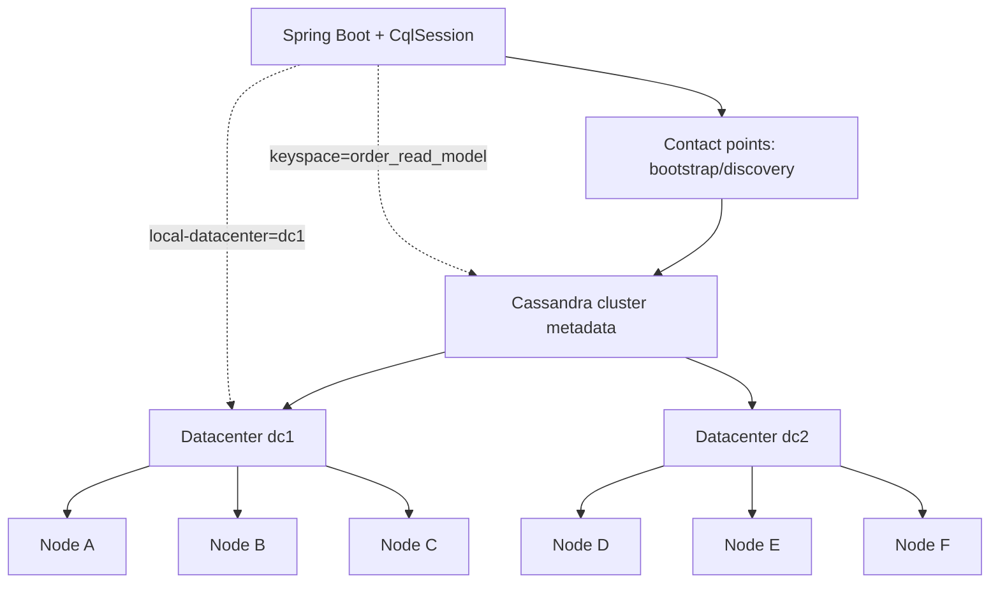
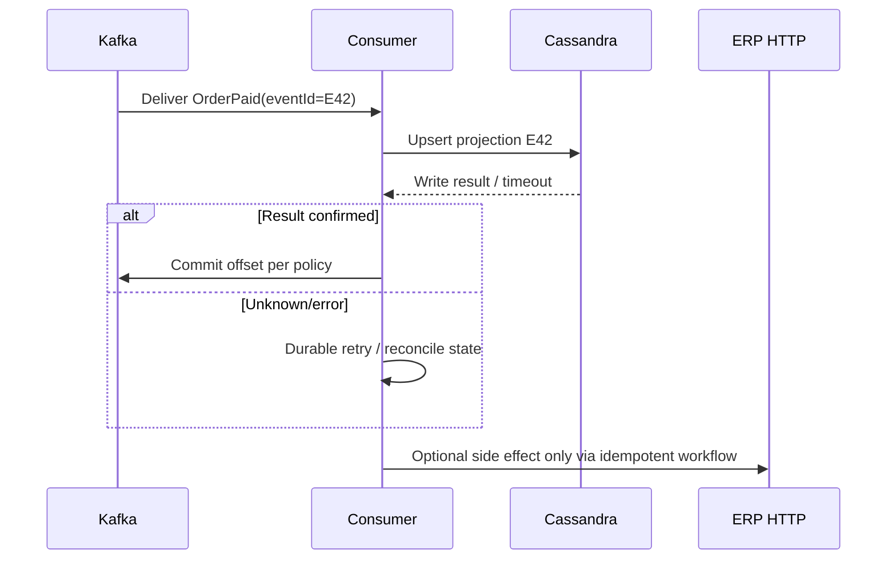

# Cassandra `CqlSession`, contact points, keyspace và local datacenter

## 1. Bài toán tích hợp: kết nối được Cassandra chưa có nghĩa đọc/ghi đúng dữ liệu

Một ứng dụng Spring Boot có thể dùng Cassandra để lưu trạng thái tra cứu khối lượng lớn, lịch sử sự kiện theo khóa phân vùng hoặc materialized view cho hệ thống đặt hàng. Cùng ứng dụng đó vẫn gọi ERP qua HTTP/SOAP, cập nhật một database giao dịch, dùng Redis làm cache và tiêu thụ Kafka/RabbitMQ thông qua Spring Integration.

Một cấu hình Cassandra trông đơn giản:

```yaml
spring:
  cassandra:
    contact-points: cassandra-1.internal,cassandra-2.internal
    port: 9042
    keyspace-name: order_read_model
    local-datacenter: dc1
```

Nhưng bốn thông số này mang bốn ý nghĩa **không thể hoán đổi**. `contact-points` chỉ là địa chỉ ban đầu giúp driver tìm ra cluster; `port` là native transport port; `keyspace-name` chỉ namespace và schema nơi câu lệnh sẽ chạy; `local-datacenter` quyết định các node nào được xem là vùng cục bộ để driver định tuyến với chính sách load balancing.

Nếu dùng keyspace không tồn tại, session có thể không khởi tạo. Nếu cấu hình local datacenter sai, driver có thể không chọn được node hợp lệ. Nếu local datacenter đúng nhưng replication factor sai hoặc consistency level không phù hợp, client vẫn có thể chạy mà độ sẵn sàng, tính nhất quán và độ trễ không đạt yêu cầu.

Bài **“Cassandra CqlSession, contact points, keyspace và local datacenter”** thuộc chương **“Các kho NoSQL khác”** trong module **SPRING_BOOT_INTEGRATION**. Nội dung đặt Cassandra trong thực tế tích hợp Spring Boot qua HTTP client, cơ sở dữ liệu, cache, broker và Spring Integration adapters; tập trung vào **cấu hình, hợp đồng dữ liệu, giao dịch, lỗi, xử lý trùng lặp, kiểm thử và observability**.

Sau bài học, bạn cần:

1. Phân biệt driver `CqlSession`, Cassandra cluster/nodes, contact points, local DC và keyspace.
2. Biết dùng Spring Boot auto-configuration thay vì tự tạo session làm mất cấu hình chung.
3. Kết nối đúng single-DC/multi-DC, container, cloud/Kubernetes, TLS và credentials.
4. Viết CQL query/prepared statement theo partition key và consistency phù hợp.
5. Xử lý timeout, không xác định kết quả ghi, retry và idempotency ở mức integration.
6. Kiểm thử với Cassandra thật qua Testcontainers và quan sát topology/latency/error.

## 2. Mô hình Cassandra: cluster, datacenter, node, token và keyspace

Cassandra là distributed wide-column database, dữ liệu được phân phối dựa trên **partition key** và replication strategy. Cùng một cluster có thể có nhiều datacenters (DC), mỗi DC gồm nhiều nodes. Khái niệm datacenter trong Cassandra là **nhóm topology/logical failure domain**, không nhất thiết tương ứng một thành phố hoặc một địa điểm thực tế duy nhất.



| Thuật ngữ | Có ý nghĩa gì? | Không phải là gì? |
|---|---|---|
| **Cluster** | Tập nodes Cassandra cùng topology/metadata. | Một máy database duy nhất. |
| **Datacenter** | Nhóm nodes dùng cho replication và DC-aware routing. | Địa chỉ client tự chọn tùy tiện. |
| **Node** | Instance Cassandra lưu dữ liệu và phục vụ native CQL protocol. | Luôn là một partition hay một shard độc lập. |
| **Token/ring** | Cơ chế phân phối partition replicas theo partitioner/topology. | Kafka topic offset. |
| **Partition key** | Quyết định dữ liệu thuộc partition nào. | Primary key theo nghĩa RDBMS thông thường. |
| **Replication factor (RF)** | Số replicas của dữ liệu trong một DC theo strategy. | Số connection pool hoặc số retries. |
| **Keyspace** | Namespace cho tables/types với replication settings. | Cassandra server/cluster hoặc database SQL transaction. |
| **CqlSession** | Phiên driver chia sẻ, quản lý topology và connections. | Một JDBC connection hoặc một HTTP request. |

Phân biệt **logical datacenter** với **availability zone**: triển khai nhiều racks/zones có thể cấu hình rack-aware placement trong cùng DC. Cách đặt replication/racks phụ thuộc vận hành cluster và snitch; client không được tự suy luận datacenter từ IP hoặc hostname.

### 2.1. Vì sao chọn Cassandra cho một luồng tích hợp?

Cassandra phù hợp khi mô hình truy cập **query-first**, cần scale theo phân vùng, nhiều writes, có chiến lược availability/consistency rõ và dữ liệu không cần join/transaction quan hệ rộng. Nó không tự thay thế PostgreSQL cho nghiệp vụ đòi hỏi đa bảng ACID, foreign keys hoặc outbox relational transaction nguyên tử.

Ví dụ hợp lý: bảng tra trạng thái gần nhất theo `(tenantId, orderId)`, time-series theo một aggregate và bucket, projections đọc từ Kafka. Ví dụ chưa hợp lý: bắt Cassandra thực thi nhiều ad-hoc joins và query tùy ý rồi bật `ALLOW FILTERING` trên bảng lớn.

## 3. `CqlSession` của DataStax/Apache Cassandra Java Driver 4

Trong driver thế hệ 4, API chính là:

```java
import com.datastax.oss.driver.api.core.CqlSession;
```

`CqlSession` chịu trách nhiệm:

- Khởi tạo kết nối tới contact points, lấy cluster metadata và routing information.
- Quản lý các pooled connections tới nodes theo driver configuration.
- Chuẩn bị/thực thi CQL statements, chuyển đổi values và paging.
- Chọn coordinator node dựa trên load balancing, query routing và local DC.
- Quản lý timeouts, retry/load balancing policy và driver metrics nếu bật.
- Theo dõi topology changes, node status và session lifecycle.

**Một ứng dụng thường dùng một session được quản lý và tái sử dụng**, không tạo một `CqlSession` mới cho mỗi truy vấn hoặc mỗi message broker. Tạo session tốn handshake/metadata/connections và dễ tăng số sockets, threads, memory, TLS handshakes dưới tải.

### 3.1. Session và JDBC connection khác nhau thế nào?

| Cassandra driver | JDBC/JPA trong Spring Boot |
|---|---|
| `CqlSession` có thể bao nhiều connections/nodes. | `DataSource` quản lý pool JDBC connections. |
| Routing theo partition key/replicas/DC-aware policies. | Thường gửi SQL qua một connection tới một DB endpoint. |
| Consistency level chọn trên request/statement. | Transaction isolation/commit trên JDBC resource. |
| Upsert mặc định và LWT theo điều kiện. | Row locks, joins, multi-statement transactions theo RDBMS. |
| Không có JDBC `@Transactional` ACID đa bảng/partition tương đương. | `@Transactional` hỗ trợ local DB transactions khi cấu hình đúng. |

Không gọi `session.close()` trong repository/gateway sau một query; Spring container nên sở hữu vòng đời singleton session được auto-configure.

## 4. Spring Boot: lựa chọn dependency và property namespace đúng phiên bản

Ở Spring Boot 3.x với Spring Data Cassandra, dependency thường là:

```kotlin
dependencies {
    implementation("org.springframework.boot:spring-boot-starter-data-cassandra")
    implementation("org.springframework.boot:spring-boot-starter-actuator")
}
```

Starter mang Spring Data Cassandra và Cassandra Java driver version tương thích theo Spring Boot BOM. Với Spring Boot 2.x hoặc phiên bản khác, một số **property prefixes và APIs** khác: những ví dụ trong bài dùng `spring.cassandra.*` thường gặp ở Boot 3.x; hãy đối chiếu configuration metadata của đúng version ứng dụng.

```yaml
spring:
  cassandra:
    contact-points: cassandra-1.internal,cassandra-2.internal
    port: 9042
    local-datacenter: dc1
    keyspace-name: order_read_model
```

Đây là **minh họa** với cluster tự vận hành. Hostnames và DC phải được xác nhận từ topology, không copy vào môi trường thật khi chưa có cluster/ACL/TLS. `keyspace-name` phải tồn tại trước khi session dùng nó; các bootstrap migrations thường chạy ngoài application data path.

### 4.1. Những thứ Boot có thể tự cấu hình

Khi starter/classpath và điều kiện auto-configuration phù hợp, Boot cung cấp hoặc phối hợp tạo `CqlSession` và Spring Data infrastructure như `CassandraTemplate`/repositories. Các components phụ thuộc bean bạn tự định nghĩa; nếu bạn tạo một `CqlSession` riêng, auto-configuration có thể **back off**, khiến `spring.cassandra.*` không đi vào session ấy.

Không phải chỉ cần file `application.yml` có thông số là app tự kết nối tới đúng cluster: phải xác nhận **bean `CqlSession` thực tế được inject** và startup logs/metadata chỉ ra địa chỉ, DC và keyspace mong đợi.

### 4.2. Cấu hình tách theo môi trường

```yaml
# application-local.yml (ví dụ)
spring:
  cassandra:
    contact-points: 127.0.0.1
    port: 9042
    local-datacenter: datacenter1
    keyspace-name: order_read_model_local
```

Ở production, đặt cluster endpoints, credentials, truststore và DC từ cấu hình môi trường có quản lý. Không mặc định `datacenter1` là tên DC thật trong staging/prod chỉ vì đó là giá trị container mặc định trong một ảnh Docker.

## 5. Contact points: điểm vào cluster, không phải danh sách duy nhất các nodes sẽ dùng

`contact-points` là một hoặc nhiều địa chỉ node **driver có thể kết nối ban đầu** để lấy metadata. Sau bootstrap, driver biết các nodes mà cluster công bố và theo chính sách phù hợp có thể kết nối tới những nodes khác.

```text
Spring Boot app
  -> cassandra-1.internal:9042  (contact point)
  -> metadata: nodes A, B, C; dc/rack/tokens/status
  -> load balancing chooses coordinators for requests
```

Vì vậy:

- Một contact point không phải một proxy đại diện duy nhất cho cluster.
- Tăng nhiều contact points chủ yếu giúp **khởi tạo kết nối tin cậy** khi một node không sẵn sàng; không phải phép cộng throughput tự động.
- Địa chỉ driver nhận từ metadata phải **routable từ nơi ứng dụng chạy**. NAT, Docker, Kubernetes và multi-DC network có thể khiến contact point reachable nhưng các node khác không reachable.
- Dùng DNS/hostnames ổn định, danh sách đủ độc lập cho bootstrap, đúng TLS/identity policy.
- Không cho request người dùng tự chỉ định contact point làm thay đổi cluster mà app sẽ gửi dữ liệu.

### 5.1. Cassandra native transport port

Port điển hình cho CQL native protocol không mã hóa là **9042**, nhưng deployment có thể sử dụng port khác hoặc gateway/provider endpoint riêng. Cổng này khác JMX, gossip/internode và HTTP API; không xem 9042 là HTTP endpoint.

```yaml
spring:
  cassandra:
    contact-points: cassandra-a.internal,cassandra-b.internal
    port: 9042
```

Một số driver APIs cho phép contact point có port riêng theo `InetSocketAddress`. Với Spring Boot property `port`, hãy kiểm tra syntax contact-point URI/host của version đang dùng trước khi viết `host:port` vào chuỗi danh sách; không suy đoán parser chấp nhận mọi dạng.

### 5.2. Bootstrap thành công nhưng query thất bại

Tình huống có thể xảy ra khi client kết nối được contact point nhưng cluster công bố private IP unreachable, các nodes sai datacenter hoặc TLS certificate không hợp lệ trên những node tiếp theo. Hãy xem **node endpoints sau discovery và policy local DC**, không chỉ ping DNS của contact point.

## 6. `local-datacenter`: nhãn topology cần trùng tên thực tế

Local datacenter cho phép load-balancing policy ưu tiên các nodes thuộc DC được chọn, nhất là khi cluster multi-DC. Với default load balancing policy của driver 4, việc xác định DC đúng rất quan trọng để có tập nodes ứng viên hợp lệ.

```yaml
spring:
  cassandra:
    local-datacenter: dc1
```

`dc1` phải là giá trị **datacenter name mà Cassandra cluster công bố**, không phải tên Kubernetes namespace, AWS region hay hostname tùy ý. Cassandra có thể dùng `datacenter1`, `dc1` hoặc tên khác do vận hành đặt.

### 6.1. Cách kiểm tra tên DC

Trên một máy/cluster được phép truy cập, đội vận hành có thể kiểm tra qua `nodetool status` hoặc query metadata CQL:

```sql
SELECT data_center, rack, host_id
FROM system.local;
```

Thông tin node peers có thể đến từ `system.peers_v2` trong Cassandra versions phù hợp và metadata driver. Chú ý quyền truy cập system tables và sự khác nhau giữa Cassandra/managed providers; không suy luận DC chỉ từ địa chỉ IP của container.

Trong application, có thể kiểm tra metadata đã load bằng API driver:

```java
session.getMetadata().getNodes().values()
    .forEach(node -> {
        String dc = node.getDatacenter();
        // Ghi log nội bộ DC + node state khi được phép.
    });
```

Không log toàn bộ cluster addresses/credentials ra public response. Dùng health diagnostics được bảo vệ và cảnh báo khi node count/DC không phù hợp deployment expectation.

### 6.2. Các sai cấu hình kinh điển

| Triệu chứng | Khả năng |
|---|---|
| Driver báo không xác định được local datacenter. | Không đặt `local-datacenter` khi driver cần explicit value. |
| Local DC được cấu hình nhưng không có node dùng được. | Sai chính tả/tên DC hoặc node trong DC chưa reachable. |
| Kết nối sang remote DC ngoài ý muốn. | Routing policy/local DC không được thiết lập như kỳ vọng hoặc dùng custom builder. |
| Latency tăng sau deploy sang region khác. | Client vẫn local DC cũ hoặc cross-DC path đang được dùng. |
| Contact points đều ở remote DC. | Bootstrap có thể bị giới hạn/không được chấp nhận theo driver policy. |

**Không sửa bằng cách “thử đại local-datacenter=datacenter1”**. Xác nhận topology/metadata từ cluster thực tế và dùng test startup có assertion.

## 7. Keyspace: namespace và replication settings, không chỉ tên bảng

Keyspace lưu metadata replication và durable writes; mỗi CQL table thuộc một keyspace. Spring Boot property:

```yaml
spring:
  cassandra:
    keyspace-name: order_read_model
```

Khi session chọn keyspace, các statements như `SELECT ... FROM order_status_by_id` có thể dùng tên bảng không qualified. Nhưng khi đang tạo keyspace mới hoặc chạy schema bootstrap, cần kết nối **không chọn keyspace chưa tồn tại** và thực thi DDL bằng quyền thích hợp.

### 7.1. Tạo keyspace đúng replication strategy

Ví dụ cho production một datacenter `dc1` có tối thiểu ba nodes phù hợp:

```sql
CREATE KEYSPACE IF NOT EXISTS order_read_model
WITH replication = {
    'class': 'NetworkTopologyStrategy',
    'dc1': 3
}
AND durable_writes = true;
```

Ý nghĩa:

- `NetworkTopologyStrategy` cho phép replication factor riêng theo DC.
- `'dc1': 3` định nghĩa ba replicas tại DC mang tên `dc1`.
- RF phải phù hợp số nodes, failure domains và capacity; không copy `3` cho single-node test cluster.
- `durable_writes=true` là lựa chọn thường dùng cho dữ liệu bền vững; cấu hình thay đổi cần hiểu write path.

Trong môi trường test một node:

```sql
CREATE KEYSPACE IF NOT EXISTS integration_test
WITH replication = {
    'class': 'NetworkTopologyStrategy',
    'datacenter1': 1
};
```

**Không dùng `SimpleStrategy` như lựa chọn mặc định cho production multi-DC**. Khi thêm DC thứ hai, replication strategy cần mô tả rõ cả hai; nếu local DC của client không có replica phù hợp, consistency/availability sẽ bị ảnh hưởng.

### 7.2. Keyspace không tự hình thành khi app đã chọn nó

Nếu đặt `spring.cassandra.keyspace-name=order_read_model` mà keyspace chưa tồn tại, driver/session có thể lỗi khởi tạo hoặc fail khi statement yêu cầu keyspace đó. Cách đáng tin cậy:

1. Infra/admin hoặc migration job tạo keyspace và tables.
2. Xác minh replication/DC/schema.
3. Application khởi động với keyspace đã sẵn sàng.
4. Startup/health test kiểm tra connect và query theo contract.

Đừng cấp quyền `CREATE KEYSPACE` cho mọi app instance chỉ để tự sửa config thiếu, trừ khi có kế hoạch bootstrap bảo mật, serialization và audit rõ ràng.

## 8. Quan hệ giữa local datacenter, replication factor và consistency level

Ba khái niệm hay bị nhầm:

- **Local DC**: driver ưu tiên/coordinator nodes ở DC nào.
- **Replication factor**: mỗi partition có bao nhiêu replicas trong DC theo keyspace strategy.
- **Consistency level**: cần bao nhiêu replicas xác nhận/đọc để operation thành công theo semantics.

Ví dụ keyspace RF=3 ở `dc1`:

| Consistency | Quy tắc gần đúng trong local DC | Đánh đổi |
|---|---|---|
| `LOCAL_ONE` | Một replica cục bộ đáp ứng. | Latency thấp, ít bảo đảm đọc dữ liệu mới hơn. |
| `LOCAL_QUORUM` | Quorum replicas trong local DC, RF=3 cần 2. | Tốt hơn cho đọc/ghi trong cùng DC, phụ thuộc availability. |
| `ONE` | Một replica phù hợp trả lời, không nhất thiết diễn giải giống LOCAL_ONE ở đa DC. | Cần hiểu routing/replication topology. |
| `QUORUM` | Quorum theo tổng replicas ở các DC tùy topology. | Có thể tăng cross-DC cost, không phải LOCAL_QUORUM. |
| `EACH_QUORUM` | Quorum của từng DC có replicas. | Availability/latency và multi-DC dependencies khác. |

Trong một DC RF=3, LOCAL_QUORUM write + LOCAL_QUORUM read có giao nhau về quorum trong điều kiện không có concurrent updates bất thường; **không biến mọi query thành linearizable transaction**. Last-write-wins timestamps, tombstones, repair, hinted handoff và concurrent clients còn ảnh hưởng giá trị thấy được. Nếu cần compare-and-set, dùng **lightweight transaction (LWT)** và hiểu chi phí/serial consistency.

### 8.1. Chọn consistency theo từng loại integration operation

- Projection đọc có thể chịu độ trễ cập nhật: cân nhắc `LOCAL_ONE` nếu nghiệp vụ chấp nhận.
- Luồng cần đọc ngay sau ghi tại local DC: cân nhắc `LOCAL_QUORUM` đọc/ghi với RF thiết kế đúng.
- LWT cho unique command marker: cần kiểm soát serial consistency và regular consistency.
- Đối soát remote payment/ledger: Cassandra với weak/last-write-wins semantics có thể không phải source of truth phù hợp.

Không tự đặt mọi request thành `ALL`/`EACH_QUORUM` để “an toàn nhất”; điều này có thể làm outage lan rộng khi một replica/DC tạm ngừng.

## 9. `CqlSession` bean do Spring Boot quản lý

Ví dụ repository inject session:

```java
import com.datastax.oss.driver.api.core.CqlSession;
import org.springframework.stereotype.Repository;

@Repository
public class OrderStatusCqlGateway {
    private final CqlSession session;

    public OrderStatusCqlGateway(CqlSession session) {
        this.session = session;
    }

    public boolean isSessionReady() {
        return session != null && !session.isClosed();
    }
}
```

`isClosed()` chỉ phản ánh local lifecycle, **không chứng minh cluster có node khỏe hoặc request sẽ thành công**. Readiness thật cần kiểm tra phù hợp với local DC, keyspace, dependency availability và SLO, với chi phí hợp lý.

Không tự quản lý vòng đời bằng `try (CqlSession session = ...)` trong từng method của singleton repository. Spring Boot quản lý bean và close khi context shutdown theo lifecycle.

### 9.1. Một session dùng cho nhiều keyspaces?

Có thể dùng **fully qualified table names** như `order_read_model.order_status_by_id` trong statements nếu quyền cho phép. Nhưng có nhiều keyspaces/trust boundaries/credentials/cluster khác nhau, nên định nghĩa rõ bean và adapter ownership. Không thay keyspace mặc định bằng cách dùng mutable global state trong singleton khi nhiều requests song song.

Đặc biệt, một session tới **cluster A** không tự truy vấn được cluster B chỉ vì tên keyspace giống nhau. Chọn cluster/credentials theo cấu hình đáng tin cậy, không theo header người dùng tùy tiện.

## 10. Khi cần custom session: tránh bypass Spring Boot configuration

Một ví dụ driver API đơn giản:

```java
import com.datastax.oss.driver.api.core.CqlIdentifier;
import com.datastax.oss.driver.api.core.CqlSession;
import java.net.InetSocketAddress;

CqlSession client = CqlSession.builder()
    .addContactPoint(new InetSocketAddress("cassandra-1.internal", 9042))
    .withLocalDatacenter("dc1")
    .withKeyspace(CqlIdentifier.fromCql("order_read_model"))
    .build();
```

Ví dụ trên minh họa driver gốc, **không phải cách mặc định khuyến nghị cho bean Spring Boot production**. Khi tự gọi `CqlSession.builder()`, bạn chịu trách nhiệm TLS, credentials, custom driver config, metrics, keyspace, DC, health, retry, socket pools và lifecycle. Ngoài ra Boot auto-configuration có thể back off trước bean này, làm properties `spring.cassandra.*` bị bỏ qua nếu chúng không được dùng để cấu hình builder.

### 10.1. Ưu tiên builder customizer đúng phiên bản

Trong các thế hệ Spring Boot hỗ trợ, có extension point như `CqlSessionBuilderCustomizer` để tùy chỉnh session builder do Boot tạo. Ví dụ về ý tưởng:

```java
import com.datastax.oss.driver.api.core.CqlSessionBuilder;
import org.springframework.boot.autoconfigure.cassandra.CqlSessionBuilderCustomizer;
import org.springframework.context.annotation.Bean;

@Bean
CqlSessionBuilderCustomizer cassandraClientCustomizer() {
    return (CqlSessionBuilder builder) -> {
        // Chỉ custom những thuộc tính có chủ đích, tránh overwrite
        // contact points, keyspace, local DC, auth/TLS từ Boot.
    };
}
```

Kiểm tra class/package/extension point của Spring Boot version thực tế; không trộn Spring Data Cassandra `AbstractCassandraConfiguration` và Boot auto-configuration mà không hiểu bean ownership. Nhiều customizers có thể ghi đè cấu hình lẫn nhau: phải kiểm tra final session metadata.

### 10.2. Những trường hợp nên có session riêng

- Hai Cassandra clusters có separate credentials/availability domains.
- Client chuyên đọc với policy timeout/request-throttling khác hẳn (tùy API và topology).
- Một external managed Cassandra-compatible service cần auth/SSL/driver profile riêng.
- Một migration/admin job có quyền schema khác application runtime.

Mỗi session phải được đặt tên/`@Qualifier` rõ và có lifecycle/health/metrics riêng, tránh inject nhầm.

## 11. CQL schema theo query: chọn partition key trước khi viết repository

Ví dụ cần tra trạng thái đơn theo tenant + orderId, không cần query tất cả đơn theo status:

```sql
CREATE TABLE IF NOT EXISTS order_read_model.order_status_by_id (
    tenant_id text,
    order_id text,
    state text,
    version bigint,
    updated_at timestamp,
    PRIMARY KEY ((tenant_id, order_id))
);
```

Ở đây partition key gồm `tenant_id` và `order_id`. Việc có cả hai là một thiết kế: mỗi order có một partition riêng; không phải Cassandra tự động hiểu tenant security. Query tối ưu:

```sql
SELECT state, version, updated_at
FROM order_read_model.order_status_by_id
WHERE tenant_id = ? AND order_id = ?;
```

Không query:

```sql
SELECT *
FROM order_read_model.order_status_by_id
WHERE state = 'PAID' ALLOW FILTERING;
```

trên bảng lớn rồi kỳ vọng hiệu năng tốt. Cassandra không có B-tree index/joins giống PostgreSQL; `ALLOW FILTERING` có thể quét nhiều partitions và gây latency không kiểm soát. Nếu cần truy vấn `orders_by_status`, tạo table/materialized read model theo access pattern với partition/bucket hợp lý.

### 11.1. Query-first schema và partition sizing

Quy tắc thiết kế:

1. Liệt kê query thực tế: theo aggregate ID, theo tenant + ngày, theo status + bucket.
2. Chọn partition key phân bổ đều writes/reads.
3. Tránh **một partition khổng lồ cho toàn tenant** chỉ vì truy vấn theo tenant thuận tiện.
4. Chọn clustering columns cho thứ tự/cắt trang trong partition.
5. Dự tính retention/TTL/tombstones và scan pattern.
6. Định nghĩa idempotency/version semantics trong domain, không suy ra từ `PRIMARY KEY`.

`PRIMARY KEY ((tenant_id), order_id)` và `PRIMARY KEY ((tenant_id, order_id))` **không tương đương**: dạng đầu gom mọi orders của một tenant vào một partition, dễ nóng và phình to; dạng sau phân tán theo từng cặp.

## 12. Prepared statements và cách bind dữ liệu đúng

`CqlSession` hỗ trợ `prepare` và `execute`. Prepared statements nên được tái sử dụng cho những query lặp lại; bind variables áp dụng cho **values**, không cho table/keyspace identifiers.

```java
import com.datastax.oss.driver.api.core.CqlSession;
import com.datastax.oss.driver.api.core.cql.PreparedStatement;
import com.datastax.oss.driver.api.core.cql.BoundStatement;
import com.datastax.oss.driver.api.core.cql.Row;
import java.util.Optional;

public final class OrderStatusReader {

    private final CqlSession session;
    private final PreparedStatement findByKey;

    public OrderStatusReader(CqlSession session) {
        this.session = session;
        this.findByKey = session.prepare("""
            SELECT state, version
            FROM order_read_model.order_status_by_id
            WHERE tenant_id = ? AND order_id = ?
            """);
    }

    public Optional<String> stateOf(
            String tenantId, String orderId) {
        BoundStatement bound = findByKey.bind(tenantId, orderId);
        Row row = session.execute(bound).one();

        return row == null
                ? Optional.empty()
                : Optional.ofNullable(row.getString("state"));
    }
}
```

Giả định keyspace/table đã tồn tại và session có quyền SELECT. Với startup cần tránh `prepare` trước migrations/schema readiness; một số application chọn lazy initialization hoặc schema migration job có dependency order.

### 12.1. Đừng nối trực tiếp user input vào CQL

Sai:

```java
String cql = "SELECT * FROM order_status_by_id WHERE order_id = '"
        + inputOrderId + "'";
```

Đúng là `session.prepare(...)` và `bind(...)` hoặc statement builder có bind variables. Nếu tên keyspace/table phải khác theo tenant, **không bind được identifiers bằng `?`**; dùng allowlist và mapping từ tenant đã xác thực sang các identifier cấu hình trước, hoặc thiết kế multi-tenant trong partition key.

### 12.2. Mapping kiểu và NULL

Java driver có codecs cho nhiều CQL types; `timestamp` thường map với `java.time.Instant` ở driver 4. Với nullable columns, `getString(...)`/`getInstant(...)` có thể trả null; với thiếu cột, API có thể báo lỗi. Không đọc một bản ghi không tồn tại rồi tự hiểu state `PENDING`. Dữ liệu nguồn sự thật cần DTO/schema validation.

## 13. Ghi/upsert và nguy cơ mất bản cập nhật

Cassandra `INSERT` thường có semantics **upsert**: ghi lại cùng primary key cập nhật columns, không tạo duplicate row như một bảng SQL unique-key insert. Ví dụ:

```java
import java.time.Instant;
import com.datastax.oss.driver.api.core.cql.PreparedStatement;
import com.datastax.oss.driver.api.core.cql.BoundStatement;

PreparedStatement write = session.prepare("""
    INSERT INTO order_read_model.order_status_by_id
        (tenant_id, order_id, state, version, updated_at)
    VALUES (?, ?, ?, ?, ?)
    """);

BoundStatement bound = write.bind(
        "tenant-1", "O-42", "PAID", 7L, Instant.now());

session.execute(bound);
```

**Upsert không phải compare-and-set.** Hai events cùng order có `version=7` và `version=8` đến khác thứ tự có thể ghi state cũ đè state mới nếu không có guard. Cassandra dùng conflict resolution/timestamps, nhưng client app không nên giả định “version lớn nhất sẽ thắng” chỉ vì có cột `version`.

### 13.1. Idempotent write có điều kiện

Cùng một `INSERT` với cùng các giá trị có thể được coi là idempotent về mặt logical final state trong một số tình huống; nhưng các trường hợp **counter, TTL, client write timestamp, side effects hoặc LWT** làm semantics phức tạp hơn. Retry phải dựa trên thao tác thực tế, không chỉ vì chữ `INSERT`.

## 14. Lightweight transaction (LWT) cho compare-and-set hoặc unique marker

Cassandra hỗ trợ conditional writes như `IF NOT EXISTS` hoặc `IF version = ?`, sử dụng Paxos/serial consistency ở phạm vi partition phù hợp. Nó **khác** transaction JDBC bao nhiều tables/rows.

Ví dụ tạo marker một lần:

```sql
INSERT INTO order_read_model.consumed_events_by_id
    (consumer_name, event_id, processed_at)
VALUES (?, ?, ?)
IF NOT EXISTS;
```

Schema phù hợp:

```sql
CREATE TABLE IF NOT EXISTS order_read_model.consumed_events_by_id (
    consumer_name text,
    event_id text,
    processed_at timestamp,
    PRIMARY KEY ((consumer_name, event_id))
);
```

Ở driver:

```java
import com.datastax.oss.driver.api.core.cql.PreparedStatement;
import com.datastax.oss.driver.api.core.cql.Row;

PreparedStatement claimEvent = session.prepare("""
    INSERT INTO order_read_model.consumed_events_by_id
      (consumer_name, event_id, processed_at)
    VALUES (?, ?, ?)
    IF NOT EXISTS
    """);

Row result = session.execute(
        claimEvent.bind("inventory", eventId, java.time.Instant.now()))
    .one();

boolean applied = result != null
        && result.getBoolean("[applied]");
```

`[applied]` là column metadata thường trả về cho conditional statement trong driver. Test thực tế theo Cassandra version/driver; đừng chỉ kiểm tra `execute` không ném exception.

### 14.1. Vì sao một marker chưa tạo exactly-once workflow?

Nếu consumer ghi marker `IF NOT EXISTS` trước rồi gọi ERP HTTP, process có thể crash sau marker nhưng trước ERP call. Khi redelivery, marker đã tồn tại nên consumer bỏ qua **công việc chưa hoàn tất**. Với source of truth ở PostgreSQL, hãy ghi inbox marker + business update trong **cùng RDBMS transaction** hoặc dùng durable operation state machine; Cassandra marker chỉ giúp ngăn tranh chấp trên key, **không nguyên tử với HTTP/SOAP/Kafka hoặc dữ liệu ở partition khác**.

Nếu muốn dùng Cassandra làm durable workflow state, phải thiết kế states `PENDING/CLAIMED/SUCCEEDED/UNKNOWN`, lease/generation và recovery, kiểm tra khả năng update có điều kiện trong phạm vi partition cùng data model.

## 15. Conditional update để ngăn version bị ghi lùi

Giả sử bản ghi đã tồn tại, có thể dùng LWT:

```sql
UPDATE order_read_model.order_status_by_id
SET state = ?, version = ?, updated_at = ?
WHERE tenant_id = ? AND order_id = ?
IF version = ?;
```

Kết quả trả `[applied]`. Caller cần:

- Xác định expectedVersion đã đọc/lưu từ nguồn đáng tin cậy.
- Nếu `[applied]=false`, đọc current version/state để quyết định duplicate/out-of-order/conflict.
- Tách trường hợp record chưa tồn tại và cần khởi tạo bằng `IF NOT EXISTS`.
- Có retry bounded nếu LWT contention; không biến retry vô hạn thành lock storm.

**LWT tốn nhiều round trips hơn plain write.** Không biến mọi projection update thành LWT nếu business chỉ cần last-write-wins và có thể rebuild/reconcile; cân bằng consistency với throughput/SLO.

### 15.1. Serial consistency và regular consistency khác nhau

Conditional write có **serial consistency** (ví dụ `LOCAL_SERIAL`) cho protocol điều kiện và **normal consistency** (ví dụ `LOCAL_QUORUM`) cho phần đọc/ghi thông thường. Đặt một thuộc tính `LOCAL_QUORUM` chưa tự mô tả trọn semantics LWT; hãy kiểm tra statement configuration, driver defaults, RF/local DC và cluster version.

## 16. Consistency per statement và request timeout

Thay vì tạo session mới cho mỗi operation, có thể đặt policy trên statement cụ thể:

```java
import com.datastax.oss.driver.api.core.DefaultConsistencyLevel;
import com.datastax.oss.driver.api.core.cql.BoundStatement;
import java.time.Duration;

BoundStatement lookup = findByKey
        .bind(tenantId, orderId)
        .setConsistencyLevel(DefaultConsistencyLevel.LOCAL_QUORUM)
        .setTimeout(Duration.ofSeconds(2));

Row row = session.execute(lookup).one();
```

Ví dụ dùng `findByKey` là prepared statement đã khai báo. Request timeout phía driver **không có nghĩa remote write chưa được áp dụng**; một timeout có thể xảy ra sau khi coordinator/replicas nhận mutation. Cần tách timeout **đọc**, timeout **ghi** và **kết quả ghi không xác định**.

### 16.1. Driver retry policy không thay business retry

Driver có thể retry một số errors/replica cases theo policy và statement idempotence. Nhưng không nên bật `setIdempotent(true)` đại trà để driver thử lại mọi lệnh ghi:

- Statements có conditional state/counter/TTL cần phân tích riêng.
- CQL write timeout có thể có kết quả không chắc chắn ở các replicas.
- Một Kafka consumer retry ngoài driver có thể nhân thêm số attempts.
- Nếu câu lệnh thay đổi downstream business state ngoài Cassandra, driver không thể đảm bảo idempotency.

Định nghĩa **một retry budget tổng** từ Kafka listener/Spring Integration đến Cassandra driver và adapter. Retry có backoff/jitter, giới hạn concurrency và deadline; khi kết quả ghi không rõ, đối soát bằng stable business key.

## 17. Asynchronous query và tránh chặn event loop

`session.execute(...)` là API blocking từ góc nhìn caller. Không gọi blocking CQL query trực tiếp trên Reactor Netty event loop hoặc message processing thread đang có poll deadline chặt nếu chưa lập ngân sách.

Driver hỗ trợ `executeAsync` trả `CompletionStage<AsyncResultSet>`:

```java
import java.util.concurrent.CompletionStage;
import com.datastax.oss.driver.api.core.cql.AsyncResultSet;

CompletionStage<AsyncResultSet> stage =
        session.executeAsync(findByKey.bind(tenantId, orderId));
```

Nếu code application dùng Reactor:

```java
import reactor.core.publisher.Mono;

Mono<AsyncResultSet> result =
        Mono.fromCompletionStage(
            () -> session.executeAsync(
                findByKey.bind(tenantId, orderId)));
```

Lambda supplier trì hoãn việc gửi query tới thời điểm subscribe. Khi Reactor retry bằng resubscribe, query có thể chạy lại; cần kiểm tra idempotency cho writes. Nếu dùng `ReactiveCassandraTemplate`/Spring Data reactive repositories, hãy kiểm tra driver/reactive integration và context propagation theo phiên bản; **không trộn thread-bound JDBC transaction với Cassandra reactive operation** rồi giả định rollback chung.

### 17.1. Paging và backpressure

`AsyncResultSet` là một page kết quả theo driver; nếu có nhiều pages, cần fetch tiếp bằng `fetchNextPage()` hoặc chọn Spring Data abstraction phù hợp. Không dùng offset-based pagination giống SQL trên một bảng Cassandra lớn và cũng không materialize hàng triệu rows vào memory. Paging state gắn với statement/query context, cần kiểm soát khi expose ra API.

## 18. Cấu hình authentication, TLS và trust boundary

Khi Cassandra cluster yêu cầu auth/TLS, ứng dụng cần sử dụng cấu hình phù hợp với driver và Spring Boot version, thường gồm:

```yaml
spring:
  cassandra:
    contact-points: cassandra-a.internal,cassandra-b.internal
    port: 9042
    local-datacenter: dc1
    keyspace-name: order_read_model
    username: ${CASSANDRA_USERNAME}
    password: ${CASSANDRA_PASSWORD}
```

Credentials nên lấy từ secret manager/environment/secret volume theo chính sách, không hard-code trong Git. **Không hiểu ví dụ này là TLS đã được bật:** username/password chỉ xử lý authentication; TLS/mTLS truststore/certificates, hostname verification, encrypted connection và driver options phải được cấu hình riêng theo environment.

### 18.1. Managed Cassandra-compatible services có thể khác topology tự vận hành

Một dịch vụ managed có thể yêu cầu secure connect bundle, proxy endpoint, custom port, token-based auth hoặc compatibility hạn chế một số CQL/features. Khi đó phải dùng hướng dẫn driver/provider phù hợp; các property contact-points/local-datacenter tự vận hành không nhất thiết thay thế toàn bộ secure connection workflow.

Không chuyển `local-datacenter` thành region name tùy tiện khi provider yêu cầu DC identifier cụ thể hoặc bundled metadata. Kiểm tra node metadata/driver logs thay vì suy diễn.

### 18.2. Quyền tối thiểu

- Runtime app chỉ cần SELECT/MODIFY trên keyspace/tables cần thiết.
- Migration/admin job mới có quyền CREATE/ALTER/DROP, theo approval/audit.
- Tách credentials cho test/staging/prod.
- Không log passwords, secure bundle paths chứa secret, JDBC-like URL strings hoặc raw connection configuration.

## 19. Bootstrap topology trong Docker, Kubernetes và nhiều DC

Trong Docker/Testcontainers, contact point app sử dụng là **host + mapped port** mà container runtime cấp; Cassandra node có thể tự công bố địa chỉ/port nội bộ. Tùy Testcontainers module/version, networking integration xử lý một phần discovery; không hard-code `127.0.0.1:9042` cho mọi CI runner.

Trong Kubernetes:

- Cassandra pods thường có stable StatefulSet DNS.
- Node addresses phải routable từ application namespace/network.
- Network policies phải cho phép native port.
- Local DC naming xuất phát Cassandra config/topology.
- Service load balancing không tự bảo đảm token-aware routing; một proxy TCP có thể che metadata/topology nếu thiết kế chưa phù hợp.

### 19.1. Multi-DC failover không phải đổi một property tùy tiện

Khi local DC mất hoàn toàn, chuyển client sang remote DC có thể thay đổi latency, consistency và write availability. Plan failover phải xét replication factor theo remote DC, consistency levels, data replication/repair, DNS/security, application SLAs và khả năng cluster driver cập nhật topology.

Không để mỗi request tự “đổi DC” bằng cách mutate shared session; cấu hình failover nên được vận hành có kiểm soát, quan sát và test.

## 20. Phân loại lỗi: khi nào lỗi nằm ở cấu hình, khi nào nằm ở dữ liệu?

Java driver 4 có nhóm exception như `AllNodesFailedException`, `DriverTimeoutException`, các server-side timeout/unavailable và query validation errors. Những lỗi này **không đồng nghĩa** Spring `DataAccessException` trong mọi trường hợp.

| Tình huống | Nguyên nhân có thể | Bước xử lý |
|---|---|---|
| Không kết nối được bất kỳ node nào. | Contact points/network/TLS, nodes down, local DC mismatch. | Kiểm tra network, discovery, DC, auth, driver errors. |
| Session startup báo keyspace không tồn tại. | Migration chưa chạy hoặc sai `keyspace-name`. | Chạy schema bootstrap đúng quyền, không retry nóng mãi. |
| Invalid query/unknown table. | CQL/schema/version mismatch. | Sửa query/migration, không retry. |
| Read/write timeout. | Quorum/replica latency, backpressure, network. | Xem CL/RF, p95/p99, outcome uncertainty. |
| Unavailable replicas. | Không đủ replicas đáp ứng chosen consistency. | Kiểm tra node status/RF/local DC, policy availability. |
| Authentication/authorization failure. | Secret/ACL/provider setting sai. | Dừng retry nóng, cảnh báo config/security. |
| Overloaded/coordinator busy. | Hot partition, queue saturation, concurrent writes. | Giảm in-flight, phân tán partition key, throttle. |
| LWT conflict. | Cùng key bị cập nhật tranh chấp. | Đọc current state, retry bounded hoặc reject conflict. |
| Codec/type mismatch. | Schema/data contract hoặc bind value sai. | Sửa DTO/codec, test migrated records. |

### 20.1. `@Repository` không tự dịch mọi driver exception

Spring Data Cassandra template/repositories có thể chuyển driver exceptions sang nhóm `org.springframework.dao.DataAccessException` qua exception translator của Spring Data. Nhưng khi gọi `CqlSession.execute(...)` trực tiếp, driver có thể ném **driver-specific runtime exceptions**. Đừng chỉ catch `DataAccessException` rồi cho rằng bạn đã phân loại hết mọi failure.

Tầng adapter nên chuẩn hóa lỗi kỹ thuật thành những nhóm ổn định như `CASSANDRA_UNAVAILABLE`, `CQL_CONTRACT_ERROR`, `WRITE_OUTCOME_UNKNOWN`, `CONDITIONAL_CONFLICT`, nhưng **giữ cause nội bộ** để điều tra. Không gửi stack trace, CQL với bound PII hoặc server addresses ra public HTTP response.

## 21. Cassandra không cung cấp cùng giao dịch với Kafka, HTTP và RDBMS

Ví dụ ứng dụng đọc sự kiện Kafka rồi:

1. Ghi read model Cassandra.
2. Phát `ProjectionUpdated` sang Kafka.
3. Ack source offset.

Nếu Cassandra write thành công nhưng Kafka publish lỗi, hệ thống có thể có projection mới nhưng thiếu event. Nếu Kafka offset commit trước Cassandra write, crash làm mất công việc. **Không có một `@Transactional` Spring JDBC nào gom ba hệ này thành atomic unit.**



Nếu đây chỉ là **rebuildable read projection**, Kafka retained log + idempotent version checks có thể đủ; với ledger hoặc money movement, chọn source of truth/transaction boundary mạnh hơn. Khi yêu cầu ghi local business state + event intent nguyên tử, transactional outbox trong **database hỗ trợ local transaction cần thiết** thường rõ ràng hơn; Cassandra batch **không phải** drop-in replacement của SQL ACID multi-row transaction.

### 21.1. Cassandra batch không giải quyết distributed atomicity

Cassandra logged batch có mục đích giúp đảm bảo batch mutations được áp theo cơ chế của Cassandra, nhưng **không cung cấp isolation và ACID transaction qua các hệ thống**. Unlogged batch cũng không phải công cụ tăng throughput chung cho writes khác partitions; nhiều writes độc lập có thể hiệu quả hơn khi gửi async với giới hạn.

Không bọc Kafka publish hoặc HTTP ERP call trong Cassandra batch rồi coi tất cả sẽ rollback nếu endpoint từ chối.

## 22. Kafka/RabbitMQ redelivery và idempotency trong projection

Broker có thể giao cùng event nhiều lần do consumer crash/rebalance, producer retry hoặc replay. Cassandra upsert cho primary key giống nhau không tự đủ khi events **đến sai thứ tự** hoặc side effects nằm ngoài Cassandra.

Thiết kế nên có:

- Stable `eventId`, `aggregateId`, `aggregateVersion` trong payload/event envelope.
- Partition key phù hợp theo aggregate; dùng version guard hoặc LWT khi cần.
- Không dùng Kafka topic-partition-offset làm business eventId duy nhất nếu producer có thể republish.
- Với consumer chỉ ghi Cassandra projection, xác định idempotency là “same event không đổi final state” và test duplicate/out-of-order.
- Với external HTTP/SOAP side effect, dùng durable inbox/operation state + upstream idempotency key hoặc reconciliation.

### 22.1. LWT marker và projection ở hai partitions vẫn có gap

Nếu ghi `consumed_events_by_id` thành công rồi app crash trước khi ghi `order_status_by_id`, redelivery thấy marker và bỏ qua projection chưa hoàn tất. Không dùng “đã insert marker” làm dấu **SUCCEEDED** khi side effect chưa hoàn thành. Có thể dùng một state machine trong **cùng partition model** với conditional transitions hoặc lựa chọn PostgreSQL inbox/outbox transactional boundary tùy độ quan trọng.

## 23. Timeouts, retry budgets và backpressure

Một Kafka listener có thể nhận 200 records/poll; mỗi record gọi Cassandra với retry/timeout dài, trong khi max poll interval của Kafka bị vượt. Điều cần theo dõi:

| Tài nguyên | Tín hiệu | Biện pháp |
|---|---|---|
| Cassandra driver in-flight requests | Queue depth/request throttling/timeouts. | Giới hạn concurrency; điều chỉnh driver profile sau số đo. |
| Coordinator/replica latency | p95/p99 reads/writes, timeouts. | Xem hot partitions, CL/RF, compaction/GC. |
| Kafka consumer lag | Backlog và tuổi record. | Giảm blocking, durable handoff, phân chia workers. |
| Spring Integration channel queue | Pending messages và error handling. | Bounded channels/consumer capacity, durable queue khi cần. |
| HTTP ERP pool/rate limit | Saturation và 429/503. | Bulkhead/timeout, không nhân retry across layers. |
| Cassandra storage | Tombstones, compaction backlog, disk. | TTL/schema/partition sizing/operational repair. |

### 23.1. Một timeout không đảo ngược write

Nếu driver gửi mutation tới replica nhưng client timeout trước khi nhận kết quả, Cassandra có thể đã ghi một phần/toàn bộ theo consistency và background reconciliation. Đối với state update versioned, không phát một event mới hoặc tăng version chỉ vì không nhận response. Đọc theo key với consistency thích hợp, đánh giá operation ID/version trước retry.

### 23.2. Chọn một lớp retry sở hữu chính sách

Không đồng thời cho driver retry ba lần, Spring Retry thêm ba lần, Spring Integration advice thêm ba lần và broker redelivery vô hạn. Xác định:

1. Các errors được retry (timeout/resource contention có điều kiện).
2. Operation có an toàn khi retry không.
3. Tổng attempts/deadline/backoff/jitter.
4. Nơi ghi `RETRY_WAIT`, `UNKNOWN` hoặc quarantine khi budget hết.
5. Cách khôi phục sau process restart.

## 24. TTL, tombstones và dữ liệu có thể “biến mất” sau một thời gian

Cassandra có TTL để tự hết hạn cells/rows theo semantics; deletes/expired data tạo tombstones được xử lý qua compaction/repair. Với cache-like projection, TTL có thể phù hợp. Với **inbox/idempotency keys**, TTL quá ngắn khiến một event được replay sau thời hạn TTL trông như chưa xử lý, dẫn tới duplicate side effect.

Ví dụ:

```sql
INSERT INTO order_read_model.order_status_by_id
    (tenant_id, order_id, state, version, updated_at)
VALUES (?, ?, ?, ?, ?)
USING TTL 86400;
```

`86400` giây là **một ngày**, chỉ minh họa. Trước khi áp TTL phải xác định:

- Broker retention/DLT/replay window dài bao lâu?
- Có thể rebuild projection từ source of truth không?
- TTL có làm state chuyển ngược khi record cũ được replay?
- Có hot partitions/tombstone scans gây query chậm không?
- Có backup/repair/retention compliance yêu cầu không?

**Không dùng TTL như cơ chế tự đảm bảo exactly-once.** TTL phục vụ lifecycle dữ liệu, không phải lock/transaction.

## 25. Multi-tenancy, dữ liệu nhạy cảm và phân quyền

Tenant ID trong partition key giúp tách logic truy cập nhưng **không tự tạo security boundary**. Repository phải lấy tenant từ identity đã xác thực và kiểm tra ACL, không tin tenant header chưa xác minh trong Kafka/HTTP inbound.

Các mức cách ly:

| Mô hình | Ưu điểm | Rủi ro |
|---|---|---|
| Chung cluster/keyspace/table, partition key chứa tenant. | Ít vận hành, query by key rõ. | Phải enforce app authorization; noisy neighbor. |
| Keyspace riêng mỗi tenant. | Dễ quản lý namespace/schema/quyền hơn theo một số bối cảnh. | Schema/migration explosion; dynamic identifier routing khó. |
| Cluster riêng theo tenant/trust boundary. | Cô lập tài nguyên và credentials rõ. | Chi phí/lifecycle/session/observability lớn. |

Không lấy tenant input để nối trực tiếp `USE tenant_...` hay tạo session mới tùy tiện. Với tenant-specific keyspace, dùng mapping allowlist, named sessions hoặc fully qualified queries đã kiểm soát.

### 25.1. Log và trace an toàn

- Không log credentials, access tokens, certificate secrets, secure bundle.
- Không đưa `tenantId`, `orderId`, `eventId` làm Micrometer tags cardinality cao.
- Ghi query operation template và error category, không log bind values chứa PII.
- Với topology errors, lưu node/DC diagnostics ở log nội bộ có phân quyền.
- Tracing qua Kafka/HTTP nên dùng instrumentation phù hợp, không tự gán trace ID vào Cassandra primary key.

## 26. Observability: thấy topology đúng không bằng đo latency thực

Cassandra Java driver có metrics và diagnostics tùy driver version/config. Spring Boot Actuator có thể cung cấp health/instrumentation khi dependency và beans phù hợp, nhưng **không tự có đủ mọi metric** chỉ nhờ starter.

Những tín hiệu nên thu:

| Tín hiệu | Vì sao cần? |
|---|---|
| Nodes được driver nhận diện theo DC/status | Phát hiện sai contact points/local DC/routing. |
| Request latency p50/p95/p99 theo query operation | Phân biệt một query nóng và cluster-wide slowdown. |
| Client timeouts, retries và in-flight requests | Phát hiện retry storm/cạn capacity. |
| Read/write consistency và LWT contention | Đánh giá lựa chọn CL/RF và conditional writes. |
| Server-side dropped mutations/read failures | Kiểm tra cluster health ngoài client. |
| Partition size, tombstone scans, compaction/GC | Phát hiện query schema/TTL không hợp lý. |
| Kafka consumer lag và redeliveries | Cassandra chậm có gây tắc broker flow? |
| Spring Integration error channel/outbox oldest age | Phân biệt data store outage và durable job backlog. |
| Business `UNKNOWN`/reconciliation age | Một timeout có đang treo nghiệp vụ? |

### 26.1. Health check cần phân biệt liveness với readiness

Cassandra outage không nhất thiết làm JVM chết. Liveness có thể vẫn xanh trong khi readiness giảm theo SLO/dependency criticality; nếu mọi pods bị đánh unhealthy rồi restart đồng thời, outage có thể thành connect storm.

Một simple `session.isClosed()` check không đủ. Định nghĩa readiness từ lightweight query/driver node availability có timeout phù hợp, tách dependency optional và critical, không dùng truy vấn `SELECT *` nặng để “test sức khỏe”.

### 26.2. Trace theo operation, không theo raw CQL dữ liệu

Span/metric name dạng `cassandra.order-status.lookup` có cardinality thấp; không tag `orderId=O-42`. Correlation/event IDs có thể xuất hiện trong logs/traces được bảo vệ để đối soát, nhưng backend observability có quyền/retention riêng.

## 27. Kiểm thử unit: kiểm tra mapping và query contract trước

Unit tests có thể mock `CqlSession`/`PreparedStatement` hoặc test application logic versioning, nhưng **không** chứng minh local DC/routing, keyspace tồn tại, CQL validity, LWT conflict hay driver timeout semantics. Khi test logic adapter, tách:

- Query statement/parameter mapping.
- DTO null/version handling.
- Phân loại errors thành domain outcomes.
- Quy tắc idempotency/out-of-order.
- Retry budget/scheduling.
- Security: tenant ID luôn lấy từ trusted context.

Không mock `session.execute(...)` trả `Row` hoàn hảo rồi kết luận schema keyspace đã đúng. Những điều phụ thuộc Cassandra cluster phải có integration test.

## 28. Testcontainers Cassandra: nối bằng host/port động và DC đúng

Một integration test khung với Spring Boot 3.x và Cassandra Testcontainers:

```kotlin
dependencies {
    testImplementation("org.springframework.boot:spring-boot-starter-test")
    testImplementation("org.springframework.boot:spring-boot-testcontainers")
    testImplementation("org.testcontainers:junit-jupiter")
    testImplementation("org.testcontainers:cassandra")
}
```

Test cần một keyspace `integration_test` và table được tạo **trước khi session trong Spring context yêu cầu keyspace đó**. Ví dụ CQL init script `cassandra-init.cql` (được chuẩn bị thành test resource trong dự án, không được worker này tạo):

```sql
CREATE KEYSPACE IF NOT EXISTS integration_test
WITH replication = {
  'class': 'NetworkTopologyStrategy',
  'datacenter1': 1
};

CREATE TABLE IF NOT EXISTS integration_test.order_status_by_id (
    tenant_id text,
    order_id text,
    state text,
    version bigint,
    PRIMARY KEY ((tenant_id, order_id))
);
```

Khung JUnit Jupiter:

```java
import com.datastax.oss.driver.api.core.CqlIdentifier;
import com.datastax.oss.driver.api.core.CqlSession;
import org.junit.jupiter.api.Test;
import org.springframework.beans.factory.annotation.Autowired;
import org.springframework.boot.test.context.SpringBootTest;
import org.springframework.test.context.DynamicPropertyRegistry;
import org.springframework.test.context.DynamicPropertySource;
import org.testcontainers.containers.CassandraContainer;
import org.testcontainers.junit.jupiter.Container;
import org.testcontainers.junit.jupiter.Testcontainers;

import static org.junit.jupiter.api.Assertions.assertEquals;

@SpringBootTest
@Testcontainers
class CassandraConfigurationIT {

    @Container
    static CassandraContainer<?> cassandra =
            new CassandraContainer<>("cassandra:4.1")
                .withEnv("CASSANDRA_DC", "datacenter1")
                .withInitScript("cassandra-init.cql");

    @DynamicPropertySource
    static void cassandraProperties(DynamicPropertyRegistry registry) {
        registry.add("spring.cassandra.contact-points",
                cassandra::getHost);
        registry.add("spring.cassandra.port",
                () -> cassandra.getMappedPort(9042));
        registry.add("spring.cassandra.local-datacenter",
                () -> "datacenter1");
        registry.add("spring.cassandra.keyspace-name",
                () -> "integration_test");
    }

    @Autowired CqlSession session;

    @Test
    void connectsToConfiguredKeyspace() {
        assertEquals(
                CqlIdentifier.fromCql("integration_test"),
                session.getKeyspace().orElseThrow());
    }
}
```

Đây là **khung theo tổ hợp Spring Boot/Testcontainers/driver tương thích**, cần kiểm tra API của version thật, init script classpath, Docker availability và image tag được phê duyệt. Container có thể mất thời gian khởi động; CI cần resource limits, timeouts và test isolation hợp lý. Việc map native transport port/dc có đặc thù Cassandra driver; không hard-code external `localhost` khi chạy remote Docker.

### 28.1. Khi dùng `@ServiceConnection`

Nếu Spring Boot/Testcontainers version đang dùng có `CassandraConnectionDetails` support cho CassandraContainer, có thể dùng `@ServiceConnection` thay việc tự đăng ký toàn bộ connection properties; **vẫn cần xác minh keyspace và local DC** theo container/topology. Không đồng thời cấu hình hai Cassandra containers khác nhau bằng service connection và dynamic properties rồi không biết session nào được dùng.

## 29. Integration test phải kiểm tra thực sự routing và CQL behavior

Ma trận đề xuất:

| Tình huống | Điều cần chứng minh |
|---|---|
| Contact point reachable, local DC đúng. | Session startup, nodes metadata và query hoạt động. |
| Local DC sai. | Application/test fail rõ, không silently dùng node khác. |
| Keyspace không tồn tại. | Startup/query báo cấu hình sai, không tự tạo production schema. |
| Init schema hợp lệ. | Prepared statement hoạt động với primary key/query contract. |
| Sai tên table/column. | Driver trả query validation error, không bị swallow. |
| Cùng primary key upsert hai lần. | Hiểu chính xác final state, không gọi là duplicate-row error. |
| Conditional insert `IF NOT EXISTS`. | `[applied]` true lần đầu và false lần sau. |
| Conditional update version xung đột. | Không ghi đè state mới; policy đọc lại/reconcile đúng. |
| Query khác partition key. | Bị từ chối hoặc mất hiệu năng theo schema; không tự bật ALLOW FILTERING. |
| TTL hết hạn + replay event. | Không nhân side effect ngoài ý muốn, retention hợp contract. |
| Cassandra node unavailable. | Retry bounded; readiness/metrics phản ánh đúng. |
| Driver write timeout bất định. | Không phát business key mới, có reconciliation. |
| Hai Kafka consumers cùng event/aggregate. | Idempotency/ordering đủ mạnh theo contract. |
| Startup with wrong credentials/TLS. | Không bypass security và không log secrets. |
| Multi-DC failover (môi trường chuyên dụng). | Local routing, CL/RF và metrics đúng expectation. |

### 29.1. Test topology phức tạp cần cluster phù hợp

Một CassandraContainer đơn node **không thể chứng minh** quorum behavior của RF=3 hoặc multi-DC routing. Với logic phụ thuộc multi-DC, dùng môi trường test nhiều nodes/DC hoặc sandbox cluster được quản lý theo chính sách; đừng đánh dấu test đơn node là bằng chứng production consistency.

### 29.2. Không dùng Sleep để chờ eventually consistent state

Dùng assertions poll với deadline, key cụ thể, consistency thích hợp và quan sát lỗi. `Thread.sleep(3000)` cố định có thể flaky trên CI và không cho biết nguyên nhân thất bại. Với async paging/retry, assertions cần chờ đúng business state chứ không chỉ chờ Future của bước enqueue.

## 30. Troubleshooting: đọc đúng bốn tham số trước khi tăng retry

| Triệu chứng | Nguyên nhân thường gặp | Cách kiểm tra |
|---|---|---|
| Startup fail `AllNodesFailedException`. | Contact points, DNS/network/port, TLS, DC mismatch. | Kiểm tra endpoints, transport và driver per-node causes. |
| Cluster chạy nhưng không chọn được node. | `local-datacenter` sai hoặc local nodes inaccessible. | Driver metadata/actual datacenter names. |
| Connect được nhưng `Keyspace ... does not exist`. | `keyspace-name` chưa bootstrap hoặc sai env. | Query system schema, migration order. |
| Ở Docker local chạy, CI remote fail. | Hard-code localhost/native port, advertised address mismatch. | mapped host/port, Testcontainers networking. |
| Query timeout dù cluster còn nodes. | Consistency cao hơn replicas available, hot partition, load. | RF, CL, node status, latency, metrics. |
| Đọc dữ liệu cũ sau ghi. | CL/RF choices, concurrent timestamps, replication lag. | Local read/write consistency, version policies. |
| `IF NOT EXISTS` false bất ngờ. | Marker đã tồn tại/TTL/duplicate event. | Read key/hash/outcome, đừng ack mù. |
| Upsert làm version lùi. | Không có LWT/version guard hoặc out-of-order events. | Compare aggregateVersion, event delivery ordering. |
| Event duplicate vẫn tạo ERP side effect. | Cassandra marker không atomically commit với HTTP. | Durable operation state, idempotency key, reconciliation. |
| Latency tăng theo một tenant. | Hot/large partition hoặc schema query không phù hợp. | Partition size and query shape, metrics by operation. |
| Production bị lỗi sau khi thêm CqlSession bean. | Bypass Boot properties/auth/local DC/metrics. | Bean ownership, customizer, session metadata. |
| Test H2/Mockito pass nhưng Cassandra fail. | Mock không có CQL/schema/LWT/consistency. | Testcontainers Cassandra, real keyspace migration. |
| Sau restart có nhiều connections. | Session được tạo per request hoặc không close. | Bean lifecycle, thread/socket metrics. |
| CQL fields bị null/mismatch. | Codec/schema evolution/binding sai. | Driver codec, row nulls và schema migration. |
| Health green dù query fail. | Chỉ kiểm tra `!session.isClosed()`. | Lightweight readiness query + node availability. |

### 30.1. Runbook nhanh

1. Xác định ứng dụng đang dùng **bean CqlSession nào** và profile/property nguồn nào.
2. Kiểm tra contact points, native port và network/routability tới các node được driver discover.
3. Xác nhận local DC bằng metadata, không suy ra từ địa chỉ hoặc tên region.
4. Xác nhận keyspace hiện hữu, RF/NetworkTopologyStrategy và quyền truy cập.
5. Kiểm tra consistency level và serial consistency nếu có LWT.
6. Đối chiếu CQL/query partition key, schema, prepared binds và codec.
7. Phân biệt read timeout, write timeout, unavailable, validation và auth/TLS errors.
8. Khi write outcome không rõ, tra cứu bằng stable key/version trước retry.
9. Kiểm tra Kafka lag/Spring Integration retry, pool/throttle và business backlog.
10. Thêm integration test tái hiện **đúng config và error boundary**.

## 31. Các phản mẫu cần tránh

1. **Gán `local-datacenter` bằng tên region/Kubernetes namespace chưa được Cassandra công bố.**
2. **Dùng contact point như một load balancer duy nhất** và bỏ qua discovered node addresses.
3. **Hard-code localhost:9042 cho CI/remote Docker**.
4. **Giả định keyspace tự được tạo** vì Boot có `keyspace-name` property.
5. **Copy production replication factor=3 vào one-node test** mà không hiểu quorum.
6. **Dùng `SimpleStrategy` cho multi-DC production** theo thói quen.
7. **Tạo `CqlSession` mới mỗi lần gọi hoặc mỗi Kafka event**.
8. **Tự khai báo session bean bỏ qua Boot security, TLS, DC và metrics**.
9. **Dùng `ALLOW FILTERING` để sửa mọi query sai partition key**.
10. **Cho rằng CQL INSERT tạo duplicate key error giống SQL**.
11. **Cho rằng cột version tự ngăn out-of-order writes** khi không có guard.
12. **Gọi LWT mà không đọc `[applied]`**.
13. **Dùng Cassandra marker để giả định HTTP ERP side effect đã commit**.
14. **Gọi CqlSession blocking trực tiếp trên Reactor event loop**.
15. **Retry mọi driver exception vô hạn hoặc gắn `idempotent=true` không phân tích**.
16. **Dùng Cassandra batch như một distributed ACID transaction với Kafka/HTTP**.
17. **Dùng TTL inbox ngắn hơn event replay/DLT retention**, gây duplicate sau hết hạn.
18. **Log credentials, CQL bind PII hoặc node internals ra public API**.
19. **Xem single-node Testcontainers là kiểm chứng multi-DC quorum**.
20. **Chỉ test repository mocks mà không test keyspace/local DC thật**.

## 32. Checklist cấu hình Cassandra cho Spring Boot Integration

- [ ] Đã chọn Cassandra đúng cho access pattern, không giả định tính năng RDBMS.
- [ ] Spring Boot/driver/Spring Data Cassandra versions được quản lý tương thích.
- [ ] `spring.cassandra.contact-points` là địa chỉ bootstrap routable và đủ HA.
- [ ] Native transport port, TLS, credentials và network policy đúng environment.
- [ ] `spring.cassandra.local-datacenter` trùng datacenter name từ cluster metadata.
- [ ] `spring.cassandra.keyspace-name` tồn tại trước session startup.
- [ ] Replication strategy/RF phù hợp single-/multi-DC topology.
- [ ] Consistency levels theo từng operation và availability/latency budget được test.
- [ ] Runtime application dùng Boot-managed `CqlSession` bean nếu không có lý do override.
- [ ] Session được reuse và close theo Spring lifecycle, không tạo per request.
- [ ] Custom session/builder giữ cấu hình auth/TLS/metrics và bean ownership.
- [ ] Schema theo partition key/query, tránh hot partitions/ALLOW FILTERING.
- [ ] CQL values dùng prepared statements/binds, không nối input user.
- [ ] DTO/codec/nullable schema và schema migration được quản lý.
- [ ] LWT được dùng có chủ đích và kiểm tra `[applied]`/serial consistency.
- [ ] Duplicate/out-of-order event handling giữ stable event ID/aggregate version.
- [ ] Không dùng Cassandra marker riêng để chứng minh cross-system atomicity.
- [ ] Retry policy có budget, phân biệt read/write/unknown outcome.
- [ ] Không block event loop; paging/backpressure có giới hạn.
- [ ] TTL/tombstone/retention tuân theo replay/idempotency window.
- [ ] Multi-tenant isolation và quyền truy cập được enforce ở business boundary.
- [ ] Metrics/health theo DC, node, latency, timeout, LWT, pool/throttle và backlog.
- [ ] Cassandra Testcontainers test khởi tạo keyspace và mapped host/port/DC chính xác.
- [ ] Test error paths: wrong local DC, missing keyspace, LWT conflict, duplicate/out-of-order.
- [ ] Nếu multi-DC critical, có sandbox test nhiều DC/replicas riêng.
- [ ] Có runbook cho startup failures, schema drift, outage, retry storm và recovery.

## 33. Tổng kết

**`CqlSession` là client session dùng chung của Cassandra Java driver, quản lý kết nối, topology, routing và thực thi CQL. `contact-points` phục vụ bootstrap/discovery, `keyspace-name` xác định namespace/schema/replication, còn `local-datacenter` xác định DC để driver ưu tiên routing.** Chúng phải được cấu hình cùng nhau theo **topology thật**: đặt đúng contact point nhưng sai DC hoặc keyspace vẫn có thể khiến integration fail ngay từ startup hoặc hoạt động với latency/consistency sai.

Trong Spring Boot, hãy ưu tiên auto-configured session/starter và test bean thực sự được dùng; thiết kế CQL theo partition key, dùng prepared statements, chọn consistency theo RF, cân nhắc LWT/version guard khi cần xử lý trùng và sai thứ tự. Cassandra không thay thế local JDBC transaction, broker acknowledgment hoặc outbox/inbox guarantees; một timeout ghi vẫn có thể để lại kết quả `UNKNOWN` cần đối soát.

Trong **SPRING_BOOT_INTEGRATION**, Cassandra là một storage dependency của luồng HTTP, cache, Kafka/RabbitMQ và Spring Integration. Khi kiểm soát **connection configuration, schema contract, retry/idempotency, tests với cluster thực và observability**, ứng dụng mới tích hợp Cassandra ổn định mà không biến một lỗi local datacenter hoặc một event replay thành mất dữ liệu hay side effect trùng lặp.
