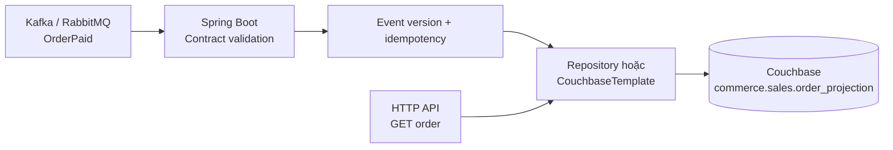
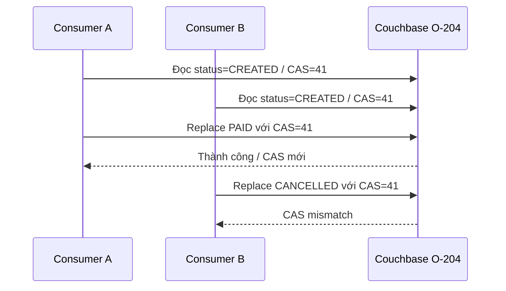
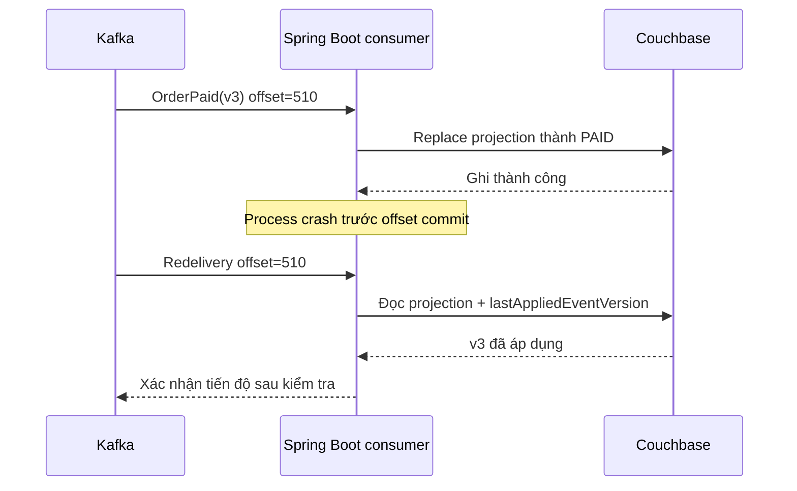

# CouchbaseTemplate, repository và cấu hình kết nối

## 1. Bối cảnh và mục tiêu

Trong mô-đun **SPRING_BOOT_INTEGRATION**, Spring Boot tổ chức các luồng HTTP, SQL, cache, message broker và adapter Spring Integration. Một số luồng cần một kho tài liệu JSON có thể truy cập theo khóa, cập nhật projection từ Kafka/RabbitMQ hoặc phục vụ truy vấn theo trạng thái. **Couchbase** là cơ sở dữ liệu tài liệu hỗ trợ cả thao tác **key-value (KV)** và ngôn ngữ truy vấn **SQL++**.

Spring Data Couchbase cung cấp hai cách tích hợp thường gặp:

- **`CouchbaseRepository`**: khai báo interface theo mô hình repository, có CRUD, lookup theo ID, derived queries và phân trang.
- **`CouchbaseTemplate`**: thao tác tường minh bằng các API insert, replace, upsert, find theo ID và query; phù hợp khi cần thể hiện rõ loại phép ghi và tùy chỉnh operation.

Cả hai đều truy cập Couchbase qua cấu hình của Spring Data. Ví dụ xuyên suốt là dịch vụ `order-projection` nhận sự kiện thanh toán từ Kafka, cập nhật trạng thái đơn hàng và trả dữ liệu cho HTTP API.



Mục tiêu của bài: cấu hình kết nối, tạo entity cho bucket/scope/collection, dùng template và repository đúng ngữ nghĩa, hiểu secondary index và query consistency, xử lý CAS, timeout, retry, giao dịch, bảo mật và kiểm thử tích hợp.

## 2. Các khái niệm Couchbase thiết yếu

| Khái niệm | Vai trò | Ví dụ |
| --- | --- | --- |
| Cluster | Tập node Couchbase, gồm các service như Data, Query, Index tùy triển khai | `cb-prod.example.net` |
| Bucket | Đơn vị lưu trữ và quản trị tài nguyên | `commerce` |
| Scope | Nhóm logic các collection trong bucket | `sales` |
| Collection | Không gian lưu các document và key tương ứng | `order_projection` |
| Document | Nội dung JSON gắn với một document ID duy nhất trong collection | `tenant42::order::O-204` |
| KV | Đọc/ghi theo document ID thông qua Data service | `findById`, insert, replace |
| SQL++ | Truy vấn JSON theo field, filter, sort, join | Tìm các đơn `PAID` theo tenant |
| Secondary index | Cấu trúc index giúp SQL++ tránh scan toàn bộ dữ liệu | Index trên `tenantId` và `status` |
| CAS | Metadata dùng kiểm soát ghi đồng thời | Optimistic locking bằng `@Version` |

Không đồng nhất **document key** với field `orderId` bên trong JSON. Quy ước ví dụ `tenant42::order::O-204` làm khóa ổn định qua retry và giảm va chạm giữa tenant. Không gắn password, email hoặc access token vào key vì ID có thể xuất hiện trong log, trace và báo cáo sự cố.

Một KV lookup biết trước key thường **không cần secondary index**. Ngược lại, truy vấn theo `status` dùng Query/Index service và cần index phù hợp; việc `findById` thành công chưa chứng minh truy vấn SQL++ đã được cấu hình.

## 3. Dependency và cấu hình kết nối trong Spring Boot

Ví dụ giả định **Java 17+, Spring Boot 3.x và Spring Data Couchbase tương ứng theo BOM**. Không nên tự ép phiên bản Couchbase Java SDK khác với nhánh Spring Data mà Boot đã quản lý nếu chưa kiểm thử tính tương thích.

```groovy
dependencies {
    implementation 'org.springframework.boot:spring-boot-starter-data-couchbase'
    implementation 'org.springframework.boot:spring-boot-starter-validation'
    testImplementation 'org.springframework.boot:spring-boot-starter-test'
}
```

Spring Boot dùng cấu hình cluster và bucket qua các property sau:

```yaml
spring:
  couchbase:
    connection-string: ${COUCHBASE_CONNECTION_STRING:couchbase://localhost}
    username: ${COUCHBASE_USERNAME}
    password: ${COUCHBASE_PASSWORD}
  data:
    couchbase:
      bucket-name: commerce
```

| Property | Ý nghĩa |
| --- | --- |
| `spring.couchbase.connection-string` | Seed nodes hoặc endpoint của cluster, ví dụ `couchbase://localhost` trong lab |
| `spring.couchbase.username` | Principal dùng để xác thực Couchbase |
| `spring.couchbase.password` | Bí mật lấy từ secret manager hoặc environment |
| `spring.data.couchbase.bucket-name` | Tên bucket mặc định Spring Data sử dụng |

`couchbase://` trong lab không đại diện cho kết nối production an toàn. Với Couchbase TLS, sử dụng endpoint/connection string `couchbases://...` và cấu hình trust chain/hostname đúng khả năng Couchbase SDK và Spring Boot version đang dùng. Đừng tắt certificate validation chỉ để loại bỏ lỗi handshake.

### Profile theo môi trường

```yaml
# application-prod.yml — ví dụ
spring:
  couchbase:
    connection-string: ${COUCHBASE_CONNECTION_STRING}
    username: ${COUCHBASE_USERNAME}
    password: ${COUCHBASE_PASSWORD}
  data:
    couchbase:
      bucket-name: commerce
```

Local có thể dùng cluster `couchbase://localhost`, account thử nghiệm và bucket riêng; production dùng IAM/secret manager, network policy và TLS. Không hardcode password trong Git, image hoặc diagnostic log. Khi rotate secret, kiểm tra lifecycle của SDK client và rollout/restart nếu cần: thay Secret object không làm mọi kết nối đang sống tự nhận credential mới.

### Những gì Spring Boot không tự tạo

Việc thêm starter và entity Java **không tự cung cấp** tất cả tài nguyên server-side. Trước khi ứng dụng chạy phải có:

1. Cluster hoạt động và địa chỉ các node quảng bá có thể truy cập từ môi trường deploy.
2. Bucket `commerce` cùng scope `sales`, collection `order_projection` nếu dùng mapping phía dưới.
3. Principal có quyền KV và Query đúng bucket/scope/collection, tách khỏi account migration/index.
4. Query service và các secondary index cần thiết cho những query ngoài `findById`.
5. Monitoring, timeout và quy trình cập nhật schema/index trước khi rollout bản mới.

Một tài khoản chỉ có quyền KV có thể đọc document theo ID nhưng không thực hiện SQL++ query. Đừng gán quyền quản trị toàn cluster cho user runtime chỉ để đơn giản hóa bootstrap.

## 4. Ánh xạ Java entity vào document

Ví dụ dùng `@Document` cùng `@Id` để khai báo identity và `@Scope`/`@Collection` để chỉ rõ namespace:

```java
import java.time.Instant;
import org.springframework.data.annotation.Id;
import org.springframework.data.annotation.Version;
import org.springframework.data.couchbase.core.mapping.Collection;
import org.springframework.data.couchbase.core.mapping.Document;
import org.springframework.data.couchbase.core.mapping.Field;
import org.springframework.data.couchbase.core.mapping.Scope;

@Document
@Scope("sales")
@Collection("order_projection")
public class OrderProjection {
    @Id
    private String id;

    @Field
    private String tenantId;

    @Field
    private String orderId;

    @Field
    private String status;

    @Field
    private Instant updatedAt;

    @Version
    private Long version;

    public OrderProjection() {}

    public OrderProjection(String id, String tenantId, String orderId,
                           String status, Instant updatedAt) {
        this.id = id;
        this.tenantId = tenantId;
        this.orderId = orderId;
        this.status = status;
        this.updatedAt = updatedAt;
    }

    public String getId() { return id; }
    public String getTenantId() { return tenantId; }
    public String getOrderId() { return orderId; }
    public String getStatus() { return status; }
    public Instant getUpdatedAt() { return updatedAt; }
    public Long getVersion() { return version; }

    public void setId(String id) { this.id = id; }
    public void setTenantId(String tenantId) { this.tenantId = tenantId; }
    public void setOrderId(String orderId) { this.orderId = orderId; }
    public void setStatus(String status) { this.status = status; }
    public void setUpdatedAt(Instant updatedAt) { this.updatedAt = updatedAt; }
    public void setVersion(Long version) { this.version = version; }
}
```

Giải thích:

- `@Id` ánh xạ **document key**, khác với một field `orderId` trong nội dung JSON.
- `@Field` chỉ trường được ánh xạ; mapper có thể sử dụng quy ước hoặc tên field cụ thể.
- `@Scope` và `@Collection` xác định collection đang dùng; cấu hình server phải có đúng các tên này.
- `@Version` sử dụng CAS cho optimistic locking theo semantics của Spring Data Couchbase. CAS phản ánh biến đổi ở document, **khác** version thứ tự sự kiện nghiệp vụ đến từ Kafka.
- Spring Data có thể ghi thêm metadata xác định kiểu entity; kiểm tra JSON thực tế và index/query sinh ra trước khi tự migration.

Không dùng document entity trực tiếp làm DTO dữ liệu không tin cậy từ HTTP/Kafka. DTO đầu vào có thể chứa `eventId`, `schemaVersion`, `eventVersion` và những field đã validate, còn `tenantId` phải được đối chiếu quyền theo caller/producer.

## 5. Dùng CouchbaseRepository

Spring Data triển khai các method CRUD, `findById` và derived query cho interface:

```java
import org.springframework.data.couchbase.repository.CouchbaseRepository;
import org.springframework.data.domain.Page;
import org.springframework.data.domain.Pageable;

public interface OrderProjectionRepository
        extends CouchbaseRepository<OrderProjection, String> {

    Page<OrderProjection> findByTenantIdAndStatus(
            String tenantId, String status, Pageable pageable);
}
```

Ví dụ service tra cứu theo key:

```java
import java.util.Optional;
import org.springframework.stereotype.Service;

@Service
public class OrderLookupService {
    private final OrderProjectionRepository repository;

    public OrderLookupService(OrderProjectionRepository repository) {
        this.repository = repository;
    }

    public Optional<OrderProjection> find(String tenantId, String orderId) {
        String key = tenantId + "::order::" + orderId;
        return repository.findById(key);
    }
}
```

Repository tạo ra abstraction tiện lợi nhưng không thay business authorization; method `find(...)` minh họa cách tạo key, còn controller/service thật phải kiểm tra `tenantId` đã xác thực. `save` có thể tạo mới hoặc cập nhật, vì thế **đừng coi nó là “insert nếu chưa có”** cho nghiệp vụ yêu cầu không ghi đè.

| Repository operation | Cách thực hiện thường gặp | Secondary index |
| --- | --- | --- |
| `findById(id)` | KV lookup theo ID | Thường không cần |
| `save(entity)` | Ghi theo key | Không cần secondary index để ghi cơ bản |
| `existsById(id)` và `deleteById(id)` | KV theo key | Thường không cần |
| `findByTenantIdAndStatus(...)` | SQL++ Query theo các field | Cần index phù hợp |
| `@Query` tùy chỉnh | SQL++ statement được khai báo | Tùy predicate, sort, index |

Hạn chế `findAll()` trên tập dữ liệu lớn, đặc biệt khi trả về HTTP. Dùng phân trang, tenant filter, giới hạn kích thước kết quả và query timeout. Deep offset pagination cũng có thể chậm: đánh giá keyset hoặc cursor dựa trên truy vấn thực tế.

## 6. Dùng CouchbaseTemplate

`CouchbaseTemplate` phù hợp khi muốn biểu diễn rõ **insert-only**, **replace**, **upsert**, hoặc truy cập theo ID trong một adapter:

```java
import java.util.Optional;
import org.springframework.data.couchbase.core.CouchbaseTemplate;
import org.springframework.stereotype.Service;

@Service
public class OrderDocumentCommands {
    private final CouchbaseTemplate template;

    public OrderDocumentCommands(CouchbaseTemplate template) {
        this.template = template;
    }

    public OrderProjection insertOnly(OrderProjection document) {
        return template.insertById(OrderProjection.class).one(document);
    }

    public Optional<OrderProjection> get(String documentId) {
        return Optional.ofNullable(
                template.findById(OrderProjection.class).one(documentId));
    }

    public OrderProjection replaceExisting(OrderProjection document) {
        return template.replaceById(OrderProjection.class).one(document);
    }

    public OrderProjection upsert(OrderProjection document) {
        return template.upsertById(OrderProjection.class).one(document);
    }
}
```

Mẫu này minh họa fluent operations của Spring Data Couchbase hiện đại; cần xác nhận signature/behavior trên version ứng dụng. Đặc biệt phải thử trực tiếp `@Version`/CAS cho từng phép ghi; **không được mặc định upsert giữ nguyên invariant nghiệp vụ** hoặc không thể ghi đè document người khác vừa sửa.

| Nhu cầu | Ưu tiên |
| --- | --- |
| CRUD thông thường và derived queries | `CouchbaseRepository` |
| Cần insert thất bại khi key đã tồn tại | `CouchbaseTemplate.insertById` |
| Cần replace một document đã đọc và kiểm soát concurrency | Template/SDK + CAS phù hợp |
| Query động với predicate/phân trang đặc thù | Template, custom repository hoặc SQL++ có parameter |
| Increment/sub-document atomic operation đặc thù SDK | Adapter sử dụng Couchbase Java SDK trực tiếp khi cần |

Template và Repository có thể cùng xuất hiện trong dự án; nên đặt chúng sau một **service contract** thống nhất về ID, version, retry và telemetry, tránh mỗi nơi có một quy tắc ghi khác nhau.

## 7. SQL++ query và secondary index

Tìm document bằng `tenantId` và `status` cần Query/Index service. Ví dụ SQL++ chạy trên collection đã định nghĩa:

```sql
SELECT META(o).id AS docId, o.orderId, o.status
FROM `commerce`.`sales`.`order_projection` AS o
WHERE o.tenantId = "tenant42"
  AND o.status = "PAID"
LIMIT 20;
```

Trong ví dụ trên, các tên namespace được bọc bằng *backtick* đúng cú pháp SQL++. Một index minh họa cho predicate này:

```sql
CREATE INDEX ix_order_projection_tenant_status
ON `commerce`.`sales`.`order_projection`(tenantId, status);
```

**Index này là điểm khởi đầu, không phải công thức cho mọi query.** Spring Data có thể bổ sung điều kiện type metadata, phân trang hoặc sort. Cần quan sát câu SQL++ thực tế và dùng `EXPLAIN` để kiểm tra Query optimizer:

```sql
EXPLAIN
SELECT o.orderId, o.status
FROM `commerce`.`sales`.`order_projection` AS o
WHERE o.tenantId = "tenant42"
  AND o.status = "PAID"
LIMIT 20;
```

Khi index chưa sẵn sàng, truy vấn có thể lỗi hoặc chậm. Tạo index, collection và RBAC trong quy trình provisioning/migration, không tự giả định thêm Java entity là server sẽ tự tạo toàn bộ. Đặc biệt:

- **Primary index** tiện cho lab, nhưng truy vấn quét rộng trong production dễ tốn CPU, I/O và thời gian.
- Thứ tự field trong index, filter/sort thực tế và cách lưu `MISSING`/`NULL` ảnh hưởng khả năng tối ưu.
- Cần kiểm tra query plan theo workload, không chỉ xác nhận query trả đúng vài row thử nghiệm.
- Cần hạn chế quyền truy cập Query service, scope/collection, số kết quả và thời gian chạy; không cho client tự chèn cú pháp SQL++ hoặc tên cột tùy ý.
- Query syntax chấp nhận parameter binding cho **giá trị**; danh sách field/sort phải được allowlist ở phía application.

Một lỗi phổ biến là `findById` đọc được dữ liệu nhưng `findByTenantIdAndStatus` lỗi. Đó có thể là **thiếu index, thiếu quyền Query hoặc Query service không hoạt động**, không nhất thiết là mất kết nối toàn cluster.

## 8. Query consistency so với KV lookup

Việc ghi document KV thành công không đồng nghĩa một truy vấn SQL++ sử dụng secondary index sẽ nhìn thấy bản mới ngay tức khắc. Tùy query scan consistency, index có thể cần thời gian để bắt kịp các mutation đã xảy ra.

| Kiểu đọc | Đặc tính | Phù hợp khi |
| --- | --- | --- |
| KV `findById` theo key | Đi qua đường KV, không cần scan index | Cần đọc một document vừa biết ID |
| SQL++ với `NOT_BOUNDED` | Có thể trả kết quả trước khi index bắt kịp mutation mới nhất | Dashboard/listing chấp nhận một mức độ trễ |
| SQL++ với `REQUEST_PLUS` | Chờ index bắt kịp mutation đã hoàn tất trước thời điểm query theo semantics SDK | Cần độ mới của kết quả query tốt hơn |
| SQL++ `AT_PLUS`/mutation state | Chờ những mutation cụ thể được chỉ định hiển thị trên index | Đã giữ mutation tokens và có yêu cầu nhất quán tương ứng |

Không tuyên bố repository **luôn** đọc kết quả mới nhất chỉ vì mọi API dùng cùng `CouchbaseTemplate`. Hãy phân loại use case:

1. `GET /orders/{id}` sau thao tác cập nhật một document: thường có thể ưu tiên đọc KV theo ID.
2. `GET /orders?status=PAID`: query theo secondary index, cần định nghĩa độ trễ chấp nhận được.
3. Báo cáo kiểm toán yêu cầu trạng thái tại một thời điểm nhất định: kiểm soát consistency, đối soát và snapshot theo thiết kế; Query consistency không thay thế toàn bộ logic kiểm toán.

Yêu cầu mạnh hơn về consistency có thể tăng latency và tỷ lệ timeout nếu index lag. Chỉ dùng theo yêu cầu nghiệp vụ và kiểm thử thực tế.

## 9. CAS, optimistic locking và sự kiện đến sai thứ tự

`@Version` trong entity giúp Spring Data sử dụng cơ chế **CAS (compare-and-swap)** của Couchbase để phát hiện document bị thay đổi kể từ lúc đọc. Ví dụ có hai consumer cùng cập nhật một order:



Khi gặp optimistic locking failure, **không retry nguyên object cũ vô hạn**. Cần đọc document hiện tại, kiểm tra lại transition nghiệp vụ và thử ghi theo version/CAS mới nếu phù hợp.

**CAS không phải event version.** Nếu producer phát `OrderUpdated(v3)` trước `OrderUpdated(v2)`, CAS của tài liệu chỉ bảo đảm hai phép ghi không âm thầm ghi đè ở cùng thời điểm; nó **không xác định** event nào mới hơn về nghiệp vụ. Với projection có yêu cầu đúng thứ tự, thêm field như `lastAppliedEventVersion` và kiểm tra:

| Version nhận | Version đã lưu | Cách xử lý gợi ý |
| --- | --- | --- |
| `v3` | `v3` | Duplicate, không áp dụng side effect lần nữa |
| `v2` | `v3` | Event cũ, bỏ qua có ghi nhận hoặc đưa tra soát theo contract |
| `v4` | `v3` | Thường có thể áp dụng nếu transition hợp lệ |
| `v6` | `v3` | Có khoảng trống version; cần chính sách chờ/tải lại state/tra soát |

Khi một update phải dựa trên document hiện tại, sử dụng vòng **read → validate → conditional replace** có giới hạn retries. Nếu nhiều producer tranh ghi cùng key, cân nhắc phân vùng sự kiện theo key và xử lý tuần tự, nhưng vẫn giữ version/CAS để chịu được retry sau crash.

### Vì sao dùng upsert bừa bãi dễ sai?

`upsert` tiện cho một read model có thể ghi đè hoàn toàn từ snapshot đáng tin; nhưng trong một luồng event-driven, upsert một document với status cũ có thể làm lùi trạng thái mới. Cần chính sách:

- `insert` khi chỉ được tạo mới một lần; trùng key phải được nhận diện.
- `replace` với CAS/version guard khi cập nhật từ trạng thái đã đọc.
- `upsert` khi ứng dụng có nguồn chân lý nhất quán và ghi đè là thao tác được phép.
- Khi mutation chỉ tăng counter hoặc thay một vài field theo điều kiện, đánh giá API KV atomic/sub-document hoặc giao dịch phù hợp thay vì read-modify-write không bảo vệ.

## 10. Timeout, retries và kết quả ghi chưa rõ

Lỗi kết nối, failover, Query overload hoặc node chậm có thể gây timeout. Với hệ thống tích hợp, việc retry phải dựa vào **ngữ nghĩa phép ghi**:

| Trường hợp | Nguy cơ | Cách xử lý |
| --- | --- | --- |
| Document không tìm thấy | Key sai, dữ liệu chưa có hoặc đã xóa | Phân loại not found theo hợp đồng; không retry vô hạn |
| Insert báo key đã tồn tại | Trùng event, xử lý cạnh tranh hoặc dữ liệu khác | Đọc đối chiếu key/payload và quyết định duplicate hay conflict |
| CAS mismatch | Writer khác đã thay tài liệu | Đọc lại, đánh giá transition và retry hữu hạn |
| Query index thiếu | Lỗi cấu hình/schema deployment | Sửa index, không tăng số lần retry |
| Authentication/RBAC bị từ chối | Credential hoặc quyền sai | Alert cấu hình, sửa identity/quyền |
| Timeout trước khi chắc chắn thực hiện | Có thể chưa có mutation | Retry nếu operation idempotent, backoff và giới hạn |
| **Ambiguous timeout** | Client không biết mutation đã được server áp dụng hay chưa | **Đọc đối chiếu** bằng key/event ID trước khi ghi lại |

Các loại exception và semantics cụ thể phải kiểm tra theo Couchbase Java SDK đang dùng. Không suy luận từ `TimeoutException` rằng server chưa ghi: đặc biệt ở bước **DB commit thành công nhưng consumer chưa ACK/commit offset**, cùng record sẽ được xử lý lại.

Nếu thao tác tạo ID mới ngẫu nhiên ở mỗi attempt, retry có thể tạo nhiều document. Ưu tiên khóa ổn định theo entity/event, unique business constraint ở nơi phù hợp, và idempotency để bảo vệ những bước gọi HTTP hoặc publish broker.

Số retries, backoff, timeout và circuit breaker nên theo SLO và giới hạn tải. Dừng retry khi lỗi cố định như sai quyền, sai schema hoặc thiếu index; không biến sự cố diện rộng thành hàng nghìn yêu cầu lặp lại mỗi giây.

## 11. Giao dịch và nhất quán với broker

Một phép KV ghi một document có tính nguyên tử theo semantics của operation. Khi cần cập nhật **nhiều document** có ràng buộc chung, cần cân nhắc transaction Couchbase do SDK/framework hỗ trợ, các operation được phép và yêu cầu về durability/consistency. Spring `@Transactional` chỉ có ý nghĩa khi transaction manager tương ứng được cấu hình và lời gọi đi qua Spring-managed transaction context.

**Không suy rằng `@Transactional` của JDBC/JPA tự áp dụng cho Couchbase hoặc kết hợp Couchbase + Kafka + HTTP thành một transaction phân tán.** Một workflow có thể cần transactional outbox, inbox, idempotent consumer hoặc saga tùy yêu cầu.

Xét trường hợp:



Khi đọc lại thấy `v3` đã xử lý, consumer không được tiếp tục phát email/thu tiền lần thứ hai. Nếu còn side effect ngoài Couchbase, cần idempotency key ở hệ thống nhận hoặc state giao hàng riêng. Kafka transaction cho chuỗi Kafka-to-Kafka không tự tạo exactly-once cho Couchbase.

## 12. Bảo mật kết nối và dữ liệu

Couchbase lưu JSON có thể chứa thông tin khách hàng, vì vậy cần:

- Lấy credential từ secret manager hoặc môi trường với quyền hạn tối thiểu; không ghi password trong Git hoặc log.
- Cấp **RBAC theo bucket/scope/collection và operation**; tách account ứng dụng khỏi account tạo index/migration.
- Bật TLS phù hợp và xác minh chứng thư, hostname, CA trust; không dùng chế độ bỏ qua validation để khắc phục sự cố.
- Giới hạn network egress/ingress, truy cập UI quản trị và các port Couchbase theo hạ tầng.
- Kiểm tra `tenantId` theo principal đã xác thực, không tin tenant do client tự gửi.
- Không dùng email/token làm document key hoặc metric label; hạn chế log raw JSON, SQL++ có PII, secret và dữ liệu trả về từ query.
- Thiết kế retention, TTL và quyền đọc snapshot/backup theo mức nhạy cảm và yêu cầu vận hành.

Khi rotate password, việc cập nhật Secret ở môi trường **không chứng minh client SDK đang dùng credential mới**. Cần rollout hoặc refresh lifecycle được hỗ trợ, test tạo kết nối mới, quan sát authentication failures, rồi mới thu hồi credential cũ.

### TTL và giới hạn dữ liệu

Nếu projection chỉ cần tồn tại trong một khoảng thời gian, chọn expiration/TTL với chính sách rõ: default TTL của bucket/collection và TTL từng document có thể tương tác với mutation theo semantics cụ thể. Kiểm thử để tránh update vô tình làm mất TTL hoặc kéo dài retention.

Đừng lưu một document JSON không giới hạn kích thước hay mảng sự kiện vô hạn chỉ vì Couchbase hỗ trợ document. Giới hạn kích thước đầu vào, số field, số phần tử, độ sâu và số lần fan-out để bảo vệ bộ nhớ, Query Index và network.

## 13. Quan sát KV, Query và sức khỏe cluster

Một dashboard tối thiểu nên tách:

| Tín hiệu | Mục tiêu |
| --- | --- |
| KV `get/insert/replace` latency | Biết Data service có đáp ứng SLO không |
| CAS conflict, key exists/not found | Phân biệt tranh chấp, duplicate và lỗi data contract |
| SQL++ query latency, timeouts, scan volume | Phát hiện index thiếu/chưa tối ưu |
| Index state/lag/build progress | Đánh giá độ mới query và readiness |
| SDK connection/authentication/TLS errors | Chẩn đoán network, certificate, credential |
| Node/cluster capacity | Theo dõi CPU, RAM, disk, failover, replica và quota |
| Kafka consumer lag, redelivery, retry/DLT | Liên hệ Couchbase outage với backlog |
| Business event version gaps, duplicates | Phát hiện event out-of-order hoặc ghi đè sai |

Log có cấu trúc nên chứa `eventId`, `documentId` nếu không nhạy cảm, operation, scope/collection, duration, mã lỗi và trace ID. Không gắn payload JSON đầy đủ vào span hay metric label. Khi KV nhanh nhưng SQL++ chậm, kiểm tra `EXPLAIN`, trạng thái index và Query service trước khi tăng thread của application.

## 14. Kiểm thử tích hợp trên Couchbase thực

Mock repository chỉ kiểm tra business logic được mock, không chứng minh mapping, namespace, CAS, query index hoặc scan consistency. Hãy dùng Couchbase trong môi trường thử nghiệm (ví dụ Testcontainers), có **bucket, scope, collection và index** được provision trước test.

```java
import static org.junit.jupiter.api.Assertions.assertEquals;
import static org.junit.jupiter.api.Assertions.assertTrue;
import java.time.Instant;
import java.util.UUID;
import org.junit.jupiter.api.Test;
import org.springframework.beans.factory.annotation.Autowired;
import org.springframework.boot.test.context.SpringBootTest;
import org.springframework.data.couchbase.core.CouchbaseTemplate;

@SpringBootTest
class OrderProjectionCouchbaseIT {
    @Autowired
    CouchbaseTemplate template;

    @Autowired
    OrderProjectionRepository repository;

    @Test
    void insertWithTemplateAndReadWithRepository() {
        String orderId = UUID.randomUUID().toString();
        String key = "test-tenant::order::" + orderId;
        var document = new OrderProjection(
                key, "test-tenant", orderId, "CREATED", Instant.now());

        template.insertById(OrderProjection.class).one(document);

        var found = repository.findById(key);
        assertTrue(found.isPresent());
        assertEquals("CREATED", found.orElseThrow().getStatus());
    }
}
```

Đây là **integration test skeleton** cần test profile và Couchbase fixture thật, không phải test độc lập có thể chạy khi chưa tạo cluster/bucket/scope. Nó kiểm tra template và repository dùng cùng mapping; cần thêm các case:

| Trường hợp | Kết quả cần kiểm tra |
| --- | --- |
| Repository derived query | Query dùng đúng index, tenant filter và pagination |
| Hai writer cùng CAS | Một ghi thành công, ghi cạnh tranh được phát hiện |
| KV write rồi query ngay | Consistency đúng policy, không dựa vào sleep cố định |
| Event v3 rồi v2 | Không ghi lùi trạng thái |
| Crash sau KV write trước commit offset | Redelivery không tạo business side effect trùng |
| Ambiguous timeout | Đọc đối chiếu key/version và retry an toàn |
| Sai RBAC hoặc TLS trust | Bị từ chối rõ ràng, không fallback sang kết nối kém an toàn |
| Query/index unavailable | Phân loại đúng lỗi, có timeout/backoff hữu hạn |

Đợi index sẵn sàng bằng điều kiện thực tế có timeout thay vì `Thread.sleep` cứng. Với lỗi network/crash/failover, thực hành trên môi trường kiểm thử cô lập.

## 15. Những lỗi thường gặp và hướng xử lý

| Triệu chứng | Nguyên nhân cần xem | Kiểm tra |
| --- | --- | --- |
| Cluster connect timeout | DNS, network policy, port, TLS, địa chỉ node công bố | Truy cập topology từ môi trường application |
| Authentication failed | User/password, rotation, secret source | Secret version, user RBAC, kết nối mới |
| Collection không tồn tại | `@Scope`/`@Collection` lệch với resource | Namespace được provision |
| `findById` được nhưng derived query lỗi | Query/Index service hoặc secondary index | Query logs, `EXPLAIN`, index readiness |
| Query trả dữ liệu cũ | Index lag và consistency option | KV get theo ID, consistency của query |
| CAS/optimistic locking failure | Có writer khác đã thay tài liệu | Đọc lại và tính lại transition |
| Timeout dù server đã ghi | Ambiguous mutation outcome | Đọc key + business version/idempotency |
| Giao lại event làm trạng thái lùi | Thiếu event version guard | So sánh lastAppliedEventVersion |
| Query chậm sau khi cache hết hạn | Scan rộng, index sai, limit không có | Explain, scan metrics, bounded result |
| Chỉ production lỗi | RBAC, TLS, bucket, networking, SDK version khác môi trường test | So sánh deployment và health từng dependency |

## 16. Bài thực hành: từ Kafka đến Couchbase

**Đề bài:** consumer nhận `OrderCreated`, `OrderPaid` và `OrderCancelled` từ Kafka, lưu projection ở `commerce.sales.order_projection` và phục vụ hai API: đọc theo ID, liệt kê đơn `PAID` của một tenant.

Yêu cầu:

1. Provision bucket, scope, collection và index; tách credential runtime với credential migration.
2. Cấu hình `spring.couchbase.*` và `spring.data.couchbase.bucket-name` theo profile, lấy secret từ môi trường.
3. Định nghĩa `OrderProjection` có `@Id`, `@Version` và thêm `lastAppliedEventVersion` để chống event cũ.
4. Dùng template insert-only cho sự kiện tạo mới; cập nhật theo CAS/version cho các event tiếp theo.
5. Dùng repository `findById` cho API theo ID, derived query + index cho API danh sách.
6. Cho `OrderPaid(v3)` đến trước `OrderCreated(v2)`: chứng minh không áp dụng trạng thái lỗi thời và có cơ chế xử lý khoảng trống.
7. Giả lập mất tiến trình sau khi Couchbase ghi thành công nhưng trước commit Kafka offset; xác minh redelivery không tạo tác dụng phụ trùng.
8. Đo Query latency/index readiness, KV timeout, CAS conflicts, Kafka lag và duplicate events.
9. Kiểm tra document keys không chứa PII/secret và RBAC/TLS hoạt động.

### Tiêu chí nghiệm thu

| Kiểm chứng | Kỳ vọng |
| --- | --- |
| Bootstrap | Đúng cluster, bucket, scope, collection và quyền |
| KV CRUD | Insert, lookup và replace đúng key/mapping |
| Derived query | Có index phù hợp, giới hạn kết quả và tenant isolation |
| Concurrency | Không silent lost update với CAS |
| Event replay | Không áp dụng business effect hai lần |
| Query consistency | Có policy rõ cho trường hợp cần kết quả mới nhất |
| Timeout | Có đối chiếu khi outcome không rõ, retry có giới hạn |
| Monitoring | Phân biệt KV, Query, Index, auth và consumer lag |

## 17. Các lỗi thiết kế cần tránh

1. Tưởng `findById` chạy được thì mọi query đều không cần index.
2. Dùng `findAll` trên dữ liệu lớn và lọc bằng Java.
3. Dùng `upsert` cho mọi mutation mà không có CAS hoặc business version.
4. Retry timeout của lệnh ghi mà không xác minh outcome.
5. Đưa email, password hoặc token vào document key và log.
6. Truyền tên bucket/scope/collection tùy ý từ request user vào query.
7. Tin rằng `@Transactional` SQL/JPA bao phủ Couchbase, Kafka và HTTP.
8. Bỏ qua eventual consistency của secondary index khi cần read-your-own-write.
9. Đặt quyền tạo/xóa index vào account runtime thay vì pipeline triển khai.
10. Đổi secret ở secret manager nhưng không xác minh client mới đã dùng nó.
11. Dùng Couchbase entity làm HTTP input DTO khiến client sửa field nội bộ.
12. Không kiểm tra version Spring Boot/Spring Data/SDK trước khi cấu hình API template hoặc transactions.

## 18. Câu hỏi tự kiểm tra

1. `CouchbaseTemplate` và `CouchbaseRepository` khác nhau về abstraction như thế nào?
2. Tại sao `findById` thường không cần secondary index nhưng `findByTenantIdAndStatus` cần?
3. Bucket, scope và collection ảnh hưởng đến cấu hình Spring Data ra sao?
4. CAS từ `@Version` có thay thế `eventVersion` khi Kafka giao event sai thứ tự không?
5. Sau KV write, tại sao SQL++ query có thể chưa thấy dữ liệu mới?
6. Làm sao chứng minh cùng một record Kafka được giao hai lần nhưng projection chỉ áp dụng một lần?
7. Khi mutation timeout, vì sao không thể kết luận Couchbase chưa ghi?
8. Với service cần nhiều document thay đổi đồng thời, vì sao phải kiểm tra transaction manager và những operation được hỗ trợ?
9. Sự khác nhau giữa quyền KV, Query và quyền index/migration là gì?
10. Để kiểm thử repository query và optimistic locking, vì sao chỉ mock interface là chưa đủ?

## Tổng kết

Trong **SPRING_BOOT_INTEGRATION**, Spring Data Couchbase kết nối hệ thống Spring Boot với cơ sở dữ liệu document qua **`CouchbaseTemplate`** và **`CouchbaseRepository`**. Cấu hình `spring.couchbase.*` xác định cluster và credential, `spring.data.couchbase.bucket-name` chọn bucket, còn `@Scope`/`@Collection` gắn entity với namespace. KV theo ID và SQL++ theo field khác nhau về index, latency và độ mới dữ liệu. Khi triển khai luồng HTTP/broker thật, phải kiểm soát CAS, business event version, idempotency sau redelivery, timeout có thể đã ghi, transaction boundary, TLS/RBAC, query plan và test tích hợp trên Couchbase thật.

### Tài liệu tham khảo

- [Spring Boot Reference — NoSQL / Couchbase](https://docs.spring.io/spring-boot/reference/data/nosql.html)
- [Spring Data Couchbase Reference](https://docs.spring.io/spring-data/couchbase/reference/)
- [Couchbase Java SDK Documentation](https://docs.couchbase.com/java-sdk/current/hello-world/start-using-sdk.html)
- [Couchbase SQL++ — CREATE INDEX](https://docs.couchbase.com/server/current/n1ql/n1ql-language-reference/createindex.html)
