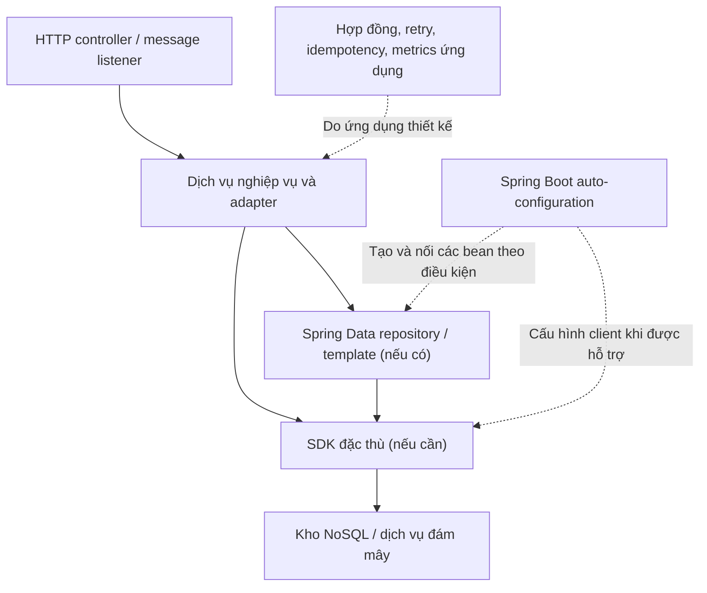
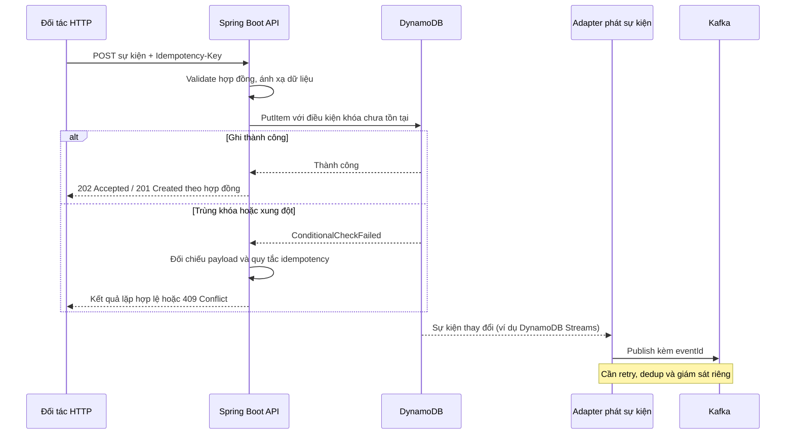

# Phân biệt tính năng do Boot tự cấu hình với phần do nhà cung cấp bổ sung

## 1. Vì sao cần phân biệt?

Khi tích hợp một kho NoSQL vào ứng dụng **Spring Boot**, việc thêm một starter và khai báo vài thuộc tính thường đủ để ứng dụng có một client, template hoặc repository hoạt động. Điều đó dễ tạo ra ngộ nhận rằng Spring Boot cũng chịu trách nhiệm về mọi khả năng của kho dữ liệu: tạo bảng hoặc bucket, thiết lập chỉ mục, quản lý phân vùng, bảo đảm giao dịch, xử lý lỗi mạng, bảo mật và theo dõi hiệu năng.

Trong thực tế, các trách nhiệm này nằm ở những lớp khác nhau. Với module **SPRING_BOOT_INTEGRATION**, sự phân biệt đặc biệt quan trọng vì một luồng tích hợp có thể đồng thời nhận HTTP, ghi NoSQL, dùng cache, phát sự kiện qua broker và gọi adapter của hệ thống khác. Cấu hình khởi động thành công **không** đồng nghĩa toàn bộ luồng có hợp đồng dữ liệu đúng, xử lý trùng lặp an toàn hay bảo đảm nhất quán.

Sau bài này, người học có thể:

- Nhận diện phần nào thuộc cơ chế *auto-configuration* của Boot; phần nào do Spring Data, driver/SDK, nhà cung cấp dịch vụ và mã nghiệp vụ đảm nhiệm.
- Quyết định khi nào nên dùng starter chính thức và khi nào phải tự khai báo bean cho SDK hoặc sử dụng starter của bên thứ ba.
- Kiểm chứng cấu hình thực sự được áp dụng, thiết kế xử lý lỗi, giao dịch, idempotency, kiểm thử và quan sát cho một luồng tích hợp NoSQL.

## 2. Năm lớp trách nhiệm trong một tích hợp NoSQL

| Lớp | Trách nhiệm chính | Không nên mặc định suy ra |
|---|---|---|
| **Spring Boot auto-configuration** | Dựa vào dependency, thuộc tính và các điều kiện để tạo/cấu hình một số bean: client, connection factory, template, repository infrastructure, health indicator hoặc metrics khi được hỗ trợ. | Boot tự tạo database, index, bảng, bucket, cluster; tự bảo đảm tính đúng đắn của truy vấn và giao dịch. |
| **Spring Data** (nếu kho có module tương ứng) | Mapping object ↔ document/record, repository abstraction, template và tích hợp transaction trong phạm vi kho có hỗ trợ. | Các kho NoSQL có cùng mô hình truy vấn, cùng khả năng transaction hoặc cùng mức nhất quán. |
| **Driver/SDK của nhà cung cấp** | Thực hiện giao thức kết nối, gửi lệnh, xác thực theo cơ chế hỗ trợ, cung cấp API đặc thù như conditional write, bulk API, durability, query options. | SDK tự hiểu hợp đồng API, chủ động chống trùng sự kiện hoặc biết cách phối hợp với mọi hệ thống khác. |
| **Dịch vụ/cluster NoSQL** | Lưu dữ liệu, thực thi replication, phân vùng, index, TTL, backup, quota, policy truy cập và các giới hạn theo engine/dịch vụ. | Thêm dependency hoặc thay đổi `application.yml` sẽ tự provision tài nguyên hạ tầng. |
| **Ứng dụng và quy trình vận hành** | Thiết kế data contract, khóa định danh, tính idempotent, retry, timeout, giao dịch xuyên hệ thống, migration, kiểm thử và cảnh báo. | Những vấn đề trên được xử lý hoàn toàn bởi tên starter hoặc annotation của repository. |

Có thể hình dung luồng phụ thuộc như sau:



**Điểm phân định:** Boot là lớp **ghép nối cấu hình**; Spring Data là lớp **trừu tượng truy cập dữ liệu**; SDK và dịch vụ cung cấp **năng lực cụ thể của hệ quản trị**. Một ứng dụng có thể dùng cả ba lớp, chỉ dùng SDK, hoặc kết hợp chúng theo từng thao tác.

## 3. Boot thực sự tự cấu hình những gì?

Auto-configuration được quyết định bởi các điều kiện, không chỉ bởi sự xuất hiện của từ “NoSQL” trong dự án:

1. **Classpath:** Có dependency và các loại client cần thiết hay không? Chẳng hạn, starter Spring Data Redis thường đưa vào driver và phần tích hợp cần cho `RedisConnectionFactory`.
2. **Properties:** Có cấu hình kết nối, credential, database/bucket, timeout… phù hợp với *phiên bản Boot đang sử dụng* hay không?
3. **Các bean sẵn có:** Nhiều auto-configuration dùng cơ chế như `@ConditionalOnMissingBean` để nhường quyền cho bean do ứng dụng khai báo; không được giả định mọi bean đều có cơ chế này.
4. **Điều kiện bổ sung:** Có module Spring Data, Actuator, Micrometer, cấu hình bật/tắt hoặc bean phụ trợ phù hợp hay không?

Khi các điều kiện khớp, Boot **có thể** cung cấp connection factory/client, template, repository infrastructure và những tích hợp vận hành tương ứng. Phạm vi chính xác phải kiểm tra trên tài liệu và dependency của **phiên bản đang chạy**; các tên bean và module có thể thay đổi giữa các phiên bản.

Ví dụ thường gặp:

| Kho dữ liệu | Phần thường được Boot/Spring Data hỗ trợ khi dùng đúng starter | Phần vẫn thuộc driver, nhà cung cấp hoặc ứng dụng |
|---|---|---|
| **Redis** | Kết nối Redis, `RedisTemplate`, `StringRedisTemplate`, repository support nếu cấu hình tương ứng. | Chiến lược key, TTL, eviction, Redis Cluster/Sentinel thực tế, Lua/script, stream consumer semantics, chống cache stampede. |
| **Couchbase** | Cấu hình kết nối cluster và hỗ trợ `CouchbaseTemplate`/repository qua Spring Data Couchbase. | Tạo bucket/scope/collection, index truy vấn, durability và sub-document operations đặc thù, cấu hình cụm. |
| **Cassandra** | `CqlSession` và lớp truy cập của Spring Data Cassandra nếu dependency phù hợp. | Tạo keyspace, partition key, compaction, consistency level, topology, mô hình truy vấn theo partition. |
| **Neo4j** | Driver và Spring Data Neo4j repository/transaction infrastructure khi điều kiện phù hợp. | Cypher chuyên sâu, index/constraint, routing, đặc tính của cluster và kế hoạch truy vấn. |
| **Elasticsearch** | Client và Spring Data Elasticsearch abstraction tương ứng với phiên bản thư viện. | Index template, analyzer, mapping, lifecycle policy, shard/replica, phiên bản API của server. |
| **Amazon DynamoDB** | **Spring Boot core không mặc định cung cấp auto-configuration dành riêng cho DynamoDB** chỉ vì thêm AWS SDK. Có thể dùng cấu hình tự viết hoặc starter tích hợp riêng của bên khác. | AWS SDK/Enhanced Client, IAM, table, key schema, conditional writes, stream, TTL, capacity mode, chính sách retry. |

**Lưu ý:** Bảng mô tả ranh giới chức năng, không cam kết một starter luôn tạo mọi bean được liệt kê. Ví dụ, repository cần module Spring Data tương ứng; health indicator thường còn phụ thuộc Actuator. Tính năng của một *third-party starter* phải được phân biệt với tính năng thuộc **Spring Boot core**.

## 4. Ví dụ A — Một kho có hỗ trợ auto-configuration: Couchbase

Giả sử dịch vụ HTTP lưu bản đọc (read model) của đơn hàng vào Couchbase. Nếu dùng Spring Data Couchbase, ta có thể bắt đầu bằng starter:

```kotlin
dependencies {
    implementation("org.springframework.boot:spring-boot-starter-data-couchbase")
}
```

Một cấu hình minh họa cho ứng dụng sử dụng nhóm thuộc tính phổ biến trong Spring Boot 3.x:

```yaml
spring:
  couchbase:
    connection-string: ${COUCHBASE_CONNECTION_STRING}
    username: ${COUCHBASE_USERNAME}
    password: ${COUCHBASE_PASSWORD}
  data:
    couchbase:
      bucket-name: ${COUCHBASE_BUCKET}
```

Với classpath và cấu hình hợp lệ, Boot/Spring Data đảm nhiệm phần xây dựng các đối tượng truy cập Couchbase được hỗ trợ. Developer có thể viết repository, ví dụ:

```java
// OrderReadModel là entity Couchbase do ứng dụng tự định nghĩa và ánh xạ.
public interface OrderReadModelRepository
        extends CouchbaseRepository<OrderReadModel, String> {
}
```

**Những việc cấu hình trên chưa làm:**

- Không tạo cluster, bucket, scope/collection hoặc index truy vấn trên môi trường Couchbase.
- Không xác định document key có chống đụng độ hay không; không lựa chọn consistency/durability phù hợp cho nghiệp vụ.
- Không tự chọn timeout, retry hoặc chính sách xử lý khi kết nối chập chờn; mặc định của client cần được kiểm tra dưới tải thực tế.
- Không bảo đảm phép ghi Couchbase và việc phát sự kiện sang Kafka là một giao dịch nguyên tử.

Nếu cần sub-document API hoặc lựa chọn durability cụ thể của Couchbase SDK, ứng dụng dùng API của SDK hoặc phần mở rộng mà Spring Data cho phép; **starter không biến mọi tính năng của Couchbase thành annotation chung của Spring Data**. Index và tài nguyên của cluster nên được quản lý bằng quy trình triển khai/migration có kiểm soát.

## 5. Ví dụ B — Kho yêu cầu tích hợp SDK: DynamoDB

Với DynamoDB, chỉ thêm SDK AWS v2 không làm Spring Boot core tự tạo `DynamoDbClient`. Ứng dụng cần một cấu hình bean rõ ràng, hoặc một thư viện auto-configuration riêng được đánh giá và chọn chủ động.

```kotlin
dependencies {
    implementation("software.amazon.awssdk:dynamodb")
}
```

Phiên bản AWS SDK nên được quản lý bằng BOM hoặc ràng buộc dependency nhất quán. Cấu hình minh họa:

```yaml
integration:
  dynamodb:
    region: ${AWS_REGION:ap-southeast-1}
```

```java
import org.springframework.beans.factory.annotation.Value;
import org.springframework.context.annotation.Bean;
import org.springframework.context.annotation.Configuration;
import software.amazon.awssdk.auth.credentials.DefaultCredentialsProvider;
import software.amazon.awssdk.regions.Region;
import software.amazon.awssdk.services.dynamodb.DynamoDbClient;

@Configuration(proxyBeanMethods = false)
class DynamoDbConfiguration {
    @Bean(destroyMethod = "close")
    DynamoDbClient dynamoDbClient(
            @Value("${integration.dynamodb.region}") String region) {
        return DynamoDbClient.builder()
                .region(Region.of(region))
                .credentialsProvider(DefaultCredentialsProvider.create())
                .build();
    }
}
```

Ở đây **Spring** quản lý vòng đời bean do ta khai báo, còn **AWS SDK** thực hiện kết nối, ký request, xác thực qua credential provider chain và cung cấp API DynamoDB. Quyền IAM, bảng, key schema và khả năng truy cập endpoint vẫn phải được chuẩn bị ngoài ứng dụng. Trên môi trường thực, ưu tiên danh tính workload/role hoặc cơ chế cấp quyền phù hợp thay cho hard-code access key.

Một khả năng **thuộc DynamoDB**, không do Boot sinh ra, là ghi có điều kiện để tránh tạo trùng bản ghi:

```java
import java.util.Map;
import software.amazon.awssdk.services.dynamodb.model.AttributeValue;
import software.amazon.awssdk.services.dynamodb.model.PutItemRequest;
import software.amazon.awssdk.services.dynamodb.model.ConditionalCheckFailedException;

void recordOnce(DynamoDbClient client, String eventId, String payload) {
    try {
        client.putItem(PutItemRequest.builder()
                .tableName("integration_events")
                .item(Map.of(
                        "pk", AttributeValue.builder().s(eventId).build(),
                        "payload", AttributeValue.builder().s(payload).build()))
                .conditionExpression("attribute_not_exists(pk)")
                .build());
    } catch (ConditionalCheckFailedException duplicate) {
        // Kiểm tra bản ghi hiện có và quy tắc idempotency trước khi
        // quyết định xem đây là yêu cầu lặp hợp lệ hay một xung đột.
        throw duplicate;
    }
}
```

Ví dụ giả định bảng `integration_events` đã tồn tại và có partition key chuỗi tên `pk`. `attribute_not_exists(pk)` là điều kiện phía DynamoDB; Boot không suy luận điều kiện này từ tên repository hoặc khóa HTTP. Đoạn bắt exception cố ý **không tự coi mọi lỗi điều kiện là thành công**: cùng `eventId` nhưng payload khác nhau có thể là xung đột dữ liệu cần trả về lỗi nghiệp vụ.

Nếu sử dụng *DynamoDB Enhanced Client* để ánh xạ object, đó vẫn là thư viện AWS SDK. Một starter khác có thể tự tạo client hoặc mapper, nhưng phải xác định rõ ai cung cấp bean, nó dùng credential nào, và có trùng bean với cấu hình thủ công hay không.

## 6. Bảng phân quyền chức năng khi thiết kế tích hợp

| Câu hỏi kỹ thuật | Boot / Spring Data giúp gì? | Ai phải chịu trách nhiệm cuối cùng? |
|---|---|---|
| **Kết nối & cấu hình** | Bind properties, tạo bean khi có hỗ trợ, dùng lifecycle của Spring, áp dụng cấu hình người dùng cung cấp. | Ứng dụng chọn endpoint/region, TLS, quyền truy cập; nhà cung cấp phục vụ và bảo vệ endpoint. |
| **Data contract & serialization** | Có thể mapping object sang document/record bằng converter của Spring Data. | Ứng dụng quản lý schema evolution, field bắt buộc, tương thích producer/consumer, cách xử lý dữ liệu cũ. |
| **Chỉ mục và mô hình truy vấn** | Cung cấp API truy vấn, mapping metadata, một số tùy chọn schema tùy module. | Đội phát triển và vận hành thiết kế khóa, index, shard/partition, migration. |
| **Transaction** | Có thể cấu hình transaction manager cho kho hỗ trợ và trong phạm vi transaction thật sự được driver/server cung cấp. | Ứng dụng quyết định ranh giới giao dịch; không suy ra transaction xuyên Redis/Couchbase/DynamoDB/Kafka. |
| **Retry & timeout** | Có thể cấu hình các thuộc tính client được expose; có thể tích hợp thư viện retry/circuit breaker riêng. | Driver định nghĩa lỗi và retry nội tại; ứng dụng chỉ retry thao tác an toàn, có backoff, deadline và idempotency. |
| **Xử lý trùng lặp** | Repository có thể giúp truy vấn/ghi; không tự mang ý nghĩa idempotency của nghiệp vụ. | Ứng dụng chọn idempotency key, ràng buộc duy nhất/conditional write và chính sách khi payload xung đột. |
| **Quan sát** | Actuator, Micrometer và health/metrics cho những integration được hỗ trợ khi có dependency và cấu hình thích hợp. | Ứng dụng thêm metrics theo nghiệp vụ; dịch vụ/vendor cung cấp metrics vận hành cluster; cần theo dõi cả hai. |
| **Bảo mật & vòng đời bí mật** | Đưa các property hoặc custom bean vào môi trường runtime. | Đơn vị vận hành quản lý secret, role, network, rotation, IAM/ACL, phân tách quyền; tránh log credential. |

Điểm dễ nhầm: tính năng nằm ở **Spring Data** không nhất thiết là do **Boot** viết. Chẳng hạn, `CouchbaseRepository` thuộc Spring Data Couchbase; Boot có thể tự ghép các thành phần để repository được tạo. Tương tự, cơ chế retry có sẵn trong driver không đồng nghĩa ứng dụng được phép gửi lại một lệnh ghi không idempotent mà không kiểm tra.

## 7. Tình huống thực tế: HTTP → DynamoDB → broker thông điệp

Giả sử một adapter nhận `POST /integrations/order-events`, lưu sự kiện vào DynamoDB rồi phát thông tin cho các hệ thống downstream qua Kafka. Luồng này minh họa ranh giới trong **SPRING_BOOT_INTEGRATION**:



Trong thiết kế này:

1. **Boot** khởi tạo web server, binding HTTP, lifecycle của bean tự khai báo và có thể cấu hình các thành phần Kafka khi dependency tương ứng hiện diện.
2. **AWS SDK và DynamoDB** thực thi conditional write; nếu dùng DynamoDB Streams thì dịch vụ và adapter/SDK chịu trách nhiệm lấy thay đổi từ stream.
3. **Ứng dụng** chuẩn hóa payload, gắn khóa idempotency, ánh xạ lỗi sang response nhất quán, giám sát độ trễ, retry và chống phát sự kiện trùng.

Việc ghi DynamoDB rồi gửi Kafka trực tiếp từ một request **không tự có tính nguyên tử**. Nếu tiến trình chết giữa hai thao tác sẽ có dữ liệu đã ghi nhưng chưa có thông điệp. Tùy yêu cầu, có thể dùng luồng thay đổi như DynamoDB Streams để phát sự kiện sau khi ghi, hoặc một cơ chế outbox phù hợp với kho lưu trữ. Kể cả khi dùng stream, consumer cần chịu được việc nhận lại hoặc xử lý lặp; phải kiểm tra giới hạn thứ tự, lưu giữ và phân phối thực tế của dịch vụ.

Đối với cache Redis được dùng để tăng tốc truy vấn, Boot có thể cấu hình client nhưng **chiến lược invalidation** và quy tắc tránh trả dữ liệu cũ vẫn thuộc ứng dụng. Không dùng trạng thái cache làm bằng chứng một giao dịch nhiều hệ thống đã hoàn tất.

## 8. Cách kiểm chứng phần nào đang được Boot tự cấu hình

Không nên đoán dựa trên tên dependency. Thực hiện chuỗi kiểm tra sau với đúng phiên bản Boot và đúng profile triển khai:

1. **Kiểm tra dependency thực tế:** xem dependency tree; tìm starter chính thức, Spring Data module, driver, AWS SDK hoặc starter của bên thứ ba. Một SDK đơn lẻ không bảo đảm có Boot auto-configuration.
2. **Đối chiếu cấu hình được hỗ trợ:** tìm property metadata và tài liệu cho phiên bản đang sử dụng, tránh chép ví dụ từ bản cũ rồi mặc định chúng còn hiệu lực.
3. **Xem condition report:** chạy ứng dụng với `--debug` trong môi trường phát triển để xem các auto-configuration khớp/không khớp và nguyên nhân. Nếu dùng Actuator, endpoint `/actuator/conditions` có thể cung cấp thông tin tương tự khi được cài, bật và cấp quyền thích hợp.
4. **Quan sát bean thực tế:** kiểm tra trong `ApplicationContext` có client/template/repository nào, bean xuất phát từ auto-configuration hay từ `@Configuration` tự viết; xác định trường hợp bean người dùng khiến auto-configuration lùi lại.
5. **Xác thực trên kho chạy thật:** kết nối thành công chưa chứng minh quyền ghi, index, consistency hay khả năng phục hồi khi timeout. Thực hiện phép ghi/đọc có kiểm soát và kiểm chứng failure path.

Ví dụ đối với DynamoDB, nếu context có `DynamoDbClient` nhưng bean được khai báo trong `DynamoDbConfiguration` ở phần trên, đó là **bean do ứng dụng cấu hình**, không phải bằng chứng rằng Boot core tự cấu hình DynamoDB. Ngược lại, với Couchbase có starter tương ứng, client/template được Boot/Spring Data thiết lập theo điều kiện cụ thể; vẫn phải kiểm tra có bean nào bị ghi đè hay thiếu thuộc tính.

## 9. Kiểm thử và quan sát cho luồng tích hợp

Một luồng NoSQL đạt yêu cầu cần kiểm tra ngoài việc “ứng dụng khởi động không lỗi”.

| Loại kiểm thử | Kiểm tra tối thiểu | Lỗi thường bị bỏ sót |
|---|---|---|
| **Unit test** cho adapter/logic | Mapping request → document, validation, xử lý duplicate key, exception mapping, quyết định retry. | Nuốt mọi lỗi điều kiện thành “đã xử lý”, làm mất xung đột thật. |
| **Integration test** với datastore | Khởi tạo bean bằng cấu hình gần thực tế; ghi/đọc; index cần thiết; codec/serialization; timeout và rollback trong phạm vi hỗ trợ. Có thể dùng Testcontainers khi phù hợp. | Unit mock pass nhưng lệnh thực hoặc index truy vấn không tồn tại. |
| **Contract test** | Tương thích JSON/field, version, semantics của HTTP status, idempotency key và sự kiện phát ra. | Producer thêm field hoặc đổi kiểu khiến consumer hiểu sai. |
| **Failure test** | Mạng chập chờn, hết quota, permission denied, timeout sau khi server đã nhận ghi, retry/trùng sự kiện, broker không sẵn sàng. | Retry gây ghi trùng; mất sự kiện vì “dual write”. |
| **Operational check** | Health/readiness, connection pool, p95/p99 latency, tỷ lệ timeout/throttle, retry count, lag của stream/consumer, DLQ, số bản ghi xung đột. | Health endpoint trả UP nhưng một luồng nghiệp vụ vẫn tắc. |

Về telemetry, cần tách rõ:

- **Tín hiệu ứng dụng:** số request thành công/thất bại theo loại lỗi, số duplicate hợp lệ và conflict, thời gian từ nhận HTTP tới lưu và tới khi sự kiện được phát, độ dài backlog.
- **Tín hiệu client/driver:** thời gian gọi SDK, số connection, timeout, throttling, retry và lỗi xác thực nếu client expose.
- **Tín hiệu dịch vụ:** CPU/memory hoặc capacity, độ trễ server, index/replica health, tỷ lệ throttle và trạng thái stream từ công cụ giám sát của nhà cung cấp.

Không log token, access key hoặc toàn bộ payload nhạy cảm. Dùng correlation ID, event ID và trace context để nối các chặng HTTP, NoSQL, cache, broker và adapter mà không đưa thông tin bí mật vào log.

## 10. Các nhầm lẫn thường gặp và cách xử lý

| Nhầm lẫn | Hệ quả | Cách làm đúng |
|---|---|---|
| “Đã thêm starter, Boot sẽ tạo hết schema/index.” | Truy vấn lỗi hoặc chậm khi đưa lên môi trường mới. | Quản lý provisioning và migration bằng quy trình hạ tầng riêng; kiểm tra index trước khi mở traffic. |
| “Có `@Repository` nghĩa là mọi datastore đều có transaction như RDBMS.” | Chỉ một phần dữ liệu được ghi khi luồng nhiều kho/broker thất bại. | Xác định transaction support của datastore và ranh giới thực tế; thiết kế outbox/stream, idempotency hoặc bù trừ phù hợp. |
| “Có AWS SDK nghĩa là có Boot starter chính thức.” | Bean `DynamoDbClient` không tồn tại khi inject. | Khai báo bean thủ công hoặc chọn rõ integration/starter bổ sung; kiểm tra condition report. |
| “Driver có retry nên cứ retry tất cả thao tác.” | Ghi trùng hoặc thứ tự sự kiện không đúng. | Phân loại lỗi; chỉ retry khi an toàn; dùng conditional write/idempotency key và backoff với giới hạn. |
| “Health UP nghĩa là hệ thống tích hợp khỏe.” | Luồng không phát được thông điệp dù datastore kết nối được. | Theo dõi từng chặng và chỉ số end-to-end như backlog, lag, DLQ, kết quả giao dịch nghiệp vụ. |
| “Cloud service có TTL thì bản ghi hết hạn biến mất ngay.” | Đọc thấy dữ liệu đã quá hạn trong một khoảng thời gian. | Kiểm tra semantics TTL của từng dịch vụ; áp dụng kiểm tra thời hạn ở ứng dụng nếu cần hiệu lực tức thời. |

## 11. Checklist trước khi đưa một NoSQL adapter vào production

- [ ] Đã xác định **cái gì do Boot core, Spring Data, SDK, third-party starter và dịch vụ NoSQL** cung cấp; có tài liệu theo đúng phiên bản.
- [ ] Đã kiểm tra bean và auto-configuration conditions theo profile triển khai, bao gồm các custom bean.
- [ ] Đã chuẩn bị bảng/bucket/keyspace, index, quyền truy cập, TLS, secret và quy trình migration/provisioning.
- [ ] Đã chốt schema và hợp đồng tương thích, khóa phân vùng/tài liệu, consistency và transaction boundary.
- [ ] Đã định nghĩa timeout, retry có giới hạn, idempotency và cách phân biệt duplicate hợp lệ với conflict.
- [ ] Đã thử lỗi mất kết nối, timeout không rõ kết quả, thiếu quyền, throttle, broker chậm hoặc không sẵn sàng.
- [ ] Đã có integration/contract test và metric, trace, log, alert cho cả client và luồng end-to-end.

**Ghi nhớ:** Boot giúp khởi tạo và nối đúng các thành phần mà nó hỗ trợ theo điều kiện; Spring Data cung cấp cách truy cập dữ liệu; nhà cung cấp đưa ra tính năng và ràng buộc của NoSQL; ứng dụng vẫn phải thiết kế tính đúng đắn của luồng tích hợp, đặc biệt ở những chỗ có giao dịch, lỗi mạng và xử lý trùng lặp.
