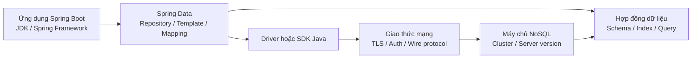

# Kiểm tra tương thích driver, máy chủ và Spring Data khi nâng phiên bản

Trong một ứng dụng Spring Boot tích hợp nhiều hệ thống, nâng phiên bản thư viện không chỉ là thay một số trong `pom.xml` hoặc `build.gradle`. Ví dụ, ứng dụng vẫn biên dịch sau khi cập nhật Spring Boot nhưng không kết nối được cụm Cassandra; hoặc kết nối Couchbase thành công nhưng truy vấn dùng scope/collection không chạy; hoặc Spring Data Elasticsearch khởi động được nhưng ánh xạ chỉ mục và câu truy vấn thay đổi hành vi. Những lỗi này thường chỉ xuất hiện khi ứng dụng thực sự giao tiếp với máy chủ.

Bài học thuộc chương **Các kho NoSQL khác** của module **SPRING_BOOT_INTEGRATION**. Trong bối cảnh tích hợp HTTP client, cơ sở dữ liệu, cache, broker thông điệp và các adapter của Spring Integration, việc kiểm tra tương thích phải bao phủ **cấu hình kết nối, hợp đồng dữ liệu, giao dịch, xử lý lỗi, chống xử lý trùng lặp, kiểm thử và quan sát vận hành**. Mục tiêu là có bằng chứng rằng phiên bản mới vẫn thực hiện đúng luồng nghiệp vụ, kể cả khi triển khai lần lượt nhiều phiên bản ứng dụng và máy chủ.

## 1. Tương thích là quan hệ giữa nhiều tầng



| Tầng cần xét | Câu hỏi phải trả lời | Ví dụ lỗi khi bỏ qua |
| --- | --- | --- |
| JDK, Spring Boot, Spring Framework | Bản đích có yêu cầu Java và Spring Framework tối thiểu nào? | Khởi động lỗi vì API hoặc phiên bản Java không phù hợp. |
| Spring Data module và release train | `spring-data-cassandra`, `spring-data-couchbase`, `spring-data-neo4j`… có cùng nhóm phiên bản được kiểm thử không? | `NoSuchMethodError`, không tạo được bean, thay đổi repository/mapping. |
| Driver/SDK và dependency bắc cầu | Driver thực sự nằm trong `runtimeClasspath` là bản nào? Có phiên bản bị ép hoặc trùng không? | Lỗi liên kết nhị phân, codec, serializer hoặc cấu hình driver. |
| Giao thức và bảo mật | Driver có hỗ trợ giao thức, cơ chế xác thực, TLS và chế độ cluster của server không? | Handshake, xác thực, SSL hoặc khám phá node thất bại. |
| Server và tính năng | Bản server đích có hỗ trợ câu lệnh, tính năng, topology và đường nâng cấp mong muốn không? | Lệnh hoặc truy vấn bị từ chối dù kết nối thành công. |
| Dữ liệu và hành vi ứng dụng | Schema, index, kiểu dữ liệu, TTL, phân trang, concurrency và retry còn giữ đúng hợp đồng không? | Đọc sai dữ liệu, ghi trùng, mất cập nhật, tăng độ trễ. |

**Phân biệt ba khái niệm:** *biên dịch được* chỉ chứng minh API sử dụng tại thời điểm build có mặt; *kết nối được* chỉ chứng minh một phần của giao thức, mạng và xác thực; *tương thích nghiệp vụ* đòi hỏi thử các thao tác đọc/ghi, mapping, truy vấn, lỗi và luồng tích hợp thực tế. Không suy diễn từ một kết quả sang hai kết quả còn lại.

Một bảng tương thích chính thức cũng phải được đọc đúng ngữ cảnh: phiên bản được dự án dùng để xây dựng/kiểm thử không mặc nhiên là tuyên bố hỗ trợ mọi phiên bản server mới hơn. Phạm vi hỗ trợ, lịch bảo trì và các giới hạn theo major version phải được xác nhận từ tài liệu của **đúng phiên bản** Spring Data, driver và nhà cung cấp server.

## 2. Chốt bộ phiên bản thật trước khi nâng cấp

Trước khi sửa dependency, lập một bản ghi hiện trạng (*baseline*) và bộ phiên bản mục tiêu (*target*) cho từng môi trường.

| Thành phần | Baseline cần ghi nhận | Target cần xác minh |
| --- | --- | --- |
| Runtime | Java, Spring Boot, Spring Framework | Yêu cầu tối thiểu và thay đổi cấu hình khi nâng major. |
| Spring Data | Release train, module và phiên bản Spring Data Commons | Release train do Boot quản lý; tài liệu migration tương ứng. |
| Driver/SDK | Tọa độ artifact và phiên bản được giải quyết thực tế | Phạm vi hỗ trợ server, breaking changes, dependency bắc cầu. |
| Máy chủ | Phiên bản từng node, loại cluster, chế độ tương thích và tính năng đang bật | Đường nâng cấp hợp lệ; trường hợp node cũ/mới cùng tồn tại. |
| Hợp đồng dữ liệu | Schema, index, query, codec, TTL, độ nhất quán, kiểu ID và serialization | Khả năng đọc/ghi hai chiều và migration/rollback dữ liệu. |
| Vận hành | TLS, xác thực, secret, địa chỉ node, timeouts, pool, retry, metrics | Cấu hình và ngưỡng vận hành sau khi nâng cấp. |

Với Maven, xem phiên bản sau khi áp dụng BOM, parent và dependency transitively resolved:

```bash
./mvnw help:effective-pom -Doutput=target/effective-pom.xml
./mvnw dependency:tree -Dincludes=org.springframework.data:*
./mvnw dependency:tree -Dincludes=com.datastax.oss:*
./mvnw dependency:tree -Dincludes=org.neo4j.driver:*
```

Với Gradle:

```bash
./gradlew dependencies --configuration runtimeClasspath
./gradlew dependencyInsight --dependency spring-data-cassandra --configuration runtimeClasspath
./gradlew dependencyInsight --dependency java-driver-core --configuration runtimeClasspath
```

Lệnh trên chỉ là ví dụ cho Cassandra/Neo4j; thay tọa độ tương ứng khi dùng Couchbase, MongoDB hoặc Elasticsearch. Với ứng dụng dùng `bootJar`, cần kiểm tra thêm các thư viện thực sự đóng gói trong artifact được triển khai. Danh sách dependency khai báo không đủ để xác định bản driver đang chạy khi BOM, plugin hoặc dependency bắc cầu tham gia giải quyết phiên bản.

**Quy tắc ưu tiên:** khi dùng Spring Boot starter, để Spring Boot quản lý đồng bộ Spring Data và các dependency mà Boot cung cấp version management; chỉ override release train/driver khi có lý do rõ ràng, được tài liệu hỗ trợ và có kiểm thử bổ sung. Không nâng riêng một Spring Data module lên major mới rồi mặc định các module khác và Spring Framework vẫn tương thích. Nếu không dùng Spring Boot BOM, tham khảo **Spring Data Release Train BOM** để chọn bộ module nhất quán.

## 3. Kiểm tra theo từng loại NoSQL

| Kho dữ liệu và tầng truy cập thường gặp | Điều cần đối chiếu khi tăng phiên bản | Ca kiểm thử tối thiểu mang giá trị |
| --- | --- | --- |
| **Apache Cassandra** — Spring Data Cassandra, Java Driver, CQL | Bản driver hỗ trợ server/protocol nào; local datacenter, node discovery, consistency level, keyspace, kiểu dữ liệu và thay đổi CQL/schema. | Kết nối cả cụm; đọc/ghi theo partition key; prepared statement, paging, timeout/retry và lỗi khi node không sẵn sàng. |
| **Couchbase** — Spring Data Couchbase, Couchbase Java SDK | Bản SDK và Couchbase Server; bucket/scope/collection; quyền truy cập, index, SQL++/Query, CAS, expiry/TTL. | CRUD bằng repository/template; query dùng index thật; cập nhật có CAS và kiểm tra hết hạn tài liệu. |
| **Neo4j** — Spring Data Neo4j, Neo4j Java Driver | Tương thích Bolt/driver/server; cấu hình URI, database, routing cluster; Cypher, mapping quan hệ và transaction. | Ghi/đọc node và quan hệ; giao dịch có rollback; query Cypher đang dùng; kết nối tới đúng database. |
| **Elasticsearch** — Spring Data Elasticsearch, Java API Client (tùy dòng phiên bản) | Ma trận Spring Data–Elasticsearch; thay đổi client API, mapping, analyzer, template, index alias và Query DSL. | Tạo/đọc document, refresh rồi search; so sánh kết quả truy vấn và mapping/index; kiểm tra phân trang. |
| **MongoDB** — Spring Data MongoDB, MongoDB Java Driver | Driver–server compatibility; Feature Compatibility Version nếu áp dụng; BSON codec, aggregation, transaction, change stream và auth/TLS. | CRUD, aggregation, index, transaction/change stream nếu luồng sử dụng; kiểm tra BSON cũ/mới. |
| **Redis** — Spring Data Redis, Lettuce/Jedis | Phiên bản server/giao thức RESP; standalone/sentinel/cluster; codec, Lua script, TTL và serialization của cache. | Đọc/ghi key; expiry; script và failover; kiểm tra dữ liệu cache cũ do bản trước ghi. |

Các mục MongoDB và Redis giúp đối chiếu rủi ro chung; với **kho NoSQL khác**, ưu tiên đúng công nghệ mà module đang tích hợp, ví dụ Cassandra, Couchbase, Neo4j hoặc Elasticsearch. Một số công nghệ dùng SDK riêng hoặc adapter tùy biến thay vì Spring Data chính thức; khi đó vẫn cần kiểm tra cùng các tầng, nhưng không tự giả định có release train Spring Data quản lý.

Ví dụ, với Elasticsearch, bảng phiên bản trong tài liệu Spring Data Elasticsearch ghi rõ release train, phiên bản Spring Data, Elasticsearch và Spring Framework đi kèm. Với Cassandra, phải kiểm tra cả hỗ trợ **giao thức** lẫn cấu hình datacenter và schema. Với Couchbase, việc `ping` thành công không chứng minh SQL++ query chạy được nếu index hoặc quyền truy cập đã thay đổi.

## 4. Lập ma trận nâng cấp có tính đến triển khai cuốn chiếu

Không chỉ kiểm thử trạng thái cuối cùng. Nếu ứng dụng và máy chủ được triển khai không cùng lúc, sẽ có khoảng thời gian hai phiên bản cùng hoạt động. Hãy ghi kết quả cho các tổ hợp khả dĩ:

| Ứng dụng | Server | Vì sao cần kiểm tra? |
| --- | --- | --- |
| Cũ | Cũ | Baseline đã biết; các test cũ phải vẫn chạy. |
| **Mới** | **Cũ** | Bắt buộc khi nâng ứng dụng trước hoặc rollback server chưa diễn ra. |
| **Cũ** | **Mới** | Bắt buộc khi nâng server trước hoặc rollback ứng dụng. |
| Mới | Mới | Trạng thái đích và hiệu năng cần nghiệm thu. |

Tùy công nghệ, một số tổ hợp có thể **không được nhà cung cấp hỗ trợ**; đánh dấu là *không triển khai*, điều chỉnh thứ tự nâng cấp, thay vì cố kiểm thử rồi coi kết quả chạy được là bảo đảm. Với cluster, còn phải xem hướng dẫn về phiên bản node hỗn hợp và nâng cấp rolling của chính server.

Trước khi chạy, khóa danh sách đường đi được phép:

1. **Đọc release notes và compatibility matrix** của Spring Boot, Spring Data module, driver/SDK và server cho chính các bản nguồn/đích; ghi rõ điều kiện JDK, API bị loại bỏ, cấu hình đổi tên và tính năng không còn hỗ trợ.
2. **Chọn trình tự** phù hợp với hỗ trợ chính thức: nâng server trước hay ứng dụng trước, có cần bản trung gian không, có giai đoạn node hỗn hợp không.
3. **Thiết kế schema và định dạng dữ liệu tương thích chuyển tiếp:** thêm field/index trước khi ứng dụng mới dùng; không xóa ngay field mà ứng dụng cũ đang đọc; kiểm tra serialized value từ bản cũ có đọc được bởi bản mới và ngược lại khi cần rollback.
4. **Kiểm tra bằng môi trường gần production:** cùng topology, auth/TLS, dữ liệu mẫu, index, replication và độ lớn dữ liệu đủ để bộc lộ timeout, paging hoặc query plan.
5. **Thử cách quay lui:** lưu snapshot/backup đúng cách; xác định thay đổi schema/index/feature nào không đảo ngược bằng việc trả về JAR cũ.

Mỗi ô của ma trận nên có: phiên bản cụ thể, ngày kiểm thử, link log/build, người xác nhận, `PASS`/`FAIL`/`NOT_SUPPORTED` và vấn đề còn mở. `Chưa kiểm thử` không phải `PASS`.

## 5. Ví dụ: chứng minh Spring Data Cassandra hoạt động với server đích

Giả sử một Spring Boot service ghi sự kiện tích hợp vào Cassandra trước khi gửi thông báo qua broker. Khi nâng Boot/Spring Data/driver hoặc Cassandra Server, cần chứng minh **driver kết nối được**, **Spring Data mapping vẫn đúng** và **retry không tạo sự kiện trùng**. Ví dụ sau tập trung vào hai điều đầu; phần chống trùng cần test riêng ở mức nghiệp vụ.

### 5.1. Giữ dependency được quản lý đồng bộ

Khi dự án sử dụng Spring Boot parent hoặc BOM phù hợp, dependency có thể được khai báo không kèm version:

```xml
<dependencies>
    <dependency>
        <groupId>org.springframework.boot</groupId>
        <artifactId>spring-boot-starter-data-cassandra</artifactId>
    </dependency>
    <dependency>
        <groupId>org.springframework.boot</groupId>
        <artifactId>spring-boot-starter-test</artifactId>
        <scope>test</scope>
    </dependency>
</dependencies>
```

Không tự chèn version cho `spring-data-cassandra` hoặc `java-driver-core` chỉ để làm cây dependency trông mới hơn. Kiểm tra bản đã giải quyết sau khi đổi phiên bản Boot; đối chiếu hỗ trợ server qua tài liệu driver.

### 5.2. Môi trường test có schema cố định

Dùng Cassandra test cluster riêng với keyspace `integration_test`, không dùng production. Tạo bảng bằng migration/fixture trước khi chạy test:

```sql
CREATE TABLE IF NOT EXISTS integration_test.integration_probe (
    id text PRIMARY KEY,
    payload text
);
```

Cấu hình ví dụ trong `src/test/resources/application-test.yml`:

```yaml
spring:
  cassandra:
    contact-points: "${CASSANDRA_CONTACT_POINTS:127.0.0.1:9042}"
    local-datacenter: "${CASSANDRA_DC:datacenter1}"
    keyspace-name: integration_test
    schema-action: none
```

Keyspace phải tồn tại trước; tên datacenter cần khớp với cluster thực tế. Với TLS/auth, thêm cấu hình theo hướng dẫn Spring Boot và cấu hình cluster test. Không đặt `schema-action` tạo/xóa schema trên hệ thống dùng dữ liệu thật chỉ để làm test chạy qua.

### 5.3. Test giao thức và mapping qua Spring Boot

```java
import static org.assertj.core.api.Assertions.assertThat;

import java.util.UUID;

import com.datastax.oss.driver.api.core.CqlSession;
import com.datastax.oss.driver.api.core.cql.Row;
import org.junit.jupiter.api.Test;
import org.springframework.beans.factory.annotation.Autowired;
import org.springframework.boot.test.context.SpringBootTest;
import org.springframework.data.cassandra.core.CassandraTemplate;
import org.springframework.data.cassandra.core.mapping.PrimaryKey;
import org.springframework.data.cassandra.core.mapping.Table;
import org.springframework.test.context.ActiveProfiles;

@SpringBootTest
@ActiveProfiles("test")
class CassandraUpgradeCompatibilityIT {

    @Autowired CqlSession session;
    @Autowired CassandraTemplate template;

    @Test
    void driverCanQueryTargetServer() {
        Row row = session.execute("SELECT release_version FROM system.local").one();
        assertThat(row).isNotNull();
        assertThat(row.getString("release_version")).isNotBlank();
    }

    @Test
    void springDataCanRoundTripMappedEntity() {
        String id = UUID.randomUUID().toString();
        try {
            template.insert(new Probe(id, "compatible"));
            Probe loaded = template.selectOneById(id, Probe.class);
            assertThat(loaded).isNotNull();
            assertThat(loaded.getPayload()).isEqualTo("compatible");
        } finally {
            template.deleteById(id, Probe.class);
        }
    }

    @Table("integration_probe")
    static class Probe {
        @PrimaryKey
        private String id;
        private String payload;

        Probe() {}

        Probe(String id, String payload) {
            this.id = id;
            this.payload = payload;
        }

        public String getId() { return id; }
        public String getPayload() { return payload; }
    }
}
```

Test này kiểm tra cả `CqlSession` (driver giao tiếp với server) và `CassandraTemplate` (ánh xạ entity qua Spring Data). Chạy nó với từng ô **được hỗ trợ** trong ma trận nâng cấp, trỏ tới cluster có phiên bản tương ứng. Với Maven Surefire, tên lớp kết thúc bằng `IT` có thể cần cấu hình Failsafe hoặc cấu hình include riêng để được chạy; đừng xem build xanh là bằng chứng nếu test chưa thực thi.

**Giới hạn của ví dụ:** test CRUD một bảng chưa bao phủ truy vấn nghiệp vụ, secondary index/materialized view, prepared statement có tham số phức tạp, consistency level, paging, multi-node failure, concurrency hay retry. Nếu luồng gửi sự kiện có nguy cơ gửi lặp sau timeout, bổ sung kiểm thử khóa idempotency/unique business key hoặc outbox theo thiết kế đang dùng. Không suy ra giao dịch phân tán giữa Cassandra và broker chỉ vì một thao tác ghi đơn lẻ thành công.

## 6. Bộ test cần có trước khi chấp thuận nâng cấp

Tổ chức kiểm thử từ rẻ đến đắt, nhưng không bỏ qua các lớp có thể phát hiện thay đổi hành vi:

| Lớp kiểm thử | Kiểm chứng | Dấu hiệu chấp nhận |
| --- | --- | --- |
| **Build và startup** | Dependency tree, yêu cầu Java, context load, bean auto-configuration và cảnh báo deprecation. | Không xung đột classpath, không lỗi khởi động hoặc cấu hình mất hiệu lực. |
| **Kết nối và giao thức** | TLS/auth, discovery, server metadata, database/keyspace/bucket, failover. | Kết nối được đúng cluster trong cấu hình vận hành thật. |
| **Hợp đồng dữ liệu** | Entity mapping, codec, kiểu ID, null, số, ngày giờ, enum, dữ liệu do bản cũ ghi. | Round-trip đúng; đọc được dữ liệu cũ; không thay đổi ngầm serialization. |
| **Truy vấn và hiệu năng** | Query/CQL/Cypher/SQL++/DSL, index, paging, phân trang và tải đại diện. | Kết quả, thứ tự, timeouts và latency trong ngưỡng đã thỏa thuận. |
| **Giao dịch và độ tin cậy** | Rollback nếu datastore hỗ trợ; concurrency, retry, timeout, outbox/idempotency, ngắt mạng. | Không mất cập nhật, không xử lý hai lần ngoài chính sách nghiệp vụ. |
| **Luồng tích hợp đầu cuối** | Đọc/ghi NoSQL rồi gọi HTTP, ghi cache, gửi/nhận broker hoặc chạy Spring Integration adapter. | Cùng hợp đồng dữ liệu và hành vi xử lý lỗi như baseline. |
| **Triển khai và rollback** | Kết hợp app cũ/mới với server cũ/mới; khả năng đọc schema trước/sau migration. | Có đường triển khai và quay lui đã được kiểm tra. |

Đối với tính năng không được ứng dụng sử dụng (ví dụ Cassandra không có giao dịch đa hàng kiểu RDBMS), không tạo một yêu cầu test sai bản chất công nghệ. Thay vào đó, kiểm chứng đúng mô hình nhất quán, atomicity và các bảo đảm mà ứng dụng thực sự phụ thuộc.

## 7. Chẩn đoán lỗi để tìm đúng tầng

| Hiện tượng sau nâng cấp | Khả năng thường gặp | Hướng điều tra trước |
| --- | --- | --- |
| `NoSuchMethodError`, `ClassNotFoundException`, lỗi khởi động bean | Spring Data, Spring Framework, driver hoặc thư viện bắc cầu bị lệch version. | So `runtimeClasspath`, BOM, API migration, artifact đóng gói. |
| Lỗi handshake, protocol/codec hoặc không tìm được node | Driver/server chưa tương thích, cấu hình datacenter/topology thay đổi. | Tài liệu compatibility, server logs, protocol, contact points và seed node. |
| `SSLHandshakeException` hoặc authentication failed | TLS cipher/certificate, trust store hoặc cơ chế auth đổi. | So cấu hình bảo mật và identity ở hai phiên bản; không tắt TLS để che lỗi. |
| Truy vấn bị từ chối hoặc mapping sai dữ liệu | CQL/Cypher/SQL++/Query DSL đổi; index/schema hoặc converter khác. | Chạy truy vấn tối thiểu, so migration, log query và dữ liệu mẫu cũ. |
| Tăng timeout và lỗi chỉ khi tải cao | Pool, retry, pagination, query plan, backpressure hoặc biến động cluster. | Đo p95/p99 latency, connections, số request lỗi, retry và server metrics. |
| Đọc được dữ liệu mới nhưng không đọc được dữ liệu cũ | Thay đổi codec, định dạng JSON/BSON, enum, time, TTL hoặc index mapping. | Golden dataset do phiên bản cũ tạo; chạy test đọc chéo cả hai phiên bản. |

Khi lỗi xuất hiện, **giữ nguyên bằng chứng**: tập phiên bản, exception đầy đủ, endpoint/cluster bị ảnh hưởng, câu truy vấn đã rút gọn không chứa dữ liệu nhạy cảm, thời điểm và chỉ số liên quan. Khôi phục tình trạng ổn định trước nếu có rủi ro dữ liệu; sau đó tái hiện lỗi bằng tổ hợp phiên bản tối thiểu.

## 8. Triển khai có quan sát và phương án quay lui

Một quy trình thực dụng:

1. **Trước triển khai:** khóa dependency, ghi baseline và phiên bản từng node, sao lưu/snapshot theo cơ chế của kho dữ liệu, nghiệm thu ma trận tương thích và tài liệu migration. Chuẩn bị feature flag nếu client mới dùng tính năng server mới.
2. **Triển khai canary:** đưa một phần lưu lượng qua bản mới. Theo dõi lỗi theo loại (auth, timeout, mapping, query), tỷ lệ request thất bại, p95/p99, pool, GC, retry, độ trễ consumer và số sự kiện lặp.
3. **Mở rộng từng đợt:** chỉ tăng lưu lượng khi các chỉ số ổn định và đối soát dữ liệu đúng. Kiểm tra đường đi HTTP → NoSQL → broker/cache, không chỉ health endpoint.
4. **Rollback:** nếu bản mới lỗi, quay lại bản ứng dụng cũ **chỉ khi** schema, dữ liệu và server còn hỗ trợ bản cũ. Nếu đã bật tính năng/định dạng dữ liệu một chiều, thực hiện kế hoạch khôi phục hoặc tương thích chuyển tiếp đã thử trước.
5. **Sau triển khai:** cập nhật bảng phiên bản đã chạy thực tế, kết quả test, thời điểm cắt chuyển và các cảnh báo mới; bỏ override tạm thời đã không còn cần thiết.

**Ví dụ tình huống:** nâng Spring Boot khiến Spring Data Couchbase/SDK thay đổi hành vi xử lý expiry. Một bài test CRUD đơn giản có thể vẫn PASS nhưng cache-document đáng lẽ hết hạn lại tồn tại lâu hơn. Test phải kiểm tra thời gian sống và dữ liệu đọc từ phiên bản cũ; dashboard phải theo dõi số bản ghi quá hạn. Nếu phiên bản mới đã ghi theo định dạng mà bản cũ không đọc được, rollback chỉ mã ứng dụng là chưa đủ.

## 9. Checklist hoàn thành

- [ ] Xác định chính xác Boot/JDK, release train Spring Data, module, driver thực tế và phiên bản server tại mọi môi trường liên quan.
- [ ] Đối chiếu tài liệu hỗ trợ và hướng dẫn migration của **cả** Spring Data, driver và server; ghi lại tổ hợp không được hỗ trợ.
- [ ] Tạo ma trận app cũ/mới × server cũ/mới, tính cả rolling upgrade và khả năng rollback.
- [ ] Chạy test kết nối, mapping, truy vấn/index, dữ liệu cũ/mới, tải, lỗi mạng, retry và luồng tích hợp có ý nghĩa nghiệp vụ.
- [ ] Xác nhận migration schema/serialization có thể chuyển tiếp; có backup và phương án khôi phục khi cần.
- [ ] Quan sát canary bằng metric, log, trace phù hợp; lưu bằng chứng PASS/FAIL và người phê duyệt.

### Tài liệu chính thức nên đối chiếu

- [Spring Boot — Working with NoSQL Technologies](https://docs.spring.io/spring-boot/reference/data/nosql.html): starter, cấu hình kết nối và auto-configuration.
- [Spring Data — Dependency Management](https://docs.spring.io/spring-data/commons/reference/data-commons/dependencies.html): release train BOM và cách Spring Boot chọn phiên bản Spring Data.
- [Spring Data Elasticsearch — Version Compatibility Matrix](https://docs.spring.io/spring-data/elasticsearch/reference/elasticsearch/versions.html): ví dụ bảng đối chiếu version giữa Spring Data, Elasticsearch và Spring Framework.
- [Spring Data Cassandra — Reference](https://docs.spring.io/spring-data/cassandra/reference/): mapping, template, repository và thay đổi API theo phiên bản.
- Release notes/compatibility của **driver/SDK và server cụ thể** mà ứng dụng thực sự sử dụng: đối chiếu đúng bản nguồn, bản đích và yêu cầu triển khai cluster.

Không dùng phiên bản được nêu trong một hướng dẫn mới nhất để suy ra rằng dự án đang dùng release train cũ tự động tương thích. Kết luận nâng cấp phải dựa trên tài liệu của đúng phiên bản và kết quả kiểm thử chạy với server thật hoặc môi trường test tương đương.
