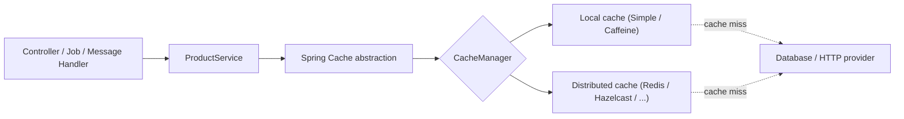
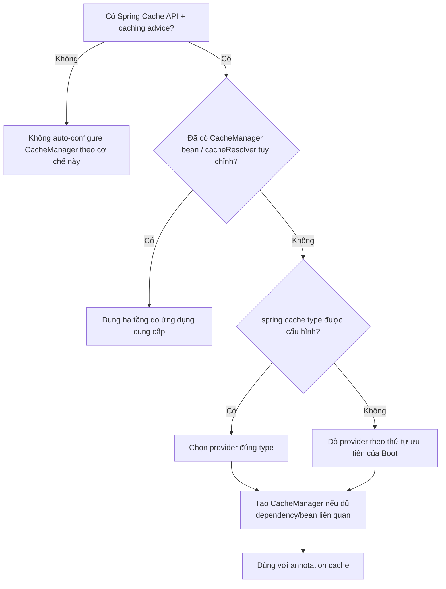
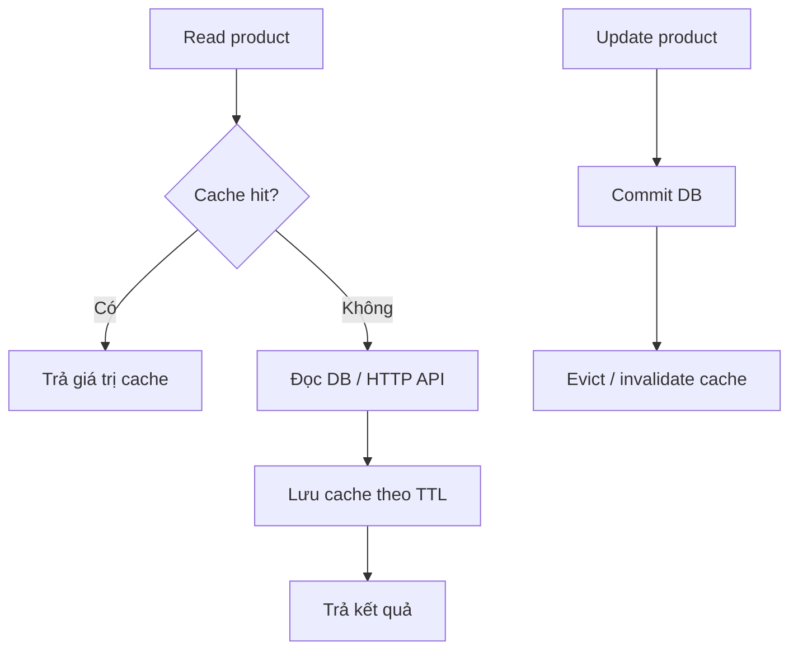

# Cách Boot chọn cache provider và chỉ định spring.cache.type

## 1. Cache provider nằm ở đâu trong hệ thống tích hợp?

Trong **SPRING_BOOT_INTEGRATION**, một ứng dụng Spring Boot có thể gọi HTTP API, đọc cơ sở dữ liệu, dùng Redis, trao đổi thông điệp qua broker và kết nối các hệ thống qua Spring Integration adapter. Khi một thao tác đọc dữ liệu tốn thời gian nhưng dữ liệu không thay đổi liên tục, cache giúp giảm độ trễ và giảm tải lên hệ thống phía sau.

Giả sử Catalog Service đọc thông tin sản phẩm từ database hoặc HTTP Product API. Lần đọc đầu có thể lấy nguồn dữ liệu thật và lưu kết quả; những lần sau với cùng khóa sẽ trả kết quả từ cache. Khi sản phẩm thay đổi, ứng dụng phải cập nhật hoặc xóa cache đúng thời điểm.



**Spring Cache** là abstraction về cache; nó không bắt buộc backend cụ thể. `spring.cache.type` giúp Spring Boot chọn một backend được hỗ trợ khi **auto-configure** `CacheManager`. Có thể lựa chọn cache trong bộ nhớ tiến trình như Simple/Caffeine hoặc cache phân tán như Redis, tùy yêu cầu nhất quán, lưu giữ dữ liệu và vận hành.

**Mục tiêu bài học:** hiểu cơ chế Spring Boot phát hiện cache provider, điều kiện tạo `CacheManager`, cách dùng `spring.cache.type` để kiểm soát lựa chọn, cấu hình các backend tiêu biểu, xử lý trường hợp nhiều dependency cùng tồn tại, kiểm thử và quan sát hành vi cache trong một hệ thống tích hợp thực tế.

Các ví dụ dùng **Spring Boot 3.x / Spring Framework 6**. Thứ tự phát hiện và tập giá trị `spring.cache.type` có thể thay đổi theo phiên bản; khi nâng cấp major hoặc dùng một bản Boot cụ thể, cần đối chiếu tài liệu và condition report của đúng phiên bản đang chạy.

## 2. Phân biệt Spring Cache và cache provider

Các thành phần có trách nhiệm khác nhau:

| Thành phần | Chức năng | Ví dụ |
| --- | --- | --- |
| `@Cacheable`, `@CachePut`, `@CacheEvict` | Diễn đạt chính sách cache tại lời gọi method | Cache kết quả đọc sản phẩm, xóa khi cập nhật |
| `Cache` | API đọc, ghi và evict một không gian cache | Cache tên `products` |
| `CacheManager` | Cung cấp các đối tượng `Cache` theo tên | `ConcurrentMapCacheManager`, `CaffeineCacheManager`, `RedisCacheManager` |
| `CacheResolver` | Quyết định cache nào dùng cho một invocation | Resolver tùy chỉnh theo tenant/ngữ cảnh |
| Cache provider | Cơ chế lưu trữ và quy tắc TTL/eviction/thống kê | Caffeine, Redis, JCache provider |
| Spring Boot auto-configuration | Chọn và tạo bean thích hợp khi đủ điều kiện | `CacheAutoConfiguration` |

Trong Spring Framework, các annotation cache thường được xử lý qua proxy/AOP. Khi gọi một method được đánh dấu `@Cacheable`, Spring tìm key, hỏi `CacheManager`/resolver về cache, đọc cache trước và gọi method thật khi cần.

**Tên cache không phải tên provider.** Trong `@Cacheable(cacheNames = "products")`, `products` là một vùng cache logic. Nó có thể được quản lý bởi Caffeine, Redis hoặc provider khác. `spring.cache.type=redis` chọn cơ chế lưu cache, còn `spring.cache.cache-names=products` có thể dùng để cấu hình tên vùng cache được tạo trước, tùy provider.

### 2.1. Cache không phải nguồn sự thật

Cache là bản dữ liệu dẫn xuất. Nếu dùng để đọc giá, tồn kho hoặc quyền truy cập, phải xác định rõ mức độ dữ liệu cũ (*staleness*) có thể chấp nhận. TTL, eviction, thông báo invalidation và độ trễ đồng bộ có thể làm hai instance ứng dụng thấy kết quả khác nhau.

Một cache miss là tình huống bình thường, không tự động đồng nghĩa lỗi. Ngược lại, cache hit không chứng minh dữ liệu vẫn đúng với database nếu không có chính sách cập nhật/xóa.

## 3. Bắt đầu với starter và bật caching

Với Maven, thêm starter:

```xml
<dependency>
    <groupId>org.springframework.boot</groupId>
    <artifactId>spring-boot-starter-cache</artifactId>
</dependency>
```

Starter mang các dependency để dùng Spring Cache và cấu hình tương ứng, **không phải starter tự chọn sẵn Redis hay Caffeine cho mọi ứng dụng**. Backend ngoài bộ nhớ Simple cần dependency và đôi khi dịch vụ bên ngoài riêng.

Bật xử lý annotation cache bằng `@EnableCaching`:

```java
import org.springframework.cache.annotation.EnableCaching;
import org.springframework.context.annotation.Configuration;

@Configuration
@EnableCaching
public class CachingConfiguration {
}
```

`@EnableCaching` kích hoạt hạ tầng interceptor/advice của Spring Cache để xử lý các annotation như `@Cacheable`. Spring Boot có thể auto-configure `CacheManager` phù hợp khi điều kiện classpath và hạ tầng caching được thỏa mãn.

Ví dụ service:

```java
import org.springframework.cache.annotation.CacheEvict;
import org.springframework.cache.annotation.Cacheable;
import org.springframework.stereotype.Service;

@Service
public class ProductService {

    private final ProductRepository repository;

    public ProductService(ProductRepository repository) {
        this.repository = repository;
    }

    @Cacheable(cacheNames = "products", key = "#productId")
    public ProductDto findById(String productId) {
        return repository.load(productId);
    }

    @CacheEvict(cacheNames = "products", key = "#productId")
    public void invalidate(String productId) {
        // Dùng để xóa bản cache khi dữ liệu nguồn đã thay đổi.
    }
}
```

`ProductRepository` và `ProductDto` là các thành phần nghiệp vụ giả định. Ở phương thức `findById`, nếu key đã tồn tại, Spring Cache có thể trả bản ghi được cache mà không gọi repository. `invalidate` xóa key tương ứng khi method hoàn tất thành công theo cấu hình annotation.

**Lưu ý proxy:** lời gọi nội bộ `this.findById(id)` trong cùng đối tượng thường không đi qua Spring proxy, nên `@Cacheable` không có tác dụng trong chế độ proxy mặc định. Ngoài ra, `@CacheEvict` không tự biết database đã thay đổi ở chỗ nào: ứng dụng phải thiết kế các đường ghi và invalidation đầy đủ.

## 4. Điều kiện để Boot tự tạo CacheManager

Cần phân biệt ba quyết định:

1. **Có kích hoạt hạ tầng Spring Cache không?** Thường thông qua `@EnableCaching`.
2. **Ứng dụng đã tự định nghĩa cache infrastructure chưa?** Nếu đã cung cấp `CacheManager` hoặc một `CacheResolver` theo tên dành riêng cho resolver mặc định, Boot có thể nhường quyền.
3. **Nếu Boot được phép tự cấu hình, chọn provider nào?** Dựa vào `spring.cache.type` hoặc thứ tự phát hiện provider khi không chỉ định type.

Một mô hình tư duy:



**`spring.cache.type` không có quyền ghi đè một `CacheManager` tùy chỉnh đã tồn tại.** Nếu dự án định nghĩa `@Bean CacheManager customCacheManager()`, bean đó là lựa chọn chủ động của ứng dụng; thay đổi property `spring.cache.type` có thể không làm provider thay đổi.

Tương tự, khi ứng dụng cung cấp `CacheResolver` tên `cacheResolver` theo quy ước mà cache auto-configuration kiểm tra, Boot có thể không tạo manager mặc định. Cần xem báo cáo điều kiện auto-configuration của phiên bản đang chạy nếu hành vi khác kỳ vọng.

### 4.1. Đừng nhầm dependency với kết nối thật

Có dependency Spring Data Redis trên classpath và có bean `RedisConnectionFactory` chưa chứng minh Redis server đang kết nối thành công. Với cache Redis, lỗi credential, DNS, socket hoặc timeout có thể xuất hiện khi thao tác cache diễn ra; khả năng kết nối còn phải được kiểm tra độc lập.

Ngược lại, nếu chỉ có starter cache và không có provider nào đặc thù, Boot thường chọn cache Simple dựa trên `ConcurrentHashMap`: phù hợp development hoặc một số ứng dụng nhỏ, nhưng không thay thế một dịch vụ cache phân tán cho nhiều instance.

## 5. Thứ tự Boot tự dò cache provider khi không đặt type

Trong tài liệu Spring Boot 3.x, các loại provider được xét theo thứ tự thông dụng sau khi cache auto-configuration đủ điều kiện:

| Thứ tự | Loại provider | Điều kiện điển hình | Điểm cần chú ý |
| --- | --- | --- | --- |
| 1 | **Generic** | Có một hoặc nhiều bean `org.springframework.cache.Cache` được khai báo trực tiếp | Boot có thể gom các cache bean thành manager; dễ thay đổi hành vi nếu thêm bean |
| 2 | **JCache (JSR-107)** | Có provider/cache API JCache phù hợp | Khi provider có cả API Spring native và JCache, Boot thường ưu tiên JCache |
| 3 | **Hazelcast** | Có hạ tầng Hazelcast phù hợp | Có thể dùng như backend phân tán hoặc cấu hình khác tùy deployment |
| 4 | **Infinispan** | Có thư viện và cấu hình Infinispan phù hợp | Cần lưu ý tính tương thích client/server |
| 5 | **Couchbase** | Có dependency và hạ tầng Couchbase tương ứng | Cache phụ thuộc database/cluster bên ngoài |
| 6 | **Redis** | Có Spring Data Redis cùng `RedisConnectionFactory` | Có thể chia sẻ cache giữa các instance |
| 7 | **Caffeine** | Có thư viện Caffeine | Local in-memory theo từng JVM |
| 8 | **Cache2k** | Có provider cache2k được hỗ trợ | Local cache với cơ chế cấu hình riêng |
| 9 | **Simple** | Không có provider phù hợp trước đó | Backed by concurrent maps; không tự có TTL phân tán |
| — | **None** | Chỉ định chủ động `spring.cache.type=none` | Tạo cache manager no-op để tắt hiệu lực lưu cache |

**Thứ tự trên phản ánh lựa chọn tự động, không phải xếp hạng hiệu năng hoặc khuyến nghị nghiệp vụ.** Một project vô tình thêm dependency JCache hoặc Redis có thể khiến provider được chọn thay đổi mặc dù code service không sửa. Mức độ áp dụng chính xác của mỗi nhánh phụ thuộc điều kiện classpath, bean và phiên bản Spring Boot.

Đặc biệt, nếu một provider hỗ trợ **hai API** (chẳng hạn JCache và API cache native), Boot thường ưu tiên khả năng tương thích qua JCache, trừ khi bạn cấu hình rõ provider theo một cách khác được hỗ trợ.

### 5.1. Vì sao thêm một dependency lại đổi cache trong runtime?

Giả sử ban đầu ứng dụng chỉ có `spring-boot-starter-cache`: manager là Simple. Sau đó nhóm khác thêm `spring-boot-starter-data-redis` để sử dụng `RedisTemplate` trong một workflow, đồng thời Boot đã có `RedisConnectionFactory`. Khi không đặt `spring.cache.type` và không có custom cache manager, cache annotation có thể chuyển sang Redis.

Điều này có thể gây bất ngờ:

- Key và value dùng Redis serialization thay vì object reference trong JVM.
- Có thêm network hop, timeout và lỗi Redis.
- Dữ liệu cache được chia sẻ giữa các instance, có nguy cơ collision key nếu thiếu namespace.
- TTL/eviction theo Redis khác Simple.
- Unit test dùng Simple vẫn xanh, còn production thất bại khi Redis chưa sẵn sàng.

Vì vậy, với hệ tích hợp có nhiều dependency cache hoặc muốn kiểm soát rõ hành vi qua các môi trường, **khai báo `spring.cache.type` có chủ đích** là lựa chọn dễ vận hành và dễ kiểm thử.

## 6. Chỉ định trực tiếp spring.cache.type

Ví dụ chọn Caffeine cho cache local:

```yaml
spring:
  cache:
    type: caffeine
```

Chọn Redis:

```yaml
spring:
  cache:
    type: redis
```

Vô hiệu hóa lưu cache qua abstraction:

```yaml
spring:
  cache:
    type: none
```

Thuộc tính này ánh xạ tới các loại cache mà phiên bản Boot hỗ trợ như `simple`, `caffeine`, `redis`, `jcache`, `hazelcast`, `infinispan`, `couchbase`, `cache2k`, `generic` và `none`. Chữ thường như các ví dụ là định dạng YAML phổ biến.

**Type chỉ chọn nhánh cấu hình, không tự tạo dependency hoặc hạ tầng.** Đặt `spring.cache.type=redis` mà không có Redis driver/`RedisConnectionFactory` phù hợp có thể khiến ứng dụng không tạo được cache manager hoặc không khởi động theo điều kiện cấu hình hiện tại. Nó không tự khởi động Redis server.

Tương tự, `spring.cache.type=caffeine` cần thư viện Caffeine trên classpath. Đặt `none` không xóa annotation khỏi source code: các lời gọi annotated vẫn đi qua cache abstraction nếu đã bật caching, nhưng dùng no-op cache manager để không giữ bản ghi.

### 6.1. Bảng lựa chọn cho từng mục tiêu

| Mục tiêu | Type có thể chọn | Khi nào phù hợp |
| --- | --- | --- |
| Demo/test đơn giản, không muốn hạ tầng ngoài | `simple` | Dữ liệu ít, một JVM, không cần TTL chặt |
| Cache local có eviction/TTL và tốc độ cao | `caffeine` | Read-heavy, chấp nhận mỗi instance có dữ liệu riêng |
| Cache chia sẻ nhiều instance | `redis` | Có Redis cluster/managed service, cần đo network và failure mode |
| Hệ sinh thái đã chuẩn hóa JCache | `jcache` | Có provider JSR-107 và quy trình quản lý cấu hình |
| Tạm vô hiệu cache để điều tra | `none` | Cần chạy cùng logic business mà không cache |
| Cache phân tán gắn với nền tảng khác | `hazelcast`/`infinispan`/`couchbase` | Có chiến lược vận hành và hạ tầng tương ứng |

Một ứng dụng chỉ dùng **một** `CacheManager` mặc định thường đơn giản hơn. Nếu phải vừa có cache Caffeine ngắn hạn, vừa có Redis chia sẻ, cần thiết kế **nhiều CacheManager** với tên/`CacheResolver` và route rõ ràng theo cache name/operation; lúc này `spring.cache.type` một mình không biểu diễn toàn bộ chính sách.

## 7. Cấu hình Simple: cache mặc định trong bộ nhớ

Với `spring-boot-starter-cache` và `@EnableCaching`, có thể ép lựa chọn Simple:

```yaml
spring:
  cache:
    type: simple
    cache-names:
      - products
      - categories
```

Spring sử dụng `ConcurrentMapCacheManager` trong cách cấu hình thông thường. Các cache lưu trong bộ nhớ process; sau restart sẽ mất toàn bộ. Giữa hai replica, mỗi replica có một bản cache riêng.

Simple không cung cấp TTL/maximum-size/eviction dựa trên tuổi như Caffeine hoặc Redis. Dữ liệu có thể tồn tại đến khi được evict, clear hoặc tiến trình restart; không nên dùng cho cache tăng trưởng không kiểm soát.

Khi cấu hình `spring.cache.cache-names`, Boot có thể tạo sẵn các cache tên đó và hạn chế việc tạo tên mới tùy đặc tính provider. Không dựa vào việc một cache name sai được tự động tạo ở production; nên kiểm tra tên và cấu hình trong test.

Ví dụ đọc bean trong runtime:

```java
import org.springframework.cache.CacheManager;
import org.springframework.stereotype.Component;

@Component
public class CacheInspector {

    private final CacheManager manager;

    public CacheInspector(CacheManager manager) {
        this.manager = manager;
    }

    public boolean hasProductsCache() {
        return manager.getCache("products") != null;
    }
}
```

Test có thể xác nhận loại manager là `ConcurrentMapCacheManager` nếu project không định nghĩa manager riêng và `type=simple`. Tuy nhiên **không** viết business logic phụ thuộc class manager; code nghiệp vụ nên phụ thuộc abstraction Spring Cache.

## 8. Cấu hình Caffeine: cache nhanh trong một JVM

Thêm thư viện Caffeine, để Spring Boot BOM quản lý phiên bản:

```xml
<dependency>
    <groupId>com.github.ben-manes.caffeine</groupId>
    <artifactId>caffeine</artifactId>
</dependency>
```

Ví dụ cấu hình:

```yaml
spring:
  cache:
    type: caffeine
    cache-names:
      - products
      - categories
    caffeine:
      spec: maximumSize=10000,expireAfterWrite=5m
```

`CaffeineCacheManager` bọc cache Caffeine và áp dụng chính sách kích thước tối đa, hết hạn sau khi ghi theo spec. Đây là **cache local**, vì vậy các instance Spring Boot khác nhau không chia sẻ cùng object cache.

**Tình huống phù hợp:** Product Service có traffic cao, sản phẩm thay đổi không thường xuyên và chấp nhận mỗi instance phục vụ dữ liệu có độ trễ cập nhật vài phút. Caffeine giảm network hop so với Redis nhưng không có cơ chế nhất quán phân tán tự động giữa các replica.

Một số điểm cần cân nhắc:

- `maximumSize` là chính sách eviction của Caffeine, không phải giới hạn cứng chính xác về số bản ghi tồn tại tại mọi thời điểm.
- `expireAfterWrite` bắt đầu theo thời điểm ghi; có thể khác `expireAfterAccess`. Chọn theo yêu cầu dữ liệu cũ.
- Caffeine không tự đồng bộ invalidation giữa các JVM. Nếu cần xóa đồng thời trên nhiều instance, phải có cơ chế broadcast/invalidation hoặc chấp nhận TTL.
- Metric hit/miss/eviction cần instrumentation và cấu hình hỗ trợ; đừng giả định mọi ứng dụng tự động thu đủ thống kê.

Nếu cần cấu hình nâng cao, có thể dùng `CaffeineSpec` hoặc `Caffeine` builder theo cách Boot hỗ trợ. Lưu ý thứ tự ưu tiên của spec/builder và khả năng tùy chỉnh có thể thay đổi theo phiên bản, nên tránh khai báo nhiều nguồn cấu hình mâu thuẫn.

## 9. Cấu hình Redis: chia sẻ cache giữa nhiều instance

Khi dùng Redis làm backend cache, cần Spring Data Redis và một Redis server riêng. Dependency Maven:

```xml
<dependency>
    <groupId>org.springframework.boot</groupId>
    <artifactId>spring-boot-starter-cache</artifactId>
</dependency>
<dependency>
    <groupId>org.springframework.boot</groupId>
    <artifactId>spring-boot-starter-data-redis</artifactId>
</dependency>
```

Ví dụ cấu hình Spring Boot 3.x:

```yaml
spring:
  data:
    redis:
      host: ${REDIS_HOST:localhost}
      port: ${REDIS_PORT:6379}
      connect-timeout: 2s
      timeout: 2s
  cache:
    type: redis
    cache-names:
      - products
      - categories
    redis:
      time-to-live: 10m
      cache-null-values: false
      use-key-prefix: true
      key-prefix: "catalog::"
```

`spring.data.redis.*` cấu hình **kết nối Redis**, còn `spring.cache.redis.*` cấu hình **cách Spring Cache sử dụng Redis**. Đây là hai nhóm thuộc tính độc lập:

| Thuộc tính | Tác dụng |
| --- | --- |
| `spring.data.redis.host/port` | Địa chỉ Redis server |
| `spring.data.redis.connect-timeout/timeout` | Giới hạn kết nối/thao tác theo client |
| `spring.cache.type=redis` | Chọn `RedisCacheManager` do Boot tạo khi đủ điều kiện |
| `spring.cache.redis.time-to-live` | TTL mặc định cho entry của các cache do cấu hình quản lý |
| `spring.cache.redis.cache-null-values` | Có cho phép lưu kết quả null theo cache configuration hay không |
| `spring.cache.redis.use-key-prefix` | Có thêm prefix cho key cache trong Redis |
| `spring.cache.redis.key-prefix` | Prefix tùy chỉnh; cần kiểm tra cách ghép với cache name |

Khi các service chia sẻ một Redis cluster, cần namespace key phân tách theo ứng dụng/môi trường/cache name. Không chỉ dùng key sản phẩm `123` trên một Redis dùng chung mà thiếu namespace, vì collision giữa các service/schema có thể gây lỗi deserialize hoặc sai dữ liệu.

**Quan trọng về dữ liệu:** Redis Cache sử dụng serialization theo cấu hình Spring Data Redis/RedisCacheManager, không phải Java object reference. Nên kiểm tra cách encode key/value, version DTO, khả năng tương thích khi deploy rolling và xử lý schema cũ. Tránh deserialize dữ liệu không tin cậy với serializer Java mặc định nếu không có ràng buộc an toàn.

### 9.1. Redis cũng là phụ thuộc runtime có thể lỗi

Redis timeout không thể mặc nhiên xử lý như cache miss. Tùy nghiệp vụ:

- **Cache đọc sản phẩm:** có thể cho fallback sang database với giới hạn concurrency nếu Redis không khả dụng.
- **Cache phân quyền hoặc giá quan trọng:** cache stale hay fallback không được làm sai quyết định nghiệp vụ.
- **Redis dùng cho rate limiter, idempotency hay lock:** đó không còn là cache đọc tùy chọn; cần chính sách lỗi *fail-open/fail-closed* rõ ràng.

Nếu chuyển cache từ Caffeine sang Redis chỉ bằng `spring.cache.type`, phải kiểm tra cả network, TLS/ACL, timeout, serialization, TTL, eviction, key prefix và cách ứng dụng phản ứng khi Redis outage.

## 10. JCache và các provider khác

`spring.cache.type=jcache` yêu cầu một provider hỗ trợ **JSR-107/JCache** cùng cấu hình thích hợp. Một số sản phẩm như Ehcache 3 có hỗ trợ JCache, nhưng cần dependency/module đúng phiên bản và cấu hình provider cụ thể.

Ví dụ:

```yaml
spring:
  cache:
    type: jcache
    jcache:
      provider: com.example.cache.ExampleCachingProvider
      config: classpath:cache-config.xml
```

`com.example.cache.ExampleCachingProvider` chỉ là **placeholder minh họa**; thay bằng tên fully qualified của `CachingProvider` mà dependency thực tế cung cấp. File `cache-config.xml` cũng là resource do dự án chuẩn bị và có cú pháp theo provider. Không copy ví dụ này rồi kỳ vọng ứng dụng chạy khi chưa có provider thật.

Khi nhiều JCache provider cùng nằm trên classpath, cần chỉ định `spring.cache.jcache.provider` để tránh lựa chọn mơ hồ. Nếu một thư viện vừa có support JCache vừa có native integration, việc Boot ưu tiên JCache trong auto-detection có thể khiến cấu hình native của bạn không được sử dụng.

Các provider như Hazelcast, Infinispan và Couchbase yêu cầu dependency, connection/client và cấu hình riêng. **Tên `spring.cache.type` không thay thế tài liệu vận hành provider.** Trước khi dùng cần xác định topology, bảo mật, serialization, TTL/eviction, high availability, nhu cầu kiểm thử failover và chi phí hạ tầng.

## 11. Khi ứng dụng tự cấu hình CacheManager

Một ví dụ Spring tự quản lý:

```java
import org.springframework.cache.CacheManager;
import org.springframework.cache.concurrent.ConcurrentMapCacheManager;
import org.springframework.context.annotation.Bean;
import org.springframework.context.annotation.Configuration;

@Configuration
public class CustomCacheConfiguration {

    @Bean
    CacheManager cacheManager() {
        return new ConcurrentMapCacheManager("products", "categories");
    }
}
```

Khi đã có bean `CacheManager`, Boot thường back off khỏi việc tạo manager khác. Trong trường hợp này, đặt `spring.cache.type=redis` **không tự đổi bean trên thành `RedisCacheManager`**. Muốn thay provider, sửa cấu hình bean, bỏ bean custom để dùng auto-configuration, hoặc thiết kế routing nhiều manager rõ ràng.

Nếu ứng dụng định nghĩa `CacheResolver` tùy chỉnh, cần xác định nó có được đặt tên `cacheResolver` và cache annotation có chọn resolver đó không. Các annotation có thể chọn manager/resolver bằng thuộc tính `cacheManager` hoặc `cacheResolver` khi có nhiều bean, nhưng phải thống nhất để tránh cấu hình gây nhầm lẫn.

Ví dụ dùng bean cụ thể:

```java
@Cacheable(
    cacheNames = "products",
    key = "#productId",
    cacheManager = "catalogCacheManager"
)
public ProductDto findById(String productId) {
    return repository.load(productId);
}
```

`catalogCacheManager` phải là tên bean thực tế trong ứng dụng. Nếu các cache cần chính sách khác nhau (TTL ngắn cho tồn kho, TTL dài cho danh mục), có thể cấu hình từng cache theo provider thay vì tạo nhiều backend không cần thiết.

### 11.1. Customizer có giới hạn phạm vi

Spring Boot cung cấp những hook như `CacheManagerCustomizer` trong các cấu hình được hỗ trợ. Tuy nhiên, customizer không có nghĩa nó sẽ chạy cho một bean `CacheManager` do ứng dụng tự tạo theo mọi đường đi. Khi cần override sâu hành vi provider, hãy chọn một nơi sở hữu cấu hình và kiểm tra actual bean type lúc runtime.

## 12. Kiểm tra provider thực sự được chọn

Không nên đoán backend chỉ từ việc dependency nào nằm trong `pom.xml`. Cách chắc chắn hơn là xem `CacheManager` thực tế của application context.

Ví dụ một component ghi ra class name khi khởi động môi trường development:

```java
import org.springframework.boot.ApplicationRunner;
import org.springframework.context.annotation.Bean;
import org.springframework.context.annotation.Configuration;
import org.springframework.cache.CacheManager;

@Configuration
public class CacheDiagnostics {

    @Bean
    ApplicationRunner reportCacheManager(CacheManager manager) {
        return args -> System.out.println(
            "CacheManager = " + manager.getClass().getName()
        );
    }
}
```

Khi chạy production, tránh log nhiều thông tin cấu hình nhạy cảm; class name manager thường là thông tin vận hành không nhạy cảm. Có thể sử dụng structured logging thay `System.out` trong hệ thống thực.

Bật chế độ condition report của Spring Boot trong môi trường phù hợp:

```properties
debug=true
```

Sau đó tìm phần liên quan `CacheAutoConfiguration` và các cấu hình cache provider trong startup log. Với Spring Boot Actuator, endpoint `conditions` (nếu có và được cấp quyền) cho biết điều kiện nào matched hoặc không matched.

Điều cần tìm là:

- Có tạo `CacheManager` bean không, và thuộc class nào?
- Có custom bean `CacheManager` hoặc `cacheResolver` khiến Boot back off không?
- `spring.cache.type` được nạp đúng từ profile/env không?
- Provider mong muốn có dependency và bean kết nối bắt buộc không?
- Test và production đang chạy cùng auto-configuration hay một profile đã override type?

Trong trường hợp có nhiều `CacheManager`, chỉ in một bean không đủ để giải thích toàn bộ route. Cần kiểm tra `@Primary`, tên bean và `CacheResolver` được annotation sử dụng.

## 13. Kiểm thử không phụ thuộc Redis thật cho các case đơn giản

Một test ở tầng Spring Boot có thể ép cache Simple để xác minh các annotation hoạt động mà không cần broker/cache server ngoài.

Ví dụ kiểm tra có manager và cache được tạo:

```java
import static org.assertj.core.api.Assertions.assertThat;

import org.junit.jupiter.api.Test;
import org.springframework.beans.factory.annotation.Autowired;
import org.springframework.boot.test.context.SpringBootTest;
import org.springframework.cache.CacheManager;
import org.springframework.cache.concurrent.ConcurrentMapCacheManager;

@SpringBootTest(properties = {
    "spring.cache.type=simple",
    "spring.cache.cache-names=products,categories"
})
class CacheConfigurationTest {

    @Autowired
    CacheManager manager;

    @Test
    void usesSimpleCacheManager() {
        assertThat(manager)
            .isInstanceOf(ConcurrentMapCacheManager.class);
        assertThat(manager.getCache("products")).isNotNull();
    }
}
```

Test giả định application context bật `@EnableCaching`, không định nghĩa custom CacheManager và có starter-cache. Nếu trong ứng dụng thật có manager tùy chỉnh, phép assert class có thể không phù hợp; cần điều chỉnh test theo cấu hình mục tiêu.

Kiểm tra annotation cache có tránh gọi repository lần hai bằng test nghiệp vụ:

```java
import static org.mockito.Mockito.*;

@Test
void cachesProductLookup() {
    when(repository.load("sku-123"))
        .thenReturn(new ProductDto("sku-123", "USB-C cable"));

    service.findById("sku-123");
    service.findById("sku-123");

    verify(repository, times(1)).load("sku-123");
}
```

Đoạn ngắn là **mẫu ý tưởng**: service phải là Spring bean được inject qua proxy, repository mock là dependency của service, và `ProductDto` có constructor tương ứng; các chi tiết setup phụ thuộc project. Nếu tự `new ProductService(repository)` trong unit test, interceptor Spring không chạy, nên không thể dùng test này để kết luận `@Cacheable` hoạt động.

### 13.1. Kiểm thử cache disabled

Có thể chạy profile test:

```yaml
spring:
  cache:
    type: none
```

Khi `none` và không có custom CacheManager, cache manager no-op không lưu entry. Lời gọi vào method annotated `@Cacheable` thường chạy lại lần sau; hữu ích để xác minh hành vi không phụ thuộc cache. Tuy nhiên `none` **không được dùng như bằng chứng rằng chính sách TTL/invalidation trên Redis hay Caffeine đã đúng**.

### 13.2. Kiểm thử Redis/Caffeine với provider thật

Với Caffeine: chạy test trên manager Caffeine thật, xác minh TTL/maximum-size và evict; tránh phụ thuộc thời gian thực quá sát vì test dễ chập chờn.

Với Redis: chạy Redis thật qua Testcontainers hoặc test environment, xác minh key namespace, serializer, TTL, invalidation sau update và hành vi khi Redis timeout. Bài test chỉ ép `type=redis` nhưng không có Redis server không kiểm tra được trao đổi dữ liệu thực tế.

Các case quan trọng ở ranh giới tích hợp:

1. Cache miss → gọi API/database một lần, hit → không gọi lại.
2. Cập nhật dữ liệu nguồn → evict hoặc refresh đúng key.
3. Không cache nhầm `null`/error/response dữ liệu không hợp lệ.
4. Cache key tránh collision giữa tenant, service và version DTO.
5. Sau rolling deployment, instance mới có thể đọc cache entry cũ hoặc có migration/version prefix.
6. Redis outage không khiến service retry vô hạn và làm quá tải database.
7. Hai instance ứng dụng dùng Redis nhìn thấy invalidation chung; với Caffeine, xác minh chấp nhận sự khác biệt hoặc có broadcast cơ chế khác.

## 14. Lỗi cấu hình thường gặp

| Hiện tượng | Nguyên nhân cần xem xét | Hướng xử lý |
| --- | --- | --- |
| `@Cacheable` không có tác dụng | Chưa bật `@EnableCaching`, self-invocation, bean không qua proxy | Kiểm tra caching advice/proxy và đường gọi |
| Không có `CacheManager` để inject | Cache auto-configuration không đủ điều kiện hoặc bị custom resolver | Xem condition report, starter, caching config |
| Đặt `type=redis` nhưng Boot báo thiếu bean | Thiếu Spring Data Redis/connection factory | Khai báo dependency và kết nối hợp lệ |
| Thêm Redis rồi app bỗng chậm | Auto-detection chuyển từ local sang Redis | Kiểm tra actual manager; ép type mong muốn |
| Caffeine không kích hoạt | Thiếu thư viện Caffeine hoặc có provider ưu tiên cao hơn | Thêm dependency, đặt `type=caffeine` |
| Cache key sai/collision | Khóa không chứa tenant/version, hoặc key generator không phù hợp | Quy ước key, namespace, test đa tenant |
| Redis đọc entry lỗi deserialize | Serializer/schema thay đổi giữa các phiên bản | Cố định serializer, version prefix, migration |
| Không thấy TTL ở cache Simple | Simple không hỗ trợ TTL cấu hình kiểu Redis/Caffeine | Chuyển provider phù hợp hoặc tự quản lý invalidation |
| `CacheManagerCustomizer` không chạy | Bean manager được tạo thủ công hoặc type không khớp | Xác định nguồn tạo manager, chọn hook phù hợp |
| Test chạy khác production | `spring.cache.type`/profile/env hoặc classpath khác | Giữ cấu hình test chủ đích và kiểm thử provider thật ở tầng tích hợp |

Một lỗi cache không nên tự động trả 500 nếu cache chỉ là lớp tối ưu cho dữ liệu đọc **và** fallback xuống database được phép. Nhưng một lỗi idempotency/rate-limit dùng Redis có thể liên quan trực tiếp tính đúng đắn, nên chính sách fail-open hoặc fail-closed phải được định nghĩa cho từng tình huống.

## 15. TTL, invalidation và tính nhất quán của dữ liệu

Chọn đúng provider mới chỉ là bước đầu. Thời gian sống của dữ liệu và chiến lược cập nhật quyết định cache có an toàn không.

### 15.1. Cache-aside và độ trễ cập nhật

Một cache-aside flow phổ biến:



Thực tế có race condition: request A đọc dữ liệu cũ ngay trước khi update, request B commit DB và xóa cache, sau đó request A ghi dữ liệu cũ trở lại cache. Chỉ thêm `@CacheEvict` không tự loại bỏ mọi cuộc đua; với dữ liệu nhạy cảm cần versioning, đồng bộ hoặc cơ chế nhất quán phù hợp.

### 15.2. Ba kiểu ràng buộc phổ biến

| Nhu cầu | Chiến lược phù hợp |
| --- | --- |
| Dữ liệu danh mục thay đổi ít, chấp nhận stale | Caffeine TTL ngắn hoặc Redis TTL kèm evict |
| Nhiều instance cần thấy thay đổi nhanh | Redis chia sẻ + invalidation rõ, hoặc cơ chế broadcast invalidation |
| Dữ liệu nghiệp vụ cần tính nhất quán mạnh | Không dựa cache như nguồn quyết định cuối; xác minh và commit atomically ở owner service/database |

**Đừng cache kết quả phụ thuộc context mà key không chứa context đó.** Ví dụ dữ liệu có quyền theo user/tenant phải bao gồm định danh tương ứng trong key hoặc tránh cache ở tầng chia sẻ. Đừng lưu access token/PII trong cache nếu không có yêu cầu và kiểm soát truy cập/retention rõ.

### 15.3. Cache stampede và negative caching

Khi một key hết hạn đúng lúc traffic cao, nhiều request có thể cùng gọi database/HTTP provider, gây **cache stampede**. Một số hướng xử lý: phân tán TTL (jitter), refresh-ahead, giới hạn concurrency, single-flight theo key, stale-while-revalidate có điều kiện hoặc cache dữ liệu thiếu trong thời gian ngắn.

Negative caching (`not found`) cần được định nghĩa cẩn thận: thông tin không tồn tại có thể thay đổi rất nhanh. Không dùng default null caching tùy tiện cho mọi endpoint rồi vô tình giữ trạng thái thiếu mãi.

## 16. Quan sát cache sau khi triển khai

Các chỉ số nên theo dõi:

- **Cache effectiveness:** hit/miss ratio theo cache name, thời gian lấy dữ liệu, số lần fallback sang nguồn dữ liệu thật.
- **Resource usage:** memory, entry count (nếu provider hỗ trợ), eviction, expiration, key cardinality và payload size.
- **Backend Redis:** latency, timeout, số connection, memory/eviction, replication/failover và error rate.
- **Business effect:** độ trễ API p50/p95/p99, tần suất stale data, số lần invalidation không đúng, tỷ lệ lỗi của downstream khi cache miss.
- **Deployment:** provider được chọn, cache schema/key prefix version, TTL và khác biệt giữa các môi trường.

Spring Boot Actuator có thể expose metric về cache qua Micrometer khi có dependency/binder hỗ trợ và cache được quan sát đúng cách. Cần kiểm tra metric nào thực sự có dữ liệu cho provider; không giả định mọi backend đều xuất sẵn hit/miss với cùng mức chi tiết. Endpoint health của Redis (nếu có) nói về kết nối Redis, không thay thế đánh giá cache hit ratio và hiệu quả nghiệp vụ.

Trong log/tracing, tránh biến giá trị key có PII thành metric labels có cardinality vô hạn. Chỉ ghi cache name, operation, outcome và trace/correlation ID phù hợp chính sách bảo mật.

## 17. Tình huống tổng hợp: Catalog Service dùng HTTP, Redis và database

Giả sử Catalog Service đang chạy trên ba instance. Nó gọi Product API (HTTP) để lấy thông tin, ghi đơn hàng vào database và phát thông điệp qua broker. Nhóm phát triển muốn giảm số lần gọi HTTP để bảo vệ Product API.

Có ba cách tiếp cận:

1. **Simple:** dùng thử ở local để hiểu annotation và key; không có TTL tự động và mỗi instance có cache riêng.
2. **Caffeine:** cache local TTL vài phút; phù hợp nếu Product API được phép nhận mức stale ngắn và invalidation xuyên instance không bắt buộc.
3. **Redis:** chia sẻ cache giữa ba instance; phải chấp nhận network hop, quản lý credential/TLS, TTL, serialization và sự cố Redis.

Nếu module đã thêm Spring Data Redis để xử lý tác vụ idempotency ở một luồng khác, không nên mặc nhiên để điều này đổi cache cho toàn Catalog Service. Cấu hình tường minh `spring.cache.type=caffeine` nếu muốn local, hoặc `redis` nếu muốn chia sẻ, giúp hành vi nhất quán giữa local, test và production.

Một cấu hình production minh họa khi chọn Redis:

```yaml
spring:
  cache:
    type: redis
    cache-names: products
    redis:
      time-to-live: 5m
      cache-null-values: false
      key-prefix: "catalog:prod:"
      use-key-prefix: true
  data:
    redis:
      host: ${REDIS_HOST}
      port: ${REDIS_PORT:6379}
      connect-timeout: 2s
      timeout: 2s
```

Tiếp theo cần kiểm thử ít nhất: cache miss/hit, xóa cache sau cập nhật, tương thích DTO, lỗi Redis, key không xung đột giữa môi trường và kết nối từ từng replica. Nếu use case đòi hỏi tính nhất quán mạnh cho tồn kho, kiểm tra và reserve hàng phải được thực hiện ở hệ thống sở hữu dữ liệu, **không quyết định cuối cùng dựa trên một bản cache**.

### Checklist trước khi merge hoặc deploy

- [ ] Đã bật `@EnableCaching` và xác nhận lời gọi đi qua Spring proxy?
- [ ] Đã biết `CacheManager` nào được tạo từ auto-configuration hay custom bean?
- [ ] Đã đặt `spring.cache.type` khi cần tránh thay đổi do classpath?
- [ ] Đã có dependency/backend thật và kiểm tra quyền kết nối nếu provider yêu cầu?
- [ ] Đã thống nhất cache names, key, version, serializer và cách tách tenant/môi trường?
- [ ] Đã chọn TTL, eviction và quy trình invalidation theo nghiệp vụ?
- [ ] Đã định nghĩa cách ứng dụng phản ứng khi cache miss và cache/backend lỗi?
- [ ] Đã kiểm thử provider thực tế cùng các đường ghi dữ liệu và theo dõi hit/miss?

**Kết luận:** Spring Boot chọn cache provider theo điều kiện classpath/bean và thứ tự tự dò khi không được cấu hình rõ. `spring.cache.type` giúp chỉ định provider mong muốn trong **nhánh auto-configuration**, nhưng không thay thế dependency, hạ tầng backend hoặc bean `CacheManager` do ứng dụng tự định nghĩa. Với hệ thống tích hợp Spring Boot, chọn provider phải đi cùng hợp đồng dữ liệu, TTL, invalidation, xử lý lỗi, kiểm thử và quan sát để cache giảm tải mà không làm sai nghiệp vụ.
