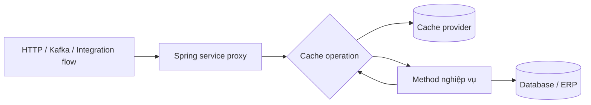
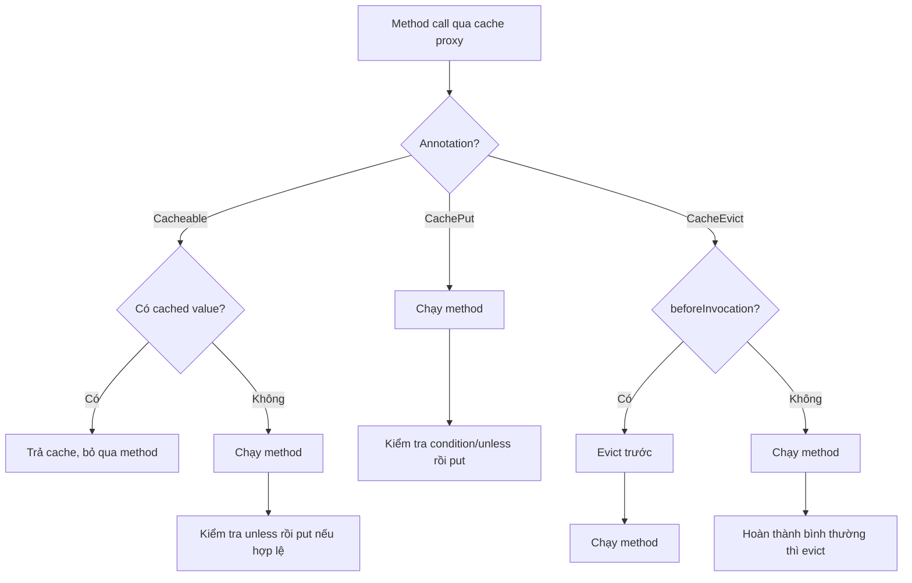
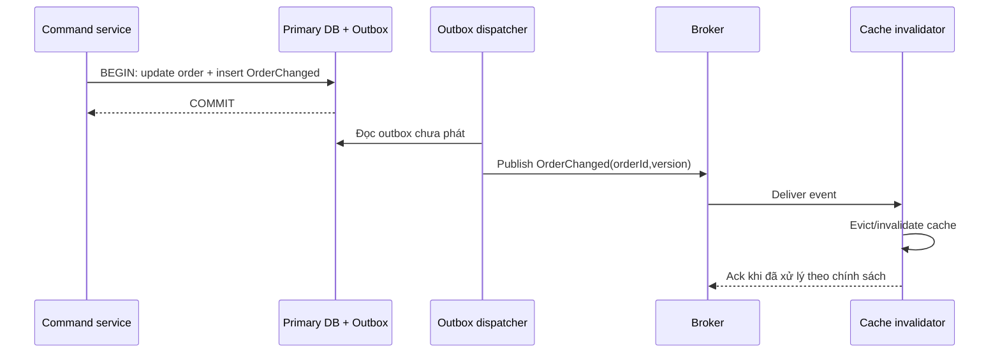

# `@Cacheable`, `@CachePut`, `@CacheEvict` và ngữ nghĩa cập nhật

## 1. Vì sao ngữ nghĩa cập nhật cache quan trọng trong tích hợp?

Một dịch vụ Spring Boot thường cần kết nối nhiều phụ thuộc: đọc đơn hàng từ PostgreSQL, tra hồ sơ từ ERP qua HTTP/SOAP, kiểm tra cache Redis, nhận thông điệp Kafka/RabbitMQ và thực thi các adapter của Spring Integration. Đọc lặp một bản ghi tốn thời gian và connection; cache giúp giảm độ trễ và tải. Nhưng khi dữ liệu đổi, cache trở thành **một bản sao có thể cũ**. Tối ưu hiệu năng chỉ có ý nghĩa khi ứng dụng xác định rõ bản sao ấy được cập nhật hoặc vô hiệu hóa khi nào.

Trong module **SPRING_BOOT_INTEGRATION**, bộ nhớ đệm phải được xem cùng với cấu hình kết nối, hợp đồng dữ liệu, giao dịch, xử lý lỗi, xử lý trùng lặp, kiểm thử và quan sát luồng tích hợp. Ba annotation của **Spring Cache abstraction** có mục đích khác nhau:

- **`@Cacheable`:** ưu tiên đọc cache; nếu có giá trị, không gọi method đích.
- **`@CachePut`:** luôn gọi method đích rồi đưa kết quả của lần gọi ấy vào cache.
- **`@CacheEvict`:** loại bỏ một mục hoặc toàn bộ mục trong cache, thường sau khi method hoàn thành bình thường.

Ví dụ xuyên suốt: `OrderQueryService.getOrder(id)` đọc từ DB và được cache; `OrderCommandService.changeStatus(id, status)` cập nhật DB; một consumer nhận `OrderChanged` từ broker có thể cũng thay đổi trạng thái. Nếu lệnh ghi đã commit mà cache vẫn giữ trạng thái cũ, API sẽ trả dữ liệu không đúng. Nếu cache được cập nhật trước khi DB commit rồi transaction rollback, API có thể trả trạng thái **chưa từng được commit**.

**Mục tiêu của bài** là hiểu hành vi thực sự của ba annotation, đặc biệt ở ranh giới **method, proxy, database transaction, nhiều replica và nguồn cập nhật từ bên ngoài**.

## 2. Spring Cache là abstraction, không phải một hệ thống lưu trữ

Spring cung cấp `Cache`, `CacheManager`, các operation annotation và interceptor. Ứng dụng lựa chọn backend: cache trong RAM (ví dụ Caffeine) hoặc cache chia sẻ (ví dụ Redis). Annotation không quyết định dữ liệu được lưu ở đâu, TTL dài bao nhiêu hoặc consistency mạnh đến mức nào.

| Thành phần | Trách nhiệm | Điều không tự bảo đảm |
|---|---|---|
| `Cache` | Đọc/ghi/xóa mục bằng key. | Không mặc nhiên bền vững hoặc nhất quán với DB. |
| `CacheManager` | Cung cấp các cache theo tên. | Không tự biết bản ghi nào đã đổi ở hệ thống khác. |
| `CacheResolver` | Chọn cache cho một invocation. | Không tự tạo transaction đa hệ thống. |
| `KeyGenerator` | Tạo key khi không khai báo SpEL `key`. | Không tự hiểu tenant, quyền truy cập hoặc phiên bản dữ liệu. |
| `CacheInterceptor` | Chặn lời gọi method được Spring quản lý. | Không chặn self-invocation qua `this` ở proxy mode. |
| Backend Caffeine/Redis/... | Lưu dữ liệu và các đặc tính TTL/eviction cụ thể. | Không tự thực hiện nghiệp vụ cập nhật nguồn dữ liệu. |



Đặc điểm quan trọng: Spring Cache hoạt động ở **ranh giới method**. Nếu dữ liệu thay đổi trực tiếp ở SQL console, bởi batch job hoặc bởi một instance không gửi invalidation, annotation trên method của instance khác sẽ **không tự được kích hoạt**.

### 2.1. Đọc nhanh không đồng nghĩa đọc hiện hành

Một bản ghi order có thể là `PENDING` trong cache, nhưng đã `PAID` trong DB. Khi `@Cacheable` trả giá trị đang cache, method truy vấn DB **không chạy**. Vì vậy, ứng dụng phải xác định mức dữ liệu cũ có thể chấp nhận:

- Danh mục ít đổi: có thể chấp nhận stale vài phút.
- Trạng thái hiển thị đơn hàng: tùy SLA và nghiệp vụ, có thể yêu cầu xóa cache ngay sau cập nhật.
- Số dư, phân quyền, hạn mức thanh toán: không nên áp cache vô điều kiện; cần cơ chế xác thực/nhất quán nghiêm ngặt hơn hoặc đọc nguồn chuẩn tại quyết định quan trọng.

## 3. Bật caching trong Spring Boot

Một ứng dụng Spring Boot sử dụng annotation cache thường cần dependency và **`@EnableCaching`**:

```kotlin
dependencies {
    implementation("org.springframework.boot:spring-boot-starter-cache")
}
```

```java
import org.springframework.boot.SpringApplication;
import org.springframework.boot.autoconfigure.SpringBootApplication;
import org.springframework.cache.annotation.EnableCaching;

@SpringBootApplication
@EnableCaching
public class IntegrationApplication {
    public static void main(String[] args) {
        SpringApplication.run(IntegrationApplication.class, args);
    }
}
```

`spring-boot-starter-cache` mang các API/configuration phục vụ Spring Cache, nhưng **không tự khiến mọi method có annotation được intercept nếu thiếu bước kích hoạt caching thích hợp**. `@EnableCaching` bật cơ chế tìm và xử lý các annotation trên Spring beans, thông thường theo chế độ AOP proxy.

Spring Boot có thể tự cấu hình `CacheManager` khi điều kiện classpath, provider và bean tương ứng thỏa mãn. Nếu không có cache provider chuyên biệt, một ứng dụng có thể dùng cache đơn giản dựa trên `ConcurrentHashMap` theo điều kiện/version; **không xem backend tạm thời này là cấu hình production an toàn** vì nó không có TTL hoặc đồng bộ liên replica theo cách Redis/Caffeine được thiết kế.

### 3.1. Cache trong RAM với Caffeine

Thêm provider khi cần:

```kotlin
dependencies {
    implementation("org.springframework.boot:spring-boot-starter-cache")
    implementation("com.github.ben-manes.caffeine:caffeine")
}
```

Ví dụ cho một instance:

```yaml
spring:
  cache:
    type: caffeine
    cache-names: orderById,ordersByCustomer
    caffeine:
      spec: maximumSize=10000,expireAfterWrite=5m,recordStats
```

`maximumSize` giới hạn số entry, `expireAfterWrite` giới hạn tuổi kể từ lần ghi, `recordStats` hỗ trợ thống kê ở provider. Đây là **cấu hình minh họa**, không phải TTL hoặc sức chứa thích hợp cho mọi nghiệp vụ. Caffeine nằm trong RAM của từng instance; nếu có 4 replica, mặc định có 4 bản sao riêng biệt.

### 3.2. Redis làm cache chia sẻ

Khi cần nhiều replica nhìn cùng một cache, có thể dùng Redis:

```kotlin
dependencies {
    implementation("org.springframework.boot:spring-boot-starter-cache")
    implementation("org.springframework.boot:spring-boot-starter-data-redis")
}
```

```yaml
spring:
  cache:
    type: redis
    cache-names: orderById,ordersByCustomer
    redis:
      time-to-live: 5m
      cache-null-values: false
      use-key-prefix: true
  data:
    redis:
      host: redis.internal
      port: 6379
```

Cấu hình Redis ở trên giả định hostname nội bộ có thể phân giải được trong môi trường triển khai. Cache value serialization cần được kiểm tra kỹ; khi triển khai DTO/schema mới, các entry được ghi bằng phiên bản ứng dụng cũ có thể không deserialize được. Việc đổi serializer, kiểu DTO hoặc định dạng JSON/JDK serialization là **thay đổi hợp đồng cache** và cần kế hoạch version/migration hoặc xóa có kiểm soát.

**Tách biệt hai khái niệm:** `spring.cache.redis.time-to-live` thiết lập thời gian sống của entry theo cấu hình Redis cache; nó **không** đảm bảo dữ liệu không bao giờ stale trong khoảng TTL. Cache vẫn có thể cũ vài giây sau khi DB cập nhật nếu không có invalidation.

## 4. Bảng so sánh ngữ nghĩa ba annotation

| Annotation | Có đọc cache trước khi chạy method? | Method đích có luôn chạy? | Thay đổi cache | Mặc định khi method ném exception |
|---|---|---|---|---|
| `@Cacheable` | Có. | **Không**, khi cache hit; có khi miss. | Lưu kết quả sau khi method hoàn thành. | Không cache kết quả từ invocation thất bại. |
| `@CachePut` | Không bỏ qua method vì hit. | **Có**, khi lời gọi được thực thi qua interceptor; `condition` có thể quyết định việc put. | Lưu/ghi đè kết quả method vào key. | Thường không put nếu method thất bại. |
| `@CacheEvict` | Không phục vụ kết quả từ cache. | **Có**. | Xóa theo key hoặc xóa toàn cache. | Mặc định không evict khi method ném exception; `beforeInvocation=true` là ngoại lệ. |

Bảng mô tả tình huống annotation được kích hoạt đúng (qua Spring proxy/caching infrastructure) và không có customization đặc biệt. Chữ “luôn” ở `@CachePut` nghĩa là annotation **không sử dụng cache hit để bỏ qua thân method**, không có nghĩa method chắc chắn chạy nếu lời gọi chưa xảy ra, bị chặn ở interceptor khác hoặc ứng dụng chưa bật caching.

Một cách hình dung:



## 5. `@Cacheable`: đọc qua cache, miss mới gọi nguồn dữ liệu

Giả sử có domain view không chứa dữ liệu nhạy cảm và có thể đọc từ DB:

```java
public record OrderView(long id, String status, long version) {}
```

Một service truy vấn:

```java
import org.springframework.cache.annotation.Cacheable;
import org.springframework.stereotype.Service;

@Service
public class OrderQueryService {
    private final OrderRepository repository;

    public OrderQueryService(OrderRepository repository) {
        this.repository = repository;
    }

    @Cacheable(cacheNames = "orderById", key = "#p0",
               unless = "#result == null")
    public OrderView findById(long orderId) {
        return repository.findViewById(orderId).orElse(null);
    }
}
```

Ví dụ giả định `OrderRepository` do ứng dụng định nghĩa, có phương thức `findViewById(long)` trả `Optional<OrderView>`. Trình tự:

1. Spring tạo key từ `#p0` (tham số thứ nhất là `orderId`), tìm trong cache `orderById`.
2. **Hit:** trả `OrderView` đang lưu, không gọi `repository.findViewById`.
3. **Miss:** gọi repository; nếu trả `OrderView`, cache kết quả rồi trả cho caller.
4. Nếu trả `null`, biểu thức `unless = "#result == null"` ngăn lưu null vào cache.

`unless` được đánh giá **sau khi method chạy**, nên có thể dùng `#result`. `condition` được đánh giá trước invocation (trong ngữ cảnh tham số) và thích hợp để quyết định có tham gia cache ngay từ đầu hay không.

### 5.1. `condition` khác `unless`

```java
@Cacheable(
    cacheNames = "orderById",
    key = "#p0",
    condition = "#p0 > 0",
    unless = "#result == null")
public OrderView findById(long id) {
    return repository.findViewById(id).orElse(null);
}
```

- `condition` sai → bỏ cache cho invocation ấy; method chạy bình thường, không đọc/ghi cache.
- `condition` đúng → có thể đọc cache; nếu miss, chạy method; `unless` quyết định có đưa kết quả vào cache không.
- `unless` không giúp bỏ qua truy vấn tốn kém trên cache miss: method đã chạy trước khi kiểm tra kết quả.

Có thể dùng `unless` để không cache response quá lớn, chưa hoàn tất hoặc không phù hợp chính sách dữ liệu. Nhưng business rule phải được biểu diễn rõ: đừng lưu thông tin trả lời phân quyền theo ID nếu dữ liệu phụ thuộc người đang truy cập.

### 5.2. `Optional`, `null` và kết quả rỗng

Spring Cache xử lý `Optional` như một dạng return value đặc biệt trong các trường hợp annotation hỗ trợ: `Optional` có giá trị có thể được unwrap khi cache; `Optional.empty()` biểu diễn giá trị rỗng. Khi dùng `#result`, phải đọc ngữ nghĩa của giá trị đã unwrap theo framework/version; không giả định nó luôn là chính đối tượng `Optional`.

Cache một kết quả “không tìm thấy” (*negative caching*) có thể giảm load khi nhiều request truy vấn ID không tồn tại, nhưng cần TTL ngắn và quy tắc invalidation khi bản ghi vừa được tạo. Nếu backend không hỗ trợ null hoặc `cache-null-values=false`, hãy chủ động không cache null. Không nên để entry “không tồn tại” sống lâu khiến dữ liệu mới tạo bị che khuất.

### 5.3. `@Cacheable(sync = true)` khi nhiều caller cùng cache miss

```java
@Cacheable(cacheNames = "orderById", key = "#p0", sync = true)
public OrderView loadOrder(long id) {
    return repository.findViewById(id).orElse(null);
}
```

`sync = true` đề nghị cache provider đồng bộ hóa tải cùng key để giảm nhiều lời gọi lặp khi miss. **Đây là một hint phụ thuộc khả năng của provider**, không phải distributed lock cho mọi deployment. Những giới hạn thường cần chú ý: chỉ dùng một cache trong operation, không kết hợp `unless`, và không trộn thêm cache operation khác trên cùng method khi sử dụng `sync=true`. Nếu cần xử lý null/negative caching riêng, phải cân nhắc thiết kế tương thích thay vì sao chép annotation ở ví dụ 5.1.

Với cache local, khóa có thể chỉ bảo vệ một process; nhiều replica vẫn có thể cùng miss. Với Redis, semantics của `Cache.get(key, Callable)` và triển khai provider cần được xác minh bằng test thực tế trước khi khẳng định có chống stampede liên replica.

## 6. `@CachePut`: luôn tính lại rồi ghi đè cache

Khi method cập nhật DB và trả representation mới, `@CachePut` có thể làm mới cache cho key tương ứng:

```java
import org.springframework.cache.annotation.CachePut;
import org.springframework.stereotype.Service;
import org.springframework.transaction.annotation.Transactional;

@Service
public class OrderCommandService {
    private final OrderRepository repository;

    public OrderCommandService(OrderRepository repository) {
        this.repository = repository;
    }

    @Transactional
    @CachePut(cacheNames = "orderById", key = "#p0")
    public OrderView changeStatus(long orderId, String newStatus) {
        return repository.updateStatusAndRead(orderId, newStatus);
    }
}
```

`updateStatusAndRead(...)` là thao tác repository giả định trả trạng thái **sau khi cập nhật**, theo cùng hợp đồng dữ liệu `OrderView` của method đọc. Sau khi method hoàn thành bình thường, caching interceptor có thể put `OrderView` vào `orderById[orderId]`. Nếu key hoặc value không trùng cách tra cứu, các request đọc sau đó vẫn có thể đọc bản ghi cũ từ key khác.

Khác `@Cacheable`, **`@CachePut` không bỏ qua việc cập nhật DB chỉ vì cache đã có giá trị**. Nó nên dùng khi việc thực thi method **bắt buộc** xảy ra, chẳng hạn thay đổi trạng thái đơn hàng.

### 6.1. Kết quả lưu phải là trạng thái có thẩm quyền

Nếu method trả `boolean` hoặc `int rowsUpdated`, dùng `@CachePut` một cách máy móc sẽ đưa `true` hoặc `1` vào cache vốn được kỳ vọng chứa `OrderView`. Lần đọc kế tiếp có thể lỗi kiểu hoặc trả dữ liệu sai.

**Quy tắc:** trước khi dùng `@CachePut`, xác nhận **return type** là đúng kiểu dữ liệu cache mà các reader mong đợi. Nếu method ghi chỉ trả acknowledgment, thường nên dùng `@CacheEvict` để xóa dữ liệu cũ và cho reader nạp lại.

### 6.2. Có thể dùng `#result` cho key sau invocation

```java
@CachePut(cacheNames = "orderById", key = "#result.id()",
          unless = "#result == null")
public OrderView save(OrderDraft draft) {
    return repository.saveAndRead(draft);
}
```

Vì `@CachePut` đánh giá key khi có kết quả, có thể sử dụng `#result` để lấy ID của object đã lưu. Đoạn này minh họa khi `saveAndRead` trả `OrderView` không null, còn `OrderDraft` là kiểu ứng dụng định nghĩa. Khác với `@CachePut`, `@Cacheable` cần key **để tra cache trước khi chạy method**, nên không thể dựa vào `#result` theo cách tương tự để chọn cache hit.

Trường hợp thay đổi khóa tự nhiên, ví dụ đổi email hoặc external ID, put entry theo key **mới** không tự xóa entry theo key **cũ**. Cần evict cả key cũ hoặc version/prefix được thiết kế riêng.

### 6.3. Không kết hợp `@Cacheable` và `@CachePut` tùy tiện trên một method

Đặt hai annotation này trên cùng một method có thể tạo ngữ nghĩa khó dự đoán: `@Cacheable` có thể trả hit và **không thực thi method**, trái mục đích của `@CachePut`. Spring khuyến cáo tránh kết hợp chúng trên cùng method, trừ khi điều kiện được thiết kế để thực sự loại trừ nhau. Tách **read method** và **write method** giúp rõ tính đúng đắn.

## 7. `@CacheEvict`: loại bỏ bản sao cũ

Nếu không muốn tự đưa representation mới vào cache sau lệnh ghi, dùng eviction:

```java
import org.springframework.cache.annotation.CacheEvict;
import org.springframework.stereotype.Service;
import org.springframework.transaction.annotation.Transactional;

@Service
public class OrderDeletionService {
    private final OrderRepository repository;

    public OrderDeletionService(OrderRepository repository) {
        this.repository = repository;
    }

    @Transactional
    @CacheEvict(cacheNames = "orderById", key = "#p0")
    public void delete(long orderId) {
        repository.deleteById(orderId);
    }
}
```

Mặc định, eviction xảy ra **sau khi annotated method hoàn thành bình thường**, không phải nhất thiết **sau database commit**. Điều này quan trọng khi method còn có `@Transactional`: transaction interceptor và caching interceptor là những lớp AOP khác nhau, và thứ tự chúng bao quanh lời gọi có thể ảnh hưởng thời điểm cache bị xóa so với commit.

Nếu method ném exception, eviction mặc định không chạy. Nhưng cần phân biệt “method không ném lỗi” với “giao dịch ngoài cùng đã commit”: một transaction có thể bị đánh dấu rollback-only hoặc method con tham gia transaction của caller.

### 7.1. `beforeInvocation = true`

```java
@CacheEvict(cacheNames = "orderById", key = "#p0",
            beforeInvocation = true)
public void forceRefresh(long orderId) {
    // Một hành động có thể ném exception.
}
```

Khi `beforeInvocation=true`, entry được xóa **trước** lúc method đích chạy và có thể vẫn bị xóa dù method lỗi. Điều này hữu ích trong một số tình huống muốn cache bị loại bỏ bất kể kết quả của thao tác sau đó, nhưng **không biến xóa cache thành giao dịch nguyên tử với DB**.

Nếu cache xóa trước, một reader khác có thể cache miss và đọc DB trong khi lệnh ghi vẫn chưa commit, dẫn tới repopulate dữ liệu cũ. Vì vậy không tự coi `beforeInvocation=true` là “mẹo giải quyết mọi race condition”.

### 7.2. Xóa toàn cache bằng `allEntries = true`

```java
@CacheEvict(cacheNames = "ordersByCustomer", allEntries = true)
public void invalidateAllCustomerOrderLists() {
    // Method thao tác nghiệp vụ hoặc callback làm mất hiệu lực các danh sách.
}
```

Khi `allEntries=true`, provider được yêu cầu xóa tất cả entry thuộc **cache đã chỉ định**, không chỉ một ID. Key riêng thường không có ý nghĩa trong operation này. Đây có thể là cách đơn giản cho cache ít entry, nhưng nếu số khách hàng lớn, xóa toàn bộ sẽ tạo hàng loạt cache miss và tăng tải database.

### 7.3. Xóa nhiều cache bằng `@Caching`

Một cập nhật order có thể làm cũ cả cache chi tiết và danh sách theo khách hàng:

```java
import org.springframework.cache.annotation.Caching;

@Caching(evict = {
    @CacheEvict(cacheNames = "orderById", key = "#p0"),
    @CacheEvict(cacheNames = "ordersByCustomer", allEntries = true)
})
public void invalidateOrderAndLists(long orderId) {
    // Operation mẫu: cần được gọi qua proxy để annotations có hiệu lực.
}
```

`@Caching` gom nhiều operation. Ví dụ dùng `allEntries=true` cho danh sách để dễ hiểu, **không phải khuyến nghị mặc định** cho cache lớn; tốt hơn có thể xác định `customerId` liên quan và chỉ xóa danh sách của khách hàng đó. Nếu đã cache nhiều biến thể lọc/sắp xếp, cần có chiến lược invalidation bao phủ các biến thể.

## 8. Chọn `@CachePut` hay `@CacheEvict` cho lệnh ghi?

| Đặc tính | `@CachePut` | `@CacheEvict` |
|---|---|---|
| Method ghi trả object mới đúng định dạng cache | Thích hợp nếu commit/timing được kiểm soát. | Thích hợp nhưng lần đọc tiếp theo phải tải lại. |
| Method chỉ trả `void`/số dòng bị ảnh hưởng | Không nên put kiểu dữ liệu không đúng. | Thường phù hợp hơn. |
| Một thay đổi ảnh hưởng nhiều cache/view | Put một key có thể chưa đủ. | Evict những view liên quan hoặc dùng cơ chế version. |
| Giá trị mới phải tính lại từ nhiều bảng | Có thể cần query thêm để put đúng object. | Evict và để reader tính lại khi cần. |
| Cache phải nhất quán chặt với DB commit | Annotation đơn lẻ không đủ. | Cũng không đủ; cần điều phối sau commit/consistency policy. |
| Có request update từ ứng dụng khác | Put chỉ chạy nếu lời gọi đi qua service. | Evict cũng chỉ chạy nếu có sự kiện/đường cập nhật kích hoạt. |

**Không có lựa chọn luôn đúng.** `@CachePut` giúp tránh read miss sau update khi có kết quả chuẩn; `@CacheEvict` có ngữ nghĩa an toàn và đơn giản hơn khi khó tạo giá trị mới đúng hoặc cần xóa nhiều representation. Cả hai vẫn phải giải quyết ranh giới transaction và dữ liệu cập nhật từ ngoài ứng dụng.

## 9. Cache key: quyết định cả tính đúng đắn lẫn bảo mật

Mặc định, `SimpleKeyGenerator` của Spring thường dùng:

- Không tham số: `SimpleKey.EMPTY`.
- Một tham số: chính đối tượng tham số làm key.
- Nhiều tham số: một `SimpleKey` chứa các tham số.

Cách mặc định hợp lý với method đơn giản, nhưng một luồng tích hợp có nhiều tenant, partner, locale hoặc schema version cần thiết kế key rõ hơn.

```java
@Cacheable(
    cacheNames = "partnerCatalog",
    key = "#p0 + ':' + #p1 + ':' + #p2")
public CatalogView findCatalog(
        String tenantId, String partnerCode, String locale) {
    return catalogRepository.load(tenantId, partnerCode, locale);
}
```

Với phương thức trên, nếu key chỉ là `partnerCode`, tenant A có thể đọc kết quả của tenant B. Đây có thể là **lỗi phân quyền**, không chỉ là lỗi cache hit. Dữ liệu phụ thuộc identity/role/quyền truy cập phải có key hoặc boundary tương ứng, và với thông tin nhạy cảm đôi khi không nên cache ở tầng dùng chung.

### 9.1. SpEL trong annotation

| Biểu thức | Ý nghĩa |
|---|---|
| `#p0` hoặc `#a0` | Tham số thứ nhất theo vị trí. |
| `#root.methodName` | Tên method được intercept. |
| `#root.targetClass` | Class của target. |
| `#p0.id()` | Gọi accessor trên argument phù hợp. |
| `#result` | Kết quả khi ngữ cảnh hỗ trợ, thường `unless` hoặc key/condition sau invocation của operation phù hợp. |

Có thể dùng `key = "#orderId"` nếu metadata tên tham số khả dụng (ví dụ compile với `-parameters`). `#p0` không phụ thuộc tên tham số nên ổn định hơn cho ví dụ và thư viện biên dịch khác nhau.

### 9.2. Tránh collisions và key không ổn định

Đừng dựa trên `toString()` của object mutable hoặc đối tượng có giá trị khác nhau giữa các lần gọi. Với Redis, key prefix còn phải phân tách application, môi trường, tenant và tên cache để tránh hai hệ thống vô tình dùng chung namespace. Thay đổi key format là **thay đổi hợp đồng cache**; cần xem xét clear/migration, TTL và backward compatibility khi rolling deployment có nhiều phiên bản ứng dụng.

### 9.3. `@CacheConfig` cho cấu hình chung của một service

```java
import org.springframework.cache.annotation.CacheConfig;

@CacheConfig(cacheNames = "orderById")
@Service
public class OrderLookupService {
    @Cacheable(key = "#p0")
    public OrderView find(long id) {
        return repository.findViewById(id).orElse(null);
    }
}
```

Đoạn minh họa chỉ tập trung vào ý tưởng tái sử dụng `cacheNames`, giả định đã có field `repository` được inject. `@CacheConfig` giúp tránh lặp khai báo, nhưng không tự bật caching, không tạo transaction và không thay đổi hành vi proxy. Nếu một class thao tác nhiều cache có chính sách khác nhau, cấu hình riêng trên method thường dễ đọc hơn.

## 10. Transaction và thời điểm cập nhật cache: bẫy lớn nhất

Một câu hỏi thường bị bỏ qua: **`@CacheEvict` mặc định “sau method” có nghĩa là “sau commit” hay không?** Câu trả lời là **không mặc nhiên**.

Xét:

```java
@Transactional
@CachePut(cacheNames = "orderById", key = "#p0")
public OrderView changeStatus(long id, String status) {
    return repository.updateStatusAndRead(id, status);
}
```

Ở Spring AOP, caching advice và transaction advice đều có thể bao quanh method. Chúng không biến Redis/Caffeine và database thành một physical transaction. Cache có thể được put khi transaction DB chưa commit, hoặc sau khi commit, tùy interception order, cache manager và execution context. Nếu DB commit thất bại hoặc bị rollback ở transaction ngoài, cache có thể lệch khỏi dữ liệu chuẩn.

### 10.1. Ba tình huống cần phân biệt

| Tình huống | Rủi ro |
|---|---|
| **Put trước DB commit** | Caller khác đọc giá trị chưa commit; nếu DB rollback, cache sai. |
| **Evict trước DB commit** | Một reader cache miss, đọc giá trị cũ từ DB rồi đưa lại vào cache; sau commit cache vẫn stale. |
| **DB commit rồi evict/put lỗi** | Database đã đổi nhưng cache vẫn có entry cũ; retry request ghi DB không phải luôn an toàn. |

Ngoài ra, một lời gọi `@Transactional(REQUIRED)` có thể **tham gia transaction ngoài**. Khi inner method trả về bình thường, transaction thực tế có thể còn lâu mới commit. Bởi vậy “gắn cả `@Transactional` và `@CacheEvict` cùng method” chưa đủ để chứng minh consistency.

### 10.2. Transaction-aware cache operations

Spring hỗ trợ các cơ chế cache transaction-aware, như `TransactionAwareCacheManagerProxy`; một số cache manager provider có tùy chọn transaction-aware. Trong transaction đồng bộ đang hoạt động, các thao tác phù hợp như `put`/`evict`/`clear` có thể được **hoãn tới sau commit** nhờ transaction synchronization. Hành vi cụ thể cần kiểm tra với provider và version, đặc biệt các phép toán “ngay lập tức” như `putIfAbsent` hoặc early eviction.

Điều này giải quyết một phần vấn đề **cache thay đổi trước commit**, nhưng không biến DB và Redis thành giao dịch phân tán nguyên tử. Nếu cache backend lỗi sau DB commit, giá trị stale vẫn có thể tồn tại. Việc chấp nhận rủi ro phụ thuộc mức độ nhất quán nghiệp vụ và thời gian TTL.

### 10.3. Invalidation sau commit qua event trong ứng dụng

Một lựa chọn đơn giản cho operation cập nhật DB là phát sự kiện trong transaction rồi xử lý sau commit:

```java
public record OrderChanged(long orderId) {}
```

```java
import org.springframework.context.ApplicationEventPublisher;
import org.springframework.stereotype.Service;
import org.springframework.transaction.annotation.Transactional;

@Service
public class OrderUpdateService {
    private final OrderRepository repository;
    private final ApplicationEventPublisher events;

    public OrderUpdateService(
            OrderRepository repository,
            ApplicationEventPublisher events) {
        this.repository = repository;
        this.events = events;
    }

    @Transactional
    public void markPaid(long id) {
        repository.markPaid(id);
        events.publishEvent(new OrderChanged(id));
    }
}
```

```java
import org.springframework.cache.CacheManager;
import org.springframework.stereotype.Component;
import org.springframework.transaction.event.TransactionPhase;
import org.springframework.transaction.event.TransactionalEventListener;

@Component
public class OrderCacheInvalidator {
    private final CacheManager cacheManager;

    public OrderCacheInvalidator(CacheManager cacheManager) {
        this.cacheManager = cacheManager;
    }

    @TransactionalEventListener(phase = TransactionPhase.AFTER_COMMIT)
    public void onChanged(OrderChanged event) {
        var cache = cacheManager.getCache("orderById");
        if (cache != null) {
            cache.evict(event.orderId());
        }
    }
}
```

Đoạn này minh họa **điều phối theo commit**, giả định local `PlatformTransactionManager` và event listener được cấu hình trong cùng process. `AFTER_COMMIT` giúp callback chỉ chạy khi transaction tương ứng đã commit, nhưng **event nội bộ không bền vững**: ứng dụng có thể chết ngay sau commit trước khi listener hoàn tất. Nếu một bản ghi cache cũ gây hậu quả nghiêm trọng và cần invalidation tin cậy, phải chuyển sang một phương án durable như outbox/invalidation event.

Lưu ý transaction synchronization và cache manager transaction-aware có lifecycle riêng. Nếu đã có cơ chế defer cache operations, đừng tự chồng thêm nhiều lớp post-commit mà chưa kiểm thử thời điểm thực thi và lỗi.

### 10.4. Transactional outbox cho thay đổi liên dịch vụ



Outbox tạo ý định phát sự kiện cùng transaction DB, từ đó worker có thể retry sau crash. Sự kiện có thể được phát/nhận hơn một lần; invalidator phải idempotent, và nếu cần tránh out-of-order events có thể dùng version/generation. **Evict lặp lại** thường an toàn hơn việc put một value cũ tới cache khi event đến trễ.

## 11. Race condition khi cache miss và update đồng thời

Giả sử reader R và writer W dùng cache-aside:

```text
R: GET cache -> MISS
R: Đọc DB: status = PENDING
W: UPDATE DB: status = PAID, COMMIT
W: EVICT cache key order:42
R: PUT vào cache: PENDING (kết quả đọc trước đó)
```

Kết quả: **cache chứa giá trị cũ sau khi DB đã commit và sau khi eviction đã chạy**. Đây là race condition kinh điển, không thể giải quyết hoàn toàn chỉ bằng `@CacheEvict` đặt ở cuối write method.

Tùy mức yêu cầu, có những chiến lược:

1. **TTL hợp lý:** chấp nhận stale tối đa theo thời gian sống thay vì đòi strong consistency; phù hợp dữ liệu không quá nhạy cảm.
2. **Versioned cache keys:** dùng version tăng đơn điệu và chỉ đọc/ghi đúng generation hiện tại; cần cơ chế lấy version đáng tin cậy.
3. **Write serialization/locking theo key:** điều phối read/load/update trong phạm vi cần bảo vệ; khóa phân tán cần giải quyết expiry, fencing và failure semantics.
4. **Invalidate có sequencing:** gắn event version, bỏ qua update cache cũ nếu có version mới; đôi khi cần watermark ở Redis.
5. **Đọc nguồn chuẩn ở bước quyết định:** bỏ cache tại thao tác quan trọng như xác nhận thanh toán hoặc phân quyền.

Không vội dùng “double delete” với sleep cố định và cho rằng đã chứng minh tính nhất quán; phương pháp ấy có thể chỉ giảm một phần xác suất race. Cần xác định consistency requirement và kiểm thử concurrency.

### 11.1. Tránh mất cập nhật và event đi sai thứ tự

Nếu `OrderChanged(version=8)` đến trước `OrderChanged(version=7)`, cơ chế `@CachePut` dựa trên payload event có thể **ghi đè ngược** dữ liệu mới bằng dữ liệu cũ. Evict-only ít rủi ro hơn vì reader sẽ lấy lại từ DB khi cần, nhưng vẫn có race cache-aside như trên. Nếu dùng event-driven cache update, cần version check hoặc compare-and-set tại cache và quy tắc giải quyết out-of-order rõ ràng.

## 12. Cache stampede, stale data và giới hạn tải phụ thuộc

Một cache entry có TTL 5 phút được nhiều request truy vấn cùng lúc. Khi entry hết hạn, 100 caller có thể đồng thời cache miss và gọi PostgreSQL/ERP. Đây là **cache stampede**, có thể khiến phụ thuộc chậm hơn đúng lúc cache mất tác dụng.

Các cách giảm tải:

- `@Cacheable(sync=true)` khi provider hỗ trợ, chỉ trong phạm vi semantics đã được kiểm chứng.
- Single-flight theo key, lock có thời hạn hoặc refresh-ahead với giới hạn concurrent loads.
- TTL có jitter giữa entry hoặc cache group để tránh hàng loạt key hết hạn cùng lúc.
- Bulkhead, bounded queue và circuit breaker trên repository/HTTP adapter khi cache miss.
- Stale-while-revalidate nếu nghiệp vụ **cho phép** trả dữ liệu cũ trong khoảng ngắn khi refresh nền.
- Warm-up có giới hạn cho dữ liệu phổ biến; không quét hàng triệu key cùng lúc khi khởi động.

Cache không loại bỏ nhu cầu quản lý **connection pool và timeout**. Nếu Redis hỏng, toàn bộ traffic có thể đổ về DB; fallback cache-miss cần rate/concurrency limit riêng để không gây cascading failure.

### Negative caching và chính sách refresh

Caching `Optional.empty`/not-found lâu có thể khiến resource mới tạo bị “ẩn” đến hết TTL. Nên dùng TTL ngắn cho negative result và invalidation khi entity xuất hiện. Với trạng thái có quy định bảo mật hoặc dữ liệu pháp lý, không dùng stale fallback nếu thiếu căn cứ.

## 13. Nhiều replica: cache local, Redis và thay đổi từ ngoài

| Kiểu triển khai | Ưu điểm | Điều phải xử lý |
|---|---|---|
| Local Caffeine mỗi pod | Rất nhanh, không cần network cho mỗi hit. | Invalidation chỉ trên một pod; dữ liệu có thể lệch giữa các replica. |
| Redis cache chia sẻ | Nhiều replica cùng đọc/ghi một keyspace. | Redis latency, availability, serialization, key prefix và eviction race. |
| Local L1 + Redis L2 | Giảm round-trip tới Redis cho hot key. | Invalidation hai tầng, coherence, version và độ phức tạp vận hành. |
| Event-driven invalidate | Lan truyền thay đổi từ DB/ERP/broker. | Delivery at-least-once, ordering, idempotency, crash, missed events. |
| TTL-only | Đơn giản, giới hạn tuổi cache. | Chấp nhận dữ liệu stale trong khoảng TTL và cold-miss burst. |

Một replica nhận lệnh cập nhật DB không thể dùng `@CacheEvict` local để đảm bảo pod khác đã bỏ entry. Ngay cả với Redis chung, cache có thể bị repopulate bởi reader chậm, hoặc producer ngoài ứng dụng thay đổi DB mà không phát invalidation.

Trong hệ thống có nhiều writer (HTTP API, Spring Batch, consumer broker, job đồng bộ ERP), cần liệt kê **tất cả đường ghi** và quyết định ai phát sự kiện thay đổi. Những writer không đi qua cùng Spring service sẽ không tự kích hoạt annotation của service đó.

### 13.1. Key prefix và thay đổi schema dữ liệu

Khi Redis dùng chung giữa các module, đặt prefix theo application và cache name; nếu phiên bản DTO không tương thích, có thể dùng `v2` trong tên cache/key hoặc làm sạch entry có chiến lược. Tránh dùng `FLUSHALL` làm cách “sửa” cache nếu Redis còn chứa dữ liệu của hệ thống khác.

Cache storage không phải bản sao lưu bền vững của database. Với Redis, eviction theo chính sách bộ nhớ, TTL, restart hoặc failover có thể làm key biến mất. Ứng dụng phải luôn có cách phục hồi qua nguồn dữ liệu chuẩn.

## 14. Exception, rollback và `CacheErrorHandler`

Mặc định, lỗi ở cache backend như Redis timeout có thể lan đến caller và làm hỏng cả thao tác vốn có thể đọc DB. Spring Cache có `CacheErrorHandler` để tùy biến cách xử lý các lỗi `get`/`put`/`evict`/`clear` của cache.

Một lựa chọn là **fail-open cho các cache đọc ít quan trọng**: khi Redis read lỗi, ghi metric và fallback đọc DB có giới hạn. Nhưng không nên blanket catch mọi cache error:

- **Lỗi đọc cache:** có thể chấp nhận cache miss, nếu backend DB đủ capacity.
- **Lỗi put cache:** request đọc DB vẫn có thể thành công nhưng hiệu năng suy giảm.
- **Lỗi evict cache sau DB commit:** nguy hiểm hơn vì entry cũ vẫn tồn tại. Nếu không có invalidation bền vững, phải ghi nhận sự cố, rút ngắn TTL/disable cache theo chính sách hoặc dùng cơ chế đối soát.
- **Cache dùng cho quyền truy cập/giới hạn an toàn:** bỏ qua lỗi cache có thể làm mất kiểm soát phân quyền; chính sách fail-open/fail-closed phải được quyết định theo nghiệp vụ.

Không nên coi `CacheErrorHandler` là transaction manager. Nó điều chỉnh cách Spring phản ứng với lỗi cache, không rollback tác dụng phụ ở DB hoặc ERP.

## 15. Cache trong luồng Spring Integration, HTTP và broker

Một Spring Integration flow nhận message `OrderChanged` có thể gọi adapter cập nhật DB, phát outbox và yêu cầu invalidate cache. Quy tắc cần rõ ràng:

- Nếu flow dùng `DirectChannel`, các bước đồng bộ thường chạy trong caller thread; nếu dùng `ExecutorChannel`, ngữ cảnh transaction/thread-local không tự được mang sang worker.
- Nếu consumer Kafka commit offset trước khi transaction DB và outbox commit, một sự kiện có thể bị mất xử lý.
- Nếu Redis eviction thành công nhưng ack broker thất bại, event có thể được giao lại; **evict lặp** thường không gây side effect nghiệp vụ.
- Nếu DB commit thành công nhưng event invalidation chưa được phát, cache có thể stale đến TTL; outbox/retry giúp phục hồi.
- Nếu dữ liệu gốc ở ERP, gọi `@CacheEvict` khi ứng dụng **không biết** ERP đã thay đổi cũng không có tác dụng; cần đồng bộ thay đổi từ ERP qua webhook, polling có checkpoint hoặc TTL được thỏa thuận.

Không dùng cache làm bằng chứng “message đã được xử lý”. Đó là trách nhiệm của unique business key/idempotency table, transaction và acknowledgment policy của consumer.

### 15.1. API update và cache consistency

Đối với HTTP `PATCH /orders/{id}`, cần phân biệt:

1. **Accepted:** request được chấp nhận và lưu ý định xử lý bền vững, chưa chắc DB/ERP đã cập nhật.
2. **Committed:** dữ liệu chuẩn trong DB đã commit.
3. **Cache refreshed/invalidated:** các reader dùng cache sẽ không tiếp tục dựa vào entry cũ theo consistency guarantee đã thiết kế.
4. **Downstream reconciled:** ERP/broker đã xác nhận tác dụng phụ.

Một response `200/204` không tự chứng minh cả bốn bước. Cache invalidation lỗi sau commit là tình huống phải có metric/runbook, không nên âm thầm trả “mọi hệ thống đã đồng bộ”.

## 16. Kiểm thử annotation và các tình huống cạnh tranh

Đơn vị test gọi trực tiếp `new OrderQueryService(repository)` sẽ không đi qua caching proxy; nó chỉ kiểm tra method Java. Muốn kiểm tra annotation, cần một **Spring context có bật caching và CacheManager**.

Ví dụ test tối giản dùng cache trong RAM:

```java
import static org.junit.jupiter.api.Assertions.assertEquals;
import java.util.concurrent.atomic.AtomicInteger;
import org.junit.jupiter.api.Test;
import org.springframework.beans.factory.annotation.Autowired;
import org.springframework.cache.CacheManager;
import org.springframework.cache.annotation.Cacheable;
import org.springframework.cache.annotation.EnableCaching;
import org.springframework.cache.concurrent.ConcurrentMapCacheManager;
import org.springframework.context.annotation.Bean;
import org.springframework.context.annotation.Configuration;
import org.springframework.test.context.junit.jupiter.SpringJUnitConfig;

@SpringJUnitConfig(CacheAnnotationTest.TestConfig.class)
class CacheAnnotationTest {

    @Configuration
    @EnableCaching
    static class TestConfig {
        @Bean
        CacheManager cacheManager() {
            return new ConcurrentMapCacheManager("orderById");
        }

        @Bean
        CountingLookup countingLookup() {
            return new CountingLookup();
        }
    }

    static class CountingLookup {
        final AtomicInteger executions = new AtomicInteger();

        @Cacheable(cacheNames = "orderById", key = "#p0")
        public String lookup(String orderId) {
            return "status-" + executions.incrementAndGet();
        }
    }

    @Autowired
    CountingLookup lookup;

    @Test
    void secondCallUsesCache() {
        assertEquals("status-1", lookup.lookup("O-42"));
        assertEquals("status-1", lookup.lookup("O-42"));
        assertEquals(1, lookup.executions.get());
    }
}
```

Test này minh họa `@Cacheable` và đòi hỏi test dependencies của Spring/JUnit; trong dự án thật cần đảm bảo method được proxy intercept (có thể tách class thành public bean nếu cấu hình proxy khác). Với test suite có thể chạy nhiều test dùng chung context/cache, phải reset cả cache và counter giữa các test để tránh phụ thuộc thứ tự. Test trên không khẳng định điều gì về Redis, TTL hoặc concurrent writer.

### 16.1. Ma trận kiểm thử nên có

| Trường hợp | Kết quả cần chứng minh |
|---|---|
| Hai lượt đọc cùng key | Method nguồn chạy một lần khi cache hit hợp lệ. |
| Hai key khác nhau | Không dùng lẫn giá trị. |
| Tenant A và B cùng ID | Không có cross-tenant cache leakage. |
| `@CachePut` với object trả về | Cache lưu đúng `OrderView`, không phải `boolean`/ack. |
| `@CacheEvict` sau write | Cache entry bị loại bỏ theo key đúng. |
| Method update ném exception | Quy tắc eviction mặc định và `beforeInvocation` khác nhau. |
| Transaction rollback | Cache không chứa dữ liệu chưa commit theo chiến lược đã chọn. |
| DB commit rồi Redis lỗi | Có cơ chế phát hiện stale/invalidation failure. |
| Hai reader miss cùng key | Concurrency/`sync=true` có hiệu ứng đúng trên provider thực tế. |
| Cache miss và writer đan xen | Không để dữ liệu cũ sống quá mức consistency yêu cầu. |
| Nhiều pod, một pod update | Pod khác đọc đúng theo TTL/invalidation đã cam kết. |
| Event out-of-order/replayed | Không put ngược version, eviction idempotent. |
| Redis unavailable | Fallback không gây thác lũ kết nối DB. |
| DTO đổi schema qua rolling deployment | Không gặp lỗi deserialize hoặc có kế hoạch versioning rõ. |

Các test transaction/concurrency nên chạy với database và cache backend gần production (ví dụ PostgreSQL + Redis qua Testcontainers) khi điều kiện dự án cho phép. Không chỉ dùng H2/in-memory cache để kết luận về isolation, message ordering hay distributed consistency.

## 17. Quan sát cache trong production

Cache cần metric để trả lời **lợi ích có xứng với chi phí và rủi ro không**:

| Nhóm chỉ số | Ví dụ | Ý nghĩa |
|---|---|---|
| Cache lookup | Hit, miss, hit ratio theo cache name. | Cache có thực sự tránh truy vấn nguồn không? |
| Size/eviction | Entry count, eviction/expiration do provider hỗ trợ. | Cache có chạm giới hạn RAM hoặc churn cao không? |
| Cache latency/errors | `get`/`put`/`evict` latency, Redis timeouts, connection errors. | Cache backend có trở thành dependency chậm? |
| Origin load | DB/ERP QPS, latency, connections pending. | Khi miss tăng, phụ thuộc có bị bão hòa không? |
| Business freshness | Độ trễ từ DB commit tới invalidation, số stale read phát hiện. | Cache đáp ứng consistency policy ở mức nào? |
| Event invalidation | Outbox backlog, retry, DLQ, event lag, duplicate count. | Đường đồng bộ cập nhật còn tin cậy không? |
| Resource saturation | Redis memory, Redis pool/network, JVM heap/GC. | Giá trị cache có gây áp lực tài nguyên không? |

Spring Boot Actuator/Micrometer có khả năng instrument một số loại cache, nhưng metric cụ thể phụ thuộc `CacheManager`, provider, tên cache và các cấu hình như Caffeine `recordStats`. **Không mặc định Redis cache có đầy đủ hit/miss theo cache name** nếu backend không cung cấp tín hiệu ấy ở tầng Spring. Hãy kiểm tra metric đang thực sự xuất hiện trong `/actuator/metrics` hoặc registry và bổ sung đo ở tầng adapter khi cần.

Không dùng `orderId`, `customerId`, `requestId` làm metric tag; những giá trị ấy có cardinality cao. Tag hợp lý thường là `cache=orderById`, `operation=get|put|evict`, `outcome=hit|miss|error`, `source=db|erp`.

### 17.1. Diễn giải chỉ số đúng

Hit ratio cao **không tự chứng minh** cache có lợi: nếu dữ liệu stale gây sai nghiệp vụ thì hiệu năng tăng là vô nghĩa. Tỷ lệ hit có thể cao vì quá nhiều request đọc một vài hot key; vẫn phải kiểm tra latency p95/p99 của cache miss, cache failure và nguồn dữ liệu.

Nếu sau release lượng Redis entries tăng mạnh nhưng tỷ lệ hit thấp, có thể key đã vô tình chứa timestamp/request ID; nếu miss tăng đột biến đúng thời gian TTL, kiểm tra expiry đồng loạt và cache stampede trước khi tăng pool DB.

## 18. Troubleshooting: hiểu từ triệu chứng tới gốc vấn đề

| Triệu chứng | Nguyên nhân hay gặp | Cách kiểm tra |
|---|---|---|
| `@Cacheable` luôn gọi DB | Thiếu `@EnableCaching`; bean tạo bằng `new`; self-invocation; key thay đổi. | Xem bean proxy, cache manager, key và test context. |
| Update DB rồi API vẫn trả cũ | `@CacheEvict` không chạy, sai key/cache name, instance khác ghi hoặc eviction sớm. | Trace update→commit→invalidation, xem cache value và TTL. |
| `@CachePut` làm lỗi cast/type | Method trả `int`/`boolean` nhưng reader kỳ vọng DTO. | Kiểm tra return value/key/value type. |
| Có `@CacheEvict` nhưng dữ liệu vẫn stale | Cache miss reader load giá trị cũ sau eviction; list cache không bị xóa. | Reproduce interleaving và kiểm tra mọi representation. |
| Cache null kết quả không nhất quán | `unless`, `Optional` và provider null policy khác nhau. | Kiểm tra config và test not-found/create. |
| Có `@CacheEvict(allEntries=true)` nhưng DB đột ngột quá tải | Toàn bộ cache bị xóa, cold miss storm. | Theo dõi hit/miss, origin QPS và invalidation frequency. |
| Chỉ một pod thấy dữ liệu mới | Local cache Caffeine không nhận invalidation đa pod. | Xác minh cache provider và đồng bộ giữa replica. |
| Redis timeout khiến API 500 | Cache error propagation chưa có chính sách. | Xem CacheErrorHandler, fallback và DB capacity. |
| Redis có key nhưng deserialization lỗi | DTO/serializer đổi giữa phiên bản. | Kiểm tra wire format, prefix/version và rolling deployment. |
| Hit ratio đột ngột thấp sau đổi code | Cache key format hoặc tenant key thay đổi. | Kiểm tra SpEL/KeyGenerator và sample key được che. |
| Cache update xuất hiện trước DB commit | Transaction advice/cache advice ordering không đúng giả định. | Test rollback thật, transaction awareness và event after commit. |
| Event replay làm cache quay về trạng thái cũ | Put theo event payload không kiểm tra version. | Kiểm tra event ordering, version và idempotency. |

Một runbook nên phân biệt **lỗi cache hạ tầng**, **cache không được invalidate**, **tác vụ nguồn ghi chưa commit**, **consumer event mất/lặp**, và **sai key/serializer**. Mỗi nguyên nhân đòi cách xử lý khác; flush toàn Redis hoặc tăng TTL thường không phải phương án đầu tiên.

## 19. Những phản mẫu nên tránh

1. **Đánh đồng method trả về bình thường với DB đã commit:** `@CachePut`/`@CacheEvict` và `@Transactional` không tự tạo atomicity đa resource.
2. **Cache giá trị phụ thuộc người dùng chỉ theo entity ID:** có thể làm rò rỉ dữ liệu tenant/role.
3. **Dùng `@CachePut` để ghi số dòng thay vì DTO:** phá hợp đồng cache của reader.
4. **Chỉ invalidate cache chi tiết, bỏ qua danh sách/tổng hợp:** phần phụ trợ vẫn stale.
5. **Cho rằng Redis giải quyết mọi vấn đề nhất quán:** vẫn có race, lost invalidation và writer ngoài hệ thống.
6. **Tăng TTL để đạt hit ratio cao bằng mọi giá:** kéo dài khoảng dữ liệu cũ.
7. **Dùng `@Cacheable(sync=true)` như distributed lock chắc chắn:** semantics phụ thuộc provider và phạm vi deployment.
8. **Bỏ cache error để coi request ghi luôn thành công:** stale cache có thể tồn tại sau DB commit.
9. **Xóa toàn cache mỗi khi một order thay đổi:** gây stampede và tải cao vào DB.
10. **Dùng cache làm kho lưu bền vững hoặc bằng chứng xử lý event:** cache có thể expire/evict/restart.
11. **Quên proxy/self-invocation:** annotation có thể không được gọi như kỳ vọng.
12. **Dùng event put mà không kiểm tra version:** event trễ có thể ghi ngược trạng thái.

## 20. Checklist thiết kế cache cho luồng tích hợp

- [ ] Đã xác định source of truth và mức stale data được phép theo từng operation.
- [ ] Có `spring-boot-starter-cache`, `@EnableCaching` và `CacheManager` đúng provider.
- [ ] Dữ liệu có nhạy cảm hay phụ thuộc tenant/role không? Key đã phản ánh đầy đủ ngữ cảnh chưa?
- [ ] `@Cacheable` dùng đúng key, `condition`, `unless` và chính sách null/negative caching.
- [ ] `@CachePut` chỉ ghi kết quả đúng kiểu cache; không dùng để bỏ qua thao tác DB.
- [ ] `@CacheEvict` xóa đúng key/các cache dẫn xuất; dùng `allEntries` có chủ đích.
- [ ] Hiểu rõ `beforeInvocation` và tác động khi method ném exception.
- [ ] Đã kiểm chứng caching proxy, tránh self-invocation và client/service tạo thủ công bằng `new`.
- [ ] Thời điểm put/evict so với transaction commit đã được thử nghiệm, không phỏng đoán.
- [ ] Có transaction-aware cache hoặc after-commit policy thích hợp, biết giới hạn failure sau commit.
- [ ] Nếu invalidation phải bền vững, có outbox/consumer idempotent và xử lý event out-of-order.
- [ ] TTL, max size, serialization và key version được định nghĩa rõ theo môi trường.
- [ ] Multi-replica và tất cả writer (API, batch, broker, ERP sync) có cơ chế cập nhật/invalidation chung.
- [ ] Có cơ chế tránh stampede và giới hạn tải database/HTTP khi cache miss hoặc Redis hỏng.
- [ ] Test hit/miss, create/update/delete, rollback, concurrency, stale read, restart và provider lỗi.
- [ ] Metric cache và backend được giám sát, có cảnh báo stale/invalidation lag khi nghiệp vụ yêu cầu.
- [ ] Cache error policy không bỏ qua lỗi có thể làm sai dữ liệu quan trọng.

## 21. Tổng kết

**`@Cacheable` tối ưu đường đọc bằng cách trả cache hit và bỏ qua thân method; `@CachePut` luôn thực hiện method rồi đưa kết quả vào cache; `@CacheEvict` xóa entry hoặc cả cache theo chính sách đã khai báo.** Sự khác nhau về thời điểm và kiểu dữ liệu được lưu quyết định tính đúng đắn của API, không chỉ độ nhanh.

Trong **SPRING_BOOT_INTEGRATION**, một giải pháp cache đáng tin cậy phải trả lời đồng thời: **cache key thuộc ai, dữ liệu được cập nhật ở đâu, transaction nào đã commit, invalidation đi đến mọi replica như thế nào và điều gì xảy ra nếu cache/broker lỗi?** Phối hợp annotation với transaction boundary, versioning, TTL, outbox khi cần, kiểm thử cạnh tranh và quan sát vận hành sẽ giúp tăng hiệu năng mà không đánh mất hợp đồng dữ liệu của hệ thống tích hợp.
