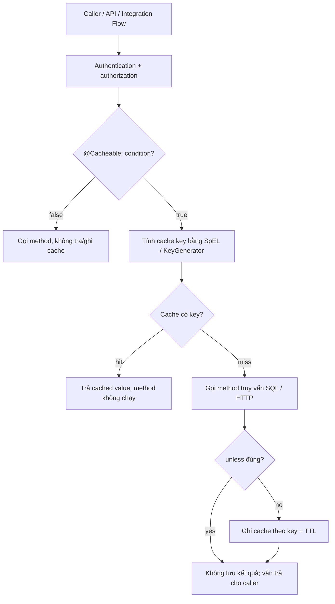
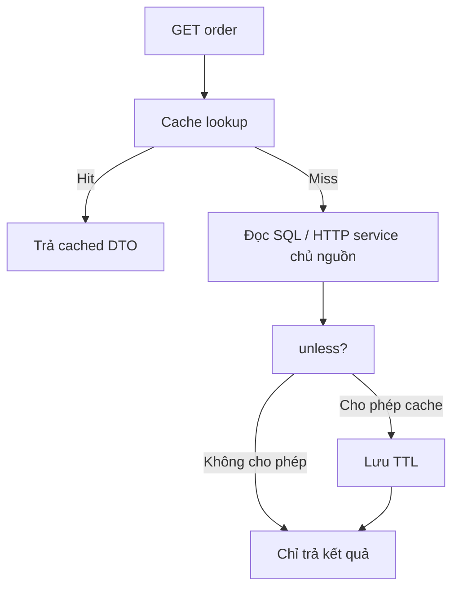

# Cache key, SpEL, condition và unless

> **Chương:** Bộ nhớ đệm  
> **Phạm vi:** Trong module **SPRING_BOOT_INTEGRATION**, Spring Boot trao đổi dữ liệu qua HTTP client, SQL, Redis/cache, broker thông điệp và các adapter Spring Integration. Bài này tập trung vào cách Spring Cache quyết định **một kết quả được lưu dưới khóa nào**, dùng **SpEL** để định nghĩa khóa và điều kiện, và phân biệt **`condition`** với **`unless`** trong các annotation caching. Trọng tâm thực tế là tính đúng đắn dữ liệu, cách ly tenant, transaction, lỗi, xử lý trùng lặp, kiểm thử và quan sát.

## 1. Cache key là một phần của hợp đồng dữ liệu

Giả sử API `GET /tenants/{tenantId}/orders/{orderId}` đọc trạng thái đơn hàng từ SQL rồi dùng Redis để giảm độ trễ. Hai request:

```text
GET /tenants/tenant-a/orders/ORD-42
GET /tenants/tenant-b/orders/ORD-42
```

Nếu cache chỉ dùng `orderId` làm khóa, hai tenant có thể cùng truy cập entry `ORD-42`, dẫn đến dữ liệu sai hoặc **lộ dữ liệu xuyên tenant**. Tương tự, nếu cùng một order nhưng kết quả phụ thuộc ngôn ngữ, đơn vị tiền, quyền truy cập hoặc phiên bản schema mà các yếu tố đó không có trong key, kết quả cache có thể sai dù database đúng.

Một cache key hữu ích phải:

1. **Đủ phân biệt:** tất cả tham số làm thay đổi kết quả phải được phản ánh hoặc có một invariant chứng minh chúng không ảnh hưởng.
2. **Ổn định:** cùng ý định truy vấn luôn tạo cùng key giữa retry, nhiều instance và các lần deploy tương thích.
3. **Không chứa bí mật:** không dùng bearer token, mật khẩu hoặc PII thô làm key; bảo vệ cả log và quyền truy cập backend.
4. **Có phạm vi rõ:** tách tenant, môi trường, cache name, schema/version nếu cần.
5. **Có vòng đời:** TTL, invalidation và quy định xử lý key cũ khi dữ liệu hoặc codec thay đổi.

**Caching là một tối ưu hiệu năng, không phải nguồn sự thật nghiệp vụ.** Cache miss không chứng minh bản ghi không tồn tại, còn cache hit không chứng minh người gọi đã được xác thực hoặc có quyền đọc bản ghi đó.



Lưu ý sơ đồ mô tả `@Cacheable` thông thường và bỏ qua các biến thể đồng bộ hóa đặc biệt như `sync=true`. Khi cache hit, biểu thức `unless` **không được dùng để tái xét kết quả đã cache**.

## 2. Spring Cache abstraction gồm những thành phần nào?

Spring Cache là abstraction quản lý hoạt động đọc/ghi/evict cache thông qua các interceptor/AOP và `CacheManager`. Nó không gắn cố định với Redis; provider có thể là cache trong bộ nhớ, Redis hoặc hệ thống được tích hợp khác.

| Thành phần | Vai trò | Điều cần nhớ |
| --- | --- | --- |
| **`@EnableCaching`** | Bật cơ chế xử lý annotation cache | Không tự tạo Redis server hay policy TTL |
| **`@Cacheable`** | Đọc cache trước; nếu miss mới thực thi method và có thể ghi kết quả | Cache hit thường **bỏ qua method body** |
| **`@CachePut`** | Thực thi method rồi cập nhật cache theo key | Không phải “chỉ put khi miss” |
| **`@CacheEvict`** | Xóa entry hoặc tất cả entry được chỉ định | Mặc định thao tác evict diễn ra sau khi method chạy thành công ở góc nhìn cache interceptor; **không đồng nghĩa sau DB commit** |
| **`@Caching`** | Gộp nhiều operation cache trên một method | Hữu ích khi cần evict nhiều cache |
| **`@CacheConfig`** | Khai báo cấu hình cache chung ở cấp class | Không tự tạo transaction hay quyền truy cập |
| **`CacheManager` / `Cache`** | Định vị vùng cache, thao tác get/put/evict | Semantics TTL/serialization/cluster phụ thuộc provider |
| **`KeyGenerator`** | Tạo key từ method và arguments | Có thể cấu hình toàn cục hoặc đặt tên trên từng annotation |
| **Spring Expression Language (SpEL)** | Tạo key, điều kiện pre-invocation hoặc post-invocation | Biểu thức chỉ thấy biến có sẵn ở đúng thời điểm |

Thông thường annotation được xử lý khi lời gọi đi qua **Spring AOP proxy** của bean. Một method được gọi nội bộ bằng `this.method()` có thể không đi qua proxy, dẫn tới annotation caching không có tác dụng. Các method private hoặc bean không do Spring quản lý cũng không thể giả định interception diễn ra.

### 2.1. Cache name khác cache key

Ví dụ:

```java
@Cacheable(cacheNames = "order-view-v2", key = "#p0 + ':' + #p1")
public OrderView find(String tenantId, String orderId) {
    // ...
}
```

`cacheNames = "order-view-v2"` xác định **vùng cache** do `CacheManager` quản lý; `key` xác định **entry trong vùng đó**. Với RedisCacheManager, key vật lý thường còn được gắn prefix theo cache name/cấu hình backend. Không coi chuỗi SpEL tính ra là toàn bộ key vật lý trên Redis trong mọi provider.

Đừng dùng cùng một cache name cho các DTO không tương thích mà không có chiến lược version/serializer; ứng dụng phiên bản cũ có thể đọc nhầm value mới.

## 3. Khóa mặc định khi không khai báo `key`

Spring Cache dùng `SimpleKeyGenerator` theo cơ chế mặc định thông dụng:

| Tham số method | Khóa mặc định về mặt khái niệm | Ví dụ |
| --- | --- | --- |
| Không có tham số | `SimpleKey.EMPTY` | `allCurrencies()` |
| Một tham số không null, không phải array | Chính đối tượng tham số | `find("ORD-42")` → `"ORD-42"` |
| Nhiều tham số | `SimpleKey` chứa danh sách tham số | `find("tenant-a", "ORD-42")` |
| Một đối tượng dạng array hoặc trường hợp đặc biệt | `SimpleKey` bao các đối số thích hợp | Phụ thuộc cách so sánh/hash của giá trị |

`SimpleKeyGenerator` phù hợp với nhiều trường hợp, nhưng không biết **ý nghĩa nghiệp vụ** của tham số. Nếu method có một tham số là DTO tùy biến với `equals()`/`hashCode()` không ổn định, hoặc kết quả phụ thuộc một thông tin chỉ nằm trong security context, khóa mặc định có thể không đúng kỳ vọng.

**Một key mặc định không tự bao gồm tên method, tên class, tenant hay version.** Cache name có thể phân vùng theo nghiệp vụ, nhưng nếu hai method dùng chung một cache và có bộ tham số trùng nhau mà trả kiểu/ý nghĩa khác nhau, nguy cơ va chạm logic vẫn tồn tại.

### 3.1. Các lỗi khóa mặc định dễ bị bỏ qua

```java
// Nguy cơ: method trả kết quả khác nhau theo tenant đang đăng nhập,
// nhưng cache key chỉ có orderId.
@Cacheable("order-view")
public OrderView findOrder(String orderId) {
    String tenant = currentTenantFromSecurityContext();
    return database.load(tenant, orderId);
}
```

Nếu cache hit, **method body không chạy** nên không thể dựa vào `currentTenantFromSecurityContext()` bên trong để bảo vệ quyền truy cập. Bảo vệ đúng gồm **xác thực/phân quyền trước khi cho phép trả cache hit**, đồng thời key phải chứa scope tenant đáng tin cậy.

Các rủi ro khác: tham số mutable bị thay đổi sau khi dùng làm key; composite key được encode không ổn định giữa instance; cách normalize chữ hoa/thường khác nhau; thay đổi serializer sau deploy; nhiều vùng cache dùng cùng key prefix vật lý.

### 3.2. Không đồng nhất cache key với idempotency key

| Cache key | Idempotency key |
| --- | --- |
| Nhận diện **kết quả tra cứu** có thể tái sử dụng | Nhận diện **một ý định thực thi thao tác** khi retry |
| Có thể expire/evict theo TTL cache | Retention phải bao phủ retry/replay SLA của nghiệp vụ |
| Miss thường dẫn tới tính toán/đọc lại | Miss của một dedup record **không chứng minh** side effect chưa từng xảy ra |
| Thường được sinh từ tham số hàm đọc | Do client/producer và scope nghiệp vụ thống nhất |

Không dùng Redis cache thông thường và `@Cacheable` như lớp bảo đảm duy nhất chống tạo đơn/thanh toán trùng. Với side effect quan trọng, cần unique constraint, inbox/outbox hoặc record idempotency bền vững.

## 4. SpEL trong annotation caching

**SpEL** (*Spring Expression Language*) cho phép tham chiếu tham số, method, cache name, thậm chí bean helper để tính key hoặc điều kiện. Biểu thức được đánh giá trong một **evaluation context** do Spring Cache tạo ra cho từng lời gọi.

| Biểu thức | Ý nghĩa | Dùng ở đâu? |
| --- | --- | --- |
| `#p0` hoặc `#a0` | Tham số thứ nhất theo vị trí | `key`, `condition`; cũng dùng được tại `unless` |
| `#p1` / `#a1` | Tham số thứ hai | Tạo composite key, điều kiện theo tham số |
| `#tenantId` | Tham số có tên `tenantId` nếu metadata tên tham số hiện diện | Dễ đọc; cần build giữ parameter names, ví dụ `-parameters` |
| `#root.methodName` | Tên method đang được intercept | Phân biệt operation khi nhiều method dùng cùng cache |
| `#root.targetClass` | Kiểu class đích | Có thể dùng khi sinh key theo type |
| `#root.target` | Bean đối tượng đích | Dùng hạn chế vì coupling vào implementation |
| `#root.args[0]` | Danh sách tham số từ root object | Tương đương tham chiếu tham số theo index |
| `#root.caches[0].name` | Tên cache đầu tiên từ danh sách cache đích | Hữu ích khi debug; cẩn thận nếu cấu hình nhiều cache |
| `#result` | Kết quả method **khi nó đã có** | `unless` của `@Cacheable`; các vị trí post-invocation được annotation hỗ trợ |
| `@beanName.method(...)` | Gọi một Spring bean theo tên | Tạo khóa có quy ước phức tạp; không gọi I/O nặng trong SpEL |

Ví dụ so sánh:

```java
@Cacheable(
    cacheNames = "order-view-v2",
    key = "#p0 + ':' + #p1",
    condition = "#p0 != null && #p1 != null",
    unless = "#result == null")
public OrderView find(String tenantId, String orderId) {
    // ...
}
```

Khi tên tham số được giữ đúng trên class file, có thể viết `key = "#tenantId + ':' + #orderId"` để dễ đọc hơn. Trong hệ thống build phức tạp, `#p0` và `#p1` tránh phụ thuộc vào parameter-name discovery, nhưng nếu đổi thứ tự tham số thì **SpEL cũng phải được cập nhật**.

### 4.1. Không đưa `#result` vào biểu thức trước khi method chạy

`condition` được đánh giá **trước khi thực thi method**; lúc này chưa có business result. Do đó:

```java
// Sai về ngữ nghĩa: condition cần #result nhưng result chưa có.
@Cacheable(cacheNames = "orders",
           condition = "#result.status() == 'CONFIRMED'")
public OrderView find(String orderId) { /* ... */ }
```

Đối với quyết định “chỉ lưu khi kết quả CONFIRMED”, sử dụng **`unless`** và phải bảo vệ trường hợp null:

```java
@Cacheable(
    cacheNames = "orders",
    unless = "#result == null || #result.status() != 'CONFIRMED'")
public OrderView find(String orderId) { /* ... */ }
```

Ví dụ này không dùng khi `status` là kiểu dữ liệu khác; hãy điều chỉnh biểu thức cho DTO thực tế. Với `Optional<T>` được Spring Cache hỗ trợ, `#result` ở `unless` có semantics kết quả được **unwrap** trong các trường hợp phù hợp; không mặc định `#result` luôn là `Optional` cần gọi `isPresent()`.

### 4.2. SpEL có thể lỗi và phải được test

Biểu thức như `#p0.toLowerCase()` có thể lỗi khi tham số null; `#result.status()` có thể lỗi khi result null. Expression sai, bean helper không tồn tại hoặc trả kiểu không đúng có thể làm operation cache bị lỗi lúc runtime, không chỉ “bỏ qua cache”.

Nên giữ biểu thức ngắn, có guard null, đặt tên rõ, và test chính **bean proxy** với những tham số null/empty/enum lạ. Không lồng query SQL, Redis hay HTTP call trong biểu thức chỉ để tính key.

## 5. Khác biệt quan trọng giữa `condition` và `unless`

| Tiêu chí | `condition` | `unless` |
| --- | --- | --- |
| Thời điểm đánh giá | **Trước** lời gọi method (`@Cacheable`) | **Sau khi method có kết quả** nếu cần xét lưu (`@Cacheable`) |
| Đối tượng truy cập | Method, arguments, context | Method, arguments và `#result` |
| Ý nghĩa boolean `true` | **Cho phép** hoạt động cache được xét | **Ngăn ghi** kết quả vào cache |
| Boolean `false` | Bỏ qua cache và vẫn chạy method | Cho phép ghi kết quả nếu flow thích hợp |
| Có thể tránh chạy method nếu cache hit? | Có, khi `condition=true` và entry hit | Không; `unless` không chạy trên cache hit thông thường |
| Trường hợp điển hình | Chỉ cache truy vấn đọc hợp lệ, flag cho phép cache | Không lưu null, lỗi nghiệp vụ hoặc dữ liệu tạm thời |

Tên của hai thuộc tính tạo ra một sự **đảo chiều rất dễ nhầm**:

```java
condition = "#p2 == false"              // true -> tham gia cache
unless    = "#result == null"           // true -> KHÔNG lưu
```

### 5.1. Bảng chân trị trên một cache miss

| `condition` | Có thực thi method? | `unless` | Ghi cache? |
| --- | --- | --- | --- |
| false | Có | Không cần đánh giá | **Không** |
| true | Có (vì miss) | false | **Có** |
| true | Có (vì miss) | true | **Không** |

Nếu `condition=true` và cache **hit**, method thường không chạy, `unless` không được dùng để kiểm tra cached result thêm một lần. Một policy “không được trả kết quả PENDING” chỉ có `unless` **không thể xóa những entry PENDING đã bị lưu trước đó**; cần invalidation, version key hoặc sửa quy tắc quyền truy cập/lookup.

### 5.2. Ví dụ điều kiện input và output

Giả sử có method:

```java
@Cacheable(
    cacheNames = "order-view-v2",
    key = "#p0 + ':' + #p1",
    condition = "#p0 != null && #p1 != null && !#p2",
    unless = "#result == null || #result.status() == 'PROCESSING'")
public OrderView findOrder(
        String tenantId, String orderId, boolean bypassCache) {
    // ...
}
```

Giải nghĩa:

- `bypassCache=true` → `condition=false` → không đọc cache, không ghi cache, method luôn chạy.
- `bypassCache=false`, key có trong cache → trả entry ngay.
- Cache miss, database trả `null` → trả null cho caller, **không lưu null**.
- Cache miss, database trả status `PROCESSING` → không lưu kết quả tạm thời.
- Cache miss, database trả status `CONFIRMED` → có thể lưu theo TTL của cache provider.

Vì kết quả của method phụ thuộc vào tenant và order, **`bypassCache` không cần trở thành phần của key** nếu nó chỉ điều khiển caching chứ không thay đổi dữ liệu trả về. Ngược lại, nếu có tham số `includeHistory` làm thay đổi nội dung DTO, phải đưa nó vào key hoặc chọn cache riêng.

### 5.3. `unless` không phải validation hay error handler

Khi method ném exception, không có result thành công để lưu theo đường đi thông thường của `@Cacheable`. `unless` không tự chuyển exception thành null, không phân loại HTTP 404/503 và không retry. Validation nên ở ranh giới request/DTO, lỗi hạ tầng cần policy riêng, còn `unless` chỉ quyết định **có ghi kết quả đã tính vào cache hay không**.

## 6. Ví dụ Spring Boot 3.x: cache kết quả đọc đơn từ PostgreSQL

Ví dụ sử dụng Spring Boot 3.x, Java 17+, Spring Cache và Redis. Giả định ứng dụng đã có bảng `orders` với các cột `tenant_id`, `order_id`, `status`, `updated_at`. Database là nguồn dữ liệu chính; cache chỉ để giảm số query đọc.

### 6.1. Dependencies

```xml
<dependencies>
    <dependency>
        <groupId>org.springframework.boot</groupId>
        <artifactId>spring-boot-starter-cache</artifactId>
    </dependency>
    <dependency>
        <groupId>org.springframework.boot</groupId>
        <artifactId>spring-boot-starter-data-redis</artifactId>
    </dependency>
    <dependency>
        <groupId>org.springframework.boot</groupId>
        <artifactId>spring-boot-starter-jdbc</artifactId>
    </dependency>
</dependencies>
```

Ứng dụng cần driver PostgreSQL runtime, kết nối `DataSource` được cấu hình và Redis server khả dụng. Dùng Spring Boot parent/BOM quản lý version dependency. Đối với cache trong bộ nhớ, có thể chọn provider khác thay vì Redis; không tự thêm Redis chỉ để dùng `@Cacheable`.

### 6.2. Bật caching và cấu hình provider

```java
package com.example.integration.cache;

import org.springframework.cache.annotation.EnableCaching;
import org.springframework.context.annotation.Configuration;

@Configuration
@EnableCaching
public class CacheConfiguration {}
```

```yaml
spring:
  cache:
    type: redis
    cache-names: order-view-v2
    redis:
      time-to-live: 5m
      cache-null-values: false
      use-key-prefix: true
  data:
    redis:
      host: ${REDIS_HOST:localhost}
      port: ${REDIS_PORT:6379}
      timeout: 2s
```

Ở đây **`spring.cache.redis.time-to-live` là TTL cache** do Spring Boot/RedisCacheManager cấu hình, không phải timeout truy vấn SQL hoặc Redis command. `cache-null-values=false` bảo vệ thêm ở backend, nhưng `unless` ở method vẫn hữu ích để diễn đạt rõ quy tắc không lưu null và có thể áp dụng khi đổi provider.

Không dùng một TTL chung cho mọi loại dữ liệu nếu yêu cầu freshness khác nhau. Chẳng hạn trạng thái đơn vừa thanh toán có thể cần invalidation nhanh hơn dữ liệu danh mục sản phẩm. Với TTL riêng theo cache, có thể cấu hình `RedisCacheManagerBuilderCustomizer` hoặc API cấu hình tương ứng với phiên bản Spring Data Redis.

### 6.3. DTO và service

```java
package com.example.integration.cache;

import java.time.Instant;

public record OrderView(
        String orderId,
        String status,
        Instant updatedAt
) {}
```

```java
package com.example.integration.cache;

import java.util.List;
import org.springframework.cache.annotation.Cacheable;
import org.springframework.jdbc.core.JdbcTemplate;
import org.springframework.stereotype.Service;

@Service
public class OrderViewService {
    private final JdbcTemplate ordersJdbc;

    public OrderViewService(JdbcTemplate ordersJdbc) {
        this.ordersJdbc = ordersJdbc;
    }

    @Cacheable(
        cacheNames = "order-view-v2",
        key = "#p0 + ':' + #p1",
        condition = "#p0 != null && #p1 != null",
        unless = "#result == null || #result.status() == 'PROCESSING'")
    public OrderView find(String tenantId, String orderId) {
        List<OrderView> rows = ordersJdbc.query("""
            SELECT order_id, status, updated_at
              FROM orders
             WHERE tenant_id = ? AND order_id = ?
            """,
            (rs, row) -> new OrderView(
                rs.getString("order_id"),
                rs.getString("status"),
                rs.getTimestamp("updated_at").toInstant()
            ),
            tenantId, orderId
        );
        return rows.stream().findFirst().orElse(null);
    }
}
```

**Tính đúng đắn:** `tenantId` phải được đối chiếu với danh tính đã xác thực ở **boundary trước khi truy cập kết quả cache**, không chỉ bên trong `find()` (vì hit bỏ qua body). Nếu ứng dụng cho phép tenant/order ID chứa dấu `:`, cách nối chuỗi đơn giản có thể va chạm. Hãy validate ký tự định danh hoặc dùng encoder có cấu trúc được minh họa ở mục 8.

**Trường hợp database không tìm thấy:** phương thức trả null; với biểu thức `unless` ở trên, không ghi entry null. Các lệnh SQL hỏng, timeout DB hoặc exception mapping không tự chuyển thành cache miss. Vì service dùng `JdbcTemplate` blocking, nó phù hợp Spring MVC/worker imperative; trong WebFlux event-loop phải có ranh giới blocking phù hợp hoặc dùng R2DBC nếu cần pipeline non-blocking.

### 6.4. Cache không phải xác thực người dùng

Giả sử HTTP controller nhận `tenantId` từ path rồi gọi service đã cache. Một kiểm tra tenant *chỉ được thực hiện ở bên trong method `find()`* sẽ bị bỏ qua trên cache hit. Cần xác thực, kiểm tra quyền và bind tenant đáng tin cậy **trước invocation tới bean caching**, hoặc tổ chức security interceptor ở ranh giới có thứ tự đảm bảo, đồng thời dùng key có tenant scope.

Đừng chỉ lấy `tenantId` từ một header do client tự cung cấp rồi giả định đó là phạm vi bảo mật.

## 7. `@CachePut`, `@CacheEvict` và ranh giới cập nhật dữ liệu

### 7.1. `@CachePut` luôn thực thi method

```java
@CachePut(
    cacheNames = "order-view-v2",
    key = "#p0 + ':' + #p1",
    condition = "#p0 != null && #p1 != null",
    unless = "#result == null")
public OrderView refresh(String tenantId, String orderId) {
    return loadFreshView(tenantId, orderId);
}
```

Mẫu này **luôn gọi `loadFreshView(...)`** khi invocation đi qua cache proxy, rồi quyết định có put kết quả vào cache hay không. `@CachePut` không có nghĩa “đọc cache nếu có”; nó thường dùng khi kết quả mới phải được cập nhật vào cache.

Với `@CachePut`, biểu thức key có thể được đánh giá sau invocation và một số ngữ cảnh annotation hỗ trợ `#result` ở key/unless; nhưng key chứa đối tượng kết quả khiến invalidation từ operation khác khó khớp. Nên ưu tiên khóa ổn định từ business identity.

**Không gắn `@Cacheable` và `@CachePut` trên cùng một method một cách tùy tiện.** Một annotation muốn bỏ qua method khi cache hit, annotation kia lại yêu cầu method luôn chạy; cách phối hợp phức tạp dễ sai nếu không có contract rõ ràng.

### 7.2. `@CacheEvict` loại bỏ entry

```java
@CacheEvict(cacheNames = "order-view-v2",
            key = "#p0 + ':' + #p1")
public void invalidate(String tenantId, String orderId) {
    // Service chỉ mô tả cache invalidation theo key.
}
```

Nếu call đi qua cache proxy và method hoàn thành, entry được xóa theo key. `beforeInvocation = true` yêu cầu evict **trước** method body, kể cả khi method sau đó lỗi; cần dùng có chủ đích, không mặc định tốt hơn.

```java
@CacheEvict(cacheNames = "order-view-v2", allEntries = true)
public void clearOrderViewCache() {
    // Operation quản trị: xóa vùng cache, có thể gây cache stampede.
}
```

`allEntries=true` thường xóa toàn bộ entry trong cache được chỉ định; không đưa vào đường nghiệp vụ thường xuyên. Với Redis, phạm vi key prefix, pattern và cách clear tùy provider/config; phải đo tác động và quyền Redis. Không kết hợp `allEntries=true` với một giả định rằng `key` vẫn lọc được chỉ một entry.

### 7.3. DB transaction commit và cache operation không phải cùng một transaction

Một lỗi kinh điển:

```text
@Transactional cập nhật orders trong SQL
→ @CachePut ghi Redis hoặc @CacheEvict xóa Redis
→ SQL transaction rollback sau đó
→ Cache và database có thể lệch nhau
```

Hoặc, SQL đã commit, nhưng cache eviction thất bại, làm hệ thống trả dữ liệu cũ. `@Transactional` của JDBC/JPA **không tự rollback Redis** và không biến HTTP, Kafka hay JMS thành transaction chung.

Đối với thay đổi nghiệp vụ quan trọng:

1. Ghi dữ liệu SQL và bản ghi **outbox** trong cùng database transaction nếu cần phát event.
2. Sau commit, phát sự kiện/invalidate cache theo chiến lược có thể retry.
3. Cập nhật phiên bản key hoặc TTL để giới hạn thời gian stale.
4. Consumer chịu được message trùng và xử lý eviction/update theo key ổn định.

Một lựa chọn trong cùng process là `@TransactionalEventListener(phase = TransactionPhase.AFTER_COMMIT)` để thực hiện eviction sau commit. Nhưng nếu process crash ngay sau commit và trước listener, event in-memory có thể mất; nếu yêu cầu reliability xuyên crash, dùng outbox hoặc cơ chế đồng bộ lại.

### 7.4. Ví dụ invalidation sau commit trong cùng ứng dụng

```java
package com.example.integration.cache;

import org.springframework.cache.Cache;
import org.springframework.cache.CacheManager;
import org.springframework.stereotype.Component;
import org.springframework.transaction.event.TransactionPhase;
import org.springframework.transaction.event.TransactionalEventListener;

record OrderChanged(String tenantId, String orderId) {}

@Component
public class OrderCacheInvalidator {
    private final CacheManager cacheManager;

    public OrderCacheInvalidator(CacheManager cacheManager) {
        this.cacheManager = cacheManager;
    }

    @TransactionalEventListener(phase = TransactionPhase.AFTER_COMMIT)
    public void onOrderChanged(OrderChanged event) {
        Cache cache = cacheManager.getCache("order-view-v2");
        if (cache != null) {
            cache.evict(event.tenantId() + ":" + event.orderId());
        }
    }
}
```

Đoạn này giả định service cập nhật đơn phát `OrderChanged` **trong transaction SQL đang hoạt động** qua `ApplicationEventPublisher`. Nếu không có transaction, listener kiểu này không nhất thiết được gọi (trừ khi cấu hình fallback execution). Nhớ giữ cùng một thuật toán key như `@Cacheable`; cách nối `tenantId + ':' + orderId` chỉ an toàn khi các định danh đã được validate và không chứa dấu phân tách.

Nếu cache invalidation thất bại sau commit, không thể rollback DB; cần metric/alert và cơ chế retry/reconciliation tương ứng.

## 8. Dùng bean tạo key hoặc KeyGenerator khi SpEL quá dài

Với nhiều dịch vụ, việc copy biểu thức nối key giữa `@Cacheable`, `@CacheEvict` và mã invalidation thủ công dễ sinh lỗi. Một bean chung giúp thống nhất encoding/version/scope.

### 8.1. KeyPolicy được gọi từ SpEL

```java
package com.example.integration.cache;

import org.springframework.stereotype.Component;

@Component("cacheKeyPolicy")
public class CacheKeyPolicy {
    public String order(String tenantId, String orderId) {
        if (tenantId == null || orderId == null) {
            throw new IllegalArgumentException("Missing cache key field");
        }
        // Length prefix tránh va chạm do dấu phân tách trong input.
        return "v2:t" + tenantId.length() + ":" + tenantId
             + ":o" + orderId.length() + ":" + orderId;
    }
}
```

```java
@Cacheable(
    cacheNames = "order-view-v2",
    key = "@cacheKeyPolicy.order(#p0, #p1)",
    condition = "#p0 != null && #p1 != null",
    unless = "#result == null")
public OrderView find(String tenantId, String orderId) {
    // ...
}
```

`@cacheKeyPolicy.order(...)` gọi bean có tên `cacheKeyPolicy` trong SpEL, không phải Java static method. Để invalidate thủ công, inject **cùng bean** vào `OrderCacheInvalidator` và gọi `keyPolicy.order(...)` thay vì copy thuật toán.

**Versioning:** `v2` trong key và `order-view-v2` trong cache name giúp cách ly dữ liệu cũ khi thay đổi schema hoặc serializer. Chọn quy tắc bump version có chủ đích, tránh tạo quá nhiều entry cũ không được dọn. Key được stringify/serialize thế nào còn phụ thuộc CacheManager/provider.

### 8.2. Dùng KeyGenerator khi muốn chuẩn hóa theo method

```java
package com.example.integration.cache;

import java.lang.reflect.Method;
import org.springframework.cache.interceptor.KeyGenerator;
import org.springframework.context.annotation.Bean;
import org.springframework.context.annotation.Configuration;

@Configuration
class CacheKeyGeneratorConfiguration {
    @Bean("scopedKeyGenerator")
    KeyGenerator scopedKeyGenerator() {
        return (Object target, Method method, Object... params) -> {
            // Ví dụ minh họa; production phải encode tham số ổn định,
            // có scope tenant và xử lý kiểu dữ liệu phức tạp rõ ràng.
            return method.getDeclaringClass().getSimpleName()
                    + ":" + method.getName()
                    + ":" + java.util.Arrays.deepToString(params);
        };
    }
}
```

Được dùng như sau:

```java
@Cacheable(cacheNames = "reference-data",
           keyGenerator = "scopedKeyGenerator")
public ReferenceData lookup(String tenantId, String code) {
    // ...
}
```

**Giới hạn của generator minh họa:** `Arrays.deepToString()` không phải một serializer canonical đủ an toàn cho mọi loại object, map, secret hoặc array rất lớn. Với hệ nhiều instance, cần chuẩn hóa encoding và schema của tham số, hạn chế input, ẩn PII, giữ ổn định sau nâng cấp.

Không chỉ định đồng thời `key` và `keyGenerator` trong cùng annotation: đó là hai chiến lược **loại trừ nhau** cho việc chọn key.

## 9. Phạm vi key theo tenant, quyền truy cập và định dạng kết quả

### 9.1. Tenant scope và user-specific result

Nếu cached result phụ thuộc vào **tenant**, key phải bao gồm tenant đã được xác thực. Nếu kết quả còn phụ thuộc **quyền từng user**, chỉ tenant scope có thể chưa đủ. Ví dụ một endpoint trả trường dữ liệu tùy role:

```java
// Nguy cơ: cùng tenant/order nhưng admin và viewer thấy trường khác nhau.
@Cacheable(cacheNames = "order-details", key = "#p0 + ':' + #p1")
public OrderDetails details(
        String tenantId, String orderId, boolean includeSensitiveFields) {
    // ...
}
```

Nếu `includeSensitiveFields` làm nội dung thay đổi, nó phải được đưa vào key **hoặc tách cache/DTO theo scope**; thường tốt hơn cache một DTO nội bộ không chứa thông tin bí mật rồi áp dụng biến đổi quyền/ẩn trường ở boundary đã xác thực.

Không lưu bản copy data đã được lọc theo user trong cache dùng chung nếu không thiết kế key/authorization rõ. Token, session ID, role lấy trực tiếp từ request không được tin nếu chưa qua security middleware.

### 9.2. Locale, currency và feature flag

Những yếu tố khác có thể thay đổi kết quả:

| Yếu tố | Khi cần đưa vào key? | Ví dụ |
| --- | --- | --- |
| Locale/ngôn ngữ | Khi DTO đã chứa chuỗi được dịch | `product:vi-VN:SKU-1` |
| Currency | Khi số tiền được chuyển đổi hoặc format khác | `price:VND:SKU-1` |
| Feature flag | Khi flag làm thay đổi nội dung trả về trong thời gian rollout | Version cache hoặc flag trong key |
| API contract version | Khi cấu trúc DTO khác, không đọc lẫn value | `order-view-v2` |
| Pagination/sort/filter | Khi kết quả khác theo trang và thứ tự | Key chứa filter/sort/page canonical |
| Authorization scope | Khi result đã bị lọc theo quyền | Dùng cache vùng riêng hoặc key có scope đã xác thực |

Không đưa timestamp hiện tại hoặc request ID ngẫu nhiên vào key khi chúng **không thật sự thay đổi dữ liệu**; làm vậy khiến tỷ lệ hit gần như bằng 0. Ngược lại, bỏ qua một tham số làm thay đổi output gây cache poisoning.

## 10. Consistency: TTL, stale data và invalidation

### 10.1. TTL không sửa được key sai

TTL một phút chỉ giới hạn thời gian sai có thể tồn tại; nó không biến việc trả nhầm tenant thành chấp nhận được. Nếu key thiếu tenant, lỗi isolation vẫn xảy ra ngay khi cache hit. **Thiết kế key và authorization đúng trước, tối ưu TTL sau.**

### 10.2. Cache-aside, read-through và stale reads

`@Cacheable` thường triển khai mô hình read-through ở mức method:



Khi SQL cập nhật nhưng cache chưa evict, entry có thể stale. Trong hệ nhiều instance, việc local eviction ở một node chưa chắc xóa được cache của node khác nếu backend là cache in-memory. Với Redis chung, invalidation qua cùng cache region/key có thể ảnh hưởng tất cả instance, nhưng network outage, replication lag và race với request đang đọc vẫn cần được tính đến.

### 10.3. Cạnh tranh giữa read miss và write

Một race có thể xảy ra:

1. Reader A cache miss, đọc dữ liệu cũ từ SQL.
2. Writer B cập nhật SQL và evict key.
3. Reader A kết thúc rồi **put dữ liệu cũ** vào cache sau eviction.

Vì vậy **evict sau commit** là cần trong nhiều thiết kế nhưng chưa chắc đủ cho nhất quán tuyến tính dưới mọi race. Với dữ liệu nhạy cảm về phiên bản, có thể dùng:

- Version/sequence trong DTO và key; chỉ công bố snapshot phù hợp version.
- Versioned cache keys dựa trên state version từ nguồn bền vững.
- TTL ngắn hoặc bỏ cache cho thao tác quyết định quan trọng.
- Mô hình điều phối cập nhật/đọc có tính nhất quán cao hơn khi SLA thật sự yêu cầu.

Không dùng cache làm bằng chứng duy nhất rằng order chưa được thanh toán hay event chưa từng xử lý.

### 10.4. Cache stampede và `sync=true`

Khi một key “nóng” vừa hết TTL, nhiều request đồng thời đều miss và cùng gọi database. Spring Cache hỗ trợ một số trường hợp:

```java
@Cacheable(cacheNames = "reference-data",
           key = "#p0",
           sync = true)
public ReferenceData load(String code) {
    // ...
}
```

`sync=true` yêu cầu provider hỗ trợ cơ chế phối hợp để hạn chế nhiều invocation đồng thời cho một key ở phạm vi mà provider thực thi. Đây **không phải cam kết distributed lock xuyên mọi node/provider**, và có các hạn chế với cache operation, ví dụ không dùng chung với `unless` và một số tổ hợp nhiều cache. Không bật như một cách chữa mọi lỗi concurrency mà chưa kiểm tra backend.

### 10.5. Negative caching

Có thể muốn cache “không tìm thấy” để giảm truy vấn vào DB khi nhiều request sai ID, nhưng lưu kết quả null hoặc placeholder có thể khiến một order mới tạo **không xuất hiện** cho đến khi negative entry hết hạn.

Chỉ dùng negative caching nếu hợp đồng cho phép stale-not-found trong một cửa sổ rõ ràng, có TTL ngắn, key đúng scope và invalidation khi tạo bản ghi. `unless="#result == null"` là lựa chọn đơn giản để **không negative-cache null**.

## 11. Những giới hạn của annotation và AOP

### 11.1. Self-invocation bỏ qua cache proxy

```java
@Service
class OrderFacade {
    public OrderView get(String tenantId, String orderId) {
        return this.cachedFind(tenantId, orderId); // Bỏ qua proxy
    }

    @Cacheable(cacheNames = "order-view-v2",
               key = "#p0 + ':' + #p1")
    public OrderView cachedFind(String tenantId, String orderId) {
        // Query...
        return null;
    }
}
```

Trong proxy-based caching mặc định, lời gọi `this.cachedFind(...)` không được chặn bởi interceptor caching. Cách thường dùng: tách method được cache sang một Spring bean riêng và gọi qua constructor injection, hoặc dùng cấu hình interception khác khi thực sự cần.

### 11.2. Method visibility, final và lỗi key expression

Annotation trên method private/final hoặc object không do Spring quản lý có thể không tạo interception mong đợi, tùy loại proxy và cấu hình. Đừng viết unit test gọi trực tiếp một instance bằng `new` rồi kết luận caching đã hoạt động. Test phải chạy qua **bean thật** trong Spring context.

### 11.3. Một annotation không tự giải quyết transaction

`@Cacheable` không mở transaction SQL tự động; method body có thể cần `@Transactional(readOnly=true)` theo yêu cầu truy vấn. `@CachePut` và `@CacheEvict` không cung cấp atomicity xuyên Redis/SQL/HTTP.

Đồng thời, khi một method vừa có `@Transactional` vừa có annotation cache, **thứ tự các advice/proxy** có thể ảnh hưởng thời điểm cache put/evict so với commit. Nếu yêu cầu “chỉ sau commit mới thay cache”, phải thiết kế rõ after-commit hoặc transaction-aware cache handling rồi kiểm thử trên phiên bản framework/provider thực.

## 12. Lỗi backend cache và cách phân loại

| Tình huống | Hành vi nên quyết định | Không nên suy luận |
| --- | --- | --- |
| **Cache miss** | Truy vấn nguồn thật, có thể ghi cache theo `unless` | Không chứng minh dữ liệu không tồn tại |
| **Redis timeout/cache unavailable** | Có thể fallback sang DB với rate limit/bulkhead nếu cache chỉ là tối ưu | Không coi mọi lỗi cache là miss không giới hạn |
| **Sai serializer hoặc schema** | Báo lỗi, invalidate/migrate value có kiểm soát | Không retry vô hạn một value không giải mã được |
| **Cache hit nhưng data stale** | TTL/invalidation/version/reconciliation | Không coi cache là nguồn sự thật cuối |
| **Duplicate concurrent load** | Đo tải, có thể giới hạn concurrency/sync theo provider | Không giả định `@Cacheable` chỉ thực thi method một lần trên toàn cluster |
| **Cache put thất bại sau DB commit** | Metric, retry hoặc để cache miss lần sau theo policy | Không rollback DB bằng `@Transactional` thường |
| **Eviction thất bại** | Cảnh báo, outbox/retry, TTL tối đa stale | Không che lỗi khỏi mọi caller nếu correctness bị ảnh hưởng |

Spring cung cấp `CacheErrorHandler` và các cơ chế mở rộng để xử lý lỗi cache get/put/evict/clear theo chiến lược. Nếu lựa chọn **fail-open** khi cache read hỏng, cần giới hạn tải lên database/HTTP đối tác và không áp dụng cho cache đang giữ state điều phối quan trọng (dedup/lock) như thể nó chỉ là read-through cache.

## 13. Quan sát hiệu quả của key và biểu thức

Một cache có hit rate cao **chưa chắc đúng**; nếu key thiếu tenant thì hit rate có thể cao vì lẫn dữ liệu. Cần quan sát cả hiệu năng lẫn tính đúng đắn:

| Tín hiệu | Câu hỏi cần trả lời |
| --- | --- |
| Cache hit/miss/eviction theo cache name | Cache đang giảm tải hay gây thừa memory? |
| Hit ratio theo operation | Biểu thức key có ổn định qua request không? |
| Cache put skipped do `unless` | Có quá nhiều kết quả null/PROCESSING bị bỏ qua không? |
| `condition=false` rate | Bao nhiêu request chủ động bypass cache? |
| DB/HTTP fallback latency | Khi cache miss/outage, nguồn thật có đủ khả năng phục vụ? |
| Key cardinality và Redis memory | Có key nở vô hạn theo request ID/nonce không? |
| Serializer failures | Có value của phiên bản khác hoặc schema không tương thích không? |
| Stale-data / cache reconciliation incidents | Eviction có xảy ra sau update và đúng key không? |

Metric chuẩn có thể phụ thuộc Spring Boot Actuator, Micrometer và CacheManager/provider. **Không mặc định Spring Cache tự cung cấp metric cho từng nhánh `unless`**; nếu cần, thêm instrumentation tùy chỉnh. Hạn chế cardinality tag: tên cache/operation/loại lỗi là hợp lý, còn `tenantId`, `orderId`, cache key, token hoặc URL thô thường không nên là metric tag.

Log/tracing nên ghi correlation ID được kiểm soát, tên cache và operation outcome; tránh ghi toàn bộ cache key khi nó chứa dữ liệu cá nhân. Với cache kết quả HTTP đối tác, xác định quyền cache, TTL và cách ẩn dữ liệu nhạy cảm trước khi lưu.

## 14. Kiểm thử key, condition, unless và transaction

### 14.1. Bộ test cần thiết

| Ca kiểm thử | Điều cần chứng minh |
| --- | --- |
| Cùng tenant/order, đọc hai lần | Method truy vấn DB một lần nếu entry còn TTL |
| Khác tenant, cùng order ID | Hai cache key độc lập; không trả chéo dữ liệu |
| Khác order ID, cùng tenant | Không đụng key |
| `condition=false` | Method chạy mỗi lần, không đọc/ghi cache |
| `unless=true` vì `null` | Không lưu null; lần sau vẫn gọi nguồn |
| `unless=true` vì `PROCESSING` | Kết quả tạm thời không được cache |
| `unless=false` vì `CONFIRMED` | Kết quả có thể cache |
| Cache hit sau khi đổi dữ liệu nguồn | Thấy dữ liệu cũ theo TTL/invalidation đã cam kết, không “tự cập nhật” |
| SpEL tham số null / input lạ | Không ném lỗi biểu thức ngoài dự kiến |
| Self-invocation | Test phát hiện lời gọi nội bộ không đi qua proxy |
| `@CacheEvict` sau update | Entry được xóa/đổi đúng key, đúng thời điểm tương ứng commit |
| Cache backend outage | Fallback/retry/alert đúng policy, không dồn tải ngoài kiểm soát |
| Đồng thời nhiều request cache miss | Đo stampede, validate `sync=true` nếu bật |
| DTO/serializer phiên bản cũ/mới | Không đọc lẫn dữ liệu không tương thích |

### 14.2. Test Spring Cache bằng bean proxy

Một cách kiểm tra đơn giản với backend test là inject service thật qua Spring context, làm sạch cache rồi gọi hai lần. Pseudocode JUnit:

```java
@SpringBootTest
class OrderViewCacheIT {
    @Autowired OrderViewService service;
    @Autowired CacheManager cacheManager;

    @Test
    void sameTenantOrderUsesOneCacheEntry() {
        Cache cache = cacheManager.getCache("order-view-v2");
        assertThat(cache).isNotNull();
        cache.clear();

        OrderView first = service.find("tenant-a", "ORD-42");
        OrderView second = service.find("tenant-a", "ORD-42");

        assertThat(second).isEqualTo(first);
        // Dùng spy/proxy repository hoặc metric truy vấn để khẳng định
        // SQL thật chỉ được gọi một lần. So sánh DTO thôi chưa đủ.
    }
}
```

Đây là skeleton test: cần imports JUnit 5, AssertJ, Spring cache, fixture PostgreSQL/Redis và những bean thực tế; nên chạy bằng Testcontainers khi cần chứng minh Redis key serialization, TTL, eviction đa instance và SQL transaction. **Không chỉ assert hai kết quả bằng nhau**: một implementation không hề cache cũng có thể trả hai DTO giống nhau.

### 14.3. Test bằng một provider rồi vẫn phải test Redis

Một cache in-memory (như `ConcurrentMapCacheManager` hoặc Caffeine) rất hữu ích cho logic SpEL/key, nhưng **không chứng minh** key/value serialization, Redis TTL, prefix, memory eviction hay behavior khi network timeout. Với production Redis, cần integration test chứa Redis thật hoặc môi trường gần tương đương.

Đặc biệt, nếu một bean custom `KeyGenerator` trả object phức tạp, cache in-memory có thể giữ object bằng `equals()/hashCode()` trong khi Redis serialize thành chuỗi/bytes khác. Test cùng provider production để tránh false confidence.

### 14.4. Test ranh giới cập nhật sau commit

Một test transaction hiệu quả:

1. Bắt đầu update trong SQL transaction, cố tình ném exception trước commit.
2. Kiểm tra database rollback và cache **không chứa giá trị chưa commit**.
3. Update thành công, sau commit xác minh eviction/invalidation đúng key.
4. Giả lập lỗi Redis lúc eviction; ghi metric và kiểm tra cơ chế retry/TTL, không giả định DB rollback.
5. Với broker redelivery, kiểm tra outbox/idempotency bảo vệ side effect thay vì dựa vào một cache key TTL ngắn.

## 15. Những lỗi thiết kế phổ biến

1. **“Mọi tham số trong key mặc định đều đã đủ scope.”** Sai: kết quả có thể phụ thuộc tenant/role từ context hoặc external configuration.
2. **“`@Cacheable` luôn gọi method rồi mới đọc cache.”** Sai: cache hit thường bỏ qua method.
3. **“`condition=true` nghĩa là bỏ qua cache.”** Sai: true cho phép caching; `unless=true` mới ngăn ghi result.
4. **“`unless` có thể chặn kết quả xấu đang nằm trong cache.”** Sai: trên hit thông thường, method không chạy và `unless` không đánh giá lại entry.
5. **“Có thể dùng `#result` trong `condition`.”** Sai: chưa có result ở thời điểm pre-invocation.
6. **“`@CachePut` giống `@Cacheable`.”** Sai: put chủ yếu chạy method và cập nhật cache.
7. **“Một key nối chuỗi bất kỳ luôn duy nhất.”** Sai: delimiter/canonicalization và scope không rõ có thể va chạm.
8. **“`@Transactional` bảo đảm SQL và Redis commit cùng nhau.”** Sai: hai hệ thống có transaction riêng.
9. **“Redis cache có thể thay thế inbox/idempotency.”** Sai: TTL, eviction và failover không bảo vệ side effect đã commit dài hạn.
10. **“Một unit test gọi method bằng `new` đủ xác minh caching.”** Sai: proxy interception cần Spring context hoặc cơ chế AOP phù hợp.
11. **“`sync=true` đảm bảo một DB query duy nhất trong cả cluster.”** Sai: semantics phụ thuộc provider/triển khai.
12. **“Chỉ cần xem hit rate để kết luận cache tốt.”** Sai: key sai có thể làm hit rate cao nhưng lộ dữ liệu hoặc trả stale value.

## 16. Checklist thiết kế cache key và SpEL

1. **Phân loại dữ liệu:** có cần cache không, có nhạy cảm hay có tác dụng phụ khi đọc không?
2. **Liệt kê mọi yếu tố ảnh hưởng kết quả:** tenant, business ID, locale, currency, filter, pagination, role và schema version.
3. **Chọn cache name và key format:** có prefix/version, canonicalization, độ dài và cách ly môi trường.
4. **Chọn `key` hoặc `keyGenerator`:** không dùng đồng thời; giữ thuật toán thống nhất với eviction.
5. **Chốt `condition`:** input nào được tham gia cache trước invocation?
6. **Chốt `unless`:** output nào không được lưu sau khi method chạy?
7. **Thiết kế TTL/invalidation:** freshness, cache stampede, negative caching và race với DB commit.
8. **Đảm bảo authorization:** kiểm tra trước cache hit, không tin tenant/role do caller tự khai báo.
9. **Không thay idempotency bằng cache:** những thao tác side effect dùng constraint/ledger/inbox/outbox bền vững.
10. **Kiểm thử/quan sát:** Spring proxy, provider production, null/miss, tenant isolation, stale/rollback, outage và metric cardinality.

### Câu hỏi tự kiểm tra

1. Cache name và cache key khác nhau thế nào?
2. `SimpleKeyGenerator` chọn khóa gì khi method không có tham số, một tham số và nhiều tham số?
3. Vì sao method đọc dữ liệu theo tenant có thể nguy hiểm nếu key chỉ chứa `orderId`?
4. `#p0`, `#root.methodName` và `#result` có ý nghĩa khác nhau thế nào?
5. Tại sao `#result` không có trong `condition`?
6. Khi `condition=false`, method có được thực thi không và cache có được tra không?
7. Khi `unless=true` trên cache miss, kết quả có được trả về cho caller không?
8. Tại sao `unless` không thể dùng để thu hồi một cached result trên cache hit?
9. Vì sao phải dùng chung thuật toán key cho `@Cacheable` và `@CacheEvict`?
10. Khi cập nhật SQL thất bại sau khi cache đã put, ranh giới transaction nào bị vi phạm?
11. Khi nào `@Cacheable(sync=true)` có thể hữu ích, và vì sao không nên coi nó là distributed idempotency?
12. Những test nào chứng minh không lộ dữ liệu giữa hai tenant và không truy vấn DB khi cache hit?

**Ghi nhớ:** Trong Spring Cache, **key xác định danh tính dữ liệu được tái sử dụng**, còn SpEL giúp định nghĩa danh tính và policy ngay tại method. Với `@Cacheable`, **`condition=true`** cho phép lookup/cache trước lời gọi; **`unless=true`** từ chối lưu **sau khi có kết quả**. Một cache hit có thể bỏ qua toàn bộ method body, nên tenant scope, authorization, TTL và invalidation phải được thiết kế cẩn thận. Khi workflow đi qua SQL, Redis, HTTP và broker, cache chỉ là một lớp tối ưu — tính đúng đắn của giao dịch và xử lý trùng vẫn cần nguồn sự thật bền vững, idempotency và kiểm thử ranh giới thực tế.
