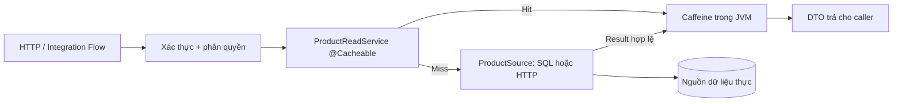
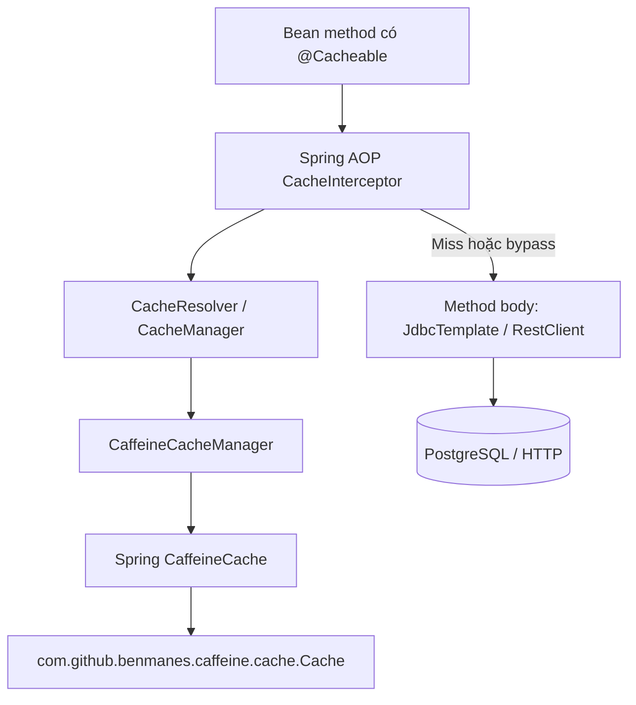
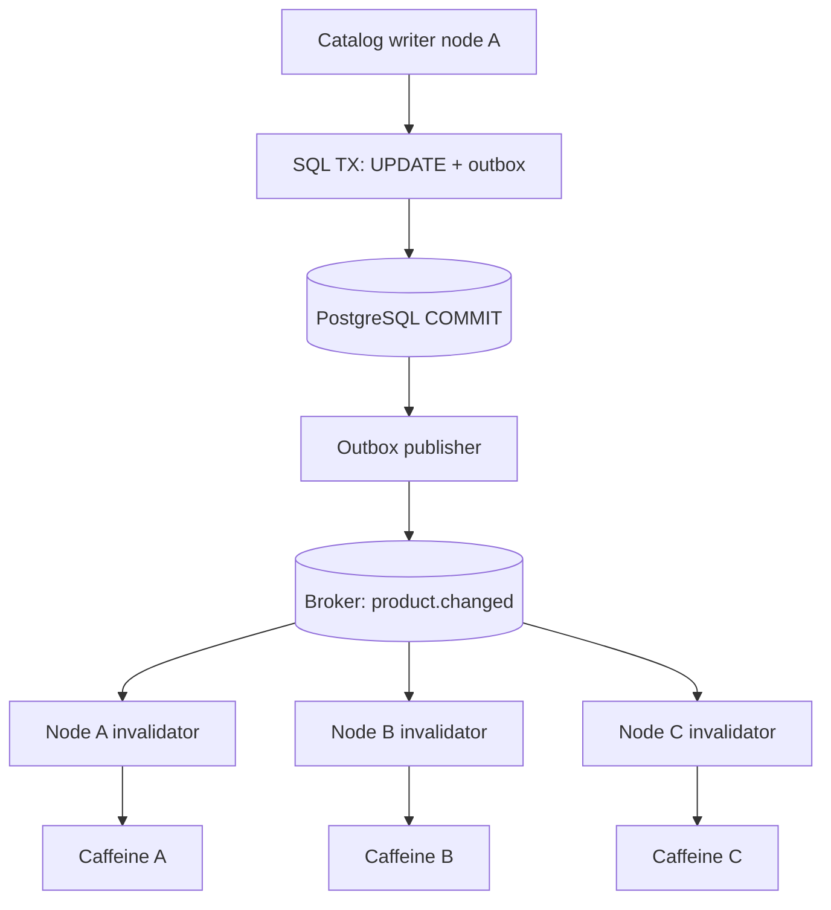
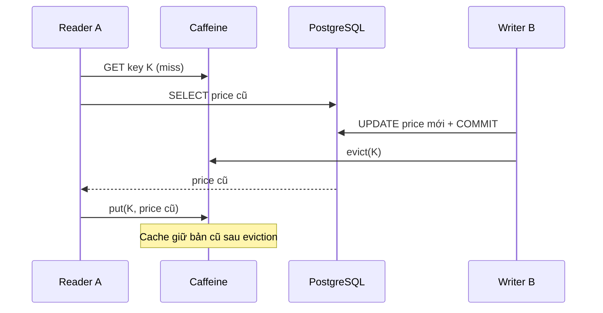

# Tích hợp Caffeine cho cache cục bộ

> **Chương:** Bộ nhớ đệm  
> **Phạm vi:** Trong module **SPRING_BOOT_INTEGRATION**, Spring Boot kết nối hệ thống qua HTTP client, cơ sở dữ liệu, cache, broker thông điệp và adapter Spring Integration. Bài này hướng dẫn tích hợp **Caffeine** làm bộ nhớ đệm **trong tiến trình JVM**, từ dependency và Spring Cache auto-configuration đến thiết kế key, TTL, giới hạn dung lượng, xử lý miss/stampede, cập nhật dữ liệu, tính nhất quán giữa các replica, bảo mật, kiểm thử và quan sát.

## 1. Bài toán: tại sao cần cache cục bộ?

Một API Spring Boot tra cứu sản phẩm có thể nhận hàng nghìn request cho cùng một SKU trong vài phút. Mỗi request đọc PostgreSQL hoặc gọi HTTP đến catalog-service:

```text
GET /tenants/tenant-a/products/SKU-42
        |
        v
Spring Boot ProductReadService
        |
        v
PostgreSQL / HTTP catalog-service
        |
        v
ProductView (giá, tên, phiên bản dữ liệu)
```

Nếu phần lớn kết quả thay đổi ít và được phép cũ tối đa một khoảng thời gian ngắn, ta có thể đặt **Caffeine** giữa service và nguồn dữ liệu:



Khi **cache hit**, method có `@Cacheable` có thể **không chạy**; dữ liệu được lấy từ bộ nhớ của **chính instance** đang xử lý. Khi **cache miss**, method thực thi, lấy dữ liệu nguồn rồi Spring Cache có thể lưu kết quả để tái sử dụng.

**Lợi ích chính:** giảm số lần truy cập DB/HTTP, giảm latency và tải lên hệ phụ thuộc. **Giới hạn chính:** cache trong RAM không bền vững, không chia sẻ tự động giữa các replica và có thể trả dữ liệu cũ.

### Mục tiêu học tập

Sau bài này, người học có thể:

1. Bật Caffeine bằng dependency và `spring.cache.*` trong Spring Boot.
2. Phân biệt Spring Cache abstraction, `CaffeineCacheManager` và native Caffeine cache.
3. Thiết kế key theo tenant, identity, schema version và dữ liệu thật sự ảnh hưởng kết quả.
4. Chọn `maximumSize`, `expireAfterWrite` hoặc `expireAfterAccess` đúng mục tiêu.
5. Dùng `@Cacheable`, `@CachePut` và `@CacheEvict` mà không nhầm thời điểm cập nhật.
6. Hiểu giới hạn của `sync=true`, `refreshAfterWrite`, null caching và cached object mutable.
7. Giải quyết lỗi invalidation, race với SQL transaction và cache cục bộ nhiều instance.
8. Kiểm thử cache hit/miss, concurrency, TTL, memory, instrumentation và bảo mật.

## 2. Caffeine là gì? Khác Redis ở đâu?

**Caffeine** là thư viện Java cung cấp cache in-memory hiệu năng cao, hỗ trợ size-based eviction, expiration, statistics, asynchronous loading và các cơ chế nạp dữ liệu. Nó lưu key/value **trong heap của tiến trình JVM**, không cần server cache bên ngoài.

| Tiêu chí | Caffeine cục bộ | Redis dùng làm cache |
| --- | --- | --- |
| Vị trí dữ liệu | Heap của **mỗi JVM** | Process/server Redis ngoài ứng dụng |
| Network hop khi hit | Không | Có, trừ khi thêm L1 cache cục bộ |
| Chia sẻ giữa nhiều replica | **Không tự động** | Có thể, nếu các replica dùng chung Redis |
| Vòng đời | Mất khi app restart, redeploy hoặc cache bị clear | Phụ thuộc cấu hình Redis persistence/eviction và vận hành |
| Giới hạn tài nguyên | Heap, GC, kích thước key/value, CPU | Redis memory, network, connection pool |
| Eviction/TTL | `maximumSize`, `expireAfterWrite`, `expireAfterAccess`, v.v. | TTL và eviction policy theo Redis/config |
| Invalidation đa instance | Cần cơ chế riêng | Các instance có thể evict cùng key từ backend chung |
| Độ trễ thường gặp | Rất thấp, thao tác trong process | Cao hơn do network/protocol, tùy hạ tầng |
| Trường hợp phù hợp | Reference data, danh mục, kết quả query ít đổi, tính toán thuần | Cache dùng chung, trạng thái cần chia sẻ, key/value lớn hơn khi hạ tầng phù hợp |

**Không nhầm “nhanh” với “đúng”.** Nếu giá sản phẩm vừa được cập nhật ở node A nhưng node B vẫn giữ giá cũ, Caffeine có thể trả dữ liệu stale đến khi B hết TTL hoặc nhận được tín hiệu invalidation.

Với cùng một hệ thống, có thể phối hợp **Caffeine L1 + Redis L2** hoặc Caffeine trước database, nhưng lúc đó phải thiết kế thêm thứ tự đọc, eviction, key version và propagation. Bài này tập trung trước hết vào **một tầng cache local** được quản lý rõ.

## 3. Spring Cache và Caffeine đứng ở các tầng khác nhau

Spring Boot có **Spring Cache abstraction**; Caffeine là một **provider** mà abstraction có thể sử dụng:



| Thành phần | Trách nhiệm |
| --- | --- |
| `@EnableCaching` | Bật interception cho annotation caching theo cấu hình Spring |
| `@Cacheable` | Tra cache trước; cache miss mới gọi method rồi có thể put kết quả |
| `@CachePut` | Gọi method và cập nhật cache bằng kết quả |
| `@CacheEvict` | Xóa key hoặc một vùng cache theo cấu hình |
| `CacheManager` | Định vị các cache theo **cache name** |
| `CaffeineCacheManager` | Triển khai `CacheManager` bằng Caffeine trong memory |
| `CaffeineCache` | Adapter giữa Spring `Cache` và native Caffeine cache |
| `com.github.benmanes.caffeine.cache.Cache` | Cấu trúc cache thực giữ entries/expiry/eviction/stats |

Khi dùng annotation, code nghiệp vụ không cần gọi `getIfPresent()`/`put()` của Caffeine trực tiếp. Ngược lại, một số use case (manual cache, cache loading, expiry đặc thù) có thể phù hợp với **native Caffeine API** hơn abstraction của Spring.

**Quan trọng:** `@Cacheable` hoạt động qua interceptor/proxy. Tạo object bằng `new`, gọi method private hoặc gọi nội bộ `this.cachedMethod()` có thể **bỏ qua cache** theo mô hình proxy-based mặc định.

## 4. Dependency và auto-configuration trong Spring Boot

### 4.1. Maven

Ví dụ **Spring Boot 3.x, Java 17+**:

```xml
<dependencies>
    <dependency>
        <groupId>org.springframework.boot</groupId>
        <artifactId>spring-boot-starter-cache</artifactId>
    </dependency>
    <dependency>
        <groupId>com.github.ben-manes.caffeine</groupId>
        <artifactId>caffeine</artifactId>
    </dependency>
</dependencies>
```

Nếu ví dụ có SQL, thêm `spring-boot-starter-jdbc` và JDBC driver tương ứng; nếu có HTTP, thêm web/HTTP client dependency theo ứng dụng. Khi dùng Spring Boot BOM, **để Boot quản lý version** của Spring Cache và Caffeine trừ khi đã kiểm chứng yêu cầu nâng cấp riêng.

Với Gradle:

```groovy
dependencies {
    implementation 'org.springframework.boot:spring-boot-starter-cache'
    implementation 'com.github.ben-manes.caffeine:caffeine'
}
```

Starter cache cung cấp Spring Cache infrastructure; dependency Caffeine cung cấp backend. Nếu ứng dụng còn có Redis/Hazelcast/JCache trên classpath, **không dựa vào suy đoán provider được chọn theo classpath**: đặt loại cache tường minh, và xác minh `CacheManager` thực tế.

### 4.2. Bật annotation caching

```java
package com.example.integration.cache;

import org.springframework.cache.annotation.EnableCaching;
import org.springframework.context.annotation.Configuration;

@Configuration
@EnableCaching
public class LocalCacheConfiguration {
}
```

`@EnableCaching` bật cơ chế annotation; nó **không** tự tạo một distributed cache và không tự quyết định TTL. Spring Boot có thể tự cấu hình `CaffeineCacheManager` khi dependencies và conditions phù hợp; nếu ứng dụng đã khai báo một bean `CacheManager`, Boot có thể **back off**, vì thế properties không phải lúc nào cũng tác động lên manager tự viết.

### 4.3. application.yml cho một cache region

```yaml
spring:
  cache:
    type: caffeine
    cache-names:
      - catalog-product-v1
    caffeine:
      spec: "maximumSize=10000,expireAfterWrite=2m,recordStats"
```

Giải nghĩa:

- `spring.cache.type=caffeine`: chọn provider Caffeine thay vì để Boot chọn theo những điều kiện khác.
- `spring.cache.cache-names`: khai báo những **cache region** được biết, ví dụ `catalog-product-v1`.
- `spring.cache.caffeine.spec`: một **Caffeine spec** gồm các tùy chọn phân cách bằng dấu phẩy.
- `maximumSize=10000`: định hướng giới hạn số entry trong **mỗi native cache** theo chính sách eviction, không phải 10.000 entry tổng cộng cho cả cluster.
- `expireAfterWrite=2m`: entry hết hạn sau khoảng thời gian từ lần tạo/ghi lại; **read hit không kéo dài hạn**.
- `recordStats`: bật ghi nhận statistics của native cache; có chi phí nhỏ để phục vụ đo lường.

Nếu đã có 5 replica và mỗi replica cho phép region này tối đa khoảng 10.000 entry, toàn hệ có thể giữ **nhiều bản sao** của cùng dữ liệu trong RAM. Memory budget phải tính theo **số cache regions × số instance × kích thước key/value + overhead**, không chỉ theo một con số `maximumSize`.

**Lưu ý:** TTL của Caffeine là **per-entry local policy**, không có nghĩa mọi entry bị xóa vật lý ngay đúng thời điểm hết hạn. Eviction/expiration maintenance có thể xảy ra khi cache có thao tác hoặc theo scheduler nếu đã cấu hình. Về mặt truy xuất, entry hết hạn không còn được coi là hit; việc reclaim memory có thể diễn ra sau đó.

## 5. Hiểu expireAfterWrite, expireAfterAccess và eviction

### 5.1. Các cấu hình cơ bản

| Cấu hình Caffeine | Ý nghĩa | Tình huống thường dùng |
| --- | --- | --- |
| `maximumSize=N` | Evict theo chính sách kích thước khi số entry vượt ngưỡng | Giới hạn memory bằng số lượng key tương đối đồng đều |
| `maximumWeight=N` + `weigher` | Giới hạn theo trọng số riêng do ứng dụng tính | Value có kích thước chênh lệch lớn; cần cân nhắc |
| `expireAfterWrite=2m` | Hết hạn tính từ lần tạo/thay thế value | Giá/danh mục cần freshness định kỳ |
| `expireAfterAccess=2m` | Hết hạn khi không được truy cập trong một khoảng thời gian | Kết quả ít dùng nên bị dọn, nhưng hot key có thể ở lâu |
| `refreshAfterWrite=...` | Cho phép refresh theo thời gian với **loading cache phù hợp** | Muốn cập nhật bất đồng bộ mà không luôn bắt caller chờ reload |
| `recordStats` | Ghi hit/miss/eviction/load statistics | Chẩn đoán hiệu quả cache |

**`maximumSize` không đơn giản là LRU.** Caffeine sử dụng chính sách admission/eviction có tính tới **tần suất và mức độ gần đây** để cải thiện hit rate. Không viết business logic dựa trên thứ tự entry nào bị evict trước.

`maximumWeight` đòi hỏi cách tính weight có ý nghĩa; các object Java có reference, collection và overhead, vì thế không coi `String.length()` là số byte heap thực tế. Việc memory vượt budget vẫn có thể xảy ra nếu một value quá lớn hoặc ứng dụng giữ reference từ nơi khác.

### 5.2. Timeline cho hai kiểu TTL

```text
T0:  key K được ghi vào cache
T1:  caller đọc K
T2:  caller đọc K
T3:  caller đọc K

expireAfterWrite = 2 phút:
    K hết hạn theo thời điểm ghi ở T0
    Read ở T1/T2/T3 không kéo dài TTL

expireAfterAccess = 2 phút:
    K hết hạn khi không có access trong khoảng 2 phút
    Hot key có thể tồn tại lâu nếu liên tục được đọc
```

Với dữ liệu giá, hạn mức, tồn kho hoặc dữ liệu có yêu cầu **freshness tối đa**, `expireAfterWrite` thường dễ suy luận hơn. Với một số dữ liệu tham chiếu có thể giữ lâu nếu còn hot, `expireAfterAccess` có thể hữu ích, nhưng nó **không cung cấp upper bound rõ cho tuổi dữ liệu** của một hot key.

### 5.3. Refresh không phải expiration

`refreshAfterWrite` không đơn giản bằng `expireAfterWrite`:

- Expiration có thể khiến một access sau TTL trở thành miss và phải chờ load.
- Refresh gắn với cơ chế **LoadingCache/AsyncLoadingCache** và loader để cập nhật value; cache có thể tiếp tục trả bản cũ khi refresh đang diễn ra theo semantics phù hợp.
- Không mặc định thêm `refreshAfterWrite=1m` vào `spring.cache.caffeine.spec` sẽ làm tất cả method `@Cacheable` tự refresh theo ý muốn. Với một cấu hình cache không có loader phù hợp, nó có thể không hoạt động hoặc bị từ chối.

Nếu cần stale-while-revalidate, phải thiết kế **loader, error policy, executor, giới hạn refresh concurrency và freshness SLA**, không chỉ thêm một duration.

## 6. Ví dụ hoàn chỉnh: cache dữ liệu sản phẩm đọc từ PostgreSQL

Giả định ứng dụng có bảng:

```sql
CREATE TABLE catalog_products (
    tenant_id VARCHAR(80) NOT NULL,
    sku VARCHAR(120) NOT NULL,
    display_name VARCHAR(300) NOT NULL,
    price_minor BIGINT NOT NULL,
    currency VARCHAR(3) NOT NULL,
    version BIGINT NOT NULL,
    updated_at TIMESTAMPTZ NOT NULL,
    PRIMARY KEY (tenant_id, sku)
);
```

`price_minor` lưu số tiền theo **đơn vị nhỏ nhất đã thống nhất** để tránh sai số float; `currency` giúp nhận biết đơn vị; `version` và `updated_at` phục vụ điều tra freshness. Database là nguồn sự thật, Caffeine chỉ giữ bản đọc.

### 6.1. DTO bất biến

```java
package com.example.integration.catalog;

import java.time.Instant;

public record ProductView(
        String sku,
        String displayName,
        long priceMinor,
        String currency,
        long version,
        Instant updatedAt
) {}
```

Dùng `record` với các thành phần kiểu bất biến là một lựa chọn phù hợp cho cache local. Nếu DTO có `List`/`Map` mutable, một record **không tự bảo vệ dữ liệu sâu bên trong**; cần copy bất biến hoặc defensive copy.

### 6.2. Nguồn dữ liệu bên dưới

```java
package com.example.integration.catalog;

public interface ProductSource {
    ProductView load(String tenantId, String sku);
}
```

```java
package com.example.integration.catalog;

import java.util.List;
import org.springframework.jdbc.core.JdbcTemplate;
import org.springframework.stereotype.Repository;

@Repository
public class JdbcProductSource implements ProductSource {
    private final JdbcTemplate jdbc;

    public JdbcProductSource(JdbcTemplate jdbc) {
        this.jdbc = jdbc;
    }

    @Override
    public ProductView load(String tenantId, String sku) {
        List<ProductView> values = jdbc.query("""
                SELECT sku, display_name, price_minor, currency,
                       version, updated_at
                  FROM catalog_products
                 WHERE tenant_id = ? AND sku = ?
                """,
                (rs, row) -> new ProductView(
                        rs.getString("sku"),
                        rs.getString("display_name"),
                        rs.getLong("price_minor"),
                        rs.getString("currency"),
                        rs.getLong("version"),
                        rs.getTimestamp("updated_at").toInstant()),
                tenantId, sku);
        return values.stream().findFirst().orElse(null);
    }
}
```

Trong ví dụ này, JDBC là API **blocking**; không gọi trực tiếp trên Reactor event-loop của WebFlux/RSocket. Nếu muốn sử dụng HTTP client thay thế, có thể viết implementation khác của `ProductSource`, nhưng phải quy định timeout, 4xx/5xx, auth và fallback riêng.

### 6.3. Tạo key có tenant scope và version

```java
package com.example.integration.catalog;

import org.springframework.stereotype.Component;

@Component("catalogKeyPolicy")
public class CatalogKeyPolicy {

    public String product(String tenantId, String sku) {
        if (tenantId == null || tenantId.isBlank()
                || sku == null || sku.isBlank()) {
            throw new IllegalArgumentException(
                    "tenantId and sku must not be blank");
        }
        if (tenantId.length() > 80 || sku.length() > 120) {
            throw new IllegalArgumentException(
                    "cache identity is too long");
        }

        // Length-prefix tránh va chạm nếu value chứa ký tự phân tách.
        return "product:v1:t" + tenantId.length() + ":" + tenantId
                + ":s" + sku.length() + ":" + sku;
    }
}
```

**Vì sao không dùng `key = "#sku"`?** SKU có thể lặp ở nhiều tenant. **Vì sao không chỉ nối `tenantId + ':' + sku`?** Nếu hai phần chứa dấu phân tách, có thể xảy ra va chạm giữa những cặp giá trị khác nhau; length-prefix hoặc một structured key bất biến giảm nguy cơ này.

`tenantId` phải đến từ **nguồn danh tính đã xác thực hoặc được đối chiếu trước caching boundary**, không phải một header tùy ý mà user tự đặt. Key này chứa tên tenant thô; nếu tenant ID được xem là nhạy cảm, có thể dùng opaque ID hoặc digest có scope và salt quản lý phù hợp. Tránh log toàn bộ key.

### 6.4. Service có @Cacheable

```java
package com.example.integration.catalog;

import org.springframework.cache.annotation.Cacheable;
import org.springframework.stereotype.Service;

@Service
public class ProductReadService {
    private final ProductSource source;

    public ProductReadService(ProductSource source) {
        this.source = source;
    }

    @Cacheable(
        cacheNames = "catalog-product-v1",
        key = "@catalogKeyPolicy.product(#p0, #p1)",
        condition = "#p0 != null && #p1 != null",
        unless = "#result == null")
    public ProductView find(String tenantId, String sku) {
        return source.load(tenantId, sku);
    }
}
```

Luồng xử lý:

1. Spring Cache kiểm tra `condition` **trước lời gọi method**.
2. Nếu điều kiện cho phép, SpEL gọi bean `catalogKeyPolicy` để tính key.
3. Caffeine tìm key trong region `catalog-product-v1` của **JVM hiện tại**.
4. Nếu **hit**, trả `ProductView` đã cache, **không gọi `source.load(...)`**.
5. Nếu **miss**, gọi `source.load(...)` để thực hiện query SQL.
6. Nếu trả `null`, `unless="#result == null"` khiến **không put null**.
7. Nếu trả DTO khác null, Spring Cache put vào Caffeine theo TTL/eviction policy.

**Đừng nhầm `unless` với validation.** Exception SQL hoặc lỗi deserialize không được `unless` “biến thành cache miss”. Cần phân loại lỗi nguồn thật riêng. Với `condition=false`, method vẫn chạy nhưng không đọc/ghi cache; biểu thức này không tự thay việc validate tham số.

### 6.5. Boundary kiểm tra quyền nằm trước cache hit

Một pattern an toàn:

```java
@GetMapping("/tenants/{tenantId}/products/{sku}")
public ProductView product(
        @PathVariable String tenantId,
        @PathVariable String sku,
        Authentication authentication) {

    authorization.checkCanReadTenant(authentication, tenantId);
    return productReadService.find(tenantId, sku);
}
```

Đây là snippet controller minh họa; `authorization` là service kiểm tra quyền được triển khai riêng và `Authentication` đến từ Spring Security. **Không chuyển phần kiểm tra quyền chỉ vào `ProductReadService.find()` nếu phần method body sẽ bị bỏ qua trên hit**. Cần đặt authorization tại boundary **chắc chắn được thực thi mỗi request** hoặc tại một lớp advice có thứ tự/semantics đã được kiểm thử.

## 7. Khi nào nên cache một HTTP response?

Trong tích hợp Spring Boot, `ProductSource` có thể gọi một API bên ngoài thay vì PostgreSQL:

```java
package com.example.integration.catalog;

import org.springframework.beans.factory.annotation.Qualifier;
import org.springframework.web.client.RestClient;

public final class HttpProductSource implements ProductSource {
    private final RestClient client;

    public HttpProductSource(
            @Qualifier("catalogRestClient") RestClient client) {
        this.client = client;
    }

    @Override
    public ProductView load(String tenantId, String sku) {
        return client.get()
                .uri("/internal/v1/tenants/{tenantId}/products/{sku}",
                        tenantId, sku)
                .retrieve()
                .body(ProductView.class);
    }
}
```

Đây là **implementation thay thế** cho JDBC, không được đăng ký cùng lúc dưới hai bean `ProductSource` không phân biệt. Để triển khai thật, cần khai báo `catalogRestClient`, TLS/service credentials, timeout, mapping lỗi và quyết định tenant/authorization. Không cho caller tùy ý nhập base URL nhằm tránh SSRF.

**Không cache mọi HTTP response như nhau:**

| Loại kết quả | Chính sách thường phù hợp |
| --- | --- |
| 200 + DTO tham chiếu ít đổi | Cache TTL rõ và có cơ chế invalidation khi cần |
| 404 “không tồn tại” | Cân nhắc negative caching TTL ngắn; có thể bỏ qua để tránh stale-not-found |
| 401/403 | **Không** biến thành response cache chung; đây là security/business failure |
| 429 hoặc 503 | Không lưu thành “sản phẩm không tồn tại”; backoff/fallback đúng policy |
| Timeout sau request đọc | Phân loại lỗi; retry hữu hạn nếu an toàn; không tự gán null |
| HTTP POST tạo tài nguyên | Không dùng `@Cacheable` thay cho idempotency record |

Nếu HTTP source trả DTO thay đổi theo locale, currency, feature flag hoặc role, **mọi yếu tố ảnh hưởng output phải có trong key hoặc tách cache region**. Không lấy cached DTO của người dùng có quyền cao trả cho người dùng quyền thấp.

## 8. @Cacheable, @CachePut và @CacheEvict có semantics khác nhau

| Annotation | Khi nào method chạy? | Điều xảy ra với Caffeine |
| --- | --- | --- |
| `@Cacheable` | Bỏ qua body khi cache hit thông thường; chạy khi miss/bypass | Đọc key rồi có thể put kết quả |
| `@CachePut` | Thực thi method khi invocation đi qua proxy | Put kết quả mới theo key, không dùng để skip method theo hit |
| `@CacheEvict` | Method được gọi theo điều kiện; evict trước/sau theo cấu hình | Xóa key hoặc toàn region local |
| `@Caching` | Theo các annotation con | Có thể phối hợp nhiều cache operations |

### 8.1. condition và unless là hai giai đoạn

```java
@Cacheable(
    cacheNames = "catalog-product-v1",
    key = "@catalogKeyPolicy.product(#p0, #p1)",
    condition = "#p0 != null && #p1 != null",
    unless = "#result == null")
public ProductView find(String tenantId, String sku) {
    // ...
}
```

- `condition=true`: **cho phép cache được xét trước invocation**.
- `condition=false`: bỏ qua cache, vẫn gọi method.
- `unless=true`: **không lưu result sau khi method chạy**.
- Với cache hit, `unless` không phải bộ lọc để xét lại cached result ở mọi request.

Nếu DTO thiếu `sku`, validation phải được thực hiện trong thiết kế API/domain, không kỳ vọng biểu thức `unless` thay thế hoàn toàn kiểm soát schema.

### 8.2. Không cache null hoặc mutable references tùy tiện

Caffeine native cache không lưu `null` như một value thông thường. Spring `CaffeineCache` có thể **adapt null bằng sentinel** tùy cấu hình `allowNullValues` của manager; vì thế không được dựa vào suy đoán “Caffeine không chứa null nên `@Cacheable` luôn bỏ qua kết quả null”.

`unless="#result == null"` diễn đạt policy không cache null ở mức method. Nếu cần cache not-found, dùng **kết quả có cấu trúc** (ví dụ trạng thái `NOT_FOUND` có TTL riêng) hoặc quy ước khác đã được kiểm thử.

Trong local cache, value thường là **cùng object reference** được trả cho caller. Nếu caller sửa một `List` mutable bên trong cached DTO, request tiếp theo có thể nhìn thấy dữ liệu đã bị thay đổi **mà không truy vấn source**. Dùng immutable DTO và defensive copy khi cần.

## 9. Tùy chỉnh nhiều cache region với TTL khác nhau

Một cấu hình `spring.cache.caffeine.spec` chung thường áp dụng **cùng policy** cho những cache được manager này tạo. Nhưng dữ liệu có freshness khác nhau:

- `catalog-product-v1`: mô tả/giá sản phẩm được phép stale 2 phút.
- `catalog-stock-v1`: số lượng tồn kho chỉ được phép stale 10 giây.

Trong trường hợp cần **policy riêng từng region**, có thể tạo thủ công một `SimpleCacheManager` từ những `CaffeineCache`:

```java
package com.example.integration.cache;

import java.time.Duration;
import java.util.List;

import com.github.benmanes.caffeine.cache.Caffeine;
import org.springframework.cache.CacheManager;
import org.springframework.cache.caffeine.CaffeineCache;
import org.springframework.cache.support.SimpleCacheManager;
import org.springframework.context.annotation.Bean;
import org.springframework.context.annotation.Configuration;

@Configuration(proxyBeanMethods = false)
class PerRegionCaffeineConfiguration {

    @Bean
    CacheManager cacheManager() {
        CaffeineCache product = new CaffeineCache(
                "catalog-product-v1",
                Caffeine.newBuilder()
                        .maximumSize(10_000)
                        .expireAfterWrite(Duration.ofMinutes(2))
                        .recordStats()
                        .build());

        CaffeineCache stock = new CaffeineCache(
                "catalog-stock-v1",
                Caffeine.newBuilder()
                        .maximumSize(2_000)
                        .expireAfterWrite(Duration.ofSeconds(10))
                        .recordStats()
                        .build());

        SimpleCacheManager manager = new SimpleCacheManager();
        manager.setCaches(List.of(product, stock));
        return manager;
    }
}
```

**Chỉ chọn một trong hai cách cấu hình** cho bài thực hành:

- **Cách A — Boot auto-configuration:** `spring.cache.type=caffeine` + `spring.cache.caffeine.spec`.
- **Cách B — Custom manager:** tự khai báo bean `CacheManager` và quản lý từng native cache như trên.

Nếu chọn **Cách B**, không thể mặc định `spring.cache.caffeine.spec` sẽ tiếp tục chỉnh cấu hình của manager tự viết; chính code tạo `CaffeineCache` đang sở hữu policy. Không đặt đồng thời hai cấu hình rồi đoán “policy nào thắng”.

**Cảnh báo nghiệp vụ:** 10 giây stale stock có thể vẫn quá dài nếu kiểm tra tồn kho là bước giữ hàng chính thức. Cache dùng để hiển thị gợi ý không được thay thế **reserve stock transaction** ở nguồn dữ liệu có thẩm quyền.

## 10. @Cacheable(sync=true) và cache stampede

**Cache stampede** xảy ra khi nhiều request cùng đọc một key vừa hết TTL:

```text
T0: catalog-product-v1/SKU-42 hết hạn
T1: Request A -> miss -> query SQL
T2: Request B -> miss -> query SQL
T3: Request C -> miss -> query SQL
...
Tn: N request đều làm tải backend tăng mạnh
```

Spring Cache hỗ trợ:

```java
@Cacheable(
    cacheNames = "catalog-product-v1",
    key = "@catalogKeyPolicy.product(#p0, #p1)",
    sync = true)
public ProductView findSynced(String tenantId, String sku) {
    return source.load(tenantId, sku);
}
```

`sync=true` yêu cầu cache provider phối hợp để tránh nạp đồng thời **cùng một key** ở phạm vi provider hỗ trợ. Caffeine là một provider có thể hỗ trợ cơ chế atomic per-key loading qua Spring Cache get-with-loader.

**Giới hạn phải hiểu rõ:**

1. `sync=true` trong một Caffeine cache **không tạo distributed lock giữa nhiều JVM**.
2. Nó có giới hạn cấu hình: không dùng chung với `unless` và các tổ hợp operation/cache name không được hỗ trợ.
3. Các key khác nhau vẫn có thể được load đồng thời; cần giới hạn toàn cục nếu backend có rate limit.
4. Nếu loader thất bại, các caller có thể cùng thấy lỗi; cần retry/backoff/circuit breaker ở tầng phù hợp.
5. Một hot key có thể gây head-of-line waiting trong cùng JVM khi nạp rất chậm; theo dõi loader latency.

**Không copy `sync=true` vào ví dụ `ProductReadService.find()` ở mục 6 rồi giữ nguyên `unless`**: cấu hình kết hợp này không hợp lệ theo semantics Spring Cache sync caching. Nếu muốn loại bỏ null, có thể chọn một **sentinel/result wrapper** có hợp đồng rõ hoặc thiết kế loader chỉ trả dữ liệu hợp lệ.

### 10.1. Nếu backend HTTP cũng bị giới hạn tải

Giả sử 20 replica cùng miss một key. `sync=true` có thể giới hạn một load per key **trong mỗi replica**, nhưng backend vẫn có thể nhận 20 HTTP requests. Nếu mức tải đó vẫn quá cao, cần:

- Cache chung như Redis hoặc phương án invalidation/coalescing qua cluster.
- Bulkhead/rate limiter ở HTTP client.
- Prewarm những key có lưu lượng lớn nếu thực sự cần.
- Cơ chế fallback **không đánh đổi security hoặc freshness**.

Không dùng một Redis lock TTL ngắn như bảo đảm duy nhất cho lệnh ghi nghiệp vụ; việc chống trùng side effect đòi hỏi database unique constraint/ledger riêng.

## 11. Cập nhật dữ liệu: eviction phải đúng key và đúng thời điểm

Giả sử admin thay giá sản phẩm trong PostgreSQL. Nếu chỉ sửa database, local cache của từng instance có thể tiếp tục trả giá cũ.

### 11.1. Mẫu đơn giản @CacheEvict

```java
@CacheEvict(
    cacheNames = "catalog-product-v1",
    key = "@catalogKeyPolicy.product(#p0, #p1)")
public void invalidate(String tenantId, String sku) {
    // Chỉ phục vụ thao tác evict khi được gọi qua Spring proxy.
}
```

Đây là phương pháp xóa một entry trong cache của **instance hiện tại**. Không có nghĩa mọi replica đều được invalidated. Với thay đổi SQL trong một `@Transactional`, còn cần xem **cache eviction xảy ra trước hay sau DB commit**.

### 11.2. Sai lầm: cập nhật cache trong transaction SQL rồi transaction rollback

```text
BEGIN SQL TRANSACTION
  UPDATE catalog_products SET price_minor = 119000
  @CachePut hoặc @CacheEvict ghi/xóa Caffeine
  Exception -> ROLLBACK SQL
END

Kết quả có thể xảy ra:
  SQL giữ giá cũ
  Cache đã chứa giá mới hoặc đã bị xóa
```

Local Caffeine cache **không phải tài nguyên tham gia JDBC transaction**. `@Transactional` không tự rollback một put/evict đã diễn ra trong RAM.

### 11.3. Gửi event trong transaction, invalidate sau commit

Một thiết kế tốt hơn trong **cùng JVM** dùng `@TransactionalEventListener(AFTER_COMMIT)`:

```java
package com.example.integration.catalog;

public record ProductChanged(String tenantId, String sku) {}
```

```java
package com.example.integration.catalog;

import org.springframework.context.ApplicationEventPublisher;
import org.springframework.jdbc.core.JdbcTemplate;
import org.springframework.stereotype.Service;
import org.springframework.transaction.annotation.Transactional;

@Service
public class ProductPriceMutationService {
    private final JdbcTemplate jdbc;
    private final ApplicationEventPublisher events;

    public ProductPriceMutationService(
            JdbcTemplate jdbc,
            ApplicationEventPublisher events) {
        this.jdbc = jdbc;
        this.events = events;
    }

    @Transactional
    public void updatePrice(
            String tenantId, String sku, long newPriceMinor) {
        if (newPriceMinor < 0) {
            throw new IllegalArgumentException(
                    "newPriceMinor must not be negative");
        }

        int rows = jdbc.update("""
                UPDATE catalog_products
                   SET price_minor = ?,
                       version = version + 1,
                       updated_at = CURRENT_TIMESTAMP
                 WHERE tenant_id = ? AND sku = ?
                """, newPriceMinor, tenantId, sku);

        if (rows != 1) {
            throw new IllegalStateException(
                    "Product not found or not unique");
        }

        events.publishEvent(new ProductChanged(tenantId, sku));
    }
}
```

```java
package com.example.integration.catalog;

import org.springframework.cache.Cache;
import org.springframework.cache.CacheManager;
import org.springframework.stereotype.Component;
import org.springframework.transaction.event.TransactionPhase;
import org.springframework.transaction.event.TransactionalEventListener;

@Component
public class LocalProductCacheInvalidator {
    private final CacheManager manager;
    private final CatalogKeyPolicy keys;

    public LocalProductCacheInvalidator(
            CacheManager manager,
            CatalogKeyPolicy keys) {
        this.manager = manager;
        this.keys = keys;
    }

    @TransactionalEventListener(
        phase = TransactionPhase.AFTER_COMMIT)
    public void invalidate(ProductChanged event) {
        Cache cache = manager.getCache("catalog-product-v1");
        if (cache != null) {
            cache.evict(keys.product(
                    event.tenantId(), event.sku()));
        }
    }
}
```

Khi event được publish **trong transaction đang hoạt động**, listener dạng `AFTER_COMMIT` thực thi sau khi transaction đó commit thành công. Nếu transaction rollback, listener không thực hiện eviction theo nhánh sau commit này. Nếu không có transaction, listener mặc định **không** chạy trừ khi bật hành vi fallback thích hợp; phải kiểm thử boundary.

**Đây chưa phải chiến lược nhất quán đa instance.** Event qua `ApplicationEventPublisher` là **in-process**, không phải event bền vững, và chỉ xóa cache trên node đang xử lý thay đổi. Nếu JVM crash ngay sau commit trước eviction, event in-memory cũng có thể mất.

### 11.4. Thiết kế nhiều replica



Nếu cần phát invalidation cho tất cả replica:

1. Ghi **ProductChanged event/outbox** cùng transaction SQL khi yêu cầu durability.
2. Phát qua broker hoặc bus thích hợp.
3. **Mỗi replica** phải thực sự nhận sự kiện invalidation; với Kafka **cùng consumer group sẽ chia partition**, không phát một event tới **mọi** instance trong cùng group. Cần subscription topology phù hợp (ví dụ group riêng từng instance, pub/sub đúng semantics, hoặc cache version).
4. Consumer kiểm tra event ID/version và evict đúng key; xử lý trùng an toàn.
5. Nếu một node offline bỏ lỡ thông báo, TTL tối đa hoặc reconciliation/version key phải đảm bảo không stale vô hạn.

**Nếu cần read-after-write nhất quán mạnh giữa mọi node**, local cache bất đồng bộ thường không phải lựa chọn đơn giản nhất. Cân nhắc đọc trực tiếp nguồn sự thật cho operation quan trọng, dùng shared cache có chiến lược nhất quán hoặc thiết kế version read nghiêm ngặt.

## 12. Race condition: evict sau commit vẫn có thể bị stale write

Một race kinh điển:



Vì vậy **evict sau commit là một phần của thiết kế, không phải chứng minh linearizability**. Để giảm rủi ro:

- TTL có giới hạn rõ theo freshness SLA.
- DTO mang `version`/`updatedAt` để phát hiện stale.
- Key dạng `tenant:sku:version` khi caller có thể xác định source version đáng tin cậy.
- Chỉ đọc từ nguồn thật cho quyết định nhạy cảm như thực thi thanh toán/giữ hàng.
- Hoặc thiết kế cơ chế cache update/compare-version có thứ tự phù hợp; đừng hy vọng một eviction fire-and-forget đủ bảo vệ mọi race.

**Cache local không thay thế SQL optimistic locking.** Nếu hai writer cập nhật cùng sản phẩm, cần constraint/version check trong database, không dùng giá trị cache làm cơ chế khóa chính.

## 13. Multi-tenant, security và dữ liệu nhạy cảm

### 13.1. Key phải phản ánh mọi yếu tố ảnh hưởng kết quả

| Yếu tố | Nếu bỏ khỏi key, có thể xảy ra |
| --- | --- |
| Tenant | Lộ sản phẩm/giá của tenant khác |
| SKU hoặc entity ID | Hai thực thể dùng chung một value |
| Currency | Trả giá USD cho request VND |
| Locale | Trả tên/đơn vị ngôn ngữ sai |
| Feature flag/version | Một rollout trả schema/logic cũ |
| Filter/sort/page | Trả kết quả tìm kiếm của truy vấn khác |
| Authorization scope | Cached response đã được lọc theo quyền bị đưa cho user quyền thấp |

Một số yếu tố không nhất thiết phải nằm trong key nếu chúng **không làm thay đổi dữ liệu cache**; ví dụ correlation ID chỉ phục vụ tracing. Ngược lại, đưa request ID ngẫu nhiên vào key cho mọi request sẽ gần như triệt tiêu hit rate.

**Thứ tự an toàn:** xác thực caller → kiểm tra quyền tenant/resource → gọi bean cache. Không đặt kiểm tra quyền chỉ bên trong method có `@Cacheable` nếu method body bị skip trên hit.

### 13.2. Tránh cache thông tin bí mật

Không cache raw access tokens, passwords hoặc dữ liệu nhạy cảm dài hạn trong heap nếu không có đánh giá bảo mật. Heap dump, debugger, crash report hoặc memory diagnostics có thể làm lộ value. Nếu cần cache authorization decision, phải có freshness, revocation semantics và fail-closed policy theo nhu cầu; TTL “5 phút” không tự phù hợp mọi hành động bảo mật.

Không dùng một key có bearer token làm metric tag hoặc log. Mỗi JVM có một vùng memory riêng nhưng **không phải boundary bảo mật** nếu các request multi-tenant cùng process.

## 14. Quản lý bộ nhớ, kích thước và vòng đời cache

Cache local rất nhanh nhưng dùng chung heap với HTTP requests, SQL result mapping, messaging buffers và Reactor streams. Memory pressure có thể khiến GC pause tăng hoặc JVM hết heap.

### 14.1. Ước lượng memory budget

Ví dụ minh họa:

```text
maximumSize = 10.000 entries
ước lượng mỗi key+value+overhead ~ 2 KB/entry
memory thô ~ 20 MB cho một region / một JVM

Nếu 4 cache regions có cùng quy mô:
  ~ 80 MB/JVM chưa kể object graphs/GC overhead

Nếu 8 replicas:
  có thể giữ nhiều bản sao (~640 MB trên cả cluster theo ước lượng)
```

**Con số 2 KB chỉ là giả định**; object graph thực tế phải đo bằng heap profiling/JFR/metrics. `maximumSize` giới hạn số entry theo chính sách, không giới hạn kích thước mỗi value. Một value chứa hàng megabyte hoặc tham chiếu đến object graph khổng lồ vẫn có thể gây OOM.

### 14.2. Giới hạn nhập liệu trước khi cache

Một endpoint nhận input tùy ý `search?q=...` có thể tạo một key mới cho mỗi câu query, khiến cache ít hit và nhiều eviction:

- Validate chiều dài, ký tự và số lượng filter.
- Normalize input có ý nghĩa, nhưng không thay đổi semantics của truy vấn.
- Không cache những truy vấn quá hiếm, quá đắt về memory hoặc chứa dữ liệu nhạy cảm.
- Hạn chế tổng số request đồng thời khi cache miss (bulkhead).
- Quan sát cardinality và churn thay vì chỉ hit rate.

### 14.3. Application shutdown, redeploy và warmup

Caffeine cache cục bộ **mất nội dung khi tiến trình dừng**; với các cache cơ bản không cần thao tác shutdown network như Redis client. Spring context quản lý lifecycle của `CacheManager`; nếu có custom scheduler/executor/loader riêng, ứng dụng phải đảm bảo chúng được shutdown đúng cách.

Sau rolling deployment, replica mới có cache lạnh, dẫn tới **cold-start thundering herd** nếu mọi instance đồng loạt truy vấn backend. Có thể prewarm một tập key hữu hạn, tăng dần traffic, có concurrency limit hoặc dùng shared cache nếu thực sự cần. Không prewarm mọi dữ liệu người dùng/tenant một cách vô hạn.

## 15. Quan sát Caffeine và Spring Cache

Caffeine hỗ trợ thống kê qua `recordStats`:

| Chỉ số | Ý nghĩa và giới hạn |
| --- | --- |
| **Hit count / hit rate** | Tỷ lệ lookup tìm thấy entry; cao chưa chắc key đúng |
| **Miss count** | Có thể do cold start, TTL, eviction, sai key hoặc bypass |
| **Load success/failure** | Khi dùng cache-loading operation tương ứng |
| **Eviction count/weight** | Caffeine dọn entry theo policy; phân biệt expire/evict khi phân tích |
| **Estimated size** | Xấp xỉ số entry; không phải số byte heap |
| **Load duration** | Độ trễ nạp dữ liệu khi đã instrumentation phù hợp |

Với Boot Actuator/Micrometer và provider phù hợp, một số metric cache được bind tự động. Nhưng **không mặc định mọi branch `condition/unless` đều có metric riêng**; muốn đo bypass, stale recheck hoặc lỗi hợp đồng nghiệp vụ cần thêm instrumentation ở service.

### 15.1. Đọc thống kê native cache để chẩn đoán

```java
package com.example.integration.cache;

import org.springframework.cache.Cache;
import org.springframework.cache.CacheManager;
import org.springframework.cache.caffeine.CaffeineCache;

public class CacheDiagnostics {
    private final CacheManager manager;

    public CacheDiagnostics(CacheManager manager) {
        this.manager = manager;
    }

    public String catalogSnapshot() {
        Cache springCache =
                manager.getCache("catalog-product-v1");

        if (!(springCache instanceof CaffeineCache caffeine)) {
            return "catalog-product-v1 is not a CaffeineCache";
        }

        var nativeCache = caffeine.getNativeCache();
        var stats = nativeCache.stats();
        return "estimatedSize=" + nativeCache.estimatedSize()
                + ", hits=" + stats.hitCount()
                + ", misses=" + stats.missCount()
                + ", evictions=" + stats.evictionCount();
    }
}
```

Đây là class minh họa đọc metric, chưa được đánh dấu thành Spring bean hoặc HTTP endpoint; không nên expose trực tiếp thông tin nội bộ ra public API. Để stats có ý nghĩa, cache cần bật `recordStats`. `estimatedSize()` là xấp xỉ và có thể chưa phản ánh ngay tất cả hoạt động maintenance.

**Không dùng tenantId, SKU hoặc raw cache key làm metric label.** Tên region, operation, outcome/error class có cardinality thấp thích hợp hơn. Nếu cần phân tích một key riêng, dùng trace/log có kiểm soát quyền truy cập và redact dữ liệu.

### 15.2. Kết hợp tín hiệu cache với nguồn dữ liệu

Một miss rate tăng không tự chứng minh Caffeine lỗi. Có thể do thay đổi key schema sau deploy, traffic từ nhiều tenant mới, TTL quá ngắn hoặc dữ liệu thay đổi liên tục. Cần so sánh với:

- JDBC query count/latency và connection pool.
- HTTP client request count/timeout/rate-limit.
- Heap usage, GC pause, CPU.
- Số entry cache và eviction count theo region.
- Cache invalidation event lag, replica skew và stale-data incidents.
- Tần suất 404/null/PROCESSING bị bỏ qua bởi policy.

**Đo tính đúng đắn trước tối ưu hit ratio:** cache hit rất cao nhưng trả nhầm tenant/giá cũ vẫn là lỗi nghiêm trọng.

## 16. Kiểm thử Caffeine: cần chứng minh bean proxy và behavior

### 16.1. Bộ tình huống tối thiểu

| Tình huống | Kỳ vọng |
| --- | --- |
| Hai lần đọc cùng tenant/SKU | Chỉ một lần gọi source nếu cache còn entry |
| Hai tenant có cùng SKU | Hai key độc lập, không trả dữ liệu chéo |
| SKU khác nhau | Không đụng key |
| `condition=false` | Method chạy nhưng cache không lookup/put |
| Source trả null + `unless=true` | Không lưu null; lần sau có thể load lại |
| Source ném exception | Không biến thành một cached success giả |
| Entry hết TTL | Lần truy cập sau TTL nạp lại dữ liệu |
| Vượt `maximumSize` | Có eviction/limit theo policy, không giữ số entry tăng vô hạn |
| 10 caller cùng miss một key với `sync=true` | Số lần load được phối hợp **trong một cache instance** |
| Update SQL rollback | Event `AFTER_COMMIT` không evict theo nhánh đã thiết kế |
| Update SQL commit | Entry đúng key bị evict sau commit |
| Update ở node A, đọc ở node B | Thấy giới hạn consistency đã định; không giả định local cache tự chia sẻ |
| Source/DTO sau nâng cấp | Key region/version khác hoặc compatibility được kiểm thử |
| Caller cố truy cập tenant khác | Authorization vẫn được kiểm tra trước khi dùng cached DTO |

### 16.2. Ví dụ unit/integration test với Spring cache proxy và source đếm số lần load

Ví dụ bên dưới xây **test Spring context nhỏ**; không cần PostgreSQL/Redis để chứng minh interception và key isolation. Test sử dụng class `ProductReadService` và `CatalogKeyPolicy` ở trên:

```java
package com.example.integration.catalog;

import static org.assertj.core.api.Assertions.assertThat;

import java.time.Instant;
import java.util.concurrent.atomic.AtomicInteger;

import com.github.benmanes.caffeine.cache.Caffeine;
import org.junit.jupiter.api.Test;
import org.springframework.beans.factory.annotation.Autowired;
import org.springframework.cache.CacheManager;
import org.springframework.cache.annotation.EnableCaching;
import org.springframework.cache.caffeine.CaffeineCacheManager;
import org.springframework.context.annotation.Bean;
import org.springframework.context.annotation.Configuration;
import org.springframework.test.context.junit.jupiter.SpringJUnitConfig;

@SpringJUnitConfig(classes = {
        ProductReadService.class,
        CatalogKeyPolicy.class,
        LocalCaffeineCacheTest.Config.class
})
class LocalCaffeineCacheTest {

    static final class CountingSource implements ProductSource {
        final AtomicInteger loads = new AtomicInteger();

        @Override
        public ProductView load(String tenantId, String sku) {
            loads.incrementAndGet();
            return new ProductView(
                    sku, tenantId + "-product", 125000L, "VND",
                    1L, Instant.parse("2026-11-21T03:00:00Z"));
        }
    }

    @Configuration
    @EnableCaching
    static class Config {
        @Bean
        CountingSource countingSource() {
            return new CountingSource();
        }

        @Bean
        CacheManager cacheManager() {
            var manager = new CaffeineCacheManager(
                    "catalog-product-v1");
            manager.setCaffeine(Caffeine.newBuilder()
                    .maximumSize(100)
                    .recordStats());
            return manager;
        }
    }

    @Autowired ProductReadService service;
    @Autowired CountingSource source;

    @Test
    void cachesPerTenantAndSku() {
        ProductView first = service.find("tenant-a", "SKU-42");
        ProductView second = service.find("tenant-a", "SKU-42");
        ProductView otherTenant =
                service.find("tenant-b", "SKU-42");

        assertThat(second).isEqualTo(first);
        assertThat(otherTenant.displayName())
                .isEqualTo("tenant-b-product");
        assertThat(source.loads.get()).isEqualTo(2);
    }
}
```

**Test ghi chú:** Bean `CountingSource` đồng thời hiện thực `ProductSource` nên Spring có thể inject nó vào `ProductReadService` mà **không cần khai báo bean `ProductSource` thứ hai**. Khai báo thêm một bean cùng interface không cần thiết dễ dẫn đến nhiều ứng viên hoặc wiring mơ hồ. Điều thiết yếu là service phải là **Spring bean proxy**, không phải object tạo bằng `new`.

Test cần được cô lập khỏi cache entries/test khác; nếu nhiều test method dùng chung context thì clear cache và reset counter trước mỗi test, hoặc thiết kế test fixtures riêng. Test không có TTL nên chỉ xác minh key/annotation behavior; TTL/memory cần test riêng bằng cấu hình có thời gian hết hạn.

### 16.3. Dùng ticker giả để test TTL chính xác

Caffeine hỗ trợ `Ticker`, giúp test expiration mà không phải `Thread.sleep()` nhiều giây. Với native Caffeine cache, cấu hình ticker điều khiển rồi tăng thời gian:

```java
// Pseudocode ý tưởng với một FakeTicker từ test support:
var ticker = new FakeTicker();
var cache = Caffeine.newBuilder()
        .ticker(ticker::read)
        .expireAfterWrite(Duration.ofMinutes(2))
        .build();

cache.put("SKU-42", "v1");
assertThat(cache.getIfPresent("SKU-42")).isEqualTo("v1");

ticker.advance(Duration.ofMinutes(3));
assertThat(cache.getIfPresent("SKU-42")).isNull();
```

`FakeTicker` trong ví dụ là **test helper cần tự triển khai hoặc lấy từ test library phù hợp**; không giả định đây là class của public API Caffeine trong mọi phiên bản. Với integration test Spring Cache, có thể tạo `CaffeineCacheManager` bằng native cache có ticker được inject hoặc tách logic TTL vào test chuyên biệt.

### 16.4. Khi cần integration test với SQL/HTTP thật

Test cache thuần không chứng minh tất cả:

- **SQL transaction/invalidation:** dùng PostgreSQL Testcontainers để kiểm chứng rollback, commit và event `AFTER_COMMIT`.
- **HTTP timeout:** dùng WireMock/MockWebServer để chứng minh lỗi remote không bị cache nhầm thành giá trị hợp lệ.
- **Nhiều instance:** chạy hai application contexts/processes hoặc mô phỏng rõ hai cache managers độc lập, xác minh không có propagation mặc định.
- **Security:** gửi request thực qua boundary được bảo vệ, thử cùng SKU ở hai tenant.
- **Load:** đo hit/miss/heap và GC dưới traffic có phân phối key giống production.

## 17. Troubleshooting những lỗi thường gặp

| Triệu chứng | Nguyên nhân có thể | Hướng kiểm tra |
| --- | --- | --- |
| `@Cacheable` không có tác dụng | Thiếu `@EnableCaching`, gọi qua self-invocation, object ngoài Spring | Kiểm tra bean proxy và call path |
| Cache khác Caffeine dù đã thêm dependency | Provider auto-detection/bean custom khác | `spring.cache.type=caffeine`, bean `CacheManager` thực |
| `spring.cache.caffeine.spec` không thay TTL | Custom `CacheManager` đang tự cấu hình | Kiểm tra bean factory/conditions, đừng chỉnh YAML vô ích |
| Cache hit nhưng trả nhầm tenant | Key thiếu tenant hoặc quyền kiểm tra trong method bị skip | Authorization boundary, key scope và regression test |
| Bản ghi null bị cache | Spring wrapper có thể adapt null, thiếu `unless` | Config `allowNullValues` và result policy |
| Memory tăng/GC pause | Không giới hạn entry, key cardinality cao, value quá lớn | `maximumSize`, profiling và input limits |
| Nhiều SQL query cùng key | Stampede, TTL quá ngắn, nhiều replica | `sync=true` đúng phạm vi, bulkhead, load tests |
| `sync=true` kết hợp `unless` lỗi | Hai cơ chế không tương thích trong annotation | Thiết kế sentinel/wrapper hoặc bỏ một tùy chọn |
| Redis instance khác không thấy entry | Đây là Caffeine local, không phải Redis | Xác minh `CacheManager`, cache topology |
| Cập nhật SQL mà trả giá cũ | Thiếu eviction, cache khác instance, race read/write | After-commit policy, event broadcast/TTL/version |
| Stale vẫn tồn tại sau node restart khác | Invalidation chỉ in-process | Kiểm tra từng replica/broker event delivery |
| Không có hit/miss statistics | Thiếu `recordStats` hoặc metrics binding | Native cache stats/Actuator |
| Một test PASS nhưng production sai | Test chỉ mock service, khác provider/profile | Test Spring proxy + Caffeine thực + backend contract |

### 17.1. Không xử lý sự cố bằng cách “đẩy TTL về 0”

TTL bằng 0 hoặc tắt cache có thể giúp **khoanh vùng lỗi**, nhưng nếu request rate lớn, backend SQL/HTTP có thể bị quá tải ngay. Cần đánh giá capacity, rate limit và rollout an toàn. Nếu có nguy cơ lộ dữ liệu chéo tenant, ưu tiên **ngừng trả dữ liệu sai** và sửa key/authorization trước khi tối ưu hiệu năng.

### 17.2. Xem CacheManager thực sự đang hoạt động

Trong một ứng dụng có Actuator, endpoint `/actuator/beans` và `/actuator/conditions` (nếu được bật/cho phép) giúp giải thích bean và auto-configuration. Không mở chúng công khai trên Internet. Khi cần, kiểm tra class thực:

```java
@Autowired CacheManager cacheManager;

@Test
void localCacheProviderIsCaffeine() {
    assertThat(cacheManager)
            .isInstanceOf(CaffeineCacheManager.class);
}
```

Test này chỉ hợp lệ với **Cách A** hoặc custom `CaffeineCacheManager`; với **Cách B** ở mục 9, manager thực sự là `SimpleCacheManager` có chứa các `CaffeineCache`. Do đó có thể cần assert kiểu cache **theo region** thay vì ép toàn bộ manager phải là `CaffeineCacheManager`.

## 18. Thực hành thiết kế policy theo loại dữ liệu

Một hệ Spring Boot xử lý đơn hàng có bốn luồng:

| Dữ liệu | Có nên cache Caffeine? | Policy khởi đầu để thử nghiệm |
| --- | --- | --- |
| Danh mục quốc gia, mã tiền tệ, danh sách mã trạng thái | **Có** | TTL vài chục phút, giới hạn size, version khi đổi schema |
| Giá sản phẩm dùng để hiển thị | **Có điều kiện** | TTL ngắn, invalidation/version; giá đặt hàng phải được xác thực ở bước giao dịch |
| Số tồn kho hiển thị | **Có điều kiện rất chặt** | TTL rất ngắn hoặc không cache; giữ hàng phải hỏi nguồn thật |
| Idempotency record cho thao tác thanh toán | **Không dùng Caffeine làm nguồn quyết định duy nhất** | Lưu bền vững trong DB/ledger có unique constraint và retention theo retry SLA |
| Access token và dữ liệu xác thực nhạy cảm | **Cần đánh giá security riêng** | Revocation, expiry, audience và isolation; không coi cache TTL là policy bảo mật |
| Kết quả query SQL nặng nhưng ít đổi | **Có thể** | Size/TTL theo memory budget, đo hit rate và stale tolerance |
| Một event broker đang chờ xử lý/ack | **Không thay broker/inbox bằng cache** | Ack/retry/DLQ và idempotent consumer theo hợp đồng |

**Bài tập:** Thiết kế `CatalogReadService` cho 3 tenant, 8 replica, 100.000 SKU, mỗi sản phẩm khoảng 1 KB và yêu cầu giá hiển thị không cũ quá 60 giây. Hãy xác định:

1. Cache key: tenant + SKU + currency/locale nếu làm thay đổi kết quả.
2. Region name/version và serializer/value immutability.
3. `maximumSize` theo heap budget của **một** replica, không theo tổng SKU toàn hệ.
4. `expireAfterWrite` và quy tắc invalidation/broadcast.
5. Tải backend khi mọi replica restart cùng lúc.
6. Trường hợp cập nhật giá vừa xảy ra nhưng reader cũ put lại sau eviction.
7. Test isolation, rollback, multi-instance stale và security.
8. Các metric cần để quyết định cache có thực sự đem lại lợi ích.

Không có một bộ thông số TTL/size đúng cho mọi ứng dụng; cần đo phân phối traffic, kích thước object, tần suất thay đổi, SLA stale và số replica để chốt.

## 19. Checklist trước khi triển khai production

1. **Chọn đúng backend:** Caffeine local cho dữ liệu phù hợp; cân nhắc Redis/shared cache khi cần state chung.
2. **Bật đúng hạ tầng:** starter cache, Caffeine dependency, `@EnableCaching` và `CacheManager` được kiểm chứng.
3. **Đặt cache region/version:** tên rõ, không trộn DTO không tương thích.
4. **Thiết kế key:** tenant, identity và những tham số ảnh hưởng result; không chứa bí mật.
5. **Kiểm tra authorization:** thực thi trước khi trả cache hit.
6. **Đặt policy:** `maximumSize`/`maximumWeight`, `expireAfterWrite`/`expireAfterAccess` theo use case.
7. **Xử lý null/exception:** biết khi nào `unless` bỏ qua caching, không nuốt lỗi nguồn.
8. **Kiểm soát concurrency:** stampede, `sync=true` theo đúng hạn chế, bulkhead/rate limit.
9. **Thiết kế cập nhật:** after-commit invalidation, race, multi-replica và outbox/broadcast nếu cần.
10. **Quản lý memory:** profiling, value immutability, cold start và rolling deploy.
11. **Quan sát:** hit/miss/eviction, size, loader latency, backend latency, stale incidents và GC.
12. **Kiểm thử:** Spring proxy, Caffeine thật, TTL, rollback, multi-tenant, multi-instance và failure scenarios.

### Câu hỏi tự kiểm tra

1. Caffeine giữ dữ liệu ở đâu và vì sao node B không tự thấy entry được cache tại node A?
2. `spring.cache.type=caffeine` và dependency `caffeine` giải quyết những việc gì khác nhau?
3. `CacheManager`, `CaffeineCache` và native Caffeine `Cache` khác nhau ra sao?
4. `expireAfterWrite` khác `expireAfterAccess` khi một key được đọc liên tục như thế nào?
5. Vì sao `maximumSize=10000` không có nghĩa toàn cluster chỉ giữ 10.000 entries?
6. Tại sao `refreshAfterWrite` không phải một cấu hình TTL đơn giản cho mọi `@Cacheable`?
7. Vì sao method chứa authorization check có thể bị skip khi cache hit?
8. `condition` và `unless` được đánh giá ở những thời điểm nào?
9. Vì sao native Caffeine không lưu null nhưng Spring Cache có thể vẫn biểu diễn cached null?
10. `@Cacheable(sync=true)` giải quyết loại stampede nào và không giải quyết loại nào?
11. Tại sao không kết hợp `sync=true` với `unless` trong cùng `@Cacheable`?
12. Vì sao cache eviction thực hiện sau SQL commit vẫn có thể bị một reader ghi lại giá cũ?
13. Khi consumer trong Kafka group nhận một invalidation event, nó có tự làm mọi replica trong group evict không?
14. Vì sao cached `ProductView` nên bất biến ngay cả khi không có serialization/network?
15. Những test nào chứng minh cache thật sự giảm số lần query SQL và không làm lộ dữ liệu tenant?

## 20. Tài liệu tham khảo

- [Spring Boot — Caching](https://docs.spring.io/spring-boot/reference/io/caching.html): cấu hình Spring Cache, Caffeine và các cache providers.
- [Spring Framework — Cache Abstraction](https://docs.spring.io/spring-framework/reference/integration/cache.html): `@Cacheable`, `@CachePut`, `@CacheEvict`, key, SpEL, `sync` và proxy behavior.
- [Caffeine — Wiki](https://github.com/ben-manes/caffeine/wiki): eviction, expiration, loading, statistics, refresh và tuning.
- [Micrometer — Reference](https://docs.micrometer.io/micrometer/reference/): metrics và cách quan sát cache.
- [Spring Framework — Transaction Management](https://docs.spring.io/spring-framework/reference/data-access/transaction.html): ranh giới SQL transaction và after-commit behavior.

**Ghi nhớ:** **Caffeine là cache cục bộ trong JVM**: rất nhanh, không cần Redis server nhưng **không chia sẻ tự động giữa các replica** và không bền vững qua restart. Spring Cache dùng `CaffeineCacheManager` để cung cấp `@Cacheable`/`@CacheEvict`, còn Caffeine quyết định expiration, eviction và thống kê. Một tích hợp đúng phải có **key chứa scope và version phù hợp, TTL/size dựa trên dữ liệu thật, authorization trước hit, kết quả bất biến, invalidation sau commit và chiến lược đa instance nếu cần**. Không sử dụng cache TTL thay cho SQL transaction, durable idempotency ledger, broker acknowledgment hoặc kiểm thử tính nhất quán xuyên hệ thống.
