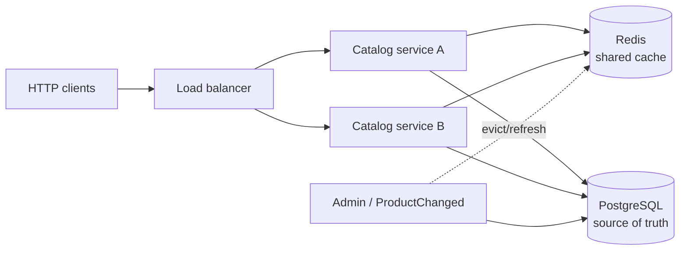
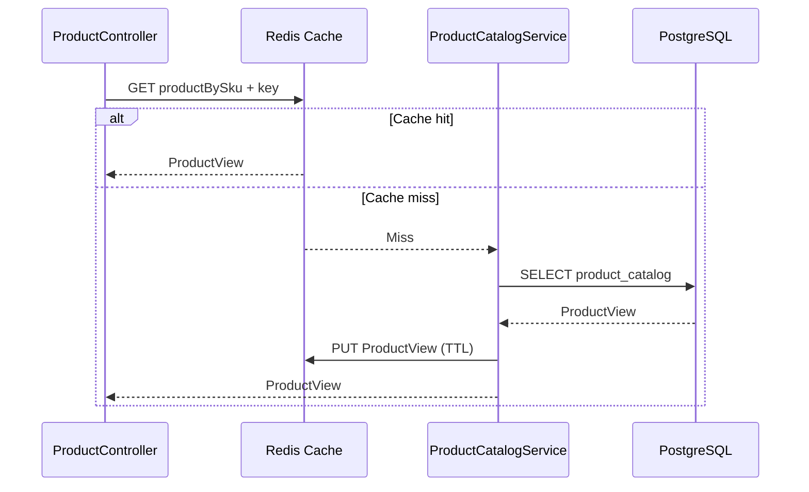
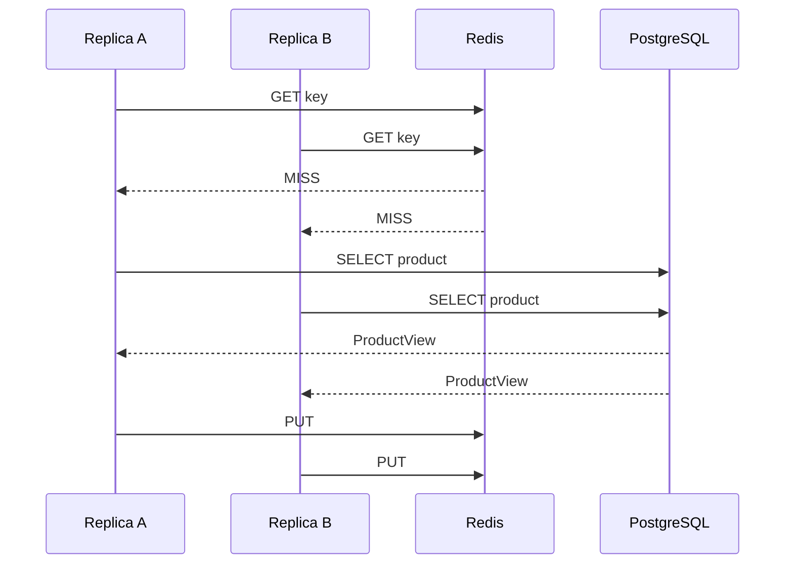

# Tích hợp RedisCacheManager cho cache dùng chung

Khi một ứng dụng Spring Boot chạy nhiều replica, `@Cacheable` với cache mặc định trong bộ nhớ của từng JVM có thể tạo ra những kết quả khác nhau: instance A đã cập nhật giá sản phẩm, còn instance B vẫn trả giá cũ vì giữ một bản cache riêng. Nếu mỗi instance tự cache mà không có cơ chế chia sẻ hoặc invalidation liên vùng, lỗi rất khó tái hiện ở local nhưng xuất hiện thường xuyên sau khi scale.

**RedisCacheManager** là implementation của Spring Cache dùng Redis làm nơi lưu cache chung. Nhiều replica kết nối tới cùng Redis deployment có thể truy cập cùng những cache entries theo cache name và key. Tuy nhiên, **dùng chung nơi lưu không đồng nghĩa dữ liệu luôn nhất quán**: SQL vẫn là nguồn sự thật, cache có TTL, ghi cache có thể thất bại, việc xóa cache có thể đến sau commit và những luồng HTTP/broker có thể làm dữ liệu thay đổi đồng thời.

Bài thuộc chương **Bộ nhớ đệm** trong module **SPRING_BOOT_INTEGRATION**, với mục tiêu tổ chức tích hợp Spring Boot qua HTTP client, cơ sở dữ liệu, cache, broker thông điệp và adapter Spring Integration. Trọng tâm là quản lý **cấu hình, hợp đồng dữ liệu, giao dịch, lỗi, xử lý trùng lặp, kiểm thử và quan sát**. Vì vậy ta sẽ dùng một tình huống **Product Catalog API + PostgreSQL + Redis + sự kiện ProductChanged**, tập trung vào những gì `RedisCacheManager` làm được và những giới hạn cần thiết kế thêm.

> **Phiên bản minh họa:** Java 17+, Spring Boot **3.5.x**, Spring Data Redis **3.5.x**, Redis 7.x và PostgreSQL 16. API, package và serializer của Spring Boot 4.x/Spring Data Redis 4.x có thay đổi (đặc biệt Jackson 3). Với ứng dụng thật, phải kiểm tra dependency BOM, method signatures và thuộc tính cấu hình của **phiên bản triển khai**, không áp dụng các import của Boot 3.x sang Boot 4.x một cách máy móc.

## 1. Mục tiêu học tập

Sau bài này, bạn có thể:

1. Phân biệt **Spring Cache abstraction**, `CacheManager`, `RedisCacheManager`, `RedisConnectionFactory` và `RedisTemplate`.
2. Giải thích vì sao Redis là **shared cache** giữa các instance, nhưng không tự tạo consistency với PostgreSQL.
3. Bật Spring caching và nhận `RedisCacheManager` qua auto-configuration của Spring Boot.
4. Dùng `spring.cache.redis.*`, `RedisCacheConfiguration` và `RedisCacheManagerBuilderCustomizer` đúng phạm vi.
5. Thiết kế TTL, cache names, key prefix, tenant isolation, null handling và serializer có version.
6. Sử dụng `@Cacheable`, `@CachePut`, `@CacheEvict`, `@Caching` và hiểu proxy/self-invocation.
7. Quản lý invalidation sau SQL commit, chống stale write/race và xử lý thay đổi từ broker hoặc service khác.
8. Phân biệt cache miss với Redis outage; thiết kế fail-open/fail-closed theo loại dữ liệu.
9. Hiểu cache stampede, hot keys, cache warming, eviction, failover và batch clear.
10. Kiểm thử cache trên Redis thật bằng Testcontainers và quan sát hit/miss, TTL, latency, pool và lỗi serialization.

## 2. Bài toán: hai replica cùng đọc Product Catalog

Giả sử `GET /products/{sku}` đọc PostgreSQL. Dữ liệu ít thay đổi so với tần suất đọc, nên việc query DB trên mọi request gây áp lực không cần thiết.



Nếu dùng cache trong memory:

```text
Replica A:
  product:tenant-a:SKU-1 -> price=150000

Replica B:
  product:tenant-a:SKU-1 -> price=120000

Database:
  product:tenant-a:SKU-1 -> price=150000
```

A/B có trạng thái độc lập. Với Redis shared:

```text
Redis key:
  integration:catalog:v2:productBySku::tenant-a:SKU-1

Value:
  {"tenantId":"tenant-a","sku":"SKU-1",
   "name":"Áo thun","priceMinor":150000,"version":8}
```

Cả A/B đọc cùng Redis key nếu **cache name, key calculation, serializer, prefix và kết nối** giống nhau.

Nhưng nếu hai replica cùng cache miss rồi đọc SQL ở những thời điểm khác nhau, một replica vẫn có thể ghi giá cũ đè lên giá mới. Cơ chế chia sẻ dữ liệu giải quyết **storage duplication**, không tự giải quyết mọi cạnh tranh cập nhật.

## 3. Spring Cache abstraction là lớp nào?

Spring Framework định nghĩa các contract chính:

| Thành phần | Vai trò |
| --- | --- |
| `org.springframework.cache.Cache` | `get`, `put`, `evict`, `clear` trên một named cache |
| `org.springframework.cache.CacheManager` | Tìm cache theo tên, ví dụ `productBySku` |
| `@Cacheable` | Cache-aside ở method: hit bỏ qua method, miss gọi method rồi ghi cache |
| `@CachePut` | Luôn gọi method, sau đó cập nhật cache bằng result |
| `@CacheEvict` | Xóa entry hoặc cả named cache theo điều kiện |
| `@Caching` | Gộp nhiều thao tác cache trên một method |
| `KeyGenerator`/SpEL | Chọn cache key từ arguments/context |
| `CacheResolver` | Xác định cache(s) được sử dụng theo invocation |
| `CacheErrorHandler` | Quyết định phản ứng khi provider cache ném lỗi |

Các annotation này **không phụ thuộc riêng Redis**. Spring Boot có thể dùng cache trong JVM, Caffeine, JCache hoặc Redis tùy classpath và cấu hình. Redis là **implementation backend**, không làm thay đổi các khái niệm cốt lõi của Spring Cache.

### 3.1. Những bean của Redis đóng vai trò gì?

```text
@Cacheable / @CacheEvict
          |
          v
Spring Cache interceptor
          |
          v
CacheManager
          |
          v
RedisCacheManager
          |
          v
RedisCache + RedisCacheWriter
          |
          v
RedisConnectionFactory (Lettuce/Jedis)
          |
          v
Redis server/cluster
```

`RedisConnectionFactory` quản lý cách client kết nối Redis; `RedisCacheManager` thực thi **Spring Cache** trên Redis. `RedisTemplate` là API thao tác Redis data structures trực tiếp (GET/SET/HASH/LIST...), **không phải điều kiện bắt buộc để viết `@Cacheable` service**.

Có thể đồng thời có `StringRedisTemplate` phục vụ distributed counter và `RedisCacheManager` phục vụ @Cacheable, nhưng serializer/TTL/key của hai con đường **không tự giống nhau**.

### 3.2. Cache shared không phải database source-of-truth

`RedisCacheManager` thường dùng cache-aside:



Nếu Redis mất dữ liệu, ứng dụng cần có khả năng **đọc lại từ database** (nếu business policy cho phép). Không thiết kế việc khởi tạo trạng thái nghiệp vụ duy nhất chỉ trong cache rồi dựa vào TTL như một cơ chế lưu trữ bền vững.

## 4. Cache nào nên dùng chung qua Redis?

| Loại dữ liệu | Có nên cache? | Lưu ý |
| --- | --- | --- |
| Product catalog ít thay đổi | Thường có | TTL ngắn/vừa, version/prefix và invalidation |
| Settings/feature flag không nhạy cảm | Có cân nhắc | TTL ngắn, tránh cache sai môi trường |
| Reference data, currency metadata | Thường có | Contract version và lịch cập nhật |
| HTTP response từ đối tác ngoài | Có điều kiện | Không bỏ qua Retry-After, auth, TTL của provider |
| Stock quantity real-time | Rất thận trọng | Độ trễ stale gây bán vượt tồn kho |
| Trạng thái payment/authorization | Thường không dùng cache làm quyết định cuối | Luôn xác minh source-of-truth khi ghi tiền |
| Authentication token/PII | Chỉ khi chính sách bảo mật cho phép | Encryption, TTL, tenant isolation, ACL |
| Distributed lock | **Không dùng @Cacheable** | Cần atomic lock protocol và fencing khi phù hợp |
| Idempotency ledger/outbox/inbox | Không dùng cache thay durable SQL | Redis loss/eviction không được phá invariants |

**Câu hỏi thiết kế:** Nếu entry tồn tại thêm 2 phút sau khi SQL đổi, hậu quả nghiệp vụ là gì? Nếu câu trả lời là “có thể thanh toán nhầm hoặc cấp quyền sai”, không nên chỉ dựa vào TTL.

## 5. Dependencies Spring Boot 3.5

Một Gradle Groovy DSL tối thiểu cho catalog SQL + Redis:

```groovy
plugins {
    id 'java'
    id 'org.springframework.boot' version '3.5.7'
    id 'io.spring.dependency-management' version '1.1.7'
}

java {
    toolchain {
        languageVersion = JavaLanguageVersion.of(17)
    }
}

repositories { mavenCentral() }

dependencies {
    implementation 'org.springframework.boot:spring-boot-starter-web'
    implementation 'org.springframework.boot:spring-boot-starter-cache'
    implementation 'org.springframework.boot:spring-boot-starter-data-redis'
    implementation 'org.springframework.boot:spring-boot-starter-jdbc'
    implementation 'org.springframework.boot:spring-boot-starter-actuator'

    implementation 'org.flywaydb:flyway-core'
    runtimeOnly 'org.flywaydb:flyway-database-postgresql'
    runtimeOnly 'org.postgresql:postgresql'

    testImplementation 'org.springframework.boot:spring-boot-starter-test'
    testImplementation 'org.springframework.boot:spring-boot-testcontainers'
    testImplementation 'org.testcontainers:junit-jupiter'
    testImplementation 'org.testcontainers:postgresql'
}

tasks.named('test') {
    useJUnitPlatform()
}
```

Spring Boot BOM quản lý versions của Spring Data Redis, Lettuce, Jackson, Flyway và các starters. Phiên bản plugin ở trên **chỉ để minh họa một dự án Boot 3.5**; với dự án khác hãy chọn một release Boot được tổ chức xác nhận, không ghép ngẫu nhiên starter/version.

**Vì sao có hai starters khác nhau?**

- `spring-boot-starter-cache`: Spring Cache abstraction/AOP support.
- `spring-boot-starter-data-redis`: Redis client, `RedisConnectionFactory`, Spring Data Redis integration.
- `spring-boot-starter-jdbc`: SQL source-of-truth của ví dụ.
- `spring-boot-starter-actuator`: health/metrics trong phạm vi instrumentation được bật.

Thông thường Lettuce được starter Redis cung cấp. Nếu tự đổi sang Jedis, phải kiểm tra pool, cluster, TLS và dependency selection theo Boot version. Không cần tự khai báo `RedisConnectionFactory` chỉ để đổi hostname và timeout nếu properties đã đáp ứng.

## 6. Redis local và cấu hình kết nối

### 6.1. Chạy Redis cho lab

```bash
docker run -d --name redis-cache-lab \
  -p 6379:6379 redis:7.4-alpine

docker exec redis-cache-lab redis-cli ping
```

Kết quả dự kiến: `PONG`. Đây là Redis không có ACL/password để tiện lab trên máy cô lập, **không** được đưa ra Internet hay dùng production. Redis standalone này cũng không có HA; nếu container bị xóa, cache mất là điều bình thường.

Khi chạy application trong Docker, `localhost` từ application container **không** chỉ host Redis container khác; cần Docker network và service DNS đúng.

### 6.2. application.yml

```yaml
spring:
  datasource:
    url: ${CATALOG_JDBC_URL:jdbc:postgresql://localhost:5432/catalog}
    username: ${CATALOG_DB_USER:catalog}
    password: ${CATALOG_DB_PASSWORD:devonly}

  data:
    redis:
      host: ${REDIS_HOST:localhost}
      port: ${REDIS_PORT:6379}
      username: ${REDIS_USERNAME:}
      password: ${REDIS_PASSWORD:}
      connect-timeout: 1s
      timeout: 2s

  cache:
    type: redis
    cache-names:
      - productBySku
    redis:
      time-to-live: 10m
      cache-null-values: false
      use-key-prefix: true
      enable-statistics: true

management:
  endpoints:
    web:
      exposure:
        include: "health,info,metrics"
```

Giải thích:

- `spring.data.redis.*` cấu hình kết nối tới Redis ở Spring Boot 3.5, không phải Cache abstraction TTL.
- `spring.cache.type: redis` ép Boot chọn Redis provider khi auto-configuration cache phù hợp. Nếu thiếu Redis dependencies hoặc connection factory, startup có thể fail; không âm thầm fallback về memory cache để che lỗi.
- `spring.cache.cache-names` khai báo các named caches dự định sử dụng; tạo sẵn cache theo provider, **không** tự warm mọi key.
- `time-to-live: 10m` áp dụng thời hạn mặc định cho entries khi không bị ghi đè bởi custom configuration.
- `cache-null-values: false` tránh lưu null theo provider, phù hợp khi không muốn che dữ liệu mới.
- `use-key-prefix: true` giữ prefix cache name để tránh va chạm giữa named caches.
- `enable-statistics` kích hoạt thống kê RedisCache theo khả năng của Spring Data Redis, **không** tự cung cấp mọi chỉ số server/cluster.
- `timeout/connect-timeout` kiểm soát những giai đoạn khác nhau; không tự tạo circuit breaker/retry.
- Các biến credentials với fallback trống trong lab không phù hợp production: production cần auth/TLS/secret manager và kiểm tra tránh bỏ qua bảo mật.

### 6.3. Tách config môi trường

```text
local:
  redis: localhost:6379
  schema: catalog dev

staging:
  redis: redis.staging.internal
  schema: catalog staging

production:
  redis: managed Redis cluster
  schema: catalog production
```

Không dùng một Redis deployment/prefix chung cho dev và prod nếu không có partitioning và ACL thực sự kiểm soát. Một lệnh `Cache.clear()` nhầm cache/environment có thể xóa dữ liệu của dịch vụ khác nếu key namespaces không được cách ly.

## 7. Bật caching: @EnableCaching

```java
package com.example.integration.cache;

import org.springframework.cache.annotation.EnableCaching;
import org.springframework.context.annotation.Configuration;

@Configuration(proxyBeanMethods = false)
@EnableCaching
public class CacheEnablementConfiguration {}
```

`@EnableCaching` kích hoạt infrastructure cho cache annotations. Spring Boot có thể auto-configure `RedisCacheManager` khi các điều kiện đáp ứng:

1. Caching đã được bật.
2. Spring Cache/Redis libraries có mặt trên classpath.
3. Có `RedisConnectionFactory` phù hợp.
4. Không có user `CacheManager` hoặc `cacheResolver` làm nhánh mặc định back off.
5. `spring.cache.type` và các provider conditions không loại Redis.

**Không đồng nghĩa:** Thêm `spring-boot-starter-data-redis` tự tạo business cache hay tự động cache mọi repository method.

### 7.1. Kiểm tra CacheManager thực sự đang được inject

```java
@Component
public class CacheDiagnostics {

    public CacheDiagnostics(
            org.springframework.cache.CacheManager manager) {

        System.out.println(
                "CacheManager = " + manager.getClass().getName());
    }
}
```

Đây là đoạn kiểm chứng **chỉ phù hợp lab**. Production nên dùng bean graph/Actuator conditions với quyền truy cập an toàn; không log cấu trúc hệ thống và secrets một cách vô tội vạ.

Có thể assert:

```java
assertThat(cacheManager)
        .isInstanceOf(RedisCacheManager.class);
```

Nếu thực tế là `ConcurrentMapCacheManager`, các replica vẫn dùng cache cục bộ dù cấu hình Redis client đang tồn tại. Cần xem condition evaluation report và bean definitions, không suy từ “Redis PING thành công”.

## 8. RedisCacheManager mặc định và ba cấp tùy chỉnh

| Cấp | Cách làm | Khi nên chọn |
| --- | --- | --- |
| **1. Properties** | `spring.cache.redis.time-to-live`, `cache-null-values`, `cache-names` | TTL chung, cấu hình đơn giản |
| **2. Builder customizer** | `RedisCacheManagerBuilderCustomizer` | Mỗi cache có TTL/serializer/prefix riêng mà vẫn giữ Boot auto-config |
| **3. RedisCacheConfiguration @Bean** | Tự cung cấp default cache configuration | Cần điều chỉnh toàn bộ defaults có chủ đích |
| **4. Tự khai báo RedisCacheManager @Bean** | Xây manager trực tiếp từ `RedisConnectionFactory` | Nhiều managers, writer/batch strategy đặc biệt, ownership riêng |

**Ưu tiên properties → customizer → custom manager**. Đặt một `@Bean RedisCacheManager` chỉ để thay TTL có thể khiến Boot auto-configuration **back off** và bỏ qua defaults/customizers mà bạn mong đợi.

### 8.1. Các mặc định Spring Data Redis phải biết

Theo Spring Data Redis 3.5, `RedisCacheManager` mặc định thường có:

- Cache writer **non-locking**.
- Batch clearing theo `KEYS`, nếu không cấu hình khác.
- Null values **được phép** ở cấu hình mặc định của `RedisCacheConfiguration`.
- Default cache key prefix **theo cache name**.
- Không TTL nếu không cấu hình.
- Key serializer mặc định `StringRedisSerializer`.
- Value serializer mặc định `JdkSerializationRedisSerializer`.
- Transaction awareness **không bật** theo mặc định.
- Local hits/misses statistics tắt nếu không bật.

**Đặc biệt:** Nếu giá trị là Java record `ProductView` không implements `Serializable`, JDK serializer có thể thất bại khi serialize. Bài này sẽ cấu hình **typed JSON** cho cache product thay vì mặc định JDK serialization.

## 9. DTO và bảng PostgreSQL minh họa

### 9.1. SQL migration

`src/main/resources/db/migration/V1__create_product_catalog.sql`:

```sql
CREATE TABLE product_catalog (
    tenant_id VARCHAR(64) NOT NULL,
    sku VARCHAR(64) NOT NULL,
    product_name VARCHAR(200) NOT NULL,
    price_minor BIGINT NOT NULL CHECK (price_minor >= 0),
    version BIGINT NOT NULL DEFAULT 1,
    updated_at TIMESTAMPTZ NOT NULL DEFAULT now(),
    PRIMARY KEY (tenant_id, sku)
);

CREATE INDEX idx_product_catalog_tenant_updated
    ON product_catalog (tenant_id, updated_at);
```

Mọi lookup phải có `tenant_id` **đã được authorization**. `sku` có thể trùng giữa tenants; nếu cache key chỉ là sku, tenant A có thể nhận sản phẩm của tenant B.

### 9.2. ProductView record

```java
package com.example.integration.cache;

public record ProductView(
        String tenantId,
        String sku,
        String name,
        long priceMinor,
        long version
) {}
```

Đây là DTO cache/API được version bằng **value schema/key prefix**, không serialize entity JPA đang managed hoặc object chứa lazy proxies trực tiếp vào Redis. Trong production còn cần hợp đồng JSON serialization riêng nếu các service nhiều ngôn ngữ truy cập cùng key.

### 9.3. JDBC repository

```java
package com.example.integration.cache;

import org.springframework.jdbc.core.JdbcTemplate;
import org.springframework.stereotype.Repository;
import java.util.List;

@Repository
public class ProductRepository {

    private final JdbcTemplate jdbc;

    public ProductRepository(JdbcTemplate jdbc) {
        this.jdbc = jdbc;
    }

    public ProductView findByTenantAndSku(
            String tenantId, String sku) {

        List<ProductView> rows = jdbc.query("""
                SELECT tenant_id, sku, product_name,
                       price_minor, version
                FROM product_catalog
                WHERE tenant_id = ? AND sku = ?
                """,
                (rs, row) -> new ProductView(
                        rs.getString("tenant_id"),
                        rs.getString("sku"),
                        rs.getString("product_name"),
                        rs.getLong("price_minor"),
                        rs.getLong("version")),
                tenantId, sku);

        return rows.stream().findFirst().orElse(null);
    }

    public int updatePrice(String tenantId,
                           String sku, long priceMinor) {
        return jdbc.update("""
                UPDATE product_catalog
                SET price_minor = ?, version = version + 1,
                    updated_at = now()
                WHERE tenant_id = ? AND sku = ?
                """, priceMinor, tenantId, sku);
    }
}
```

`JdbcTemplate` không tự biết dữ liệu đang được cache. Caching thực hiện tại **service boundary** hoặc một adapter có contract, không phải Spring tự intercept mọi SQL query để quyết định key.

## 10. @Cacheable: chia sẻ kết quả đọc giữa các instance

```java
package com.example.integration.cache;

import org.springframework.cache.annotation.Cacheable;
import org.springframework.stereotype.Service;

@Service
public class ProductCatalogService {

    private final ProductRepository repository;

    public ProductCatalogService(ProductRepository repository) {
        this.repository = repository;
    }

    @Cacheable(
        cacheNames = "productBySku",
        key = "#p0 + ':' + #p1",
        unless = "#result == null"
    )
    public ProductView find(String tenantId, String sku) {
        return repository.findByTenantAndSku(tenantId, sku);
    }
}
```

Giải thích từng phần:

- `cacheNames="productBySku"` chọn named cache.
- `key="#p0 + ':' + #p1"` chọn key từ arg0 = tenantId, arg1 = sku; `#p0/#p1` không phụ thuộc tên Java parameter có được giữ bằng `-parameters` hay không.
- `unless="#result == null"` không cache kết quả không tìm thấy.
- Cache hit: Spring cache interceptor trả giá trị từ Redis mà không chạy repository.
- Cache miss: repository đọc SQL; result được serialize và ghi Redis với TTL theo config.
- Một method trả `null` có thể hợp lệ khi không có sản phẩm; API nên map sang `404`/typed result thay vì lặng lẽ trả 200 null.

**Bảo mật:** Giá trị `tenantId` phải đến từ authenticated tenant context và được kiểm tra quyền; cache key có tenant không tự xác minh caller được phép truy cập tenant đó.

### 10.1. Ví dụ đường đi của key

Với key biểu thức `tenant-a:SKU-1`:

```text
Named cache:  productBySku
Key:          tenant-a:SKU-1
Redis key:    productBySku::tenant-a:SKU-1
```

Đó là default prefix theo cache name (trừ khi custom). Khi dùng Redis chung cho nhiều ứng dụng, default `productBySku::` có thể trùng nếu hai apps khác nhau đều đặt cache name này. Cần thêm **service/environment/schema prefix**, ví dụ `integration:catalog:v2:productBySku::`.

### 10.2. Delimiter và canonical key

Cách ghép `tenantId + ":" + sku` trong lab giả định hai thành phần không chứa ký tự phân tách gây nhập nhằng. Nếu input tùy ý, hai cặp có thể ghép ra cùng string. Production nên validate định dạng tenant/sku, encode key theo độ dài/hash có cấu trúc, và dành version namespace cho thay đổi key schema.

**Không đưa token, password, email/PII thô vào Redis key** nếu không được chính sách dữ liệu cho phép: key xuất hiện trong metrics, Redis management commands và logs.

## 11. Tùy chỉnh per-cache TTL và typed JSON serialization

Đây là điểm quan trọng của `RedisCacheManager`: một ứng dụng có thể có các named caches khác nhau với TTL và serializer phù hợp, trong khi Boot tiếp tục quản lý `RedisConnectionFactory` và cache manager lifecycle.

### 11.1. RedisCacheManagerBuilderCustomizer cho Boot 3.5

```java
package com.example.integration.cache;

import java.time.Duration;

import com.fasterxml.jackson.databind.ObjectMapper;

import org.springframework.boot.autoconfigure.cache.RedisCacheManagerBuilderCustomizer;
import org.springframework.context.annotation.Bean;
import org.springframework.context.annotation.Configuration;
import org.springframework.data.redis.cache.RedisCacheConfiguration;
import org.springframework.data.redis.serializer.Jackson2JsonRedisSerializer;
import org.springframework.data.redis.serializer.RedisSerializationContext;

@Configuration(proxyBeanMethods = false)
public class ProductRedisCacheConfiguration {

    @Bean
    RedisCacheManagerBuilderCustomizer productCacheCustomizer(
            ObjectMapper objectMapper) {

        return builder -> {
            RedisCacheConfiguration productCache =
                    RedisCacheConfiguration.defaultCacheConfig()
                            .entryTtl(Duration.ofMinutes(5))
                            .disableCachingNullValues()
                            .computePrefixWith(
                                cacheName -> "integration:catalog:v2:"
                                        + cacheName + "::")
                            .serializeValuesWith(
                                RedisSerializationContext.SerializationPair
                                        .fromSerializer(
                                            new Jackson2JsonRedisSerializer<>(
                                                objectMapper,
                                                ProductView.class)));

            builder.withCacheConfiguration(
                    "productBySku", productCache);

            // Hoãn put/evict có hỗ trợ cho tới sau SQL commit.
            builder.transactionAware();
        };
    }
}
```

**Điểm đã đối chiếu theo Boot 3.5:** `RedisCacheManagerBuilderCustomizer` thuộc package `org.springframework.boot.autoconfigure.cache`. Trong Boot 4.x package thay đổi; không lấy import từ tài liệu Boot 4 rồi dùng cho ví dụ Boot 3.5.

`Jackson2JsonRedisSerializer<>(objectMapper, ProductView.class)` là **typed serializer** cho cache `productBySku`, không cần bật Jackson default typing tùy ý. Nó phù hợp khi mọi value trong named cache này có type `ProductView`. Không dùng serializer này cho một cache chứa nhiều type không có contract chung.

### 11.2. Tại sao không override CacheManager trực tiếp?

Ví dụ `@Bean RedisCacheManager manager(...)` sẽ làm bean thuộc quyền sở hữu của ứng dụng; Boot có thể không tạo manager mặc định. Khi đó phải tự quyết định:

- Cache names và TTL mặc định.
- Prefix/serializer.
- Transaction awareness.
- Writer batch/locking policy.
- Stats/metrics.
- Cache creation policy.

`RedisCacheManagerBuilderCustomizer` chỉ tác động khi Boot **thật sự dùng Redis auto-configuration để tạo manager**. Nếu nơi khác đã khai báo custom manager, customizer có thể không được gọi. Nên assert type và cấu hình ở integration test.

### 11.3. Không trộn hai nguồn TTL mà không xác định ưu tiên

`spring.cache.redis.time-to-live: 10m` là default cho cache do Boot cấu hình. Trong ví dụ builder customizer, `productBySku` được override TTL thành **5 phút**, và prefix thành `integration:catalog:v2:...`. Những cache khác nếu được tạo theo mặc định sẽ dùng policy riêng của manager theo các properties đã bind.

Nếu muốn mọi thứ đi theo một nguồn cấu hình, có thể dùng typed `@ConfigurationProperties` để cung cấp TTL từng cache thay vì hardcode trong Java. Đừng thay một giá trị YAML rồi đoán rằng nó ghi đè `entryTtl(...)` ở code customizer.

### 11.4. Tại sao dùng typed JSON thay cho JDK serializer?

- Bytes JSON có thể quan sát/kiểm tra thuận tiện hơn JDK serialization.
- Tách schema dữ liệu cache ra khỏi Java Serializable byte format.
- Không phải cache value nào cũng implements Serializable.
- Dễ đặt version namespace và kiểm thử backward compatibility.

Nhưng **JSON không tự đảm bảo an toàn với schema evolution**: đổi tên `name` → `productName`, đổi type `priceMinor`, default hoặc date-time format có thể làm instance cũ không giải mã được.

### 11.5. Jackson version khi nâng Spring Boot 4.x

Spring Data Redis 3.5 thường dùng các API Jackson 2 như `Jackson2JsonRedisSerializer`. Dòng 4.x chuyển trọng tâm sang Jackson 3 và có serializer thay thế như `JacksonJsonRedisSerializer`. Nâng một service lên Boot 4 trong khi replica cũ vẫn dùng Boot 3 đòi **cross-version serialization tests**; đừng mặc định JSON bytes vẫn hệt nhau hoặc class whitelist/type metadata tương thích.

## 12. TTL: sự khác nhau giữa thời gian sống và thời gian nhàn rỗi

### 12.1. TTL

Với `entryTtl(Duration.ofMinutes(5))`, một entry được ghi lúc T0 thường hết hạn khoảng T0+5 phút dù được đọc nhiều lần, nếu không có cơ chế refresh expiry riêng.

```text
T0      T+2m        T+5m
SET     GET hit     Key expires
                  -> next GET misses
```

TTL là **giới hạn thời gian lưu**, không phải guarantee dữ liệu luôn mới trong khoảng thời gian đó.

### 12.2. TTI-like behavior (Spring Data Redis 3.2+)

Spring Data Redis cung cấp `RedisCacheConfiguration.enableTimeToIdle()` trong các phiên bản hỗ trợ. Nó sử dụng `GETEX` để **gia hạn TTL khi đọc**, tạo hiệu ứng tương tự time-to-idle.

```java
RedisCacheConfiguration config =
        RedisCacheConfiguration.defaultCacheConfig()
                .entryTtl(Duration.ofMinutes(5))
                .enableTimeToIdle();
```

**Điều kiện:** Redis **6.2+** hỗ trợ `GETEX`. Redis không có một TTI primitive độc lập như TTL; việc đọc entry qua `RedisTemplate.opsForValue().get` từ code khác có thể **không gia hạn cùng cách**. Nếu có nhiều clients truy cập cùng key mà không thống nhất `GETEX`, thời gian sống không tuân theo mô hình mà người thiết kế kỳ vọng.

Dùng TTI khi business thật sự muốn “giữ dữ liệu còn được sử dụng”, và phải đánh giá hot key không bao giờ hết hạn có thể gây stale.

### 12.3. TTL động theo key hoặc value

Spring Data Redis 3.2+ có `RedisCacheWriter.TtlFunction` để quyết định TTL riêng từng entry, ví dụ metadata tĩnh 1 giờ còn sản phẩm thay đổi nhanh 30 giây.

**Lưu ý:** `TtlFunction` nhìn thấy key/value ở tầng cache writer, không có đầy đủ request/user context; không được dùng nó để quyết định authorization. Với nhiều tiers, phân biệt cache names theo domain thường dễ quản lý hơn TTL biến thiên quá phức tạp.

### 12.4. TTL bằng zero

Trong `RedisCacheConfiguration.entryTtl(Duration.ZERO)`, zero có thể biểu diễn cache không hết hạn theo cấu hình Spring Data Redis. Điều này nguy hiểm cho dữ liệu nghiệp vụ hay thay đổi: không TTL + invalidation lỗi = stale không có giới hạn thời gian.

## 13. Null values và negative caching

Với `cache-null-values=false`, thiếu product thường không ghi entry. Ưu điểm: sản phẩm mới được tạo có thể được nhìn thấy ngay sau lần đọc mới. Nhược điểm: một SKU không tồn tại bị truy vấn liên tục có thể đánh vào database.

**Negative caching** (caching kết quả “không có dữ liệu”) đôi khi hữu ích:

```text
GET tenant-a:SKU-X
 -> SQL: not found
 -> cache NOT_FOUND 10-30s
```

Nhưng nếu cache tất cả `null` trong 10 phút, sau khi insert product mới ứng dụng có thể tiếp tục trả 404 sai. Một chiến lược tốt hơn là cache **typed result** có trạng thái `Found/NotFound` với TTL khác, hoặc dùng cache name riêng `missingProducts` TTL rất ngắn.

Không cache negative result của câu hỏi authorization nếu quyền có thể được cấp tức thời. Đối với payment/stock, negative cache có thể làm quyết định nghiệp vụ sai.

### 13.1. unless và condition khác nhau

- `condition` đánh giá trước khi gọi method, theo input/context.
- `unless` đánh giá sau khi method trả result, có thể xét `#result`.

Ví dụ:

```java
@Cacheable(
    cacheNames = "productBySku",
    key = "#p0 + ':' + #p1",
    condition = "#p1 != null && #p1.length() <= 64",
    unless = "#result == null"
)
public ProductView find(String tenantId, String sku) {
    return repository.findByTenantAndSku(tenantId, sku);
}
```

**Đừng dùng condition này làm validation/security.** Nó chỉ quyết định có dùng cache; method vẫn được gọi khi condition false, nên phải validate input và quyền ở business layer.

## 14. @CachePut và @CacheEvict khi dữ liệu SQL thay đổi

### 14.1. Khi nào dùng @CacheEvict?

Với update giá, một cách đơn giản là xóa cache key để request kế tiếp tải dữ liệu mới từ SQL:

```java
package com.example.integration.cache;

import org.springframework.cache.annotation.CacheEvict;
import org.springframework.stereotype.Service;
import org.springframework.transaction.annotation.Transactional;

@Service
public class ProductCommandService {

    private final ProductRepository repository;

    public ProductCommandService(ProductRepository repository) {
        this.repository = repository;
    }

    @Transactional
    @CacheEvict(
        cacheNames = "productBySku",
        key = "#p0 + ':' + #p1"
    )
    public void changePrice(
            String tenantId, String sku, long newPriceMinor) {

        if (newPriceMinor < 0) {
            throw new IllegalArgumentException("priceMinor âm");
        }

        int updated = repository.updatePrice(
                tenantId, sku, newPriceMinor);

        if (updated != 1) {
            throw new IllegalArgumentException(
                    "Không tìm thấy product");
        }
    }
}
```

`@CacheEvict` mặc định `beforeInvocation=false`, nghĩa là cache eviction chỉ được gọi khi method hoàn tất **không có exception**. Tuy nhiên, **“method return” và “database commit” không phải luôn cùng thời điểm** dưới nhiều proxies/transaction advice. Trong ví dụ customizer đã gọi `builder.transactionAware()` để các thao tác cache put/evict hỗ trợ transaction synchronization có thể được defer tới **after commit**.

**Phải integration-test** thời điểm eviction và DB commit với đúng Spring Boot setup. Transaction awareness không nguyên tử hóa Redis với PostgreSQL.

### 14.2. @CachePut

`@CachePut` luôn thực thi method và dùng result để ghi cache:

```java
@CachePut(
    cacheNames = "productBySku",
    key = "#result.tenantId() + ':' + #result.sku()"
)
public ProductView refreshFromDatabase(
        String tenantId, String sku) {

    return repository.findByTenantAndSku(tenantId, sku);
}
```

Nếu result có thể `null` và đã cấu hình `disableCachingNullValues()`, dùng `unless="#result == null"` hoặc một contract phù hợp để tránh lỗi put null. `@CachePut` thích hợp với refresh một value đã biết, nhưng **dễ ghi dữ liệu cũ** nếu hai refresh đồng thời hoàn thành đảo thứ tự.

### 14.3. Khi nào không dùng @CachePut?

Giả sử:

```text
T1: request A đọc DB version 7 nhưng xử lý chậm
T2: update DB sang version 8, cache evict
T3: request A PUT version 7 vào Redis sau eviction
```

Cache lại giữ dữ liệu cũ tới khi TTL hết. Nếu dùng `@CachePut` để cập nhật giá một cách không có version guard, một update đến muộn có thể đè giá mới. Với catalog quan trọng, cân nhắc **cache invalidation có version**, conditional writes qua Redis script/CAS hoặc key có version để chặn stale refill.

## 15. Proxy và self-invocation

Spring caching annotations thường được xử lý bởi **Spring proxy**, tương tự `@Transactional` và `@Async`. Lời gọi nội bộ `this.method()` thường không đi qua proxy nên không áp dụng cache interception.

Sai:

```java
@Service
public class ProductService {

    public ProductView getProduct(String tenantId, String sku) {
        return findCached(tenantId, sku); // Self-invocation.
    }

    @Cacheable(cacheNames = "productBySku")
    public ProductView findCached(String tenantId, String sku) {
        return readFromDatabase(tenantId, sku);
    }
}
```

Đúng hơn là tách bean:

```java
@Service
public class ProductFacade {

    private final ProductCatalogService catalog;

    public ProductFacade(ProductCatalogService catalog) {
        this.catalog = catalog;
    }

    public ProductView getProduct(String tenantId, String sku) {
        return catalog.find(tenantId, sku);
    }
}
```

`ProductCatalogService` là bean khác đã có `@Cacheable`, và lời gọi đi qua Spring proxy. Không tự tạo service bằng `new ProductCatalogService(...)` để test proxy; phải inject bean từ context.

### 15.1. Không kết hợp @Cacheable và @CachePut trên cùng method tùy tiện

Hai annotations này có semantic khác nhau: `@Cacheable` có thể bỏ qua method, còn `@CachePut` luôn muốn gọi method. Nếu gắn cả hai thiếu điều kiện loại trừ rõ, rất khó suy luận thứ tự ghi và invalidation. Hãy chia read method và write/refresh method với ownership riêng.

### 15.2. Final/private methods

Với proxy-based caching thông thường, methods không thể intercept theo proxy mode sẽ không có caching behavior mong muốn. Đừng dựa vào annotation ở `private` method hay self-call; kiểm chứng bằng integration test qua bean injected.

## 16. Transaction-aware cache: after commit không phải atomic commit

Cần phân biệt ba mốc:

```text
A. SQL UPDATE được gửi tới PostgreSQL
B. SQL transaction COMMIT thành công
C. Redis key được xóa/cập nhật
```

Nếu xóa Redis ở **A** rồi một request khác cache miss, đọc SQL cũ trước **B** và ghi lại Redis, thì sau **B** cache có thể vẫn chứa giá cũ. Đó là race giữa transaction và cache-aside.

### 16.1. RedisCacheManagerBuilder.transactionAware()

`RedisCacheManager.RedisCacheManagerBuilder.transactionAware()` cho manager tạo các cache có cơ chế đồng bộ với Spring-managed transaction.

```java
@Bean
RedisCacheManagerBuilderCustomizer transactionAwareCache() {
    return builder -> builder.transactionAware();
}
```

Đây là **mẫu minh họa API**. Trong ví dụ ở mục 11, `transactionAware()` đã được bật, không cần khai báo thêm bean customizer trùng trách nhiệm.

Khi transaction đang hoạt động, các thao tác như `Cache.put`/`Cache.evict` có thể được **hoãn tới sau khi commit thành công**. Nhưng:

- Không phải mọi Cache API operation đều được hoãn. `putIfAbsent` và những thao tác immediate cần xem contract riêng.
- Chỉ có tác dụng trong Spring transaction context phù hợp, không tự mở SQL transaction.
- Nếu Redis lỗi ở thời điểm after-commit, **SQL đã commit**; lỗi cache không thể rollback SQL.
- `RedisTemplate` trực tiếp không tự nhận semantics của RedisCacheManager.
- Thứ tự AOP của `@Transactional`/`@CacheEvict` vẫn cần integration test thực tế.

### 16.2. Không nhầm transaction awareness với XA

```mermaid
sequenceDiagram
    participant A as ProductCommandService
    participant SQL as PostgreSQL
    participant R as Redis
    A->>SQL: BEGIN + UPDATE price
    SQL-->>A: UPDATE OK
    A->>SQL: COMMIT
    SQL-->>A: Commit OK
    A->>R: EVICT productBySku key
    alt Redis healthy
        R-->>A: EVICT OK
    else Redis unavailable
        R--xA: Timeout
        Note over SQL,R: SQL đã commit; cache có thể stale
    end
```

Nếu business yêu cầu “mọi update SQL cuối cùng phải invalidate cache”, cần **invalidation intent được ghi bền vững** qua SQL outbox hoặc durable job thay vì chỉ after-commit callback trong bộ nhớ.

### 16.3. @CacheEvict(beforeInvocation=true) có rủi ro gì?

`@CacheEvict(beforeInvocation=true)` xóa cache trước khi method chạy. Nếu SQL transaction chưa commit, một request khác có thể đọc giá cũ rồi điền lại cache. Nếu method ném exception, cache đã bị xóa dù SQL có thể rollback.

Mặc định `beforeInvocation=false` kết hợp transaction awareness có ích hơn cho nhiều luồng write, nhưng **không loại bỏ toàn bộ stale races**.

## 17. ProductChanged: invalidation giữa nhiều service

Một ứng dụng tích hợp hiếm khi có chỉ một writer:

- HTTP admin thay đổi giá.
- Batch job nhập sản phẩm.
- Service khác cập nhật projection SQL.
- Migration/backfill sửa dữ liệu.
- Broker consumer nhận một event `ProductChanged`.
- Một thao tác vận hành sửa dữ liệu có kiểm soát.

Nếu chỉ `ProductCommandService` biết gọi `@CacheEvict`, những writer paths khác có thể bỏ qua invalidation.

### 17.1. Hợp đồng sự kiện

```java
package com.example.integration.cache;

public record ProductChanged(
        String eventId,
        String tenantId,
        String sku,
        long productVersion
) {}
```

Một business handler không phụ thuộc broker:

```java
package com.example.integration.cache;

import org.springframework.cache.Cache;
import org.springframework.cache.CacheManager;
import org.springframework.stereotype.Component;

@Component
public class ProductCacheInvalidator {

    private final CacheManager cacheManager;

    public ProductCacheInvalidator(CacheManager cacheManager) {
        this.cacheManager = cacheManager;
    }

    public void invalidate(ProductChanged event) {
        Cache cache = cacheManager.getCache("productBySku");
        if (cache == null) {
            throw new IllegalStateException(
                    "Cache productBySku không được cấu hình");
        }
        cache.evict(event.tenantId() + ":" + event.sku());
    }
}
```

Adapter Kafka/RabbitMQ/JMS có thể gọi `invalidate(event)` sau khi deserialize/validate. Nếu dùng Kafka ở Spring Boot 3.x, dependency phù hợp là `org.springframework.kafka:spring-kafka`; bài Redis này không buộc cài broker nếu chỉ muốn thực hành cache.

**Ack rule:** Không acknowledge broker như đã xử lý nếu invalidation chưa thành công hoặc chưa được chuyển giao tới durable retry mechanism. Nếu cache error handler cố tình nuốt lỗi `evict`, message có thể bị ack trong khi Redis vẫn giữ stale value.

### 17.2. SQL outbox làm invalidation bền vững

```text
@Transactional:
  UPDATE product_catalog ... version=version+1
  INSERT outbox(eventId, "ProductChanged",
                tenantId, sku, productVersion)
COMMIT

Outbox relay:
  claim pending event
  publish to broker, wait confirmation
  mark published (with safe retry)

Cache invalidation consumer:
  validate event
  EVICT Redis key
  ACK only after success/handoff
```

Vẫn có khả năng publish event trùng khi relay crash sau broker confirmation. Với eviction, duplicate thường chấp nhận được, song cần metrics và **version-aware ordering** nếu cache cũng có refresh/put.

### 17.3. Stale refill race sau eviction

```text
T0: Request A misses cache, SELECT SQL version=7
T1: Request B UPDATE SQL version=8, COMMIT
T2: B EVICT Redis key
T3: A PUT version=7 từ kết quả SQL cũ
T4: Cache chứa version=7 dù DB đã ở version=8
```

`transactionAware()` không giải quyết hoàn toàn, vì request A không chung transaction với B.

Giải pháp tùy SLA:

1. TTL nhỏ để giới hạn thời gian stale.
2. Cache key có version và xác minh version từ nguồn đáng tin.
3. Redis conditional PUT bằng Lua/CAS chỉ khi entry version mới không lớn hơn.
4. Invalidation epoch/token được tăng bởi data owner; loader kiểm tra token trước/sau truy vấn.
5. Đọc SQL trực tiếp cho những quyết định yêu cầu strong consistency.
6. Bảo đảm ordered updates/sequence guards khi áp dụng các event từ broker.

Không gọi shared Redis cache là *strongly consistent* chỉ vì mọi replica cùng thấy một Redis endpoint.

## 18. Multi-tenant isolation và cache key

Sai:

```java
@Cacheable(cacheNames = "productBySku", key = "#p1")
public ProductView find(String tenantId, String sku) {
    return repository.findByTenantAndSku(tenantId, sku);
}
```

Nếu `tenant-a/SKU-1` và `tenant-b/SKU-1` cùng key, request tenant B có thể nhận dữ liệu tenant A. Đây là **lỗi cách ly dữ liệu** chứ không chỉ cache miss.

Đúng hơn:

```java
@Cacheable(
    cacheNames = "productBySku",
    key = "#p0 + ':' + #p1",
    unless = "#result == null"
)
public ProductView find(String tenantId, String sku) {
    return repository.findByTenantAndSku(tenantId, sku);
}
```

**Nhưng** tenantId phải đến từ authenticated tenant context hoặc đã qua authorization; một client tự truyền `tenantId=tenant-b` không trở nên được phép chỉ vì cache key chứa tenant.

| Lớp key | Mục đích |
| --- | --- |
| `production:catalog` | Tách service và environment |
| `v2:productBySku` | Tách schema/cache type |
| `tenant-a:SKU-1` | Tách tenant và business identity |

Ví dụ Redis key:

```text
production:catalog:v2:productBySku::tenant-a:SKU-1
```

Nếu tenantId/SKU có thể chứa dấu `:`, cần normalize/encode theo định dạng không nhập nhằng. Không đưa token/password/email nguyên văn vào key nếu policy không cho phép; keys có thể xuất hiện trong management tools và logs.

### 18.1. Hai tầng cache làm tăng rủi ro

Nếu thêm Caffeine local-cache phía trước Redis:

```text
Replica A local near cache --> Redis shared --> SQL
Replica B local near cache --> Redis shared --> SQL
```

Xóa Redis không tự xóa local caches A/B. Cần pub/sub invalidation, TTL local nhỏ hoặc version token, đồng thời kiểm tra loss/reordering của các thông báo invalidation. Nếu mục tiêu đơn giản là **cache dùng chung**, bắt đầu với một RedisCacheManager duy nhất thường dễ vận hành hơn.

## 19. Cache stampede, hot keys và sync=true

Khi cùng một key hết TTL, hàng trăm request trên nhiều replica có thể đồng thời miss rồi gọi PostgreSQL:



`@Cacheable(sync=true)` yêu cầu provider phối hợp load một key thông qua `Cache.get(key, Callable)` khi được hỗ trợ:

```java
@Cacheable(
    cacheNames = "productBySku",
    key = "#p0 + ':' + #p1",
    sync = true
)
public ProductView find(String tenantId, String sku) {
    return repository.findByTenantAndSku(tenantId, sku);
}
```

**Không giả định** `sync=true` cung cấp distributed single-flight lock trên **mọi replica** khi dùng RedisCacheManager. Spring Cache `sync=true` có ràng buộc, chẳng hạn không kết hợp `unless` theo cách thông thường; phải test provider behavior cụ thể.

Biện pháp theo mức độ yêu cầu:

- TTL jitter để tránh nhiều keys hết hạn đồng thời.
- Rate limiting/circuit breaker và SQL connection pool sizing.
- Refresh-ahead những hot keys.
- Distributed lease có TTL và fencing nếu cần, rồi kiểm tra dữ liệu sau khi lấy lease.
- Stale-while-revalidate có maximum stale window rõ.
- Cache key versioning hoặc version guard khi ghi để chặn stale refill.

**Cache stampede là vấn đề tải/hiệu năng; duplicate business command là vấn đề idempotency.** Không dùng một Redis lock “chống cache miss” để thay SQL unique constraints, inbox hoặc outbox.

## 20. RedisCacheWriter: non-locking, locking và clear

Spring Data Redis thường dùng `nonLockingRedisCacheWriter` mặc định nhằm giảm round-trips. Một số thao tác gồm nhiều Redis commands, ví dụ `putIfAbsent` hoặc clear, có thể có race trong đường non-locking.

Locking writer có thể giảm overlap nhưng khóa thường ở **mức named cache**, không phải mỗi key. Với cache đông traffic, khóa toàn cache dễ tạo contention; không bật chỉ để mong toàn bộ `@Cacheable` trở thành distributed lock.

### 20.1. Cache.clear có thể dùng KEYS

```java
Cache cache = cacheManager.getCache("productBySku");
if (cache != null) {
    cache.clear();
}
```

`clear()` ảnh hưởng tất cả entries của named cache; nếu cache dùng chung nhiều tenants, việc clear có thể xóa dữ liệu của **mọi tenant**. Trong các Spring Data Redis versions tương ứng, default batch clear có thể sử dụng `KEYS`, dễ gây spike khi Redis có nhiều keys.

Có thể chọn `SCAN` qua custom writer:

```java
RedisCacheWriter writer =
        RedisCacheWriter.nonLockingRedisCacheWriter(
                redisConnectionFactory,
                BatchStrategies.scan(1000));
```

Imports:

```java
import org.springframework.data.redis.cache.BatchStrategies;
import org.springframework.data.redis.cache.RedisCacheWriter;
```

Mảnh code là **tùy chọn cho custom manager**. Nếu tự build `RedisCacheManager.builder(writer)`, phải tái áp dụng TTL, prefix, serializer và transaction awareness; Boot builder customizer không tự chạy trên manager được bạn tạo thủ công.

`SCAN` giảm rủi ro chặn do một lệnh `KEYS` nhưng vẫn có network/load, khác nhau giữa Lettuce/Jedis và cluster; không tạo transaction snapshot trong khi keys có thể đổi.

## 21. Redis outage: cache miss khác cache error

- **Miss:** Redis trả không có entry. Spring Cache có thể gọi method gốc, đọc SQL và ghi cache.
- **Error:** Redis timeout, TLS handshake fail, ACL denied hoặc serializer lỗi. Theo mặc định Spring Cache có thể propagate exception, làm API thất bại dù PostgreSQL vẫn truy cập được.

Chọn chính sách theo nghiệp vụ:

| Dữ liệu | Khi Redis outage | Lý do |
| --- | --- | --- |
| Public product description | Có thể fallback SQL | Chấp nhận giá trị DB hiện tại |
| Currency reference | Có thể fallback DB/circuit breaker | Quản lý tải khi cache miss hàng loạt |
| Authorization/entitlement | Fail-closed hoặc đọc source-of-truth | Không được cấp quyền dựa trên dữ liệu thiếu |
| Payment amount/state | Dùng nguồn đáng tin, không suy từ cache | Quyết định tài chính |
| Invalidation sau update | Retry/durable intent | Không được nuốt lỗi dẫn tới stale lâu dài |

### 21.1. CacheErrorHandler có thể fail-open read path

```java
package com.example.integration.cache;

import org.slf4j.Logger;
import org.slf4j.LoggerFactory;
import org.springframework.cache.Cache;
import org.springframework.cache.annotation.CachingConfigurer;
import org.springframework.cache.interceptor.CacheErrorHandler;
import org.springframework.context.annotation.Configuration;

@Configuration(proxyBeanMethods = false)
public class CacheFailurePolicy implements CachingConfigurer {

    private static final Logger log =
            LoggerFactory.getLogger(CacheFailurePolicy.class);

    @Override
    public CacheErrorHandler errorHandler() {
        return new CacheErrorHandler() {
            @Override
            public void handleCacheGetError(
                    RuntimeException exception,
                    Cache cache, Object key) {
                log.warn("Redis GET failed cache={}",
                        cache.getName(), exception);
                // Cache miss/fallback method theo interceptor policy.
            }

            @Override
            public void handleCachePutError(
                    RuntimeException exception, Cache cache,
                    Object key, Object value) {
                log.warn("Redis PUT failed cache={}",
                        cache.getName(), exception);
                // Không chặn read-only response của catalog.
            }

            @Override
            public void handleCacheEvictError(
                    RuntimeException exception, Cache cache, Object key) {
                throw exception;
            }

            @Override
            public void handleCacheClearError(
                    RuntimeException exception, Cache cache) {
                throw exception;
            }
        };
    }
}
```

**Đây là ví dụ chính sách global cho annotation-driven caching** khi `CachingConfigurer` này được framework sử dụng; không nhất thiết đúng cho mọi named cache. Trong production, chia chính sách theo cache name, tránh fail-open cho authorization. `CachingConfigurer` được khởi tạo sớm; không lạm dụng autowired dependencies không cần thiết trong configuration.

### 21.2. Vì sao không nuốt lỗi evict?

Nếu SQL commit version 8, Redis outage làm eviction fail, rồi broker listener ack như đã xử lý, thì key version 7 có thể còn sau Redis phục hồi. Nên:

1. Ghi invalidation intent trong SQL outbox.
2. Retry với backoff/dead-letter khi Redis outage.
3. Không ack broker trước khi xử lý đúng theo durable policy.
4. Dùng TTL làm hàng rào cuối cùng.
5. Quan sát oldest pending invalidation và stale age.

**Lưu ý:** Ném lỗi `evict` sau SQL commit không làm SQL rollback. Nếu HTTP caller tự retry một update không idempotent, có thể tạo business effect trùng; cần operation ID/trạng thái rõ ràng.

### 21.3. Fail-open có thể kéo sập database

Nếu Redis outage và mọi GET fallback SQL, tần suất query SQL có thể tăng 10–100 lần. Phải có connection pool capacity, rate limiting, bulkhead, giảm tải và monitoring DB health. Không coi “cache chỉ là tối ưu hóa” là lý do bỏ qua capacity khi nó biến mất.

## 22. Serialization contract giữa các replica

Replica A lưu JSON:

```json
{
  "tenantId": "tenant-a",
  "sku": "SKU-1",
  "name": "Áo thun",
  "priceMinor": 150000,
  "version": 8
}
```

Replica B deploy class mới đổi `priceMinor` thành `priceDecimal`. Nếu cùng Redis key prefix, B có thể không deserialize được JSON của A, còn A có thể không hiểu JSON mới của B.

**Quy tắc:**

- Version cache namespace, ví dụ `integration:catalog:v3`, thay vì giả định mọi serializer đều tương thích.
- Test decode payload của version trước/sau khi rolling deploy.
- Cache DTO phẳng, immutable, không cache JPA entity lazy proxy.
- Không ghi dữ liệu chứa credentials/PII không cần thiết.
- Giới hạn quyền Redis, không bật arbitrary Jackson default typing với bytes không đáng tin.
- Nâng Boot 3.x → 4.x phải đánh giá thay đổi Jackson 2 → Jackson 3 serializers.
- Bump namespace có thể tránh phải `clear()` toàn Redis, nhưng keys cũ vẫn chiếm memory đến TTL/eviction.

JDK serialization mặc định khó kiểm soát tương thích và có rủi ro với untrusted payloads. Typed `Jackson2JsonRedisSerializer<ProductView>` trong bài phù hợp cho một named cache có type ổn định; nếu cần nhiều types, phải có schema contract và serializer policy riêng.

## 23. TTL, memory pressure và Redis topology

Redis có `maxmemory` và các eviction policies như `allkeys-lru` hoặc `volatile-ttl`. Khi đầy bộ nhớ, cache key có thể bị xóa **trước khi TTL hết**, hoặc write có thể bị từ chối tùy policy. Cache không được làm source-of-truth của idempotency/outbox chỉ vì Redis có persistence.

### 23.1. Redis standalone, Sentinel và Cluster

| Mode | Đặc điểm cần test |
| --- | --- |
| Standalone | Dễ chạy local, không HA |
| Sentinel-managed | Failover, discovery, reconnect, short outages |
| Redis Cluster | Sharding/redirect, resharding, multi-key restrictions |
| Managed Redis | TLS/ACL, failover, quota và cloud networking |

Không suy luận Redis replica read luôn thấy write mới nếu có replication lag. Không đặt business invariant dựa vào việc client chọn một replica đọc bất kỳ.

### 23.2. Chọn TTL theo độ mới của nguồn

`cache TTL = 30s` không làm SQL projection mới nếu projection đã stale 30 phút do broker consumer bị chậm. Cần đo:

- Tuổi dữ liệu nguồn.
- Cache entry age/TTL.
- Consumer lag/outbox backlog.
- API response freshness SLA.
- Những action cần bypass cache.

Một chiến lược stale-while-revalidate cần rõ `freshUntil` và `staleUntil`, retry/refresh có idempotency và những endpoint được phép trả stale; `@Cacheable` đơn thuần không tự thực hiện đầy đủ.

## 24. Kiểm thử Redis thật bằng Testcontainers

Test cache bằng `ConcurrentMapCacheManager` chỉ chứng minh annotation hoạt động trong JVM. Nó **không** chứng minh Redis serialization, TTL, shared visibility, network timeout hoặc behavior khi Redis failover. Cần integration tests với Redis thật cho một cache tích hợp nhiều replica.

### 24.1. Test dependencies

Phần `build.gradle` ở mục 5 đã có Spring Boot test starter và JUnit Testcontainers. Redis có thể dùng `GenericContainer`, không cần giả định Testcontainers core có một `RedisContainer` chính thức với API giống PostgreSQL.

```groovy
dependencies {
    testImplementation 'org.springframework.boot:spring-boot-starter-test'
    testImplementation 'org.springframework.boot:spring-boot-testcontainers'
    testImplementation 'org.testcontainers:junit-jupiter'
    testImplementation 'org.testcontainers:postgresql'
}
```

Docker engine phải sẵn trong môi trường chạy Testcontainers. Trong CI có thể cần runner có Docker socket/permissions, hoặc nền tảng Testcontainers tương thích theo chính sách của tổ chức.

### 24.2. Kết nối PostgreSQL và Redis containers

```java
package com.example.integration.cache;

import org.junit.jupiter.api.Test;
import org.springframework.boot.test.context.SpringBootTest;
import org.springframework.boot.testcontainers.service.connection.ServiceConnection;
import org.springframework.test.context.DynamicPropertyRegistry;
import org.springframework.test.context.DynamicPropertySource;

import org.testcontainers.containers.GenericContainer;
import org.testcontainers.containers.PostgreSQLContainer;
import org.testcontainers.junit.jupiter.Container;
import org.testcontainers.junit.jupiter.Testcontainers;
import org.testcontainers.utility.DockerImageName;

@SpringBootTest
@Testcontainers
class RedisProductCacheIT {

    @Container
    @ServiceConnection
    static PostgreSQLContainer<?> postgres =
            new PostgreSQLContainer<>("postgres:16-alpine");

    @Container
    static GenericContainer<?> redis =
            new GenericContainer<>(
                    DockerImageName.parse("redis:7.4-alpine"))
                    .withExposedPorts(6379);

    @DynamicPropertySource
    static void redisProperties(DynamicPropertyRegistry registry) {
        registry.add(
                "spring.data.redis.host", redis::getHost);
        registry.add(
                "spring.data.redis.port",
                () -> redis.getMappedPort(6379));
    }

    @Test
    void contextStartsWithRedis() {
        // Bài test kế tiếp kiểm tra cả Redis, SQL và cache annotation.
    }
}
```

`@ServiceConnection` (Spring Boot 3.1+) cung cấp connection details cho PostgreSQL container được hỗ trợ. Với Redis `GenericContainer`, ta truyền host/port bằng `@DynamicPropertySource` tường minh, không dựa vào khả năng nhận diện image name của Testcontainers.

**Giả định:** Spring Boot application có `@EnableCaching`, `spring.cache.type=redis`, migration tạo `product_catalog`, cùng `ProductRepository/ProductCatalogService/ProductCommandService` đã trình bày ở phần trước.

### 24.3. Kiểm thử RedisCacheManager thực sự được sử dụng

Bổ sung vào test class:

```java
@Autowired
CacheManager cacheManager;

@Test
void usesRedisCacheManager() {
    assertThat(cacheManager)
            .isInstanceOf(RedisCacheManager.class);
    assertThat(cacheManager.getCache("productBySku"))
            .isNotNull();
}
```

Imports:

```java
import static org.assertj.core.api.Assertions.assertThat;

import org.springframework.beans.factory.annotation.Autowired;
import org.springframework.cache.CacheManager;
import org.springframework.data.redis.cache.RedisCacheManager;
```

Nếu test trả về cache manager trong memory, đừng sửa test thành chỉ kiểm `notNull`. Hãy xem condition report, classpath, `spring.cache.type` và bean override để tìm nguyên nhân.

### 24.4. Xác minh cache entry nằm trong Redis và có TTL

Cùng class test, inject `JdbcTemplate`, `StringRedisTemplate`, service:

```java
@Autowired JdbcTemplate jdbc;
@Autowired StringRedisTemplate redisTemplate;
@Autowired ProductCatalogService catalog;
@Autowired ProductCommandService commands;

@Test
void cacheIsStoredInRedisAndInvalidatedAfterWrite() {
    String tenant = "tenant-a";
    String sku = "SKU-" + java.util.UUID.randomUUID();

    jdbc.update("""
            INSERT INTO product_catalog (
                tenant_id, sku, product_name, price_minor
            )
            VALUES (?, ?, ?, ?)
            """, tenant, sku, "Sản phẩm thử", 125500L);

    ProductView first = catalog.find(tenant, sku);
    assertThat(first.priceMinor()).isEqualTo(125500L);

    String redisKey =
            "integration:catalog:v2:productBySku::"
                    + tenant + ":" + sku;

    assertThat(redisTemplate.hasKey(redisKey)).isTrue();

    Long ttl = redisTemplate.getExpire(
            redisKey, java.util.concurrent.TimeUnit.SECONDS);
    assertThat(ttl).isNotNull().isPositive();

    // Cố tình đi vòng qua @CacheEvict để chứng minh stale read.
    jdbc.update("""
            UPDATE product_catalog
            SET price_minor = ?, version = version + 1
            WHERE tenant_id = ? AND sku = ?
            """, 130000L, tenant, sku);

    ProductView stillCached = catalog.find(tenant, sku);
    assertThat(stillCached.priceMinor()).isEqualTo(125500L);

    // Đây là write path có @CacheEvict và transaction-aware manager.
    commands.changePrice(tenant, sku, 140000L);

    ProductView refreshed = catalog.find(tenant, sku);
    assertThat(refreshed.priceMinor()).isEqualTo(140000L);
}
```

Import thêm:

```java
import org.springframework.data.redis.core.StringRedisTemplate;
import org.springframework.jdbc.core.JdbcTemplate;
```

**Điều test chứng minh:**

- Named cache tạo Redis key theo prefix được cấu hình.
- Cache entry có TTL hữu hạn.
- Read path thực sự trả từ cache khi SQL được sửa vòng ngoài.
- `@CacheEvict` cùng update method đúng proxy/transaction để query kế tiếp thấy dữ liệu mới.

**Giới hạn:** Test một process chưa chứng minh race dưới concurrency hoặc invalidation xuyên replica. Đồng thời, test sử dụng cache prefix cụ thể; nếu bạn đổi prefix, phải cập nhật assertion theo contract mới.

### 24.5. Kiểm tra nhiều CacheManager cùng đọc một Redis entry

Để chứng minh bản chất shared store mà không cần hai JVM ngay trong unit test, có thể tạo **một manager thứ hai** cùng connection factory và *cùng RedisCacheConfiguration*:

```java
RedisCacheConfiguration sameConfig =
        RedisCacheConfiguration.defaultCacheConfig()
                .entryTtl(Duration.ofMinutes(5))
                .disableCachingNullValues()
                .computePrefixWith(
                    name -> "integration:catalog:v2:"
                            + name + "::")
                .serializeValuesWith(
                    RedisSerializationContext.SerializationPair
                            .fromSerializer(
                                new Jackson2JsonRedisSerializer<>(
                                    objectMapper,
                                    ProductView.class)));

RedisCacheManager second =
        RedisCacheManager.builder(redisConnectionFactory)
                .withCacheConfiguration(
                        "productBySku", sameConfig)
                .build();

ProductView fromSecond =
        second.getCache("productBySku")
              .get("tenant-a:SKU-1", ProductView.class);
```

Với key đã được ghi trước và cùng contract, `fromSecond` có thể lấy lại dữ liệu. Cần inject `ObjectMapper` và `RedisConnectionFactory`/imports như phần trên.

**Không nhầm phép thử này với test two-replica thực:** Cả hai managers vẫn nằm trong một process và có thể dùng cùng connection factory. Để kiểm tra xuyên replica, khởi chạy hai Spring application contexts/JVMs độc lập dùng cùng Redis Testcontainer, cho A ghi cache và B đọc; sau update ở B, kiểm tra A nhận value mới sau invalidation. Mọi instance phải có cùng prefix, key strategy và serializer.

### 24.6. Kiểm thử TTL expiration

Tạo một **test cache riêng** với TTL 1 giây, ghi key và kiểm tra `PTTL`/`TTL`. Dùng Awaitility chờ expiry có deadline hợp lý thay vì dựa vào `Thread.sleep(1000)` rồi mong timer chính xác.

```java
await().atMost(Duration.ofSeconds(10))
    .untilAsserted(() ->
        assertThat(redisTemplate.hasKey(testKey))
            .isFalse());
```

Imports:

```java
import static org.awaitility.Awaitility.await;
import java.time.Duration;
```

`testKey` là key test đã ghi ở cache TTL ngắn, **không phải** `productBySku` TTL 5 phút. Kiểm tra key miss dẫn tới DB reload trong một test độc lập; tránh phụ thuộc clock của máy chạy CI quá mức.

## 25. Test những lỗi người dùng thường gặp

| Tình huống | Phép thử bắt buộc |
| --- | --- |
| Redis không chạy | Read catalog fail-open/fail-fast đúng policy, DB không bị sập do fallback |
| Redis timeout | Error category và latency bounded |
| Không có `@EnableCaching` | Repository bị gọi lại; cache không có entry |
| `ConcurrentMapCacheManager` vô tình thay Redis | Assert đúng `RedisCacheManager` |
| Cache key thiếu tenant | Cross-tenant test phải phát hiện dữ liệu sai |
| DTO đổi schema | Cross-version deserialize; không dùng dữ liệu cũ làm sai |
| `Jackson2JsonRedisSerializer` sai type | Serialization/deserialize error được báo rõ |
| Negative null caching | Sản phẩm vừa tạo không bị che 404 quá SLA |
| SQL update rollback | Cache không bị cập nhật như một write đã commit |
| SQL commit nhưng Redis evict lỗi | Có durable invalidation/retry hoặc giới hạn stale |
| Hai replica cache miss đồng thời | Đo SQL loads/stampede |
| A đọc version 7 chậm, B update version 8 | Không để stale version 7 sống quá SLA |
| Redis restart mất cache | SQL fallback, application phục hồi |
| Redis eviction do maxmemory | Cache miss là hành vi bình thường |
| Redis read replica lag | Không sử dụng stale cho quyết định nhạy cảm |
| Full cache clear trên lượng key lớn | Không khóa Redis quá lâu, đo SCAN/KEYS |
| Broker ProductChanged redelivery | Eviction idempotent, ack đúng |
| Key prefix đổi khi deploy | Không đọc nhầm serializer cũ và không quên dọn key |
| Cache metrics trống | Xác minh manager instrumentation và statistics settings |
| Multi-tenant auth fail | Không trả cached value của tenant khác |

### 25.1. Kiểm thử transaction rollback

Một test hữu ích:

1. Insert product version 1 và load vào Redis.
2. Bắt đầu command SQL transaction.
3. Update DB version 2 rồi cố ý throw exception để rollback.
4. Đảm bảo DB vẫn version 1.
5. Đảm bảo cache không bị ghi giá version 2 hoặc không ảnh hưởng bất biến theo policy.
6. Thử phiên bản command thành công; kiểm tra Redis key bị evict sau commit.

Phép thử cần gọi **Spring-managed bean qua proxy**, không tạo đối tượng bằng `new`; đồng thời kiểm tra cả SQL và Redis thật. Không kết luận rollback được bảo đảm nếu chỉ test với H2 khi production dùng PostgreSQL.

### 25.2. Kiểm thử race và stale refill

Dùng `CountDownLatch` để chặn một request ngay sau SQL SELECT version 7, cho request khác commit version 8 + evict, rồi thả request đầu tiếp tục put version 7. Nếu test tái hiện stale refill, hãy quyết định **version guard/epoch/TTL** theo SLA và viết test ngược chứng minh fix.

Không chỉ kiểm thử happy path một thread. Rủi ro cache lớn nhất thường xuất hiện đúng lúc nhiều replica xử lý cùng key.

## 26. Observability: CacheManager và hệ thống Redis

| Metric/tín hiệu | Giải thích |
| --- | --- |
| Cache hit/miss theo cache name | TTL/key phù hợp hay đang miss liên tục? |
| Redis command latency p95/p99 | Redis/network có chậm không? |
| GET/SET/EVICT failures | Cache provider có lỗi? |
| Redis connection/pool saturation | Client có đủ connections? |
| Redis used memory/evicted keys | Sắp hết RAM hoặc eviction sớm? |
| Redis keyspace hits/misses | Mức độ hit toàn server, khác cache-level |
| Redis blocked clients/slowlog | Lệnh KEYS/scan/command nào gây chậm? |
| SQL query rate khi cache miss | Redis outage có gây DB load spike? |
| Oldest pending invalidation | SQL đổi nhưng event chưa xóa cache? |
| Product version conflict count | Có stale refill hoặc event đảo thứ tự? |
| Broker lag/DLQ | ProductChanged có đến chậm hoặc bị lỗi? |
| Cache response freshness | Dữ liệu trả có quá SLA stale không? |
| Tenant key/capacity skew | Có tenant/hot SKU chiếm phần lớn cache? |

Spring Boot Actuator + Micrometer có thể cung cấp cache/Redis metrics tùy instrumentation. `spring.cache.redis.enable-statistics` kích hoạt thống kê từ Spring Data Redis cache; **không mặc định đồng nghĩa tất cả metrics trên đều xuất hiện**.

### 26.1. Kiểm tra Actuator ở môi trường được bảo vệ

```bash
curl http://localhost:8080/actuator/health

curl http://localhost:8080/actuator/metrics
```

Dùng `/actuator/metrics` để xem tên metric thực của ứng dụng/version. Không hardcode dashboard metric name từ một phiên bản khác mà chưa kiểm tra. Redis server metrics thường cần Redis exporter/managed-provider metrics riêng; Actuator không thay thế chúng.

**Bảo mật:** `/actuator/env`, `/actuator/configprops`, `/actuator/beans` và management Redis endpoints không nên public production. Cần auth, network policy và sanitization.

### 26.2. Structured log cho cache

```text
component=product-catalog
cache=productBySku
operation=GET
result=MISS
tenantAlias=tenant-a
keyFingerprint=hash-8f3a
dbFallback=true
durationMs=47
traceId=t-12d5
```

Dùng fingerprint/alias thay vì raw PII key; không đưa SKU/tenant có cardinality rất lớn vào metric labels. Cần đo **cache miss cùng SQL latency**, vì cache hit ratio cao đôi khi vẫn kèm một số hot keys gây DB spikes.

## 27. Bảo mật Redis cache dùng chung

- **Network:** Chỉ cho services cần thiết truy cập Redis, không expose `6379` ra Internet.
- **Authentication/ACL:** Mỗi ứng dụng có Redis credentials/ACL phù hợp; giới hạn commands/key patterns khi Redis hỗ trợ.
- **TLS:** Mã hóa kết nối, xác minh certificates và hostname, cấu hình đúng trên Lettuce/Jedis.
- **Secrets:** Không commit password/token trong `application.yml` hoặc source code; dùng secret manager.
- **Tenant isolation:** Cache key phải có tenant đã được authorize, hoặc tách namespace/instance theo mô hình bảo mật.
- **Value serialization:** Tránh JDK untrusted deserialization và Jackson default typing tùy tiện.
- **Sensitive values:** Không lưu token/PII/payment data không cần thiết; TTL và encryption nếu policy bắt buộc.
- **Operational access:** Lệnh `KEYS`/`SCAN`, dashboards, logs và backup có thể làm lộ keys/data; cần phân quyền.
- **Cache poisoning:** Không cho người dùng tạo arbitrary cache key/serializer metadata mà không validate.
- **Eviction:** Không để một tenant có thể gọi `Cache.clear()` xóa toàn cache của tenants khác.
- **Resilience:** Rate limits và circuit breakers tránh Redis outage gây denial-of-service lên PostgreSQL.

Ví dụ khi dùng Redis TLS theo Spring Boot 3.5 có thể cấu hình thuộc tính thuộc nhóm `spring.data.redis.ssl.*` theo tài liệu của version; đừng biến một ví dụ Redis local không TLS thành khuyến nghị cho production.

## 28. Anti-pattern thường gặp

1. **Chỉ thêm Redis starter rồi nghĩ @Cacheable đã bật.** Cần `@EnableCaching`/infrastructure.
2. **Không kiểm tra CacheManager thực tế**, vô tình dùng cache JVM local khi scale.
3. **Dùng chung cache name/key cho hai services**, xảy ra va chạm Redis keys.
4. **Cache key chỉ có SKU, thiếu tenant**, dẫn tới rò rỉ dữ liệu xuyên tenant.
5. **Tin vào tenantId do client gửi** mà chưa authorization.
6. **Không có TTL** cho dữ liệu thay đổi thường xuyên.
7. **TTL bằng 30 giây mà SQL projection stale 30 phút**, nhầm TTL với source freshness.
8. **Tự tạo RedisCacheManager chỉ để đổi TTL**, làm Boot back off và quên các defaults.
9. **Dùng JDK serializer mặc định cho record không Serializable** rồi lỗi runtime.
10. **Thay DTO JSON khi rolling deploy mà không version cache namespace**.
11. **Dùng Generic JSON default typing cho untrusted bytes** thiếu kiểm soát type.
12. **@Cacheable method được gọi qua this.method**, annotation bị bỏ qua.
13. **@CachePut không có version guard**, ghi stale value đè fresh value.
14. **@CacheEvict trước SQL commit**, mở cửa sổ stale refill.
15. **Hiểu transactionAware là distributed SQL–Redis transaction**.
16. **Nuốt lỗi Redis evict và ack ProductChanged**, để cache stale quá SLA.
17. **Dùng Redis cache thay idempotency ledger/outbox**, mất dữ liệu khi eviction.
18. **Dùng @Cacheable(sync=true) và tin đã có distributed single-flight lock**.
19. **Dùng Cache.clear() trên shared Redis lớn mà không xem KEYS/SCAN**.
20. **Dùng near cache local mà không có invalidation liên replica**.
21. **Cache negative result quá lâu**, gây sai 404 sau khi dữ liệu được tạo.
22. **Fail-open mọi cache**, kể cả authorization/payment.
23. **Không capacity-plan SQL fallback khi Redis outage**.
24. **Không phân biệt Redis network timeout với cache miss**.
25. **Chỉ kiểm thử mock CacheManager, không Testcontainers Redis**.
26. **Chỉ test một instance**, không thử shared visibility và race.
27. **Không đo eviction/lag/stale age**, chỉ nhìn hit ratio.
28. **Dùng raw PII làm Redis key/metric label**.
29. **Xóa tất cả Redis keys bằng FLUSHALL để triển khai schema mới**.
30. **Coi Redis Cluster replication/failover là strong consistency với SQL**.

## 29. Quy trình triển khai RedisCacheManager có kiểm soát

1. Liệt kê các methods đang cache, keys, names, TTL và business owners.
2. Xác định dữ liệu nào được phép stale và stale tối đa bao lâu.
3. Chọn Redis topology, kết nối TLS/ACL, resource quotas và secrets.
4. Thêm starters và `@EnableCaching`; assert đúng `RedisCacheManager`.
5. Đặt `spring.cache.type=redis`, prefix service/environment/schema version.
6. Dùng typed DTO serializer và tests cross-version.
7. Định nghĩa TTL/null/negative cache policy cho mỗi named cache.
8. Xác minh mọi SQL writer paths có invalidate cache hoặc durable outbox.
9. Kiểm tra `@CacheEvict`, transaction awareness và failure after commit.
10. Kiểm thử stale refill race và version/order guards nếu SLA yêu cầu.
11. Kiểm tra multi-tenant authorization trước khi đọc cache.
12. Chạy Testcontainers PostgreSQL + Redis cho integration tests.
13. Test Redis outage, scale, stampede, memory eviction và restart.
14. Dùng metric/cache stats/Redis exporter để xác nhận hit/miss, latency và SQL fallback.
15. Canary rollout với cache namespace mới; kiểm tra old/new serializer compatibility.
16. Có rollback plan dùng versioned keys, không `FLUSHALL`.
17. Dọn keys cũ bằng TTL hoặc cleanup process an toàn, tránh `KEYS` trên hot Redis.
18. Có runbook Redis outage và broker invalidation backlog.

## 30. Câu hỏi tự kiểm tra

1. `RedisCacheManager` khác `RedisConnectionFactory` và `RedisTemplate` ở điểm nào?
2. Vì sao Redis gọi là shared cache nhưng không tự đồng bộ với PostgreSQL?
3. Trong Spring Boot 3.5 cần những starters và annotation nào để dùng `@Cacheable` với Redis?
4. Khi nào Boot auto-configure RedisCacheManager và khi nào back off?
5. `spring.data.redis.*` và `spring.cache.redis.*` khác mục đích gì?
6. Vì sao prefix theo cache name nên được giữ?
7. Vì sao cần thêm service/environment/schema version vào key prefix?
8. Cache key `sku` thiếu tenant dẫn đến lỗi bảo mật gì?
9. `@Cacheable` khác `@CachePut` và `@CacheEvict` như thế nào?
10. Vì sao self-invocation có thể làm cache annotations không hoạt động?
11. `condition` và `unless` khác nhau về thời điểm đánh giá?
12. Null caching/negative caching có tác động gì đến sản phẩm vừa được tạo?
13. TTL có bảo đảm key tồn tại đủ khoảng thời gian đã cấu hình không?
14. Redis `GETEX` giúp mô phỏng TTI thế nào và cần Redis version nào?
15. `RedisCacheManagerBuilderCustomizer` dùng khi nào thay cho custom manager?
16. Vì sao typed JSON serializer phù hợp hơn JDK serialization trong ví dụ?
17. Vì sao Boot 3.x và 4.x có thay đổi quan trọng về Jackson serializer?
18. `transactionAware()` có biến Redis và PostgreSQL thành transaction nguyên tử không?
19. Eviction sau SQL commit vẫn có thể để stale refill bằng cách nào?
20. Khi nào versioned cache keys/conditional writes cần thiết?
21. `@Cacheable(sync=true)` có khóa phân tán giữa mọi replica không?
22. RedisCacheWriter locking có locking theo cache hay từng key?
23. Vì sao `Cache.clear()` dùng `KEYS` có thể nguy hiểm ở Redis lớn?
24. `SCAN` có thay thế hoàn toàn thiết kế xóa key theo namespace không?
25. Nếu Redis outage và GET fail-open, database có nguy cơ gì?
26. Vì sao không nên fail-open việc evict sau SQL update nếu stale dữ liệu là rủi ro?
27. Làm sao broker consumer dùng `ProductChanged` để invalidation có retry?
28. Dùng SQL outbox giúp loại bỏ cửa sổ lỗi nào giữa commit và invalidate?
29. Nếu dùng local near cache trước Redis, cần gì để invalidation liên replica?
30. Những phép kiểm thử nào chứng minh cache nằm ở Redis thay vì JVM?
31. Cache payload schema có cần version khi rolling deployment không?
32. Khi nào phải bypass cache và đọc SQL source-of-truth?
33. Một HTTP partner đã stale 30 phút thì cache TTL 30 giây có cứu được không?
34. Metric nào giúp phát hiện Redis outage đang kéo SQL xuống?
35. Khi Redis có nhiều tenants, ai được phép clear toàn cache?

### Bài tập thực hành

1. Tạo project Spring Boot 3.5 có Cache, Data Redis, JDBC, Flyway, PostgreSQL và Actuator.
2. Chạy Redis local hoặc Testcontainers, bật `@EnableCaching`, kiểm tra `RedisCacheManager` thực tế.
3. Tạo `ProductView`, `ProductRepository` và `ProductCatalogService.find` có cache key tenant+sku.
4. Dùng `RedisCacheManagerBuilderCustomizer` đặt TTL 5 phút, JSON serializer typed và prefix `integration:catalog:v2:...`.
5. Gọi `catalog.find` hai lần, xác nhận Redis key tồn tại và SQL không bị gọi ở cache hit.
6. Đặt `spring.cache.redis.time-to-live=10m` rồi chứng minh `productBySku` vẫn có TTL riêng do customizer.
7. Tạo sản phẩm cho tenant-a và tenant-b cùng SKU, assert không bao giờ trả chéo dữ liệu.
8. Dùng `ProductCommandService.changePrice` với `@CacheEvict` và transaction-aware manager; kiểm tra cache sau commit.
9. Cố tình update SQL trực tiếp không evict, xác nhận cached read trả stale; lập chính sách xử lý mọi writer paths.
10. Dùng latch tái hiện stale refill race; nếu yêu cầu chặt, áp dụng versioned cache key hoặc guarded writes.
11. Cấu hình TTL 1 giây ở cache test và dùng Awaitility chờ Redis key hết hạn.
12. Tắt Redis trong môi trường test; đo latency và SQL query rate khi fail-open.
13. Tạo ProductChanged invalidation handler qua broker hoặc test harness; test duplicate/redelivery.
14. Ghi SQL outbox khi update, crash sau commit trước publish, rồi replay invalidation.
15. Thử product DTO v2 có thêm/đổi field; kiểm tra JSON serialization compatibility với v1.
16. Dùng hai application contexts/instances cùng Redis để kiểm tra shared hit và eviction visibility.
17. Tạo nhiều cache entries, so sánh `KEYS` vs `SCAN` batch clear chỉ trên Redis test.
18. Giám sát Redis latency, misses, eviction, DB fallback và oldest pending invalidation.
19. Viết runbook Redis unavailable, serializer incompatible và cache poisoning.
20. Chuẩn bị rollout/rollback plan dựa trên versioned namespace, không dùng `FLUSHALL`.

**Tiêu chí hoàn thành:** Khi chạy hai instances cùng Redis, cùng tenant+SKU nhìn thấy cached value được chia sẻ; updates SQL làm cache invalidation theo đúng contract; TTL, prefix và serializer có test; lỗi Redis không biến thành mất dữ liệu hoặc cấp quyền sai; và mọi thay đổi từ broker có khả năng retry/đối soát.

## 31. Ghi nhớ

- **`RedisCacheManager` hiện thực Spring Cache abstraction trên Redis**, cho phép nhiều Spring Boot replicas dùng chung cache entries.
- **Shared storage không tự tạo strong consistency** với SQL, HTTP partner hay broker.
- **`@EnableCaching` + Redis starter + auto-config conditions** mới cho ra RedisCacheManager; phải assert bean thực tế.
- **Ưu tiên properties rồi builder customizer**, tránh override manager khi chỉ cần TTL/prefix/serializer.
- **Mỗi cache có key prefix, TTL và serialization contract**; key phải chứa tenant đã được authorization.
- **Typed JSON và versioned namespaces** giúp giảm rủi ro khi rolling deploy, không thay thế contract tests.
- **`@Cacheable` là cache-aside; `@CachePut` có thể stale overwrite; `@CacheEvict` cần transaction/ordering rõ**.
- **Transaction-aware cache không phải SQL–Redis distributed transaction**; cần outbox khi invalidation không được phép mất.
- **TTL, stale refill race, Redis memory eviction và stampede** phải được giải quyết theo SLA.
- **Fail-open chỉ phù hợp một số read paths**; evict failures và authorization cache cần chính sách riêng.
- **Testcontainers, multi-instance tests và observability** mới chứng minh cache dùng chung hoạt động trong điều kiện thật.

### Tài liệu tham khảo chính thức

1. [Spring Boot 3.5 — Caching](https://docs.spring.io/spring-boot/3.5/reference/io/caching.html)
2. [Spring Boot 3.5 — Redis](https://docs.spring.io/spring-boot/3.5/reference/data/nosql.html)
3. [Spring Boot 3.5 — Application Properties](https://docs.spring.io/spring-boot/3.5/appendix/application-properties/index.html)
4. [Spring Framework — Cache Abstraction](https://docs.spring.io/spring-framework/reference/integration/cache.html)
5. [Spring Framework — CachingConfigurer Javadoc](https://docs.spring.io/spring-framework/docs/6.2.x/javadoc-api/org/springframework/cache/annotation/CachingConfigurer.html)
6. [Spring Data Redis 3.5 — Redis Cache](https://docs.spring.io/spring-data/redis/reference/3.5/redis/redis-cache.html)
7. [Spring Data Redis 3.5 — RedisCacheConfiguration API](https://docs.spring.io/spring-data/redis/docs/3.5.x/api/org/springframework/data/redis/cache/RedisCacheConfiguration.html)
8. [Spring Data Redis 3.5 — RedisCacheManagerBuilder API](https://docs.spring.io/spring-data/redis/docs/3.5.0/api/org/springframework/data/redis/cache/RedisCacheManager.RedisCacheManagerBuilder.html)
9. [Spring Data Redis — Upgrading from 3.x to 4.x](https://docs.spring.io/spring-data/redis/reference/upgrading.html)
10. [Spring Boot — Testcontainers](https://docs.spring.io/spring-boot/3.5/reference/testing/testcontainers.html)
11. [Redis — Key Expiration](https://redis.io/docs/latest/develop/use/keyspace/)
12. [Redis — SCAN](https://redis.io/docs/latest/commands/scan/)
13. [Redis — GETEX](https://redis.io/docs/latest/commands/getex/)
14. [Redis — Security](https://redis.io/docs/latest/operate/oss_and_stack/management/security/)
15. [Spring Integration — Reference](https://docs.spring.io/spring-integration/reference/)

**Kết luận:** Tích hợp RedisCacheManager cho cache dùng chung không chỉ là thêm `@Cacheable` rồi trỏ hostname Redis. Cần chứng minh **đúng CacheManager**, thiết kế named caches và key prefix không va chạm, chọn TTL và serializer theo hợp đồng, hiểu transaction/eviction races, và có quy trình invalidation bền vững khi dữ liệu thay đổi từ SQL hoặc broker. Redis giúp nhiều replicas dùng chung kết quả đọc, còn PostgreSQL cùng hợp đồng sự kiện/outbox vẫn chịu trách nhiệm tính đúng đắn nghiệp vụ. Một shared cache đáng tin là shared cache có thể **mất entry, chậm, gián đoạn và phục hồi** mà không phá authorization, không nhân đôi side effects và vẫn được kiểm thử/quan sát khi hệ thống mở rộng.


