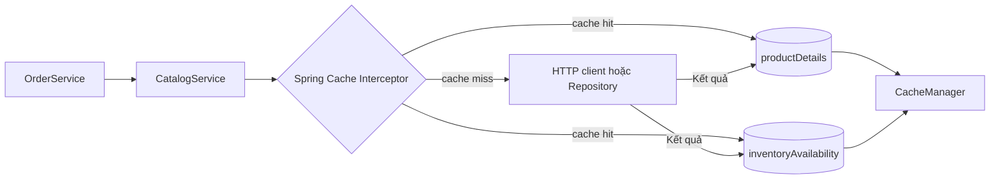
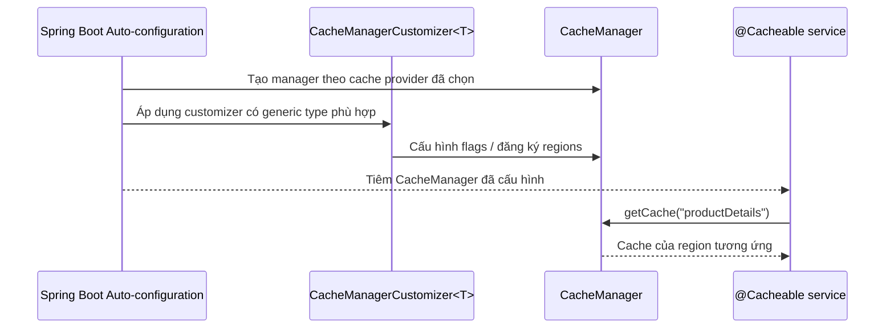

# CacheManagerCustomizer và cấu hình từng vùng cache

## 1. Vì sao phải cấu hình theo từng vùng cache?

Trong Spring Boot Integration, một yêu cầu HTTP có thể đọc dữ liệu từ database, Redis, dịch vụ tồn kho hoặc bảng giá bên ngoài. Nếu dữ liệu được truy vấn lặp lại mà ít thay đổi, cache giúp giảm độ trễ và lượng request tới downstream. Tuy nhiên, không phải dữ liệu nào cũng nên được giữ trong cache trong cùng một khoảng thời gian.

Ví dụ một hệ thống bán hàng cần cache:

- `productDetails`: tên và mô tả sản phẩm; ít đổi, có thể giữ 30 phút.
- `inventoryAvailability`: số lượng còn lại; đổi liên tục, nên giữ rất ngắn hoặc không cache nếu quyết định bán hàng đòi hỏi dữ liệu tức thời.
- `exchangeRates`: tỷ giá được cập nhật theo lịch; cần chính sách TTL và làm mới riêng.
- `customerPermissions`: quyền truy cập; dữ liệu nhạy cảm, thay đổi quyền phải có cơ chế vô hiệu hóa mạnh, không phụ thuộc duy nhất vào TTL dài.

Một **vùng cache** (*cache region*, *cache name*) là không gian tên logic mà các thao tác Spring Cache tham chiếu qua `cacheNames` / `value`. Mỗi vùng có thể có chính sách riêng về tuổi dữ liệu, dung lượng, khóa và xử lý giá trị rỗng. `CacheManager` giữ và cung cấp các đối tượng `Cache` theo tên vùng.



**Lợi ích chính của cấu hình từng vùng:** vùng chứa metadata chậm thay đổi có thể tối ưu tỷ lệ cache hit; vùng chứa trạng thái biến động cần TTL thấp hơn và nhiều biện pháp tránh dữ liệu cũ. Một thông số chung cho toàn bộ `CacheManager` thường không đủ.

### Những thứ cần phân biệt

| Khái niệm | Ý nghĩa | Ví dụ |
| --- | --- | --- |
| **Cache name/region** | Tên logic mà service chỉ ra khi gọi cache | `productDetails` |
| **Cache key** | Danh tính một mục *bên trong* region | `tenant-1:SKU-100` |
| **Cache value** | Đối tượng được lưu | `ProductDto` |
| **TTL** (*time to live*) | Khoảng thời gian một entry còn hợp lệ theo chính sách | 30 phút |
| **Max size/weight** | Giới hạn dung lượng trong cache hỗ trợ eviction theo kích thước | Caffeine tối đa 20.000 entry |
| **Cache eviction/invalidation** | Chủ động loại bỏ mục khi hết hiệu lực hoặc sau thay đổi nghiệp vụ | Xóa `productDetails[tenant-1:SKU-100]` |
| **Cache backend** | Nơi lưu dữ liệu thật | RAM trong tiến trình, Redis, JCache provider |

Một region có thể có cùng tên trên nhiều instance ứng dụng, nhưng với cache **local** thì mỗi instance vẫn có dữ liệu và thời điểm hết hạn độc lập. Ngược lại, Redis được chia sẻ giữa các instance nếu chúng cùng kết nối đến cùng hệ thống Redis và cùng quy ước key/prefix.

## 2. Spring Boot tạo và tùy chỉnh CacheManager như thế nào?

Khi dùng cache annotations như `@Cacheable`, ứng dụng cần bật cơ chế cache của Spring, thường bằng `@EnableCaching`, cùng dependency tương ứng. Spring Boot có auto-configuration để tạo một `CacheManager` phù hợp với các thư viện, bean và cấu hình hiện diện trong ứng dụng.

`CacheManagerCustomizer<T extends CacheManager>` là một điểm mở rộng của **Spring Boot**. Nó nhận một đối tượng `CacheManager` được auto-configuration tạo ra, cho phép chỉnh một số thuộc tính hoặc đăng ký cache tùy biến trước khi ứng dụng sử dụng.



Các điểm quan trọng:

1. **Customizer phụ thuộc loại manager.** `CacheManagerCustomizer<CaffeineCacheManager>` chỉ hữu ích khi manager đang được cấu hình là `CaffeineCacheManager`. Nếu Spring Boot chọn Redis, customizer dành cho Caffeine sẽ không tùy chỉnh Redis.
2. **Customizer chỉ tự động được áp dụng trong quá trình auto-configuration phù hợp.** Nếu ứng dụng tự khai báo bean `CacheManager`, Spring Boot thường không tự gọi các `CacheManagerCustomizer` lên bean đó. Khi tự tạo manager, hãy cấu hình trực tiếp trên bean hoặc áp dụng customizer một cách tường minh.
3. **Một manager không đồng nghĩa một TTL.** Nhiều provider có cấu hình mặc định áp dụng chung; muốn TTL riêng từng region phải dùng API hỗ trợ của provider hoặc builder tương ứng.
4. **Thứ tự tùy chỉnh có thể quan trọng.** Nếu nhiều customizer cùng sửa danh sách cache, null policy hoặc default settings, kết quả phụ thuộc thứ tự thực thi. Có thể quản lý thứ tự bằng `@Order` / `Ordered`; tốt nhất để một nơi sở hữu chính sách mỗi region.
5. **Một ứng dụng có thể có nhiều `CacheManager`.** Khi đó cần xác định manager được `@Cacheable` chọn bằng cấu hình caching resolver/manager hoặc `cacheManager` attribute trên annotation, thay vì giả định mọi vùng dùng một backend.

### Bật caching và dependency

Ví dụ Spring Boot 3.x, Spring Framework 6.x, Java 17+:

```xml
<dependencies>
    <dependency>
        <groupId>org.springframework.boot</groupId>
        <artifactId>spring-boot-starter-cache</artifactId>
    </dependency>
</dependencies>
```

```java
import org.springframework.cache.annotation.EnableCaching;
import org.springframework.context.annotation.Configuration;

@Configuration(proxyBeanMethods = false)
@EnableCaching
public class CachingConfiguration {
}
```

`@EnableCaching` kích hoạt Spring cache interception dựa trên proxy mặc định. Không có cơ chế này, `@Cacheable` có thể chỉ là annotation trên phương thức mà không làm phát sinh các thao tác cache được mong đợi.

Spring Boot thường quyết định provider dựa trên cấu hình và các thư viện khả dụng. Trong dự án nhiều dependency (ví dụ vừa Caffeine vừa Redis), nên chọn rõ:

```yaml
spring:
  cache:
    type: caffeine
```

Đoạn YAML trên chỉ là một lựa chọn cho môi trường **Caffeine**. Phần Redis bên dưới là một **phương án khác**, không ghép hai giá trị `spring.cache.type` vào một profile.

## 3. CacheManagerCustomizer cho cache đơn giản

`ConcurrentMapCacheManager` là manager đơn giản của Spring Framework, thường phù hợp cho ví dụ, thử nghiệm hoặc dữ liệu có rủi ro thấp. Nó lưu dữ liệu trong `ConcurrentMap` bên trong tiến trình.

Ví dụ ứng dụng sử dụng loại simple:

```yaml
spring:
  cache:
    type: simple
    cache-names:
      - productDetails
      - inventoryAvailability
```

`spring.cache.cache-names` khai báo những tên cache dự kiến. Với `ConcurrentMapCacheManager`, việc đặt các tên cố định đưa manager vào chế độ tạo cache theo danh sách đã khai báo; nếu yêu cầu một tên cache không tồn tại, `getCache(name)` có thể trả `null` thay vì tự tạo vô hạn.

Tạo customizer:

```java
import org.springframework.boot.autoconfigure.cache.CacheManagerCustomizer;
import org.springframework.cache.concurrent.ConcurrentMapCacheManager;
import org.springframework.context.annotation.Bean;
import org.springframework.context.annotation.Configuration;

@Configuration(proxyBeanMethods = false)
class SimpleCacheCustomization {

    @Bean
    CacheManagerCustomizer<ConcurrentMapCacheManager> simpleCacheCustomizer() {
        return manager -> manager.setAllowNullValues(false);
    }
}
```

Tại đây `setAllowNullValues(false)` không cho phép các giá trị `null` được lưu vào cache. Khi một phương thức thực sự trả `null`, cần chính sách rõ ràng ở annotation hoặc service, chẳng hạn `unless = "#result == null"`, và phải hiểu thứ tự đánh giá của cache interception.

**Giới hạn căn bản:** `ConcurrentMapCacheManager` không cung cấp TTL, giới hạn `maximumSize` hay eviction theo thời gian như Caffeine. Tên vùng được khai báo riêng **không có nghĩa** mỗi vùng đã có TTL khác nhau. Ngoài ra, dữ liệu chỉ tồn tại trong JVM hiện tại và thường tăng theo số key cho tới khi được xóa hoặc tiến trình kết thúc. Vì thế không nên dùng manager đơn giản như một cache production không giới hạn cho tập dữ liệu có cardinality lớn.

## 4. Caffeine: TTL và dung lượng riêng cho từng vùng cache

Caffeine là cache **trong bộ nhớ của từng instance**, hỗ trợ TTL, giới hạn số phần tử, eviction theo access/write, thống kê và nhiều chiến lược nâng cao. Spring sử dụng `CaffeineCacheManager` làm adapter giữa abstraction `CacheManager` và native Caffeine caches.

Thêm dependency `caffeine` bên cạnh `spring-boot-starter-cache`:

```xml
<dependency>
    <groupId>com.github.ben-manes.caffeine</groupId>
    <artifactId>caffeine</artifactId>
</dependency>
```

Chọn Caffeine trong cấu hình:

```yaml
spring:
  cache:
    type: caffeine
    cache-names:
      - productDetails
      - inventoryAvailability
```

Nếu chỉ cần chính sách **giống nhau cho mọi vùng**, Boot hỗ trợ cấu hình Caffeine spec chung:

```yaml
spring:
  cache:
    type: caffeine
    caffeine:
      spec: maximumSize=10000,expireAfterWrite=300s
```

Tuy nhiên `spring.cache.caffeine.spec` không phải cú pháp để gán TTL **khác nhau theo từng tên vùng**. Khi cần tùy biến mỗi region, có thể đăng ký native cache với thông số riêng bằng `CacheManagerCustomizer<CaffeineCacheManager>`.

### 4.1. Đăng ký hai vùng với chính sách khác nhau

```java
import java.time.Duration;

import com.github.benmanes.caffeine.cache.Caffeine;
import org.springframework.boot.autoconfigure.cache.CacheManagerCustomizer;
import org.springframework.cache.caffeine.CaffeineCacheManager;
import org.springframework.context.annotation.Bean;
import org.springframework.context.annotation.Configuration;

@Configuration(proxyBeanMethods = false)
public class CaffeineRegionConfiguration {

    @Bean
    CacheManagerCustomizer<CaffeineCacheManager> caffeineRegions() {
        return manager -> {
            manager.setAllowNullValues(false);

            manager.registerCustomCache(
                    "productDetails",
                    Caffeine.newBuilder()
                            .expireAfterWrite(Duration.ofMinutes(30))
                            .maximumSize(20_000)
                            .recordStats()
                            .build());

            manager.registerCustomCache(
                    "inventoryAvailability",
                    Caffeine.newBuilder()
                            .expireAfterWrite(Duration.ofSeconds(10))
                            .maximumSize(5_000)
                            .recordStats()
                            .build());
        };
    }
}
```

`registerCustomCache(...)` đăng ký một native Caffeine cache dành riêng cho region. Mỗi native cache có lịch eviction, dung lượng và thống kê riêng. Các giá trị số trong ví dụ chỉ để minh họa: TTL và size thực tế phải dựa vào mức độ thay đổi dữ liệu, nhu cầu nhất quán, lượng key và bộ nhớ đang có.

| Region | TTL minh họa | Maximum size | Tại sao |
| --- | --- | --- | --- |
| `productDetails` | 30 phút từ lần ghi | 20.000 entry/instance | Thông tin sản phẩm ít đổi, ưu tiên hiệu năng |
| `inventoryAvailability` | 10 giây từ lần ghi | 5.000 entry/instance | Tồn kho đổi nhanh, giảm khoảng thời gian có thể hiển thị thông tin cũ |

**Về tính nhất quán:** việc hiển thị tồn kho từ cache có thể chấp nhận độ trễ vài giây, nhưng quyết định cuối cùng để giữ hàng/trừ kho phải kiểm tra hoặc thao tác có bảo vệ đồng thời trên nguồn dữ liệu có thẩm quyền. Không dùng một entry cache đã có thể cũ làm cơ chế duy nhất bảo đảm còn hàng.

**Phân biệt expire-after-write với expire-after-access:** `expireAfterWrite` tính tuổi từ lần tạo/ghi giá trị; lượt đọc cache hit không kéo dài tuổi mục. `expireAfterAccess` gia hạn thời gian dựa vào truy cập; hữu ích cho một số loại metadata, nhưng có thể giữ dữ liệu cũ lâu hơn kỳ vọng nếu có nhiều lượt đọc liên tục. Hãy chọn theo yêu cầu freshness của nghiệp vụ.

**Chi phí cache local:** trong môi trường có ba instance Spring Boot, mỗi instance có một `productDetails` riêng; tối đa 20.000 entry là **mỗi instance**, không phải cả cụm. TTL trên mỗi instance cũng bắt đầu từ thời điểm entry của chính instance đó được ghi.

### 4.2. Kết nối region với nghiệp vụ

Ví dụ service có hai điểm đọc khác nhau. Các gateway phía dưới được coi là các adapter đã có, dùng HTTP client hoặc repository để lấy dữ liệu thật:

```java
import org.springframework.cache.annotation.Cacheable;
import org.springframework.stereotype.Service;

@Service
public class ProductReadService {

    private final ProductApiGateway productApi;
    private final InventoryApiGateway inventoryApi;

    public ProductReadService(ProductApiGateway productApi,
                              InventoryApiGateway inventoryApi) {
        this.productApi = productApi;
        this.inventoryApi = inventoryApi;
    }

    @Cacheable(
            cacheNames = "productDetails",
            key = "#p0 + ':' + #p1",
            unless = "#result == null")
    public ProductDetails getDetails(String tenantId, String sku) {
        return productApi.fetchProduct(tenantId, sku);
    }

    @Cacheable(
            cacheNames = "inventoryAvailability",
            key = "#p0 + ':' + #p1",
            unless = "#result == null")
    public InventoryAvailability getAvailability(String tenantId, String sku) {
        return inventoryApi.fetchAvailability(tenantId, sku);
    }
}
```

Ở đây `ProductDetails`, `InventoryAvailability`, `ProductApiGateway` và `InventoryApiGateway` là các kiểu nghiệp vụ của dự án, không phải lớp có sẵn của Spring. Biểu thức `#p0`, `#p1` tham chiếu tham số theo vị trí, tránh phụ thuộc vào khả năng Spring đọc tên tham số Java tại runtime.

Quy ước khóa `tenantId:sku` có ý nghĩa quan trọng: cùng `SKU-100` ở hai tenant có thể có giá, quyền truy cập hoặc tồn kho khác nhau. Cache key phải chứa **mọi yếu tố ảnh hưởng kết quả** như tenant, locale, currency, phân khúc khách hàng hoặc version dữ liệu khi thích hợp.

### 4.3. Những yếu tố cần kiểm soát khi dùng Caffeine

- `maximumSize` giới hạn số entry ước lượng bằng thuật toán eviction, không phải giới hạn bytes chính xác. Một entry chứa đồ thị đối tượng lớn có thể chiếm rất nhiều RAM.
- `recordStats()` bật thống kê native cache như hit, miss và eviction để phục vụ quan sát, có chi phí nhất định.
- Khi method ném exception, `@Cacheable` thông thường không lưu exception như kết quả thành công; các thất bại ở downstream cần cơ chế retry/circuit breaker riêng.
- Thư viện Caffeine hỗ trợ cache loader và async cache, nhưng `@Cacheable` đồng bộ không tự biến HTTP call thành non-blocking.
- Với lượng request lớn cùng truy cập một key vừa hết hạn, có thể xảy ra **cache stampede**; dùng cơ chế đồng bộ load theo key, giới hạn đồng thời hoặc chiến lược refresh khi thật sự cần. `@Cacheable(sync = true)` có hạn chế về cache, điều kiện/`unless` và mức độ hỗ trợ của provider; đừng kết hợp tùy tiện với ví dụ đang dùng `unless`.

## 5. Redis: cấu hình riêng từng vùng khi cache dùng chung nhiều instance

Redis thường phù hợp khi nhiều instance Spring Boot cần truy cập một cache chung, có nhu cầu chia sẻ kết quả đã tra cứu hoặc muốn duy trì cache qua việc restart một instance. Đổi lại, các thao tác cache có độ trễ mạng, yêu cầu quản lý kết nối, serializer, memory policy và khả năng xử lý khi Redis unavailable.

Trong môi trường Spring Boot dùng Redis, `RedisCacheManager` là một lựa chọn phổ biến. Cấu hình YAML minh họa:

```yaml
spring:
  cache:
    type: redis
    redis:
      time-to-live: 10m
      cache-null-values: false
      use-key-prefix: true
  data:
    redis:
      host: redis.internal.example
      port: 6379
```

Đây là **phương án Redis thay thế Caffeine**. Giá trị `time-to-live: 10m` là TTL mặc định mà auto-configuration có thể áp dụng cho các vùng không được cấu hình riêng; nó không diễn tả TTL theo từng region. Địa chỉ, thông tin xác thực, TLS và topology Redis cần lấy từ cấu hình theo môi trường, không hard-code secret.

Dependency thường gồm `spring-boot-starter-cache` và `spring-boot-starter-data-redis`:

```xml
<dependency>
    <groupId>org.springframework.boot</groupId>
    <artifactId>spring-boot-starter-data-redis</artifactId>
</dependency>
```

### 5.1. Dùng RedisCacheManagerBuilderCustomizer

Trong Spring Boot, cách trực tiếp để tạo region Redis với TTL riêng là tùy chỉnh **builder của RedisCacheManager** trước khi manager được xây dựng. Spring Boot cung cấp `RedisCacheManagerBuilderCustomizer` cho mục đích này.

```java
import java.time.Duration;

import org.springframework.boot.autoconfigure.cache.RedisCacheManagerBuilderCustomizer;
import org.springframework.context.annotation.Bean;
import org.springframework.context.annotation.Configuration;
import org.springframework.data.redis.cache.RedisCacheConfiguration;

@Configuration(proxyBeanMethods = false)
public class RedisRegionConfiguration {

    @Bean
    RedisCacheManagerBuilderCustomizer redisCacheRegions() {
        RedisCacheConfiguration common =
                RedisCacheConfiguration.defaultCacheConfig()
                        .disableCachingNullValues();

        return builder -> builder
                .withCacheConfiguration(
                        "productDetails",
                        common.entryTtl(Duration.ofMinutes(30)))
                .withCacheConfiguration(
                        "inventoryAvailability",
                        common.entryTtl(Duration.ofSeconds(10)));
    }
}
```

Ở đây mỗi vùng được cấu hình bằng một `RedisCacheConfiguration` khác nhau, được sao chép từ `common`. Không có giới hạn `maximumSize` từng vùng giống Caffeine trong đoạn code này: Redis quản lý bộ nhớ theo cấu hình máy chủ, chính sách eviction và giới hạn tài nguyên tương ứng.

**Vì sao dùng builder customizer?** `CacheManagerCustomizer<RedisCacheManager>` nhận manager sau khi đã được xây dựng; nhiều thuộc tính cấu hình Redis cache như TTL mặc định hoặc bảng `initialCacheConfigurations` được đưa vào từ **giai đoạn builder**. Vì vậy `RedisCacheManagerBuilderCustomizer` là điểm phù hợp để khai báo cấu hình theo vùng trong quy trình auto-configuration của Spring Boot.

**Cảnh báo về cấu hình chung:** khi tạo `RedisCacheConfiguration.defaultCacheConfig()` mới, bạn đang dùng các **default của Spring Data Redis** cho serializer, key prefix và những thiết lập khác, thay vì tự động thừa hưởng mọi giá trị trong `spring.cache.redis.*`. Trong ví dụ, chính sách `disableCachingNullValues()` được khai báo lại rõ ràng. Nếu production có serializer JSON tùy biến, TTL mặc định, transaction awareness hoặc quy tắc prefix riêng, hãy đưa chúng vào `common` một cách nhất quán và kiểm thử qua Redis thật. Không giả định cấu hình region tự kế thừa hoàn toàn cấu hình Boot của manager.

### 5.2. Redis TTL không đồng nghĩa nhất quán tức thời

Giả sử `inventoryAvailability` có TTL 10 giây. Khi một lần bán hàng làm thay đổi tồn kho ở database, cache có thể tiếp tục phục vụ giá trị cũ cho tới khi entry hết hạn hoặc bị xóa chủ động.

- TTL giảm **khoảng thời gian tối đa kỳ vọng** một giá trị cũ còn được giữ theo cơ chế expire-after-write, nhưng không bảo đảm không có khoảng trễ hay race condition khi đọc đồng thời với cập nhật.
- Redis không có giao dịch ACID **chung** với PostgreSQL chỉ vì ứng dụng sử dụng `@Transactional`.
- Cache miss có thể tạo nhiều request đồng thời tới nguồn dữ liệu, cần giới hạn tải và chính sách chống stampede.
- Redis server có thể loại bỏ key **trước TTL** khi đạt chính sách bộ nhớ/eviction. Không dùng cache như nguồn lưu dữ liệu nghiệp vụ duy nhất.

### 5.3. Prefix, serializer và tên vùng

Trong cache chia sẻ, tên region thường tham gia tạo prefix cho key. Ví dụ một key có thể mang dạng logic:

```text
productDetails::tenant-1:SKU-100
inventoryAvailability::tenant-1:SKU-100
```

Đây chỉ là **ví dụ định dạng**, key thật có thể khác tùy serializer và `CacheKeyPrefix`. Prefix giúp tránh va chạm giữa region. Nếu Redis phục vụ nhiều ứng dụng hoặc môi trường, cân nhắc prefix bổ sung theo ứng dụng/môi trường và giữ quy ước ổn định để không đọc lẫn dữ liệu.

Với value serializer, cần cân nhắc:
- Tính tương thích qua các lần deploy khi DTO/record thay đổi.
- An toàn khi deserialize dữ liệu không tin cậy; hạn chế cơ chế polymorphic type tùy tiện.
- Chi phí dung lượng, latency và khả năng quan sát/đối soát.
- Khả năng parse các giá trị cũ trong Redis khi nâng phiên bản ứng dụng.

Đừng thay serializer của một cache dùng chung mà không có kế hoạch migration/namespace version hoặc xóa cache phù hợp. Một lỗi deserialize có thể khiến mọi cache hit của vùng đó bị hỏng cho tới khi key được xóa.

## 6. Cache annotations dùng vùng cache như thế nào?

Spring Cache abstraction làm việc ở mức method invocation, không yêu cầu service biết chi tiết Caffeine hay Redis. Những annotation thường gặp:

| Annotation | Tác dụng chính | Lưu ý |
| --- | --- | --- |
| `@Cacheable` | Kiểm tra cache trước; khi miss mới chạy method và có thể lưu kết quả | Chọn khóa đúng; dùng `condition` / `unless` nếu cần |
| `@CachePut` | Luôn chạy method và cập nhật cache bằng kết quả khi thành công | Hữu ích khi chủ động refresh entry sau thay đổi |
| `@CacheEvict` | Xóa một key hoặc nhiều entry theo policy | Cân nhắc thời điểm commit DB và ảnh hưởng các instance |
| `@Caching` | Gom nhiều thao tác cache annotation | Dùng vừa đủ để giữ logic dễ đọc |
| `@CacheConfig` | Khai báo thông số chung như `cacheNames` ở mức lớp | Không tự định nghĩa TTL/backend cho region |

Ví dụ cập nhật sản phẩm và xóa entry đã cache:

```java
import org.springframework.cache.annotation.CacheEvict;
import org.springframework.stereotype.Service;

@Service
public class ProductCacheInvalidator {

    @CacheEvict(
            cacheNames = "productDetails",
            key = "#p0 + ':' + #p1")
    public void evictProduct(String tenantId, String sku) {
        // Phương thức được gọi qua Spring bean/proxy sau khi dữ liệu
        // thực tế đã được cập nhật thành công.
    }
}
```

Nếu có transaction DB, **thời điểm xóa cache rất quan trọng**. Gọi `@CacheEvict` trước khi transaction commit có thể làm request khác miss và đọc lại dữ liệu DB cũ, rồi ghi dữ liệu cũ vào cache. Nếu transaction rollback, việc cache đã bị xóa cũng không đồng nghĩa dữ liệu DB thay đổi.

Có thể phát **domain event** sau thay đổi và xử lý tại `@TransactionalEventListener(phase = TransactionPhase.AFTER_COMMIT)` để vô hiệu hóa cache sau commit (trong trường hợp transaction thực sự được quản lý đúng). Cơ chế event in-memory sau commit có thể mất khi process crash đúng thời điểm; với yêu cầu bảo đảm cao, ghi **outbox trong transaction DB**, rồi worker phát sự kiện/invalidation bền vững.

Đối với cache local nhiều instance, một instance xóa `productDetails` **không tự xóa** bản sao cache của các instance khác. Cần event fan-out, pub/sub hoặc dùng Redis chung. Nếu cập nhật nhiều nơi, phải xác định mục tiêu nhất quán trước khi chọn mô hình cache.

## 7. Chọn TTL, key và chính sách từng vùng

Một mẫu cấu hình tham khảo cho hệ thống tích hợp:

| Region | Nguồn dữ liệu | TTL định hướng | Invalidation | Lưu ý |
| --- | --- | --- | --- | --- |
| `productDetails` | DB/catalog HTTP API | Vài phút đến hàng chục phút | Sau thay đổi sản phẩm | Key phải bao gồm tenant/locale nếu cần |
| `inventoryAvailability` | Inventory API | Vài giây, hoặc tắt cache | Sau xác nhận thay đổi tồn kho | Không dùng dữ liệu cũ để cấp quyền bán hàng |
| `shippingQuotes` | Shipping HTTP API | Ngắn, theo cam kết của hãng | Khi địa chỉ/trọng lượng/dịch vụ thay đổi | Key bao gồm đầy đủ đầu vào tính phí |
| `exchangeRates` | API tỷ giá | Theo chu kỳ công bố dữ liệu | Khi có phiên bản tỷ giá mới | Lưu timestamp/version nguồn |
| `customerPermissions` | Identity/authorization service | Cực ngắn hoặc không cache | Ngay khi thay đổi quyền | Rủi ro bảo mật, cần invalidate đáng tin cậy |

Bảng trên mang tính định hướng, **không phải** TTL tiêu chuẩn. Tốc độ thay đổi dữ liệu, tác động của dữ liệu cũ, độ tin cậy của downstream và yêu cầu SLO quyết định thời gian sống hợp lý.

### Thiết kế khóa tránh lẫn ngữ cảnh

Một cache method `getProduct(String sku)` có thể dùng khóa chỉ là `sku`. Nhưng nếu giá và nội dung khác theo tenant/currency/locale, khóa `sku` là sai:

```text
Sai:
  productDetails["SKU-100"]

Đúng trong hệ thống đa tenant:
  productDetails["tenant-1:vi-VN:VND:SKU-100"]
```

Nếu khóa gồm nhiều trường, có thể dùng `KeyGenerator` được kiểm soát thay vì nối chuỗi thủ công. Tránh key chứa dữ liệu cá nhân hoặc token; key trong Redis cũng có thể xuất hiện trong vận hành/monitoring. Nếu identifier có dấu phân cách, hãy dùng mã hóa ổn định để tránh hai bộ tham số khác nhau tạo cùng một key.

### Null caching và negative caching

Với `setAllowNullValues(false)` hoặc `disableCachingNullValues()`, giá trị `null` không được cache. `@Cacheable(unless="#result == null")` có thể bỏ qua lưu null ở tầng annotation và giúp tránh lỗi của provider khi method trả null.

Tuy vậy, cố tình không cache kết quả “không tồn tại” có thể khiến downstream bị gọi liên tục nếu nhiều request cùng tìm một key sai. Một số hệ thống dùng **negative caching**: lưu kết quả “không tồn tại” trong TTL rất ngắn qua một DTO/`Optional` đã quy ước, với chính sách bảo vệ cache penetration. Cần tách bạch với lỗi mạng: không cache `500`/timeout như “sản phẩm không tồn tại” và không giữ kết quả phủ định quá lâu nếu đối tượng có thể được tạo ngay sau đó.

### Throttling và cache stampede

Khi một key nóng hết TTL, hàng trăm request có thể cùng miss và gọi một HTTP endpoint. Cách giảm tải gồm:

- Giới hạn đồng thời outbound HTTP (bulkhead) và timeout rõ ràng.
- Dùng cơ chế *single-flight* / synchronized cache loading theo key khi provider hỗ trợ; hiểu rõ phạm vi mỗi JVM và hạn chế của `@Cacheable(sync = true)`.
- Phân tán thời điểm hết TTL bằng TTL jitter nếu framework/provider cho phép ở lớp cấu hình phù hợp.
- Làm mới có kiểm soát trước khi hết hạn (*refresh ahead*) nếu dữ liệu có thể chấp nhận stale trong khoảng nhỏ.
- Dùng retry/backoff có giới hạn; không để lỗi cache kéo theo bão retry xuống hệ thống nguồn.

## 8. Trình tự xử lý khi cập nhật DB và cache

Cache thường là dữ liệu **phái sinh** từ database hoặc API ngoài. Vì vậy phải định nghĩa rõ nguồn sự thật và thời điểm cập nhật.

```mermaid
sequenceDiagram
    participant U as User/API
    participant S as Application Service
    participant DB as Database
    participant O as Outbox/After-commit event
    participant C as CacheManager
    U->>S: Cập nhật sản phẩm
    S->>DB: BEGIN; UPDATE product
    DB-->>S: COMMIT
    S->>O: Thông báo productChanged
    O->>C: Evict productDetails[tenant:sku]
    C-->>O: Hoàn tất eviction
    S-->>U: Kết quả nghiệp vụ
    Note over DB,C: Hệ thống cần xét race và việc mất event sau commit
```

Nếu dùng `@CachePut` để cập nhật cache ngay với dữ liệu mới, cần chắc chắn dữ liệu đã commit và bản ghi không bị một request đồng thời khác ghi đè bằng dữ liệu cũ. Với các thao tác quan trọng, một cơ chế version hoặc khả năng đối soát và xóa lại cache là cần thiết.

**Một race điển hình:**

1. Request A miss cache và bắt đầu đọc database giá trị cũ.
2. Request B cập nhật database, commit và xóa cache.
3. Request A đọc xong và điền **giá trị cũ** trở lại cache sau lần xóa.

Do đó “evict sau commit” là một bước quan trọng nhưng chưa đủ để bảo đảm **linearizable consistency** trong mọi trường hợp. Tùy yêu cầu có thể dùng cache key mang version, chiến lược update theo version, TTL ngắn, đồng bộ theo key hoặc thay đổi luồng đọc/ghi. Với các quyết định tài chính, tồn kho hay phân quyền quan trọng, xác minh ở hệ thống có thẩm quyền thay vì tin cache tuyệt đối.

## 9. Kiểm thử đúng chính sách theo từng vùng

Một bài kiểm thử chỉ thấy `@Cacheable` trả cùng dữ liệu hai lần chưa chứng minh TTL từng vùng, size hay invalidation đúng. Nên phân tầng kiểm thử:

| Mục tiêu | Kiểm tra hữu ích | Công cụ thường dùng |
| --- | --- | --- |
| `CacheManager` đúng loại | Context tạo `CaffeineCacheManager` hoặc `RedisCacheManager` theo profile | Spring Boot test context |
| Customizer có được áp dụng | Tên vùng tồn tại, null policy và native config hợp lệ | `@SpringBootTest` / context test nhỏ |
| Cache hit/miss | Gọi service hai lần với cùng key, đảm bảo HTTP/DB gateway chỉ gọi khi miss | Mockito spy/fake gateway hoặc HTTP mock |
| Cách ly tenant/locale | Cùng SKU nhưng khác tenant/locale không đọc chung entry | Service integration test |
| TTL của Caffeine | Dùng ticker có thể điều khiển trong test để chuyển thời gian; kiểm tra entry hết hạn đúng vùng | Caffeine `Ticker`, không phụ thuộc `Thread.sleep` |
| TTL Redis theo vùng | Xác minh TTL thật và biến mất sau thời gian thích hợp | Redis test container và Redis key TTL |
| Invalidation sau commit | Cập nhật DB thành công → cache bị xóa; rollback → không xóa sai | Test tích hợp DB và event/outbox |
| Nhiều instance | Thay đổi cache ở một instance có được đồng bộ sang instance khác? | Integration test nhiều process/Redis |
| Downstream lỗi | Cache miss khi API timeout phải có behavior có kiểm soát | WireMock / MockRestServiceServer |
| Quan sát | Hit/miss/eviction và latency cache có hiện diện theo region? | Micrometer/Actuator + provider metrics |

### Ví dụ kiểm tra CacheManager đã được tạo

```java
import static org.assertj.core.api.Assertions.assertThat;

import org.junit.jupiter.api.Test;
import org.springframework.beans.factory.annotation.Autowired;
import org.springframework.boot.test.context.SpringBootTest;
import org.springframework.cache.CacheManager;
import org.springframework.cache.caffeine.CaffeineCacheManager;

@SpringBootTest
class CacheRegionConfigurationTest {

    @Autowired
    CacheManager cacheManager;

    @Test
    void shouldContainRegionsWithCaffeineManager() {
        assertThat(cacheManager)
                .isInstanceOf(CaffeineCacheManager.class);

        assertThat(cacheManager.getCache("productDetails"))
                .isNotNull();

        assertThat(cacheManager.getCache("inventoryAvailability"))
                .isNotNull();
    }
}
```

Test này áp dụng khi môi trường test thực sự chọn Caffeine (`spring.cache.type=caffeine`) và chỉ có một manager mặc định. Nó xác minh bean và tên vùng, **chưa kiểm chứng TTL**. Nếu hệ thống cho phép tạo region động, `getCache(name)` có thể tự tạo một vùng trước đó không có: để kiểm tra đăng ký đúng, hãy xem `getCacheNames()` trước khi gọi `getCache(...)` và kiểm tra native cache config bằng cách thích hợp.

Để kiểm thử TTL một cách có ý nghĩa, có thể inject Caffeine `Ticker` trong cấu hình thử nghiệm, thay đổi thời gian ảo, đọc hai vùng và xác minh sau 15 giây chỉ `inventoryAvailability` hết hạn còn `productDetails` vẫn có giá trị. Không dùng test sleep 10–30 phút; test đó chậm và dễ flaky. Với Redis, dùng container Redis có version đúng với production để xác minh serialized keys, TTL và eviction cùng cấu hình region.

### Test invalidation gắn với nghiệp vụ

Ví dụ quy trình:

1. Nạp `productDetails(tenant-1, SKU-100)` lần đầu, đếm một lần gọi repository/HTTP gateway.
2. Nạp lại cùng key, phải hit và không tăng số lần gọi.
3. Nạp cùng SKU cho `tenant-2`, phải miss riêng; không lẫn dữ liệu.
4. Cập nhật sản phẩm rồi commit DB; phát eviction theo key tương ứng.
5. Nạp lại `tenant-1`, phải nhận thông tin mới; `tenant-2` không bị ảnh hưởng nếu dữ liệu độc lập.
6. Giả lập transaction rollback hoặc worker crash quanh event; xác minh cơ chế phục hồi/đối soát nếu thiết kế đòi hỏi độ tin cậy cao.

Trong test liên quan Spring proxy, không gọi phương thức `@Cacheable` bằng `this.getDetails(...)` bên trong cùng bean rồi mong interception xảy ra. Với proxy mode mặc định, **self-invocation** thường bỏ qua caching advice. Test nên gọi qua Spring-managed bean/proxy.

## 10. Quan sát, tài nguyên và rủi ro khi vận hành

Nên theo dõi các chỉ số theo từng region và đối tác downstream:

| Chỉ số | Điều cần nhận biết |
| --- | --- |
| Hit rate / miss rate | Một region không có hiệu quả cache, hoặc key có cardinality quá cao |
| Eviction count / cause | Caffeine bị giới hạn size, expire hoặc bị eviction chủ động |
| Cache size, Redis memory/keys | Nguy cơ tăng RAM, vượt giới hạn hoặc tranh chấp tài nguyên |
| Backend latency / error rate | Redis chậm/timeout kéo dài đường xử lý HTTP |
| Downstream call rate | Cache miss làm tăng tải API hoặc database |
| Data age / stale read quan sát được | Cache giữ dữ liệu cũ quá nhu cầu nghiệp vụ |
| TTL và số key theo region | Cấu hình sai vùng, key không hết hạn hoặc prefix chồng lấn |

Caffeine `recordStats()` cung cấp số liệu native; Micrometer có thể ghi metrics cho cache được instrument theo khả năng backend và cấu hình Spring Boot. Redis cũng cần quan sát server-side; không suy ra cache hit rate từ một chỉ số duy nhất khi hệ thống có nhiều tầng cache.

Khi cache backend tạm thời không sẵn sàng, Spring mặc định có thể phát sinh lỗi từ thao tác cache. Có thể dùng `CacheErrorHandler` để điều chỉnh cách xử lý một số lỗi cache, nhưng **bỏ qua mọi lỗi** có thể làm phát sinh bão truy vấn DB/API. Phải chọn fail-open hay fail-closed dựa vào tính quan trọng của dữ liệu: catalog có thể fallback lấy dữ liệu nguồn, còn phân quyền hoặc kiểm soát rủi ro không được dùng fallback thiếu an toàn.

Không lưu token, session nhạy cảm, dữ liệu cá nhân hoặc đối tượng JPA đang attached vào cache mà chưa thiết kế rõ serializer, thời gian sống, quyền truy cập và cơ chế vô hiệu hóa. Cache là một hệ thống dữ liệu riêng và phải tuân thủ chính sách bảo mật của ứng dụng.

## 11. Những lỗi cấu hình dễ gặp

| Sai sót | Hậu quả | Cách sửa |
| --- | --- | --- |
| Khai báo `CacheManagerCustomizer<CaffeineCacheManager>` nhưng Boot tạo Redis manager | Customizer không có tác dụng | Chọn `spring.cache.type` rõ ràng; kiểm tra bean thực tế |
| Đã tự khai báo `@Bean CacheManager` nhưng mong Boot tự áp dụng customizer | Region/flags không được cấu hình | Cấu hình trực tiếp manager hoặc gọi customizer tường minh |
| Đặt `spring.cache.caffeine.spec` và tưởng đã khai báo TTL từng vùng | Tất cả vùng mặc định cùng chính sách | Dùng `registerCustomCache` từng vùng hoặc cấu hình manager chuyên biệt |
| Dùng `ConcurrentMapCacheManager` cho dữ liệu lớn cần TTL | Cache phình to, dữ liệu không tự hết hạn | Chọn Caffeine hoặc Redis có TTL/eviction phù hợp |
| Cấu hình Redis region mới bằng `defaultCacheConfig()` nhưng quên serializer/prefix chung | Khác định dạng dữ liệu, va chạm hoặc lỗi deserialize | Đồng bộ cấu hình common; test với Redis thật |
| Khóa chỉ có SKU trong hệ thống nhiều tenant | Rò rỉ/lẫn dữ liệu giữa tenant | Đưa đầy đủ context vào key |
| Evict trước khi DB commit | Request khác có thể nạp lại giá trị cũ | Cân nhắc after-commit và giải quyết race/khôi phục |
| Chỉ evict local cache ở một instance | Các instance khác tiếp tục phục vụ dữ liệu cũ | Phát invalidation tới toàn cụm hoặc dùng cache chia sẻ |
| Chỉ bật TTL mà tin cache luôn chính xác | Dữ liệu cũ vẫn được đọc trong khoảng TTL | Xác định SLA freshness và kiểm tra nguồn sự thật khi cần |
| Không có negative cache/rate limit cho key không tồn tại | Nhiều request miss cùng đánh vào downstream | Cân nhắc negative TTL ngắn và giới hạn tải |
| Dùng `@Cacheable` qua self-invocation | Caching không chạy như dự định | Gọi qua Spring proxy/bean khác hoặc tách lớp |
| Cache metric có hit rate tốt nhưng phục vụ dữ liệu sai | Tối ưu hiệu năng che khuất lỗi nhất quán | Test correctness, invalidation và stale-data scenarios |

## 12. Checklist cấu hình vùng cache trong dự án tích hợp

1. Xác định **nguồn dữ liệu có thẩm quyền** và mức độ chấp nhận dữ liệu cũ của mỗi nhóm dữ liệu.
2. Đặt tên region ổn định, có ý nghĩa; chọn key gồm tenant/locale/currency/version nếu ảnh hưởng kết quả.
3. Chọn **local** (Caffeine) hay **shared** (Redis) theo số instance, đặc tính tải và nhu cầu đồng bộ.
4. Bật `@EnableCaching` và chọn `spring.cache.type` rõ ràng khi classpath có nhiều provider.
5. Dùng `CacheManagerCustomizer<T>` khi Boot auto-configure manager phù hợp; dùng API builder của provider, chẳng hạn `RedisCacheManagerBuilderCustomizer`, khi cấu hình phải được đặt trước bước build.
6. Định nghĩa TTL và giới hạn tài nguyên theo từng vùng; với Caffeine, `registerCustomCache` cho phép chính sách riêng; với Redis, `withCacheConfiguration` cho phép TTL riêng.
7. Quy định null/negative caching, serializer và namespace key; tránh rò rỉ dữ liệu nhạy cảm.
8. Thiết kế invalidation sau thay đổi dữ liệu; kiểm tra ranh giới transaction, multi-instance và tình huống crash.
9. Kiểm thử cache hit/miss, TTL, key isolation và eviction thực sự; không dừng ở test tìm thấy tên vùng.
10. Theo dõi metrics, cache backend errors, downstream load và stale-data để điều chỉnh cấu hình theo thực tế.

**Điều cần nhớ:** `CacheManagerCustomizer` là điểm gắn cấu hình vào **CacheManager được Spring Boot tự tạo**. Khả năng TTL, giới hạn dung lượng, serialization và eviction **theo từng vùng** phụ thuộc provider: `ConcurrentMapCacheManager` đơn giản không có TTL; `CaffeineCacheManager` có thể đăng ký native cache riêng từng vùng; `RedisCacheManager` nên khai báo cấu hình theo vùng thông qua builder. Dù chọn backend nào, một cache nhanh chỉ thật sự hữu ích khi khóa, thời gian sống và cơ chế vô hiệu hóa phù hợp với hợp đồng dữ liệu của luồng tích hợp.

### Tài liệu tham khảo

- [Spring Boot Reference — Caching](https://docs.spring.io/spring-boot/reference/io/caching.html): cấu hình cache provider, cache names và customizer.
- [Spring Boot API — CacheManagerCustomizer](https://docs.spring.io/spring-boot/api/java/org/springframework/boot/autoconfigure/cache/CacheManagerCustomizer.html).
- [Spring Framework Reference — Cache Abstraction](https://docs.spring.io/spring-framework/reference/integration/cache.html).
- [Spring Framework API — CaffeineCacheManager](https://docs.spring.io/spring-framework/docs/current/javadoc-api/org/springframework/cache/caffeine/CaffeineCacheManager.html).
- [Spring Data Redis Reference — Redis Cache](https://docs.spring.io/spring-data/redis/reference/redis/redis-cache.html).
